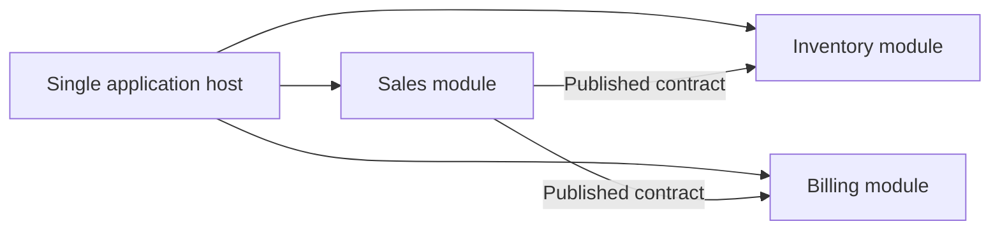

# Modular Monolith

## Overview

A modular monolith is one deployable application organized into explicit modules with enforced
boundaries. Modules collaborate through intentional interfaces while sharing a deployment
lifecycle. It combines deployment simplicity with internal separation; it is not simply a
monolith whose folders happen to have business-oriented names.

## Structure and Boundaries

A module typically owns a cohesive capability, its internal domain model, and the rules for
accessing its data. Other modules use published contracts rather than reaching into its
implementation or writing directly to its tables.

The modules run and deploy together. The diagram shows logical boundaries, not separate
processes; a module call may be an in-process interface, and module-owned data may reside in a
shared database server while retaining separate schemas or access rules.

## How It Works

1. Define modules around cohesive business capabilities and ownership.
2. Keep implementation details private and expose a small, versionable module API.
3. Enforce dependency rules in code and tests; avoid cross-module table access.
4. Coordinate cross-module workflows explicitly, preferably through application-level contracts
   or domain events rather than shared mutable internals.
5. Build and deploy the application as one unit, while measuring module coupling and change
   impact.

## Example

An order application can contain `Ordering`, `Inventory`, and `Payments` modules. `Ordering`
accepts an order request and coordinates the workflow through the `Inventory` and `Payments`
module APIs. Each module controls its own rules and persistence access. If an order must reserve
inventory and authorize payment, the workflow still needs defined failure and compensation
behavior; putting modules in one process does not automatically make their business operations
one transaction.

In .NET, modules can be represented by assemblies or namespaces with explicit public contracts.
Automated architecture tests can prevent one module from referencing another module's internal
types. The deployment remains one application unless a later decision changes that boundary.

## Advantages

- One deployment and usually simpler local development and operations than a distributed
  microservices system.
- Clearer ownership and lower accidental coupling than an unconstrained monolith.
- In-process calls avoid network latency and many distributed failure modes.
- Supports incremental evolution: a module may become a separately deployed service if its
  boundary and business case justify the added operational cost.

## Trade-offs

- Modules share release and runtime lifecycles; independent deployment and scaling are not
  provided.
- A shared process or database can make boundaries easy to bypass without enforcement.
- Large teams may contend on a common release pipeline and codebase.
- Extracting a module later still requires designing network contracts, data ownership, security,
  failure handling, and operations.

## When to Use

- A system needs clear internal ownership but does not yet need independent deployment.
- The team wants to preserve a simple operational model while controlling architectural
  boundaries.
- Requirements or team structure are evolving, and a monolith is currently the lower-risk choice.

## When Not to Use

- Capabilities have demonstrated needs for independent release, scaling, or failure isolation
  that outweigh the cost of distributed operations.
- Organizational or regulatory constraints require separate deployment or runtime boundaries.
- The team cannot enforce module ownership and dependencies, making the structure only
  conventional.

## Common Mistakes

- Treating folders or namespaces as boundaries without controlling references and data access.
- Sharing domain entities or mutable tables across modules.
- Adding a message broker to modules in one process without a requirement for asynchronous
  decoupling or durable delivery.
- Assuming future service extraction will be automatic.
- Choosing microservices solely because a monolith is poorly modularized.

## Related Concepts

- [Architectural Styles](../architectural-styles.md) compares monolithic, modular monolith, and
  distributed approaches.
- [Microservices Architecture](../01-microservices-architecture/microservices-architecture.md)
  introduces independently deployed services and their operational trade-offs.
- [Domain-Driven Design](../03-domain-driven-design-DDD/domain-driven-design-DDD.md) helps
  discover domain boundaries; a bounded context does not have to be a separate service.
- [Layered Architecture](../05-layered-architecture/layered-architecture.md) can be used inside
  modules but does not define module ownership by itself.

## References

- [Use Domain Analysis to Model Microservices — Azure Architecture Center](https://learn.microsoft.com/en-us/azure/architecture/microservices/model/domain-analysis)
- [Tackling Business Complexity in a Microservice with DDD and CQRS Patterns — .NET](https://learn.microsoft.com/en-us/dotnet/architecture/microservices/microservice-ddd-cqrs-patterns/)
