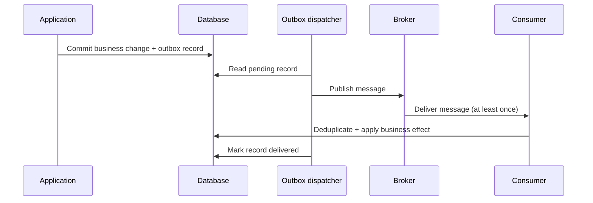

# Distributed Systems Patterns

Distributed systems exchange work across process and network boundaries, where delays, partial
failures, retries, and duplicate delivery are normal operating conditions. These patterns help
bound failures and preserve business invariants; none makes a remote call equivalent to a local
call.

## Start with Failure Boundaries

For each remote dependency, define a caller deadline, the failures that are safe to retry, the
maximum work it may consume, and the behavior when the dependency is unavailable. Propagate
cancellation and correlation identifiers. A retry policy without a deadline can increase load
precisely when a dependency is unhealthy.

Treat every network call as an operation with an uncertain outcome. A connection can fail before
the request arrives, while it is being processed, or after the operation commits but before the
response reaches the caller. The caller often cannot distinguish these cases. Design write APIs
with idempotency or a way to query operation status, and make the user-visible state reflect
whether work is pending, completed, or unknown.

Budget the whole call path, not each hop independently. If a request has a 2-second deadline and
calls three dependencies in sequence, each dependency cannot safely consume 2 seconds. Reserve
time for local work and the response, propagate the remaining deadline, and avoid retries that
can exceed it. Retries at multiple layers multiply attempts, so assign retry ownership to one
layer where possible.

## Consistency and Coordination

Choose a consistency contract from the business invariant, not from a blanket preference for
strong or eventual consistency. A user may tolerate a stale product listing but not an oversold
inventory count. Document which reads may be stale, for how long, and whether users need
read-your-writes behavior after a successful command.

| Guarantee or technique | What it means | Architect's concern |
|---|---|---|
| **Strong consistency** | A successful write is immediately visible to subsequent reads under the system's stated consistency model. | Can the storage and availability trade-offs meet latency and geographic requirements? |
| **Eventual consistency** | Replicas or projections may temporarily disagree but converge if updates stop. | Define acceptable staleness, convergence behavior, and how the product communicates pending updates. |
| **Read-your-writes** | A caller can observe its own successful update on a later read. | Route reads appropriately, return the updated representation, or expose a version/token to enforce this. |
| **Optimistic concurrency** | A write succeeds only if the version read by the caller is still current. | Use entity versions or conditional requests to prevent lost updates; define conflict handling. |

The CAP theorem is about trade-offs during a network partition: a distributed data system cannot
guarantee both linearizable consistency and successful responses from every partitioned side.
It is not a general rule that every system must choose only two of consistency, availability,
and partition tolerance. In practice, partitions and delays must be handled; the design question
is which operations reject, wait, or proceed with potentially divergent state.

Avoid distributed locks as a default coordination tool. Leases can expire while a paused process
still believes it owns the work. If a lease is necessary, use fencing tokens or monotonically
increasing versions so downstream storage can reject stale owners. Prefer ownership, partitioning,
or conditional writes when those can preserve the invariant more simply.

## Overload and Flow Control

Failures are not the only way a dependency becomes unavailable: incoming work can exceed its
capacity. Retries, queues, and timeouts can amplify overload unless the system controls admission
and concurrency.

- **Back-pressure:** slow or pause producers when downstream capacity is constrained. Bound queue
    length and message age; an unbounded queue turns overload into delayed failure and memory or
    storage exhaustion.
- **Load shedding:** reject lower-priority or excess work early when accepting it would endanger
    higher-priority operations. Make rejection explicit and retryable only when the caller can
    safely retry later.
- **Concurrency limits:** cap in-flight work to protect connection pools, threads, and downstream
    services. Tune limits from measured capacity and latency rather than choosing an arbitrary
    large number.
- **Dead-letter handling:** isolate messages that repeatedly fail so healthy work can continue.
    Preserve the failure reason and original metadata, alert on growth, and provide a controlled
    repair or replay process. A dead-letter queue is not a substitute for fixing poison messages.

## Contracts and Message Evolution

Service and event contracts outlive individual deployments. Prefer additive changes, tolerate
unknown optional fields where appropriate, and use an explicit compatibility policy for producers
and consumers. When a breaking change is unavoidable, version the contract or use a staged
expand-and-contract rollout: deploy consumers that accept both forms, switch producers, then
remove the old form after all consumers have migrated.

For events, distinguish a stable business fact from an internal implementation detail. Include a
stable event identifier, event type and schema version, occurrence time, and correlation or
causation identifiers where useful. Do not treat timestamps as a reliable global ordering
mechanism: clocks drift, and event time is not necessarily commit or delivery time. Partitioning
and aggregate versions are better tools when order matters for a specific entity.

## Observability and Operations

Instrument distributed behavior across process boundaries. Use structured logs, metrics, and
traces with a shared trace or correlation context, while avoiding sensitive or high-cardinality
values as metric labels. Propagate context through asynchronous messages as well as HTTP calls.

Track outcomes that reveal user and system impact: end-to-end latency, timeout and retry rates,
circuit-breaker state, queue depth and oldest-message age, dead-letter volume, duplicate
suppression, and outbox publication lag. Alert on symptoms and service-level objectives, not only
on individual component health checks. A service can report healthy while requests are timing out
or queues are growing without bound.

For each dependency and asynchronous workflow, assign an operational owner and document how to
diagnose a backlog, replay or repair failed work, and recover after an outage. Test failure
behavior with dependency timeouts, broker unavailability, duplicate delivery, and restart or
replay scenarios before relying on the design in production.

## Resilience Patterns

| Pattern | Purpose | Important design choices |
|---|---|---|
| **Timeout** | Bounds how long a caller waits for an operation. | Set a deadline from the caller's remaining budget; propagate cancellation. A client timeout does not prove that the remote operation did not complete. |
| **Retry** | Repeats an operation after a transient failure. | Bound attempts and total duration; use backoff with jitter. Do not retry permanent failures or non-idempotent operations unless they have an idempotency mechanism. |
| **Circuit breaker** | Temporarily stops calls likely to fail, then allows a limited recovery probe. | Choose failure signals and thresholds carefully. It complements rather than replaces timeouts, retries, or a fallback. |
| **Bulkhead** | Limits the resources consumed by one dependency, tenant, or workload. | Isolate concurrency or queues where contention would otherwise spread; size limits using capacity and latency data. |
| **Rate limiting** | Controls request volume to protect capacity and allocate it fairly. | Decide whether to reject, queue, or shed work; return a clear retry signal where appropriate. Apply limits at the boundary that owns the policy. |

These controls solve different problems and must be composed with a shared latency and capacity
budget. A fallback is only safe when it preserves the business meaning of the response; returning
empty or stale data as though it were current can conceal a failure.

## Reliable Message Processing

### Idempotency

At-least-once delivery means a handler can receive the same message more than once. Give each
operation a stable idempotency key and make recording that key atomic with the business effect.
The retention period must cover the broker's retry and replay window. Idempotency prevents
duplicate effects; it does not guarantee message ordering.

### Transactional Outbox

When a command changes a database and must publish a message, write the business change and an
outbox record in the same local transaction. A separate dispatcher publishes committed records,
retries transient broker failures, and marks records as delivered. Publication can still be
duplicated if the dispatcher crashes after sending but before recording success, so consumers
must be idempotent.



The outbox makes the database write and durable publication intent atomic; it does not create a
distributed transaction with the broker or provide exactly-once end-to-end effects.

### Inbox / Processed-Message Record

A consumer can store the message identifier in the same transaction as its business update. A
unique constraint rejects a duplicate identifier, allowing the handler to acknowledge a message
only after its effect and deduplication record commit. Keep the inbox's retention and partitioning
strategy aligned with the broker's replay and delivery guarantees.

## Other Distributed Concerns

### Service Discovery

Discovery maps a logical service identity to currently reachable instances. Prefer platform or
client-library discovery that integrates health and lifecycle information. Treat discovered
addresses as dynamic, secure the registry and service identity, and avoid using discovery as a
substitute for authentication or authorization.

### Distributed Caching

Cache-aside is a common choice: read from the cache, load from the source on a miss, then populate
the cache. Explicitly decide acceptable staleness, expiration, invalidation, and behavior during a
cache outage. A cache is not the authoritative store unless the system deliberately gives it that
role.

### Ordering and Partitioning

Ordering is generally scoped to a partition, key, or single consumer rather than guaranteed
globally. Select a partition key that preserves required business order without creating a hot
partition. Consumers should still validate state transitions because delivery order can be
affected by retries and parallel processing.

## Practical .NET Starting Point

For HTTP clients, .NET's resilience extensions provide a standard, configurable handler:

```csharp
services.AddHttpClient<CatalogClient>()
    .AddStandardResilienceHandler();
```

Tune the handler to the dependency's SLO and the caller's end-to-end deadline. Do not enable
retries blindly for writes: use an idempotency key or another application-level guarantee when a
timed-out request might already have succeeded.

## Common Mistakes

- Retrying every exception, or retrying without a total deadline.
- Retrying writes that may already have succeeded without an idempotency strategy.
- Configuring retries independently at several layers and creating a retry storm.
- Treating a circuit breaker as a replacement for timeout and load isolation.
- Allowing unbounded queues or treating a growing backlog as successful buffering.
- Assuming a broker, outbox, or retry policy provides exactly-once processing.
- Treating event timestamps as a global order or assuming delivery order across partitions.
- Making a breaking contract change while old consumers are still deployed.
- Alerting only on component health while user-visible latency or queue age degrades.
- Letting a cache become an undocumented source of truth.
- Returning fallback data without making its freshness or reduced quality visible.

## Architect's Review Checklist

For each cross-service interaction, be able to answer:

1. What business invariant does this interaction protect, and which component owns the source of
    truth?
2. What are the latency, availability, consistency, and staleness requirements?
3. What happens when the request times out after the remote operation may have committed?
4. Which failures are retryable, who owns retries, and what bounds attempts and total duration?
5. How are duplicate, delayed, out-of-order, and poison messages handled?
6. How is overload contained, and what are the queue, concurrency, and shedding limits?
7. How do contracts evolve while producers and consumers deploy independently?
8. How can operators trace, measure, repair, and safely replay failed work?
9. What identity, authorization, privacy, and retention controls apply across the boundary?

If an answer depends on a guarantee from a framework, database, broker, or cloud platform, verify
the exact guarantee and its scope. Defaults and labels such as "exactly once," "ordered," or
"highly available" are not substitutes for understanding the end-to-end behavior.

## Related Concepts

- [Saga](01-SAGA-pattern/SAGA-pattern.md) coordinates a business process across services.
- [Distributed Transactions](distributed-transaction.md) compares coordination approaches.
- [Event Sourcing](03-event-sourcing/event-sourcing.md) stores state changes as an event sequence.
- [Integration and Communication Patterns](integration-and-communication-patterns.md) compares transport and interaction models.

## References

- [Circuit Breaker pattern — Azure Architecture Center](https://learn.microsoft.com/en-us/azure/architecture/patterns/circuit-breaker)
- [Bulkhead pattern — Azure Architecture Center](https://learn.microsoft.com/en-us/azure/architecture/patterns/bulkhead)
- [Retry pattern — Azure Architecture Center](https://learn.microsoft.com/en-us/azure/architecture/patterns/retry)
- [Cache-Aside pattern — Azure Architecture Center](https://learn.microsoft.com/en-us/azure/architecture/patterns/cache-aside)
- [HTTP resilience in .NET — Microsoft Learn](https://learn.microsoft.com/en-us/dotnet/core/resilience/http-resilience)
- [Brewer's conjecture and the feasibility of consistent, available, partition-tolerant web services — ACM](https://doi.org/10.1145/564585.564601)
- [Transactional Outbox pattern — microservices.io](https://microservices.io/patterns/data/transactional-outbox.html)
- [Idempotent Consumer pattern — microservices.io](https://microservices.io/patterns/communication-style/idempotent-consumer.html)
