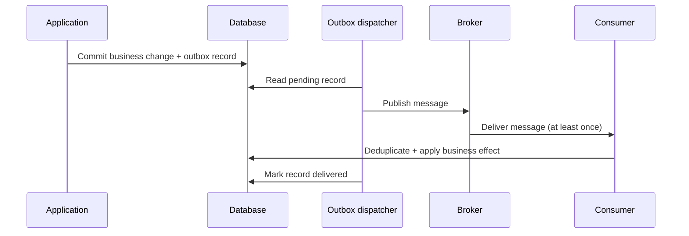

# Distributed Systems Patterns

Distributed systems exchange work across process and network boundaries, where delays, partial
failures, retries, and duplicate delivery are normal operating conditions. These patterns help
bound failures and preserve business invariants; none makes a remote call equivalent to a local
call.

## Start with Failure Boundaries

For each remote dependency, define a caller deadline, the failures that are safe to retry, the
maximum work it may consume, and the behavior when the dependency is unavailable. Propagate
cancellation and correlation identifiers. A retry policy without a deadline can increase load
precisely when a dependency is unhealthy.

## Resilience Patterns

| Pattern | Purpose | Important design choices |
|---|---|---|
| **Timeout** | Bounds how long a caller waits for an operation. | Set a deadline from the caller's remaining budget; propagate cancellation. A client timeout does not prove that the remote operation did not complete. |
| **Retry** | Repeats an operation after a transient failure. | Bound attempts and total duration; use backoff with jitter. Do not retry permanent failures or non-idempotent operations unless they have an idempotency mechanism. |
| **Circuit breaker** | Temporarily stops calls likely to fail, then allows a limited recovery probe. | Choose failure signals and thresholds carefully. It complements rather than replaces timeouts, retries, or a fallback. |
| **Bulkhead** | Limits the resources consumed by one dependency, tenant, or workload. | Isolate concurrency or queues where contention would otherwise spread; size limits using capacity and latency data. |
| **Rate limiting** | Controls request volume to protect capacity and allocate it fairly. | Decide whether to reject, queue, or shed work; return a clear retry signal where appropriate. Apply limits at the boundary that owns the policy. |

These controls solve different problems and must be composed with a shared latency and capacity
budget. A fallback is only safe when it preserves the business meaning of the response; returning
empty or stale data as though it were current can conceal a failure.

## Reliable Message Processing

### Idempotency

At-least-once delivery means a handler can receive the same message more than once. Give each
operation a stable idempotency key and make recording that key atomic with the business effect.
The retention period must cover the broker's retry and replay window. Idempotency prevents
duplicate effects; it does not guarantee message ordering.

### Transactional Outbox

When a command changes a database and must publish a message, write the business change and an
outbox record in the same local transaction. A separate dispatcher publishes committed records,
retries transient broker failures, and marks records as delivered. Publication can still be
duplicated if the dispatcher crashes after sending but before recording success, so consumers
must be idempotent.



The outbox makes the database write and durable publication intent atomic; it does not create a
distributed transaction with the broker or provide exactly-once end-to-end effects.

### Inbox / Processed-Message Record

A consumer can store the message identifier in the same transaction as its business update. A
unique constraint rejects a duplicate identifier, allowing the handler to acknowledge a message
only after its effect and deduplication record commit. Keep the inbox's retention and partitioning
strategy aligned with the broker's replay and delivery guarantees.

## Other Distributed Concerns

### Service Discovery

Discovery maps a logical service identity to currently reachable instances. Prefer platform or
client-library discovery that integrates health and lifecycle information. Treat discovered
addresses as dynamic, secure the registry and service identity, and avoid using discovery as a
substitute for authentication or authorization.

### Distributed Caching

Cache-aside is a common choice: read from the cache, load from the source on a miss, then populate
the cache. Explicitly decide acceptable staleness, expiration, invalidation, and behavior during a
cache outage. A cache is not the authoritative store unless the system deliberately gives it that
role.

### Ordering and Partitioning

Ordering is generally scoped to a partition, key, or single consumer rather than guaranteed
globally. Select a partition key that preserves required business order without creating a hot
partition. Consumers should still validate state transitions because delivery order can be
affected by retries and parallel processing.

## Practical .NET Starting Point

For HTTP clients, .NET's resilience extensions provide a standard, configurable handler:

```csharp
services.AddHttpClient<CatalogClient>()
    .AddStandardResilienceHandler();
```

Tune the handler to the dependency's SLO and the caller's end-to-end deadline. Do not enable
retries blindly for writes: use an idempotency key or another application-level guarantee when a
timed-out request might already have succeeded.

## Common Mistakes

- Retrying every exception, or retrying without a total deadline.
- Retrying writes that may already have succeeded without an idempotency strategy.
- Treating a circuit breaker as a replacement for timeout and load isolation.
- Assuming a broker, outbox, or retry policy provides exactly-once processing.
- Letting a cache become an undocumented source of truth.
- Returning fallback data without making its freshness or reduced quality visible.

## Related Concepts

- [Saga](01-SAGA-pattern/SAGA-pattern.md) coordinates a business process across services.
- [Distributed Transactions](distributed-transaction.md) compares coordination approaches.
- [Event Sourcing](03-event-sourcing/event-sourcing.md) stores state changes as an event sequence.
- [Integration and Communication Patterns](integration-and-communication-patterns.md) compares transport and interaction models.

## References

- [Circuit Breaker pattern — Azure Architecture Center](https://learn.microsoft.com/en-us/azure/architecture/patterns/circuit-breaker)
- [Bulkhead pattern — Azure Architecture Center](https://learn.microsoft.com/en-us/azure/architecture/patterns/bulkhead)
- [Retry pattern — Azure Architecture Center](https://learn.microsoft.com/en-us/azure/architecture/patterns/retry)
- [Cache-Aside pattern — Azure Architecture Center](https://learn.microsoft.com/en-us/azure/architecture/patterns/cache-aside)
- [HTTP resilience in .NET — Microsoft Learn](https://learn.microsoft.com/en-us/dotnet/core/resilience/http-resilience)
- [Transactional Outbox pattern — microservices.io](https://microservices.io/patterns/data/transactional-outbox.html)
- [Idempotent Consumer pattern — microservices.io](https://microservices.io/patterns/communication-style/idempotent-consumer.html)
