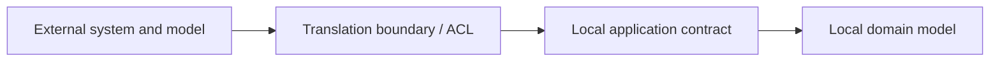

# Enterprise Application Patterns

Enterprise application patterns organize business logic, persistence, and integration
boundaries. Apply them where they clarify ownership or isolate change; do not add layers merely
because a pattern has a familiar name.

## Repository

A repository presents a collection-like interface for retrieving and persisting domain objects,
often aggregate roots. It isolates persistence concerns from domain behavior.

Use repositories when the abstraction protects a meaningful domain or application boundary.
Avoid a generic repository for every database table when it merely duplicates the persistence
framework's query API or hides necessary query behavior.

```csharp
public interface IOrderRepository
{
    Task<Order?> GetAsync(OrderId id, CancellationToken cancellationToken);
    void Add(Order order);
}
```

The interface expresses the operations the application needs. Its implementation can use EF
Core, SQL, or another store without exposing those details to the domain model.

## Unit of Work

A Unit of Work coordinates changes made during one business operation and commits them as a
single local transaction where the underlying store supports it. It is not a distributed
transaction across independent services or databases.

In EF Core, `DbContext` tracks changes and `SaveChanges` typically commits them in a transaction
for a relational provider. A wrapper is useful only when it adds a meaningful application
boundary; avoid introducing a second Unit of Work abstraction that simply forwards every call.

## Specification

A Specification packages a business rule or selection criterion so it can be named, reused, and
tested. For example, an `OrderEligibleForShipment` rule might combine payment, inventory, and
order-state conditions.

Keep the rule in the layer that owns its meaning. If a specification must execute against a
database, ensure its expression can be translated by the persistence provider; do not silently
load an unbounded dataset and filter it in memory.

## Anti-Corruption Layer

An Anti-Corruption Layer (ACL) translates between an external system's model and the local
domain's language. It protects local rules from leaking legacy schemas, vendor-specific
representations, or incompatible semantics.



The translation boundary may be an adapter, mapper, or dedicated integration component. It should
also make failures, unsupported values, and data ownership visible; translation alone does not
make an unreliable external dependency safe.

## Related Application Patterns

- **Service Layer:** Defines application operations and coordinates domain objects and
  repositories. Keep business invariants in the domain model when that model owns them; avoid a
  pass-through service that only renames calls.
- **Data Transfer Object (DTO):** Carries data across a process or application boundary. Map it
  explicitly to domain types rather than exposing persistence entities as public API contracts.
- **Dependency Injection (DI):** Supplies dependencies from outside a component. A DI container
  is a construction mechanism; it is not the Dependency Inversion Principle (DIP), which is a
  design principle about dependency direction and abstractions.
- **Domain Model and Aggregates:** Capture business rules and consistency boundaries. See
  [Domain-Driven Design](../02-architectural-styles/03-domain-driven-design-DDD/domain-driven-design-DDD.md).

## Choosing and Combining Patterns

Choose a repository when persistence access needs an explicit boundary; use a Unit of Work when
one local operation needs coordinated commit semantics; use a Specification when a business rule
or query predicate benefits from a named, testable representation; and use an ACL when external
semantics should not enter the local domain.

These patterns can be combined, but each boundary has a cost. In particular, Repository and Unit
of Work abstractions should match the transaction and query capabilities of the underlying store.
They do not provide cross-service atomicity, exactly-once messaging, or automatic domain
correctness.

## References

- [Use Domain Analysis to Model Microservices — Azure Architecture Center](https://learn.microsoft.com/en-us/azure/architecture/microservices/model/domain-analysis)
- [DbContext Lifetime, Configuration, and Initialization — EF Core](https://learn.microsoft.com/en-us/ef/core/dbcontext-configuration/)
- [Transactions — EF Core](https://learn.microsoft.com/en-us/ef/core/saving/transactions)
