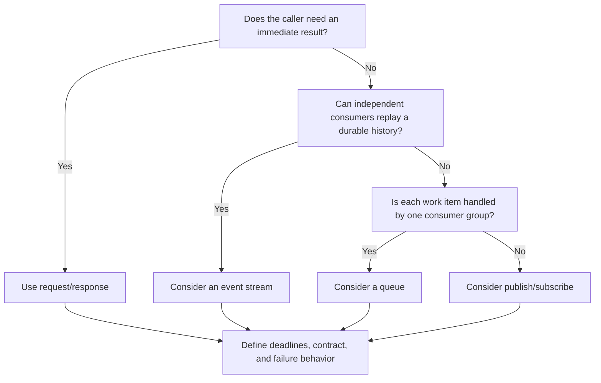

# Integration and Communication Patterns

Communication choices determine coupling, latency, failure behavior, and how independently
participants can evolve. Select a protocol from the interaction and operational requirements, not
from fashion. A system can use several protocols behind stable boundaries.

## Synchronous and Asynchronous Interaction

| Interaction | Typical fit | Main trade-offs |
|---|---|---|
| **Synchronous request/response** | The caller needs an immediate result to continue its workflow. | Simple response semantics, but the caller depends on the callee's availability and latency. Bound calls with deadlines and avoid long synchronous chains. |
| **Asynchronous messaging** | Work can complete later, needs buffering, or should be processed independently. | Reduces temporal coupling and absorbs bursts, but introduces eventual consistency, duplicate delivery, and operational work for retries and dead-letter handling. |

Use a queue when one competing consumer should process each work item, subject to the broker's
delivery semantics. Use publish/subscribe when independent subscribers each need a copy. Use an
event stream when durable ordered partitions, replay, or multiple independent readers are
important. These models are related but are not interchangeable.

## Synchronous API Options

| Option | Useful when | Costs and cautions |
|---|---|---|
| **REST-style HTTP** | Resources, broad interoperability, and standard HTTP semantics are a good fit. | Define resource identity, status codes, pagination, compatibility, and error formats. REST is more than using JSON over HTTP. |
| **GraphQL** | Clients need flexible, typed selection across related data and the server can govern query cost. | Requires controls for query depth/complexity, resolver fan-out, authorization, caching, and schema evolution. |
| **gRPC** | Efficient, strongly typed service-to-service calls or streaming are important, and clients support the protocol. | Requires generated contracts and compatible tooling; browser-facing clients may need a gateway or gRPC-Web support. |

For any synchronous API, define authentication and authorization, input limits, error semantics,
timeouts, and a compatibility policy. Avoid exposing internal database shapes as a public
contract.

## Asynchronous Integration Options

- **Message queue:** buffers commands or work for a consumer group; decide delivery, ordering,
  redelivery, poison-message, and dead-letter policies.
- **Publish/subscribe:** distributes a message to multiple subscriptions; subscribers should be
  independently deployable and tolerate duplicate delivery.
- **Event streaming:** retains an ordered log within partitions for independent consumers and
  replay; partition keys and retention affect ordering and scalability.
- **Webhook:** delivers an event to a consumer-owned HTTP endpoint. Sign requests, verify
  timestamps, retry with bounded backoff, and make receiver processing idempotent.
- **Message broker:** routes and delivers messages; it does not remove the need for contracts,
  schema evolution, observability, or application-level failure handling.

Prefer a notification that something changed over exposing an event as a command to another
service. Event names should describe a fact that has occurred; commands express requested work.

## Choosing a Communication Style

1. Establish whether the caller needs an immediate answer or can accept deferred completion.
2. Identify delivery, ordering, replay, and consistency requirements.
3. Set latency and availability budgets for all participants.
4. Define contract ownership, versioning, and compatibility before choosing a wire format.
5. Account for identity, authorization, network boundaries, and sensitive data.
6. Plan for timeouts, duplicate work, back-pressure, observability, and operational ownership.

## Common Mistakes

- Building long synchronous call chains with no end-to-end deadline.
- Using a queue when every independent subscriber needs its own copy, or pub/sub for single-owner work.
- Assuming asynchronous messaging removes consistency and failure-handling concerns.
- Treating a webhook as a reliable one-time HTTP callback.
- Changing a contract in a way that breaks deployed consumers.
- Publishing sensitive data in event payloads without a data-classification and access policy.

## Related Concepts

- [Event-Driven Architecture](../02-architectural-styles/04-event-driven-architecture/event-driven-architecture.md)
- [API Gateway](04-api-gateway/api-gateway.md)
- [Distributed Systems Patterns](distributed-systems-patterns.md)
- [Saga](01-SAGA-pattern/SAGA-pattern.md)
- [CQRS](02-CQRS-pattern/CQRS-pattern.md)

## References

- [Web API design best practices — Azure Architecture Center](https://learn.microsoft.com/en-us/azure/architecture/best-practices/api-design)
- [Learn GraphQL](https://graphql.org/learn/)
- [Introduction to gRPC](https://grpc.io/docs/what-is-grpc/introduction/)
- [Event-driven architecture style — Azure Architecture Center](https://learn.microsoft.com/en-us/azure/architecture/guide/architecture-styles/event-driven)
- [Transactional Outbox pattern — microservices.io](https://microservices.io/patterns/data/transactional-outbox.html)
