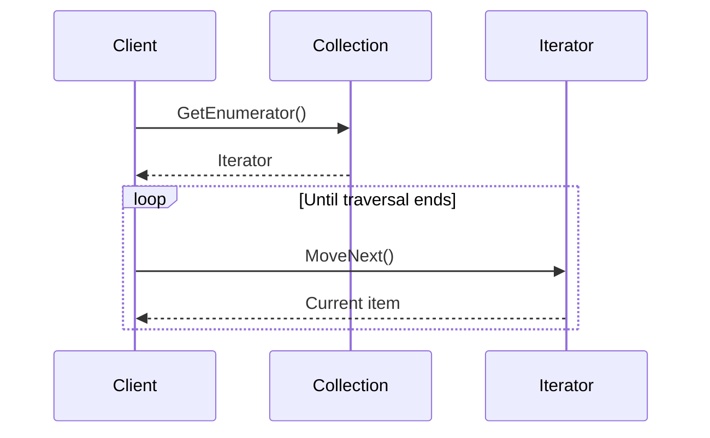

# Iterator Pattern

## Overview

The Iterator pattern provides a way to traverse a collection sequentially without exposing how
the collection stores its elements. The collection controls iteration while callers depend on a
small traversal interface.

## Problem and Intent

Callers should be able to visit each item in a collection without knowing whether it is backed by
an array, tree, database cursor, or another representation. Embedding traversal logic in every
caller couples clients to that representation and duplicates iteration behavior.

## Participants

- **Aggregate/collection:** Creates an iterator and owns the elements.
- **Iterator:** Defines traversal operations such as advancing and reading the current item.
- **Concrete iterator:** Tracks traversal state for a collection.
- **Client:** Uses the iterator without depending on the collection's internal structure.

## How It Works



In .NET, `IEnumerable<T>` and `IEnumerator<T>` provide the standard collection and iterator
contracts. C# `foreach` consumes those contracts; iterator blocks using `yield return` let the
compiler create the traversal state machine.

## C# Example

```csharp
using System;
using System.Collections;
using System.Collections.Generic;

public sealed record Book(string Title);

public sealed class BookShelf : IEnumerable<Book>
{
    private readonly List<Book> _books = new();

    public void Add(Book book) => _books.Add(book);

    public IEnumerator<Book> GetEnumerator()
    {
        foreach (var book in _books)
        {
            yield return book;
        }
    }

    IEnumerator IEnumerable.GetEnumerator() => GetEnumerator();
}

public static class Program
{
    public static void Main()
    {
        var shelf = new BookShelf();
        shelf.Add(new Book("Architecture"));

        foreach (var book in shelf)
        {
            Console.WriteLine(book.Title);
        }
    }
}
```

The client uses the enumeration contract and does not depend on `_books` or its list
representation. The example uses deferred iteration: the collection is traversed as the caller
requests items.

## Advantages and Trade-offs

**Advantages**

- Separates traversal from the collection's representation.
- Gives multiple collection types a consistent traversal API.
- Supports lazy or stateful traversal where the collection can provide it.

**Trade-offs**

- A custom iterator adds types and state that may be unnecessary when the platform already
  provides a suitable enumeration API.
- Mutating a collection during traversal can invalidate iteration or produce surprising results;
  the collection must define its behavior.
- Some iterators are one-shot, stateful, or resource-backed and should not be treated as reusable
  snapshots.

## When to Use

- Clients need a stable traversal contract independent of storage.
- A collection has more than one useful traversal order.
- Traversal should be lazy or should manage cursor/resource state.

## Common Mistakes

- Exposing a custom iterator when a standard collection interface is enough.
- Assuming every iterator can be restarted or safely enumerated more than once.
- Hiding I/O or resource ownership behind an iterator without documenting disposal and failure
  behavior.
- Modifying a collection during enumeration without a defined contract.

## Related Concepts

- [Composite](../2-structural-patterns/3-composite.md) often uses iteration to traverse trees.
- [Visitor](10-visitor.md) can apply operations while traversing a stable object structure.
- In .NET, `IEnumerable<T>`, `IEnumerator<T>`, and `yield return` are common iterator mechanisms.

## Reference

- Erich Gamma, Richard Helm, Ralph Johnson, and John Vlissides, *Design Patterns: Elements of
  Reusable Object-Oriented Software* (Addison-Wesley, 1994).
