# Docker and Containerization

> Interview-focused learning guide for a senior .NET developer / technical lead / architect. Current as of Nov 2026 (.NET 10 LTS, BuildKit default, Compose v2).

## How to use this guide

1. Read each chapter in order the first time: **simple explanation → internals → .NET example → trade-offs → failure modes → interview Q&A**.
2. Every subtopic from the syllabus has its own heading (see the table of contents). Use the **Interview Q&A** blocks to rehearse out loud.
3. For any container question use the framework in [Chapter 27](#27-structured-way-to-answer-container-questions): **context → options → trade-offs → decision → validation**. This directly addresses the "structured problem-solving" interview feedback.
4. Related guides: [Cloud-Native .NET on Azure](../07-advanced-topics/Architecting%20Cloud-Native%20NET%20Apps%20for%20Azure.md), [Microservices](../02-architectural-styles/01-microservices-architecture/microservices-architecture.md), [ASP.NET Core Web API internals](../10-aspnet-core-web-api-internals/aspnet-core-web-api-internals.md), [Cloud migration](../11-cloud-migration-and-modernization/cloud-migration-and-legacy-modernization.md).

## Table of contents

**Part A – Fundamentals**
1. [What is containerization?](#1-what-is-containerization)
2. [Virtual machines versus containers](#2-virtual-machines-versus-containers)
3. [Docker architecture](#3-docker-architecture)
4. [Docker Engine](#4-docker-engine)
5. [Docker images versus containers](#5-docker-images-versus-containers)
6. [Docker image layers](#6-docker-image-layers)

**Part B – Building and running**

7. [Dockerfile fundamentals](#7-dockerfile-fundamentals)
8. [Multi-stage Docker builds](#8-multi-stage-docker-builds)
9. [ASP.NET Core Docker images](#9-aspnet-core-docker-images)
10. [Building and running containers](#10-building-and-running-containers)
11. [Port mapping](#11-port-mapping)
12. [Environment variables](#12-environment-variables)
13. [Application configuration](#13-application-configuration)

**Part C – Data and networking**

14. [Docker volumes](#14-docker-volumes)
15. [Bind mounts](#15-bind-mounts)
16. [Docker networking](#16-docker-networking)
17. [Docker Compose](#17-docker-compose)

**Part D – Operations**

18. [Container logs](#18-container-logs)
19. [Container troubleshooting](#19-container-troubleshooting)
20. [Image optimization](#20-image-optimization)
21. [Container security](#21-container-security)

**Part E – Azure and orchestration**

22. [Deploying containers to Azure](#22-deploying-containers-to-azure)
23. [Docker versus Kubernetes](#23-docker-versus-kubernetes)
24. [Container orchestration fundamentals](#24-container-orchestration-fundamentals)

**Part F – Interview toolkit**

25. [How this topic relates to the rest of the guide](#25-how-this-topic-relates-to-the-rest-of-the-guide)
26. [Command cheat sheet](#26-command-cheat-sheet)
27. [Structured way to answer container questions](#27-structured-way-to-answer-container-questions)
28. [Scenario-based architect questions](#28-scenario-based-architect-questions)
29. [Quick-revision checklist](#29-quick-revision-checklist)

---

# Part A – Fundamentals

## 1. What is containerization?

### Simple explanation
A container is a **normal Linux (or Windows) process that has been given its own private view of the machine**: its own filesystem, network, process list, and capped CPU/memory. You package your app plus everything it needs (runtime, libraries, defaults) into an **image** and run it anywhere a container runtime exists. "Works on my machine" becomes "works on every machine that can run the image".

### Architect-level depth
Containerization is **OS-level virtualization**. There is no guest kernel; all containers on a host share the host kernel. Isolation comes from kernel features:

| Kernel feature | What it controls |
|---|---|
| **Namespaces** (`pid`, `net`, `mnt`, `uts`, `ipc`, `user`, `cgroup`) | What a process can *see* (own PID 1, own network stack, own mount table, own hostname) |
| **cgroups** (v2 on modern distros) | What a process can *use* (CPU quota/shares, memory limit, pids, IO) |
| **Union/overlay filesystem** (overlayfs) | Layered, copy-on-write root filesystem |
| **Capabilities, seccomp, AppArmor/SELinux** | Which privileged operations/syscalls a process may perform |

### Why it exists
It solves environment drift between dev/test/prod, slow VM provisioning, low density (a guest OS per app wastes RAM), dependency conflicts (two apps needing different runtimes), and non-repeatable deployments. Containers give **immutable, versioned, fast-starting deployment artifacts** — the foundation for microservices, CI/CD and orchestrators.

### How it works internally
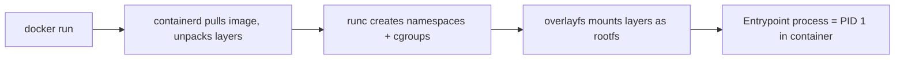
`runc` (the OCI runtime) calls `clone()` with namespace flags, applies cgroup limits, `pivot_root`s into the overlay mount, drops capabilities, applies seccomp, then `exec`s your entrypoint. That process **is** the container: when it exits, the container stops.

### Real-world use cases
Microservice deployment, reproducible CI build agents, local dev stacks (SQL Server, Redis, Service Bus emulator), legacy app packaging for lift-and-shift, batch jobs, ML model serving.

### When to use / when NOT to use
- **Use**: stateless services, multi-environment apps, polyglot stacks, horizontal scaling, CI/CD.
- **Avoid / think twice**: GUI desktop apps; workloads needing kernel modules or another kernel; hostile multi-tenant isolation (use VMs / Hyper-V isolation / Kata); production databases without a clear persistence/HA story (prefer Azure SQL / managed PaaS); apps needing Windows features unsupported in Windows containers.

### Advantages, disadvantages, trade-offs
| Advantages | Disadvantages |
|---|---|
| Consistent artifact, fast start | Shared kernel = weaker isolation than VM |
| High density, low overhead | Extra operational surface: registry, orchestration, image patching |
| Immutable infra, easy rollback (redeploy previous tag) | State/persistence needs deliberate design |
| Fits CI/CD and microservices | Debugging is harder (ephemeral, minimal images) |

### Common mistakes / anti-patterns
- Treating a container like a VM (SSH in, patch in place, many processes).
- Storing state in the writable layer.
- `latest` tag in production.
- Baking secrets into images.
- Running as root.

### Performance, scalability, reliability, security
- Near-native CPU; slight overhead for overlay FS IO and NAT'd networking.
- Scale by adding replicas; containers must be **stateless and disposable**.
- Reliability depends on an orchestrator restarting failed containers plus health checks.
- Security is defence in depth (see [Chapter 21](#21-container-security)).

### Troubleshooting
`docker ps -a`, `docker inspect`, `docker logs`, check exit code. Details in [Chapter 19](#19-container-troubleshooting).

### Interview Q&A
**Q: Explain containers to a non-technical stakeholder and then to an engineer.**
*Stakeholder:* "A shipping container for software: the same box runs identically on any ship or truck." *Engineer:* "A process isolated with namespaces, limited with cgroups, running on an overlayfs root built from image layers, sharing the host kernel."

**Q: Is a container a lightweight VM?** No. No hypervisor, no guest kernel — it is a constrained process. That is why a Linux container can't run directly on a Windows kernel; Docker Desktop runs a Linux VM (WSL2) to host them.

**Follow-up: What happens when PID 1 exits?** The container stops. Also, PID 1 gets no default signal handlers on Linux, so a process ignoring SIGTERM won't stop gracefully. .NET handles SIGTERM via `IHostApplicationLifetime`, but shell-form `ENTRYPOINT` wraps the app in `sh -c`, which may swallow signals — a classic bug. Use exec form.

**Follow-up: Can containers escape?** Yes via kernel vulnerabilities or misconfiguration (`--privileged`, mounted `docker.sock`, host PID namespace). Hence non-root, dropped capabilities, read-only FS, patched hosts.

---

## 2. Virtual machines versus containers

### Simple explanation
A VM is a **whole computer in software** (own OS). A container is **one app in its own sandbox** sharing the host's OS kernel.

### Architect-level depth
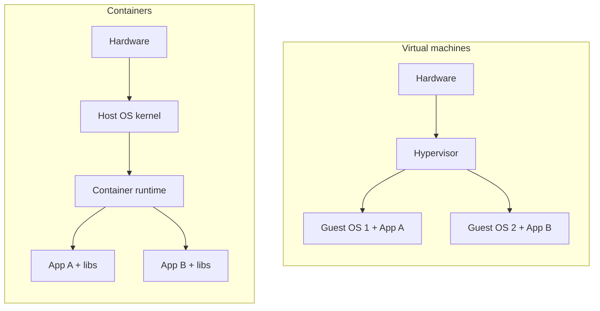

| Dimension | VM | Container |
|---|---|---|
| Isolation boundary | Hardware virtualization (strong) | Kernel namespaces (weaker, shared kernel) |
| Size | GBs | tens–hundreds of MB (.NET chiseled runtime image is on the order of tens of MB) |
| Startup | Tens of seconds to minutes | Milliseconds to seconds |
| Density | Tens per host | Hundreds per host |
| OS flexibility | Any guest OS | Same kernel family as host |
| Patching | Patch OS in place | Rebuild image, redeploy |
| Typical unit | Server ("pet") | Process ("cattle") |

### Why both exist
VMs solve **hardware consolidation and strong isolation**; containers solve **application packaging and density**. They are complementary: AKS nodes are VMs running containers; Hyper-V isolation, Kata Containers and Azure Container Instances use a micro-VM per container group for hostile multi-tenancy.

### Real-world use cases
- **VM**: lift-and-shift legacy apps, different OS needs, regulated tenant isolation, database servers needing full OS control.
- **Container**: microservices, APIs, workers, CI.

### When to use which
VMs when isolation or OS control dominates; containers when deployability and density dominate; **containers on VMs** (the default cloud pattern) when you want both.

### Trade-offs / mistakes
- "Containers are always more secure/faster" — they are denser and faster to start, not more isolated.
- One container per VM and calling it cloud-native.
- Lifting a stateful, multi-process legacy app into one container with `supervisord`.

### Performance / security notes
Container CPU ≈ bare metal; VMs add small hypervisor overhead. Noisy neighbours are managed with cgroup limits. For hostile tenants prefer VM-level isolation.

### Interview Q&A
**Q: Why are containers faster to start?** No OS boot: create namespaces, mount cached layers, exec a process.
**Q: Can a Windows container run on a Linux host?** No — the kernel must match. Windows containers run on Windows (process isolation or Hyper-V isolation).
**Follow-up: A tenant runs arbitrary code. Containers or VMs?** VMs or a sandboxed runtime (gVisor/Kata/Hyper-V isolation/ACI), because a shared-kernel exploit crosses tenants.

**Scenario:** *40 legacy .NET Framework 4.8 apps run on IIS VMs.* .NET Framework requires Windows containers. Evaluate rehost to Azure VMs first (see [Cloud migration](../11-cloud-migration-and-modernization/cloud-migration-and-legacy-modernization.md)), containerise on Windows nodes only where value is clear, and modernise to .NET 10 on Linux where feasible.

---

## 3. Docker architecture

### Simple explanation
You type `docker run`. The **CLI** sends a request to the **daemon**, which pulls the **image** from a **registry** and starts a **container**.

### Architect-level depth
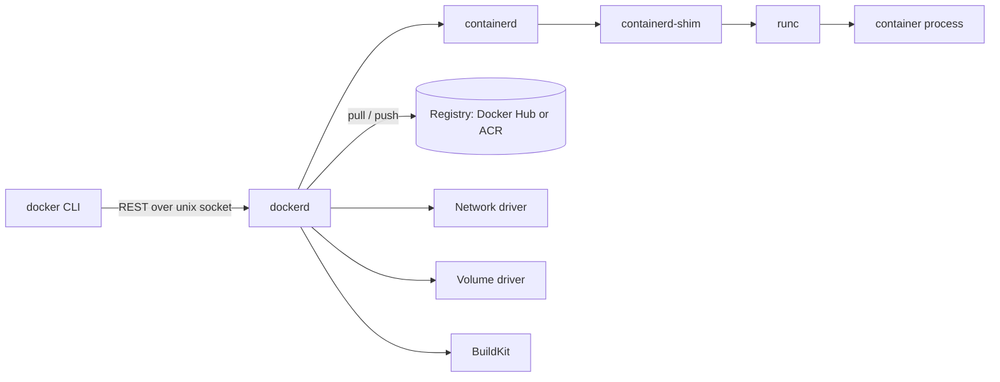
Components:
- **Client**: `docker` CLI (plus Compose plugin, `docker buildx`). Talks to the daemon through `/var/run/docker.sock`, TCP/TLS or SSH.
- **dockerd**: API, image management, networks, volumes (and Swarm).
- **containerd**: industry-standard container lifecycle/image manager (also used directly by Kubernetes).
- **containerd-shim**: keeps the container alive if the daemon restarts; reaps zombies.
- **runc**: reference OCI runtime that actually creates the container.
- **BuildKit**: parallel, cache-aware build engine (default).
- **Registry**: stores images (Docker Hub, **Azure Container Registry**, GHCR).
- **OCI specs** (image, runtime, distribution): why images are portable across Docker, Podman, containerd, CRI-O.

### Why it exists
Separation of concerns and standardisation. Kubernetes dropped dockershim and talks to containerd via CRI; images remain OCI-compatible, so "Kubernetes removed Docker" didn't break your images.

### Real-world scenarios
CI agents using BuildKit remote cache; developers on Docker Desktop (WSL2) while production runs containerd on AKS.

### When NOT to expose the daemon
Never mount `/var/run/docker.sock` into app containers (equals root on host). In CI prefer rootless BuildKit, Kaniko or **ACR Tasks** (`az acr build`).

### Mistakes
- Thinking Kubernetes nodes need Docker installed.
- Exposing the daemon on unauthenticated TCP 2375.

### Troubleshooting
`docker info`, `docker version` (client vs server), `systemctl status docker`, `journalctl -u docker`, `docker events`.

### Interview Q&A
**Q: Docker vs containerd vs runc?** Docker = developer UX + daemon; containerd = lifecycle/image management; runc = low-level OCI runtime that creates the process.
**Follow-up: Kubernetes dropped dockershim — impact?** None on OCI images. Node runtime is containerd/CRI-O; `docker ps` on a node won't show pods — use `crictl`.

---

## 4. Docker Engine

### Simple explanation
Docker Engine is the **background service + API + CLI** that builds and runs containers on one machine.

### Architect-level depth
Engine = `dockerd` + REST API + `docker` CLI. Responsibilities: image store (content-addressable under `/var/lib/docker`), storage driver (`overlay2`, or the containerd image store in newer versions), network controller (libnetwork), volume plugins, log drivers, cgroup driver (`systemd` recommended) and security profiles.

`/etc/docker/daemon.json`:
```json
{
  "log-driver": "json-file",
  "log-opts": { "max-size": "10m", "max-file": "3" },
  "storage-driver": "overlay2",
  "default-ulimits": { "nofile": { "Name": "nofile", "Hard": 65536, "Soft": 65536 } },
  "live-restore": true
}
```
`live-restore` keeps containers running while the daemon restarts. **Log rotation** prevents disk-full outages — one of the most common production incidents on plain Docker hosts.

### Real-world
Single-host deployments (small apps, edge, dev/test), CI runners, Docker Desktop. Large-scale production uses orchestrator-managed containerd.

### When NOT to use plain Docker Engine in production
When you need multi-node scheduling, cross-node self-healing, rolling updates, secrets management, autoscaling → use Container Apps / AKS / App Service.

### Mistakes
No log rotation; small OS disk filling with `/var/lib/docker`; stale host kernel; no restart policy.

### Troubleshooting
`docker system df` (disk usage), `docker system prune` (carefully!), `docker info | grep -iE "storage|cgroup"`.

### Interview Q&A
**Q: Where are layers stored and why can disk fill up?** `/var/lib/docker/overlay2`. Causes: unused images, stopped containers, build cache, unrotated JSON logs, dangling volumes. Fix: prune policy, log rotation, dedicated data disk.

---

## 5. Docker images versus containers

### Simple explanation
**Image = read-only template. Container = running (or stopped) instance of it.** Class vs object.

### Architect-level depth
- An image is an **ordered list of read-only layers + a JSON config** (entrypoint, env, exposed ports, user), identified by a **content digest** (`sha256:…`). A **manifest** lists layer digests; a **manifest list / index** maps platforms (linux/amd64, linux/arm64) to manifests.
- A container = image layers + a thin **writable layer** (copy-on-write) + runtime config (limits, network, mounts).
- Tags are **mutable pointers**; digests are **immutable**. Production should pin `image@sha256:…` or use immutable tags (git SHA) and ACR tag locking.

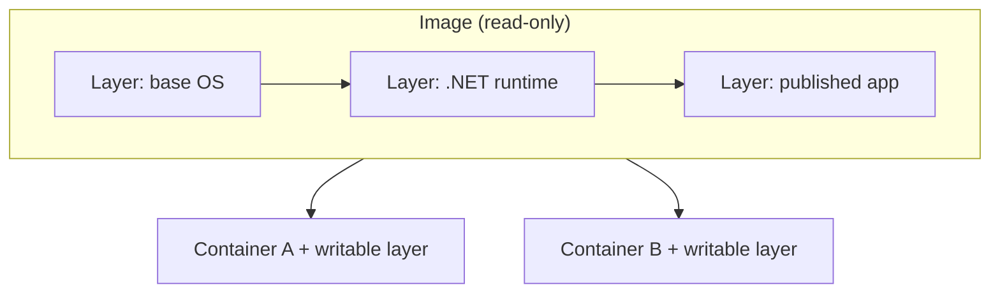

### Why it exists
Immutability gives reproducibility and rollback; layer sharing gives cheap storage and fast pulls.

### C# / ASP.NET Core angle
CI produces `myregistry.azurecr.io/orders-api:1.8.3-<gitsha>`; the *same* image is promoted dev → test → prod; only configuration changes (**build once, deploy many**).

### Mistakes
Rebuilding per environment (tested binary ≠ shipped binary); `latest`; data in the writable layer; SDK in runtime image; `docker commit` as a build process.

### Troubleshooting
`docker image inspect`, `docker history`, `docker manifest inspect`, `docker diff <container>` (what changed in the writable layer).

### Interview Q&A
**Q: Tag vs digest?** Tags are mutable (re-pushing `1.0` changes it); digests are immutable. Pin digests or enforce immutable tags for supply-chain integrity.
**Q: What happens to data written in a container when it is removed?** Lost, unless on a volume.
**Follow-up: How can two containers from one image have different state?** Separate writable layers and mounts.

---

## 6. Docker image layers

### Simple explanation
Each Dockerfile instruction that changes the filesystem (`RUN`, `COPY`, `ADD`) creates a **layer**. Layers are cached and shared, so rebuilds and pulls only transfer what changed.

### Architect-level depth
- Layers are **content-addressable tarballs** (diffs). Identical content → identical digest → stored once on disk and in the registry.
- **overlayfs**: `lowerdir` (stacked read-only layers) + `upperdir` (container writable layer) + `merged` view. Writing to a file from a lower layer triggers **copy-up** (the whole file is copied) — costly for large files.
- **Deleting a file in a later layer does not shrink the image**; it adds a whiteout marker. Cleanup must happen in the *same* `RUN`.
- **Build cache**: BuildKit keys a layer by instruction + parent + (for `COPY`) file checksums. A change invalidates that layer **and every layer after it**, so order instructions from least to most frequently changing.

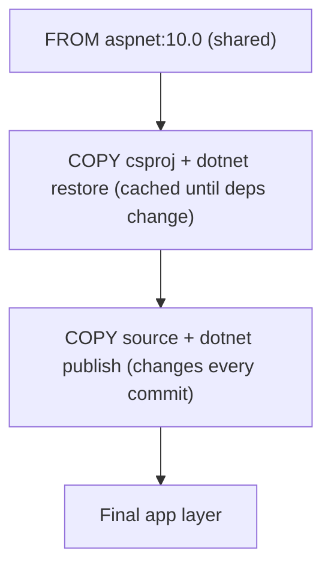

### The classic .NET cache optimisation
```dockerfile
COPY ["Orders.Api/Orders.Api.csproj", "Orders.Api/"]
COPY ["Orders.Domain/Orders.Domain.csproj", "Orders.Domain/"]
RUN dotnet restore "Orders.Api/Orders.Api.csproj"   # cached unless csproj/packages change
COPY . .                                            # source changes invalidate only from here
```
Add a BuildKit cache mount for NuGet:
```dockerfile
RUN --mount=type=cache,target=/root/.nuget/packages dotnet restore "Orders.Api/Orders.Api.csproj"
```

### Why it matters
CI build time, pull time when autoscaling (large layers slow new replica start), registry storage cost.

### Mistakes
- `COPY . .` before restore (busts cache every commit).
- `apt-get update` and `install` in separate layers, no cleanup of `/var/lib/apt/lists`.
- Putting a secret in a layer then "deleting" it — still recoverable from the earlier layer.
- Missing `.dockerignore` (ships `bin/`, `obj/`, `.git` as build context).

### Troubleshooting
`docker history --no-trunc img`, `dive img` (explore layer contents), `docker buildx build --progress=plain`.

### Interview Q&A
**Q: Why does a 5-line change rebuild restore too?** Layer ordering/cache invalidation; copy csproj files first.
**Q: I `rm` a 500 MB file in a later `RUN` and the image is the same size. Why?** Layers are additive; deletion is a whiteout. Combine in one `RUN` or use multi-stage.
**Follow-up: Security implication of layer sharing?** A vulnerable base layer is shared everywhere — patch the base and rebuild every dependent image; scan the whole image, not only your top layer.

---

# Part B – Building and running

## 7. Dockerfile fundamentals

### Simple explanation
A Dockerfile is a **text recipe**: start from a base image, copy files, run commands, declare how to start the app.

### Architect-level depth
| Instruction | Purpose | Notes |
|---|---|---|
| `FROM` | Base image / stage start | Pin version (`10.0`) or digest; `AS name` for multi-stage |
| `WORKDIR` | Set working dir | Creates it; prefer over `RUN cd` |
| `COPY` / `ADD` | Copy files | Prefer `COPY`; `ADD` auto-extracts tars and fetches URLs (surprising) |
| `RUN` | Execute at build time | Creates a layer; chain related commands |
| `ENV` | Persistent env var | Visible in image config — never secrets |
| `ARG` | Build-time variable | Not in runtime env, but visible in `docker history` |
| `EXPOSE` | Documentation of port | Does **not** publish the port |
| `USER` | Run-as user | Use non-root |
| `ENTRYPOINT` | Fixed executable | Use **exec form** `["dotnet","App.dll"]` |
| `CMD` | Default args | Overridable at `docker run` |
| `HEALTHCHECK` | Probe command | Orchestrators often use their own probes instead |
| `LABEL` | Metadata | OCI labels (`org.opencontainers.image.source`) |

**Exec form vs shell form**: `ENTRYPOINT ["dotnet","App.dll"]` makes dotnet PID 1 and receives SIGTERM. `ENTRYPOINT dotnet App.dll` runs `/bin/sh -c`, so the shell is PID 1 and may not forward signals (and chiseled images have no shell at all).

**`.dockerignore`** (mandatory hygiene):
```
**/bin/
**/obj/
.git
.vs
**/*.user
Dockerfile*
docker-compose*
**/appsettings.Development.json
```

Minimal example:
```dockerfile
FROM mcr.microsoft.com/dotnet/aspnet:10.0
WORKDIR /app
COPY ./publish .
USER app
ENTRYPOINT ["dotnet", "Orders.Api.dll"]
```

### Why it exists
Declarative, version-controlled, reproducible builds that live next to the code (infrastructure as code for the artifact).

### Real-world use
Every service has a Dockerfile in its repo; CI builds it, tags it with the git SHA and pushes to ACR.

### When NOT to hand-write a Dockerfile
For simple .NET apps, `dotnet publish -t:PublishContainer` (SDK built-in container support) builds an OCI image with no Dockerfile, no Docker daemon and sensible defaults (non-root, correct base image):
```powershell
dotnet publish ./Orders.Api -c Release -t:PublishContainer `
  -p ContainerRepository=orders-api -p ContainerImageTags='"1.0.0;latest"' `
  -p ContainerRegistry=myregistry.azurecr.io
```
Use a Dockerfile when you need OS packages, custom multi-stage steps, native dependencies or non-.NET build tooling.

### Advantages / trade-offs
Dockerfile = maximum control, widely understood. SDK container publish = less boilerplate, no daemon, but less flexibility.

### Mistakes / anti-patterns
- `latest` base tags; unpinned `apt-get install`.
- `RUN` per command (many layers), or conversely one giant unreadable `RUN`.
- Secrets in `ENV`/`ARG`/`COPY`.
- Running `dotnet run` or the SDK image in production.
- Using `ADD` for local files.
- Ignoring `.dockerignore`.

### Performance / security
Layer ordering for cache; small base; non-root; no build tools in the final image; scan in CI (Trivy / Microsoft Defender for Containers).

### Troubleshooting
`docker build --progress=plain --no-cache .`; `docker buildx build --check` (lints Dockerfile); `docker run --rm -it --entrypoint sh img` to explore (not for chiseled images).

### Interview Q&A
**Q: ENTRYPOINT vs CMD?** ENTRYPOINT = what runs; CMD = default arguments to it. `docker run img foo` replaces CMD, not ENTRYPOINT (unless `--entrypoint`).
**Q: Does `EXPOSE` open a port?** No; it's metadata. Publishing is `-p` / `-P`.
**Q: ARG vs ENV?** ARG exists at build time only; ENV persists into the container. Neither is safe for secrets — use BuildKit `--mount=type=secret`.
**Follow-up: How do you pass a private NuGet feed credential to the build safely?** `RUN --mount=type=secret,id=nugetconfig,target=/root/.nuget/NuGet/NuGet.Config dotnet restore` with `docker build --secret id=nugetconfig,src=nuget.config .` — never persisted in a layer.

---

## 8. Multi-stage Docker builds

### Simple explanation
Use a **big image to build** (SDK) and a **small image to run** (ASP.NET runtime); copy only the output across. Build tools never reach production.

### Architect-level depth
Each `FROM` starts a new stage. `COPY --from=<stage>` pulls artifacts. Only the last stage (or `--target`) ends up in the image. BuildKit builds independent stages in parallel and skips unused stages.

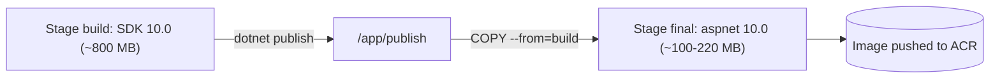

Production-grade Dockerfile for an ASP.NET Core 10 API:
```dockerfile
# syntax=docker/dockerfile:1
ARG DOTNET_VERSION=10.0

FROM mcr.microsoft.com/dotnet/sdk:${DOTNET_VERSION} AS build
WORKDIR /src
COPY ["Orders.Api/Orders.Api.csproj", "Orders.Api/"]
COPY ["Orders.Application/Orders.Application.csproj", "Orders.Application/"]
COPY ["Orders.Infrastructure/Orders.Infrastructure.csproj", "Orders.Infrastructure/"]
RUN --mount=type=cache,target=/root/.nuget/packages \
    dotnet restore "Orders.Api/Orders.Api.csproj"
COPY . .
WORKDIR /src/Orders.Api
RUN --mount=type=cache,target=/root/.nuget/packages \
    dotnet publish -c Release -o /app/publish --no-restore /p:UseAppHost=false

# Optional test stage: docker build --target test .
FROM build AS test
WORKDIR /src
RUN dotnet test --no-restore -c Release

FROM mcr.microsoft.com/dotnet/aspnet:${DOTNET_VERSION} AS final
WORKDIR /app
COPY --from=build /app/publish .
ENV ASPNETCORE_HTTP_PORTS=8080
EXPOSE 8080
USER app
ENTRYPOINT ["dotnet", "Orders.Api.dll"]
```

### Why it exists
Before multi-stage, teams maintained two Dockerfiles or shipped the SDK (hundreds of MB, large attack surface). Multi-stage gives a single reproducible file with a tiny runtime image.

### Real-world
CI: `build` → `test` (with `--target test`) → `final`. Add a `sonar`/`scan` stage. Compile front-end (Vue/Angular) in a `node` stage and copy `dist/` into `wwwroot` or into an nginx stage.

### When NOT to use
Trivial pre-built binaries (just copy). Also when the build needs the exact daemon cache of a CI that already compiles outside Docker — then `COPY` the pipeline's published output (trade: Docker build no longer reproduces the compile).

### Advantages / trade-offs
+ Small, secure final image; + cached, parallel stages; – longer Dockerfile; – debugging needs `--target build`.

### Mistakes
- Copying the whole `/src` into final.
- Forgetting `--no-restore` after restore (restore reruns).
- Running tests inside the final stage.
- `COPY --from` a stage name typo (silently pulls an external image of that name!).

### Performance / reliability
Cache mounts shorten CI; `--cache-from/--cache-to type=registry` shares cache between ephemeral agents.

### Troubleshooting
`docker build --target build -t dbg .` then run it; `docker buildx build --progress=plain`.

### Interview Q&A
**Q: How does multi-stage reduce image size and attack surface?** Final stage contains only the runtime and the published output — no SDK, compilers, source, NuGet cache.
**Q: How do you run unit tests in Docker CI without shipping them?** A `test` stage derived from `build`; CI builds `--target test`, then builds `final`. Cache makes the second build cheap.
**Follow-up: Build secrets or private feed in multi-stage?** BuildKit secret mounts; they don't land in any layer or the final image.

---

## 9. ASP.NET Core Docker images

### Simple explanation
Microsoft publishes ready-made images on `mcr.microsoft.com`: **sdk** (build), **aspnet** (run web apps), **runtime** (run console apps), **runtime-deps** (self-contained apps).

### Architect-level depth
| Image | Contents | Use |
|---|---|---|
| `dotnet/sdk:10.0` | SDK + runtime + ASP.NET | Build stage, CI |
| `dotnet/aspnet:10.0` | ASP.NET Core runtime (Debian) | Standard web API |
| `dotnet/aspnet:10.0-alpine` | musl libc, very small | Small images; test native libs (ICU, SqlClient globalization, Skia) |
| `dotnet/aspnet:10.0-noble-chiseled` (Ubuntu **chiseled**) | Distroless-style: no shell, no package manager, non-root | Best default for security + size |
| `dotnet/runtime-deps` | OS deps only | Self-contained / Native AOT |
| `*-composite` / `*-extra` chiseled variants | Composite R2R runtime / adds ICU & tzdata | Faster startup / globalization |

Key behaviours since .NET 8:
- Default **non-root** user `app` (UID 1654); default port **8080** (not 80) via `ASPNETCORE_HTTP_PORTS=8080`.
- Prefer `ASPNETCORE_HTTP_PORTS` (HTTP only) over `ASPNETCORE_URLS`.
- `DOTNET_gcServer`, GC and thread-pool respect **cgroup CPU/memory limits** (heap hard limit defaults to 75% of the container memory limit).
- Globalization: Alpine/chiseled need ICU; set `DOTNET_SYSTEM_GLOBALIZATION_INVARIANT=true` if you don't need culture data, or use the `-extra` chiseled tag.

Chiseled final stage:
```dockerfile
FROM mcr.microsoft.com/dotnet/aspnet:10.0-noble-chiseled AS final
WORKDIR /app
COPY --from=build /app/publish .
EXPOSE 8080
ENTRYPOINT ["dotnet", "Orders.Api.dll"]   # exec form mandatory: there is no shell
```
(The chiseled image already runs as `app`.)

Native AOT / self-contained trimmed alternative:
```dockerfile
FROM mcr.microsoft.com/dotnet/runtime-deps:10.0-noble-chiseled-aot AS final
COPY --from=build /app/publish .
ENTRYPOINT ["./Orders.Api"]
```

SDK-only way (no Dockerfile):
```xml
<PropertyGroup>
  <ContainerFamily>noble-chiseled</ContainerFamily>
  <ContainerRepository>orders-api</ContainerRepository>
</PropertyGroup>
```
Health checks for chiseled images (no `curl`): do them in ASP.NET Core (`/health/live`, `/health/ready`) and let the orchestrator probe; or in Compose use a probe that doesn't need tools in the container.

### Why this matters
Image choice is the biggest lever on size, CVE count, startup, and debuggability.

### Real-world
Regulated enterprises standardise on chiseled images + ACR + Defender for Containers scanning; Alpine for tiny background workers; Debian for apps with native deps.

### When NOT to use
- Alpine: apps relying on glibc-only native libs, or where musl behaviour differs (DNS, performance of some native libs).
- Chiseled: when you need an interactive shell for debugging (use ephemeral debug containers / `kubectl debug` instead).
- Self-contained/AOT: reflection-heavy code (EF Core dynamic features, some serializers).

### Advantages / trade-offs
Chiseled: smaller, fewer CVEs, non-root, but no shell/curl. Alpine: smallest but musl risk. Debian: biggest, most compatible.

### Mistakes
- Using `sdk` as the runtime.
- Assuming port 80 (non-root can't bind <1024; default is 8080).
- Setting `ASPNETCORE_URLS=http://localhost:8080` — binds loopback only; unreachable from outside the container. Use `http://+:8080` or `ASPNETCORE_HTTP_PORTS`.
- Forgetting ICU / tzdata on slim images → `CultureNotFoundException` or wrong time zones.
- HTTPS inside the container without cert mounting; terminate TLS at ingress/gateway instead.

### Performance
ReadyToRun (`-p:PublishReadyToRun=true`) reduces JIT/startup; tiered PGO; set CPU/memory limits and verify `Environment.ProcessorCount`; for many small replicas use Workstation GC, for few large ones Server GC.

### Security
Non-root, read-only root FS (`readOnlyRootFilesystem` / `--read-only` plus tmpfs for `/tmp`), drop capabilities, scan images, sign (Notation / cosign), pin by digest.

### Troubleshooting
Container exits immediately → `docker logs`; "Failed to bind to address" → port < 1024 as non-root or already used; "Couldn't find a valid ICU package" → invariant mode or `-extra`.

### Interview Q&A
**Q: Why did .NET 8 change the default port to 8080?** Non-root containers can't bind privileged ports; 8080 is the secure default; `ASPNETCORE_HTTP_PORTS` configures it.
**Q: aspnet vs runtime image?** `aspnet` includes `Microsoft.AspNetCore.App`; `runtime` only `Microsoft.NETCore.App` (console workers).
**Q: Chiseled vs Alpine?** Chiseled = Ubuntu-based, glibc, no shell, Microsoft-supported, minimal; Alpine = musl, has shell/apk. Chiseled is usually the better security default.
**Follow-up: How do you debug a chiseled container?** `kubectl debug` ephemeral container, `docker run --pid=container:<id> nicolaka/netshoot`, `dotnet-monitor` sidecar, or a debug image variant of the same build.

---

## 10. Building and running containers

### Simple explanation
**Build** turns Dockerfile + source into an image; **run** starts a container from it.

### Architect-level depth
```powershell
# build (BuildKit default). Context = '.', so keep it small via .dockerignore
docker build -t orders-api:dev -f Orders.Api/Dockerfile .

# multi-arch for ARM (Graviton / Apple Silicon / AKS arm nodes)
docker buildx build --platform linux/amd64,linux/arm64 -t myregistry.azurecr.io/orders-api:1.0.0 --push .

# run
docker run -d --name orders-api -p 8080:8080 `
  -e ASPNETCORE_ENVIRONMENT=Production `
  -e ConnectionStrings__Default="Server=db;Database=Orders;User Id=sa;Password=...;TrustServerCertificate=true" `
  --memory 512m --cpus 1 --restart unless-stopped orders-api:dev
```
Important run flags: `-d` detach, `--rm` auto-delete, `-it` interactive, `--restart`, `--memory/--cpus`, `--read-only`, `--user`, `--network`, `--health-cmd`, `--init` (adds tini as PID 1 for zombie reaping/signal forwarding).

Container lifecycle:
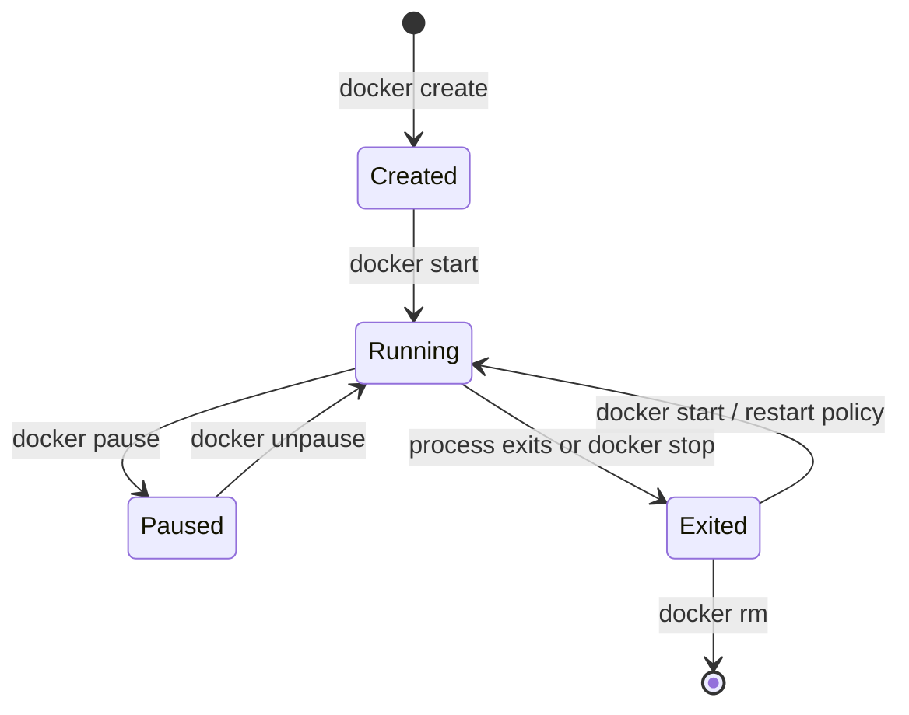
`docker stop` sends SIGTERM, waits 10 s (configurable `--stop-timeout`), then SIGKILL (exit 137). ASP.NET Core's host shutdown timeout defaults to 30 s in .NET 8+, so raise the stop timeout (or orchestrator `terminationGracePeriodSeconds`) to match so in-flight requests complete.

CI build in Azure (no local Docker):
```powershell
az acr build --registry myregistry --image orders-api:1.0.0 --file Orders.Api/Dockerfile .
```

### Why it exists
Separating build-time and run-time yields immutable artifacts and fast, repeatable start.

### When NOT to run containers by hand
Anything multi-container or production → Compose (dev), ACA/AKS (prod).

### Mistakes
- Huge build context (10 s upload before build starts).
- No resource limits → one container OOMs the host.
- No restart policy on single-host prod.
- Using `docker run` for multi-service stacks.
- Ignoring SIGTERM handling → dropped requests on deploy.

### Performance / reliability
Layer cache, BuildKit parallelism, registry cache; graceful shutdown + readiness probes for zero-downtime rollouts.

### Troubleshooting
`docker ps -a` (exit status), `docker logs --tail 100 -f`, `docker inspect --format '{{.State.ExitCode}} {{.State.OOMKilled}}' c`, `docker run --rm -it --entrypoint sh image`.

### Interview Q&A
**Q: What happens on `docker stop`?** SIGTERM → grace period → SIGKILL. Exit 143 = terminated by SIGTERM; 137 = SIGKILL (or OOM kill).
**Q: How do you ensure graceful shutdown in ASP.NET Core?** Use `IHostApplicationLifetime`, honour `CancellationToken` in handlers/background services, set `HostOptions.ShutdownTimeout`, use exec-form entrypoint, align orchestrator grace period; readiness probe flips to unhealthy first (`preStop` sleep) so traffic drains.

---

## 11. Port mapping

### Simple explanation
A container's port is private. `-p 8080:80` says "traffic hitting **host port 8080** should be forwarded to **container port 80**".

### Architect-level depth
Format: `-p [hostIP:]hostPort:containerPort[/proto]`. In bridge mode Docker programs **iptables/nftables DNAT** rules (plus a `docker-proxy` for loopback/userland cases). `-P` publishes all `EXPOSE`d ports to random high ports. `--network host` skips NAT (Linux only).

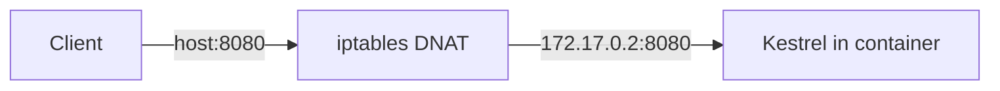
Binding: Kestrel must listen on `0.0.0.0`/`[::]` inside the container (`ASPNETCORE_HTTP_PORTS=8080` or `http://+:8080`). `localhost` inside a container is the container itself.

Compose:
```yaml
services:
  api:
    image: orders-api:dev
    ports:
      - "127.0.0.1:5000:8080"   # reachable only from the host
```

### Why it exists
Network isolation by default; explicit exposure of only what you need.

### Real-world
Dev: publish to localhost. Prod on ACA/AKS: you don't publish host ports; the platform ingress/load balancer routes to the **target port**.

### When NOT to publish ports
Internal services (DB, cache, queue) — keep them on a private network with no `ports:`; other containers reach them by service name. Docker publishes on `0.0.0.0` by default and **bypasses ufw/firewalld** rules — bind to `127.0.0.1` where possible.

### Mistakes
- Publishing the SQL Server port (1433) on a public host.
- Mixing up `host:container` order.
- Port conflicts (`address already in use`).
- Kestrel bound to localhost.
- Using `EXPOSE` and expecting access.

### Troubleshooting
```powershell
docker port orders-api
docker inspect -f '{{json .NetworkSettings.Ports}}' orders-api
curl -v http://localhost:8080/health/live
docker exec orders-api sh -c "ss -ltnp"      # not in chiseled; use a debug sidecar
```
Windows: `netstat -ano | findstr :8080`. Check host firewall/NSG; on Azure check ingress target port equals the container's port (a common ACA misconfiguration → 502/connection refused).

### Interview Q&A
**Q: Why does my API work inside the container (`curl localhost`) but not from the host?** Kestrel bound to loopback, or port not published, or wrong mapping.
**Q: Difference between EXPOSE and -p?** Documentation vs actual publishing.
**Follow-up: Why is Docker exposing my port despite a host firewall?** Docker inserts its own iptables rules in the `DOCKER` chain before ufw's rules; use `127.0.0.1:` binding or the `DOCKER-USER` chain.

---

## 12. Environment variables

### Simple explanation
Key/value settings given to the process at start: `-e KEY=value`. The standard way to configure a container **without rebuilding the image** (12-factor "config in the environment").

### Architect-level depth
ASP.NET Core's `WebApplication.CreateBuilder` loads configuration providers in order (later wins): `appsettings.json` → `appsettings.{Environment}.json` → user secrets (Development) → **environment variables** → command-line args. Hierarchy uses `__` (double underscore) in env var names because `:` is not valid in many shells:

| JSON path | Env var |
|---|---|
| `ConnectionStrings:Default` | `ConnectionStrings__Default` |
| `Logging:LogLevel:Default` | `Logging__LogLevel__Default` |
| `Jwt:Authority` | `Jwt__Authority` |
| array item `Cors:Origins:0` | `Cors__Origins__0` |

Special .NET variables: `ASPNETCORE_ENVIRONMENT`, `ASPNETCORE_HTTP_PORTS`, `ASPNETCORE_URLS`, `DOTNET_gcServer`, `DOTNET_GCHeapHardLimit`, `DOTNET_SYSTEM_GLOBALIZATION_INVARIANT`, `DOTNET_EnableDiagnostics=0` (disable diagnostics IPC in locked-down containers).

```csharp
var builder = WebApplication.CreateBuilder(args);          // env vars already included
var cs = builder.Configuration.GetConnectionString("Default");
```
Compose:
```yaml
services:
  api:
    image: orders-api:dev
    environment:
      ASPNETCORE_ENVIRONMENT: Development
      ConnectionStrings__Default: "Server=sql;Database=Orders;User Id=sa;Password=${SA_PASSWORD};TrustServerCertificate=true"
    env_file: [ .env.api ]
```

### Why it exists
One immutable image, many environments. Config separate from code.

### Real-world
ACA/App Service "Application settings" are injected as env vars; Key Vault references (`@Microsoft.KeyVault(...)` in App Service, secret refs in ACA) resolve at runtime.

### When NOT to use env vars
**Secrets** at high sensitivity: env vars leak through `docker inspect`, `/proc/<pid>/environ`, crash dumps and logs. Prefer mounted secret files (`/run/secrets/...`), Key Vault + managed identity, or orchestrator secrets. Large structured config → mounted file/App Configuration.

### Advantages / trade-offs
+ Universal, simple, language-agnostic; – flat strings, no change notification, visible to anyone who can inspect the container, require restart to change.

### Mistakes
- Baking `ENV` with secrets in Dockerfile.
- Using `:` separators in env names on Linux shells.
- Case/typo mismatches silently fall back to defaults — validate with `ValidateOnStart`.
- `.env` files committed to git.
- `ASPNETCORE_ENVIRONMENT=Development` in production (exposes developer exception page).

### Troubleshooting
`docker exec c printenv` (not on chiseled → `docker inspect -f '{{.Config.Env}}' c`); log effective config via `IConfigurationRoot.GetDebugView()` (redact secrets) in Development only.

### Interview Q&A
**Q: Why `__` instead of `:`?** Colon isn't portable in env var names; ASP.NET Core's env provider translates `__` to `:`.
**Q: How do you override a nested JSON setting in Kubernetes?** `env:` entries with `Section__Key`, from ConfigMap/Secret.
**Follow-up: Which wins, env var or appsettings.json?** Env var (registered later). Command-line wins over both.

---

## 13. Application configuration

### Simple explanation
How the app finds settings, and how you inject them safely across dev/test/prod without rebuilding.

### Architect-level depth
Layers (from least to most specific):
1. **Defaults baked in the image**: `appsettings.json` (non-secret defaults only).
2. **Environment-specific files** mounted or env vars.
3. **Environment variables** (ConfigMap-equivalent).
4. **Secrets**: file mounts / Key Vault.
5. **Central config service**: Azure App Configuration with feature flags & refresh.

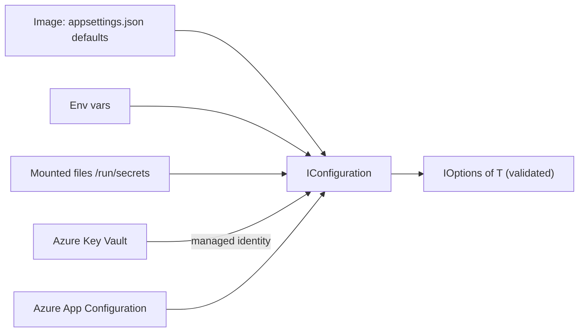

Typed, validated options:
```csharp
public sealed class JwtOptions
{
    [Required] public string Authority { get; init; } = default!;
    [Required] public string Audience  { get; init; } = default!;
}

builder.Services.AddOptions<JwtOptions>()
    .Bind(builder.Configuration.GetSection("Jwt"))
    .ValidateDataAnnotations()
    .ValidateOnStart();                 // fail fast in the container, orchestrator shows CrashLoop

// Docker/K8s secrets as files: each file name = key, content = value
builder.Configuration.AddKeyPerFile("/run/secrets", optional: true);

// Key Vault with managed identity (no secret to store)
builder.Configuration.AddAzureKeyVault(
    new Uri(builder.Configuration["KeyVault:Uri"]!), new DefaultAzureCredential());
```
Docker Compose secrets:
```yaml
services:
  api:
    secrets: [ sql_password ]
    # The file /run/secrets/sql_password is picked up by AddKeyPerFile as key "sql_password";
    # build the connection string in code from it (e.g. via a SqlConnectionStringBuilder).
secrets:
  sql_password:
    file: ./secrets/sql_password.txt
```
`IOptionsMonitor<T>` reacts to changes in file-based providers (`reloadOnChange`), but Kubernetes ConfigMap volume updates are eventually consistent and don't work with `subPath` mounts.

### Why it exists
Same artifact promoted across environments (build once, deploy many); security boundaries between code and secrets.

### Real-world
Prod secrets from Key Vault via managed identity; feature flags from App Configuration; non-secret tuning via env vars; EF migrations connection strings via distinct identities.

### When NOT to do
Don't build per-environment images; don't keep production secrets in repos or `.env` files; don't use a config service for hot-path values without caching.

### Trade-offs
Files give structure and size; env vars give simplicity; Key Vault gives audit/rotation but adds startup dependency and latency — cache and handle outage (start with last known values).

### Mistakes
No validation (typo → silent default); config that differs structurally per environment; secrets in image; reading config on each request with `IConfiguration` indexer; relying on `appsettings.Production.json` copied into image with passwords.

### Security / reliability
Least-privilege identities (Key Vault *Secrets User* role only), rotate secrets, `ValidateOnStart`, redaction in logs. Startup probe should allow time for Key Vault/App Config fetch.

### Troubleshooting
App starts with wrong DB → print effective, redacted config at startup; check precedence; confirm env var spelling; check the secret mount path exists (`ls /run/secrets` via debug container).

### Interview Q&A
**Q: How do you configure the same image for dev, test and prod?** Environment variables + mounted secrets + managed identity; no rebuild; `ASPNETCORE_ENVIRONMENT` selects environment-specific files.
**Q: How do you handle secrets in containers on Azure?** Managed identity → Key Vault (no credentials at all) or ACA/App Service secret references; avoid env-var plaintext in IaC (use Key Vault references).
**Follow-up: Config change without restart?** `IOptionsMonitor` + App Configuration refresh / file reload; but env var changes always require restart/new revision.

---

# Part C – Data and networking

## 14. Docker volumes

### Simple explanation
A container's own filesystem disappears when the container is removed. A **volume** is storage managed by Docker that **outlives the container** and can be shared.

### Architect-level depth
- Created with `docker volume create` or implicitly by `-v name:/path` / Compose `volumes:`. Stored under `/var/lib/docker/volumes/<name>/_data` (on Docker Desktop, inside the VM).
- Bypasses the union filesystem → **native write performance**, no copy-up.
- Pluggable **volume drivers** (NFS, Azure Files via CIFS, cloud disks). First-write **copy-up of image content**: an empty named volume mounted over a path with existing image content is pre-populated from the image.
- Types: **named volume**, **anonymous volume**, **tmpfs** (memory only; secrets/scratch).

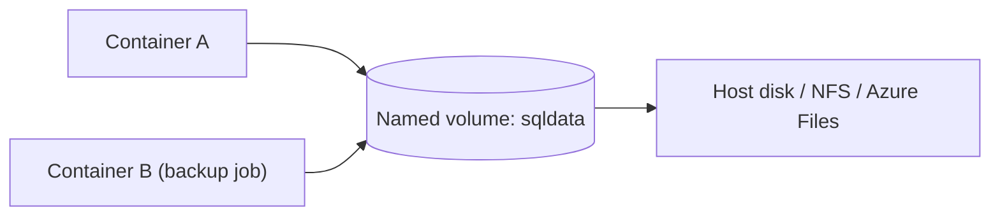
SQL Server dev container with persistent data:
```yaml
services:
  sql:
    image: mcr.microsoft.com/mssql/server:2022-latest
    environment:
      ACCEPT_EULA: "Y"
      MSSQL_SA_PASSWORD: ${SA_PASSWORD}
    volumes:
      - sqldata:/var/opt/mssql
volumes:
  sqldata:
```
Azure equivalents: **Azure Files** mounted into Container Apps/ACI (shared, SMB/NFS, slower), **managed disks** via AKS PersistentVolumeClaims (single-writer, fast), **Blob** via CSI/blobfuse (throughput, not POSIX-perfect). App Service Linux containers: `/home` persisted via Azure Storage (`WEBSITES_ENABLE_APP_SERVICE_STORAGE`).

### Why it exists
Containers are ephemeral by design; state (DBs, uploads, Data Protection keys) needs a lifecycle independent of the container.

### Real-world use cases
Local DB dev, ASP.NET Core Data Protection key ring shared by replicas, uploads, Elasticsearch data dir, build caches.

### When to use / NOT
Use for state that must survive restarts on a single host. **Do not** treat volumes as a production HA/storage strategy for databases — a volume on one host is a single point of failure with no replication. For production state prefer managed services (Azure SQL, Cosmos DB, Blob, Redis); for k8s stateful workloads use StatefulSets + replicated storage + backups.

### Advantages / disadvantages
+ Fast, Docker-managed, portable across hosts (via drivers), backup-friendly; – host-local by default, not replicated, easy to orphan (`docker volume ls -f dangling=true`), permission mismatches with non-root `app` user.

### Mistakes
- Expecting data to persist without a volume.
- Anonymous volumes silently piling up.
- `docker compose down -v` wiping the database.
- Non-root user lacking write permission (`chown`/`fsGroup`; in Dockerfile `COPY --chown=app:app`, create dir before `USER app`).
- Shared writes to a SQLite/LiteDB file across replicas.
- ASP.NET Data Protection keys in container FS → every redeploy invalidates auth cookies/antiforgery tokens: `services.AddDataProtection().PersistKeysToAzureBlobStorage(...).ProtectKeysWithAzureKeyVault(...)`.

### Performance / reliability / security
Use local SSD-backed volumes for IO-heavy work; Azure Files has latency (avoid for DB files); back up with `docker run --rm -v vol:/data -v $PWD:/b alpine tar czf /b/vol.tgz /data`; encrypt at rest on cloud disks; set mounts `:ro` when possible.

### Troubleshooting
`docker volume inspect`, `docker system df -v`, `docker run --rm -v vol:/d alpine ls -la /d` for permissions, `docker exec ... df -h`.

### Interview Q&A
**Q: Volume vs bind mount vs tmpfs?** Volume = Docker-managed persistent; bind mount = specific host path; tmpfs = RAM, never persisted.
**Q: Why do users get logged out after every deployment?** Data Protection keys were stored in the ephemeral container FS; persist/share them (Blob + Key Vault).
**Follow-up: Would you run SQL Server in a container in production?** Only with justification (e.g., licensing/edge/CI); prefer Azure SQL/MI. If needed: StatefulSet, premium disks, AG/replicas, backups to Blob, resource requests/limits, and a tested restore.

---

## 15. Bind mounts

### Simple explanation
A bind mount maps **a specific folder/file on the host** into the container. Edits on either side are visible instantly.

### Architect-level depth
`-v /host/path:/container/path` or `--mount type=bind,source=...,target=...,readonly`. Uses the host's filesystem directly; the path **must exist** (with `--mount`, else error; with `-v`, Docker creates a root-owned directory). Permissions are by UID/GID numbers — the container's `app` (1654) user must match host file ownership. On Docker Desktop/WSL2, files on the Windows drive (`/mnt/c`) cross a 9P/virtiofs boundary and are **much slower** than the WSL2 ext4 filesystem.

Developer inner loop with hot reload:
```yaml
services:
  api:
    build:
      context: .
      target: dev            # dev stage with SDK
    command: ["dotnet", "watch", "run", "--project", "Orders.Api", "--no-launch-profile", "--urls", "http://+:8080"]
    volumes:
      - ./:/src
    ports: ["8080:8080"]
    environment:
      DOTNET_USE_POLLING_FILE_WATCHER: "true"   # needed on some mounts
```
Also commonly: mounting a dev HTTPS cert (`~/.aspnet/https`) and `appsettings.Local.json`; Compose `develop: watch:` (sync/rebuild) is a modern alternative.

### Why it exists
Share files between host and container for development, config injection and log access.

### When to use / NOT
Use for **local dev**, mounting config/certs read-only, reading logs. **Don't** use in production: ties container to a host's path layout, breaks portability, risk of host exposure. Never bind-mount `/var/run/docker.sock`, `/`, `/etc`, or `/proc` into app containers.

### Advantages / disadvantages
+ Instant feedback, no copy, simple; – host-dependent, permission/ownership issues, slow on Windows paths, can expose host files, behaves differently from prod.

### Mistakes
- Mounting over the app directory in a "production" compose file (hides the published binaries).
- Read-write mounts of sensitive files.
- Line-ending issues (CRLF in shell scripts → `bad interpreter`).
- Case-sensitivity differences (Windows host vs Linux container: `Appsettings.json`).
- Anonymous volume + bind mount shadowing `obj/bin` conflicts between host (Windows) and container (Linux) builds.

### Security
Use `:ro`; limit to required paths; run as non-root; a writable bind mount lets a compromised container modify host files.

### Troubleshooting
`docker inspect -f '{{json .Mounts}}' c`; `ls -ln` in container to see numeric owners; check Docker Desktop file-sharing settings; ensure the project lives in WSL2's filesystem for speed.

### Interview Q&A
**Q: Bind mount vs volume — when each?** Bind for dev/host integration; volume for Docker-managed persistent data and production-like behaviour.
**Follow-up: Why might `dotnet watch` not detect changes in a bind-mounted folder?** inotify events don't cross some VM/file-share boundaries; use `DOTNET_USE_POLLING_FILE_WATCHER=true` or move sources into WSL2.

---

## 16. Docker networking

### Simple explanation
Containers get their own virtual network. Containers on the **same user-defined network can reach each other by name** (e.g., `sql`, `redis`), and you choose what is exposed to the outside.

### Architect-level depth
Drivers:
| Driver | Behaviour | Use |
|---|---|---|
| **bridge** (default `docker0`) | Private subnet, NAT to host; default bridge has **no DNS by name** | Legacy; avoid |
| **user-defined bridge** | Embedded DNS (127.0.0.11), isolation per network | **Standard for single-host multi-container** |
| **host** | Shares host network stack; no NAT | Max performance, port conflicts, Linux only |
| **none** | No network | Isolated batch/security |
| **overlay** | Multi-host via VXLAN (Swarm) | Multi-host Docker (rare today) |
| **macvlan/ipvlan** | Container gets LAN IP | Legacy integrations |

How it works: each container has its own **network namespace** with a `veth` pair connected to a Linux bridge; Docker adds iptables NAT (MASQUERADE outbound, DNAT for published ports); the embedded DNS resolves service/container names and Compose service aliases.

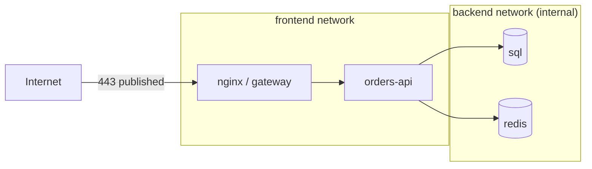
Compose with segmented networks:
```yaml
services:
  gateway: { image: nginx, networks: [frontend], ports: ["443:443"] }
  api:     { image: orders-api, networks: [frontend, backend] }
  sql:     { image: mcr.microsoft.com/mssql/server:2022-latest, networks: [backend] }
networks:
  frontend:
  backend:
    internal: true        # no outbound internet or host access
```
Connection string uses **service name** and the **container port**, not the published port: `Server=sql,1433`. In .NET, `HttpClient` to another service: `http://catalog-api:8080` (`IHttpClientFactory` named client). Container-to-host: `host.docker.internal`.

Azure analogues: ACA environments (VNet integration, internal ingress), AKS CNI/Kubernetes Services + NetworkPolicy, Private Endpoints for ACR/SQL/Service Bus, NSGs.

### Why it exists
Isolation + service discovery + controlled exposure on a shared host.

### Real-world
Local microservice dev stacks; segmenting DB from ingress; mimicking prod topology.

### When to use / NOT
User-defined bridges for almost everything on one host. `host` networking only for network-heavy tools/perf tests. Don't use legacy `--link`.

### Advantages / disadvantages
+ Name-based discovery, segmentation; – NAT overhead (small), iptables complexity, DNS quirks (search domains, resolver config), overlay complexity.

### Mistakes
- Using `localhost` to reach another container.
- Using the published (host) port between containers.
- Relying on container IPs (they change).
- Everything on one flat network, DB published to the internet.
- Default bridge and expecting DNS.
- Starting API before SQL is ready (see `depends_on: condition: service_healthy`) — but also implement **retry with backoff** (`EnableRetryOnFailure`) because dependencies restart.
- MTU mismatch in VPN/Azure overlay causing hangs on large requests.

### Performance / reliability / security
Bridge adds NAT overhead; `host` removes it. Enable `internal` networks, avoid publishing internals, mTLS/service mesh in K8s, NetworkPolicies, private endpoints in Azure. Connection pooling (`HttpClient` via `IHttpClientFactory`, SQL pool) matters more than the bridge.

### Troubleshooting
```powershell
docker network ls ; docker network inspect backend
docker exec api getent hosts sql          # DNS (may not exist in chiseled)
docker run --rm -it --network container:api nicolaka/netshoot   # curl, dig, ss, tcpdump in same netns
docker compose logs -f api
```
Symptoms: "Name or service not known" → different networks / typo / service not up; "Connection refused" → wrong port or app bound to localhost; timeouts → firewall/NSG/MTU/DNS.

### Interview Q&A
**Q: How do two containers find each other?** Same user-defined network + Docker's embedded DNS resolving container/service names.
**Q: Why can't my API reach SQL by `localhost:1433`?** `localhost` is the API container's own namespace; use the service name.
**Follow-up: Bridge vs host networking trade-off?** Bridge gives isolation and port remapping with small NAT cost; host gives zero NAT overhead but port collisions and no isolation.
**Follow-up: How is this different in Kubernetes?** Flat pod network (CNI), Services (ClusterIP + kube-proxy/eBPF), CoreDNS, NetworkPolicy, Ingress.

---

## 17. Docker Compose

### Simple explanation
A YAML file describing **a whole application stack** (API, DB, cache, queue) so one command starts everything: `docker compose up`.

### Architect-level depth
Compose v2 (`docker compose`, a CLI plugin; no `version:` key). The Compose Specification defines `services`, `networks`, `volumes`, `configs`, `secrets`. Compose creates a default project network, DNS names per service, and manages dependency ordering with `depends_on` conditions.

Realistic .NET stack:
```yaml
name: orders
services:
  api:
    build:
      context: .
      dockerfile: Orders.Api/Dockerfile
    image: orders-api:dev
    ports: ["8080:8080"]
    environment:
      ASPNETCORE_ENVIRONMENT: Development
      ConnectionStrings__Default: "Server=sql,1433;Database=Orders;User Id=sa;Password=${SA_PASSWORD};TrustServerCertificate=true"
      Redis__Configuration: "redis:6379"
      ServiceBus__ConnectionString: "Endpoint=sb://sbemulator;SharedAccessKeyName=RootManageSharedAccessKey;SharedAccessKey=SAS_KEY_VALUE;UseDevelopmentEmulator=true;"
    depends_on:
      sql:   { condition: service_healthy }
      redis: { condition: service_started }
    restart: unless-stopped
    deploy:
      resources:
        limits: { cpus: "1.0", memory: 512M }
    # Chiseled images have no curl/shell, so an in-container healthcheck needs a Debian image with curl
    # (test: ["CMD", "curl", "-f", "http://localhost:8080/health/ready"]) or a tiny probe binary.
    # In orchestrators (ACA/AKS) use platform HTTP probes against /health/live and /health/ready instead.

  sql:
    image: mcr.microsoft.com/mssql/server:2022-latest
    environment:
      ACCEPT_EULA: "Y"
      MSSQL_SA_PASSWORD: ${SA_PASSWORD}
    volumes: [ sqldata:/var/opt/mssql ]
    healthcheck:
      test: ["CMD-SHELL", "/opt/mssql-tools18/bin/sqlcmd -C -S localhost -U sa -P \"$$MSSQL_SA_PASSWORD\" -Q 'SELECT 1' || exit 1"]
      interval: 10s
      retries: 10
      start_period: 30s

  redis:
    image: redis:7-alpine

volumes:
  sqldata:
```
Useful commands: `docker compose up -d --build`, `docker compose logs -f api`, `docker compose ps`, `docker compose exec api sh`, `docker compose down` (keep volumes) vs `down -v` (delete data), `docker compose config` (render merged config), `--profile` for optional services, multiple files (`-f compose.yml -f compose.override.yml`), `docker compose watch`.

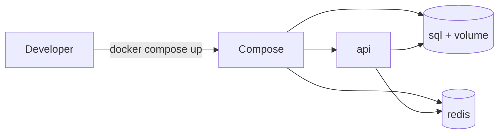

### Why it exists
Multi-container apps are tedious to start with raw `docker run`. Compose captures topology, networks, volumes and config as code → onboarding in minutes, reproducible integration tests (`Testcontainers` for .NET is an alternative embedded in tests).

### Real-world
Local dev; CI integration/E2E tests; small single-host deployments; demo environments; contract tests with WireMock containers.

### When to use / NOT
Use for dev/test/small deployments. **Not** a production orchestrator: no multi-node scheduling, rolling updates with health-gated traffic shifting, autoscaling, or self-healing across hosts → use ACA/AKS/App Service. (Production Compose on a single VM is acceptable only for low-criticality workloads.)

### Advantages / disadvantages
+ Simple, declarative, great DX; – single host, limited deployment strategies, `depends_on` is startup-ordering not readiness of your app logic, drifts from prod manifests.

### Mistakes
- Assuming `depends_on` guarantees DB readiness without healthcheck/retries.
- Committing `.env` with secrets; using `latest` images.
- `ports:` on every service.
- Using SA password simple/invalid (SQL Server requires complexity or container exits).
- Different configs in compose vs prod (use `compose.override.yml` carefully).
- Not setting `name:` so volumes/networks collide across projects.

### Performance / reliability / security
Set resource limits; healthchecks; restart policies; secrets not env; avoid privileged containers; pin image versions; use `docker compose config` in CI to validate.

### Troubleshooting
`docker compose ps -a`, `docker compose logs --tail=200 sql`, `docker compose config`, `docker compose events`; SQL container exits → check password policy and EULA; port conflicts; stale volumes with old SA password (volume keeps the old credential!).

### Interview Q&A
**Q: Compose vs Kubernetes?** Compose = single-host developer/test orchestration; Kubernetes = cluster-level orchestration with scheduling, self-healing, rolling updates, autoscaling, RBAC.
**Q: Does `depends_on` wait until SQL accepts connections?** Only with `condition: service_healthy` and a real healthcheck; also code retries (`EnableRetryOnFailure`, Polly) because transient failures are normal in production.
**Follow-up: How would you do integration tests with real SQL in CI?** Testcontainers (per-test-run SQL container, migrations applied, `WebApplicationFactory`) or Compose in the pipeline with healthchecks; clean DB per test via Respawn.

**Tie-in (database performance):** local SQL Server in Compose is an excellent place to reproduce slow queries: enable Query Store, capture the actual execution plan, compare with `SET STATISTICS IO, TIME ON`, and verify the fix before it reaches Azure SQL. Remember container CPU/memory limits skew performance results — match prod sizing when benchmarking.

---

# Part D – Operations

## 18. Container logs

### Simple explanation
Containers should write logs to **stdout/stderr**. Docker (or the platform) captures them; you read them with `docker logs`, and ship them to a central system.

### Architect-level depth
The runtime captures the process's stdout/stderr and hands it to a **logging driver**: `json-file` (default; files under `/var/lib/docker/containers/<id>/<id>-json.log`), `local` (rotated, compact), `journald`, `syslog`, `fluentd`, `gelf`. `docker logs` works only with some drivers. In Kubernetes the kubelet writes to `/var/log/containers/*.log` and agents (Fluent Bit, Azure Monitor agent) tail them.

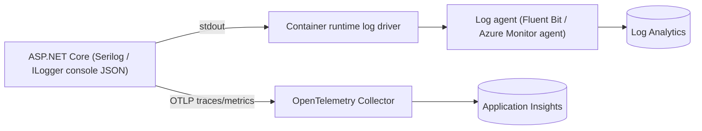
ASP.NET Core:
```csharp
builder.Logging.ClearProviders();
builder.Logging.AddJsonConsole(o =>               // structured, one JSON object per line
{
    o.IncludeScopes = true;
    o.UseUtcTimestamp = true;
});

// OpenTelemetry to Azure Monitor
builder.Services.AddOpenTelemetry()
    .UseAzureMonitor()                              // Azure.Monitor.OpenTelemetry.AspNetCore
    .WithTracing(t => t.AddSource("Orders"));
```
Rotation (plain Docker): `--log-opt max-size=10m --log-opt max-file=3` or `daemon.json`. Compose: `logging: { driver: json-file, options: { max-size: "10m", max-file: "3" } }`.

Azure: ACA writes console logs to `ContainerAppConsoleLogs_CL` in Log Analytics; App Service uses *Log stream* / diagnostics; AKS uses Container Insights (`ContainerLogV2`).
KQL example:
```kusto
ContainerAppConsoleLogs_CL
| where ContainerAppName_s == "orders-api" and Log_s has "error"
| order by TimeGenerated desc | take 100
```

### Why it exists
Ephemeral containers can't keep local log files — once the container is gone, so are its files. stdout aggregation is the 12-factor approach and lets the platform handle collection.

### Real-world
Correlate logs by `TraceId` / `CorrelationId`; alert on error rates; dashboards per revision.

### When NOT to do
Don't write rolling log files inside the container (lost on restart; fill the writable layer). Don't log secrets/PII. Don't log at Debug in prod by default (cost + perf).

### Advantages / trade-offs
+ Simple, platform-agnostic, centralised; – JSON `json-file` driver without rotation fills disks; multi-line stack traces split across entries unless JSON; log ingestion cost; sampling vs completeness.

### Mistakes
- No log rotation → disk full → outage.
- Plain-text multi-line logs that agents split.
- Logging to file inside container.
- Blocking/synchronous log sinks on the request path.
- Missing correlation IDs across services.
- Logging full request bodies (PII, volume).

### Performance / reliability / security
Use async/batched sinks; sample traces; keep log levels configurable via env var (`Logging__LogLevel__Default=Warning`); protect Log Analytics via RBAC; mask PII.

### Troubleshooting
```powershell
docker logs --since 10m --tail 200 -f orders-api
docker compose logs -f --no-log-prefix api
docker inspect -f '{{.HostConfig.LogConfig}}' orders-api
az containerapp logs show -n orders-api -g rg-orders --follow
```
No logs at all? Check that the app writes to stdout (not file), that the logging driver supports `docker logs`, and that the container didn't crash before the logger initialised (startup exceptions: log in `catch` in `Program.cs`).

### Interview Q&A
**Q: Where should a containerised ASP.NET Core app log?** stdout/stderr, structured JSON, and ship via agent/OpenTelemetry; no local files.
**Q: A host went down due to disk full; Docker was healthy yesterday. Why?** Unbounded `json-file` logs. Add rotation, central shipping and disk alerts.
**Follow-up: How do you trace a request across 6 microservices?** W3C `traceparent` propagation (automatic in ASP.NET Core/HttpClient), OpenTelemetry, Application Insights Application Map, a correlation ID in logs.

---

## 19. Container troubleshooting

### Simple explanation
When a container misbehaves, follow a fixed routine: **Is it running? Why did it stop? What does it say? Can it reach what it needs? Is it resource-starved?**

### Architect-level depth — a systematic runbook
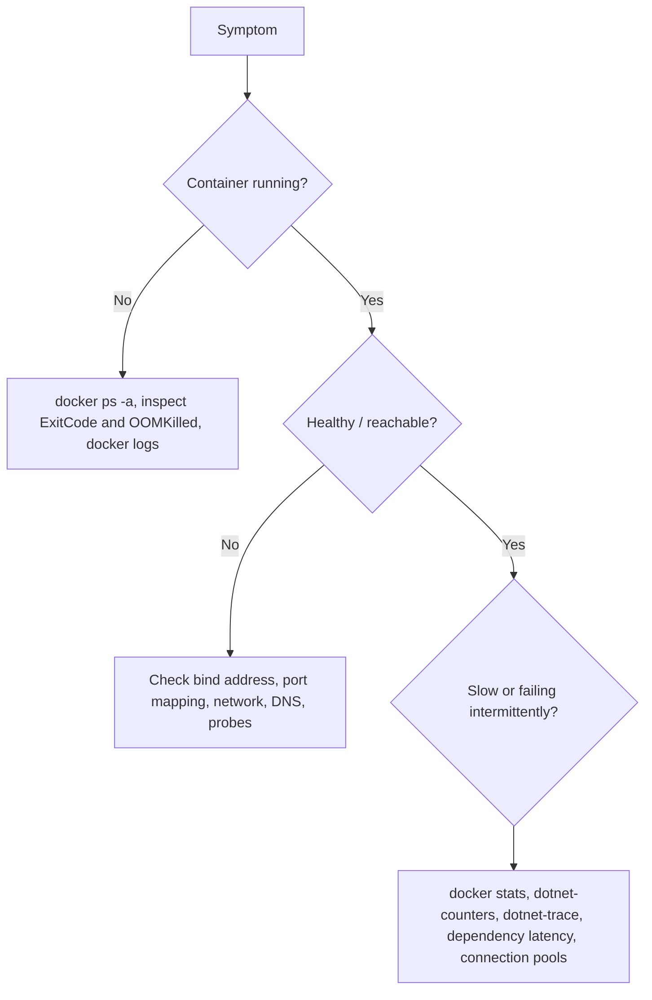
**Step 1 – state & exit code**
```powershell
docker ps -a
docker inspect -f '{{.State.Status}} exit={{.State.ExitCode}} oom={{.State.OOMKilled}} err={{.State.Error}}' orders-api
docker events --since 30m --filter container=orders-api
```
| Exit code | Meaning | Typical .NET cause |
|---|---|---|
| 0 | Clean exit | Console app finished, or host stopped (no `app.Run()`) |
| 1 | Unhandled exception | Config missing, `ValidateOnStart` failure, DB migration failure |
| 125/126/127 | Docker error / not executable / not found | Wrong ENTRYPOINT, missing file, CRLF script |
| 134 | SIGABRT | Native crash, ICU load failure |
| **137** | SIGKILL | **OOM kill** (check `OOMKilled`) or `docker stop` timeout |
| 139 | SIGSEGV | Native library bug / arch mismatch (amd64 image on arm) |
| **143** | SIGTERM | Normal graceful stop |

**Step 2 – logs, config, mounts**: `docker logs`, `docker inspect` (env, mounts, network, health log under `.State.Health`).
**Step 3 – get inside**: `docker exec -it c sh` (works on Debian/Alpine); for chiseled/distroless use a **debug container sharing namespaces**:
```powershell
docker run --rm -it --pid=container:orders-api --network=container:orders-api --cap-add=SYS_PTRACE nicolaka/netshoot
# Kubernetes
kubectl debug -it pod/orders-api-xyz --image=mcr.microsoft.com/dotnet/sdk:10.0 --target=orders-api
# Azure Container Apps
az containerapp exec -n orders-api -g rg-orders --command sh
```
**Step 4 – resources**: `docker stats --no-stream`, `docker top`, `docker system df`. Check limits: `docker inspect -f '{{.HostConfig.Memory}} {{.HostConfig.NanoCpus}}'`.
**Step 5 – .NET-specific diagnostics** (works in containers; share `/tmp` between app and tool container because the diagnostic IPC socket lives there):
```powershell
dotnet-counters monitor -p 1 --counters System.Runtime,Microsoft.AspNetCore.Hosting
dotnet-trace collect -p 1 --duration 00:00:30
dotnet-gcdump collect -p 1
dotnet-dump collect -p 1     # then analyze: clrthreads, dumpheap -stat, syncblk, clrstack
```
Run them from an SDK sidecar with `--pid=container:app` and a shared `/tmp` volume, or use **dotnet-monitor** as a sidecar exposing `/dump`, `/trace`, `/metrics`.

**Common failure patterns**
| Symptom | Likely cause | Fix |
|---|---|---|
| CrashLoopBackOff / restart loop | Startup exception, bad config, failed dependency, failing probe | Read logs from previous instance (`kubectl logs --previous`), add startup retry, tune startup probe |
| Exit 137 + OOMKilled | Memory limit too low / leak | Increase limit, fix leak (gcdump), tune `GCHeapHardLimit`, avoid large per-request buffers |
| Works locally, 502/refused in Azure | Wrong target port, bound to localhost, probe path 401 | Align `targetPort` with `ASPNETCORE_HTTP_PORTS`; allow anonymous health endpoints |
| High latency, low CPU | Thread pool starvation (sync-over-async), connection pool exhaustion, DNS | Async all the way, `dotnet-counters` (`ThreadPool Queue Length`), fix `HttpClient` lifetimes |
| Throttled CPU | cgroup CPU quota below needs | Raise limits; check `container_cpu_cfs_throttled` |
| "Permission denied" on write | Non-root user vs volume ownership | `chown`, `fsGroup`, writable `/tmp` emptyDir |
| `Name or service not known` | Network/DNS | Same network, correct service name |
| Time wrong/culture errors | Missing tzdata/ICU | `-extra` image or invariant globalization |
| SqlClient `certificate chain not trusted` | Dev SQL self-signed | `TrustServerCertificate=true` in dev only |

**.NET and cgroup limits**: the runtime reads cgroup limits — `Environment.ProcessorCount` equals the CPU limit (rounded up), thread pool and Server GC heap count scale with it; default managed heap cap = 75 % of memory limit. A 0.5 CPU limit gives `ProcessorCount=1`, which can starve the thread pool under bursts — consider ≥1 CPU for APIs. Override with `DOTNET_PROCESSOR_COUNT`, `DOTNET_GCHeapHardLimitPercent`.

### Why it exists
Distributed, ephemeral systems fail in ways local debugging can't reproduce; a repeatable runbook gets from symptom to cause fast and shows structured problem-solving.

### When NOT to
Don't `docker exec` and hot-patch prod containers (changes are lost and untracked); don't attach debuggers in prod without a plan; don't restart blindly before capturing evidence (dump/logs first).

### Mistakes
Restarting first (loses state), looking only at the last log lines, ignoring `OOMKilled`, not checking probes, comparing local (no limits) with prod (limits).

### Interview Q&A
**Q: A container restarts every minute in prod. Walk me through it.** Exit code and `OOMKilled`; previous-instance logs; probe configuration (liveness too aggressive, start-up slower than probe → use a startup probe); config/secrets present; dependency reachability; resource limits vs usage; recent change (revision/image diff); roll back to last good image while investigating.
**Q: API latency spikes only in the container.** CPU throttling due to limits; thread-pool starvation due to low `ProcessorCount`; DNS/connection setup; noisy neighbours; GC mode; compare `dotnet-counters`.
**Follow-up: How do you get a memory dump from a chiseled production pod?** `kubectl debug` ephemeral container with `dotnet-dump` and shared process namespace/`/tmp`, or dotnet-monitor sidecar writing to a mounted volume, then analyse offline.

---

## 20. Image optimization

### Simple explanation
Make images **small, fast to build/pull/start, and quiet in a vulnerability scan**.

### Architect-level depth
Levers (biggest first):
1. **Base image**: `aspnet:10.0-noble-chiseled` (or `-alpine`) instead of full Debian; `-composite` for startup.
2. **Multi-stage** — no SDK/build output in final.
3. **Layer order & `.dockerignore`** for cache hits and small context.
4. **Trim dependencies**: remove unused NuGet packages, `PublishTrimmed` (careful with reflection), `UseAppHost=false`, no `*.pdb` if not needed (`DebugType=none`), `InvariantGlobalization` when valid.
5. **ReadyToRun / Native AOT** for startup (trade: bigger or less flexible).
6. **Cleanup in same layer** (`apt-get clean`, `rm -rf /var/lib/apt/lists/*`) when you must install packages.
7. **Build cache sharing**: `--cache-from/--cache-to` registry or `type=gha`.
8. **Avoid duplicate large layers**: copy rarely-changing large assets in their own early layer.

Measure:
```powershell
docker images orders-api
docker history orders-api:dev
dive orders-api:dev
docker scout cves orders-api:dev      # or: trivy image orders-api:dev
```
Typical results for an ASP.NET Core API: SDK image ≈ 800 MB+; `aspnet` Debian ≈ 200 MB; Alpine ≈ 100–110 MB; chiseled ≈ 100 MB or less; trimmed/AOT chiseled-aot even smaller. (Exact sizes vary by tag — measure yours.)

Startup/scale-out perspective: image pull time directly delays autoscaled replicas (ACA/AKS). Use **ACR in the same region**, Artifact Streaming / geo-replication for large images, and image caching on nodes.

### Why it exists
Smaller = faster pulls, faster scale-out, lower registry/egress cost, fewer CVEs, quicker CI.

### Real-world
Scale-out events (Black Friday) bottleneck on cold pulls; security teams gate on CVE count; CI minutes cost money.

### When NOT to over-optimise
Trimming/AOT on reflection-heavy apps (EF Core, MediatR scanning, System.Text.Json with reflection) can break at runtime. Alpine with glibc-dependent natives. Don't spend days saving 20 MB if the real bottleneck is startup JIT or DB.

### Advantages / trade-offs
+ speed, cost, security; – compatibility risks (musl, trimming), harder debugging (no shell), time to maintain.

### Mistakes
Shipping SDK; leaving `bin/obj` in context; `COPY . .` first; huge `ENV`/`ARG` chains; separate RUNs that don't clean; embedding test data; not scanning; using `latest`.

### Performance / security
Prefer reproducible builds, SBOM (`docker buildx build --sbom=true --provenance=true`), signing (Notation/cosign), regular base-image rebuilds (Dependabot/Renovate + scheduled pipeline), ACR vulnerability scanning with Defender for Containers.

### Troubleshooting
Image unexpectedly large → `dive`/`docker history`; build always cold → check cache keys and `.dockerignore`; slow pulls → region/Artifact Streaming; runtime crash after trimming → add trimmer roots / `TrimmerRootAssembly`, test the trimmed build in CI.

### Interview Q&A
**Q: Your image is 1.2 GB. What do you do?** `docker history`/`dive` to find layers; multi-stage; switch to `aspnet` chiseled; remove build artifacts; `.dockerignore`; trim deps; verify.
**Q: Why does image size matter beyond disk?** Pull time on cold nodes → slower scale-out and rollout, bandwidth/egress cost, scan surface.
**Follow-up: AOT vs ReadyToRun?** R2R pre-compiles IL (faster start, still JIT-capable, larger); AOT produces native code, no JIT, tiny runtime-deps image but limits (reflection, dynamic loading) and requires compatible libraries.

---

## 21. Container security

### Simple explanation
Containers share the host kernel, so security is about **reducing what a compromised container can do** and **trusting what you run**.

### Architect-level depth — defence in depth
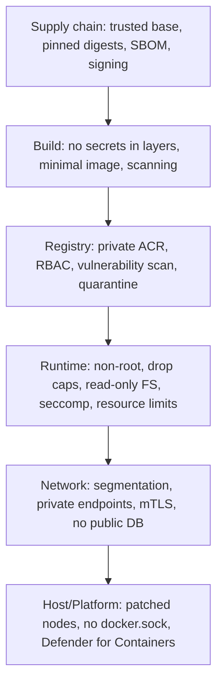
Controls and implementation:
| Area | Control | How |
|---|---|---|
| Identity | **Non-root** | `USER app` (UID 1654); `securityContext.runAsNonRoot: true` |
| Privileges | Drop capabilities, no `--privileged` | `--cap-drop=ALL`, `allowPrivilegeEscalation: false`, `--security-opt no-new-privileges` |
| Filesystem | Read-only root | `--read-only --tmpfs /tmp`; Kestrel/Data Protection write paths on volume |
| Syscalls | seccomp default profile | Keep Docker's default; AppArmor/SELinux |
| Resources | Limits | `--memory`, `--cpus`, `--pids-limit` against DoS/fork bombs |
| Secrets | Not in image/ENV/args | Key Vault + managed identity, BuildKit secret mounts |
| Images | Minimal + scanned + signed | chiseled, Trivy/Defender, Notation/cosign, ACR content trust |
| Registry | Private, RBAC, admin user disabled | AcrPull role to managed identity, private endpoint |
| Network | Least exposure | Internal networks, NSG, NetworkPolicy |
| Host | Patching, no docker.sock | Auto node image upgrades on AKS |
| Runtime detection | Threat detection | Defender for Containers, Falco |

Hardened Compose service:
```yaml
services:
  api:
    image: myregistry.azurecr.io/orders-api@sha256:...   # pinned digest
    read_only: true
    tmpfs: [ /tmp ]
    user: "1654:1654"
    cap_drop: [ ALL ]
    security_opt: [ "no-new-privileges:true" ]
    pids_limit: 200
    mem_limit: 512m
```
Kubernetes equivalent: `securityContext: { runAsNonRoot: true, readOnlyRootFilesystem: true, allowPrivilegeEscalation: false, capabilities: { drop: [ALL] }, seccompProfile: { type: RuntimeDefault } }`.

Azure: ACR with **managed identity pull** (no admin user), private endpoint, Defender for Containers scanning, Azure Policy for AKS (deny privileged), Key Vault secrets via CSI driver / workload identity.

API security tie-in: container hardening doesn't replace app security — validate JWTs (authority/audience/lifetime), authorisation policies, input validation, rate limiting (`AddRateLimiter`), CORS allow-lists, HTTPS/HSTS at the edge, security headers, parameterised SQL / EF Core, and secrets outside source. Terminate TLS at ingress/APIM and keep internal traffic locked to the network segment (mTLS where required).

### Why it exists
Shared kernel + public registries + fast deployment = a large attack surface (poisoned base images, leaked secrets, escape via misconfiguration, crypto-mining after RCE).

### Real-world incidents
Exposed Docker daemon on 2375 → cryptomining; secret baked in public image; `latest` pulled with a vulnerable/malicious dependency; container with `docker.sock` mounted → host compromise.

### When NOT to cut corners
Always apply the basics. Special cases (hostile multi-tenancy) → VM-level isolation / Hyper-V isolation / sandboxed runtimes.

### Advantages / trade-offs
+ Small blast radius, auditability; – operational friction (read-only FS needs writable mounts; non-root needs permission planning; scanning noise needs triage; chiseled lacks shell).

### Mistakes
Running as root; `--privileged`; mounting docker.sock; secrets in ENV/Dockerfile/compose files in git; unpinned/untrusted base images; no scanning or never rebuilding to pick up patches; ACR admin user shared in pipelines; exposing management ports (SQL, Redis) publicly; trusting image tags.

### Performance / reliability
Security options have negligible CPU cost; scanning in CI adds minutes (cache DBs); admission policies can block deployment — test in staging.

### Troubleshooting
`Permission denied` after enabling read-only/non-root → identify write paths (`docker diff`, strace in a debug container), mount tmpfs/volumes; scan failures → triage by exploitability (is the vulnerable package loaded? reachable?), update base; ACR pull `unauthorized` → check `AcrPull` role assignment, identity assignment on the app, private DNS for the registry.

### Interview Q&A
**Q: List 6 things you do to secure a container for an ASP.NET Core API.** Non-root chiseled image; digest pinning + signing + scanning; no secrets in image (Key Vault + managed identity); read-only FS, drop capabilities, no-new-privileges; resource limits; private network + least-exposure ingress; patch/rebuild cadence.
**Q: Why is mounting docker.sock dangerous?** Anyone with the socket can start a privileged container mounting `/` of the host → full host control.
**Follow-up: How would you stop a vulnerable image reaching prod?** CI gate on scan severity, ACR quarantine/ Defender scan, signature verification via Azure Policy/Ratify admission, deploy by digest only.

---

# Part E – Azure and orchestration

## 22. Deploying containers to Azure

### Simple explanation
Push your image to **Azure Container Registry (ACR)**, then tell an Azure compute service to run it. Pick the service by how much control vs. operational effort you want.

### Architect-level depth
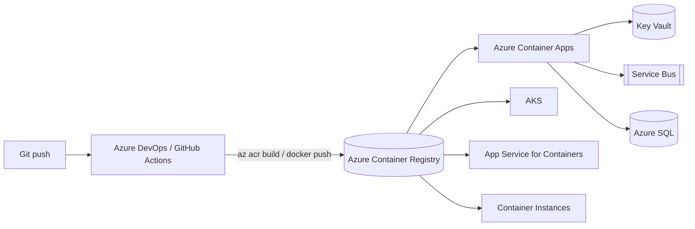
| Service | Model | Best for | Avoid when |
|---|---|---|---|
| **Azure Container Apps (ACA)** | Serverless containers on managed Kubernetes + KEDA + Dapr + Envoy; revisions; scale to zero | Microservices, APIs, event-driven workers, jobs — the default for new containerised .NET | You need raw Kubernetes API, custom operators/CRDs, daemonsets, node-level control |
| **AKS** | Managed Kubernetes control plane, you manage node pools/upgrades/networking | Large platforms, service mesh, custom controllers, GPU, platform team exists | Small team, few services (operational tax) |
| **App Service (Linux containers)** | PaaS web hosting with deployment slots | Single web app/API, simple lift-and-shift, slots for blue-green | Many microservices, event-driven scaling, sidecars |
| **Azure Container Instances (ACI)** | Single/group containers, per-second billing, no orchestration | Burst jobs, CI agents, quick tasks, virtual-node bursting | Long-running prod services needing rolling updates/autoscale |
| **Azure Functions (container)** | Event-driven functions in container | Custom runtimes/deps for functions | Plain APIs |
| **VM + Docker** | You run everything | Legacy, special needs | Anything that needs HA without work |

#### Build and push
```powershell
az group create -n rg-orders -l westeurope
az acr create -n myordersacr -g rg-orders --sku Standard --admin-enabled false
az acr build -r myordersacr -t orders-api:1.0.0 -f Orders.Api/Dockerfile .   # build in Azure, no local Docker
```
#### Run on Azure Container Apps with managed identity pulling from ACR
```powershell
az containerapp env create -n cae-orders -g rg-orders -l westeurope
az containerapp create -n orders-api -g rg-orders --environment cae-orders `
  --image myordersacr.azurecr.io/orders-api:1.0.0 `
  --registry-server myordersacr.azurecr.io --registry-identity system `
  --target-port 8080 --ingress external `
  --min-replicas 1 --max-replicas 10 `
  --cpu 0.5 --memory 1Gi `
  --env-vars ASPNETCORE_ENVIRONMENT=Production ConnectionStrings__Default=secretref:sql-conn `
  --secrets sql-conn=keyvaultref:https://kv-orders.vault.azure.net/secrets/sql-conn,identityref:system
az role assignment create --assignee <principalId> --role AcrPull --scope <acrId>
```
(Assign `AcrPull` to the identity *before* the first pull, or create with a user-assigned identity first.)

#### Bicep (infrastructure as code)
```bicep
param location string = resourceGroup().location
param image string

resource acr 'Microsoft.ContainerRegistry/registries@2023-07-01' existing = { name: 'myordersacr' }
resource uami 'Microsoft.ManagedIdentity/userAssignedIdentities@2023-01-31' = {
  name: 'id-orders-api'
  location: location
}
resource acrPull 'Microsoft.Authorization/roleAssignments@2022-04-01' = {
  name: guid(acr.id, uami.id, 'acrpull')
  scope: acr
  properties: {
    principalId: uami.properties.principalId
    principalType: 'ServicePrincipal'
    roleDefinitionId: subscriptionResourceId('Microsoft.Authorization/roleDefinitions', '7f951dda-4ed3-4680-a7ca-43fe172d538d') // AcrPull
  }
}
resource env 'Microsoft.App/managedEnvironments@2024-03-01' existing = { name: 'cae-orders' }
resource app 'Microsoft.App/containerApps@2024-03-01' = {
  name: 'orders-api'
  location: location
  identity: { type: 'UserAssigned', userAssignedIdentities: { '${uami.id}': {} } }
  dependsOn: [ acrPull ]
  properties: {
    managedEnvironmentId: env.id
    configuration: {
      ingress: { external: true, targetPort: 8080 }
      registries: [ { server: acr.properties.loginServer, identity: uami.id } ]
    }
    template: {
      containers: [ {
        name: 'api', image: image
        resources: { cpu: json('0.5'), memory: '1Gi' }
        probes: [
          { type: 'Liveness',  httpGet: { path: '/health/live',  port: 8080 } }
          { type: 'Readiness', httpGet: { path: '/health/ready', port: 8080 } }
        ]
      } ]
      scale: {
        minReplicas: 1
        maxReplicas: 10
        rules: [
          { name: 'http', http: { metadata: { concurrentRequests: '50' } } }
          { name: 'orders-queue', custom: {
              type: 'azure-servicebus'
              metadata: { queueName: 'orders', messageCount: '20' }
              identity: uami.id } }
        ]
      }
    }
  }
}
```
**Messaging tie-in**: a worker container scales on **Service Bus queue depth via KEDA**; consume with `ServiceBusProcessor` (peek-lock, `MaxConcurrentCalls`, `MaxAutoLockRenewalDuration`), complete/abandon/dead-letter, make handlers **idempotent** (at-least-once delivery), and use the outbox pattern when publishing after a DB commit (see [Event-Driven Architecture](../02-architectural-styles/04-event-driven-architecture/event-driven-architecture.md) and [Distributed Systems Patterns](../03-architectural-patterns/distributed-systems-patterns.md)). Graceful SIGTERM handling lets in-flight messages finish before the replica is removed — or the lock expires and the message is redelivered.

#### Deployment strategies on Azure
- **ACA**: revisions with traffic splitting (blue-green/canary: 90/10 → 100/0), single or multiple revision mode, instant rollback by shifting traffic.
- **App Service**: deployment slots, swap with warm-up, slot-sticky settings.
- **AKS**: rolling updates (`maxSurge/maxUnavailable`), readiness gates, Argo Rollouts/Flagger for canary; PodDisruptionBudgets.
(See [Cloud migration](../11-cloud-migration-and-modernization/cloud-migration-and-legacy-modernization.md) for blue-green/canary strategy detail.)

#### CI/CD snippet (GitHub Actions)
```yaml
- uses: azure/login@v2
  with: { client-id: ${{ vars.AZURE_CLIENT_ID }}, tenant-id: ${{ vars.AZURE_TENANT_ID }}, subscription-id: ${{ vars.AZURE_SUBSCRIPTION_ID }} }   # OIDC federation, no stored secret
- run: az acr build -r myordersacr -t orders-api:${{ github.sha }} .
- run: az containerapp update -n orders-api -g rg-orders --image myordersacr.azurecr.io/orders-api:${{ github.sha }}
```

### Why it exists
Running containers reliably requires a registry, compute, networking, identity, secrets and observability; Azure services bundle these at different abstraction levels.

### Real-world
- Startup: ACA + Azure SQL + Service Bus + Key Vault; scale-to-zero for dev.
- Enterprise: AKS landing zone with private clusters, ACR geo-replication, Defender, Azure Policy, Front Door/App Gateway WAF.
- Monolith lift-and-shift: App Service container or ACA with a single container, then strangle.

### When to use / NOT (decision shortcut)
Few services + simple needs → App Service. Many services, event-driven, no Kubernetes expertise → **ACA**. Need Kubernetes API/ecosystem/regulatory control → **AKS**. Short-lived jobs → ACA Jobs/ACI. Pure functions → Functions.

### Advantages / disadvantages / trade-offs
ACA: lowest ops, limited control, some feature gaps vs AKS. AKS: maximal flexibility, highest operational cost. App Service: simplest, least flexible. Cost: ACA consumption pricing (and scale-to-zero) vs AKS always-on node VMs (reserved instances reduce cost).

### Mistakes
- Admin-user credentials for ACR instead of managed identity.
- Wrong `targetPort` or probes hitting an authenticated endpoint.
- `minReplicas: 0` for latency-sensitive APIs (cold starts) or for queue consumers that must react instantly.
- No resource limits/requests → noisy neighbours/evictions.
- Public ingress for internal services; DB public endpoint.
- Using AKS because "it's what everyone uses".
- Not using revisions/slots → risky deployments.
- Storing state in the container FS.
- Missing private DNS for private-endpoint ACR → image pull failures.

### Performance / scalability / reliability / security
Scale rules (HTTP concurrency, CPU, queue length, cron); readiness-gated rollouts; zone redundancy; multi-region with Front Door for DR; ACR geo-replication; VNet integration and private endpoints; managed identity everywhere; Defender for Containers; Azure Policy; diagnostics to Log Analytics.

### Troubleshooting
```powershell
az containerapp revision list -n orders-api -g rg-orders -o table
az containerapp logs show -n orders-api -g rg-orders --follow
az containerapp show -n orders-api -g rg-orders --query properties.runningStatus
az acr repository show-tags -n myordersacr --repository orders-api
az acr check-health -n myordersacr
kubectl describe pod <pod> ; kubectl logs <pod> --previous ; kubectl get events --sort-by=.lastTimestamp
```
Image pull failure → identity/role/DNS; revision "failed" → probe/port/startup exception; 502/503 → target port/readiness; scale not triggering → KEDA scaler auth/metadata, check system logs (`ContainerAppSystemLogs_CL`).

### Interview Q&A
**Q: ACA vs AKS vs App Service — how do you choose?** Start from requirements: number of services, team skills, need for Kubernetes API/custom controllers/mesh, scaling model, compliance, cost. Default to ACA for containerised microservices; AKS only with a named capability need and a platform team; App Service for simple web apps with slots.
**Q: How does your container pull from ACR securely?** Managed identity with `AcrPull`, admin user disabled, private endpoint + private DNS, image digests/signature verification.
**Q: How do you do zero-downtime deployment?** Readiness probes, graceful shutdown, revision traffic splitting or slots, backward-compatible DB migrations (expand/contract), quick rollback.
**Follow-up: A worker on ACA processes Service Bus messages twice. Why?** At-least-once delivery: lock expiry/abandon/replica termination. Need idempotent consumer (dedupe key/inbox table), proper lock renewal, SIGTERM handling and a dead-letter strategy.
**Follow-up: Cold start hurting p99?** Set `minReplicas ≥ 1`, ReadyToRun/AOT, smaller image, warm-up/startup probe, keep image in same-region ACR.

---

## 23. Docker versus Kubernetes

### Simple explanation
**Docker** packages and runs containers (mostly on one machine). **Kubernetes** manages *fleets* of containers across many machines: scheduling, healing, scaling, rolling updates. They are **not competitors** — Kubernetes runs containers built with Docker/BuildKit using containerd.

### Architect-level depth
| Concern | Docker (Engine/Compose) | Kubernetes |
|---|---|---|
| Scope | Single host | Cluster of nodes |
| Unit | Container (Compose: service) | Pod (1+ containers), Deployment, StatefulSet, Job |
| Scheduling | Manual | Scheduler places pods by resources/affinity/taints |
| Self-healing | `--restart` policy on same host | Re-creates pods on healthy nodes, probes |
| Scaling | Manual `--scale` | HPA/VPA/KEDA/Cluster Autoscaler |
| Deployments | Replace container | Rolling, canary, blue-green via controllers |
| Service discovery | Embedded DNS per network | Services + CoreDNS + Ingress/Gateway API |
| Config/secrets | env, files, Compose secrets | ConfigMap, Secret (+ CSI Key Vault) |
| Storage | Volumes | PV/PVC/StorageClass |
| Security | Caps/seccomp | RBAC, PSA, NetworkPolicy, admission |
| Complexity | Low | High |

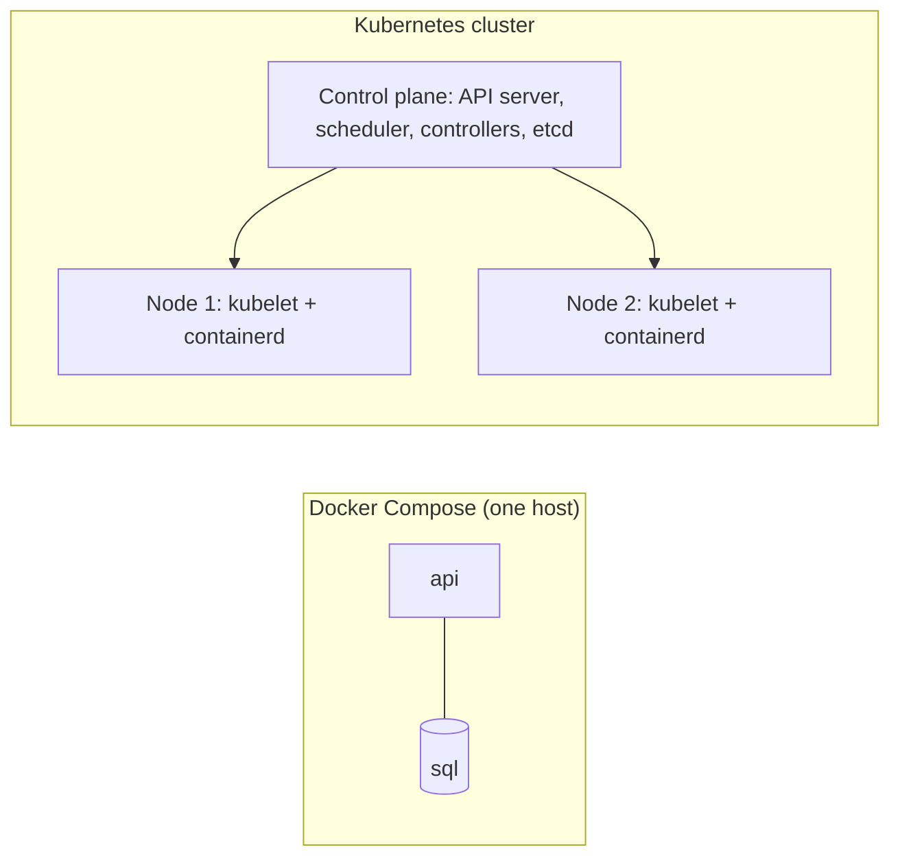
Mapping a Docker mental model to Kubernetes: container → Pod container; `docker run -p` → Service/Ingress; volume → PVC; env/secret → ConfigMap/Secret; restart policy → Deployment controller; Compose file → Helm chart/Kustomize manifests.

Minimal Kubernetes Deployment for the same API:
```yaml
apiVersion: apps/v1
kind: Deployment
metadata: { name: orders-api }
spec:
  replicas: 3
  strategy: { rollingUpdate: { maxSurge: 1, maxUnavailable: 0 } }
  selector: { matchLabels: { app: orders-api } }
  template:
    metadata: { labels: { app: orders-api } }
    spec:
      containers:
        - name: api
          image: myordersacr.azurecr.io/orders-api:1.0.0
          ports: [ { containerPort: 8080 } ]
          resources:
            requests: { cpu: 250m, memory: 256Mi }
            limits:   { memory: 512Mi }
          readinessProbe: { httpGet: { path: /health/ready, port: 8080 }, periodSeconds: 5 }
          livenessProbe:  { httpGet: { path: /health/live,  port: 8080 }, periodSeconds: 10 }
          startupProbe:   { httpGet: { path: /health/live,  port: 8080 }, failureThreshold: 30, periodSeconds: 2 }
          securityContext: { runAsNonRoot: true, readOnlyRootFilesystem: true, allowPrivilegeEscalation: false }
      terminationGracePeriodSeconds: 45
---
apiVersion: v1
kind: Service
metadata: { name: orders-api }
spec:
  selector: { app: orders-api }
  ports: [ { port: 80, targetPort: 8080 } ]
```
### Why both exist
Docker solved *packaging*; once teams ran hundreds of containers, they needed *orchestration* — Kubernetes (from Google's Borg experience) filled that gap.

### When to use / NOT
- Docker + Compose: local dev, CI, single-VM/low-criticality, edge.
- Kubernetes: many services, multi-team platform, need for autoscaling/self-healing/multi-node, rich ecosystem.
- **Not Kubernetes**: a handful of services, small team, no platform skills → ACA/App Service. Kubernetes adds cluster upgrades, CNI, ingress, RBAC, observability, cost.

### Advantages / disadvantages
Kubernetes: powerful, portable, huge ecosystem; steep learning curve, YAML sprawl, operational burden, over-engineering risk. Docker alone: simple, but you build everything else yourself.

### Mistakes
Adopting Kubernetes for 2 services; no resource requests/limits; liveness probe checking dependencies (restart storms); latest tags; single replica without PDB; ignoring node upgrades; no GitOps.

### Troubleshooting
`kubectl get pods -o wide`, `describe`, `logs --previous`, `get events`, `top pod`, `rollout status/undo`, `port-forward`, `debug`.

### Interview Q&A
**Q: Docker vs Kubernetes?** Different layers: Docker builds/runs containers; Kubernetes orchestrates them across nodes. Kubernetes uses containerd/CRI-O to run OCI images (often built by Docker).
**Q: When would you pick Compose over Kubernetes in prod?** Rarely: single-node, small internal tool, accept downtime; otherwise managed orchestrator.
**Follow-up: Liveness vs readiness vs startup probes?** Liveness: restart if wedged (keep it cheap and dependency-free). Readiness: remove from load balancer when not ready (can include dependencies). Startup: grace period for slow starts, disables others until it passes.

---

## 24. Container orchestration fundamentals

### Simple explanation
An orchestrator is the **operations robot**: you declare "run 5 copies of this image, keep them healthy, update without downtime", and it continuously makes reality match.

### Architect-level depth
Core capabilities and the **declarative reconciliation loop** (desired state → observe → act):
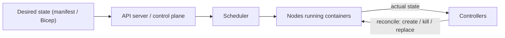
| Capability | What it does | Example |
|---|---|---|
| Scheduling | Place workloads by CPU/memory/affinity/zones | K8s scheduler, ACA environment |
| Self-healing | Restart/replace failed instances; probes | Deployment controller |
| Scaling | Horizontal/vertical/event-driven | HPA, KEDA (queue length) |
| Rolling updates & rollback | Gradual replacement gated by readiness | maxSurge/maxUnavailable, revisions |
| Service discovery & load balancing | Stable name/VIP, health-aware routing | Service, Ingress, Envoy |
| Config & secrets | Inject at runtime | ConfigMap/Secret, Key Vault CSI |
| Storage orchestration | Attach persistent volumes | PVC/StorageClass |
| Networking & policy | Pod network, segmentation | CNI, NetworkPolicy, mesh |
| Observability | Logs, metrics, traces | Container Insights, OpenTelemetry |
| Governance | RBAC, quotas, policies | Azure Policy, admission controllers |

Design principles for **orchestrator-friendly .NET apps** (12-factor): stateless processes; config via env; logs to stdout; graceful shutdown (SIGTERM); fast startup; health endpoints; idempotent handlers; backing services as attached resources; disposability; dev/prod parity; backward-compatible schema changes.

```csharp
builder.Services.AddHealthChecks()
    .AddCheck("self", () => HealthCheckResult.Healthy(), tags: new[] { "live" })
    .AddSqlServer(cs, tags: new[] { "ready" })                 // AspNetCore.HealthChecks.SqlServer
    .AddAzureServiceBusQueue(sbNs, "orders", cred, tags: new[] { "ready" });

app.MapHealthChecks("/health/live",  new() { Predicate = r => r.Tags.Contains("live") });
app.MapHealthChecks("/health/ready", new() { Predicate = r => r.Tags.Contains("ready") });

builder.Services.Configure<HostOptions>(o => o.ShutdownTimeout = TimeSpan.FromSeconds(30));
```
Rolling-update mechanics: new pods start → readiness passes → old pods get SIGTERM (preStop delay for LB deregistration) → drain in-flight requests → exit; DB migrations must be **backward compatible** (expand → deploy → contract) so old and new versions coexist.

Patterns: sidecar (Dapr, log shipper, dotnet-monitor), init containers (migrations, wait-for), ambassador, adapter, jobs/cronjobs, daemonsets, StatefulSets for ordered/stable identity.

### Why it exists
Manual management of hundreds of containers across machines is infeasible: failures, scaling, deployments, discovery and config need automation.

### Real-world
Black-Friday autoscaling; automated node-failure recovery; canary releases; multi-team platforms with quotas.

### When to use / NOT
Use for multi-service, multi-node, high-availability systems. Don't for tiny systems where the orchestrator's complexity exceeds the problem; don't orchestrate apps that aren't stateless/disposable without adapting them first.

### Advantages / trade-offs
Resilience, standardised operations, scale; vs complexity, cost, learning curve, vendor/platform choice (Swarm largely obsolete; Nomad niche; Kubernetes and its managed derivatives dominate).

### Mistakes
Liveness probes with dependency checks (cascading restarts); no PodDisruptionBudget; missing graceful shutdown; no requests/limits; CPU limits causing throttling (consider memory limit + CPU requests only, per team policy); ignoring anti-affinity/zone spread; running migrations in app start on every replica (race) rather than a Job/init step; stateful apps as plain Deployments.

### Performance / reliability / security
Right-size requests/limits; HPA on meaningful metrics (RPS, queue lag); topology spread across zones; PDBs; multiple replicas; image pull optimisation; RBAC least privilege; network policies; admission policies (non-root, no privileged).

### Troubleshooting
Pending pods → insufficient resources/taints/PVC; ImagePullBackOff → registry auth/DNS; CrashLoopBackOff → logs `--previous`; OOMKilled → limits; readiness failing → probe path/port/auth; HPA not scaling → metrics-server/KEDA.

### Interview Q&A
**Q: What does "declarative" mean in orchestration?** You state the desired end state; controllers reconcile continuously, so drift and failures self-correct.
**Q: How do you design an API for zero-downtime rolling updates?** Stateless, readiness probe, graceful shutdown/draining, backward-compatible DB and message contracts (expand/contract), idempotent consumers, versioned APIs.
**Scenario:** *Your pods are OOMKilled intermittently after a traffic increase.* Check memory working set vs limit; heap/GC (`dotnet-gcdump`); large object allocations, unbounded caches, `HttpClient` response buffering, per-request large payloads; set requests=limits for memory, tune `GCHeapHardLimit`, add HPA on memory/RPS, fix leak, load-test.

---

# Part F – Interview toolkit

## 25. How this topic relates to the rest of the guide

| This chapter | Related topic | Link / relationship |
|---|---|---|
| Containers as deploy unit | Microservices | [Microservices](../02-architectural-styles/01-microservices-architecture/microservices-architecture.md): one service ↔ one image/release unit; own data store; independent scaling |
| ACA/AKS, KEDA, Dapr | Cloud-native Azure | [Cloud-Native .NET on Azure](../07-advanced-topics/Architecting%20Cloud-Native%20NET%20Apps%20for%20Azure.md) |
| Graceful shutdown, health checks, config, logging | ASP.NET Core internals | [Web API internals](../10-aspnet-core-web-api-internals/aspnet-core-web-api-internals.md): hosting, `IHostApplicationLifetime`, middleware, `IHttpClientFactory` (connection reuse behind container networking) |
| Lift-and-shift, strangler, blue-green/canary | Cloud migration | [Migration & modernization](../11-cloud-migration-and-modernization/cloud-migration-and-legacy-modernization.md): containerise as a *replatform* step |
| Service Bus + KEDA scaling, idempotency | Event-driven / messaging | [Event-Driven Architecture](../02-architectural-styles/04-event-driven-architecture/event-driven-architecture.md), [Distributed Systems Patterns](../03-architectural-patterns/distributed-systems-patterns.md) |
| Ingress/gateway in front of containers | API Gateway | [API Gateway](../03-architectural-patterns/04-api-gateway/api-gateway.md) |
| Secrets, Zero Trust, CI/CD, IaC | Broader architect skills | [Broader Architect Skills](../06-broader-architect-skills/Broader%20Architect%20Skills.md) |
| Resilience (retry, circuit breaker, bulkhead) | Distributed patterns | Containers restart and move: every dependency call must tolerate transient failure |
| Trade-offs, ADRs | Foundations | [Foundations](../01%20Foundations.md): record the ACA vs AKS decision as an ADR |

## 26. Command cheat sheet

```powershell
# Images
docker build -t app:1.0 -f Dockerfile .            docker buildx build --platform linux/amd64,linux/arm64 --push -t reg/app:1.0 .
docker images ; docker history app:1.0 ; docker image inspect app:1.0
docker pull / push / tag / rmi / image prune -a
# Containers
docker run -d --name app -p 8080:8080 -e KEY=val --memory 512m --cpus 1 --restart unless-stopped app:1.0
docker ps -a ; docker stop/start/restart/rm -f app ; docker rm $(docker ps -aq -f status=exited)
docker logs -f --tail 100 --since 10m app
docker exec -it app sh ; docker cp app:/path ./ ; docker diff app
docker inspect app ; docker inspect -f '{{.State.ExitCode}} {{.State.OOMKilled}}' app
docker stats ; docker top app ; docker events
# Data & network
docker volume create/ls/inspect/rm/prune ; docker network create/ls/inspect/connect
# Compose v2
docker compose up -d --build ; docker compose ps ; docker compose logs -f svc ; docker compose exec svc sh
docker compose down [-v] ; docker compose config ; docker compose watch
# Cleanup & disk
docker system df ; docker system prune [-a --volumes]   # destructive!
# Azure
az acr build -r <acr> -t app:1.0 . ; az acr login -n <acr>
az containerapp logs show -n app -g rg --follow ; az containerapp revision list -n app -g rg
# Kubernetes
kubectl get pods -o wide ; kubectl describe pod p ; kubectl logs p --previous ; kubectl rollout undo deploy/app ; kubectl debug -it p --image=...
```

## 27. Structured way to answer container questions

Use this five-step framework out loud in interviews (it also covers feedback area 5 — *structured problem-solving and explaining technical decisions*):

1. **Context** — restate the problem and constraints: workload type (stateless API? worker? DB?), scale, SLAs, team skills, compliance, budget, existing estate.
2. **Options** — name 2–3 realistic options (e.g., App Service vs ACA vs AKS; Alpine vs chiseled).
3. **Trade-offs** — compare on the quality attributes that matter: operability, cost, performance, security, portability, time-to-market, skills.
4. **Decision** — choose, state *why*, and what you are explicitly giving up; mention how you'd record it (ADR).
5. **Validation** — how you'd prove it: load test, chaos/failover test, scan results, cost model, game-day, rollback rehearsal, SLO dashboards; plus the revisit trigger ("move to AKS if we need X").

Worked example: *"Where should we host 12 .NET microservices on Azure?"*
Context: small platform team (2), event-driven via Service Bus, bursty load, no need for custom operators. Options: AKS, ACA, App Service. Trade-offs: AKS gives full control but a permanent ops cost; App Service is awkward for queue-based scaling and many services; ACA offers KEDA scaling, revisions, Dapr and scale-to-zero with minimal ops. Decision: ACA, managed identity to ACR/Key Vault/Service Bus, Bicep IaC, revisions for canary; ADR notes the exit path to AKS. Validation: load test scaling rules, kill replicas during processing to confirm idempotency and no message loss, cost projection vs AKS, p95 startup time.

## 28. Scenario-based architect questions

**S1. "Our container works locally but returns 502 in ACA."**
Check `targetPort` vs `ASPNETCORE_HTTP_PORTS`; Kestrel bound to `localhost`; health probe path requiring auth or HTTPS; startup slower than probe; revision logs (`ContainerAppSystemLogs_CL`); ingress transport (http vs http2); image arch (amd64 vs arm). Fix → align ports, anonymous health endpoint, startup probe, redeploy new revision.

**S2. "Deployments cause 30 s of failed requests."**
Missing readiness gating or graceful shutdown. Add readiness probe, `preStop` delay, `HostOptions.ShutdownTimeout`, exec-form entrypoint, `terminationGracePeriodSeconds` > shutdown timeout, maxUnavailable 0; verify backward-compatible DB changes; test with a load generator during rollout.

**S3. "Design the container strategy for migrating a .NET Framework monolith."**
Assess: can it move to .NET 10 (Linux)? If not, Windows containers on ACA/AKS Windows nodes or rehost to VMs. Plan: containerise as replatform, externalise config/secrets/state (sessions, Data Protection keys, file uploads → Blob), add health endpoints and stdout logging, then strangle services incrementally behind a gateway; blue-green via slots/revisions; parallel-run for risky flows. (Details in [Cloud migration](../11-cloud-migration-and-modernization/cloud-migration-and-legacy-modernization.md).)

**S4. "Memory climbs until OOMKilled every ~6 hours."**
Evidence: `docker stats`/Container Insights working set vs limit; `dotnet-counters` (GC heap size, gen2, LOH); `dotnet-gcdump` comparing two snapshots; suspects: static caches, event handler leaks, `HttpClient` created per call, large buffers, unbounded channels/queues, EF change tracker in singletons. Short-term: raise limit + alert; long-term: fix leak, bound caches, load test soak.

**S5. "A SQL-backed API is slow only under container CPU limits."**
Cause options: CPU throttling, thread pool starvation, sync-over-async around ADO.NET, too-small connection pool, missing index causing CPU-heavy scans. Approach: compare `ProcessorCount` and throttle metrics; check `dotnet-counters` thread pool queue; SQL side: Query Store top resource consumers, actual execution plan, missing index DMVs, parameter sniffing, wait stats; fix indexing/async code, then right-size CPU.

**S6. "Security audit: what would you change in this Dockerfile?"** (root user, `latest` base, SDK in final, secrets in ENV, HTTP only, no scan.) → multi-stage, chiseled non-root image, digest pin, BuildKit secrets, Key Vault + managed identity, scan + SBOM + sign, read-only FS, drop caps, private ACR with `AcrPull` identity.

**S7. "Should we run SQL Server/Elasticsearch/RabbitMQ in containers in production?"** Prefer managed (Azure SQL, Azure AI Search/Elastic Cloud, Service Bus). If self-hosting: StatefulSet/operators, replicated persistent storage, backups and restore drills, anti-affinity, resource guarantees, upgrade runbooks — and an honest TCO comparison against PaaS.

## 29. Quick-revision checklist

- [ ] Container = isolated process (namespaces + cgroups + overlayfs); shares host kernel; not a VM.
- [ ] Image = immutable layered template with digest; container = image + writable layer; tags are mutable.
- [ ] Layer order → cache; deleting later doesn't shrink; `.dockerignore`; BuildKit cache/secret mounts.
- [ ] Multi-stage: SDK to build, `aspnet`/chiseled to run; exec-form ENTRYPOINT; `USER app`; port 8080.
- [ ] `ASPNETCORE_HTTP_PORTS` vs `URLS`; bind `0.0.0.0`, never `localhost` in containers.
- [ ] Env vars use `__`; build once, configure per environment; secrets → Key Vault/mounted files, not ENV.
- [ ] `ValidateOnStart` for options; precedence: appsettings < env < command-line.
- [ ] Volumes for persistence (not prod DB HA); bind mounts for dev; tmpfs for scratch; Data Protection keys must be shared.
- [ ] User-defined bridge networks → DNS by service name; connect with container port; never publish internals.
- [ ] Compose = dev/test single host; `depends_on` + healthcheck + app retries.
- [ ] Logs to stdout (JSON), rotation, OpenTelemetry → Azure Monitor.
- [ ] Exit codes: 137 (SIGKILL/OOM), 143 (SIGTERM), 139 (SIGSEGV); `docker inspect` first.
- [ ] .NET honours cgroup limits (`ProcessorCount`, 75 % heap cap); use dotnet-counters/gcdump/dump via sidecar.
- [ ] Optimise: chiseled, multi-stage, trim, R2R/AOT (know the trade-offs), scan, SBOM, sign.
- [ ] Secure: non-root, read-only FS, drop caps, no docker.sock, limits, private ACR + managed identity.
- [ ] Azure choice: ACA (default) vs AKS (need K8s) vs App Service (simple) vs ACI (jobs); KEDA on Service Bus depth.
- [ ] Zero-downtime = readiness + graceful shutdown + revisions/slots + expand/contract DB changes.
- [ ] Docker ≠ Kubernetes: packaging vs orchestration; declarative reconciliation.
- [ ] Always answer with **context → options → trade-offs → decision → validation**.
