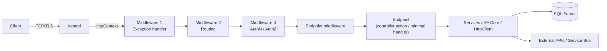
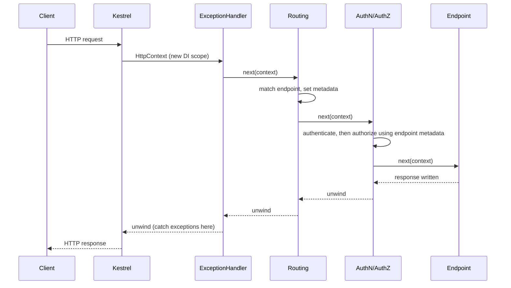
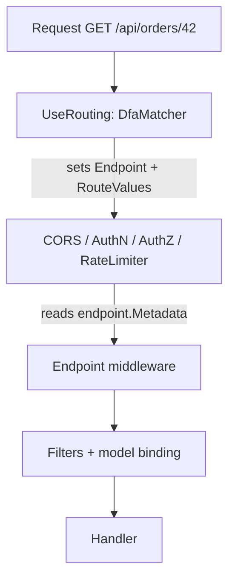
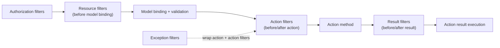
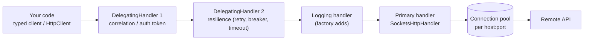
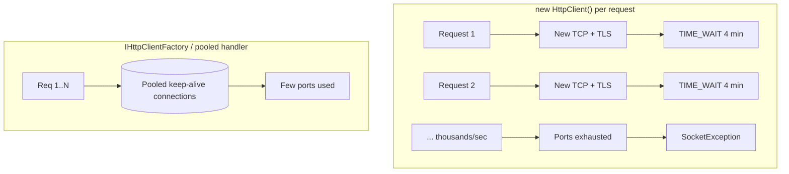
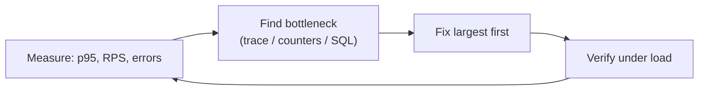

# ASP.NET Core Web API Internals

> Interview-focused deep dive for senior developer / tech lead / architect roles. Targets **.NET 10 (LTS)**; most content applies to .NET 8+. Where behaviour changed between versions it is called out. Verify version-specific details against the official docs before quoting them in an interview.

## How to use this guide

1. Read **Chapter 0** once to hold the whole request lifecycle in your head. Everything else hangs off it.
2. Each numbered subtopic (§1–§23) follows the same shape so you can drill quickly:
   **Concept → Why it exists → Internals → Example → Use cases → When / when NOT → Trade-offs → Mistakes → Performance/Scale/Reliability/Security → Troubleshooting → Related topics → Interview Q&A.**
3. Chapters **10–13** at the end hold cross-cutting follow-up questions, architect scenarios, a cheat sheet, a decision-explanation framework (feedback area #5) and a revision checklist.
4. Practise *saying* answers aloud using the framework in [Chapter 12](#chapter-12-explaining-technical-decisions).

Related guides in this repository:
[API Gateway](../03-architectural-patterns/04-api-gateway/api-gateway.md) ·
[Distributed Systems Patterns](../03-architectural-patterns/distributed-systems-patterns.md) ·
[Layered Architecture](../02-architectural-styles/05-layered-architecture/layered-architecture.md) ·
[Broader Architect Skills (security, scaling, DB)](../06-broader-architect-skills/Broader%20Architect%20Skills.md) ·
[Docker & Containerization](../09-containers-and-docker/docker-and-containerization.md) ·
[Cloud Migration & Legacy Modernization](../11-cloud-migration-and-modernization/cloud-migration-and-legacy-modernization.md)

---

## Table of Contents

- [Chapter 0 – Mental model](#chapter-0-mental-model-of-an-aspnet-core-request)
- **Part A – Host & pipeline**
  - [§1 Request processing pipeline](#1-aspnet-core-request-processing-pipeline)
  - [§2 Middleware architecture](#2-middleware-architecture)
  - [§3 Middleware execution order](#3-middleware-execution-order)
- **Part B – Routing & endpoints**
  - [§4 Routing and endpoint routing](#4-routing-and-endpoint-routing)
  - [§5 Conventional routing](#5-conventional-routing)
  - [§6 Attribute routing](#6-attribute-routing)
- **Part C – Programming models**
  - [§7 Controllers vs Minimal APIs](#7-controllers-vs-minimal-apis)
- **Part D – DI, configuration, logging**
  - [§8 Dependency Injection integration](#8-dependency-injection-integration)
  - [§9 Configuration and the Options pattern](#9-configuration-and-the-options-pattern)
  - [§10 Logging](#10-logging)
- **Part E – Errors & filters**
  - [§11 Global exception handling](#11-global-exception-handling)
  - [§12 Exception handling middleware](#12-exception-handling-middleware)
  - [§13 Filters vs middleware](#13-filters-vs-middleware)
- **Part F – Binding & validation**
  - [§14 Model binding](#14-model-binding)
  - [§15 Model validation](#15-model-validation)
- **Part G – Background work**
  - [§16 Hosted services](#16-hosted-services)
  - [§17 BackgroundService](#17-backgroundservice)
- **Part H – HttpClient & networking**
  - [§18 IHttpClientFactory](#18-ihttpclientfactory)
  - [§19 HttpClient lifetime management](#19-httpclient-lifetime-management)
  - [§20 Socket exhaustion](#20-socket-exhaustion)
  - [§21 HTTP connection pooling](#21-http-connection-pooling)
- **Part I – Performance**
  - [§22 API performance optimization](#22-api-performance-optimization)
- **Part J – Production**
  - [§23 ASP.NET Core production troubleshooting](#23-aspnet-core-production-troubleshooting)
- [Chapter 10 – API design & security essentials](#chapter-10-api-design-and-security-essentials)
- [Chapter 11 – Follow-ups and architect scenarios](#chapter-11-tough-follow-ups-and-architect-scenarios)
- [Chapter 12 – Explaining technical decisions](#chapter-12-explaining-technical-decisions)
- [Chapter 13 – Cheat sheet and revision checklist](#chapter-13-cheat-sheet-and-revision-checklist)

---

## Chapter 0: Mental model of an ASP.NET Core request

**Simple version:** a web server (Kestrel) receives bytes, turns them into an `HttpContext`, and hands it to a chain of functions (middleware). The last function in the chain is the endpoint (your controller action or minimal API handler). The response travels back out through the same chain in reverse.

**Architect version:** the app is a *Generic Host* (`WebApplication`) that owns DI, configuration, logging, lifetime and a set of `IHostedService`s. Kestrel is just one of those hosted services (`GenericWebHostService`). Per request, Kestrel parses HTTP/1.1, HTTP/2 or HTTP/3 frames, creates a `DefaultHttpContext` (pooled), and invokes a single `RequestDelegate` that was composed at startup from your `app.Use…` calls. A DI **scope** is created per request, so scoped services (e.g. `DbContext`) live exactly as long as one request.



**Where things live in the app (for orientation):**

| Concern | Built at | Runs |
|---|---|---|
| DI container, config, logging | `WebApplication.CreateBuilder` / `builder.Build()` | Once at startup |
| Middleware pipeline | `app.Use*` calls → `RequestDelegate` | Every request |
| Endpoint table (routes + metadata) | `app.Map*` / `MapControllers()` | Matched every request |
| Hosted services | `AddHostedService` | Start with host, stop on shutdown |
| Handler pools | `AddHttpClient` | Rotated by lifetime |

---

# Part A – Host & pipeline

## 1. ASP.NET Core request processing pipeline

**Concept (simple):** every HTTP request flows through an ordered list of steps. Each step can inspect/modify the request, short-circuit with a response, or pass to the next step.

**Architect depth:** the pipeline is a *delegate chain* — `ApplicationBuilder` collects `Func<RequestDelegate, RequestDelegate>` components and `Build()` folds them from last to first into one `RequestDelegate`. There is no reflection and no per-request allocation of the chain itself, which is why ASP.NET Core is fast. Cross-cutting behaviour (errors, auth, CORS, compression) is composed, not inherited — the opposite of the old System.Web `HttpModule` event model.

**Why it exists:** classic ASP.NET was tied to IIS and a fixed event lifecycle with a heavyweight `System.Web`. ASP.NET Core was redesigned to be host-agnostic, modular (you pay only for what you add), cross-platform and container-friendly.

**How it works internally**

1. `WebApplication.CreateBuilder(args)` builds configuration (appsettings → env-specific → user secrets in Development → environment variables → command line), logging, DI and registers Kestrel via `ConfigureWebHostDefaults` equivalent.
2. `builder.Build()` freezes the service collection into an `IServiceProvider`; `ValidateScopes`/`ValidateOnBuild` default **on in Development** only.
3. `app.Run()` starts hosted services in registration order; `GenericWebHostService` binds Kestrel last-ish so that your startup hosted services can complete first (use `IHostedLifecycleService` for finer control).
4. Kestrel accepts a connection (a *connection middleware* pipeline handles TLS, HTTP/2 negotiation), parses a request, and pulls a pooled `HttpContext` + features (`IHttpRequestFeature`, `IHttpResponseFeature`, …).
5. `HostingApplication` creates a DI scope via the `IServiceScopeFactory` and sets `HttpContext.RequestServices`.
6. The composed `RequestDelegate` runs. When it completes, the scope is disposed (calling `Dispose`/`DisposeAsync` on scoped services — this is when your `DbContext` is released).



**Minimal host (explicit pipeline)**

```csharp
var builder = WebApplication.CreateBuilder(args);

builder.Services.AddProblemDetails();
builder.Services.AddAuthentication().AddJwtBearer();
builder.Services.AddAuthorization();
builder.Services.AddControllers();

var app = builder.Build();

app.UseExceptionHandler();         // 1. outermost: sees everything below
app.UseHsts();                     //    (non-Development)
app.UseHttpsRedirection();
app.UseRouting();                  // 2. select endpoint
app.UseCors();                     // 3. after routing, before auth
app.UseAuthentication();           // 4. who are you
app.UseAuthorization();            // 5. may you (needs endpoint metadata)
app.MapControllers();              // 6. terminal endpoint

app.Run();
```

**Real-world use cases:** request-ID/correlation propagation, tenant resolution, API-key gating on a subset of routes (`UseWhen`/`MapWhen`), cheap health endpoints that bypass auth, response compression.

**When to use / NOT:** the pipeline is the right place for *cross-cutting* concerns that don't need to know which action runs. If logic needs the action's arguments, model-binding results or action result type, use **filters** (§13) instead.

**Trade-offs:** (+) tiny overhead, explicit, testable via `TestServer`/`WebApplicationFactory`; (−) order-sensitivity is a footgun (§3); (−) global behaviour is invisible from the controller code.

**Common mistakes:** doing blocking I/O in middleware; storing per-request state in fields of a convention-based middleware (it's a singleton!); forgetting `await next()` (request hangs/short-circuits silently); writing to the response and then calling `next()`.

**Performance / scalability / reliability / security:** each middleware adds a call frame and potential allocation — keep hot-path middleware allocation-free (`ValueTask`, `Span`, avoid LINQ/closures). Reliability: outermost middleware owns error handling. Security: security middleware must precede the endpoint and must run in the right relative order (§3).

**Troubleshooting:** log `context.GetEndpoint()?.DisplayName` in a tiny middleware to see what was matched; use `app.Use(async (c,n)=>{ … })` probes; enable `Microsoft.AspNetCore` logs at `Debug` temporarily; `dotnet-trace` with the `Microsoft.AspNetCore.Hosting` provider shows per-request durations.

**Relates to:** [API Gateway](../03-architectural-patterns/04-api-gateway/api-gateway.md) (gateways are essentially pipelines at the edge); [Layered Architecture](../02-architectural-styles/05-layered-architecture/layered-architecture.md) (pipeline = presentation layer plumbing); §2, §3, §13.

**Interview Q&A**

- **Q: Walk me through what happens when a request hits an ASP.NET Core API.**
  A: Kestrel accepts the connection, parses HTTP into an `HttpContext`, a DI scope is created, and the composed `RequestDelegate` runs: exception handler → HTTPS/HSTS → routing (endpoint selected) → CORS → authentication → authorization → endpoint middleware, which runs filters/model binding/validation/action and writes the response. The response unwinds back through the same middleware in reverse, and the scope is disposed. *(Then name where you'd add correlation IDs, rate limiting, caching.)*
- **Q: Is the pipeline built per request?** A: No — built once at startup into one delegate. Per request only the context and DI scope are created.
- **Q: What's the difference between `Use`, `Run`, `Map`, `UseWhen`?** A: `Use` adds middleware that may call next; `Run` is terminal; `Map` branches by path and *doesn't rejoin*; `UseWhen` branches by predicate and **rejoins** the main pipeline.

---

## 2. Middleware architecture

**Concept (simple):** a middleware is a small component that gets the request, does something before and/or after calling the next component.

**Architect depth:** middleware is a `Func<RequestDelegate, RequestDelegate>` (decorator over the rest of the pipeline). Three authoring styles:

| Style | Lifetime | DI of scoped services | Use when |
|---|---|---|---|
| Inline `app.Use(async (ctx, next) => …)` | Closure, singleton-like | via `ctx.RequestServices` | Tiny, throwaway logic |
| **Convention-based** class (`InvokeAsync(HttpContext, …)`) | **Singleton** (constructed once) | Inject scoped deps as **`InvokeAsync` parameters** | Default for production middleware |
| **`IMiddleware`** (factory-activated) | Per request via `IMiddlewareFactory` (lifetime you register, usually transient/scoped) | Constructor injection works | When you want constructor-injected scoped deps / easier unit testing |

**Why it exists:** a composable, order-explicit alternative to inheritance/event hooks; each concern is isolated and replaceable.

**Internals:** `UseMiddleware<T>` uses reflection **once at startup** to compile an invoker that resolves `InvokeAsync` parameters from `RequestServices`. Short-circuit by not calling `next`. `Map` creates a branch pipeline with its own `PathBase`. Middleware can also `context.Response.OnStarting(...)` to run just before headers flush (the only safe place to add headers after the body began being produced).

**Example – correlation ID middleware (convention-based)**

```csharp
public sealed class CorrelationIdMiddleware(RequestDelegate next, ILogger<CorrelationIdMiddleware> logger)
{
    public const string Header = "X-Correlation-Id";

    // scoped deps (e.g. ITenantProvider) would be extra InvokeAsync parameters
    public async Task InvokeAsync(HttpContext ctx)
    {
        var id = ctx.Request.Headers.TryGetValue(Header, out var v) && !string.IsNullOrWhiteSpace(v)
            ? v.ToString()
            : Activity.Current?.TraceId.ToString() ?? Guid.NewGuid().ToString("N");

        ctx.Response.OnStarting(() =>
        {
            ctx.Response.Headers[Header] = id;
            return Task.CompletedTask;
        });

        using (logger.BeginScope(new Dictionary<string, object> { ["CorrelationId"] = id }))
        {
            await next(ctx);
        }
    }
}

app.UseMiddleware<CorrelationIdMiddleware>();
```

**`IMiddleware` variant** (must register in DI, otherwise runtime error):

```csharp
public sealed class TenantMiddleware(ITenantResolver resolver) : IMiddleware
{
    public async Task InvokeAsync(HttpContext ctx, RequestDelegate next)
    {
        ctx.Items["tenant"] = await resolver.ResolveAsync(ctx);
        await next(ctx);
    }
}
builder.Services.AddScoped<TenantMiddleware>();
app.UseMiddleware<TenantMiddleware>();
```

**Branching:**

```csharp
app.UseWhen(ctx => ctx.Request.Path.StartsWithSegments("/internal"),
    branch => branch.UseMiddleware<ApiKeyMiddleware>());   // rejoins main pipeline
app.Map("/health-lite", b => b.Run(ctx => ctx.Response.WriteAsync("ok"))); // terminal branch
```

**Real-world use cases:** correlation IDs, request/response logging (careful with PII and body size), tenant resolution, security headers, API-key gate for partner routes, maintenance mode, idempotency-key handling.

**When to use / NOT:** use for concerns independent of MVC/endpoint semantics. **Don't** use for logic that needs `ModelState`, action arguments, `IActionResult` — filters. Don't build a "mini-framework" of middleware that parses bodies and routes itself.

**Trade-offs:** convention-based is fastest but singleton (stateful fields = bugs); `IMiddleware` costs a DI resolve per request but is safer for scoped deps.

**Mistakes / anti-patterns**
- Injecting a scoped service into the middleware **constructor** (captive dependency → exception with `ValidateScopes`, or silent cross-request sharing without it).
- Reading `Request.Body` without `EnableBuffering()` then letting MVC read it again → empty body / model binding failure.
- Modifying headers after the response started → `InvalidOperationException: Headers are read-only` (use `OnStarting`).
- Swallowing exceptions in custom middleware, masking errors from the exception handler.
- Logging whole request/response bodies in prod (PII leak + latency + memory).

**Perf/scale/reliability/security:** avoid buffering large bodies; use `Request.BodyReader` (PipeReader) for custom parsing; set `MaxRequestBodySize`; never trust forwarded headers without `UseForwardedHeaders` + `KnownProxies/KnownNetworks`.

**Troubleshooting:** "request hangs" → someone didn't call/await `next` or deadlocked with `.Result`; "headers read-only" → response started; add a debug middleware printing `ctx.Response.HasStarted` before/after `next`.

**Interview Q&A**
- **Q: Convention-based vs `IMiddleware`?** A: See table — convention-based middleware is a singleton, so scoped dependencies must come through `InvokeAsync` parameters; `IMiddleware` is activated per request through `IMiddlewareFactory`, so constructor injection of scoped services is safe but you must register it.
- **Q: How would you add a header to every response, including errors?** A: `Response.OnStarting` in a middleware placed *outside* (before) the exception handler, or inside the exception handler pipeline too — because the exception handler re-executes a pipeline and can clear headers.
- **Q: Follow-up – why does response logging middleware often break streaming?** A: It replaces `Response.Body` with a `MemoryStream` to read it, which buffers the entire response and defeats streaming/`IAsyncEnumerable`; use `HttpLogging` middleware with size limits instead.

---

## 3. Middleware execution order

**Concept (simple):** middleware runs in the order you register it on the way in, and in reverse on the way out. Wrong order = security holes or features silently not working.

**Architect depth:** order encodes *dependencies*. Authorization needs the endpoint (routing) and the authenticated principal (authentication). CORS needs the endpoint metadata (for `[EnableCors]`) and must answer pre-flight before auth rejects it. The exception handler must be outermost to catch what's below it. With `WebApplication`, routing and endpoint middleware are added implicitly (routing at the *start* of the pipeline, endpoints at the end) — but **if you place middleware that needs endpoint information (CORS, auth, rate limiting per endpoint) you must call `UseRouting()` explicitly before it**; otherwise it runs before routing and sees `GetEndpoint() == null`.

**Canonical order (template)**

```
1. UseExceptionHandler        (and UseDeveloperExceptionPage only in Development)
2. UseHsts                    (non-dev)
3. UseHttpsRedirection
4. UseForwardedHeaders        (when behind a proxy/ingress – actually put FIRST in many setups)
5. UseResponseCompression / UseResponseCaching / UseOutputCache (see notes)
6. UseStaticFiles
7. UseRouting
8. UseCors
9. UseAuthentication
10. UseAuthorization
11. UseRateLimiter            (after routing if using per-endpoint policies)
12. UseOutputCache            (after CORS/auth so cached responses are not served to the unauthorized)
13. custom app middleware     (tenant, correlation, idempotency)
14. MapControllers / Map* endpoints
```

> Official docs place `UseForwardedHeaders` very early (before HSTS/redirect) when behind a reverse proxy, so scheme/host are correct before redirects. Output cache goes after CORS and routing per docs; response compression before anything that writes compressible content.

**Example of ordering bugs and their symptoms**

| Wrong order | Symptom |
|---|---|
| `UseAuthorization` before `UseAuthentication` | Everyone is anonymous → 401/403 for valid tokens |
| `UseAuthorization` before `UseRouting` (explicit) | Runtime error / no endpoint metadata → `[Authorize]` ignored or `InvalidOperationException` about endpoint routing |
| `UseCors` after `UseAuthentication` | Pre-flight OPTIONS gets 401 → browser reports "CORS error" |
| `UseExceptionHandler` after custom middleware | Exceptions in that middleware are unhandled (raw 500, no ProblemDetails) |
| `UseHttpsRedirection` before `UseForwardedHeaders` behind TLS-terminating proxy | Infinite redirect loop |
| `UseOutputCache` before auth | Authenticated response cached and served to anonymous users |
| Compression after code that writes body | Body not compressed |

**Why it matters in interviews:** it's the quickest probe of whether you understand the pipeline or memorised a template.

**Real-world:** a legit prod incident — API behind Azure Front Door/App Gateway returns redirect loop; fix is `ForwardedHeadersOptions` + `UseForwardedHeaders` first (and `KnownNetworks` cleared only when the platform guarantees the proxy is trusted, e.g. Container Apps/App Service which already handle this).

**When NOT:** don't reorder to "make it work" without understanding — you may disable security. Add an integration test that asserts an unauthenticated call to a `[Authorize]` endpoint returns 401 and a pre-flight returns 204 with CORS headers.

**Trade-offs:** explicit order = full control but human error; mitigate with a shared `UseCompanyDefaults()` extension per organisation and tests.

**Mistakes:** assuming `WebApplication` makes order irrelevant; adding auth middleware but not `AddAuthorization()`; terminal `app.Run` placed before other middleware (unreachable code); `app.UseAuthorization()` with `FallbackPolicy` unset so unmarked endpoints are public — prefer `RequireAuthenticatedUser` fallback + `[AllowAnonymous]` opt-out (secure by default).

**Perf/security:** cheap short-circuits (static files, health, rate limiter, HTTPS redirect) early; expensive ones late. Rate limiter before auth protects against credential stuffing; after routing gives per-endpoint policies.

**Troubleshooting:** the `Microsoft.AspNetCore.Routing` and `Microsoft.AspNetCore.Authorization` `Debug` logs state why a request was denied; `app.Use` debug middleware logging `User.Identity.IsAuthenticated` between stages localises the faulty position.

**Relates to:** §4 (why routing precedes auth), §12 (exception handler placement), Chapter 10 (CORS/rate limiting), [Broader Architect Skills](../06-broader-architect-skills/Broader%20Architect%20Skills.md) (Zero Trust, API security).

**Interview Q&A**
- **Q: Why must `UseAuthentication` precede `UseAuthorization`?** A: Authorization evaluates policies against `HttpContext.User`; authentication populates it. Reverse order → always anonymous.
- **Q: Where does CORS go and why?** A: After routing (so endpoint-level CORS metadata is visible) and before authentication/authorization (so pre-flight OPTIONS without credentials isn't rejected).
- **Q: Do you still need `UseRouting`/`UseEndpoints` in .NET 6+?** A: Not for the simple case — `WebApplication` adds them automatically — but call `UseRouting()` explicitly when middleware must run *after* route selection and *before* the endpoint (CORS, auth, rate limiting, output caching); `UseEndpoints` isn't needed because `MapX` calls register on the implicit endpoint builder.
- **Follow-up: How would you verify order isn't regressing?** A: `WebApplicationFactory` integration tests covering 401 vs 403, pre-flight, exception → ProblemDetails, and a startup test that asserts endpoint metadata exists in middleware.

---


# Part B – Routing & endpoints

## 4. Routing and endpoint routing

**Concept (simple):** routing maps "`GET /api/orders/42`" to "the `GetOrder` method with `id = 42`".

**Architect depth:** since ASP.NET Core 3.0, routing is *endpoint routing*: route matching is decoupled from execution. An **Endpoint** = `RequestDelegate` + **metadata collection** (`[Authorize]`, `[EnableCors]`, rate-limit policy, output-cache policy, OpenAPI info, custom attributes) + display name + route pattern. `UseRouting` runs the matcher and stores the result in `HttpContext.GetEndpoint()` / route values. Downstream middleware (auth, CORS, rate limiter) read metadata. The endpoint middleware finally invokes `endpoint.RequestDelegate`.

**Why it exists:** before 3.0, MVC owned routing, so middleware like auth/CORS couldn't know which action would run. Splitting *select* from *execute* lets cross-cutting middleware make per-endpoint decisions, and unifies controllers, minimal APIs, SignalR, gRPC and health checks under one table.

**How it works internally**
- At startup every route pattern is compiled into a **DFA (deterministic finite automaton)** matcher (`DfaMatcher`): a state graph keyed by literal segments, then parameter/policy nodes (HTTP method, host, content type). Matching cost grows with path segments, not with the number of routes.
- Candidates are ordered by **precedence**: literal > constrained parameter > unconstrained parameter > catch-all; ties broken by `Order`; remaining ties raise `AmbiguousMatchException` (HTTP 500).
- `EndpointDataSource` supplies endpoints (controllers, minimal APIs, Razor Pages, custom). `DynamicRouteValueTransformer` allows runtime-decided routes.
- **Link generation** (`LinkGenerator`) is the reverse: from name/values to URL — used by `CreatedAtAction`, `Results.CreatedAtRoute`, HATEOAS links.



**Example – inspect endpoints and metadata**

```csharp
app.Use(async (ctx, next) =>
{
    var ep = ctx.GetEndpoint();
    var policy = ep?.Metadata.GetMetadata<IAuthorizeData>()?.Policy;
    ctx.RequestServices.GetRequiredService<ILogger<Program>>()
       .LogDebug("Matched {Endpoint}, policy {Policy}", ep?.DisplayName, policy);
    await next();
});

// Dev-time: dump all endpoints
var source = app.Services.GetRequiredService<EndpointDataSource>();
foreach (var e in source.Endpoints.OfType<RouteEndpoint>())
    Console.WriteLine($"{e.RoutePattern.RawText} [{string.Join(',', e.Metadata.OfType<HttpMethodMetadata>().SelectMany(m => m.HttpMethods))}]");
```

**Route features:** constraints `{id:int}`, `{id:guid}`, `{page:min(1)}`, `{slug:regex(...)}`, custom `IRouteConstraint`; optional `{id?}`; defaults; catch-all `{**path}`; `MapGroup("/api/v1")` for shared prefix/metadata/filters; `RequireHost`; `.WithName("GetOrder")` for link generation.

**Real-world use cases:** versioned routes (`Asp.Versioning.Http`), multi-tenant host routing, per-endpoint auth policy and rate limit, health/readiness endpoints exempted from auth (`.AllowAnonymous()`), OpenAPI generation from metadata.

**When to use / NOT:** endpoint routing is the only model going forward; don't bypass it with hand-rolled path parsing in middleware. Use `DynamicRouteValueTransformer` only for genuinely data-driven routes (CMS, tenant routes) — it costs per-request work.

**Trade-offs:** (+) per-endpoint metadata, fast matching, unified model; (−) subtle ordering rules and ambiguity errors; metadata-driven features silently fail if middleware order is wrong (§3).

**Mistakes:** two actions with the same template/verb (`AmbiguousMatchException`); relying on registration order instead of constraints; unconstrained `{id}` so `/orders/abc` gives a binding 400 instead of a clean 404; assuming case-sensitivity (routing is case-insensitive; use `RouteOptions.LowercaseUrls` for generated links).

**Performance/Security:** matching is cheap, but regex constraints and dynamic transformers aren't. Route constraints are *not* validation or a security boundary — validate again in the handler. Don't expose internal endpoints without auth/`RequireHost`.

**Troubleshooting:** 404 where you expect 200 → check `PathBase` (behind a reverse proxy with sub-path use `UsePathBase`), verb mismatch (405 vs 404), `AmbiguousMatchException` message lists the conflicting endpoints; `Debug` logs from `Microsoft.AspNetCore.Routing`; a dev-only `/debug/routes` endpoint.

**Related:** §3, §5, §6, [API Gateway](../03-architectural-patterns/04-api-gateway/api-gateway.md) (gateway route tables mirror this concept).

**Interview Q&A**
- **Q: What problem did endpoint routing solve?** A: It separated route *selection* from *execution* so middleware (authz, CORS, rate limiting, output caching) can use endpoint metadata. Previously only MVC knew the target action.
- **Q: How does the matcher resolve `/products/featured` vs `/products/{id}`?** A: Literal segments outrank parameters; same precedence → `Order`; still tied → ambiguity exception.
- **Q (follow-up): Why don't route constraints replace validation?** A: A failed constraint yields "no match" (404), not a descriptive error; constraints can't express business rules and must not be the security boundary.

---

## 5. Conventional routing

**Concept (simple):** one global URL template (e.g. `{controller}/{action}/{id?}`) decides which controller/action runs, by naming convention.

**Architect depth:** `MapControllerRoute(name, pattern, defaults, constraints)` registers a conventional route; controller/action are resolved by name from `ControllerActionDescriptor`s. Used for MVC views/Razor-style apps; **not applicable** to controllers decorated with `[ApiController]`, which requires attribute routing.

**Why it exists:** web-page apps with predictable URL structures and one central place to see all URLs.

```csharp
app.MapControllerRoute(name: "default", pattern: "{controller=Home}/{action=Index}/{id?}");
app.MapControllerRoute(name: "blog", pattern: "blog/{year:int}/{month:int}/{slug}",
    defaults: new { controller = "Blog", action = "Post" });
```

**Use cases:** server-rendered MVC sites; legacy migration where the old URL scheme must be preserved (see [Cloud Migration](../11-cloud-migration-and-modernization/cloud-migration-and-legacy-modernization.md) — Strangler façade).

**When to use / NOT:** use for MVC with views and uniform URL layout. **Don't** use for REST APIs: resource URLs, verb semantics, versioning and OpenAPI are better with attribute routing; conventional routing couples public URLs to class/method names (renaming a method changes the public API).

**Trade-offs:** (+) central URL map, little per-action ceremony; (−) implicit, hard to discover, hostile to versioning and per-action metadata, accidental exposure of public methods as actions.

**Mistakes:** mixing conventional and attribute routing on one controller (attribute wins; the action vanishes from the conventional route); a catch-all conventional route swallowing API URLs.

**Security:** the risk is *accidental endpoints* — any public method on a controller may become an action; mark helpers `[NonAction]` or make them non-public.

**Troubleshooting:** list registered actions with `IActionDescriptorCollectionProvider`; verify generated URLs with `LinkGenerator`.

**Related:** §6 (preferred for APIs), §7.

**Interview Q&A**
- **Q: Why does `[ApiController]` require attribute routing?** A: Its conventions (binding inference, automatic 400 ProblemDetails) assume explicit resource-oriented routes.
- **Q: Can both coexist?** A: Yes, per controller. Conventional for MVC UI controllers, attribute for API controllers.

---

## 6. Attribute routing

**Concept (simple):** you put the URL directly on the controller/action with `[Route]` and `[HttpGet("...")]`.

**Architect depth:** templates are combined: controller-level `[Route("api/v{version:apiVersion}/[controller]")]` + action-level `[HttpGet("{id:int}")]`. Tokens `[controller]`/`[action]` substitute names; a **parameter transformer** (e.g. kebab-case) can apply globally. Metadata attributes (`[Authorize]`, `[ProducesResponseType]`, `[RequestSizeLimit]`, `[EnableRateLimiting]`) attach to the endpoint and are consumed by middleware and OpenAPI.

**Why it exists:** REST APIs are resource-centric; URL and verb should be an explicit contract independent from code naming.

```csharp
[ApiController]
[Route("api/v1/orders")]
[Authorize]
public class OrdersController(IOrderService orders) : ControllerBase
{
    [HttpGet("{id:guid}", Name = "GetOrder")]
    [ProducesResponseType<OrderDto>(StatusCodes.Status200OK)]
    [ProducesResponseType(StatusCodes.Status404NotFound)]
    public async Task<ActionResult<OrderDto>> Get(Guid id, CancellationToken ct) =>
        await orders.FindAsync(id, ct) is { } dto ? dto : NotFound();

    [HttpPost]
    [ProducesResponseType<OrderDto>(StatusCodes.Status201Created)]
    public async Task<ActionResult<OrderDto>> Create(CreateOrderRequest req, CancellationToken ct)
    {
        var dto = await orders.CreateAsync(req, ct);
        return CreatedAtRoute("GetOrder", new { id = dto.Id }, dto);
    }

    [HttpPost("{id:guid}/cancel")]   // pragmatic command sub-resource
    public async Task<IActionResult> Cancel(Guid id, CancellationToken ct)
    {
        await orders.CancelAsync(id, ct);
        return NoContent();
    }
}
```

**Real-world:** public REST APIs with versioning, partner APIs with distinct prefixes, `[AllowAnonymous]` health controllers.

**When to use / NOT:** default for APIs. Avoid deep nesting (`/a/{id}/b/{id}/c/{id}`) — it leaks the object graph and hampers evolution; avoid verbs in URLs except for commands that don't map to resource state.

**Trade-offs:** (+) explicit, discoverable, per-action metadata, versionable; (−) repetitive, inconsistent URL styles across teams → enforce with conventions (`IControllerModelConvention`) and analyzers.

**Mistakes:** forgetting `[ApiController]` (no automatic 400/binding inference); duplicate templates; `[Route("[controller]")]` so a class rename silently changes the URL; a leading `/` in an action template ignoring the controller prefix by accident.

**Security:** `[Authorize]` at class level plus a fallback policy. Routing doesn't prevent **BOLA/IDOR** (OWASP API #1) — always check ownership of `{id}` in the service layer.

**Troubleshooting:** OpenAPI UI shows the real routes; 404 vs 405 tells you whether the path or the verb mismatched.

**Related:** §4, §7, [API design essentials](#chapter-10-api-design-and-security-essentials).

**Interview Q&A**
- **Q: Attribute vs conventional for a REST API?** A: Attribute — explicit contracts, versioning, per-action metadata; required by `[ApiController]`.
- **Q: How do you keep URLs stable when classes are renamed?** A: Explicit literals instead of `[controller]` tokens, plus contract tests / OpenAPI diff in CI.

---

# Part C – Programming models

## 7. Controllers vs Minimal APIs

**Concept (simple):** two ways to write endpoints: MVC-style controller classes, or lightweight handlers mapped directly with `app.MapGet(...)`.

**Architect depth:** both compile to endpoints on the same routing/metadata system and share middleware, DI, auth and OpenAPI. The differences are in the framework features around the handler:

| Aspect | Controllers (`[ApiController]`) | Minimal APIs |
|---|---|---|
| Binding | `ModelBinder` + value providers; `[FromX]` inference | Compiled delegates via `RequestDelegateFactory`; source-generated variant for AOT |
| Validation | Automatic `ModelState` + auto-400 ProblemDetails | **.NET 10:** built-in `AddValidation()` (DataAnnotations, `[SkipValidation]`); earlier: endpoint filters / FluentValidation |
| Filters | Full MVC filter pipeline (authorization, resource, action, exception, result) | **Endpoint filters** (`AddEndpointFilter`) only |
| Results | `IActionResult`, `ActionResult<T>`, formatters, content negotiation | `Results.*` / `TypedResults.*`, mostly JSON |
| Organisation | Classes, inheritance, conventions | `MapGroup`, extension methods per feature (vertical slices) |
| Overhead | A little more per request | Lower; Native AOT-friendly |
| Ecosystem | Largest legacy ecosystem | Caught up (built-in OpenAPI via `Microsoft.AspNetCore.OpenApi`) |

**Why both exist:** controllers are batteries-included for large convention-driven APIs and MVC migrations; minimal APIs offer low ceremony, performance, AOT and vertical-slice organisation.

**Internals:** `MapGet(delegate)` uses `RequestDelegateFactory` to build, once, a `RequestDelegate` from the handler signature: it classifies each parameter (route, query, header, body, service, `HttpContext`, special types), emits expression trees that bind and invoke, then writes the return value (`IResult`, `T`→JSON, `string`→text). Controllers use `ControllerActionInvoker`, which runs the MVC filter pipeline around the action.

**Example – minimal API with groups, typed results, filter, .NET 10 validation**

```csharp
builder.Services.AddValidation();      // .NET 10
builder.Services.AddOpenApi();

var orders = app.MapGroup("/api/v1/orders")
                .RequireAuthorization()
                .WithTags("Orders")
                .AddEndpointFilter<IdempotencyFilter>();

orders.MapGet("/{id:guid}", async Task<Results<Ok<OrderDto>, NotFound>> (
        Guid id, IOrderService svc, CancellationToken ct) =>
    await svc.FindAsync(id, ct) is { } dto ? TypedResults.Ok(dto) : TypedResults.NotFound());

orders.MapPost("/", async Task<Created<OrderDto>> (
        CreateOrderRequest req, IOrderService svc, CancellationToken ct) =>
{
    var dto = await svc.CreateAsync(req, ct);   // req already validated (400 ValidationProblem otherwise)
    return TypedResults.Created($"/api/v1/orders/{dto.Id}", dto);
});

public sealed record CreateOrderRequest(
    [property: Required, StringLength(50)] string CustomerId,
    [property: MinLength(1)] List<OrderLineDto> Lines);
```

Feature-per-file organisation:

```csharp
public static class OrderEndpoints
{
    public static IEndpointRouteBuilder MapOrders(this IEndpointRouteBuilder app)
    {
        var g = app.MapGroup("/api/v1/orders").RequireAuthorization();
        // g.MapGet(...); g.MapPost(...);
        return app;
    }
}
app.MapOrders();
```

**Real-world:** controllers — large LOB API, many filters, content negotiation, legacy migration; minimal — focused microservices, BFFs, Native AOT cold-start-sensitive workloads (Container Apps scale-to-zero).

**When to use / NOT**
- **Minimal APIs** for new services where you control clients, want vertical slices, low overhead, AOT. Less ideal when you depend on resource/exception filters, ModelState-centric validation across hundreds of endpoints, XML or JSON Patch negotiation.
- **Controllers** when migrating, when mature filter conventions exist, or when you need full MVC extensibility.
- **Mixing both** is legitimate; migrate incrementally.

**Trade-offs:** the performance gap is real but small compared to I/O; choose by team productivity, feature needs and AOT. Minimal APIs risk "Program.cs soup"; controllers risk fat controllers and god services.

**Mistakes:** business logic in handlers/controllers (belongs in an application layer — see [Layered](../02-architectural-styles/05-layered-architecture/layered-architecture.md) / [Hexagonal](../02-architectural-styles/06-hexagonal-architecture/hexagonal-architecture.md)); returning EF entities directly (over-posting, cycles, schema leak); `async void`; forgetting `CancellationToken`; reflection-heavy libraries under AOT.

**Performance/Security:** AOT/trimming needs source-generated JSON (`JsonSerializerContext`); propagate `CancellationToken` (auto-bound from `RequestAborted`); group-level `RequireAuthorization()`; antiforgery is required for `[FromForm]` in .NET 8+.

**Troubleshooting:** minimal-API binding failures throw `BadHttpRequestException` (400) logged at Debug by `Microsoft.AspNetCore.Routing.EndpointMiddleware`; unexpected 415 = wrong content type; ambiguous body-source errors when two complex parameters exist — mark `[FromBody]`/`[FromServices]` explicitly.

**Related:** §13, §14–15, [Hexagonal](../02-architectural-styles/06-hexagonal-architecture/hexagonal-architecture.md), [Serverless](../02-architectural-styles/02-serverless/serverless.md).

**Interview Q&A**
- **Q: Minimal APIs or controllers for a new enterprise API in 2026?** A: Default to Minimal APIs organised by feature groups with typed results and endpoint filters, unless the team needs MVC-only features (resource/exception filters, content negotiation, existing conventions). State criteria — AOT/cold start, team skills, filter needs, migration cost. It's a hosting-model choice, not an architecture choice; business logic stays in the application layer.
- **Q: Cross-cutting validation/logging with Minimal APIs?** A: Endpoint filters on a `MapGroup`, `AddValidation()` in .NET 10, middleware for truly global behaviour.
- **Q (follow-up): Is Minimal API faster?** A: Lower framework overhead, yes, but end-to-end latency is dominated by I/O; benchmark your own workload before migrating for speed.

---

# Part D – DI, configuration, logging

## 8. Dependency Injection integration

**Concept (simple):** instead of a class creating its dependencies (`new SqlRepo()`), it declares them in the constructor and the framework supplies them.

**Architect depth:** ASP.NET Core ships a built-in container (`Microsoft.Extensions.DependencyInjection`), constructor-injection only, with three lifetimes:

| Lifetime | Instance per… | Typical use | Danger |
|---|---|---|---|
| **Singleton** | Application | Caches, configuration, stateless services, SDK clients | Must be thread-safe; can't depend on scoped services |
| **Scoped** | Request (DI scope) | `DbContext`, unit-of-work, per-request user context | Never inject into singletons (captive dependency); not thread-safe across parallel tasks |
| **Transient** | Resolution | Lightweight stateless helpers | Disposable transients resolved from the root are held until app exit (leak) |

Also: **keyed services** (.NET 8: `AddKeyedSingleton`, `[FromKeyedServices("x")]`), open generics, `GetServices<T>()` for multiple implementations (last registration wins for single resolves), `TryAdd*` for library-safe defaults, factory delegates.

**Why it exists:** loose coupling, testability, centralised lifetime management, decorators, config-driven composition.

**How it works internally**
- `IServiceCollection` → `BuildServiceProvider` compiles call-site chains per service type, cached.
- Each request: `IServiceScopeFactory.CreateScope()`; scoped instances live in the scope; on dispose, disposables are disposed in reverse creation order.
- **Captive dependency**: a singleton holding a scoped service keeps it forever (stale `DbContext`, cross-request data). `ValidateScopes` (default **on in Development**) throws; `ValidateOnBuild` verifies the graph at startup. Enable both in tests and consider all environments via `UseDefaultServiceProvider`.
- Background services (singletons) need `IServiceScopeFactory` to obtain scoped services (§17).
- No property injection or interception. For decorators use Scrutor or factories.

**Example**

```csharp
builder.Host.UseDefaultServiceProvider(o => { o.ValidateScopes = true; o.ValidateOnBuild = true; });

builder.Services.AddDbContextPool<AppDbContext>(o =>
    o.UseSqlServer(builder.Configuration.GetConnectionString("Sql"),
        sql => sql.EnableRetryOnFailure()));                      // scoped (pooled)
builder.Services.AddScoped<IOrderService, OrderService>();
builder.Services.AddSingleton(TimeProvider.System);
builder.Services.AddKeyedSingleton<IPaymentGateway, StripeGateway>("stripe");
builder.Services.AddKeyedSingleton<IPaymentGateway, AdyenGateway>("adyen");

// Decorator via factory (no external lib)
builder.Services.AddScoped<OrderService>();
builder.Services.AddScoped<IOrderService>(sp =>
    new CachedOrderService(sp.GetRequiredService<OrderService>(), sp.GetRequiredService<HybridCache>()));

app.MapPost("/pay", ([FromKeyedServices("stripe")] IPaymentGateway gw, PayRequest r) => gw.ChargeAsync(r));
```

**Captive dependency – bug and fix**

```csharp
// BUG: singleton captures scoped DbContext
public sealed class PriceCache(AppDbContext db) { /* registered AddSingleton */ }

// FIX: IDbContextFactory (or IServiceScopeFactory) and a short-lived context per operation
public sealed class PriceCache(IDbContextFactory<AppDbContext> factory)
{
    public async Task<decimal> GetAsync(int id, CancellationToken ct)
    {
        await using var db = await factory.CreateDbContextAsync(ct);
        return await db.Prices.Where(p => p.Id == id).Select(p => p.Value).SingleAsync(ct);
    }
}
```

**Real-world:** composition root in `Program.cs`, one `AddXxx()` extension per module (see [Modular Monolith](../02-architectural-styles/07-modular-monolith/modular-monolith.md)); keyed services for strategy selection (payment gateways, tenants).

**When to use / NOT:** inject *dependencies*; don't inject `IServiceProvider` into business classes (service locator) except in factories/framework glue. Don't register everything as singleton to "save allocations" without a thread-safety review. Don't resolve scoped types from the root provider.

**Trade-offs:** built-in container = simple, fast, standard; lacks advanced features (Autofac/Scrutor add them) at the price of another abstraction.

**Mistakes:** constructor over-injection (>5 deps = SRP smell); captive dependencies; `Task.Run` capturing the request-scoped `DbContext` after the request ends (disposed object); parallel `Task.WhenAll` over one `DbContext` (not thread-safe); `BuildServiceProvider()` inside `ConfigureServices` (duplicate singletons); static service locators.

**Performance/Reliability/Security:** deep transient graphs allocate; `AddDbContextPool` reduces allocation but requires stateless contexts. A per-request `ICurrentUser` must be scoped and derived from `HttpContext.User`, never a singleton.

**Troubleshooting:** "Cannot consume scoped service from singleton" → fix lifetimes; "Unable to resolve service" → missing registration (`ValidateOnBuild`); "A second operation was started on this context" → `DbContext` shared across concurrent tasks; "Cannot access a disposed object" → scope ended before background work.

**Related:** §17, §18 (typed clients are transient), [Layered](../02-architectural-styles/05-layered-architecture/layered-architecture.md), [SOLID – DIP](../05-design-principles/SOLID/SOLID.md).

**Interview Q&A**
- **Q: What is a captive dependency and how do you catch it?** A: A longer-lived service holding a shorter-lived one (singleton → scoped). Catch with `ValidateScopes`/`ValidateOnBuild`; fix with `IServiceScopeFactory`/`IDbContextFactory` or by changing lifetimes.
- **Q: How do you get a scoped service in a `BackgroundService`?** A: Create a scope per unit of work with `IServiceScopeFactory`; dispose it afterwards.
- **Q (follow-up): Why is a disposable transient dangerous?** A: Transients resolved from the root provider are tracked until the provider is disposed → memory leak in long-running apps.
- **Q (follow-up): Would you replace the built-in container?** A: Only for specific needs (decorators, scanning, child containers); Scrutor on top of the built-in container covers most.

---

## 9. Configuration and the Options pattern

**Concept (simple):** read settings (connection strings, feature flags, URLs) from JSON, environment variables, Key Vault, etc. and give strongly-typed objects to your code.

**Architect depth:** `IConfiguration` is a layered key/value tree built from providers in order (later wins): `appsettings.json` → `appsettings.{Environment}.json` → **User Secrets** (Development) → **environment variables** (`ConnectionStrings__Sql`; `__` = `:`) → **command line**. Add Azure providers (`AddAzureAppConfiguration`, Key Vault) for central, refreshable, secret-managed config. The **Options pattern** binds sections to POCOs with validation:

| Interface | Lifetime | Reloads on change? | Use when |
|---|---|---|---|
| `IOptions<T>` | Singleton | **No** | Static settings |
| `IOptionsSnapshot<T>` | **Scoped** | Yes — per request | Per-request fresh config in web apps |
| `IOptionsMonitor<T>` | Singleton | Yes — `CurrentValue` + `OnChange` | Singletons/background services needing live values |

Named options (`IOptionsMonitor<T>.Get("name")`) support several instances (e.g. several downstream APIs).

**Why it exists:** avoid `Configuration["a:b:c"]` string soup, centralise validation, keep secrets out of source control, support 12-factor "config in environment".

**Internals:** `ConfigurationBinder` maps keys to properties; change tokens from file/App Configuration providers trigger reload; `IOptionsMonitor` caches and invalidates through `IOptionsChangeTokenSource`. `ValidateOnStart()` runs validation at host start rather than first use → fail fast.

**Example**

```csharp
public sealed class PaymentsOptions
{
    public const string Section = "Payments";
    [Required, Url] public string BaseUrl { get; init; } = "";
    [Range(1, 60)] public int TimeoutSeconds { get; init; } = 10;
}

builder.Services.AddOptions<PaymentsOptions>()
    .BindConfiguration(PaymentsOptions.Section)
    .ValidateDataAnnotations()
    .Validate(o => o.BaseUrl.StartsWith("https"), "BaseUrl must be HTTPS")
    .ValidateOnStart();

// Azure: settings from App Configuration, secrets from Key Vault, managed identity, refresh via sentinel key
builder.Configuration.AddAzureAppConfiguration(o =>
    o.Connect(new Uri(builder.Configuration["AppConfig:Endpoint"]!), new DefaultAzureCredential())
     .ConfigureKeyVault(kv => kv.SetCredential(new DefaultAzureCredential()))
     .ConfigureRefresh(r => r.Register("Sentinel", refreshAll: true)));

public sealed class PricingService(IOptionsMonitor<PricingOptions> opts)
{ public decimal Margin => opts.CurrentValue.Margin; }     // live value inside a singleton
```

Platform usage: App Service/Container Apps app settings become env vars; Key Vault references resolve at platform level; Kubernetes uses ConfigMaps/Secrets (see [Docker guide](../09-containers-and-docker/docker-and-containerization.md)).

**Real-world:** feature toggles (`Microsoft.FeatureManagement`), per-environment endpoints, tenant-specific options, rotating secrets without redeploy.

**When to use / NOT:** use Options for any structured setting. Don't inject `IConfiguration` into domain/services broadly (hidden dependency); don't put secrets in `appsettings.json`; don't use `IOptionsSnapshot` in singletons (it's scoped).

**Trade-offs:** reloadable config adds complexity — a value changing mid-request can break invariants; read `CurrentValue` once per operation.

**Mistakes:** `IOptions<T>` expecting live reload; no validation → app starts, fails at first request; secrets committed to Git; wrong env var names (`__`); connection strings baked into image layers via `ENV`.

**Performance/Security:** App Configuration refresh is network I/O — use sentinel keys and cache expiration. Use **managed identity + RBAC** for Key Vault/App Config, not client secrets.

**Troubleshooting:** dump effective config in Development with `(app.Configuration as IConfigurationRoot).GetDebugView()` (redact secrets); check provider order; `ValidateOnStart` exception names the failing property.

**Related:** [Docker](../09-containers-and-docker/docker-and-containerization.md) (env vars, secrets), [Broader Architect Skills – secrets](../06-broader-architect-skills/Broader%20Architect%20Skills.md).

**Interview Q&A**
- **Q: `IOptions` vs `IOptionsSnapshot` vs `IOptionsMonitor`?** A: See table; snapshot is scoped (per-request refresh), monitor is singleton with change callbacks, `IOptions` never reloads.
- **Q: How do you fail fast on bad config?** A: `ValidateDataAnnotations().ValidateOnStart()`; in containers the readiness probe fails and the rollout halts.
- **Q (follow-up): How do you manage secrets across environments?** A: Key Vault + managed identity, platform references, no secrets in images/repos; rotation via versionless secret URIs and `IOptionsMonitor`.

---

## 10. Logging

**Concept (simple):** write messages about what the app is doing so you can diagnose problems later.

**Architect depth:** `ILogger<T>` abstraction over providers (Console/JSON, Debug, EventSource, Application Insights/OpenTelemetry, Serilog). Key ideas: **log levels** (Trace…Critical) with per-category filters in config, **structured logging** (message templates with named placeholders → queryable properties), **scopes** (`BeginScope`) for correlation, and **high-performance logging** via the `[LoggerMessage]` source generator (no boxing, no template parsing).

**Why it exists:** distributed systems fail in ways you can't reproduce locally; logs + metrics + traces (observability) are your forensic evidence.

**Internals:** `ILogger.Log` checks `IsEnabled(level)` per provider; messages are formatted lazily; scopes flow through `AsyncLocal`; `Activity` (W3C `traceparent`) adds `TraceId/SpanId` so logs correlate with distributed traces. ASP.NET Core also emits request logs (`Microsoft.AspNetCore.Hosting.Diagnostics`) and built-in **metrics** (hosting, Kestrel) consumable by OpenTelemetry/`dotnet-counters`.

**Example**

```csharp
public static partial class Log
{
    [LoggerMessage(EventId = 1001, Level = LogLevel.Information,
        Message = "Order {OrderId} placed for customer {CustomerId} total {Total}")]
    public static partial void OrderPlaced(this ILogger logger, Guid orderId, string customerId, decimal total);

    [LoggerMessage(EventId = 5001, Level = LogLevel.Error, Message = "Payment failed for {OrderId}")]
    public static partial void PaymentFailed(this ILogger logger, Guid orderId, Exception ex);
}

// Program.cs – OpenTelemetry + Azure Monitor
builder.Services.AddOpenTelemetry()
    .UseAzureMonitor()                       // Azure.Monitor.OpenTelemetry.AspNetCore
    .WithTracing(t => t.AddSource("MyApp.Orders"))
    .WithMetrics(m => m.AddMeter("MyApp.Orders"));

builder.Logging.AddJsonConsole();            // containers: structured logs to stdout
builder.Services.AddHttpLogging(o => o.LoggingFields = HttpLoggingFields.RequestPropertiesAndHeaders);
```

```json
{ "Logging": { "LogLevel": { "Default": "Information", "Microsoft.AspNetCore": "Warning",
                             "Microsoft.EntityFrameworkCore.Database.Command": "Warning" } } }
```

**KQL (Application Insights)** — correlated failures:

```kusto
requests | where timestamp > ago(1h) and success == false
| join kind=inner (traces | where severityLevel >= 3) on operation_Id
| project timestamp, name, resultCode, message, operation_Id
```

**Real-world:** structured logs with `CorrelationId`, `TenantId`, `UserId` (ID only), audit logs separated from diagnostics, sampling in App Insights to control cost.

**When to use / NOT:** log business events, errors with exception objects, slow dependencies. **Don't** log secrets/PII/tokens/full bodies; don't log in tight loops; don't use logs as metrics (use counters).

**Trade-offs:** verbose logging = cost (ingestion, I/O) and latency; sampling loses rare events (adaptive sampling keeps failures if configured).

**Mistakes:** string interpolation (`$"..."`) destroys structure and allocates; `LogError(ex.Message)` (loses stack trace → pass `ex`); logging and rethrowing at every layer (duplicates); `Information` for EF SQL in prod; no cross-service correlation.

**Performance/Reliability/Security:** `[LoggerMessage]`, `IsEnabled` guards for expensive args; in containers emit JSON to stdout and let the platform ship it. Redact (`Microsoft.Extensions.Compliance.Redaction`), restrict log access.

**Troubleshooting:** raise level per category at runtime via config reload; `dotnet-monitor`/`dotnet-trace` for live events without redeploy; search by `operation_Id`/`traceparent`.

**Related:** §23, [Distributed Systems Patterns](../03-architectural-patterns/distributed-systems-patterns.md), [Cloud-Native on Azure – observability](../07-advanced-topics/Architecting%20Cloud-Native%20NET%20Apps%20for%20Azure.md).

**Interview Q&A**
- **Q: Why structured logging?** A: Properties are indexed/queryable (`where OrderId == …`), enable alerts and dashboards; string concatenation can't.
- **Q: How do you correlate a request across five microservices?** A: W3C Trace Context (`traceparent`) propagated by `HttpClient` instrumentation and message properties; `Activity` trace ID appears in logs; query by `operation_Id`; return a correlation ID header to clients.
- **Q (follow-up): What would you never log?** A: Credentials, tokens, full card/PII, entire payloads; log IDs and sizes instead.

---

# Part E – Errors & filters

## 11. Global exception handling

**Concept (simple):** one central place that catches any unhandled error and returns a clean, consistent error response instead of a stack trace or an empty 500.

**Architect depth:** ASP.NET Core has no automatic global try/catch — you opt in. Recommended stack: `AddProblemDetails()` + `UseExceptionHandler()` + one or more **`IExceptionHandler`** implementations (since .NET 8) mapping exceptions → **RFC 9457 Problem Details** (`application/problem+json`; 9457 obsoletes 7807). Add `UseStatusCodePages()` so bare 404/405 also become ProblemDetails.

**Why it exists:** consistent error contract; never leak internals (information disclosure); centralised logging; no try/catch noise in controllers.

**Internals:** `ExceptionHandlerMiddleware` wraps `next`; on exception it clears the response, sets status 500, runs registered `IExceptionHandler`s **in registration order until one returns `true`**, then falls back to the configured path/delegate or ProblemDetails writer. If the response has already started it can't rewrite — the connection is aborted.

**Example**

```csharp
public sealed class ValidationExceptionHandler(IProblemDetailsService problems) : IExceptionHandler
{
    public async ValueTask<bool> TryHandleAsync(HttpContext ctx, Exception ex, CancellationToken ct)
    {
        if (ex is not DomainValidationException v) return false;      // let the next handler try
        ctx.Response.StatusCode = StatusCodes.Status422UnprocessableEntity;
        return await problems.TryWriteAsync(new ProblemDetailsContext
        {
            HttpContext = ctx, Exception = ex,
            ProblemDetails = { Title = "Validation failed", Detail = v.Message, Extensions = { ["errors"] = v.Errors } }
        });
    }
}

public sealed class GlobalExceptionHandler(ILogger<GlobalExceptionHandler> log, IProblemDetailsService problems) : IExceptionHandler
{
    public async ValueTask<bool> TryHandleAsync(HttpContext ctx, Exception ex, CancellationToken ct)
    {
        log.LogError(ex, "Unhandled exception {TraceId}", Activity.Current?.TraceId);
        ctx.Response.StatusCode = ex switch
        {
            OperationCanceledException when ctx.RequestAborted.IsCancellationRequested => 499,  // client closed
            NotFoundException => StatusCodes.Status404NotFound,
            ConflictException => StatusCodes.Status409Conflict,
            _ => StatusCodes.Status500InternalServerError
        };
        return await problems.TryWriteAsync(new() { HttpContext = ctx, Exception = ex });
    }
}

builder.Services.AddExceptionHandler<ValidationExceptionHandler>();   // specific first
builder.Services.AddExceptionHandler<GlobalExceptionHandler>();       // generic last
builder.Services.AddProblemDetails(o => o.CustomizeProblemDetails = c =>
    c.ProblemDetails.Extensions["traceId"] = Activity.Current?.Id ?? c.HttpContext.TraceIdentifier);

app.UseExceptionHandler();
app.UseStatusCodePages();
```

**Real-world:** one error contract across services (`type`, `title`, `status`, `detail`, `instance`, `traceId`, `errors`); domain exceptions → status codes; a `Result<T>` type for expected failures on hot paths.

**When to use / NOT:** for *unexpected* failures and as a safety net. **Don't** use exceptions for normal control flow (validation outcomes, "not found" in tight loops) — exceptions are slow and noisy; use `Result<T>`/`TypedResults`.

**Trade-offs:** exceptions give clean code but cost perf and risk leaking messages; Result types are explicit but verbose.

**Mistakes:** returning `ex.ToString()` to clients; catching `Exception` in controllers and returning 200 with an error body; logging the same exception at every layer; mapping everything to 500; not handling `OperationCanceledException` (client disconnects appear as 500s); `UseDeveloperExceptionPage` in prod.

**Perf/Reliability/Security:** include `traceId` so support can find the log; never expose internal `detail` for 500s in prod; the handler itself must not throw.

**Troubleshooting:** 500 spike → group by exception type in App Insights `exceptions`; check handler order; verify `Content-Type: application/problem+json`.

**Related:** §12, §15, [Distributed Systems Patterns](../03-architectural-patterns/distributed-systems-patterns.md).

**Interview Q&A**
- **Q: How do you implement global exception handling in .NET 8+?** A: `AddProblemDetails` + `IExceptionHandler`s (specific → generic) + `UseExceptionHandler()` as the first middleware; RFC 9457 responses; log once with trace ID.
- **Q: What if the response already started?** A: Status/headers can't change; the middleware can't write an error body — the connection is aborted. Avoid writing before work completes.

---

## 12. Exception handling middleware

**Concept (simple):** the middleware at the top of the pipeline that catches exceptions thrown by everything below it.

**Architect depth:** options: (1) built-in `UseExceptionHandler` (+ `IExceptionHandler`) — preferred; (2) custom middleware with `try/catch` around `next` — when you must control the response yourself; (3) `UseDeveloperExceptionPage` — Development only. Placement: **first** (or right after `UseForwardedHeaders`) so it covers all later middleware. Exceptions thrown *before* it aren't covered, and hosted-service exceptions never reach it.

**Why / internals:** it prevents unhandled exceptions bubbling to Kestrel (which logs and returns an empty 500 or resets the connection). The built-in version clears the response and re-executes the error path/handlers so error behaviour is consistent.

**Example – custom middleware (when built-in is insufficient)**

```csharp
public sealed class ErrorMiddleware(RequestDelegate next, ILogger<ErrorMiddleware> log)
{
    public async Task InvokeAsync(HttpContext ctx)
    {
        try { await next(ctx); }
        catch (OperationCanceledException) when (ctx.RequestAborted.IsCancellationRequested) { /* client left: not an error */ }
        catch (Exception ex) when (!ctx.Response.HasStarted)
        {
            log.LogError(ex, "Unhandled");
            ctx.Response.Clear();
            ctx.Response.StatusCode = 500;
            await ctx.Response.WriteAsJsonAsync(new ProblemDetails { Status = 500, Title = "Server error" });
        }
    }
}
```

**Use cases:** global safety net; translating provider exceptions (EF `DbUpdateConcurrencyException` → 409, `SqlException` 1205 deadlock → 503 + `Retry-After`, 2601/2627 duplicate key → 409); centralised alerting.

**When NOT:** don't replace validation or business-rule results with it; don't catch-and-swallow.

**Trade-offs:** built-in = fewer lines, chainable, DI-friendly; custom = full control but easy to get wrong (response started, double logging).

**Mistakes:** placing it after auth/custom middleware; an authorized `/error` endpoint so errors during 401 flows fail again; forgetting `Response.Clear()`; catching without `when (!Response.HasStarted)`; dev page left on.

**Perf/Security:** the error path must be cheap under failure storms (circuit breaker upstream, rate limiter); no stack traces in prod responses.

**Troubleshooting:** "empty 500 with no log" → handler registered after the failing middleware, or response already started; enable `Microsoft.AspNetCore.Diagnostics.ExceptionHandlerMiddleware` Debug logs.

**Related:** §3 (placement), §11, §13 (exception filters).

**Interview Q&A**
- **Q: Exception filter vs exception middleware?** A: Exception filters only see exceptions from MVC actions/filters, with `ActionContext`; middleware sees everything below it. Middleware = global net; filters = MVC-specific mapping.
- **Q: Does it catch exceptions from a `BackgroundService`?** A: No — they never pass through the pipeline; handle/log inside `ExecuteAsync` (§17).

---

## 13. Filters vs middleware

**Concept (simple):** both run code before/after your endpoint. Middleware sees *every* request; filters run only for MVC controllers (and endpoint filters for minimal APIs) and know about actions, parameters and results.

**Architect depth:** MVC filter stages run *inside* the endpoint after routing:



| | Middleware | MVC filters | Endpoint filters (Minimal) |
|---|---|---|---|
| Scope | All requests (static files, health…) | Controller actions | Minimal API handlers |
| Knows args / ModelState / result | No | **Yes** | Arguments yes (`EndpointFilterInvocationContext.Arguments`) |
| Can run before routing | Yes | No | No |
| Exception coverage | Everything below it | Only action/filters | Only handler/filters |
| Typical use | Correlation, compression, auth, CORS, global errors | Validation, cache headers, action audit, result shaping | Validation, idempotency, per-endpoint logging |
| DI | Ctor (singleton) / `Invoke` params | `ServiceFilter`/`TypeFilter`, `IFilterFactory` | Ctor/parameters |

**Why both:** middleware is host-level and framework-agnostic; filters exploit MVC context.

**Internals:** filters come from attributes + global filters (`options.Filters.Add`), ordered by **scope** (global → controller → action) and `Order`; "before" code runs outer→inner, "after" inner→outer; short-circuit by setting `context.Result`. Async filters implement `IAsyncActionFilter`.

**Example**

```csharp
public sealed class IdempotencyFilter(IIdempotencyStore store) : IAsyncActionFilter
{
    public async Task OnActionExecutionAsync(ActionExecutingContext ctx, ActionExecutionDelegate next)
    {
        if (!ctx.HttpContext.Request.Headers.TryGetValue("Idempotency-Key", out var key))
        { ctx.Result = new BadRequestObjectResult("Idempotency-Key required"); return; }

        if (await store.TryGetAsync(key!, out var cached)) { ctx.Result = cached; return; }   // short-circuit
        var executed = await next();
        if (executed.Result is ObjectResult r) await store.SaveAsync(key!, r);
    }
}
builder.Services.AddControllers(o => o.Filters.Add<IdempotencyFilter>());

// Minimal API endpoint filter
app.MapPost("/orders", CreateOrder).AddEndpointFilter(async (ctx, next) =>
{
    var req = ctx.GetArgument<CreateOrderRequest>(0);
    if (req.Lines.Count == 0) return Results.ValidationProblem(new Dictionary<string, string[]> { ["lines"] = ["At least one line"] });
    return await next(ctx);
});
```

**Use cases:** audit/idempotency per action, result envelopes, per-action cache headers, per-endpoint feature flags, domain-exception translation for MVC.

**When to use / NOT:** middleware for protocol/cross-cutting concerns that must apply to everything; filters when you need action context. **Don't** use filters for authentication, nor for global exception handling of non-MVC code.

**Trade-offs:** filters = rich context but MVC-only; middleware = universal but blind to action semantics. Many global filters hide behaviour — document and test.

**Mistakes:** logic needing `ModelState` placed in middleware (doesn't exist yet); resource filters used for validation (they run before binding — good for caching); scoped state in singleton filters; ordering assumptions without `Order`; assuming exception filters catch errors from other filters/middleware.

**Perf/Security:** keep filters cheap; authorize through `[Authorize]` policies, default-deny.

**Troubleshooting:** log filter entry/exit with `Order`; inspect `FilterDescriptors` via `IActionDescriptorCollectionProvider`.

**Related:** §2, §7, §12, §15.

**Interview Q&A**
- **Q: Filter or middleware for request validation?** A: Filter (or `[ApiController]` auto-validation / endpoint filter) because it needs the bound model and `ModelState`.
- **Q: Order of execution?** A: Middleware → routing → authorization filters → resource filters → model binding → action filters → action → result filters → result; exception filters wrap the action.
- **Q (follow-up): What can't an exception filter handle?** A: Exceptions from authorization/resource filters, result execution, middleware or hosted services.

---

# Part F – Binding & validation

## 14. Model binding

**Concept (simple):** turning raw HTTP data (route segments, query string, headers, JSON body, form) into typed C# parameters.

**Architect depth:** controllers use **`IModelBinder`s** fed by **value providers** (route, query, form; headers/body via attributes and input formatters). `[ApiController]` adds **binding-source inference**: complex types → `[FromBody]`, `IFormFile` → `[FromForm]`, route-name matches → `[FromRoute]`, everything else → `[FromQuery]`; `[FromServices]`/`[FromKeyedServices]` for DI. Minimal APIs bind through `RequestDelegateFactory` with similar rules plus `[AsParameters]` (bind a record from many sources), static `TryParse`/`BindAsync` for custom types, and special types (`HttpContext`, `HttpRequest`, `CancellationToken`, `Stream`, `PipeReader`).

**Why it exists:** removes manual parsing/conversion boilerplate and centralises conversion errors.

**Internals:** the JSON body is read **once** (forward-only stream) by `SystemTextJsonInputFormatter` (controllers) or `ReadFromJsonAsync` (minimal). Conversion failures populate `ModelState` (controllers) or throw `BadHttpRequestException` (minimal). Body size is bounded by Kestrel `MaxRequestBodySize` (default ~30 MB) and `[RequestSizeLimit]`. Form binding enforces `FormOptions` limits and, since .NET 8, minimal-API `[FromForm]` requires antiforgery.

**Example**

```csharp
// Controller
[HttpGet]
public Task<PagedResult<OrderDto>> List([FromQuery] OrderFilter filter, CancellationToken ct) => svc.ListAsync(filter, ct);

[HttpPost("{customerId}/orders")]
public async Task<IActionResult> Create(
    [FromRoute] string customerId,
    [FromHeader(Name = "Idempotency-Key")] string key,
    [FromBody] CreateOrderRequest body,
    [FromServices] TimeProvider clock) { /* ... */ return Accepted(); }

// Minimal API – AsParameters + custom TryParse
app.MapGet("/orders", ([AsParameters] OrderFilter f, IOrderService s, CancellationToken ct) => s.ListAsync(f, ct));

public readonly record struct Money(decimal Amount, string Currency)
{
    public static bool TryParse(string? s, IFormatProvider? _, out Money m)    // enables ?price=10.5:EUR
    {
        m = default;
        var parts = s?.Split(':');
        if (parts is not { Length: 2 } || !decimal.TryParse(parts[0], CultureInfo.InvariantCulture, out var a)) return false;
        m = new Money(a, parts[1]); return true;
    }
}

// Middleware that must read the body (e.g. webhook signature) – buffering is required
app.Use(async (ctx, next) =>
{
    ctx.Request.EnableBuffering();
    using var reader = new StreamReader(ctx.Request.Body, leaveOpen: true);
    var raw = await reader.ReadToEndAsync();
    ctx.Request.Body.Position = 0;                    // rewind for MVC
    await next();
});
```

**Real-world:** query-string filter DTOs with capped paging; file uploads streamed to Blob Storage rather than buffered; webhook signature verification (needs the raw body); custom binders for composite IDs.

**When to use / NOT:** rely on default binding; write custom binders only for recurring non-trivial types. **Don't** bind directly to EF entities (**over-posting / mass assignment**: client sets `IsAdmin`, `Price`, `Id`) — bind to request DTOs with only allowed fields, use `required` members and records.

**Trade-offs:** implicit inference is concise but surprising (a complex type on a GET goes to the body → 415/400); explicit `[From…]` is verbose but clear.

**Mistakes:** binding entities; unbounded `pageSize`; unlimited upload size; synchronous `Request.Body.Read` (`AllowSynchronousIO` off); not calling `EnableBuffering`; two `[FromBody]` parameters; culture bugs (use `DateTimeOffset`, ISO 8601, invariant culture).

**Performance/Scale/Security:** stream large payloads; set limits; System.Text.Json source generators; reject unknown members on sensitive DTOs (`JsonUnmappedMemberHandling.Disallow`). Threats: over-posting, parameter pollution, huge-body DoS, content-type confusion.

**Troubleshooting:** 400 "The JSON value could not be converted…" → read the `errors` path in ProblemDetails; 415 → missing `Content-Type: application/json`; 400 "A non-empty request body is required" → body already consumed (logging middleware without rewind); log `ModelState` errors at Debug.

**Related:** §7, §15, [Broader Architect Skills – API security](../06-broader-architect-skills/Broader%20Architect%20Skills.md).

**Interview Q&A**
- **Q: What is over-posting and how do you prevent it?** A: Clients send extra properties that bind onto sensitive fields. Bind to purpose-built DTOs (or `[Bind]`/`required`/`Disallow` unmapped members), never entities.
- **Q: Why can't I read `Request.Body` twice?** A: It's a forward-only network stream; call `EnableBuffering()` and rewind, or read once and pass the value along.
- **Q (follow-up): How would you accept a 2 GB upload?** A: Don't buffer: raise limits for that endpoint only and stream with `MultipartReader` straight to Blob Storage — or issue a SAS URL so the client uploads directly — then validate type/size and scan asynchronously.

---

## 15. Model validation

**Concept (simple):** checking that incoming data is acceptable (required, lengths, ranges, formats, business rules) before doing work, and returning a clear 400/422 if it isn't.

**Architect depth:** layered validation:
1. **Syntactic / input validation** at the API edge: DataAnnotations (`[Required]`, `[Range]`, `[StringLength]`, `[EmailAddress]`), `IValidatableObject`, FluentValidation.
2. **Semantic / business validation** in the domain/application layer (invariants, uniqueness, state transitions) — never rely on the edge alone.
3. **Persistence constraints** (SQL `CHECK`, `UNIQUE`, FK) as the last line of defence.

`[ApiController]` automatically returns **400 `ValidationProblemDetails`** when `ModelState` is invalid (disable via `SuppressModelStateInvalidFilter`). **.NET 10** adds built-in Minimal API validation: `builder.Services.AddValidation()` validates DataAnnotations on parameters/records/nested types and returns a validation problem; opt out with `[SkipValidation]`. Before .NET 10, minimal APIs had no built-in validation → endpoint filter or FluentValidation.

**Why it exists:** protect invariants, stop garbage and attacks early, give clients actionable errors.

**Internals:** `ModelState` accumulates errors per property path during binding+validation; `ValidationProblemDetails` serialises it as `{ "errors": { "field": ["msg"] } }`. FluentValidation runs `AbstractValidator<T>` rules (async-capable, conditional, cross-property).

**Example – FluentValidation + minimal API filter + DB constraint**

```csharp
public sealed class CreateOrderValidator : AbstractValidator<CreateOrderRequest>
{
    public CreateOrderValidator(ICustomerReadRepo customers)
    {
        RuleFor(x => x.CustomerId).NotEmpty().MaximumLength(50);
        RuleFor(x => x.Lines).NotEmpty().Must(l => l.Count <= 100).WithMessage("Max 100 lines");
        RuleForEach(x => x.Lines).ChildRules(l =>
        {
            l.RuleFor(i => i.Quantity).InclusiveBetween(1, 1000);
            l.RuleFor(i => i.Sku).Matches("^[A-Z0-9-]{3,20}$");
        });
        RuleFor(x => x.CustomerId).MustAsync(customers.ExistsAsync).WithMessage("Unknown customer");
    }
}

public sealed class ValidationFilter<T> : IEndpointFilter where T : class
{
    public async ValueTask<object?> InvokeAsync(EndpointFilterInvocationContext ctx, EndpointFilterDelegate next)
    {
        var model = ctx.Arguments.OfType<T>().First();
        var validator = ctx.HttpContext.RequestServices.GetRequiredService<IValidator<T>>();
        var result = await validator.ValidateAsync(model, ctx.HttpContext.RequestAborted);
        return result.IsValid ? await next(ctx) : Results.ValidationProblem(result.ToDictionary());
    }
}
orders.MapPost("/", CreateOrder).AddEndpointFilter<ValidationFilter<CreateOrderRequest>>();
```

```sql
-- last line of defence
ALTER TABLE dbo.OrderLine ADD CONSTRAINT CK_OrderLine_Qty CHECK (Quantity BETWEEN 1 AND 1000);
CREATE UNIQUE INDEX UX_Order_Idem ON dbo.[Order](CustomerId, IdempotencyKey) WHERE IdempotencyKey IS NOT NULL;
```

**Real-world:** one convention for 400 (malformed) vs 422 (semantic) and document it; localised messages; cap collection sizes (DoS); map unique-constraint violations (`SqlException.Number` 2601/2627) to 409.

**When to use / NOT:** always validate at the edge; FluentValidation when rules are conditional/cross-field/async. **Don't** put DB lookups in DataAnnotations; don't keep business invariants only in DTO attributes; don't run per-element remote lookups (N+1 against the DB).

**Trade-offs:** DataAnnotations = zero dependency, limited; FluentValidation = expressive, extra dependency; domain-level validation = strongest consistency, harder to produce field-level errors.

**Mistakes:** trusting client-side validation; no length/size limits (DoS, DB truncation); leaking internals in messages; skipping nested-object validation; treating validation failures as 500; unchecked `ModelState.IsValid` in non-`[ApiController]` controllers.

**Performance/Security:** regex with timeouts / `RegexOptions.NonBacktracking` (ReDoS); canonicalise input; allow-list rather than block-list; validation ≠ injection protection — still parameterise queries; cap payloads.

**Troubleshooting:** log `ModelState` errors with field paths; check JSON naming policy (`camelCase` vs `PascalCase`); in .NET 10 confirm `AddValidation()` is registered and the type isn't excluded.

**Related:** §14, §11 (error contract), [Broader Architect Skills](../06-broader-architect-skills/Broader%20Architect%20Skills.md), [DDD](../02-architectural-styles/03-domain-driven-design-DDD/domain-driven-design-DDD.md) (invariants).

**Interview Q&A**
- **Q: Where should validation live?** A: Three layers — input shape at the edge, business invariants in the domain/application, constraints in the DB. Edge validation gives fast feedback; domain validation guarantees correctness from every entry point (API, messages, jobs).
- **Q: 400 or 422?** A: 400 for malformed/unparseable; 422 (or 400 with ValidationProblemDetails) for well-formed but semantically invalid — pick one convention and document it.
- **Q (follow-up): Minimal API validation before .NET 10?** A: Endpoint filter with FluentValidation/`Validator.TryValidateObject`; .NET 10 adds `AddValidation()`.

---

# Part G – Background work

## 16. Hosted services

**Concept (simple):** code that runs for the lifetime of the application, started and stopped by the host (not triggered by an HTTP request).

**Architect depth:** `IHostedService` has `StartAsync(ct)` and `StopAsync(ct)`. .NET 8 adds **`IHostedLifecycleService`** (`StartingAsync`, `StartedAsync`, `StoppingAsync`, `StoppedAsync`) and optional concurrent start/stop (`HostOptions.ServicesStartConcurrently/ServicesStopConcurrently`). Kestrel itself is a hosted service. Hosted services are **singletons**; they start in registration order (sequentially by default) and the web server is started after your services registered earlier; they stop in reverse order.

**Why it exists:** long-running or periodic work (queue consumers, cache warmers, schedulers) needs managed lifecycle, DI, graceful shutdown and logging — same as web code.

**Internals:** `Host.StartAsync` awaits each `StartAsync`; **a slow `StartAsync` delays app readiness** (and can trip probes/timeouts). `HostOptions.ShutdownTimeout` (default 30 s) bounds graceful stop; after that the process exits. `IHostApplicationLifetime` exposes `ApplicationStarted/Stopping/Stopped` and `StopApplication()`.

**Example – warm-up as a lifecycle-aware hosted service**

```csharp
public sealed class CacheWarmupService(IServiceScopeFactory scopes, ILogger<CacheWarmupService> log) : IHostedLifecycleService
{
    public async Task StartedAsync(CancellationToken ct)          // after all StartAsync completed
    {
        await using var scope = scopes.CreateAsyncScope();
        await scope.ServiceProvider.GetRequiredService<IProductCache>().WarmAsync(ct);
        log.LogInformation("Cache warmed");
    }
    public Task StartAsync(CancellationToken ct) => Task.CompletedTask;
    public Task StartingAsync(CancellationToken ct) => Task.CompletedTask;
    public Task StopAsync(CancellationToken ct) => Task.CompletedTask;
    public Task StoppingAsync(CancellationToken ct) => Task.CompletedTask;
    public Task StoppedAsync(CancellationToken ct) => Task.CompletedTask;
}
builder.Services.AddHostedService<CacheWarmupService>();
builder.Services.Configure<HostOptions>(o => o.ShutdownTimeout = TimeSpan.FromSeconds(45));
```

**Use cases:** cache warm-up, starting a `ServiceBusProcessor`, periodic timers, outbox dispatcher ([Distributed Systems Patterns](../03-architectural-patterns/distributed-systems-patterns.md)), health-state publishers; EF migrations only with care for multiple replicas (prefer a job/init container).

**When to use / NOT:** in-process background work tightly coupled to the app. **Don't** use for heavy/critical jobs needing independent scaling, retries, scheduling, observability — use **Azure Functions, Container Apps Jobs, Kubernetes CronJobs, Hangfire/Quartz or a dedicated worker deployment**. With multiple instances, in-process timers run on *every* instance → duplicates; add leader election/distributed lock or a dedicated worker.

**Trade-offs:** in-process = simple deployment, shared DI; (−) scales with web replicas, competes for CPU/threads, restarts with the web app, no persisted schedule.

**Mistakes:** long synchronous work in `StartAsync`; ignoring cancellation (forced kill after timeout, lost messages); concurrent migrations from every replica; using scoped services directly (§8); assuming start order across services without coordination.

**Perf/Scale/Reliability/Security:** idempotent processing (at-least-once); graceful shutdown must drain in-flight work; scale web and workers independently when load differs; least-privilege identity per workload.

**Troubleshooting:** "hangs at startup" → a `StartAsync` isn't returning; log start/stop timings; make platform grace period (`terminationGracePeriodSeconds`) ≥ `ShutdownTimeout`.

**Related:** §17, [Event-Driven Architecture](../02-architectural-styles/04-event-driven-architecture/event-driven-architecture.md), [Docker](../09-containers-and-docker/docker-and-containerization.md) (SIGTERM and graceful shutdown).

**Interview Q&A**
- **Q: What's the lifecycle of a hosted service?** A: Singleton; `StartAsync` in registration order at host start; `StopAsync` on SIGTERM/`StopApplication` in reverse within `ShutdownTimeout`.
- **Q: Where would you run a nightly report job?** A: Not in the web app — a Container Apps Job / Functions timer / Kubernetes CronJob: independent scaling, persisted schedule, single execution, separate failure domain.

---

## 17. BackgroundService

**Concept (simple):** a ready-made base class for a long-running loop; override `ExecuteAsync` and the host manages start/stop.

**Architect depth:** `BackgroundService : IHostedService` implements `StartAsync` (launches `ExecuteAsync`, stores the task) and `StopAsync` (cancels `stoppingToken`, awaits completion up to the timeout). Since .NET 6 an **unhandled exception in `ExecuteAsync` stops the host** (`HostOptions.BackgroundServiceExceptionBehavior = StopHost`, default) — before that it was silently swallowed. Use `Ignore` only deliberately, and log. The synchronous prefix of `ExecuteAsync` (before the first `await`) historically ran on the startup path and could block host start; to be safe, begin with `await Task.Yield()` if you have synchronous setup (check release notes for your runtime version).

**Why it exists:** removes the boilerplate (cancellation linking, task tracking) around `IHostedService` for loops/consumers.

**Patterns**

```csharp
// 1) Periodic work with PeriodicTimer (no drift, async, cancellation-friendly)
public sealed class OutboxDispatcher(IServiceScopeFactory scopes, ILogger<OutboxDispatcher> log) : BackgroundService
{
    protected override async Task ExecuteAsync(CancellationToken stoppingToken)
    {
        using var timer = new PeriodicTimer(TimeSpan.FromSeconds(5));
        while (await timer.WaitForNextTickAsync(stoppingToken))
        {
            try
            {
                await using var scope = scopes.CreateAsyncScope();               // scoped DbContext per iteration
                var db  = scope.ServiceProvider.GetRequiredService<AppDbContext>();
                var bus = scope.ServiceProvider.GetRequiredService<IMessagePublisher>();
                var batch = await db.Outbox.Where(o => o.SentAt == null).OrderBy(o => o.Id).Take(100).ToListAsync(stoppingToken);
                foreach (var m in batch) { await bus.PublishAsync(m, stoppingToken); m.SentAt = DateTime.UtcNow; }
                await db.SaveChangesAsync(stoppingToken);
            }
            catch (OperationCanceledException) when (stoppingToken.IsCancellationRequested) { }
            catch (Exception ex) { log.LogError(ex, "Outbox iteration failed"); }   // don't let one bad iteration kill the loop
        }
    }
}

// 2) In-process work queue with bounded Channel<T> (back-pressure)
public sealed class WorkQueue
{
    private readonly Channel<Func<IServiceProvider, CancellationToken, ValueTask>> _ch =
        Channel.CreateBounded<Func<IServiceProvider, CancellationToken, ValueTask>>(
            new BoundedChannelOptions(1000) { FullMode = BoundedChannelFullMode.Wait, SingleReader = true });
    public ValueTask EnqueueAsync(Func<IServiceProvider, CancellationToken, ValueTask> work, CancellationToken ct) => _ch.Writer.WriteAsync(work, ct);
    public IAsyncEnumerable<Func<IServiceProvider, CancellationToken, ValueTask>> ReadAllAsync(CancellationToken ct) => _ch.Reader.ReadAllAsync(ct);
}
public sealed class QueueWorker(WorkQueue q, IServiceScopeFactory scopes, ILogger<QueueWorker> log) : BackgroundService
{
    protected override async Task ExecuteAsync(CancellationToken ct)
    {
        await foreach (var work in q.ReadAllAsync(ct))
        {
            await using var scope = scopes.CreateAsyncScope();
            try { await work(scope.ServiceProvider, ct); }
            catch (Exception ex) when (ex is not OperationCanceledException) { log.LogError(ex, "Work item failed"); }
        }
    }
}
// Caveat: an in-memory queue loses items on crash/restart → use Service Bus / outbox for durable work.

// 3) Azure Service Bus consumer
public sealed class OrderConsumer(ServiceBusClient client, IServiceScopeFactory scopes, ILogger<OrderConsumer> log) : BackgroundService
{
    protected override async Task ExecuteAsync(CancellationToken ct)
    {
        await using var processor = client.CreateProcessor("orders", "billing",
            new ServiceBusProcessorOptions { MaxConcurrentCalls = 8, AutoCompleteMessages = false, PrefetchCount = 16 });
        processor.ProcessMessageAsync += async args =>
        {
            await using var scope = scopes.CreateAsyncScope();
            await scope.ServiceProvider.GetRequiredService<IOrderHandler>().HandleAsync(args.Message, args.CancellationToken);
            await args.CompleteMessageAsync(args.Message, args.CancellationToken);   // handler must be idempotent: at-least-once
        };
        processor.ProcessErrorAsync += args => { log.LogError(args.Exception, "SB error {Source}", args.ErrorSource); return Task.CompletedTask; };
        await processor.StartProcessingAsync(ct);
        try { await Task.Delay(Timeout.Infinite, ct); } catch (OperationCanceledException) { }
        await processor.StopProcessingAsync();       // drains in-flight messages
    }
}
```

**Use cases:** outbox dispatcher, queue/topic consumers, polling integrations, in-process fire-and-forget (with durability caveats), cache refresh.

**When to use / NOT:** see §16. Prefer a **separate worker deployment** (same code, different role) when the consumer must scale independently of the API (KEDA scaling on queue length in Container Apps/AKS). **Never** use `Task.Run` fire-and-forget inside a request for important work — it's lost on restart and the DI scope is disposed.

**Trade-offs:** (+) simple, integrated; (−) at-least-once only, limited scheduling, shares resources with the web workload.

**Mistakes / anti-patterns**
- **Swallowing exceptions** with a blanket `catch {}` and no logging → silently stuck worker; or no per-iteration `try/catch` so one bad message kills the host.
- Not passing/honouring `stoppingToken`; `Thread.Sleep`/`.Result`; `while(true) { await Task.Delay(...) }` ignoring the token.
- Injecting scoped services into the constructor (captive).
- Unbounded `Channel`/`List` queues → memory blow-up.
- Non-idempotent handlers with at-least-once delivery.
- One long-lived `DbContext` for the whole loop (change tracker bloat) — scope per iteration.

**Performance/Scale/Reliability/Security:** bound concurrency (`MaxConcurrentCalls`, `SemaphoreSlim`), retry with backoff, dead-letter poison messages, expose a health check on last-success timestamp, use managed identity for Service Bus (`new ServiceBusClient(fqdn, new DefaultAzureCredential())`); register `ServiceBusClient` as a **singleton**.

**Troubleshooting:** worker "stopped doing anything" → logs for swallowed exceptions, thread-pool starvation (§23), Service Bus lock expiry (`MessageLockLostException`) when the handler outlasts the lock → renew (`MaxAutoLockRenewalDuration`) or shorten work; host stopping unexpectedly → `StopHost` behaviour; messages lost on shutdown → raise `ShutdownTimeout` + platform grace period.

**Related:** §8, §16, [Event-Driven Architecture](../02-architectural-styles/04-event-driven-architecture/event-driven-architecture.md), [Saga](../03-architectural-patterns/01-SAGA-pattern/SAGA-pattern.md), [Distributed Systems Patterns – outbox/inbox/idempotency](../03-architectural-patterns/distributed-systems-patterns.md).

**Interview Q&A**
- **Q: A `BackgroundService` crashes the whole app — why and what do you do?** A: Since .NET 6 unhandled exceptions in `ExecuteAsync` stop the host by default (fail-fast; the orchestrator restarts it). Handle per-iteration exceptions, log, retry with backoff; keep fail-fast for unrecoverable states; add health checks.
- **Q: How do you use a `DbContext` inside it?** A: Create a scope per unit of work via `IServiceScopeFactory` (or `IDbContextFactory`) and dispose after.
- **Q (follow-up): Several instances run the same timer — how to avoid duplicates?** A: Move to a single-instance worker/job, use leader election (blob lease / `sp_getapplock` / distributed lock), or make work idempotent with a competing-consumer queue.
- **Q (follow-up): Graceful shutdown on ACA/Kubernetes?** A: SIGTERM → host `StopAsync` → cancel token → drain; platform grace period (default 30 s) ≥ `ShutdownTimeout`; stop receiving new messages first.

---
# Part H – HttpClient & networking

## 18. IHttpClientFactory

**Concept (simple):** a factory that hands you correctly-configured `HttpClient`s while managing the expensive underlying connections for you.

**Architect depth:** `HttpClient` is a thin facade; the real work (sockets, TLS, connection pool, DNS) lives in the **`HttpMessageHandler`** chain (default primary: `SocketsHttpHandler`). `IHttpClientFactory` (package `Microsoft.Extensions.Http`) provides: central named/typed client configuration, **pooled and rotated handlers**, composable **`DelegatingHandler`** pipeline (auth, correlation, logging, resilience), and integration with logging/telemetry. Variants: **named**, **typed** (client class receives `HttpClient`), **generated** (Refit), and **keyed** (.NET 9+/10 `AddAsKeyed()`), plus `ConfigurePrimaryHttpMessageHandler`.

**Why it exists:** two classic bugs — `new HttpClient()` per call (socket exhaustion, §20) and a single static `HttpClient` forever (stale DNS, §19) — plus scattered, inconsistent configuration and no place for resilience policies.

**How it works internally**



- Each *named* client has a **handler pool entry**: the factory creates an `HttpMessageHandler` chain, hands out cheap `HttpClient` wrappers over the **same** handler, and **expires** the handler after `HandlerLifetime` (default **2 minutes**). Expired handlers are disposed once no longer referenced (tracked weakly), so connections are recycled and DNS changes are picked up.
- `HttpClient` instances from the factory are cheap/transient; their disposal does not dispose the shared handler.
- Typed clients are registered **transient**; each gets a fresh `HttpClient` wrapper.
- **Handler DI scope is separate from the request scope**: a `DelegatingHandler` resolving scoped services does *not* see the request's scope (known gotcha). To access request state (e.g., current user token) use `IHttpContextAccessor` (singleton accessor, uses `AsyncLocal`) or pass data via `HttpRequestMessage.Options`.

**Example – typed client with resilience (Polly v8 via Microsoft.Extensions.Http.Resilience)**

```csharp
builder.Services.AddHttpClient<IPaymentsClient, PaymentsClient>(c =>
{
    c.BaseAddress = new Uri(builder.Configuration["Payments:BaseUrl"]!);
    c.DefaultRequestHeaders.Accept.Add(new("application/json"));
})
.ConfigurePrimaryHttpMessageHandler(() => new SocketsHttpHandler
{
    PooledConnectionLifetime = TimeSpan.FromMinutes(2),
    PooledConnectionIdleTimeout = TimeSpan.FromMinutes(1),
    MaxConnectionsPerServer = 100,
    EnableMultipleHttp2Connections = true
})
.AddHttpMessageHandler<CorrelationHandler>()
.AddStandardResilienceHandler(o =>        // rate limiter → total timeout → retry → circuit breaker → attempt timeout
{
    o.Retry.MaxRetryAttempts = 3;
    o.Retry.ShouldHandle = args => ValueTask.FromResult(
        args.Outcome.Exception is HttpRequestException ||
        args.Outcome.Result?.StatusCode is >= HttpStatusCode.InternalServerError or HttpStatusCode.RequestTimeout or HttpStatusCode.TooManyRequests);
    o.Retry.DisableForUnsafeHttpMethods();          // don't retry POST/PATCH unless idempotent (use Idempotency-Key)
    o.AttemptTimeout.Timeout = TimeSpan.FromSeconds(5);
    o.TotalRequestTimeout.Timeout = TimeSpan.FromSeconds(20);
    o.CircuitBreaker.SamplingDuration = TimeSpan.FromSeconds(30);
});
builder.Services.AddTransient<CorrelationHandler>();

public sealed class PaymentsClient(HttpClient http)
{
    public async Task<PaymentResult> ChargeAsync(ChargeRequest r, CancellationToken ct)
    {
        using var resp = await http.PostAsJsonAsync("v1/charges", r, ct);
        resp.EnsureSuccessStatusCode();
        return (await resp.Content.ReadFromJsonAsync<PaymentResult>(ct))!;
    }
}

public sealed class CorrelationHandler(IHttpContextAccessor accessor) : DelegatingHandler
{
    protected override Task<HttpResponseMessage> SendAsync(HttpRequestMessage req, CancellationToken ct)
    {
        if (accessor.HttpContext?.Request.Headers.TryGetValue("X-Correlation-Id", out var id) == true)
            req.Headers.TryAddWithoutValidation("X-Correlation-Id", id.ToArray());
        return base.SendAsync(req, ct);
    }
}
```

**Real-world:** one typed client per downstream system; service-to-service token acquisition with `DelegatingHandler` + MSAL/`DefaultAzureCredential`; Refit-generated clients; BFF/gateway aggregations ([API Gateway](../03-architectural-patterns/04-api-gateway/api-gateway.md)); `.AddServiceDiscovery()` + `.AddStandardResilienceHandler()` in .NET Aspire-style apps.

**When to use / NOT:** any ASP.NET Core app calling HTTP APIs. In console apps/serverless you may use a single long-lived `HttpClient` with `PooledConnectionLifetime` set (§19). Don't resolve `HttpClient` in singletons from a *typed client registration* and keep it for days — use `IHttpClientFactory.CreateClient` or set `PooledConnectionLifetime`.

**Trade-offs:** (+) config/resilience/observability in one place, correct pooling; (−) learning curve (handler scope quirk, ordering of handlers), extra dependency, resilience handler retries can multiply load (**retry storms**) without circuit breakers/limits.

**Mistakes:** `new HttpClient()` in a `using` per request; typed client injected into a singleton (captured wrapper holds the handler beyond its lifetime — works but defeats rotation unless `PooledConnectionLifetime` is set); retrying non-idempotent calls; stacking several retry layers (SDK + Polly + gateway → exponential amplification); setting `HttpClient.Timeout` and Polly timeouts inconsistently; not disposing `HttpResponseMessage`; reading huge responses into memory (use `HttpCompletionOption.ResponseHeadersRead` + streaming).

**Performance/Scale/Reliability/Security:** reuse connections; enable HTTP/2 for multiplexing where server supports; set `Timeout` at `Timeout.InfiniteTimeSpan` on `HttpClient` when resilience handler owns timeouts; bulkhead via `MaxConnectionsPerServer`/concurrency limiter; validate TLS (never `ServerCertificateCustomValidationCallback = (_,_,_,_) => true` in prod); don't log auth headers (`RedactLoggedHeaders`); managed identity for Azure targets.

**Troubleshooting:** enable `System.Net.Http` EventSource/OTel HTTP client metrics (`http.client.request.duration`, `http.client.open_connections`), `dotnet-counters monitor System.Net.Http`; look for `TaskCanceledException` (timeout vs caller cancellation – check `InnerException is TimeoutException`), `HttpRequestException` (DNS/connect/TLS), `BrokenCircuitException`.

**Related:** §19–21, [Distributed Systems Patterns – retry, circuit breaker, bulkhead](../03-architectural-patterns/distributed-systems-patterns.md), [API Gateway](../03-architectural-patterns/04-api-gateway/api-gateway.md).

**Interview Q&A**
- **Q: Why `IHttpClientFactory` instead of `new HttpClient()`?** A: It pools and rotates the underlying handlers: no socket exhaustion, DNS refresh every handler lifetime, central config, DelegatingHandlers and resilience, better telemetry.
- **Q: Named vs typed clients?** A: Typed encapsulate the API surface and are DI-friendly (preferred); named are string-keyed config for ad-hoc usage.
- **Q (follow-up): Why can't my `DelegatingHandler` get my scoped service?** A: Handlers live in the factory's own scope pooled across requests, not the request scope; use `IHttpContextAccessor` or request options.

---

## 19. HttpClient lifetime management

**Concept (simple):** how long should you keep an `HttpClient` (and its connections) alive? Too short → you waste sockets; too long → you keep talking to old IP addresses.

**Architect depth:** the lifetime that matters is the **connection pool's** lifetime inside the handler, not the `HttpClient` object. `HttpClient` is thread-safe and meant to be reused; `SocketsHttpHandler` keeps pooled connections per endpoint and reuses them until idle/lifetime limits. DNS is resolved only when opening a **new connection**; a never-recycled connection can keep hitting a decommissioned instance after a blue-green/failover/DNS change. Hence two safe designs:

| Design | How | Notes |
|---|---|---|
| **IHttpClientFactory** | `HandlerLifetime` (default 2 min) rotates handlers | Best for ASP.NET Core; tunable with `SetHandlerLifetime` |
| **Long-lived `HttpClient` with `SocketsHttpHandler`** | `PooledConnectionLifetime = 1–5 min` (+ `PooledConnectionIdleTimeout`) | For console apps, Functions, libraries, singletons; no factory needed |

**Why it exists:** `HttpClient` was historically `IDisposable`, so developers wrapped it in `using` (→ exhaustion); the "just make it static" fix caused stale DNS. The two-design guidance above is the official reconciliation.

**Internals:** `HttpClient` → handler chain → `SocketsHttpHandler` → `HttpConnectionPoolManager` → per-authority `HttpConnectionPool` (HTTP/1.1 connections list, HTTP/2 multiplexed streams, HTTP/3 QUIC). A connection is closed when it exceeds `PooledConnectionLifetime` (checked on return/use), idle beyond `PooledConnectionIdleTimeout`, or the server closes it. DNS caching beyond that is OS-level (and TTL-dependent).

**Example**

```csharp
// Singleton for non-DI/hosted contexts
public static class Http
{
    public static readonly HttpClient Shared = new(new SocketsHttpHandler
    {
        PooledConnectionLifetime = TimeSpan.FromMinutes(2),      // refresh DNS regularly
        PooledConnectionIdleTimeout = TimeSpan.FromMinutes(1)
    }) { Timeout = TimeSpan.FromSeconds(30) };
}

// With the factory
builder.Services.AddHttpClient("inventory").SetHandlerLifetime(TimeSpan.FromMinutes(5));

// Don't mutate shared client state per request:
using var req = new HttpRequestMessage(HttpMethod.Get, url);       // set per-request headers on the message,
req.Headers.Authorization = new("Bearer", token);                    // NOT on HttpClient.DefaultRequestHeaders
var res = await client.SendAsync(req, HttpCompletionOption.ResponseHeadersRead, ct);
```

**Real-world:** failover/blue-green swaps where the backend IP changes (Traffic Manager/Front Door/App Service slots) — clients must recycle connections; Azure Functions (single static client or injected factory); Kubernetes where service IPs behind headless services change.

**When to use / NOT:** always reuse; **don't** dispose per call; **don't** set `PooledConnectionLifetime` too low (reconnect/TLS handshake costs; thrash) or `InfiniteTimeSpan` (stale DNS). 1–5 minutes is a common range; choose from your DNS TTL/failover RTO.

**Trade-offs:** shorter lifetime = faster failover, more TLS handshakes/CPU; longer = efficiency, slower DNS convergence.

**Mistakes:** mutating `DefaultRequestHeaders` per request (race conditions across threads); changing `BaseAddress`/`Timeout` after first use (throws); one `HttpClient` per request; using static client without lifetime; ignoring `HttpClient.Timeout` (default 100 s, too long/in conflict with resilience policies).

**Performance/Scale/Reliability/Security:** connection reuse cuts latency (no handshake) and ephemeral port use; HTTP/2 multiplexing reduces connection count; per-request `CancellationToken` linked to `RequestAborted`; `HttpClient.Timeout` should be ≥ longest retry budget or disabled in favour of Polly's total timeout.

**Troubleshooting:** after failover some instances still hit the old backend → connections never recycled (check lifetime); sudden latency spikes at every N minutes → rotation reconnect (expected, small); `dotnet-counters`: `http.client.open_connections`, `http.client.connection.duration`.

**Related:** §18, §20, §21, [Cloud Migration – cutover/DNS TTL](../11-cloud-migration-and-modernization/cloud-migration-and-legacy-modernization.md).

**Interview Q&A**
- **Q: Is `HttpClient` thread-safe and should it be disposed?** A: Thread-safe for sending requests; reuse it. Disposal isn't required when factory-managed; with a manual instance, keep it alive for the app lifetime with `PooledConnectionLifetime`.
- **Q: Static `HttpClient` — good or bad?** A: Fine *if* `PooledConnectionLifetime` is set; otherwise DNS changes are ignored for the process lifetime.
- **Q (follow-up): What's the 'lifetime' of a connection vs handler?** A: Handler lifetime (factory) governs when the handler chain is replaced; connection lifetime (`PooledConnectionLifetime`) governs individual pooled connections within one handler. Both lead to periodic reconnection and DNS re-resolution.

---

## 20. Socket exhaustion

**Concept (simple):** your app opens so many connections (typically one per outbound request) that the OS runs out of usable local ports; new requests fail even though the remote service is fine.

**Architect depth:** every outbound TCP connection consumes an **ephemeral local port** (Windows default dynamic range 49152–65535 ≈ 16K; Linux commonly 32768–60999 ≈ 28K). After close, the side that initiates close keeps the socket in **TIME_WAIT** (Windows default 4 min, Linux 60 s) to absorb stray packets. Creating and disposing an `HttpClient` per request opens a new connection and leaves it in TIME_WAIT → ports pile up under load → `SocketException: Only one usage of each socket address is normally permitted` / `Address already in use` / `Cannot assign requested address`. In PaaS, there's a second, tighter limit: **Azure SNAT port exhaustion** — outbound connections through the platform's load balancer share a limited set of SNAT ports per instance (App Service: 128 preallocated per instance, expandable on demand; shared by all outbound connections to the same destination IP:port). Symptoms: intermittent connect timeouts to specific dependencies at moderate load.

**Why it exists as a topic:** it's the textbook consequence of misusing `HttpClient`, and the textbook case for connection pooling.

**Internals:** closure by `Dispose` triggers FIN → TIME_WAIT; with keep-alive pooling the connection is reused for many requests, so only a handful of ports are used. The same exhaustion applies to **SQL connections** (pool size, default `Max Pool Size=100`: "*Timeout expired. The timeout period elapsed prior to obtaining a connection from the pool*") and any TCP client (Redis, Service Bus AMQP over `ServiceBusClient` must be singleton!).



**Reproduce & prove (interview gold):**

```csharp
// Anti-pattern: do this under load and watch `netstat -ano | find /c "TIME_WAIT"` (Windows) or `ss -s` (Linux)
app.MapGet("/bad", async () =>
{
    using var client = new HttpClient();            // new handler + new connection each time
    return await client.GetStringAsync("https://api.example.com/ping");
});

// Fix
app.MapGet("/good", async (IHttpClientFactory f) =>
    await f.CreateClient("ping").GetStringAsync("ping"));
```

**Real-world:** Black-Friday load → intermittent 500s with `SocketException` while CPU is low; Azure App Service "Connection Reset/timeouts" to a third-party API only at scale (SNAT); fan-out gateways opening a connection per downstream call.

**When it applies / mitigation checklist:** (1) factory/pooled handlers; (2) HTTP/2 or connection reuse to same destination; (3) singleton clients for Redis/Service Bus/Cosmos SDKs; (4) **Azure:** NAT Gateway (up to ~64K SNAT ports per public IP), **Private Endpoints/VNet integration + service endpoints** (bypass SNAT for Azure PaaS dependencies), reduce distinct outbound destinations, keep-alive; (5) tune OS ranges only as a last resort.

**Trade-offs:** pooling reduces churn but increases stale-connection risk (handled by lifetimes) and long-lived connection counts on the server.

**Mistakes:** `using (var c = new HttpClient())` in a loop; constructing `HttpClient` inside controllers/services registered transient; creating `ServiceBusClient`/`CosmosClient`/`ConnectionMultiplexer` per request; assuming the remote server is at fault; disabling keep-alive (`Connection: close`).

**Performance/Scale/Reliability/Security:** exhaustion is a *scalability cliff* — fine in dev, catastrophic at load; add load tests that watch socket counts; alert on SNAT metrics (App Service "SNAT Port Exhaustion" in Diagnose & Solve, Load Balancer SNAT connection count). Security: n/a, but TIME_WAIT floods can also be a DoS vector.

**Troubleshooting:** Windows `netstat -ano | findstr TIME_WAIT | find /c /v ""`; Linux `ss -tan state time-wait | wc -l`, `ss -s`; `dotnet-counters monitor System.Net.Sockets` and `System.Net.Http`; App Service: *Diagnose and solve problems → SNAT Port Exhaustion*; check exceptions with `SocketError.AddressAlreadyInUse`/`TryAgain`; correlate with request rate; App Insights dependencies show failures with *Duration ≈ connect timeout*.

**Related:** §18, §19, §21, [Cloud-Native on Azure](../07-advanced-topics/Architecting%20Cloud-Native%20NET%20Apps%20for%20Azure.md), [Docker – networking](../09-containers-and-docker/docker-and-containerization.md).

**Interview Q&A**
- **Q: Explain socket exhaustion and its root cause.** A: Per-request `HttpClient` → new TCP connection per call → each closed socket lingers in TIME_WAIT → ephemeral ports run out → connect failures. Fix with pooled/long-lived handlers (factory or static + `PooledConnectionLifetime`).
- **Q: Your API shows random timeouts to a 3rd-party API only in production on App Service. Diagnose.** A: Suspect SNAT exhaustion: check App Service SNAT diagnostics, count outbound connections per destination, confirm client reuse, add NAT Gateway / private endpoints, enable HTTP keep-alive, cut parallel fan-out.
- **Q (follow-up): Does the same issue exist for SQL?** A: Yes — connection pool max (100 default) exhaustion from leaks (not disposing connections, long transactions, sync-over-async); symptom is pool-timeout exceptions; fix leaks, shorten transactions, scale deliberately, don't just raise `Max Pool Size`.

---

## 21. HTTP connection pooling

**Concept (simple):** keep a few already-open connections to a server and reuse them for many requests instead of opening a new one each time.

**Architect depth:** `SocketsHttpHandler` maintains a pool per **(scheme, host, port, proxy)**. HTTP/1.1: one request per connection at a time → pool grows up to `MaxConnectionsPerServer` (default unlimited!) → requests beyond it queue. HTTP/2: many concurrent streams per connection (server-advertised `MAX_CONCURRENT_STREAMS`, typically 100); when saturated, additional connections are only opened if `EnableMultipleHttp2Connections = true`. HTTP/3 uses QUIC (opt-in/negotiated). Pool health is maintained by idle timeout, lifetime, and optional keep-alive pings (`KeepAlivePingDelay/Timeout/Policy`) to detect half-open connections (important behind NAT/Azure LB idle timeout ~4 min).

**Why it exists:** TCP+TLS handshakes cost round trips (1–3 RTT + CPU); pooling amortises them, reduces latency and ephemeral port use, lets TCP congestion windows warm up.

**Key knobs (cheat-sheet)**

| Setting | Default | Effect / guidance |
|---|---|---|
| `PooledConnectionLifetime` | Infinite (raw handler) | Set 1–5 min to refresh DNS/LB distribution |
| `PooledConnectionIdleTimeout` | 1 min (raw), see docs | Close unused connections; keep < LB idle timeout |
| `MaxConnectionsPerServer` | `int.MaxValue` | Cap to protect downstream (bulkhead) – requests queue when reached |
| `EnableMultipleHttp2Connections` | false | Needed for high-concurrency single-host HTTP/2 workloads |
| `KeepAlivePingDelay / Timeout / Policy` | off | Detect dead HTTP/2 connections behind idle-killing middleboxes |
| `ConnectTimeout` | infinite | Set (e.g. 3–5 s) to fail fast |
| `AutomaticDecompression` | None | Enable `GZip|Brotli` to cut bandwidth |
| Factory `HandlerLifetime` | 2 min | Handler rotation |

> Check exact defaults for your runtime version in the docs — they have shifted across releases; the guidance above is deliberately conservative.

**Example – bulkhead + fail-fast + HTTP/2**

```csharp
builder.Services.AddHttpClient("catalog", c => { c.BaseAddress = new("https://catalog.internal"); c.DefaultRequestVersion = HttpVersion.Version20; c.DefaultVersionPolicy = HttpVersionPolicy.RequestVersionOrLower; })
 .ConfigurePrimaryHttpMessageHandler(() => new SocketsHttpHandler
 {
     PooledConnectionLifetime = TimeSpan.FromMinutes(3),
     ConnectTimeout = TimeSpan.FromSeconds(3),
     MaxConnectionsPerServer = 200,
     EnableMultipleHttp2Connections = true,
     KeepAlivePingDelay = TimeSpan.FromSeconds(30),
     KeepAlivePingTimeout = TimeSpan.FromSeconds(10),
     KeepAlivePingPolicy = HttpKeepAlivePingPolicy.WithActiveRequests,
     AutomaticDecompression = DecompressionMethods.GZip | DecompressionMethods.Brotli
 });
```

**Real-world:** BFF fan-out to ~10 services (per-host pool sizing); calling a rate-limited vendor (cap connections + concurrency limiter); long-lived gRPC channels (one `GrpcChannel` per target, shared).

**When to use / NOT:** always rely on pooling for outbound HTTP; cap per-host connections when downstream has strict concurrency limits; **don't** raise `MaxConnectionsPerServer` blindly — you may DDoS your own dependency; for HTTP/1.1 servers, pool size = concurrency.

**Trade-offs:** large pools → memory/ports/server load; small pools → queueing latency (pool-wait shows up as slow "dependency" duration though the server is fast).

**Mistakes:** assuming each `HttpClient` has its own pool (pool is per **handler**; separate handlers → separate pools); creating handlers per request (defeats pooling); proxies/`UseProxy` per request; forgetting `HttpCompletionOption.ResponseHeadersRead` for streamed responses (connection stays busy while buffering); not disposing `HttpResponseMessage` (connection not returned).

**Performance/Scale/Reliability/Security:** measure pool wait vs server time (`http.client.request.time_in_queue` metric in .NET 8+); TLS session resumption helps; mTLS client certs → connections are keyed by cert; enable `SocketsHttpHandler` DNS refresh via lifetime; use `Activity`/OTel HTTP instrumentation.

**Troubleshooting:** slow outbound calls but server-side fast → pool queue (check `time_in_queue`, `open_connections`, `current_requests`); HTTP/2 stalls → stream limit reached; `HttpRequestException: ... forcibly closed` after idle → set keep-alive pings/idle timeout below LB's; `dotnet-counters monitor --counters System.Net.Http`.

**Related:** §18–20, [API Gateway](../03-architectural-patterns/04-api-gateway/api-gateway.md), [Distributed Systems Patterns – bulkhead](../03-architectural-patterns/distributed-systems-patterns.md).

**Interview Q&A**
- **Q: How does pooling work for HTTP/1.1 vs HTTP/2?** A: HTTP/1.1 = one in-flight request per connection, so concurrency → more connections (bounded by `MaxConnectionsPerServer`); HTTP/2 multiplexes streams on one connection, opening more only when stream limit hit and `EnableMultipleHttp2Connections` is set.
- **Q: How does pool configuration act as a bulkhead?** A: Capping connections/concurrency per downstream stops one slow dependency from consuming all threads/ports, producing fast queueing/failures instead of cascading failure.
- **Q (follow-up): Requests hang for 4 minutes then fail after idle periods in Azure — why?** A: Azure LB drops idle flows (~4 min) without RST; the pooled connection is half-open; fix with idle timeout < 4 min, keep-alive pings, shorter connection lifetime, retry on `HttpRequestException` for idempotent calls.

---

# Part I – Performance

## 22. API performance optimization

**Concept (simple):** make the API respond faster and handle more load with the same hardware. First **measure**, then fix the biggest bottleneck — usually the database or outbound calls, not C# code.

**Architect depth:** think in layers and budgets: *network & protocol* → *Kestrel/pipeline* → *serialization* → *application/async* → *data access* → *caching* → *capacity/scaling*. Use **percentiles (p95/p99)**, **throughput**, **saturation** (CPU, thread pool queue, DB DTU/vCore, connections) and the **USE/RED** methods. Optimise only measured hotspots; capture a baseline with k6/Azure Load Testing/NBomber/BenchmarkDotNet.



### 22.1 Data access (usually 70–90% of latency)

- **N+1 queries**: EF loading related rows in loops. Fix with projection (`Select` into DTO), `Include`/`AsSplitQuery`, or explicit batch queries.
- `AsNoTracking()` (or `AsNoTrackingWithIdentityResolution`) for read paths; `ExecuteUpdateAsync/ExecuteDeleteAsync` for set-based writes; compiled queries for hot paths; `AddDbContextPool`; avoid `Contains` with huge lists (use TVP/`OPENJSON`); keyset pagination instead of `OFFSET` for deep pages.
- Never `ToList()` then filter in memory; return `IAsyncEnumerable<T>` when streaming big sets.
- **SQL Server**: missing/incorrect indexes (covering indexes with `INCLUDE`), **parameter sniffing** (symptom from the API: same endpoint fast for some customers, slow for others; p99 bimodal, fixed temporarily by recompiling the plan → use Query Store to force/regress plans, `OPTION (RECOMPILE)`/`OPTIMIZE FOR UNKNOWN`/`PARAMETER SNIFFING` fix, or better statistics/indexing), **implicit conversions** (EF string params `nvarchar` vs `varchar` columns → index scan; map `.IsUnicode(false)`), locking/blocking (use RCSI — `READ_COMMITTED_SNAPSHOT ON`), deadlocks (consistent access order + retry on 1205), `SELECT *` over wide rows, scalar UDFs.
- Connection pool: `Max Pool Size=100` per unique connection string per process; leaked/long-held connections → pool timeouts. Keep transactions short; don't call HTTP inside a transaction.

```csharp
// Read path: projection + no tracking + keyset pagination + cancellation
public async Task<IReadOnlyList<OrderListItem>> ListAsync(long? afterId, int size, CancellationToken ct)
{
    size = Math.Clamp(size, 1, 100);
    return await db.Orders.AsNoTracking()
        .Where(o => afterId == null || o.Id > afterId)
        .OrderBy(o => o.Id)
        .Select(o => new OrderListItem(o.Id, o.Customer.Name, o.Total, o.Status))   // no entity materialisation, no Include
        .Take(size).ToListAsync(ct);
}
```

```sql
-- Find top queries by duration from the API's perspective (Query Store)
SELECT TOP 10 q.query_id, qt.query_sql_text, rs.avg_duration/1000.0 AS avg_ms, rs.count_executions
FROM sys.query_store_query q
JOIN sys.query_store_query_text qt ON q.query_text_id = qt.query_text_id
JOIN sys.query_store_plan p ON q.query_id = p.query_id
JOIN sys.query_store_runtime_stats rs ON p.plan_id = rs.plan_id
ORDER BY rs.avg_duration * rs.count_executions DESC;
```

### 22.2 Async, threading and memory

- **Async all the way**: no `.Result/.Wait()/GetAwaiter().GetResult()` in request paths (**sync-over-async** → thread pool starvation); no `Task.Run` to "make it async" on the server (just burns pool threads); use `ConfigureAwait(false)` in libraries (not needed in ASP.NET Core app code).
- Prefer `ValueTask` on hot paths only if often synchronous; avoid LINQ/closures/boxing in hot middleware; `ArrayPool`, `Span<T>`, `StringBuilder`, `ObjectPool`; pass `CancellationToken` everywhere.
- **Server GC** and concurrent GC appropriate for APIs (default in ASP.NET Core on server SKUs); in containers set CPU/memory limits and prefer `DOTNET_gcServer=1` only if ≥2 cores; watch **Gen2/LOH** growth (large object heap: >85K arrays — avoid big `byte[]`/string concatenations; stream instead).
- Avoid buffering whole payloads; use `PipeReader`/`Stream`/`IAsyncEnumerable`.

### 22.3 Serialization & payload

- System.Text.Json with **source generation** (`JsonSerializerContext`), `JsonSerializerOptions` reused (never `new` per call), `DefaultIgnoreCondition.WhenWritingNull`; project only needed fields; **Brotli/Gzip response compression** (beware BREACH when reflecting secrets over HTTPS), HTTP/2/3, ETag/conditional GET.

### 22.4 Caching (layered)

| Layer | Tool | Notes |
|---|---|---|
| Client/CDN | `Cache-Control`, `ETag`, Azure Front Door/CDN | Safest, cheapest |
| Server response | **Output caching** (`AddOutputCache`, tags, policies) / `ResponseCaching` | After auth/CORS; vary by query/header; tag-based invalidation |
| In-process/distributed | **`HybridCache`** (L1 memory + L2 Redis, stampede protection) | .NET 9+; preferred over raw `IMemoryCache`/`IDistributedCache` for read-through |
| DB | Indexed views, read replicas, Redis | See [Broader Architect Skills – caching](../06-broader-architect-skills/Broader%20Architect%20Skills.md) |

```csharp
builder.Services.AddOutputCache(o => o.AddPolicy("Products", p => p.Expire(TimeSpan.FromMinutes(1)).SetVaryByQuery("category","page").Tag("products")));
builder.Services.AddHybridCache(o => o.DefaultEntryOptions = new() { Expiration = TimeSpan.FromMinutes(5), LocalCacheExpiration = TimeSpan.FromMinutes(1) });
builder.Services.AddStackExchangeRedisCache(o => o.Configuration = cfg["Redis"]);       // L2 backing for HybridCache

app.UseOutputCache();
app.MapGet("/products", GetProducts).CacheOutput("Products");

public async Task<ProductDto?> GetAsync(int id, CancellationToken ct) =>
    await hybrid.GetOrCreateAsync($"product:{id}", async t => await repo.LoadAsync(id, t), tags: ["products"], cancellationToken: ct);
// on update:  await hybrid.RemoveByTagAsync("products"); await outputCache.EvictByTagAsync("products", ct);
```

### 22.5 Protecting the service (reliability = performance under stress)

```csharp
builder.Services.AddRateLimiter(o =>
{
    o.RejectionStatusCode = 429;
    o.AddPolicy("per-user", ctx => RateLimitPartition.GetTokenBucketLimiter(
        ctx.User.Identity?.Name ?? ctx.Connection.RemoteIpAddress?.ToString() ?? "anon",
        _ => new TokenBucketRateLimiterOptions { TokenLimit = 100, TokensPerPeriod = 50, ReplenishmentPeriod = TimeSpan.FromSeconds(10), QueueLimit = 0 }));
    o.AddConcurrencyLimiter("heavy", c => { c.PermitLimit = 8; c.QueueLimit = 16; });
});
app.UseRateLimiter();
app.MapGet("/reports", Report).RequireRateLimiting("heavy");
```

Also: timeouts (`AddRequestTimeouts`), health checks, `Retry-After`, compression, pagination caps, **async request-reply (202 Accepted + status endpoint)** for long operations, queue-based load levelling ([Event-Driven](../02-architectural-styles/04-event-driven-architecture/event-driven-architecture.md)), bulk endpoints to cut chattiness.

### 22.6 Hosting & scaling (Azure)

- **App Service:** Always On, ARR affinity off for stateless APIs, scale out (autoscale rules on CPU/HTTP queue length), deployment slots with warm-up (`applicationInitialization`), same region as DB; **Container Apps:** KEDA HTTP concurrency scaling, min replicas > 0 to avoid cold starts, readiness/startup probes; **AKS:** HPA on CPU/RPS, resource requests/limits tuned to avoid CPU throttling (a common hidden latency source). ReadyToRun/Tiered PGO speed up startup; **Native AOT** for cold-start-sensitive minimal APIs. See [Docker guide](../09-containers-and-docker/docker-and-containerization.md).

**Real-world:** typical wins in order — add missing index / fix N+1 (10–100×), cache read-heavy reference data, remove sync-over-async, reduce payload, scale out, then micro-optimise.

**When NOT to optimise:** without a baseline/SLO; micro-optimising code that is 2% of latency; adding Redis before fixing a bad query; premature Native AOT.

**Trade-offs:** caching = staleness/invalidation complexity; compression = CPU; scale-out = cost + stateless requirement; async queue = eventual consistency; projection DTOs = more mapping code.

**Mistakes / anti-patterns:** chatty APIs (N calls per screen) vs BFF/aggregation; `SELECT *` + `Include` chains; caching per-user data in shared output cache; unbounded `pageSize`; logging at Debug in prod; `Task.Run` in controllers; no timeouts; ignoring thread pool signals; `static` dictionary "cache" without bounds (memory leak).

**Security considerations:** cache keys must include tenant/user where data is user-specific; rate limit auth endpoints; don't expose expensive endpoints unauthenticated; compression + secrets (BREACH).

**Troubleshooting approach:** (1) is it slow everywhere or at p99 only? (2) trace one slow request (App Insights end-to-end transaction: where's the time — SQL, HTTP, CPU?) (3) check saturation (CPU, thread pool queue, GC %, connections) (4) reproduce with load test (5) fix & compare. Details in §23.

**Related:** §18–21, §23, [Broader Architect Skills – scalability](../06-broader-architect-skills/Broader%20Architect%20Skills.md), [CQRS](../03-architectural-patterns/02-CQRS-pattern/CQRS-pattern.md) (separate read models), [Distributed Systems Patterns](../03-architectural-patterns/distributed-systems-patterns.md).

**Interview Q&A**
- **Q: An endpoint went from 100 ms to 3 s after a data growth. Approach?** A: Trace → find the dominant span (usually SQL) → get the actual query & plan (Query Store/`SET STATISTICS IO`) → missing index, scan, implicit conversion, sniffing or N+1 → fix and verify; add pagination/caching only if needed; add a regression test/alert.
- **Q: How do you decide between output caching and HybridCache?** A: Output cache stores entire HTTP responses (cheap, coarse, per-instance unless distributed store); HybridCache caches *data* inside services with L1/L2 and stampede protection. Use both: HTTP-level for public GETs, HybridCache for expensive domain reads.
- **Q (follow-up): Why is `Task.Run` in an API action bad?** A: It moves work to another pool thread (no gain for I/O), adds context switches, and under load competes with request threads → starvation.
- **Q (follow-up): How do you handle a report that takes 2 minutes?** A: Async request-reply: return `202 Accepted` + `Location` for status; process via queue/worker; deliver result via polling, webhook or SignalR; protect with concurrency limits.

---

# Part J – Production

## 23. ASP.NET Core production troubleshooting

**Concept (simple):** when production misbehaves (slow, erroring, crashing, using too much memory/CPU), follow a repeatable method: *observe → narrow down → capture evidence → fix → prevent*.

**Architect depth:** you need three kinds of telemetry in place **before** an incident: **logs** (what happened), **metrics** (how much/how fast: RED = Rate, Errors, Duration; USE = Utilisation, Saturation, Errors), **traces** (where the time went across services), plus on-demand **diagnostics** (counters, traces, dumps). Health checks (liveness vs readiness vs startup) let the platform self-heal.

**Why it matters:** most outages are not "bugs in C#" but resource exhaustion (threads, connections, memory, ports), a slow dependency, bad config/deploy, or a data-shape change. The skill interviewers test is a *structured* investigation.

**Method (say this in interviews)**

1. **Scope & impact:** who/what/since when? Correlate with deploys, config changes, traffic, dependency incidents (change calendar).
2. **Golden signals:** error rate, latency percentiles, throughput, saturation.
3. **Localise:** one endpoint/instance/tenant/dependency? (App Insights *Failures/Performance/Application Map*.)
4. **Hypothesis → evidence:** counters/traces/dumps.
5. **Mitigate first** (rollback, scale out, restart instance, disable feature flag, shed load), then root-cause.
6. **Prevent:** alert, test, ADR/post-mortem (blameless).

### 23.1 Tool belt

| Need | Tool |
|---|---|
| Live runtime metrics | `dotnet-counters monitor -p <pid> System.Runtime Microsoft.AspNetCore.Hosting System.Net.Http` |
| CPU profile / slow paths | `dotnet-trace collect -p <pid> --profile cpu-sampling` (open in PerfView/Speedscope/VS) |
| Memory/leaks | `dotnet-gcdump collect`, `dotnet-dump collect` then `dumpheap -stat`, `gcroot` |
| Hangs / deadlocks / starvation | `dotnet-dump analyze`: `threads`, `clrstack -all`, `dumpasync`, `syncblk` |
| Containers/K8s/ACA sidecar | **`dotnet-monitor`** (HTTP API for dumps/traces/metrics), ephemeral debug containers, `az containerapp exec` |
| App Service | Kudu/SCM → Process Explorer, *Diagnose and solve problems*, Crash Monitoring/Profiler & Snapshot Debugger |
| Distributed tracing & logs | Application Insights / OpenTelemetry → Azure Monitor; KQL |
| SQL side | Query Store, `sys.dm_exec_requests`, `sys.dm_os_wait_stats`, Extended Events, blocked-process report |
| Network | `curl -v`, `nslookup`, `tcpdump`/Wireshark, `netstat`/`ss`, Azure Network Watcher |
| Load/regression | k6, Azure Load Testing, NBomber |

In containers the runtime image often lacks tools: run `dotnet-monitor` as a sidecar, or enable the diagnostic IPC socket shared via a volume (`DOTNET_DiagnosticPorts`), or use `kubectl debug`. See [Docker guide](../09-containers-and-docker/docker-and-containerization.md).

### 23.2 Symptom → likely cause playbook

| Symptom | Signature | Likely causes | First actions |
|---|---|---|---|
| **Thread pool starvation** | Low CPU, rising latency, `ThreadPool Queue Length` > 0 and growing, `ThreadPool Thread Count` climbing slowly (~1–2 threads/s), timeouts everywhere | Sync-over-async (`.Result`, `.Wait()`), blocking I/O, `Task.Run` abuse, long sync loops, `lock` + await | `dotnet-counters`; `dotnet-stack`/dump → many threads blocked in `Task.Wait`/`SemaphoreSlim.Wait`/`SqlCommand.Execute`; fix by async-all-the-way |
| **High CPU** | CPU ~100%, low thread-pool queue | Hot loops, regex backtracking (ReDoS), JSON serialisation of large graphs, excessive GC, logging at Debug | `dotnet-trace` CPU sampling; check GC % time; `Regex` with timeout |
| **Memory leak / growth** | Working set & Gen2/LOH rising, OOM-kill in container | Static caches/event handlers, captive scoped services, unbounded `Channel`/`List`, `HttpClient` per request, large strings/arrays (LOH), `DbContext` tracking too many entities | `dotnet-gcdump`/`dump` → `dumpheap -stat`, `gcroot`; compare two gcdumps; set container memory limits & `GCHeapHardLimit` |
| **5xx spike after deploy** | Errors begin at deploy time | Config/secret missing, migration mismatch, dependency version, cold start | Compare slot/revision; rollback; `ValidateOnStart` logs; check `exceptions` KQL |
| **Intermittent 502/503/504 (gateway)** | Gateway timeouts at apps' 230 s limit (App Gateway/Front Door/App Service front-end ~230 s) | Long requests, probe failures, instance restarts, cold start | Make long ops async (202), review health probe config, scale min instances |
| **Slow requests only for some users** | p99 ≫ p50, bimodal | Parameter sniffing, data skew, tenant-specific data size, cache misses/stampede | Trace by `user_Id/tenant`; Query Store plan regressions |
| **Connect timeouts / `SocketException`** | Failures at moderate load, CPU low | SNAT/ephemeral port exhaustion, DNS issues, per-request HttpClient | §20 checks |
| **SQL pool timeouts** | "Timeout expired ... obtaining a connection from the pool" | Leaked connections, long transactions, blocking, too much parallelism | `sys.dm_exec_sessions`, `dm_tran_locks`; fix disposal; `async`; shorten tx |
| **Hanging startup / restarts loop** | Probes fail; container restarts | Slow `StartAsync` in hosted service, missing secret, migration lock, port mismatch (`ASPNETCORE_HTTP_PORTS`), OOM | Container logs; startup probe; run locally with same env |
| **Worker stopped consuming** | Queue length grows, no errors | Swallowed exception, lock lost, deadlock, host in `Ignore` mode | Logs; dead-letter; health check on last-success timestamp |
| **CORS/401 only from browser** | Works in Postman | Middleware order, pre-flight blocked, missing `AllowCredentials` rules | §3 |
| **Random 400 for valid JSON** | `ProblemDetails.errors` | Naming policy, enum converter, date formats, body consumed twice | Compare payload with contract; log `ModelState` |

### 23.3 Examples

**Counters to watch (and what they mean)**

```bash
dotnet-counters monitor -p 1234 --counters System.Runtime,Microsoft.AspNetCore.Hosting,Microsoft.AspNetCore.Server.Kestrel,System.Net.Http
# System.Runtime: cpu-usage, working-set, gc-heap-size, gen-2-gc-count, loh-size, threadpool-thread-count,
#                 threadpool-queue-length, monitor-lock-contention-count, exception-count
# Hosting: requests-per-second, current-requests, failed-requests
# Kestrel: connection-queue-length, current-connections, tls-handshakes-per-second
```

**Capture a dump on high memory in Kubernetes/ACA (dotnet-monitor trigger):**

```json
{ "CollectionRules": { "HighMemory": {
   "Trigger": { "Type": "EventCounter", "Settings": { "ProviderName": "System.Runtime", "CounterName": "working-set", "GreaterThan": 1500, "SlidingWindowDuration": "00:01:00" } },
   "Actions": [ { "Type": "CollectGCDump", "Settings": { "Egress": "AzureBlob" } } ],
   "Limits": { "ActionCount": 2, "ActionCountSlidingWindowDuration": "01:00:00" } } } }
```

**Health checks (liveness vs readiness)**

```csharp
builder.Services.AddHealthChecks()
    .AddSqlServer(cfg.GetConnectionString("Sql")!, name: "sql", tags: ["ready"])
    .AddAzureServiceBusQueue(…, tags: ["ready"])
    .AddCheck<WorkerLivenessCheck>("worker", tags: ["live"]);

app.MapHealthChecks("/health/live",  new() { Predicate = r => r.Tags.Contains("live") }).AllowAnonymous();
app.MapHealthChecks("/health/ready", new() { Predicate = r => r.Tags.Contains("ready") }).AllowAnonymous();
```

Guidance: **liveness** = "process is not wedged" (cheap, no dependencies — otherwise a DB blip restarts every pod); **readiness** = "can take traffic" (dependencies OK); **startup** = slow starts.

**Logging scopes + correlation** (see §2, §10): every log line carries `TraceId`, `CorrelationId`, `TenantId`.

**KQL recipes (Application Insights)**

```kusto
// 1. Failure rate by operation, last 30 min
requests | where timestamp > ago(30m)
| summarize total=count(), failed=countif(success==false), p95=percentile(duration,95) by name
| extend failRate = round(100.0*failed/total,2) | order by failRate desc

// 2. Top exceptions and affected operations
exceptions | where timestamp > ago(1h) | summarize count() by type, outerMessage, operation_Name | top 20 by count_

// 3. Slow dependencies (is it SQL or HTTP?)
dependencies | where timestamp > ago(1h)
| summarize p95=percentile(duration,95), failures=countif(success==false), calls=count() by type, target, name
| order by p95 desc

// 4. End-to-end trace of one failing request
union requests, dependencies, exceptions, traces | where operation_Id == "<id>" | order by timestamp asc

// 5. Detect restarts/cold starts
traces | where message has "Application started" | summarize count() by bin(timestamp, 5m), cloud_RoleInstance
```

**Thread-pool starvation – reproduce & fix**

```csharp
// BAD: blocks a pool thread per request while waiting on I/O
app.MapGet("/slow", (IOrderService s) => s.GetAsync(1).Result);
// GOOD
app.MapGet("/slow", async (IOrderService s, CancellationToken ct) => await s.GetAsync(1, ct));
```

**Azure specifics:** App Service — *Always On*, health check path with auto-heal rules (restart instance on 5xx/slow count), `WEBSITE_*` env settings, memory dump via Kudu; Container Apps — revision history/traffic split for instant rollback, `az containerapp logs show --follow`, probes tuned (`initialDelaySeconds`, `failureThreshold`), graceful termination 30 s default; AKS — `kubectl describe pod` for OOMKilled/probe failures, `kubectl top`, CPU throttling metrics. See [Cloud Migration – rollback strategies](../11-cloud-migration-and-modernization/cloud-migration-and-legacy-modernization.md).

**When to use / NOT (diagnostics):** capture dumps/traces **with limits** (they pause the process / are large; may contain PII/secrets → secure storage, access control, retention). Don't restart as the first and only step — you lose evidence; grab a dump/trace first if safe, or drain the instance and capture from it.

**Trade-offs:** always-on profilers/trace sampling cost overhead; sampling hides rare errors; high log verbosity = cost.

**Mistakes:** no correlation IDs; alerts on symptoms only (CPU) not on SLOs; liveness probes that call the DB; debugging with `Debug` logs globally; no runbooks; unbounded Application Insights ingestion; treating retries as a fix (hides root cause, amplifies load).

**Perf/Scale/Reliability/Security:** protect diagnostic endpoints (`dotnet-monitor` auth, network isolation), scrub dumps, least privilege to production telemetry; define SLOs and error budgets.

**Related:** §10, §18–22, [Distributed Systems Patterns](../03-architectural-patterns/distributed-systems-patterns.md), [Cloud-Native on Azure – observability](../07-advanced-topics/Architecting%20Cloud-Native%20NET%20Apps%20for%20Azure.md).

**Interview Q&A**
- **Q: Production API is slow but CPU is 10%. What do you check?** A: Thread-pool starvation (queue length, sync-over-async), slow dependencies (App Insights dependency durations), connection pool/SNAT exhaustion, locks/blocking in SQL, GC pauses. Evidence: `dotnet-counters`, a dump (`dumpasync`/`clrstack -all`), traces.
- **Q: Memory grows until OOMKilled.** A: Compare two `dotnet-gcdump`s, find growing types, `gcroot` to the retainer (static cache, event handler, captive scoped service, unbounded queue); mitigate with limits, restart policy; fix retention and add bounded caches.
- **Q (follow-up): Liveness vs readiness?** A: Liveness restarts a wedged process (no external deps); readiness removes an instance from rotation when it can't serve (checks deps); startup protects slow initialisation from premature liveness kills.
- **Q (follow-up): How do you debug something you can't reproduce?** A: Add observability first (traces/metrics/logs with correlation), sample failing cases, use feature-flagged verbose logging for a tenant, capture a dump on trigger, replay traffic in staging.

---

# Chapter 10: API design and security essentials

*(Feedback area #2 — how API design meets the internals above.)*

**Design principles (REST pragmatism)**
- Resource-oriented URLs, correct verbs & status codes (201 + `Location`, 204, 400/422, 401 vs 403, 404, 409, 412, 429, 503 + `Retry-After`).
- **Idempotency**: `PUT/DELETE` idempotent by definition; `POST` made safe with `Idempotency-Key` (store key+response; §13 filter).
- **Versioning**: URL (`/v1`) or header/media-type; use `Asp.Versioning`; additive changes only within a version; deprecation headers (`Sunset`).
- **Pagination/filtering/sorting**: cap page size; keyset for large sets; return total only if cheap; HATEOAS optional.
- **Concurrency control**: ETag/`If-Match` + EF `rowversion` (`[Timestamp]`) → 412/409.
- **Error contract**: RFC 9457 ProblemDetails everywhere (§11).
- **Contracts**: OpenAPI as the source of truth (`Microsoft.AspNetCore.OpenApi`), contract tests, breaking-change diff in CI.
- **Long-running ops**: 202 + status resource. **Bulk** endpoints to reduce chattiness. **Webhooks** with HMAC signatures + retries.
- Choose REST vs gRPC vs GraphQL by consumer needs ([Integration & Communication Patterns](../03-architectural-patterns/integration-and-communication-patterns.md)).

**Security checklist mapped to the pipeline & OWASP API Top 10**

| Concern | Implementation in ASP.NET Core |
|---|---|
| **AuthN** | JWT bearer (Microsoft Entra ID / OAuth2/OIDC) with `AddJwtBearer`/`Microsoft.Identity.Web`; validate issuer, audience, lifetime, signing keys; short-lived access tokens; never roll your own |
| **AuthZ (BOLA/BFLA)** | Policy-based authorization, resource-based (`IAuthorizationService`) checks of *ownership* per object; fallback policy = authenticated; scopes/roles/claims; deny by default |
| **Broken object property level auth / mass assignment** | Request DTOs, allow-list fields, never bind entities (§14) |
| **Unrestricted resource consumption** | Rate limiting, request size limits, pagination caps, timeouts, concurrency limits (§22.5) |
| **Security misconfiguration** | HTTPS+HSTS, no dev exception page in prod, remove server header (`AddServerHeader=false`), CORS allow-list (no `*` with credentials), security headers, locked-down Swagger |
| **Injection** | Parameterised queries / EF; validate input; encode output; avoid string-built SQL; use least-privilege DB user |
| **SSRF** | Validate/allow-list outbound URLs from user input; block link-local/metadata IPs; use named typed clients |
| **Sensitive data exposure** | TLS 1.2+; encryption at rest (TDE/Always Encrypted); don't log PII/tokens; DataProtection keys persisted (Blob+Key Vault) for multi-instance |
| **Secrets** | Key Vault + managed identity; no secrets in config/images/repos; rotation |
| **Improper inventory** | API Management/gateway, version catalogue, retire old versions |
| **Unsafe consumption of 3rd-party APIs** | Timeouts, resilience, schema validation of responses, least privilege |
| **Logging & monitoring** | Audit trail, alerts on auth failures/429 spikes |

```csharp
builder.Services.AddAuthentication(JwtBearerDefaults.AuthenticationScheme).AddJwtBearer(o =>
{
    o.Authority = $"https://login.microsoftonline.com/{tenantId}/v2.0";
    o.Audience = "api://orders-api";
    o.TokenValidationParameters.ValidateLifetime = true;
    o.TokenValidationParameters.ClockSkew = TimeSpan.FromMinutes(1);
});
builder.Services.AddAuthorizationBuilder()
    .SetFallbackPolicy(new AuthorizationPolicyBuilder().RequireAuthenticatedUser().Build())
    .AddPolicy("orders.write", p => p.RequireClaim("scp", "orders.write"));

builder.Services.AddCors(o => o.AddPolicy("spa", p => p.WithOrigins("https://app.contoso.com")
    .WithMethods("GET","POST","PUT","DELETE").WithHeaders("Authorization","Content-Type").SetPreflightMaxAge(TimeSpan.FromMinutes(10))));

// resource-based authorization (BOLA defence)
var order = await db.Orders.FindAsync(id, ct);
var auth = await authz.AuthorizeAsync(User, order, "OrderOwner");
if (!auth.Succeeded) return Forbid();
```

**Gateway view:** put APIM/Front Door/App Gateway WAF in front for TLS, WAF rules, quotas, JWT pre-validation, but **still validate tokens in the API** (defence in depth/zero trust) — see [API Gateway](../03-architectural-patterns/04-api-gateway/api-gateway.md), [Broader Architect Skills – Zero Trust](../06-broader-architect-skills/Broader%20Architect%20Skills.md).

**Interview Q&A**
- **Q: How do you secure a public Web API on Azure end-to-end?** A: Entra ID OAuth2 (client credentials for service-to-service, auth code + PKCE for SPAs), JWT validation + policies + resource-based checks, APIM/WAF at the edge, managed identity to Key Vault/SQL/Service Bus (no secrets), rate limiting, input validation/DTOs, CORS allow-list, HTTPS/HSTS, private endpoints for data stores, audit logging + alerts, dependency and container image scanning.
- **Q (follow-up): 401 vs 403?** A: 401 = unauthenticated/invalid token (challenge); 403 = authenticated but not permitted. Return 404 instead of 403 when revealing existence is itself a leak.
- **Q (follow-up): Why validate JWT in the API if the gateway already did?** A: Zero trust — internal callers/misrouted traffic bypass the gateway; audience/scope checks are API-specific.

---

# Chapter 11: Tough follow-ups and architect scenarios

## 11.1 Cross-cutting follow-up questions

1. **"Walk me through what happens between Kestrel receiving a request and your controller running — be specific about auth."** → Kestrel → pooled HttpContext + scope → exception handler → routing selects endpoint (metadata incl. `[Authorize]`) → CORS → authentication handler builds `ClaimsPrincipal` from JWT → authorization middleware evaluates policies from metadata (short-circuits 401/403) → endpoint middleware → authorization/resource filters → binding & validation → action filters → action.
2. **"What would break if `UseRouting` were placed after `UseAuthorization`?"** → Authorization has no endpoint → policies from `[Authorize]` aren't applied (or runtime exception) — an auth bypass.
3. **"Singleton service needs the current user — how?"** → Don't capture; inject `IHttpContextAccessor` (AsyncLocal) or a scoped `ICurrentUser`; better to pass user as a method argument from the scoped layer.
4. **"How do you make `IOptionsMonitor` safe in a request?"** → Read `CurrentValue` once into a local at the start of the operation to avoid mid-request changes.
5. **"A `BackgroundService` must process 10k msgs/min with ordering per customer."** → Service Bus sessions (SessionId = customerId), `ServiceBusSessionProcessor`, `MaxConcurrentSessions`; idempotent handlers.
6. **"Why do retries sometimes make an outage worse?"** → Retry storms multiply load on a degraded dependency; use jitter/backoff, budgets (limit retries per time), circuit breakers, timeouts, and retry only idempotent operations at one layer.
7. **"How does `HttpClient` interplay with DNS-based blue-green cutover?"** → Pooled connections continue to old IPs until recycled; set `PooledConnectionLifetime`/handler lifetime ≤ the cutover tolerance.
8. **"Can DI scopes leak across requests?"** → Yes via captive dependencies, `static` caches holding scoped objects, `Task.Run` after request end.
9. **"Why might `ModelState.IsValid` be true while data is invalid?"** → Only validated what attributes cover; no business rules; nested/collection validation or `[ApiController]`-less controllers; client-supplied extra fields ignored.
10. **"Explain `IExceptionHandler` order."** → Executed in registration order; first returning `true` wins; fall-through to ProblemDetails/default.

## 11.2 Scenario questions (architect-level)

### Scenario A – "Order API intermittently returns 500/timeouts at peak (Azure App Service, SQL Database)"
- **Clarify:** since when, which endpoints, error signatures, CPU/memory, recent deploys.
- **Investigate:** App Insights failures → `SqlException`/`TimeoutException` vs `SocketException`; dependency durations; thread pool counters; SQL Query Store / DTU/vCore, blocked sessions; SNAT diagnostics.
- **Findings (typical):** (1) per-request `HttpClient` to the payment provider → SNAT exhaustion; (2) N+1 query on order lines; (3) sync-over-async in a legacy helper.
- **Fix:** `IHttpClientFactory` + resilience; projection/`AsSplitQuery`/index; async all the way; add NAT Gateway; autoscale on HTTP queue length; add alerts and load test; **trade-offs** explained (cost of NAT, complexity of resilience).

### Scenario B – "Design a reliable order-processing pipeline: API accepts orders, billing/inventory/shipping react"
- API validates & writes order + **outbox** row in one SQL transaction; `OutboxDispatcher` (`BackgroundService`, or better a separate worker) publishes to Service Bus topic; consumers (competing, sessions if ordering needed) are idempotent with inbox/dedupe table; retries with DLQ & poison handling; saga for compensation ([Saga](../03-architectural-patterns/01-SAGA-pattern/SAGA-pattern.md)); status endpoint (202 + polling/SignalR). Observability via trace context propagated in message properties. Trade-offs: eventual consistency, at-least-once → idempotency, operational overhead vs synchronous calls. Link: [Event-Driven](../02-architectural-styles/04-event-driven-architecture/event-driven-architecture.md), [Distributed Transactions](../03-architectural-patterns/distributed-transaction.md).

### Scenario C – "Containerise a legacy .NET API and migrate to Azure with zero downtime"
- Multi-stage Dockerfile, non-root, `ASPNETCORE_HTTP_PORTS=8080`, health endpoints, graceful shutdown, config via env/Key Vault ([Docker](../09-containers-and-docker/docker-and-containerization.md)); deploy to Container Apps behind Front Door; **blue/green or canary revisions** with traffic splitting; DB migration expand/contract; parallel run & rollback plan ([Cloud Migration](../11-cloud-migration-and-modernization/cloud-migration-and-legacy-modernization.md)); validate pipeline order (forwarded headers/HTTPS redirect behind ingress).

### Scenario D – "Make a slow, chatty API faster without a rewrite"
- Measure p95 per endpoint; find N+1 & missing indexes; add caching (HybridCache + output cache, tag invalidation); response compression & projection; BFF/aggregation endpoints to reduce round trips; rate limiting + timeouts to protect; scale out; consider CQRS read model for hot reads ([CQRS](../03-architectural-patterns/02-CQRS-pattern/CQRS-pattern.md)). Show before/after numbers.

### Scenario E – "Multi-tenant SaaS API: noisy-neighbour and data isolation"
- Tenant resolution middleware (host/claim) → scoped `ITenantContext`; EF global query filters + SQL RLS (Row-Level Security) as defence in depth; per-tenant rate limit partitions (`RateLimitPartition` keyed by tenant) and cache key prefixes; per-tenant options via named options/`IOptionsMonitor`; tiered scaling (dedicated DB for large tenants); audit logging with tenant IDs. Trade-offs: shared DB (cheap, risk) vs DB-per-tenant (isolation, cost, ops).

### Scenario F – "A BackgroundService silently stops processing in production"
- Hypotheses: swallowed exception/loop ended; `BackgroundServiceExceptionBehavior.Ignore`; SB lock lost/receiver closed; thread starvation; deadlock; poisoned message; credential expiry. Evidence: logs around last success, queue active/DLQ counts, `dotnet-dump` for threads, health check on `lastSuccessAt`. Fix: per-message try/catch + DLQ, restart-on-fault policy, liveness check on progress, alert on queue age (`oldest message age`), idempotency.

### Scenario G – "Migrate sync REST fan-out to resilient service-to-service calls"
- Typed clients with standard resilience, timeouts budget (client < gateway < LB), circuit breaker, bulkhead (connection caps), fallback/cached data, async messaging where the caller doesn't need the answer, contract versioning, distributed tracing. Show the **latency budget** (e.g., total 2 s: attempt 500 ms × 3 with jitter).

---

# Chapter 12: Explaining technical decisions

*(Feedback area #5 — structured problem-solving.)*

**Framework: C-O-T-R-E-V ("Context → Options → Trade-offs → Recommendation → Evidence → Verification/Review")**

1. **Context & constraints** — business goal, quality attributes (latency, availability, cost, security, team skills, timeline), current state, non-goals.
2. **Options** — 2–3 realistic alternatives (include "do nothing / keep as is").
3. **Trade-offs** — compare against the quality attributes that matter; be explicit about what you give up. Use a small decision matrix.
4. **Recommendation** — one clear choice; state conditions under which you'd change your mind.
5. **Evidence** — benchmarks, prototypes, incident data, vendor limits.
6. **Verification & rollback** — how you'll measure success (SLOs, fitness functions), rollout (canary/feature flag), rollback, and an ADR.

**Worked example: "Why did you choose `IHttpClientFactory` + resilience handler and cap connections for the Payments integration?"**

- **Context:** Checkout API on App Service P2v3, 600 RPS at peak, payment vendor limits 50 concurrent calls, p99 SLO 1.5 s, 99.9 % availability; incident: SNAT exhaustion + timeouts at last sale.
- **Options:** (a) keep per-request `HttpClient`; (b) static `HttpClient` with `PooledConnectionLifetime`; (c) `IHttpClientFactory` typed client + `AddStandardResilienceHandler` + `MaxConnectionsPerServer`.
- **Trade-offs:** (a) simple, fails at peak; (b) fixes exhaustion but config/resilience scattered, harder testing; (c) more config, learning curve, retry amplification risk if mis-tuned — mitigated by retry only on idempotent calls + `Idempotency-Key`, circuit breaker, attempt/total timeouts within the 1.5 s budget.
- **Recommendation:** (c); reconsider if the service becomes serverless/Function (then (b)).
- **Evidence:** load test: 0 socket errors vs 3 % before; p99 from 4.8 s to 1.1 s; SNAT metric flat.
- **Verification:** alert on dependency failure rate & `BrokenCircuit` events; canary 10 % → 100 %; rollback via slot swap; recorded as ADR-014 ([Foundations – ADRs](../01%20Foundations.md)).

**Answer shape for troubleshooting questions (STAR-T):** *Situation → Task → Action (hypotheses and evidence) → Result (numbers) → Takeaway (what you changed to prevent recurrence).* Always quantify (p95, error %, cost) and always name what you'd do differently.

**Habits that signal seniority:** ask clarifying questions before designing; state assumptions; talk in quality attributes; give "it depends — on X and Y" followed by a decision; name failure modes; mention operability (monitoring, runbooks, cost) not only the happy path.

---

# Chapter 13: Cheat sheet and revision checklist

### 13.1 Middleware order template

```csharp
app.UseForwardedHeaders();             // behind proxy/ingress (first)
app.UseExceptionHandler();             // outermost safety net
if (!app.Environment.IsDevelopment()) app.UseHsts();
app.UseHttpsRedirection();
app.UseResponseCompression();
app.UseStaticFiles();
app.UseRouting();                      // endpoint selected
app.UseCors("spa");                    // before auth
app.UseAuthentication();
app.UseAuthorization();
app.UseRateLimiter();
app.UseOutputCache();                  // after auth/CORS
app.UseMiddleware<CorrelationIdMiddleware>();
app.MapHealthChecks("/health/ready");
app.MapControllers();                  // or Map* minimal endpoints
```

### 13.2 DI lifetimes

| Lifetime | Create | Dispose | Safe to inject into |
|---|---|---|---|
| Singleton | once/app | on shutdown | Singleton, scoped, transient |
| Scoped | per request/scope | end of scope | Scoped, transient (**not** singleton) |
| Transient | per resolve | with owning scope (or root!) | Anything (beware disposable) |

### 13.3 Options interfaces

`IOptions<T>` = singleton, no reload · `IOptionsSnapshot<T>` = scoped, per-request reload · `IOptionsMonitor<T>` = singleton, live + `OnChange` · Add `ValidateDataAnnotations().ValidateOnStart()`.

### 13.4 Filters order

Authorization → Resource → (Model binding) → Action → (Action) → Result → (Result execution); Exception filters wrap action; Endpoint filters wrap minimal handlers.

### 13.5 HttpClient / pooling quick settings

| Setting | Recommended starting point |
|---|---|
| Use | `IHttpClientFactory` typed clients (or static + `SocketsHttpHandler`) |
| `HandlerLifetime` (factory) | 2–5 min |
| `PooledConnectionLifetime` | 1–5 min |
| `PooledConnectionIdleTimeout` | < LB idle timeout (≈ 1–2 min) |
| `ConnectTimeout` | 3–5 s |
| `MaxConnectionsPerServer` | Cap to downstream capacity |
| Resilience | `AddStandardResilienceHandler` (retry+breaker+timeouts+limiter); no retries on unsafe verbs |
| Streaming | `ResponseHeadersRead`; dispose responses |
| Azure outbound | NAT Gateway / private endpoints to avoid SNAT limits |

### 13.6 Error handling recipe

`AddProblemDetails()` + `AddExceptionHandler<T>()` (specific → generic) + `UseExceptionHandler()` + `UseStatusCodePages()`; log once with `traceId`; map domain errors → 4xx; unexpected → generic 500 detail.

### 13.7 Diagnostics commands

```bash
dotnet-counters monitor -p <pid> System.Runtime Microsoft.AspNetCore.Hosting System.Net.Http
dotnet-trace collect -p <pid> --profile cpu-sampling --duration 00:00:30
dotnet-gcdump collect -p <pid>
dotnet-dump collect -p <pid>  &&  dotnet-dump analyze <file>   # threads, clrstack -all, dumpasync, dumpheap -stat, gcroot
```

### 13.8 Quick-revision checklist

- [ ] Can draw the request pipeline and say where each cross-cutting concern lives (§1–3)
- [ ] Explain endpoint routing and why `UseRouting` precedes auth/CORS (§4)
- [ ] Attribute vs conventional routing; controllers vs minimal APIs decision criteria (§5–7)
- [ ] Captive dependency, `ValidateScopes/ValidateOnBuild`, keyed services (§8)
- [ ] `IOptions` vs Snapshot vs Monitor; `ValidateOnStart`; Key Vault + managed identity (§9)
- [ ] Structured logging, `[LoggerMessage]`, scopes, trace correlation (§10)
- [ ] `IExceptionHandler` + ProblemDetails (RFC 9457) and placement (§11–12)
- [ ] Filters vs middleware vs endpoint filters (§13)
- [ ] Binding sources, over-posting, `EnableBuffering` (§14)
- [ ] Layered validation; .NET 10 `AddValidation()`; FluentValidation (§15)
- [ ] Hosted service lifecycle; `BackgroundService` exception behaviour; scope per iteration; graceful shutdown (§16–17)
- [ ] Factory handler rotation, DelegatingHandlers, resilience, handler-scope gotcha (§18)
- [ ] Static client + `PooledConnectionLifetime` vs factory (§19)
- [ ] TIME_WAIT/ephemeral/SNAT explanation and fixes (§20)
- [ ] HTTP/1.1 vs HTTP/2 pooling, bulkhead via `MaxConnectionsPerServer`, keep-alive pings (§21)
- [ ] Performance method (measure → bottleneck → fix); N+1, indexes, sniffing, caching layers, rate limiting, async-all-the-way (§22)
- [ ] Production playbook: starvation vs CPU vs memory vs SNAT vs SQL; tools & KQL (§23)
- [ ] API security checklist mapped to OWASP API Top 10 (Ch. 10)
- [ ] Can explain a decision using COTREV with numbers (Ch. 12)

### 13.9 Where to go next in this repository

[Docker & Containerization](../09-containers-and-docker/docker-and-containerization.md) · [Cloud Migration & Legacy Modernization](../11-cloud-migration-and-modernization/cloud-migration-and-legacy-modernization.md) · [Microservices](../02-architectural-styles/01-microservices-architecture/microservices-architecture.md) · [API Gateway](../03-architectural-patterns/04-api-gateway/api-gateway.md) · [Distributed Systems Patterns](../03-architectural-patterns/distributed-systems-patterns.md) · [Event-Driven Architecture](../02-architectural-styles/04-event-driven-architecture/event-driven-architecture.md) · [Cloud-Native .NET on Azure](../07-advanced-topics/Architecting%20Cloud-Native%20NET%20Apps%20for%20Azure.md)
