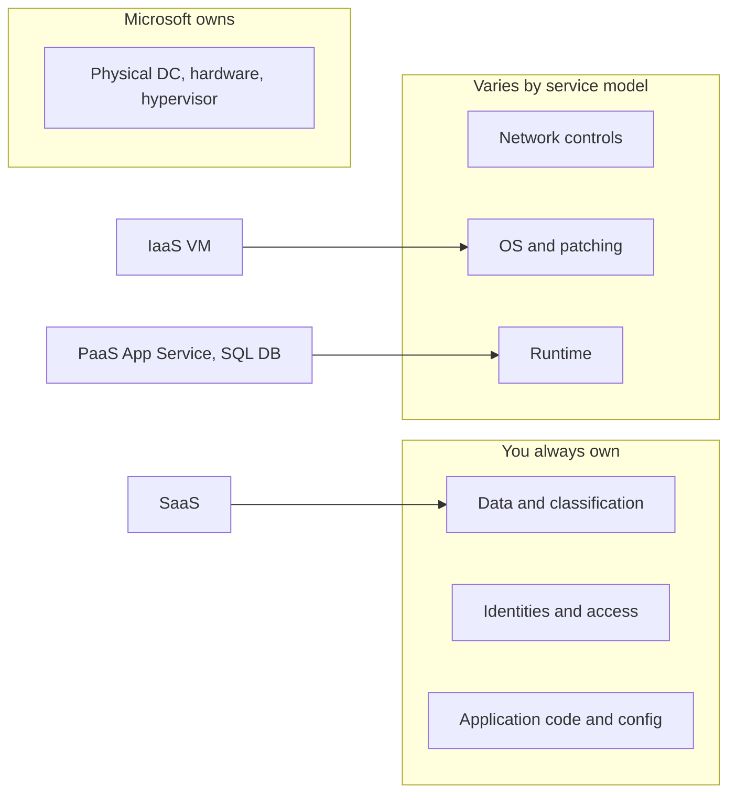
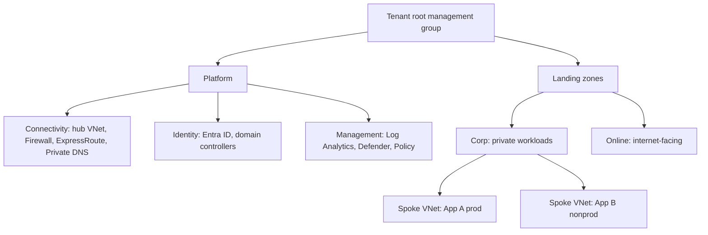
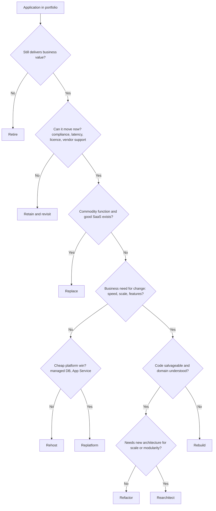
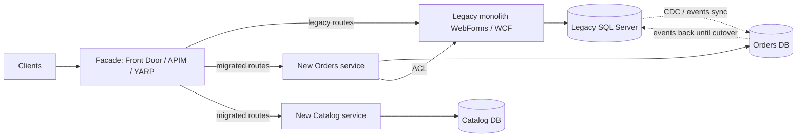
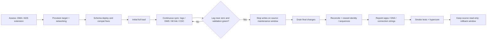
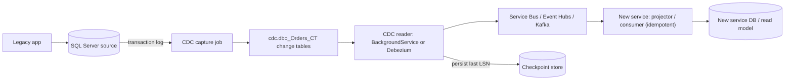
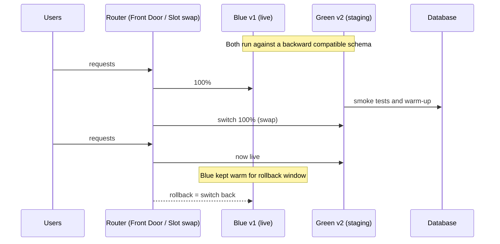
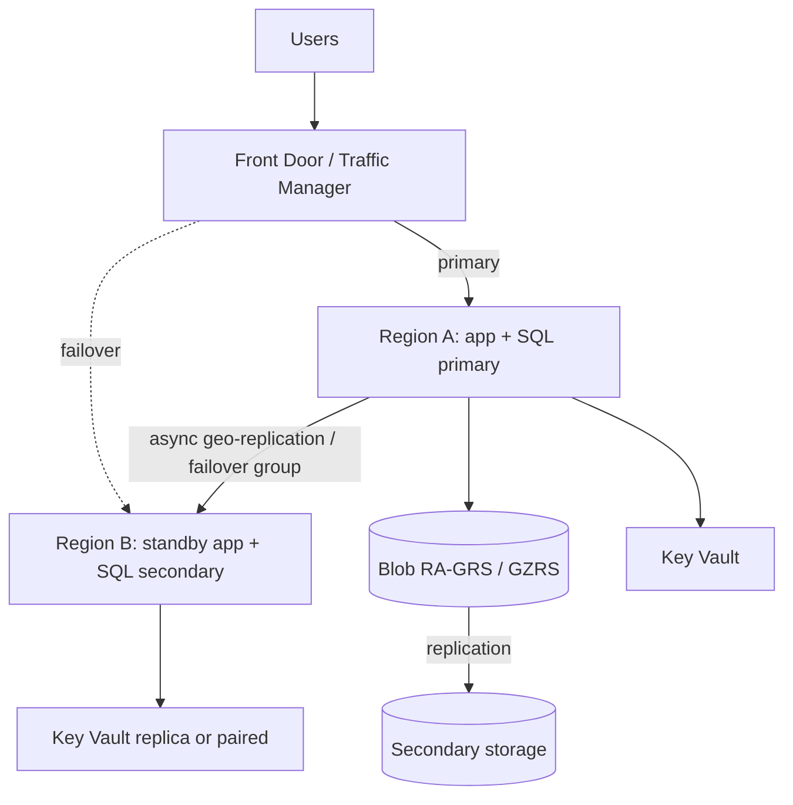
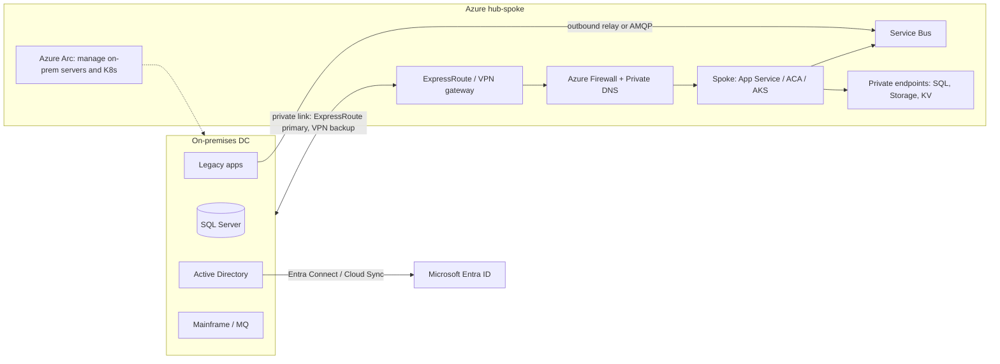

# Cloud Migration and Legacy Modernization

> Interview-grade guide for senior developer / tech lead / architect roles. Every chapter follows the
> same pattern: simple explanation → architect depth → why it exists → how it works → .NET / SQL Server /
> Azure examples → when (not) to use → trade-offs → mistakes → NFR considerations → troubleshooting →
> related topics → interview Q&A.

## How to use this guide

1. Read chapters 1–3 to build the vocabulary and the **decision framework** (the 8 Rs).
2. Read chapters 4–6 (patterns, data, release) for the *hard engineering*: this is where interviewers probe.
3. Read chapters 7–10 for resilience, hybrid, risk and cost.
4. Rehearse the scenario questions (chapter 12) aloud using the **presentation framework** (chapter 13).

Product names and features (Azure Database Migration Service, SQL Managed Instance link, Azure Migrate,
Azure Arc) evolve quickly. Treat the commands here as *illustrative*; verify current syntax/SKUs in
Microsoft Learn before using them in production.

## Table of contents

1. [Foundations: on-premises vs cloud](#1-foundations-on-premises-vs-cloud)
2. [Migration strategies: the 8 Rs](#2-migration-strategies-the-8-rs)
3. [Per-R deep dive (Rehost → Retire)](#3-per-r-deep-dive)
4. [Modernization patterns](#4-modernization-patterns)
5. [Database migration, synchronization and CDC](#5-database-migration-synchronization-and-cdc)
6. [Release and risk: zero-downtime, blue-green, canary, parallel run, rollback](#6-release-and-risk-techniques)
7. [Disaster recovery](#7-disaster-recovery)
8. [Hybrid cloud architecture](#8-hybrid-cloud-architecture)
9. [Migration risks and trade-offs](#9-migration-risks-and-trade-offs)
10. [Cost and performance considerations](#10-cost-and-performance-considerations)
11. [Troubleshooting during and after migration](#11-troubleshooting-during-and-after-migration)
12. [Interview questions, follow-ups and scenarios](#12-interview-questions-follow-ups-and-scenarios)
13. [Templates: wave plan, ADR, presentation framework, checklist](#13-templates-and-frameworks)
14. [Related topics](#14-related-topics-in-this-repository)

---

## 1. Foundations: on-premises vs cloud

### 1.1 Simple explanation
On-premises (on-prem) means you buy, rack, power, patch and secure the hardware yourself. Cloud means you
rent capacity and managed services from a provider and pay for what you consume. Migration is moving
workloads (and their data, identity, networking and operations) from one to the other **without breaking
the business**.

### 1.2 Architect-level depth

| Dimension | On-premises | Cloud (Azure) |
| --- | --- | --- |
| Cost model | CapEx, over-provisioned for peak, 3–5 year hardware cycle | OpEx, elastic, pay-per-use, commitment discounts |
| Capacity | Procurement lead time (weeks/months) | Minutes; quotas apply |
| Scaling | Mostly vertical, manual | Horizontal autoscale (App Service, ACA, AKS, Functions) |
| Resilience | You build DR site, replication, backup | Availability Zones, paired regions, geo-replication as services |
| Ops responsibility | Everything | Shared responsibility: provider owns facility/hypervisor; PaaS adds OS/runtime |
| Security | Perimeter, network-trust model | Identity-centric, Zero Trust, policy-as-code (Azure Policy, Defender) |
| Release speed | Change windows, ticket queues | IaC + CI/CD, ephemeral environments |
| Latency to legacy systems | LAN (sub-ms) | WAN/ExpressRoute (ms to tens of ms) — **critical for hybrid** |
| Compliance | Own audits | Inherit provider certifications; you still own configuration |
| Failure modes | Hardware, power | Throttling, quota, noisy neighbours, regional outages, misconfiguration, bill shock |

### 1.3 Why cloud migration exists
Drivers: data-centre exit/lease end, end-of-support (Windows Server 2012, old SQL Server versions, .NET
Framework apps on legacy IIS), scalability for spikes, faster delivery, DR cost, M&A consolidation,
security posture, access to data/AI platforms. **State the driver first**: the driver selects the strategy
(a lease-expiry deadline implies rehost; a product-velocity goal implies refactor/rearchitect).

### 1.4 Shared responsibility model



IaaS: you patch the OS and SQL Server. PaaS: Microsoft patches OS/engine; you own schema, queries,
identity, backup retention choices, network exposure. A classic interview trap: "PaaS means backups are not
my problem" — retention, restore testing and logical-corruption recovery still are.

### 1.5 Landing zone and Cloud Adoption Framework (CAF)
A **landing zone** is the pre-built, governed Azure environment workloads land in: management groups and
subscriptions per workload/environment, hub-and-spoke or Virtual WAN network, private DNS, firewall,
identity (Entra ID, PIM, conditional access), Azure Policy guardrails, logging (Log Analytics), cost
management (tags, budgets) and an IaC pipeline. CAF phases: Strategy → Plan → Ready → Migrate/Adopt →
Govern → Manage. **Migrating before the landing zone exists is the #1 cause of rework.**



### 1.6 Discovery and assessment: Azure Migrate
Azure Migrate (appliance-based) discovers servers, SQL instances and web apps, maps dependencies
(agentless or agent-based), produces readiness, right-sized SKUs and cost estimates, and includes
migration/replication tooling for VMs. Complement it with the **App Service Migration Assistant**, the
**.NET Upgrade Assistant**, and the **Azure Data Studio SQL migration extension** for databases.

Discovery outputs you must capture: dependency graph (who calls whom, ports), data volumes and change
rate (drives replication feasibility), peak/percentile utilisation (right-sizing), licences (Windows, SQL,
third party), batch windows, integration endpoints (SFTP, MQ, mainframe), compliance/data residency, and
**the hidden stuff**: scheduled tasks, file shares, linked servers, SSIS/SQL Agent jobs, CLR assemblies,
COM components, hard-coded IPs, client certificates, machine-keyed ViewState/Forms auth.

### 1.7 Real-world scenario
A 15-year-old insurance platform: ASP.NET WebForms + WCF services on Windows Server 2012, SQL Server 2014
with SQL Agent jobs, linked servers to a mainframe, file-drop integration via an SMB share. Windows Server
2012 is out of support (ESU costs extra) and the data-centre lease ends in 18 months. The constraints drive
a **mixed portfolio**: rehost the mainframe-adjacent pieces, replatform the DB to SQL Managed Instance
(linked servers/Agent jobs compatibility), refactor WCF edges behind an API facade, and strangle the
WebForms UI over time.

### 1.8 When NOT to migrate (yet)
Hard latency coupling to on-prem systems you cannot move; unclear owner; data residency not satisfied by an
available region; app is days from retirement; no landing zone or skills. Do a **retain** deliberately.

### 1.9 Interview Q&A
**Q: What do you establish before migrating the first workload?** A: Business driver and deadline, landing
zone (network, identity, governance, observability, IaC), discovery with dependency mapping, a portfolio
classification (8 Rs), success metrics (RTO/RPO, latency, cost) and a pilot wave. *Follow-up: why a pilot?*
It finds landing-zone gaps (DNS, firewall rules, identity) cheaply with a low-risk app.

---

## 2. Migration strategies: the 8 Rs

### 2.1 Simple explanation
Eight standard answers to "what do we do with this application?": move as is (rehost), move with small
tweaks (replatform), change code a bit (refactor), change the design (rearchitect), rewrite (rebuild), buy
SaaS (replace), leave it (retain), switch it off (retire). Some taxonomies use "relocate" and merge
Refactor/Rearchitect; know both vocabularies and state which you use.

### 2.2 Decision flowchart



### 2.3 Comparison table

| R | What changes | Effort | Risk | Benefit | Typical Azure target | Example |
| --- | --- | --- | --- | --- | --- | --- |
| Rehost | Nothing in app; VM moves | Low | Low | Fast exit, DR, no code risk | Azure VMs, Azure VMware Solution | Windows Server VMs via Azure Migrate |
| Replatform | Swap components for managed equivalents | Low–Med | Low–Med | Less ops, built-in HA/backup | App Service, SQL MI/DB, Azure Cache | IIS app → App Service; SQL → MI |
| Refactor | Code changes to fit PaaS/cloud | Med | Med | Elasticity, cloud services | App Service/ACA/Functions + Service Bus | Local file I/O → Blob; session → Redis |
| Rearchitect | New structure (services/events) | High | High | Scale, independent deploys | ACA/AKS, Service Bus, Cosmos/SQL | Monolith → services via strangler |
| Rebuild | Rewrite on cloud-native stack | Very high | High | Clean slate | Cloud-native PaaS | WebForms → SPA + API |
| Replace | Buy SaaS; migrate data | Med | Med | Offload commodity | Dynamics 365, M365, other SaaS | Home-grown CRM → SaaS CRM |
| Retain | Stay put (hybrid) | Low | Low now / high later | Avoids a bad move | On-prem + Arc/ExpressRoute | Latency-bound plant-floor system |
| Retire | Decommission | Low | Low | Cost removal | n/a | Unused reporting app |

Rule of thumb: **sequence cheap-and-reversible first (retire, retain, rehost) to hit deadlines, then invest
(refactor/rearchitect) where business value concentrates.** Rehost is a *stepping stone*, not a
destination — unless the value is low.

---

## 3. Per-R deep dive

Each subsection covers: what / why / how / Azure / use / avoid / trade-offs / mistakes / NFR / troubleshooting.

### 3.1 Rehost ("lift and shift")
- **What:** Replicate VMs to Azure unchanged (Azure Migrate Server Migration: agentless for VMware/Hyper-V,
  agent-based for physical/other). Continuous block replication → test migration in an isolated network →
  cutover (final sync, shutdown source, boot target, repoint DNS).
- **Why:** Deadlines, minimal risk, fastest route out of a DC, immediate access to Azure Backup/ASR/Defender.
- **Internals:** A replication appliance streams changed blocks to a storage account; at cutover a managed
  disk is created from the replica and a VM is built with the chosen SKU. Initial sync can take days for
  multi-TB; delta sync shrinks the cutover window to minutes.
- **Use:** stable apps, vendor-locked apps, tight deadline, unclear code ownership. **Avoid:** apps with
  chatty dependencies left on-prem (latency), licence models that penalise cloud, hardware dongles,
  workloads that become far pricier on always-on VMs.
- **Trade-offs:** + speed, low risk; − you keep the ops burden and tech debt, and may pay more than on-prem if not right-sized.
- **Mistakes:** sizing to on-prem allocations instead of observed utilisation; forgetting dependent
  servers/file shares in the same wave; hard-coded IPs/DNS; never revisiting after the move.
- **NFR:** Availability Zones/sets, Azure Backup, managed disks (Premium SSD v2/Ultra for SQL logs), NSGs, Defender for Servers.
- **Troubleshoot:** boot failures (drivers, integration services), slow replication (bandwidth vs change rate), time sync, DNS suffix, licence activation (use Azure Hybrid Benefit).

```bash
# Illustrative: enable Azure Hybrid Benefit and right-size a migrated VM
az vm update -g rg-migrated -n vm-web01 --license-type Windows_Server
az vm resize -g rg-migrated -n vm-web01 --size Standard_D4as_v5
```

### 3.2 Replatform ("lift, tinker, and shift")
- **What:** Same code, different platform components: IIS VM → App Service; SQL Server VM → Azure SQL
  Managed Instance/Database; self-hosted Redis → Azure Cache for Redis; on-prem MQ → Service Bus.
- **Why:** Remove undifferentiated ops (patching, backups, HA) with little code change.
- **How:** The App Service Migration Assistant checks readiness (GAC, registry, local disk, custom MSIs,
  Windows auth/AD dependencies); `web.config` transforms handle config; secrets move to App Settings /
  Key Vault references; Windows auth → Entra ID or hybrid with managed identity.
- **Use:** web apps without OS-level dependencies; databases using mainstream features. **Avoid:** apps
  needing Windows services/COM/GAC/registry (use containers or VMs), or SQL features unsupported by Azure
  SQL Database (cross-database queries, linked servers → prefer Managed Instance or a VM).
- **Trade-offs:** + less ops, built-in SLA; − platform limits, behaviour changes (timeouts, TLS, SNAT port exhaustion, scale-out breaking in-proc session).
- **Mistakes:** leaving in-proc session/cache with scale-out > 1 (users randomly logged out); local file writes lost on recycle; ignoring outbound SNAT limits.
- **Troubleshoot:** Kudu/log stream, App Service "Diagnose and solve problems", crash dumps, SNAT metrics, ARR affinity cookies.

```csharp
// Replatform tweak: externalise session and secrets instead of in-proc state / web.config secrets
builder.Services.AddStackExchangeRedisCache(o =>
    o.Configuration = builder.Configuration.GetConnectionString("Redis"));
builder.Services.AddSession(o => { o.Cookie.HttpOnly = true; o.IdleTimeout = TimeSpan.FromMinutes(20); });
builder.Configuration.AddAzureKeyVault(new Uri(builder.Configuration["KeyVaultUri"]!),
    new DefaultAzureCredential());   // managed identity, no secrets in config
```

### 3.3 Refactor
- **What:** Modify code to exploit cloud services *without* changing the overall architecture: .NET
  Framework → current .NET LTS, file system → Blob Storage, Windows services → Functions/WebJobs/
  `BackgroundService`, DPAPI/machine keys → Data Protection with Key Vault.
- **Why:** Unlock PaaS, containers, Linux (cheaper), modern security and performance.
- **How:** .NET Upgrade Assistant, API portability analyser, **System.Web adapters** with an incremental
  ASP.NET → ASP.NET Core migration, SDK-style csproj, WCF → CoreWCF or gRPC/REST.
- **Use:** code is understood and tests exist. **Avoid:** no tests and no owners → write characterization tests first.
- **Mistakes:** big-bang framework upgrade without tests; carrying `HttpContext.Current` everywhere; assuming Windows paths work on Linux.
- **Troubleshoot:** missing APIs (`System.Drawing`, `System.DirectoryServices`), culture/ICU differences on Linux, EF6 → EF Core translation differences, sync-over-async thread-pool starvation under Kestrel.

### 3.4 Rearchitect
- **What:** Change structure: modularise, introduce services/events, CQRS read models, polyglot persistence.
- **Why:** Independent scaling/deployment, team autonomy, isolation of failure.
- **How:** strangler fig, bounded contexts, anti-corruption layers (chapter 4).
- **Use:** proven pain from coupling (deployment bottleneck, scaling hotspot) and organisational maturity (DevOps, observability). **Avoid:** small teams, unclear boundaries, no CI/CD → choose a *modular monolith*.
- **Trade-offs:** + autonomy, scale, resilience; − distributed complexity, eventual consistency, ops overhead, cost.
- **Mistakes:** *distributed monolith* (synchronous call chains, shared DB, lock-step releases); services split by technical layer; premature micro-granularity.

### 3.5 Rebuild
- **What:** Rewrite from requirements on a cloud-native stack, retaining only data and business rules.
- **Why:** Technology is unsalvageable (Silverlight, VB6, proprietary WebForms controls) or the domain changed fundamentally.
- **Risk:** second-system effect, rediscovering undocumented rules, feature-parity treadmill, running two systems for years. Mitigate with strangler-style incremental rebuild and golden-master tests; avoid big-bang unless the system is small.
- **Use:** small code base, high-value process, cheap to rewrite. **Avoid:** large systems with embedded tribal knowledge.

### 3.6 Replace
- **What:** Adopt SaaS/COTS (CRM, HR, e-mail, ITSM) and migrate data; integrate via APIs/iPaaS (Logic Apps, Azure Integration Services).
- **Why:** Commodity capabilities are not differentiating; the vendor carries roadmap, security and ops.
- **Risks:** data mapping/cleansing, process change, integration glue, lock-in, customisation limits, growing licence cost. Keep an **anti-corruption layer** so SaaS models don't leak into your domain.
- **Use:** non-differentiating domains. **Avoid:** core differentiators, data-residency conflicts.

### 3.7 Retain
- **What:** Consciously leave on-prem — *with a revisit date and an exit trigger*.
- **Why:** Latency/regulatory/hardware/vendor constraints; imminent retirement; cost of move exceeds benefit.
- **How:** connect via ExpressRoute/VPN, extend identity, manage with **Azure Arc**, monitor centrally.
- **Mistake:** "retain" as a euphemism for "avoid" with no owner.

### 3.8 Retire
- **What:** Decommission redundant/unused apps; archive data per retention policy.
- **Why:** The cheapest migration is the one you don't do; reduces attack surface and licence cost.
- **How:** verify usage (logs, sign-ins, network flows) across a **full business cycle**, notify owners, read-only period, archive to Blob (immutability policy where required), then delete.
- **Mistake:** retiring something with a hidden quarterly/annual batch consumer.

### 3.9 Interview Q&A
**Q: How do you choose between rehost and refactor for a 12-year-old .NET Framework app?** A: Start from the
driver and constraints. Date-bound exit with low change demand: rehost (or replatform the DB), then schedule
refactoring by backlog value. Growth product with deployment/scaling pain: refactor to .NET LTS,
containerise, strangle incrementally. Quantify change frequency, incident cost, infra cost, skills.
*Follow-up: the team wants a rewrite?* Ask for evidence the code is unsalvageable; propose a thin-slice
strangler proof; reject big-bang unless the domain is small.

**Q: Is lift-and-shift a bad strategy?** A: No — it is bad as the *end state* for apps that needed
elasticity, and when not right-sized. It is good as stage 1 to meet a deadline, with Azure Hybrid Benefit
and reservations, followed by targeted replatforming.

---

## 4. Modernization patterns

### 4.1 Monolith modernization

**Simple explanation.** A monolith is one deployable unit. Modernising it means making it easier to change,
scale and operate — it does *not* automatically mean "microservices".

**Architect depth.** Modernisation is a ladder; stop at the lowest rung that solves your problem:

1. **Stabilise**: build/deploy automation, tests, observability, upgrade runtime.
2. **Modularise inside the monolith** (modular monolith): enforce boundaries with project/namespace
   rules, architecture tests (NetArchTest/ArchUnitNET), module-owned schemas.
3. **Extract hot spots** as services (scaling, volatility, different tech needs, team ownership).
4. **Decompose by bounded context** where organisational and data boundaries justify the cost.

**Why it exists.** Legacy monoliths suffer slow builds, risky deploys, all-or-nothing scaling, tech lock-in
and knowledge silos. But a distributed system adds network failure, consistency, versioning and operational
cost; modernisation exists to buy *specific* qualities, not to follow fashion.

**Seams.** A *seam* is a place where you can alter behaviour without editing in place: an interface, a
URL route, a message queue, a database view, a batch file hand-off. Finding seams (call-graph analysis,
dependency matrices, "change coupling" from git history) determines extraction order.

**Use / avoid.** Use when pain is measurable (lead time, change-failure rate, scaling cost). Avoid when the
monolith is small, stable, and the team is small — leave it or modularise.

**Mistakes.** Starting with the database split; extracting by technical layer; no tests; skipping the
modular-monolith stage; "microservices" that still share one database and deploy together.

See [Modular Monolith](../02-architectural-styles/07-modular-monolith/modular-monolith.md) and
[Microservices](../02-architectural-styles/01-microservices-architecture/microservices-architecture.md).

### 4.2 Modular monolith first

```csharp
// Module boundary: other modules may only use the public contract, never internals or the DB tables
namespace Billing.Contracts;
public interface IBillingModule
{
    Task<InvoiceDto> CreateInvoiceAsync(CreateInvoiceCommand cmd, CancellationToken ct);
}

// Billing.Infrastructure is internal; DI exposes only the contract
public static class BillingModuleExtensions
{
    public static IServiceCollection AddBillingModule(this IServiceCollection s, IConfiguration c)
    {
        s.AddDbContext<BillingDbContext>(o => o.UseSqlServer(c.GetConnectionString("Billing"),
            sql => sql.MigrationsHistoryTable("__EFMigrationsHistory", "billing"))); // own schema
        s.AddScoped<IBillingModule, BillingModule>();
        return s;
    }
}
```

```csharp
// Architecture test (NetArchTest) - fails the build if Ordering reaches into Billing internals
[Fact]
public void Ordering_must_not_depend_on_Billing_internals() =>
    Types.InAssembly(typeof(OrderingModule).Assembly)
         .That().ResideInNamespace("Ordering")
         .ShouldNot().HaveDependencyOn("Billing.Infrastructure")
         .GetResult().IsSuccessful.Should().BeTrue();
```

A module with its own schema, a contract interface, and async integration events can later be lifted out
as a service with a mechanical change (in-proc call → HTTP/gRPC/message). That is *why* modular-first is
the lowest-risk route to microservices.

### 4.3 Monolith → microservices migration

**Process.**
1. Event-storm / map **bounded contexts**; pick the first candidate: high change rate, clear data
   ownership, few inbound dependencies, business value.
2. Put a **facade** (YARP/API Management/Front Door) in front of the monolith.
3. Build the new service behind a **feature toggle**; copy or sync the data it owns.
4. Route a slice of traffic; compare; ramp; remove the code from the monolith.
5. Repeat; delete dead code continuously (otherwise you run both forever).

**Data ownership is the hard part.** Each service owns its data; others obtain it via API/events, not
joins. Cross-service invariants need sagas/outbox rather than distributed transactions — see
[Distributed Transactions](../03-architectural-patterns/distributed-transaction.md) and
[Saga](../03-architectural-patterns/01-SAGA-pattern/SAGA-pattern.md).

**Trade-offs.** + independent deploy/scale; − eventual consistency, observability needs, network failure
modes, duplicated reference data, harder testing. **Anti-patterns:** distributed monolith, chatty
fine-grained calls, shared database "temporarily" forever, shared domain library coupling every service,
ignoring Conway's law.

### 4.4 Strangler Fig pattern

**Simple explanation.** Like a strangler fig vine growing around a tree, you grow the new system around the
old one, route functionality across piece by piece, and finally remove the old tree.

**How it works.** A routing layer (facade/proxy) sits between clients and the legacy app. Initially all
routes go to legacy. For each migrated capability you change the route to the new implementation (all
traffic, percentage, or by user cohort). Because routing is configuration, rollback is a config change.



**Choosing the facade.**

| Option | Strengths | Limits |
| --- | --- | --- |
| **YARP** (in-process reverse proxy, .NET) | Code-level routing, custom transforms, feature-flag logic, same stack/team | You run and scale it; adds a hop |
| **Azure API Management** | Policies (auth, rate limit, transform), versioning, developer portal | Cost, latency, policy language |
| **Azure Front Door** | Global edge, WAF, weighted routing/origin groups, TLS offload | L7 path routing only, limited custom logic |
| **Application Gateway** | Regional L7, WAF, path/host routing, private backends | Regional; config-heavy |
| **Ingress (AKS) / ACA ingress** | Native to containers, traffic splitting | Cluster-scoped |

```json
// YARP strangler routing: appsettings.json. Specific routes win over the catch-all legacy route.
{
  "ReverseProxy": {
    "Routes": {
      "orders-new": { "ClusterId": "orders", "Order": 1,
        "Match": { "Path": "/api/orders/{**rest}" } },
      "legacy-all": { "ClusterId": "legacy", "Order": 100,
        "Match": { "Path": "/{**catch-all}" } }
    },
    "Clusters": {
      "orders": { "Destinations": { "d1": { "Address": "https://orders.internal/" } },
        "HealthCheck": { "Active": { "Enabled": true, "Path": "/health/ready" } } },
      "legacy": { "Destinations": { "d1": { "Address": "https://legacy.corp.local/" } } }
    }
  }
}
```

```csharp
// Percentage / cohort-based routing with a feature flag, implemented as a YARP transform
builder.Services.AddReverseProxy()
    .LoadFromConfig(builder.Configuration.GetSection("ReverseProxy"))
    .AddTransforms(ctx =>
    {
        if (ctx.Route.RouteId != "orders-new") return;
        ctx.AddRequestTransform(async t =>
        {
            var flags = t.HttpContext.RequestServices.GetRequiredService<IFeatureManager>();
            if (!await flags.IsEnabledAsync("UseNewOrders"))            // Azure App Configuration flag
                t.ProxyRequest.RequestUri = new Uri("https://legacy.corp.local" + t.Path + t.Query.QueryString);
        });
    });
```

**Anti-corruption layer (ACL).** A translation layer that stops the legacy model (anonymous column names,
status codes, WCF DTOs) leaking into the new domain. Implement as an adapter class/service calling the
legacy via its contract and mapping to new domain types. See
[Enterprise Application Patterns](../03-architectural-patterns/enterprise-application-patterns.md).

```csharp
public sealed class LegacyCustomerAcl : ICustomerDirectory   // new domain's port
{
    private readonly LegacyCustomerServiceClient _wcf;        // legacy contract
    public async Task<Customer> GetAsync(CustomerId id, CancellationToken ct)
    {
        var dto = await _wcf.GetCustomerAsync(id.Value);
        return new Customer(id, dto.CUST_NM.Trim(), dto.STS_CD switch
        {
            "A" => CustomerStatus.Active, "S" => CustomerStatus.Suspended, _ => CustomerStatus.Closed
        });
    }
}
```

**Branch by abstraction** (strangling *inside* a codebase): introduce an interface over the legacy
component, route callers through it, write the new implementation, toggle per environment/tenant, delete
the old one. Pair with trunk-based development ([Branching Strategy](../08-software-development-process/Branching%20Strategy.md)).

**Use / avoid.** Use for any large, business-critical system; essential when a big-bang is too risky.
Avoid when the system is tiny (rewrite is cheaper), when there is no seam at the edge (batch-only
integrations — use data-level strangling), or when the facade would become a new bottleneck/SPOF without HA.

**Mistakes.** Facade as single point of failure; never retiring legacy routes; sharing the legacy database
with writes from both sides without ownership rules; sticky sessions/auth tokens that don't cross systems
(users bounce between old and new and are logged out) — solve with shared auth (Entra ID/OIDC) and
shared or stateless session.

**Troubleshoot.** Route mismatch (order/precedence), header loss (`Host`, `X-Forwarded-*`), cookie domain/
path differences, WebSocket/long-running request timeouts, request-size limits, redirect loops where the
legacy emits absolute URLs.

### 4.5 Incremental migration — sequencing

Order candidates by **value ÷ risk**, honouring dependencies:
1. Leaf capabilities with few inbound dependencies (reports, notifications, search, document generation).
2. Read-heavy queries (build a read model/CQRS projection fed by CDC; legacy stays the writer).
3. Capabilities with clear owner and high change frequency.
4. Core transactional write paths last (most coupled).

Techniques: **data-level strangling** (replicate and offload reads), **UI composition** (micro-frontends
or ASP.NET Core `System.Web` adapter hosting), **event interception** (capture changes via CDC/triggers
and publish events without touching legacy code), **branch by abstraction**, **parallel change**
(expand/contract) for schemas and APIs.

Each increment must be **independently shippable, reversible, observable**, and measured with the
same KPIs as before (latency, errors, business throughput).

### 4.6 Interview Q&A
**Q: How would you migrate a large WebForms + WCF monolith to Azure with minimal risk?** A: Stabilise and
add observability; replatform infrastructure first if there's a deadline; put YARP/Front Door in front;
extract leaf and read-heavy capabilities; sync data via CDC; run new and old in parallel (shadow) before
cutting over; retire legacy routes. Data ownership by service; sagas for cross-service consistency.
*Follow-up: where do you start?* The slice with highest business value and lowest coupling — often a
read-only API or reporting — to prove the pipeline, not the core ledger.

**Q: Strangler vs big-bang rewrite?** A: Strangler delivers value continuously, limits blast radius,
allows rollback via routing, and defers risk; big-bang bets everything on feature parity and freezes the
legacy. Big-bang is only reasonable for small/low-risk systems.

**Q: How does the new service get data it needs from legacy during transition?** A: Prefer legacy as the
system of record behind an ACL API for reads; for scale, CDC → events → local read model. For writes,
designate **one owner per entity per phase** — no dual-writes.

---

## 5. Database migration, synchronization and CDC

### 5.1 Choosing the target (SQL Server → Azure)

| Target | Compatibility | Ops burden | Best for | Watch out |
| --- | --- | --- | --- | --- |
| **SQL Server on Azure VM (IaaS)** | ~100% (OS access, any feature) | You patch/backup/HA | Lift-and-shift, SSRS/SSIS/3rd-party agents, unsupported features | Licence, you own HA/DR design |
| **Azure SQL Managed Instance** | Near-100% instance-scoped (SQL Agent, cross-DB queries, linked servers (limited), CLR, Service Broker, DB Mail) | Low | Replatform with minimal change; large DBs | VNet-injected, longer provisioning, limits per tier |
| **Azure SQL Database** (single/elastic pool/Hyperscale) | Database-scoped; no SQL Agent/cross-DB queries (elastic query workarounds) | Lowest | Modernised apps, SaaS multi-tenant, Hyperscale for very large DBs | Feature gaps; connection resiliency required |

Assess with the **Azure Data Studio SQL migration extension / Data Migration Assistant (DMA)** for
compatibility issues (deprecated features, breaking changes) and SKU recommendations based on perf
counters. Re-check licences (Azure Hybrid Benefit) and `COMPATIBILITY_LEVEL`.

### 5.2 Migration methods

| Method | Downtime | Source→Target | Notes |
| --- | --- | --- | --- |
| Backup/restore (native `.bak` to URL) | Full outage during backup→restore (or small with differential/log) | → VM, → MI (`RESTORE FROM URL`) | Simplest; MI restore is one-way (cannot restore a MI backup to on-prem older versions) |
| **Log shipping / MI Log Replay Service (LRS)** | Minutes (final log tail) | → MI, → VM | Continuous restore of log backups; cutover after last log |
| **Azure DMS online** | Minutes | → MI, → DB, → VM | Continuous sync (via backups/logs for MI/VM; CDC-style for some DB paths) until cutover; verify current supported paths |
| Azure DMS offline | Full outage | many | Bulk copy; schema first |
| **MI link feature** | Minutes | SQL Server (2016+/2019+ depending) ↔ MI | Distributed availability groups for near-real-time replication; also supports *reverse* failback in newer SQL Server versions — verify version matrix |
| Transactional replication | Seconds–minutes | → DB/MI (MI as subscriber) | Granular tables; needs PKs; adds replication agents |
| BACPAC (export/import) | Long | → DB | Small DBs (< tens of GB), schema+data logical copy |
| ETL (ADF/SSIS) | Varies | any | Transform during move; not for transactional cutover |
| Always On AG extension (hybrid) | Seconds | → VM | Add Azure replica to existing AG, fail over |



```bash
# Illustrative: MI native restore from URL (T-SQL) then Log Replay Service via CLI (verify current syntax)
# T-SQL on MI:
#   CREATE CREDENTIAL [https://stmig.blob.core.windows.net/backups]
#   WITH IDENTITY='SHARED ACCESS SIGNATURE', SECRET='<sas>';
#   RESTORE DATABASE AppDb FROM URL='https://stmig.blob.core.windows.net/backups/AppDb.bak';
az sql midb log-replay start -g rg-data --managed-instance mi-prod -n AppDb \
   --storage-uri "https://stmig.blob.core.windows.net/backups" \
   --storage-sas "<sas-token>" --auto-complete --last-backup-name "AppDb_last.trn"
```

```bicep
// Illustrative DMS-like resource declaration is service/version specific; keep migration orchestration in
// scripts/runbooks and keep targets (MI, storage, private endpoints) in Bicep.
resource mi 'Microsoft.Sql/managedInstances@2023-05-01-preview' = {
  name: 'mi-prod'
  location: resourceGroup().location
  sku: { name: 'GP_Gen5', tier: 'GeneralPurpose' }
  properties: { subnetId: miSubnetId, vCores: 8, storageSizeInGB: 2048, licenseType: 'BasePrice' } // AHB
}
```

**Throughput maths (be ready to compute).** 2 TB over a 1 Gbps link at ~70% effective ≈ 2×8×10^12 bits /
(0.7×10^9) ≈ 6.3 hours of pure transfer; with compression/full+diff+log seeding and ExpressRoute it is a
background task. Over a 100 Mbps VPN it is ~2.6 days — so seed by backup/restore (or Data Box offline for
tens of TB) and sync only the delta.

### 5.3 Schema compatibility and expand/contract (parallel change)

Zero-downtime schema change requires that **old and new application versions both work against the same
schema** during rollout. Pattern: **expand → migrate → contract**.

```sql
-- EXPAND (backward compatible): add nullable column + index online; old app unaffected
ALTER TABLE dbo.Customer ADD FullName nvarchar(200) NULL;
CREATE INDEX IX_Customer_FullName ON dbo.Customer(FullName) WITH (ONLINE = ON);

-- MIGRATE: backfill in small batches to avoid log blow-up and blocking
DECLARE @rows int = 1;
WHILE @rows > 0
BEGIN
  UPDATE TOP (5000) c
     SET FullName = CONCAT(c.FirstName, N' ', c.LastName)
    FROM dbo.Customer c
   WHERE c.FullName IS NULL;
  SET @rows = @@ROWCOUNT;
  WAITFOR DELAY '00:00:00.200';           -- let log backups / readers breathe
END

-- Keep in sync while both app versions run (temporary trigger, or app dual-write behind flag)
CREATE OR ALTER TRIGGER dbo.trg_Customer_FullName ON dbo.Customer AFTER INSERT, UPDATE AS
  UPDATE c SET FullName = CONCAT(c.FirstName, N' ', c.LastName)
    FROM dbo.Customer c JOIN inserted i ON i.Id = c.Id;

-- CONTRACT (only after all instances use new column AND rollback window closed)
ALTER TABLE dbo.Customer ALTER COLUMN FullName nvarchar(200) NOT NULL;
DROP TRIGGER dbo.trg_Customer_FullName;
ALTER TABLE dbo.Customer DROP COLUMN FirstName, LastName;
```

Rules: never rename/drop in the same release that stops using it; make new columns nullable/defaulted; use
`ONLINE = ON` and `WAIT_AT_LOW_PRIORITY` for index ops (Enterprise/Azure SQL); backfill in batches;
EF Core migrations should be applied by a **separate migration job** (not at app start-up on every
instance) and reviewed as SQL scripts (`dotnet ef migrations script --idempotent`).

### 5.4 Dual-write pitfalls and safer alternatives

Dual-write = application writes to old and new stores. Failure modes: second write fails (divergence), ordering
races between concurrent writers, retries causing duplicates, partial failure with no transaction
spanning both stores, and no source of truth when they disagree.

Safer: (1) **single writer + replicate** (CDC/log shipping) so one system is authoritative per entity;
(2) **transactional outbox** (write business row + event row atomically, relay publishes events);
(3) if dual-write is unavoidable, write to the authoritative store first, make the second write
**idempotent and asynchronous**, and run **continuous reconciliation**.

```csharp
// Transactional outbox: business data and the outgoing event commit atomically
await using var tx = await db.Database.BeginTransactionAsync(ct);
db.Orders.Add(order);
db.Outbox.Add(new OutboxMessage { Id = Guid.NewGuid(), Type = "OrderPlaced",
    Payload = JsonSerializer.Serialize(new OrderPlaced(order.Id, order.Total)), CreatedUtc = DateTime.UtcNow });
await db.SaveChangesAsync(ct);
await tx.CommitAsync(ct);
// A BackgroundService polls Outbox, publishes to Service Bus (MessageId = outbox Id for duplicate detection),
// then marks the row dispatched. Consumers are idempotent (inbox / natural keys).
```

See [Distributed Systems Patterns](../03-architectural-patterns/distributed-systems-patterns.md) (outbox/inbox, idempotency).

### 5.5 Data synchronization approaches

| Approach | Latency | Source impact | Captures deletes | Use |
| --- | --- | --- | --- | --- |
| Timestamp/`rowversion` polling | Seconds–minutes | Query load | No (unless soft delete) | Simple, low volume |
| Triggers → audit tables | Real-time | Adds write latency | Yes | Small systems, can't enable CDC |
| **Change Tracking (CT)** | Poll | Low | Yes (keys only) | Lightweight "what changed", sync clients |
| **CDC** | Near-real-time (log scan) | Log reader job, cdc tables storage | Yes, with before/after images | Migration, event streaming, ETL |
| Temporal tables | Query-time history | Storage | Yes (history) | Auditing/time-travel, not streaming |
| Transactional replication | Seconds | Distribution DB | Yes | Table-level copies, read scale |
| Debezium (SQL Server connector) → Kafka / Event Hubs | Near-real-time | Uses CDC underneath | Yes | Event streaming platform |
| Service Broker/Outbox | Event-driven | App-level | App-defined | Business events (not raw rows) |

### 5.6 Change Data Capture (CDC) in SQL Server

**How it works internally.** CDC reads the **transaction log** asynchronously (log reader agent as SQL
Agent job `cdc.<db>_capture`; in Azure SQL Database, a scheduler runs it). For each captured table it
writes rows to a **change table** `cdc.<capture_instance>_CT` with metadata columns (`__$start_lsn`,
`__$seqval`, `__$operation` 1=delete, 2=insert, 3=update-before, 4=update-after, `__$update_mask`). A
cleanup job purges by retention (default 3 days). **LSN** (log sequence number) is the ordering/bookmark
key: consumers persist the last processed LSN. Requires Agent running on SQL Server/MI; the log cannot be
truncated past un-captured records (so a stopped capture job makes the **log grow**).

```sql
-- Enable CDC (db_owner / sysadmin)
EXEC sys.sp_cdc_enable_db;

EXEC sys.sp_cdc_enable_table
     @source_schema = N'dbo', @source_name = N'Orders',
     @role_name = NULL,                       -- or a gating role
     @supports_net_changes = 1;               -- requires PK/unique index

-- Consume changes between two LSNs (bookmark pattern)
DECLARE @from binary(10) = sys.fn_cdc_get_min_lsn('dbo_Orders');   -- or saved last LSN + increment
DECLARE @to   binary(10) = sys.fn_cdc_get_max_lsn();
SELECT __$operation, __$start_lsn, OrderId, Status, Total
FROM cdc.fn_cdc_get_all_changes_dbo_Orders(@from, @to, N'all');

-- Health: capture job latency and log reuse wait
SELECT latency, last_commit_time FROM sys.dm_cdc_log_scan_sessions ORDER BY start_time DESC;
SELECT name, log_reuse_wait_desc FROM sys.databases;               -- REPLICATION => capture lagging
EXEC sys.sp_cdc_help_jobs;
```

**CDC vs Change Tracking.** CDC stores the *data* of changes (before/after) and history for a retention
window — richer, heavier. CT only records *that* a row changed (PK + version) — lightweight, consumer must
read current row; cannot give intermediate states.



```csharp
// CDC consumer: polls change tables, publishes events, checkpoints LSN after successful publish.
public sealed class CdcRelay(IDbConnectionFactory dbf, IEventPublisher bus, ICheckpointStore ckpt,
                             ILogger<CdcRelay> log) : BackgroundService
{
    protected override async Task ExecuteAsync(CancellationToken ct)
    {
        using var timer = new PeriodicTimer(TimeSpan.FromSeconds(2));
        while (await timer.WaitForNextTickAsync(ct))
        {
            try
            {
                await using var con = await dbf.OpenAsync(ct);
                var from = await ckpt.GetAsync("orders") ?? await con.QuerySingleAsync<byte[]>(
                    "SELECT sys.fn_cdc_get_min_lsn('dbo_Orders')");
                var to = await con.QuerySingleAsync<byte[]>("SELECT sys.fn_cdc_get_max_lsn()");
                if (Compare(from, to) >= 0) continue;

                var rows = await con.QueryAsync<OrderChange>(@"
                    SELECT __$start_lsn AS Lsn, __$seqval AS Seq, __$operation AS Op, OrderId, Status, Total
                    FROM cdc.fn_cdc_get_all_changes_dbo_Orders(@from,@to,N'all')
                    ORDER BY __$start_lsn, __$seqval", new { from, to });

                foreach (var r in rows.Where(r => r.Op != 3))           // skip 'update before' images
                    await bus.PublishAsync(r.ToEvent(), messageId: $"{Convert.ToHexString(r.Lsn)}-{Convert.ToHexString(r.Seq)}", ct);

                await ckpt.SetAsync("orders", NextLsn(con, to), ct);   // at-least-once: consumers dedupe on messageId
            }
            catch (Exception ex) when (ex is not OperationCanceledException)
            { log.LogError(ex, "CDC relay failed; will retry from last checkpoint"); }
        }
    }
}
```

**Gotchas.** Schema changes on a captured table need a *second capture instance* (a capture instance
doesn't auto-pick up new columns); LSN gaps occur if cleanup removed data before the consumer read it (lag
> retention) → must full-resync; big transactions delay visibility; DDL on source; at-least-once delivery
means consumers must be idempotent; ordering is per-LSN, not across tables unless you merge by LSN.

**Debezium.** Open-source connector on Kafka Connect (or Azure Event Hubs Kafka endpoint + Kafka Connect
on AKS/VMs) that reads CDC tables and emits JSON/Avro events with snapshot + streaming modes. Gives
operational tooling (offset storage, schema history) at the cost of running Kafka Connect.

**Use / avoid.** Use CDC when you can't modify legacy code but need real-time data movement. Avoid CDC for
very high write rates on small VMs without capacity planning, for tables without PKs (net changes), or when
business events (not row diffs) are what consumers need — emit domain events instead, and don't leak the
legacy schema to every consumer (that couples them to it; wrap with an ACL/projector).

### 5.7 Reconciliation and validation

Never cut over on faith. Validate **count, aggregate, row-level checksum, and business invariants**.

```sql
-- 1) Row counts per table (run on source and target; compare)
SELECT s.name + '.' + t.name AS tbl, SUM(p.rows) AS row_count
FROM sys.tables t JOIN sys.schemas s ON s.schema_id=t.schema_id
JOIN sys.partitions p ON p.object_id=t.object_id AND p.index_id IN (0,1)
GROUP BY s.name, t.name ORDER BY 1;

-- 2) Aggregate checksum per key range (cheap, chunkable; use for large tables)
SELECT (OrderId/100000) AS bucket, COUNT(*) AS n,
       CHECKSUM_AGG(CHECKSUM(OrderId, CustomerId, Status, Total)) AS chk,
       SUM(CAST(Total AS decimal(38,2))) AS total_sum
FROM dbo.Orders GROUP BY (OrderId/100000) ORDER BY bucket;
-- Compare buckets; drill into mismatching buckets row by row with HASHBYTES('SHA2_256', CONCAT_WS('|', ...))

-- 3) Business invariants: orphan FK checks, negative balances, unmatched ledgers
SELECT COUNT(*) FROM dbo.OrderLine l LEFT JOIN dbo.Orders o ON o.OrderId=l.OrderId WHERE o.OrderId IS NULL;
```
(`CHECKSUM` can collide; use `HASHBYTES` for rigorous comparison on mismatching buckets.)

### 5.8 Cutover runbook (SQL, with identity/sequence handling)

1. T-minus: freeze schema changes; lower DNS TTL (e.g. to 60 s) at least one TTL period in advance; confirm lag ≈ 0; rehearse (≥ 2 dress rehearsals with timings).
2. Announce window; put the app in maintenance mode / stop writers; verify no active sessions (`sys.dm_exec_sessions`).
3. Set source **read-only** (`ALTER DATABASE ... SET READ_ONLY` or `SINGLE_USER`) — also gives a clean rollback source.
4. Drain final changes (last log backup restore / DMS "cutover" / MI link failover).
5. **Reseed identity/sequence** where sync tooling doesn't carry current values.
6. Run reconciliation queries; stats update; verify logins/users/permissions (orphaned users: `ALTER USER ... WITH LOGIN`), SQL Agent jobs, linked servers, certificates, Service Broker.
7. Repoint connection strings (Key Vault/App Configuration) → restart/slot swap; update DNS.
8. Smoke tests, synthetic transactions, monitor; hypercare.
9. Keep source for the rollback window; decide *in advance* the point of no return and the data rollback plan (reverse sync).

```sql
-- Reseed identity on target to max(source) + safety gap
DECLARE @max bigint = (SELECT ISNULL(MAX(OrderId),0) FROM dbo.Orders);
DBCC CHECKIDENT ('dbo.Orders', RESEED, @max);                   -- or add gap: @max + 1000
-- Sequences
DECLARE @s nvarchar(max) = N'ALTER SEQUENCE dbo.InvoiceNo RESTART WITH ' +
        CAST((SELECT ISNULL(MAX(InvoiceNo),0)+1 FROM dbo.Invoice) AS nvarchar(20));
EXEC sp_executesql @s;
-- Refresh stats and rebuild what's needed after bulk load
EXEC sp_updatestats;
```

### 5.9 Post-migration database performance troubleshooting (interview focus)

Migrations commonly *regress* performance for predictable reasons. Check, in this order:

1. **Compatibility level / Cardinality Estimator.** Moving to a newer engine at a higher compat level
   changes the CE and plans. Standard approach: migrate at the *old* compat level, enable **Query Store**
   (default on in Azure SQL), capture a baseline, raise compat level, then fix regressions with Query Store
   plan forcing / **automatic plan correction** (`ALTER DATABASE ... SET AUTOMATIC_TUNING (FORCE_LAST_GOOD_PLAN = ON)`).
2. **Statistics** not carried or stale → `UPDATE STATISTICS ... WITH FULLSCAN` on key tables.
3. **Parameter sniffing** — plan compiled for an atypical parameter. Evidence: same query, wildly different
   durations by parameter; Query Store shows multiple plans. Remedies: `OPTION (RECOMPILE)` for highly
   skewed, `OPTIMIZE FOR UNKNOWN`, query hints, plan forcing, parameter-sensitive plan optimisation (compat 160+), better indexing.
4. **Storage/IO**: Azure SQL tier IOPS/log-rate governance; check `sys.dm_db_resource_stats`, wait types
   `WRITELOG`, `PAGEIOLATCH_*`, `LOG_RATE_GOVERNOR`.
5. **Network latency**: chatty N+1 queries are fine at 0.3 ms, painful at 5 ms → batch, project, cache.
6. **Concurrency**: `LCK_M_*` waits, RCSI is default in Azure SQL DB; legacy code may assume locking reads.
7. **Connection resiliency**: transient faults (`40613`, `10928`) → `EnableRetryOnFailure()` in EF Core, avoid long transactions.

```sql
-- Top waits (instance/MI/VM) and Azure SQL DB equivalent
SELECT TOP 10 wait_type, wait_time_ms, waiting_tasks_count
FROM sys.dm_os_wait_stats WHERE wait_type NOT LIKE 'SLEEP%' ORDER BY wait_time_ms DESC;  -- on Azure SQL DB use sys.dm_db_wait_stats

-- Regressed queries via Query Store: highest avg duration last 1 day
SELECT TOP 10 q.query_id, qt.query_sql_text, SUM(rs.count_executions) execs,
       AVG(rs.avg_duration)/1000.0 AS avg_ms, COUNT(DISTINCT p.plan_id) AS plans
FROM sys.query_store_query q
JOIN sys.query_store_query_text qt ON qt.query_text_id=q.query_text_id
JOIN sys.query_store_plan p ON p.query_id=q.query_id
JOIN sys.query_store_runtime_stats rs ON rs.plan_id=p.plan_id
JOIN sys.query_store_runtime_stats_interval i ON i.runtime_stats_interval_id=rs.runtime_stats_interval_id
WHERE i.start_time > DATEADD(day,-1,SYSUTCDATETIME())
GROUP BY q.query_id, qt.query_sql_text ORDER BY avg_ms DESC;

-- Force a known good plan
EXEC sp_query_store_force_plan @query_id = 4711, @plan_id = 12;
```

### 5.10 Pitfalls summary for data migration
Not testing restore/recovery; collation mismatch (`tempdb` vs DB collation on VM/MI); orphaned users and
logins (SIDs); SQL Agent jobs/credentials/proxies and linked servers forgotten; identity gaps; time zones
(MI default UTC; on-prem local → `DATETIME` semantic shifts); large-object (LOB) throughput; replication
lag from long-running transactions; running reconciliation only at the end; no rollback copy.

### 5.11 Interview Q&A
**Q: Design a near-zero-downtime migration of a 2 TB SQL Server to Azure.** A: Choose target by feature
needs (MI if Agent/cross-DB; VM for full fidelity). Provision networking (ExpressRoute), seed using full
backup (+differential) to Blob, restore with LRS/DMS online or MI link, keep applying logs; rehearse and
time the cutover; lower DNS TTL; stop writers; ship tail-log; complete cutover; reconcile (counts,
checksums, invariants); reseed identities; repoint; verify; keep source read-only for rollback window; raise
compat level later after Query Store baseline.
*Follow-up: how do you roll back after writes occurred on Azure?* Reverse replication (MI link failback /
log shipping back/transactional replication) or application-level replay from the outbox; define the
point of no return and the rollback data-loss tolerance beforehand.

**Q: CDC vs Change Tracking vs temporal tables?** A: See 5.5/5.6: CDC for streaming with row images; CT for
lightweight change detection; temporal for audit/time-travel queries.

**Q: Why not just dual-write during migration?** A: No atomicity across stores → divergence; use single
writer + replication or outbox, with reconciliation.

**Q: CDC log keeps growing — why?** A: Capture job stopped/behind or Agent down; `log_reuse_wait_desc =
REPLICATION`; fix job, scale resources, then clean up; alert on `sys.dm_cdc_log_scan_sessions` latency.

---

## 6. Release and risk techniques

### 6.1 Zero-downtime migration

**Simple explanation.** Users keep working while you move things. In practice "zero" means *no
user-visible outage*; you often accept a brief write-pause (seconds–minutes), graceful degradation, or
read-only mode.

**Architect depth.** Achieving it needs five properties:
1. **Backward/forward-compatible changes** (expand/contract for schema and APIs; tolerant readers).
2. **Stateless or externalised state** (session in Redis, files in Blob) so instances are interchangeable.
3. **Traffic control** (load balancer, DNS with low TTL, Front Door/App Gateway, slot swap, revisions).
4. **Health-gated rollout** (readiness probes, automated rollback on SLO breach).
5. **Data continuity** (continuous replication + short controlled write freeze).

**Mistakes.** Assuming DNS flips instantly (resolvers ignore TTL, clients cache connections); long-lived
connections (WebSockets, gRPC, SQL pooled connections) pinned to old targets; breaking schema changes with
rolling deploys; in-flight messages lost on shutdown (no graceful drain); background jobs running in both
old and new (duplicate processing) — use leader election/feature flags to ensure one active.

```csharp
// Graceful shutdown + readiness separation so rolling/blue-green swaps do not drop requests
builder.Services.Configure<HostOptions>(o => o.ShutdownTimeout = TimeSpan.FromSeconds(30));
builder.Services.AddHealthChecks()
    .AddSqlServer(builder.Configuration.GetConnectionString("Db")!, tags: new[] { "ready" })
    .AddCheck("self", () => HealthCheckResult.Healthy(), tags: new[] { "live" });
app.MapHealthChecks("/health/live",  new() { Predicate = r => r.Tags.Contains("live") });
app.MapHealthChecks("/health/ready", new() { Predicate = r => r.Tags.Contains("ready") });
// On SIGTERM: readiness flips to unhealthy first (stop new traffic), in-flight requests finish, then exit.
```

### 6.2 Blue-green deployment

**Simple explanation.** Two identical environments: *blue* (live) and *green* (new). Deploy and test on
green, then switch traffic. If something is wrong, switch back.

**How it works.** Router (Front Door, App Gateway, Traffic Manager, slot swap, ingress) changes the active
target atomically. With App Service slots, the swap warms up the staging slot (applies slot settings,
sends warm-up requests per `applicationInitialization`) then exchanges virtual IPs — the old version is
left in the staging slot for **instant rollback via swap-back**.



```bash
# App Service: deploy to staging slot, then swap with preview (multi-phase) for safe validation
az webapp deployment slot create -g rg-app -n app-orders --slot staging --configuration-source app-orders
az webapp deploy -g rg-app -n app-orders --slot staging --src-path app.zip --type zip
az webapp deployment slot swap -g rg-app -n app-orders --slot staging --target-slot production --action preview
# validate warmed-up staging with production settings, then:
az webapp deployment slot swap -g rg-app -n app-orders --slot staging --target-slot production --action swap
# rollback = swap again (old version sits in the staging slot)
```

**Use** when you need instant rollback, can afford double capacity during the window, and the schema is
compatible with both. **Avoid** when the DB change is destructive, the app holds in-memory state, or
cost of duplicated environment (e.g. licensed appliances) is prohibitive. **Trade-offs:** + fast rollback,
simple mental model; − 2× cost during overlap, DB is the shared hard part, all-or-nothing exposure (no
gradual risk reduction → combine with canary).

**Slot gotchas.** Mark connection strings/app settings "slot sticky" where they should not swap; Always-On
and auto-heal behaviours; warm-up path must exercise DB and caches; scheduled WebJobs/BackgroundServices
run in both slots (disable in staging by a flag).

### 6.3 Canary deployment

**Simple explanation.** Send a small percentage of real traffic (1% → 5% → 25% → 100%) to the new version,
watch metrics, then continue or abort.

**How it works.** Weighted routing at the edge or platform, analysis against SLIs (error rate, p95 latency,
business KPIs), automated promotion/rollback (Azure Container Apps revisions, AKS + Flagger/Argo Rollouts,
Front Door weights, Traffic Manager weighted, App Service "traffic routing" percentages).

```bash
# Azure Container Apps: multiple revisions with traffic splitting
az containerapp revision set-mode -n orders -g rg-app --mode multiple
az containerapp update -n orders -g rg-app --image acr.azurecr.io/orders:2.0 --revision-suffix v2
az containerapp ingress traffic set -n orders -g rg-app \
   --revision-weight orders--v1=95 orders--v2=5
# promote
az containerapp ingress traffic set -n orders -g rg-app --revision-weight orders--v2=100
# App Service: send 10% of traffic to a slot
az webapp traffic-routing set -g rg-app -n app-orders --distribution staging=10
```

```bicep
// Front Door origin group with weighted origins (canary at the edge)
resource og 'Microsoft.Cdn/profiles/originGroups@2023-05-01' = {
  parent: afd, name: 'orders'
  properties: { loadBalancingSettings: { sampleSize: 4, successfulSamplesRequired: 3 }
    healthProbeSettings: { probePath: '/health/ready', probeProtocol: 'Https', probeIntervalInSeconds: 30 } }
}
resource stable 'Microsoft.Cdn/profiles/originGroups/origins@2023-05-01' = {
  parent: og, name: 'stable'
  properties: { hostName: 'orders-v1.azurewebsites.net', weight: 950, priority: 1, originHostHeader: 'orders-v1.azurewebsites.net' }
}
resource canary 'Microsoft.Cdn/profiles/originGroups/origins@2023-05-01' = {
  parent: og, name: 'canary'
  properties: { hostName: 'orders-v2.azurewebsites.net', weight: 50, priority: 1, originHostHeader: 'orders-v2.azurewebsites.net' }
}
```

**Cohort-based canary with feature flags** (Azure App Configuration + `Microsoft.FeatureManagement`):
percentage, user-group, or tenant targeting; flags decouple *deploy* from *release*.

```csharp
builder.Configuration.AddAzureAppConfiguration(o => o
    .Connect(new Uri(builder.Configuration["AppConfig:Endpoint"]!), new DefaultAzureCredential())
    .UseFeatureFlags(f => f.SetRefreshInterval(TimeSpan.FromSeconds(30))));
builder.Services.AddFeatureManagement().AddFeatureFilter<TargetingFilter>();
builder.Services.AddSingleton<ITargetingContextAccessor, HttpContextTargetingContextAccessor>(); // user/group

app.MapGet("/api/quote", async (IFeatureManager fm, IQuoteEngine legacy, INewQuoteEngine next, HttpContext http) =>
    await fm.IsEnabledAsync("NewQuoteEngine") ? await next.QuoteAsync(http) : await legacy.QuoteAsync(http));
```

**Metrics gating.** Compare canary vs baseline *same time window* (avoid time-of-day bias), require minimum
sample size, watch error rate, p95/p99, saturation, business KPIs (conversion, payment success), and DB
metrics (DTU/CPU, deadlocks). Define auto-abort thresholds *before* the rollout.

**Use** for user-facing services with good telemetry and statelessness. **Avoid** with no observability,
low traffic (can't reach statistical confidence), or irreversible side-effects (the canary's bad writes
cannot be undone — mitigate with feature-flagged write paths and idempotent reversibility).

**Mistakes.** Sticky sessions invalidating the split; shared cache poisoned by new version's serialization
format; schema not compatible with both versions; judging by averages; forgetting background workers.

### 6.4 Parallel run (shadow / dark launch)

**Simple explanation.** Run old and new implementations on the *same real inputs*, return the old result to
users, and compare the new results offline. Confidence before cutover without user risk.

**Variants.** (1) **Shadow traffic** — mirror requests to the new system, discard its response;
(2) **Dual-read/compare in-process** — call both, return legacy, log differences ("Scientist" pattern);
(3) **Parallel batch** — run the new calculation on the same period's data and diff outputs (finance,
billing, regulatory — often for a full month/quarter-end).

**Rules.** Shadow calls must be **side-effect free** (read-only, or write to a sandbox); never double-send
emails/payments; compare with tolerances (rounding, ordering, timestamps); sample to bound cost; time-box
the shadow call so it never slows users.

```csharp
// Shadow-traffic middleware: fire-and-forget copy to the candidate, with timeout and diff logging
public sealed class ShadowMiddleware(RequestDelegate next, IHttpClientFactory f, ILogger<ShadowMiddleware> log,
                                      IOptionsMonitor<ShadowOptions> opt)
{
    public async Task InvokeAsync(HttpContext ctx)
    {
        var o = opt.CurrentValue;
        if (!o.Enabled || !HttpMethods.IsGet(ctx.Request.Method) || Random.Shared.NextDouble() > o.SampleRate)
        { await next(ctx); return; }

        ctx.Request.EnableBuffering();
        var original = ctx.Response.Body;
        await using var capture = new MemoryStream();
        ctx.Response.Body = capture;
        await next(ctx);                                     // legacy path serves the user
        capture.Position = 0; await capture.CopyToAsync(original); ctx.Response.Body = original;

        var legacyBody = capture.ToArray(); var path = ctx.Request.Path + ctx.Request.QueryString;
        _ = Task.Run(async () =>                             // never block or fail the user
        {
            try
            {
                using var cts = new CancellationTokenSource(o.Timeout);
                var client = f.CreateClient("candidate");
                var cand = await client.GetByteArrayAsync(path, cts.Token);
                if (!BodiesEquivalent(legacyBody, cand))
                    log.LogWarning("SHADOW_DIFF {Path} legacyLen={L} candLen={C}", path, legacyBody.Length, cand.Length);
            }
            catch (Exception ex) { log.LogWarning(ex, "SHADOW_ERROR {Path}", path); }
        });
    }
}
```
Prefer platform mirroring where possible (e.g. proxy request-mirror features) and a persisted diff store for
analysis (Log Analytics table / Blob) over logging only. For headers/auth use a *service* identity.

**Use** for high-risk calculations (pricing, tax, ledgers), search engine swaps, rewrites. **Avoid** where
side effects can't be isolated, or when inputs include PII you may not duplicate into new environments
without controls. **Trade-offs:** + highest confidence, finds undocumented behaviour; − double load/cost,
effort building comparators, noisy diffs (non-determinism).

### 6.5 Rollback strategy

Plan rollback **before** release; a rollback not rehearsed is a hope.

| Layer | Rollback technique | Constraint |
| --- | --- | --- |
| Stateless app | Swap slot back, route weight to 0, redeploy previous image (immutable tags, **not** `latest`) | Fast; ensure old image still compatible with schema |
| Config/flags | Flip feature flag | Instant, no deploy |
| Schema | **Roll forward** with expand/contract; contract phase only after rollback window | Destructive changes can't be rolled back |
| Data | Source kept read-only/in sync; reverse replication; point-in-time restore; event replay | Data written post-cutover may need reconciling |
| Infrastructure | IaC `what-if`, previous deployment version, state backups | Drift |
| Whole migration | Fallback to on-prem with reverse sync (MI link failback, log shipping back) | Decide point-of-no-return |

**Go/no-go criteria (checklist).** Replication lag < threshold; reconciliation green; rehearsal timing
within window; runbook and roles assigned (incident commander, DBA, app, comms); monitoring dashboards and
alerts live; rollback tested; support staffed; stakeholders signed off; backups verified by restore.
**Automatic rollback triggers**: error rate > X% for Y minutes, p95 > Z, failed business transactions,
data-validation failures.

**Mistakes.** Rollback requires the new schema's old data shape; reverse data flow never tested; flags that
can't be turned off without a deploy; rollback window shorter than the time to detect issues (month-end
bugs found after the source is decommissioned).

### 6.6 Comparison of release strategies

| Strategy | Risk exposure | Rollback speed | Cost | Complexity | Best fit |
| --- | --- | --- | --- | --- | --- |
| Big-bang / recreate | 100% instantly | Slow (restore) | Low | Low | Small, tolerates downtime |
| Rolling | Gradual per instance | Medium | Low | Low | Stateless, compatible versions |
| Blue-green | 100% at switch | Instant | 2× temporarily | Medium | Need instant rollback |
| Canary | Small % first | Instant (weights) | Slight | High (analysis) | High-traffic user-facing |
| Feature flag / dark launch | Per user/tenant | Instant (flag) | Slight | Medium (flag hygiene) | Decouple deploy and release |
| Parallel run / shadow | None to users | n/a | High | High | Risky logic equivalence |

### 6.7 Interview Q&A
**Q: Blue-green vs canary — which and why?** A: Blue-green gives atomic switch and instant rollback but
exposes everyone at once and doubles cost; canary limits blast radius with real-user signal but needs
mature telemetry and traffic. Combine: deploy to green, smoke-test, canary 5% → 100%, keep blue until the
rollback window closes.
*Follow-up: schema change in a blue-green?* Must be backward-compatible (expand/contract); contract after
blue is decommissioned.

**Q: How do you prove the rewritten pricing engine is equivalent?** A: Characterization tests from
production inputs, shadow/parallel run with diff store and tolerances for a full business cycle, root-cause
every diff (bug in new, or legacy defect — decide which is "correct" with the business), then canary by
tenant.

**Q: How do you handle sessions during blue-green?** A: Externalise (Redis/distributed cache or stateless
JWT), same Data Protection key ring (blob + Key Vault) across slots so cookies/antiforgery work in both.

```csharp
builder.Services.AddDataProtection()
    .PersistKeysToAzureBlobStorage(new Uri(blobUriWithSasOrMsi), new DefaultAzureCredential())
    .ProtectKeysWithAzureKeyVault(new Uri(keyUri), new DefaultAzureCredential())
    .SetApplicationName("orders");   // identical across versions/slots
```

---

## 7. Disaster recovery

### 7.1 Simple explanation
DR is the plan and tooling to restore service after a major failure (zone/region outage, ransomware,
corruption, human error). Backups protect *data*; DR restores *service*.

### 7.2 Architect depth: RPO, RTO and tiers
- **RPO** (recovery point objective): max tolerable data loss (time). **RTO**: max tolerable downtime.
  **MTD/WRT** also exist. Derive from business impact analysis per workload tier, then price each option.
- High availability (HA) handles *component/zone* failure within a region (automatic, seconds); DR handles
  *region/disaster/logical* failure (often a decision + runbook).

| Pattern | RPO | RTO | Cost | Description |
| --- | --- | --- | --- | --- |
| Backup & restore | Hours | Hours–days | $ | Geo-redundant backups, rebuild with IaC |
| Pilot light | Minutes | 1–few hours | $$ | Data replicated; minimal compute provisioned, scaled on failover |
| Warm standby | Seconds–min | Minutes | $$$ | Scaled-down full stack running in 2nd region |
| Active-active | ~0 | ~0 | $$$$ | Both regions serve; needs multi-write/conflict strategy |



### 7.3 Azure building blocks
- **Zones**: zone-redundant App Service/SQL/Storage (ZRS/GZRS), AKS/ACA across zones → HA within region.
- **Azure SQL**: automated backups (PITR up to 35 days, LTR to years), **active geo-replication** and
  **auto-failover groups** (stable read-write/read-only listener endpoints; failover grace period =
  RPO/data-loss tolerance), zone redundancy. SQL MI: failover groups across regions. SQL on VMs: Always On
  AGs with distributed AGs, plus Azure Backup.
- **Azure Site Recovery (ASR)**: VM replication to another region with recovery plans (ordering, scripts) and test failover.
- **Traffic steering**: Front Door (anycast, health probes, priority/weighted), Traffic Manager (DNS-based; TTL caveat).
- **Storage**: GRS/RA-GRS/GZRS (async; account failover can lose recent writes), versioning/soft delete/immutability for ransomware.
- **Cosmos DB**: multi-region writes, configurable consistency. **Service Bus**: Premium geo-disaster recovery (metadata only: namespace alias pairing — messages aren't replicated unless using geo-replication feature; verify current capabilities) — plan for in-flight message loss/duplicates.
- **Config/secrets**: replicate Key Vault/App Config/ACR/images to the DR region; **DNS, certificates and identity** are classic DR gaps.

```bash
# Azure SQL auto-failover group across regions (illustrative)
az sql failover-group create -n fg-orders -g rg-sql -s sql-eus -p sql-weu \
   --add-db OrdersDb --failover-policy Manual --grace-period 1
# Connect via fg-orders.database.windows.net (read-write listener); drill:
az sql failover-group set-primary -n fg-orders -g rg-sql -s sql-weu
```

```csharp
// Client-side: connect through the failover-group listener and tolerate failover blips
services.AddDbContext<OrdersDb>(o => o.UseSqlServer(cs, sql => sql.EnableRetryOnFailure(
    maxRetryCount: 6, maxRetryDelay: TimeSpan.FromSeconds(20), errorNumbersToAdd: null)));
// Plus: Polly timeouts/circuit breakers on outbound HTTP; idempotent handlers for replayed messages.
```

### 7.4 DR for migration specifically
- Keep **on-prem as DR for cloud** (or vice-versa) during the transition via MI link / log shipping.
- Define the *failback* path: after region failover, you must reverse-replicate and fail back safely.
- **DR drills**: scheduled game days; measure achieved RTO/RPO; Azure Chaos Studio for fault injection;
  document runbooks; test *restore from backup* (corruption/ransomware scenario where replication copies
  the damage — replicas don't protect against logical errors; **backups and PITR do**).

### 7.5 Mistakes
No tested failback; DR region lacking quota/capacity (reserve or pre-provision critical SKUs); secrets/
certs/DNS not replicated; dependency on a single-region service (identity, SaaS, container registry);
RTO claimed from the design, never measured; async replication lag ignored in RPO claims; cost-cutting DR
into non-functional "paper DR".

### 7.6 Interview Q&A
**Q: Design DR for an orders platform with RPO 5 min / RTO 30 min.** A: Warm standby in paired/second
region; Front Door with health probes (priority routing); SQL failover group (async, RPO seconds typically,
confirm via `sys.dm_geo_replication_link_status`), Blob GZRS, infra in Bicep with parameters per region;
images via geo-replicated ACR; Key Vault/App Config in both; messaging with idempotent consumers; DNS TTL
tuned; quarterly failover drills; runbook and automation; backups with PITR/LTR for logical corruption.
*Follow-up: what if the primary region is up but the DB is corrupted?* Replication won't help — use PITR
to a point before corruption into a new DB, validate, swap; this is the backup/restore tier.

---

## 8. Hybrid cloud architecture

### 8.1 Simple explanation
A hybrid architecture runs part of the system on-prem (or at the edge, or another cloud) and part in
Azure, connected securely and managed coherently. It is both a **transition state** during migration and a
**permanent state** for data-residency, latency or hardware reasons.

### 8.2 Architect depth



| Concern | Options |
| --- | --- |
| Connectivity | **ExpressRoute** (private, predictable latency, 99.95%+ with redundant circuits/FastPath), **Site-to-site VPN** (cheaper, internet-based; backup path/active-active with BGP), Virtual WAN for many sites |
| Identity | **Microsoft Entra Connect / Cloud Sync** to sync AD; password hash sync/pass-through/federation; Seamless SSO; Entra Domain Services or AD DS in Azure for lift-and-shift Kerberos/LDAP apps; Entra Application Proxy for publishing on-prem web apps without inbound firewall holes |
| Management | **Azure Arc** (servers, SQL Server, Kubernetes, data services) projects on-prem resources into Azure for policy, Defender, monitoring, update management |
| Hybrid platforms | Azure Stack HCI / Azure Local (on-prem Azure-consistent infra), Azure Stack Hub, Azure VMware Solution (VMware to Azure with minimal change), AKS on Azure Local |
| Messaging | **Service Bus** (AMQP outbound-only from on-prem, no inbound ports), Event Hubs, **Azure Relay/Hybrid Connections** for exposing on-prem endpoints, on-premises data gateway for Logic Apps/Power BI |
| Data | Replication (MI link/CDC), Azure File Sync, Data Box, SQL Server Arc-enabled licensing/pay-as-you-go |
| Network name resolution | Private DNS zones + DNS forwarders/Private Resolver both ways; split-horizon DNS |

**Data gravity.** Large data pulls compute towards it. Splitting *chatty* components across the WAN
(app in Azure, DB on-prem) typically hurts: each round trip adds latency and egress cost. Keep
chatty pairs together (move app+DB in the same wave); use async messaging, caching, or read replicas across
the boundary.

```csharp
// Hybrid-friendly outbound call: timeouts, retries, circuit breaker, and per-endpoint HttpClient
builder.Services.AddHttpClient<IMainframeGateway, MainframeGateway>(c =>
        { c.BaseAddress = new Uri("https://mf-gw.corp.local"); c.Timeout = TimeSpan.FromSeconds(10); })
    .AddStandardResilienceHandler();   // Microsoft.Extensions.Http.Resilience: retry, breaker, timeouts
```

```csharp
// On-prem worker consuming from Service Bus with outbound-only connectivity and managed/service identity
await using var client = new ServiceBusClient("sb-prod.servicebus.windows.net", new DefaultAzureCredential());
var processor = client.CreateProcessor("orders-to-erp", new ServiceBusProcessorOptions
    { MaxConcurrentCalls = 8, AutoCompleteMessages = false, PrefetchCount = 32 });
processor.ProcessMessageAsync += async a => { await erp.PostAsync(a.Message.Body.ToObjectFromJson<Order>());
                                               await a.CompleteMessageAsync(a.Message); };
processor.ProcessErrorAsync += a => { logger.LogError(a.Exception, "SB error"); return Task.CompletedTask; };
await processor.StartProcessingAsync();
```

**Security.** Private endpoints (disable public access), NSGs/Firewall, forced tunnelling decisions,
least-privilege service principals/managed identities, Defender for Cloud for hybrid, secrets in Key Vault,
TLS everywhere, consistent logging into one SIEM (Sentinel). On-prem is now an *extension of your cloud
trust boundary* — compromised on-prem AD can compromise cloud identity: enforce conditional access, PIM, MFA.

**Use** when migrating in waves, regulatory/residency needs, plant/edge latency, mainframe dependency, or
reusing big hardware investments. **Avoid** as a lazy end state: permanent split with chatty coupling,
two operating models, doubled tooling and skill requirements.

**Mistakes.** Single ExpressRoute circuit with no backup; overlapping IP address ranges discovered late;
DNS resolution failures across the boundary; latency-sensitive transactions split across WAN; forgetting
bandwidth cost for replication; treating hybrid identity as an afterthought (UPN suffix mismatches, token
lifetime/Kerberos issues).

**Troubleshoot.** `Test-NetConnection`/`psping` for latency/ports, Network Watcher (connection monitor,
next-hop, NSG flow logs), ExpressRoute circuit metrics/BGP route tables, DNS (`nslookup` against both
resolvers), MTU/MSS issues with VPN, asymmetric routing with firewalls, token errors via Entra sign-in logs.

### 8.3 Interview Q&A
**Q: App tier migrated, DB still on-prem — why are pages slower?** A: Round-trip latency × chatty queries
(N+1, row-by-row). Measure round trips per request (SQL Profiler/Query Store/App Insights dependency
telemetry); batch, use set-based calls, cache, or move the DB in the same wave; ExpressRoute reduces jitter
but not physics. *Follow-up:* compute: 200 queries × 6 ms RTT = 1.2 s added.

**Q: How do you secure a hybrid connection?** A: Private connectivity (ExpressRoute/VPN), private
endpoints, firewall inspection, Entra ID with conditional access, managed identities, Key Vault, central
logging; no inbound holes — use outbound AMQP/Relay/App Proxy.

---

## 9. Migration risks and trade-offs

### 9.1 Risk register (what actually goes wrong)

| Risk | Early signal | Mitigation |
| --- | --- | --- |
| Hidden dependencies (batch jobs, shares, hard-coded IPs) | Discovery gaps, "surprise" in test migration | Dependency mapping, flow logs, full-cycle observation, test migrations |
| Data loss / divergence | Reconciliation mismatches | Single writer, checksums, rehearsals, backups verified by restore |
| Performance regression | p95 up after test cutover | Baseline before, load test, Query Store, right-size, co-locate chatty tiers |
| Extended downtime | Rehearsal exceeds window | Online replication, runbook timing, dress rehearsals, rollback trigger time |
| Security/compliance gaps | Public endpoints, no logging | Landing-zone policy, private endpoints, Defender, data classification |
| Cost overrun | Cloud bill > forecast | Right-size, reservations, budgets/alerts, FinOps cadence, decommission on-prem |
| Skills gap | Slow incident response | Training, pairing, partner, runbooks, SRE practices |
| Scope creep / "while we're at it" | Backlog growth | Separate migration from feature work; modernise post-stabilisation |
| Vendor/licence constraint | Support refusal on cloud | Early vendor check; BYOL, Azure Hybrid Benefit, dedicated hosts |
| Big-bang over-commitment | No rollback | Waves, strangler, reversible steps |
| Organisational resistance | Low adoption | Sponsor, comms, champions, success metrics |

### 9.2 Core trade-offs
- **Speed vs value:** rehost fast gets you out of the DC but defers benefits; modernise gets benefits but takes longer.
- **Risk vs reversibility:** prefer many small reversible steps over one irreversible leap.
- **Consistency vs autonomy:** service autonomy means eventual consistency and duplicated data.
- **Cost vs resilience:** active-active is expensive; match to business tier.
- **Managed vs control:** PaaS reduces ops but constrains features; IaaS keeps fidelity at the price of toil.
- **Cloud-native vs portability:** deep PaaS use maximises value but increases lock-in; pay for portability only where exit risk justifies it (abstract at *boundaries*, not everywhere).
- **Parallel run vs speed:** shadowing delays cutover but removes risk.

### 9.3 Anti-patterns
1. **Big-bang rewrite/cutover** with no fallback.
2. **Distributed monolith**: microservices that share a DB, deploy together, call each other synchronously in chains.
3. **Shared database forever** between old and new — hidden coupling; schema changes need cross-team coordination. Allowed only as a *time-boxed* step with explicit table ownership.
4. **Dual writes without reconciliation.**
5. **Migrating without observability** — no baseline, so you can't prove success or diagnose regression.
6. **Ignoring latency and licensing** until the invoice arrives.
7. **Lift-and-shift and forget** (no right-sizing, no follow-up modernisation).
8. **No tested rollback** / backups never restored.
9. **Migrating the mess** — carrying unused data/servers/jobs (retire first).
10. **Treating migration as an infra project** — no application owner, no business sign-off.
11. **Resume-driven architecture** (Kubernetes/microservices without a need).
12. **Landing zone as afterthought** → rework and security debt.

### 9.4 Interview Q&A
**Q: Name the top risks in a cloud migration and how you would mitigate them.** A: Use the table: hidden
dependencies, data integrity, performance regression, downtime, security/compliance, cost, skills. Anchor
mitigations in discovery, rehearsal, reconciliation, observability, landing-zone policy, FinOps. Provide
one real example per risk.

---

## 10. Cost and performance considerations

### 10.1 TCO and business case
Compare *like for like* over 3–5 years: on-prem (hardware refresh, DC space/power/cooling, licences, staff,
DR site, security tooling, opportunity cost) vs Azure (compute, storage, egress, licences, support,
networking, monitoring, migration one-off cost, parallel-run overlap). Use the Azure Migrate business case
and TCO tooling for a first estimate, then validate with a pilot. Include **double-running costs** during
migration and **decommission savings** only when assets are truly switched off/returned.

### 10.2 Cost levers

| Lever | What | Notes |
| --- | --- | --- |
| Right-sizing | Size by observed p95 utilisation, not allocated capacity | Revisit monthly; Azure Advisor |
| Reservations / Savings plans | 1–3 year commitments for steady workloads | Commit after stabilising, cover baseline not peak |
| **Azure Hybrid Benefit** | Bring Windows Server / SQL Server licences with Software Assurance | Significant saving on VMs/SQL; track licence compliance |
| Dev/test pricing, auto-shutdown | Stop non-prod outside hours | Easy win |
| Autoscale / serverless | Scale in/out; Azure SQL serverless auto-pause; Functions/ACA scale-to-zero | Cold starts trade-off |
| Storage tiering | Hot/cool/cold/archive, lifecycle rules, reserved capacity | Early-deletion charges |
| Spot VMs | Interruptible batch workloads | Not for stateful critical |
| Egress control | Keep chatty traffic in-region/zone; CDN/Front Door caching; Private Link | Cross-region/internet egress is billed |
| Licence optimisation | Cap vCPUs (constrained-core VMs), SQL edition downgrades (Enterprise→Standard) | Check feature use |
| Tagging + budgets + anomaly alerts | Chargeback/showback | FinOps foundation |

**FinOps loop:** Inform (tag, allocate, dashboards) → Optimise (rightsize, commit, eliminate waste) →
Operate (governance, budgets, unit economics e.g. cost per order). Track **unit cost** (cost per
transaction/tenant) rather than only the total bill.

### 10.3 The lift-and-shift cost trap
On-prem VMs were sized for hardware peaks and are "free" once bought; in Azure every idle vCPU is billed
hourly. Always-on, over-provisioned, premium-disk VMs plus egress and backup often cost *more* than on-prem
until right-sized and licences/reservations applied. Avoid by: right-size from telemetry, schedule non-prod
shutdown, use AHB/reservations, move DBs to PaaS where TCO is better (patching/HA/DR labour), and track the
unit cost trend after migration.

### 10.4 Performance considerations after migration
- **Baseline first**: capture before-migration latency (p50/p95/p99), throughput, error rates, DB waits,
  batch durations, and **business KPIs**; same load profile for the after-test (k6, JMeter, Azure Load Testing).
- **Latency**: cross-network chatty calls in the hybrid phase; co-locate app and DB in the same region/zone;
  accelerated networking; proximity placement groups for latency-critical IaaS; connection pooling.
- **Compute**: CPU generation/SKU differences (single-thread perf), burstable (B-series) throttling,
  memory-optimised for caches/SQL.
- **Storage**: Premium SSD v2/Ultra for log/tempdb; read caching settings; IOPS/throughput caps per VM size *and* disk.
- **Database**: Section 5.9 (compat level, Query Store, stats, parameter sniffing, waits, tier governance).
- **Scaling**: stateless instances, distributed cache, async offloading to Service Bus, CDN, read replicas.
- **.NET specifics**: `HttpClient` reuse via `IHttpClientFactory` (SNAT exhaustion), connection pooling,
  Kestrel/thread-pool tuning, async I/O everywhere; avoid sync-over-async (thread-pool starvation);
  response compression/caching; output caching; `EnableRetryOnFailure` for transient faults.
- **Cold starts**: Functions Consumption/ACA scale-to-zero vs always-ready instances/premium plans.

```csharp
// Cheap, effective latency/cost telemetry for the migration: record dependency round-trips per request
builder.Services.AddOpenTelemetry().UseAzureMonitor()
    .WithTracing(t => t.AddSqlClientInstrumentation(o => o.SetDbStatementForText = false)
                       .AddHttpClientInstrumentation());
// KQL (App Insights): dependency calls per request and duration, before vs after migration
// dependencies | where timestamp > ago(1d) | summarize calls=count(), totalMs=sum(duration) by operation_Id
//   | summarize avg(calls), percentile(totalMs, 95)
```

### 10.5 Interview Q&A
**Q: Cloud bill 40% above forecast after migration — what do you do?** A: Break down by service/tag/
resource group; find idle and oversized resources (Advisor); compare utilisation vs SKU; check egress and
log ingestion (Log Analytics is a frequent surprise); apply AHB, reservations after stabilising; schedule
non-prod; storage lifecycle; sampling in App Insights; set budgets and unit-cost KPIs; review architecture
for chatty cross-region traffic.

**Q: How do you justify rearchitecting if rehost is cheaper in year 1?** A: Compare 3–5-year TCO plus
value (lead time, availability, scale), not year-1 cost. Show opportunity cost of slow change and
incident/ops toil; stage investment by wave with measurable KPIs.

---

## 11. Troubleshooting during and after migration

| Symptom | Likely causes | Diagnose / fix |
| --- | --- | --- |
| **Replication lag** growing (MI link/DMS/log shipping/transactional repl.) | Long-running transactions, bandwidth/ExpressRoute saturation, redo bottleneck on target, large index rebuilds | `sys.dm_hadr_database_replica_states` (log_send_queue_size, redo_queue_size), DMS monitoring, throttle rebuild jobs, increase target SKU temporarily, compress |
| **CDC job backlog** / log growing | Capture job stopped, Agent down, huge batch, insufficient I/O | `sys.dm_cdc_log_scan_sessions`, `sp_cdc_help_jobs`, `log_reuse_wait_desc`; start jobs; tune `sp_cdc_change_job` (`maxtrans`, `maxscans`, `pollinginterval`) |
| **LSN gap / "requested LSN too old"** | Consumer lag > cleanup retention | Increase retention (`@retention`), alert on consumer lag; full resync + snapshot |
| **DMS errors** (network, permissions, unsupported feature, table without PK, collation) | Connectivity (firewall/private endpoint), missing `VIEW SERVER STATE`/`db_owner`, LOB limits | Check DMS activity log, source/target logins, SQL Server TLS/cert trust, fix DDL differences first |
| **Latency regression** after cutover | Chatty cross-network calls, tier IOPS caps, cold caches, plan regressions, TLS handshakes | App Insights dependency map, Query Store, `sys.dm_db_resource_stats`, add caching/batching, warm up, tune connection pooling |
| **DNS TTL cutover issues** | Resolvers/clients cache beyond TTL, long-lived connections, hosts-file entries, Java/.NET DNS caching (`ServicePointManager`/`SocketsHttpHandler.PooledConnectionLifetime`) | Lower TTL days earlier, set `PooledConnectionLifetime`, drain old target, keep old endpoint forwarding/proxy, use Front Door instead of DNS flips |
| **Session state / affinity issues** | In-proc session, ARR affinity, machine key differences → ViewState/forms auth failures | Redis/SQL session, shared Data Protection keys/machineKey, disable ARR affinity for stateless |
| **Auth / Entra changes** | Windows auth Kerberos no longer reachable, UPN mismatch, token/claim differences, redirect URI/reply URLs, clock skew | Entra sign-in logs, check `iss/aud/scp`, Application Proxy / Kerberos constrained delegation, update app registrations, managed identity RBAC propagation delay (minutes) |
| **SNAT / socket exhaustion** (App Service/ACA) | New `HttpClient` per call, no pooling | `IHttpClientFactory`, NAT Gateway, private endpoints, connection reuse |
| **Intermittent SQL timeouts / 40613** | Failover, throttling, missing retries | `EnableRetryOnFailure`, reduce transaction length, review tier limits |
| **Out-of-memory / crash on Linux containers** | Memory limits vs GC heap, path case sensitivity, missing fonts/ICU | `DOTNET_gcServer/gcHeapHardLimit`, dumps (`dotnet-dump`/`dotnet-gcdump`), invariant globalization decisions |
| **Jobs running twice** | Both legacy and new schedulers active | Single active scheduler by flag or leader election (blob lease) |
| **Cost spike** | Log ingestion, egress, unattached disks | Cost analysis by meter, diagnostic setting filters |

```kusto
// Log Analytics: SNAT/outbound failures and slow dependencies after cutover (App Insights)
dependencies
| where timestamp > ago(2h) and success == false
| summarize failures=count(), p95=percentile(duration,95) by target, type, resultCode
| order by failures desc
```

```sql
-- MI link / AG redo and send queues (replica health)
SELECT database_name = DB_NAME(database_id), log_send_queue_size, log_send_rate,
       redo_queue_size, redo_rate, last_commit_time
FROM sys.dm_hadr_database_replica_states WHERE is_local = 0;
```

Observability checklist: golden signals (latency, traffic, errors, saturation) per route/service on the new
and old stacks side by side; distributed tracing with correlation ids across legacy → facade → new; synthetic
transactions; business-metric dashboards; alerts routed to on-call; runbooks linked.

---

## 12. Interview questions, follow-ups and scenarios

### 12.1 Core questions (concise model answers)

1. **What are the 8 Rs?** Rehost, Replatform, Refactor, Rearchitect, Rebuild, Replace, Retain, Retire (section 2–3). Mention that classification is per *application* and per *component*, not per company.
2. **Explain the Strangler Fig pattern and when it fails.** Facade routes functionality incrementally to new components; fails with no clean seam, a facade SPOF, or if legacy never gets retired; mitigate with HA facade, data-level strangling, sunset plan.
3. **How do you do zero-downtime database migration?** Continuous replication (logs/DMS/MI link/CDC), compatible schema, short controlled write freeze, reconciliation, reseed, DNS/connection-string flip, rollback window.
4. **What is CDC and how does it differ from Change Tracking?** (5.6)
5. **How do you avoid downtime on schema changes?** Expand/contract, online index ops, batched backfills, separate migration job, feature flags.
6. **Blue-green vs canary vs rolling?** (6.6)
7. **How to decide microservices?** Team scale, independent scaling/deploy need, clear bounded contexts, DevOps maturity; else modular monolith.
8. **What belongs in a landing zone?** Network, identity, policy, logging, cost mgmt, IaC pipeline.
9. **Explain RPO/RTO and DR tiers.** (7.2)
10. **How do you secure hybrid connectivity?** (8.2)
11. **How do you control cloud cost post-migration?** (10.2)
12. **How do you prove the migration succeeded?** Pre-defined SLO/KPI baseline vs after, reconciliation reports, incident count, cost vs plan, decommission completion.

### 12.2 Tough follow-up questions an interviewer may ask
- *"Your CDC consumer crashed for 5 days and retention is 3 days — now what?"* Data gap; the change tables no longer contain the interval → treat as a **resync**: snapshot affected tables (consistent via snapshot isolation / DMS reload), re-establish CDC bookmark from the snapshot LSN, replay forward; prevent with lag alerts and retention ≥ 2× worst-case outage.
- *"How do you guarantee ordering and no duplicates with CDC → Service Bus?"* Ordering within an entity: Service Bus **sessions** keyed by aggregate id; no exactly-once: at-least-once with deterministic MessageId (LSN+seqval) + duplicate detection window + idempotent consumers/inbox table.
- *"Strangler facade: how do you avoid it becoming a bottleneck/SPOF?"* Stateless, multi-instance/zone, autoscale, health probes, minimal logic, global edge in front (Front Door); keep business logic out.
- *"Two systems both writable during transition — how?"* Don't. Assign write ownership per entity/tenant/region; others read replicas or call the owner; if bidirectional sync is unavoidable, define conflict resolution (last-writer, source-priority) and reconcile; time-box.
- *"Customer insists on zero downtime and zero risk."* Clarify: risk/downtime/cost triangle; offer read-only window or brownout; parallel run and canary reduce risk at higher cost; document residual risk in an ADR.
- *"Why not simply restore a backup and repoint?"* Works for small DBs/outage windows; for 2 TB with 15-min window you need continuous log shipping/replication; compute transfer time.
- *"Azure SQL DB or MI?"* DB for modernised/ISV-style single-DB apps and elastic pools/Hyperscale; MI when instance features (Agent, cross-DB, linked servers, CLR, Service Broker) or low-friction migration are needed; VM for unsupported features/OS access.
- *"How do you handle secrets and config during migration?"* Key Vault + managed identity, App Configuration, no secrets in pipelines; rotation plan; separate per environment; Key Vault references.
- *"How do you migrate authentication?"* Federate/sync (Entra Connect), move apps to OIDC; hybrid period with both Kerberos/Windows auth via Application Proxy/AD DS and Entra tokens; migrate users in cohorts; token cache/session cut over carefully.
- *"What if the vendor product doesn't support Azure?"* Retain/hybrid, request vendor roadmap, dedicated host/IaaS with licence mobility, or Replace.

### 12.3 Scenario questions with architect-level answers

**Scenario A — 15-year-old monolith, 2 TB SQL Server, 15-minute downtime window.**
*Approach:*
1. Assess (Azure Migrate, DMA/ADS): features used (Agent jobs, linked servers, CLR, SSIS, Service Broker) → choose **SQL MI** (or VM if blockers).
2. Landing zone + ExpressRoute; private endpoints; AD/Entra integration.
3. **Seed** 2 TB by full backup (compressed/encrypted) to Blob (or Data Box if bandwidth-bound), restore on target; continuous **log shipping / LRS or MI link** to stay within seconds of source.
4. Replatform app tier to App Service/VMs; run **in staging against the replicated DB** (read-only/test restore) to validate performance with Query Store baselines at the *same compat level*.
5. **Rehearse twice** with timings; fix long poles (connection drains, index maintenance, jobs).
6. Cutover (≈ 15 min): lower DNS TTL earlier; stop writers (maintenance page); read-only source; ship/restore tail-log; complete cutover; reseed identities; reconcile counts/checksums on critical tables; repoint config; warm up; smoke tests.
7. Rollback: source preserved read-only, MI link failback/log shipping reverse (verify version support) or accept defined data-loss window; pre-agreed decision deadline (e.g. T+45 min).
8. Hypercare; raise compat level later; decommission after rollback window.
*Why this works:* the 15-minute budget only covers the *delta*, not the bulk copy.

**Scenario B — Modernise a WebForms/WCF app incrementally to ASP.NET Core on Azure.**
Replatform infra (ACA/App Service, SQL MI) → introduce YARP facade → .NET Framework app kept behind it → adopt **System.Web adapters** for incremental ASP.NET → ASP.NET Core migration (shared auth/session via Redis + Data Protection keys) → replace WCF with REST/gRPC (CoreWCF as bridge) → extract leaf modules to services (CDC-fed read models) → retire WebForms pages route by route. Metrics: % routes migrated, error rates, deployment frequency. Reference: [ASP.NET Core Web API internals](../10-aspnet-core-web-api-internals/aspnet-core-web-api-internals.md), [Docker guide](../09-containers-and-docker/docker-and-containerization.md).

**Scenario C — Move reporting off the OLTP monolith without touching its code.**
Enable CDC on key tables → Debezium/CDC relay → Event Hubs → stream to Azure Synapse/Fabric/Cosmos/Azure SQL read model → reports hit the new store; legacy untouched; validate via reconciliation; later reuse the event stream to strangle more features.

**Scenario D — Regulated data must stay on-prem but UI must be in Azure.**
Hybrid: UI/API in Azure, sensitive store on-prem behind a gateway API; ExpressRoute + private link; token-based access (Entra) with claims-based authorisation; cache non-sensitive derived data in Azure; data-minimising DTOs; audit logs; consider Azure Arc-enabled SQL or Azure Local for in-boundary compute; define latency SLO and async patterns for slow paths.

**Scenario E — Post-cutover p95 latency doubled.**
Compare Query Store regressions (plan changes after compat bump) → force last good plan; check stats, waits (`WRITELOG`/`PAGEIOLATCH`) and tier/log-rate governance; look for N+1 cross-network calls (dependency telemetry); SNAT/socket exhaustion; cold caches; scale tier; fix top 5 queries; re-baseline.

**Scenario F — Customer data duplicated in two systems and out of sync.**
Introduce a **system-of-record decision**, stop dual-writes, run reconciliation (hash-bucket compare) to quantify drift, repair using authoritative source, add outbox/CDC for propagation, add idempotency, monitor drift as a KPI.

---

## 13. Templates and frameworks

### 13.1 Migration wave planning template

| Wave | Scope (apps/DBs) | Strategy (R) | Dependencies | Target | Downtime window | Rollback plan | Success criteria | Owner | Dates |
| --- | --- | --- | --- | --- | --- | --- | --- | --- | --- |
| 0 | Landing zone, connectivity, identity, observability | — | Security/network | Hub-spoke, ER, Entra | none | n/a | Policy compliant, pilot ready | Platform | |
| 1 (pilot) | 1–2 low-risk apps | Rehost/Replatform | Wave 0 | VM/App Service | Out-of-hours | Swap back / DNS | Runbook validated, SLOs hold | App owner | |
| 2 | Retire/Retain candidates | Retire | Usage evidence | Archive | none | Restore archive | Savings realised | Ops | |
| 3 | Customer-facing web tier | Replatform + strangler start | Wave 1–2 | App Service/ACA + YARP | Canary | Route weights | Error/latency within SLO | Dev lead | |
| 4 | Core DB (2 TB) | Replatform | Waves 0–3 | SQL MI | 15 min | Source read-only + reverse sync | Reconciliation green | DBA | |
| 5+ | Modernise hotspots | Refactor/Rearchitect | Stable base | ACA/AKS, Service Bus | Rolling | Flags | KPI uplift | Architects | |

Per-wave exit criteria: SLO met for N days, cost within ±10% forecast, no Sev1/2 open, decommission tickets raised, docs/runbooks updated, lessons learned fed to the next wave.

### 13.2 ADR example

```markdown
# ADR-021: Migrate Orders SQL Server (2 TB) to Azure SQL Managed Instance using log replay + MI link

## Status
Accepted (2026-11-18)

## Context
- On-prem SQL Server 2016; data-centre exit in Q3. Orders DB 2 TB; business allows 15 min write downtime.
- Uses SQL Agent jobs, cross-database queries, two linked servers. App is .NET Framework 4.8 (WCF/WebForms).
- Requirements: RPO <= 5 min during cutover, rollback possible for 14 days, Hybrid Benefit eligible.

## Decision
Target Azure SQL Managed Instance (General Purpose -> Business Critical after load tests). Seed via full backup to Blob,
keep in sync with log replay/MI link, cut over in a 15-min window. Keep source read-only for 14 days with reverse sync.

## Alternatives considered
1. Azure SQL Database - rejected: cross-DB queries and Agent jobs need redesign (+3 months).
2. SQL Server on VM - viable fallback: full fidelity but retains patch/HA ownership and higher ops cost.
3. Offline backup/restore - rejected: ~8 h outage.

## Consequences
+ Low app change, managed HA/backups, near-zero downtime.
- MI cost floor, VNet/subnet delegation required, per-instance limits, MI link version constraints.
- Need dress rehearsals, reconciliation tooling and Query Store baseline before compat-level upgrade.

## Review
Revisit after 6 months for cost (reservations) and modernisation options (Hyperscale/DB-per-service).
```

### 13.3 Framework: how to present a migration strategy in an interview
Use **C-A-S-D-R-O-V**:
1. **Context & drivers** — why migrate, deadlines, constraints, success metrics.
2. **Assess** — discovery, dependencies, data volume/change rate, compliance, skills.
3. **Strategy per workload** — 8 Rs with justification; show the decision flow.
4. **Design target** — landing zone, network, identity, data, observability, security (with a Mermaid/whiteboard diagram).
5. **Rollout** — waves, patterns (strangler, replication, blue-green/canary), cutover mechanics, parallel run.
6. **Operate & de-risk** — rollback, DR, testing, runbooks, FinOps, SLOs.
7. **Validate & Value** — KPIs achieved, lessons, decommission, next modernisation steps.

Always end each decision with **trade-off + alternative rejected + why**, and tie it to a real example
("on my last project we ... and measured ..."). Structure: *situation → options → decision → result → what I'd
do differently.*

### 13.4 Quick-revision checklist
- [ ] Driver and deadline stated; success metrics defined (SLO, RTO/RPO, cost, KPIs).
- [ ] Landing zone ready (network, identity, policy, logging, IaC, budgets).
- [ ] Discovery complete: dependencies, data change rate, licences, hidden jobs/shares/IPs.
- [ ] Each app classified by an R with rationale; retire/retain decided first.
- [ ] Target DB chosen (VM/MI/DB) with feature-compat evidence.
- [ ] Seed + continuous sync design; lag and reconciliation monitored.
- [ ] Expand/contract for schema; no dual-writes; outbox/CDC where needed.
- [ ] Facade/strangler routing with feature flags; ACL isolates legacy model.
- [ ] Release strategy chosen (blue-green/canary/parallel); health probes and graceful shutdown in place.
- [ ] Rollback rehearsed; point-of-no-return and go/no-go criteria agreed.
- [ ] DR: RPO/RTO per tier, geo-replication/failover groups, drills scheduled, backups restore-tested.
- [ ] Hybrid: redundant ExpressRoute/VPN, DNS both ways, identity sync, private endpoints.
- [ ] Performance baseline before/after; Query Store enabled; compat level raised after validation.
- [ ] Cost: right-sized, AHB, reservations after stabilising, budgets/alerts, unit cost tracked.
- [ ] Security: managed identities, Key Vault, least privilege, Defender, central logging.
- [ ] Decommission on-prem after rollback window; update CMDB/docs; lessons learned.

---

## 14. Related topics in this repository

- [Microservices Architecture](../02-architectural-styles/01-microservices-architecture/microservices-architecture.md) — target style for rearchitecture; data ownership and team boundaries.
- [Modular Monolith](../02-architectural-styles/07-modular-monolith/modular-monolith.md) — the safest intermediate step before extraction.
- [API Gateway](../03-architectural-patterns/04-api-gateway/api-gateway.md) — the facade used by the Strangler Fig pattern (YARP/APIM/Front Door).
- [Distributed Transactions](../03-architectural-patterns/distributed-transaction.md) and [Distributed Systems Patterns](../03-architectural-patterns/distributed-systems-patterns.md) — outbox/inbox, idempotency, retries, circuit breakers used in sync and cutover.
- [Cloud-Native .NET on Azure](../07-advanced-topics/Architecting%20Cloud-Native%20NET%20Apps%20for%20Azure.md) — ACA/AKS, Service Bus, resiliency, observability and IaC targets.
- [Broader Architect Skills](../06-broader-architect-skills/Broader%20Architect%20Skills.md) — security, CI/CD, IaC and database optimisation.
- [Branching Strategy](../08-software-development-process/Branching%20Strategy.md) — trunk-based development and branch-by-abstraction.
- [Docker and Containerization](../09-containers-and-docker/docker-and-containerization.md) — containerising legacy workloads for replatforming and canary/revision-based rollouts.
- [ASP.NET Core Web API Internals](../10-aspnet-core-web-api-internals/aspnet-core-web-api-internals.md) — middleware, `IHttpClientFactory`, health checks and hosted services used in the examples here.
