# Webhooks and Event-Based Integration

> **Audience:** senior .NET developer / tech lead / architect preparing for interviews and for real
> integration work. **Stack assumed:** C#, ASP.NET Core (.NET 10 LTS), SQL Server, Azure (Service Bus,
> Functions, Front Door/APIM, Key Vault, Managed Identity, Application Insights).
> **Interview feedback areas this guide strengthens:** API design and security, messaging patterns on
> Azure, architecture trade-offs, and structured explanation of technical decisions.

## How to use this guide

1. Read **Part A** first; it gives the vocabulary and the mental model (push vs pull, HTTP callback
   vs broker).
2. Parts B–E are the engineering chapters. Each numbered chapter is one subtopic from the topic list
   and follows the same shape: *Simple explanation → Architect depth → Why it exists → How it works
   internally → Code → Diagram → Real-world → When / when not → Trade-offs → Mistakes →
   Perf/scale/reliability/security → Troubleshooting → Related topics → Interview Q&A*. Small
   chapters compress some headings but never drop the ideas.
3. **Part F** is the interview toolkit: scenario questions, tough follow-ups, a cheat sheet, an
   answer framework and a revision checklist.

The single most important sentence in this whole guide:

> **A webhook is an unreliable, at-least-once, unordered HTTP notification. Everything else —
> signatures, inboxes, idempotency, retries, queues, reconciliation — exists to make a system built
> on top of it behave reliably.**

## Table of contents

**Part A – Fundamentals**
1. [What is a webhook?](#1-what-is-a-webhook)
2. [Webhook versus polling](#2-webhook-versus-polling)
3. [Webhook versus message queue](#3-webhook-versus-message-queue)
4. [Webhook architecture and flow](#4-webhook-architecture-and-flow)
5. [Webhook provider and consumer](#5-webhook-provider-and-consumer)

**Part B – Building webhooks in ASP.NET Core**
6. [Implementing webhooks in ASP.NET Core](#6-implementing-webhooks-in-aspnet-core)
7. [Webhook endpoint design](#7-webhook-endpoint-design)

**Part C – Security**
8. [Webhook authentication](#8-webhook-authentication)
9. [HMAC signature validation](#9-hmac-signature-validation)
10. [HTTPS and secure webhook delivery](#10-https-and-secure-webhook-delivery)

**Part D – Reliability**
11. [Duplicate webhook notifications](#11-duplicate-webhook-notifications)
12. [Idempotent webhook processing](#12-idempotent-webhook-processing)
13. [Webhook retries and exponential backoff](#13-webhook-retries-and-exponential-backoff)
14. [Message ordering](#14-message-ordering)
15. [Handling failed webhook deliveries](#15-handling-failed-webhook-deliveries)
16. [Asynchronous webhook processing using Service Bus](#16-asynchronous-webhook-processing-using-service-bus)

**Part E – Operations and scale**
17. [Webhook monitoring and logging](#17-webhook-monitoring-and-logging)
18. [Third-party system integration](#18-third-party-system-integration)
19. [Webhook scalability and security](#19-webhook-scalability-and-security)

**Part F – Interview toolkit**
20. [Scenario-based architect questions](#20-scenario-based-architect-questions)
21. [Tough follow-up questions](#21-tough-follow-up-questions)
22. [Cheat sheet](#22-cheat-sheet)
23. [Structured answer framework](#23-structured-answer-framework)
24. [Quick-revision checklist](#24-quick-revision-checklist)

---

# Part A – Fundamentals

## 1. What is a webhook?

### Simple explanation
A webhook is a **"reverse API"**: instead of you repeatedly asking a system "has anything
changed?", the system **calls your URL** when something happens. You give the provider an HTTPS
address; when an event occurs (payment succeeded, pull request opened, document signed) it sends
an HTTP `POST` with a small JSON body to that address.

Think of a doorbell versus checking the porch every five minutes.

### Architect-level depth
A webhook is **event notification over HTTP**, implemented as a *user-defined HTTP callback*
(the term comes from "web" + "hook", a programmer-defined extension point). Properties that matter
architecturally:

| Property | Reality |
| --- | --- |
| Direction | Provider → consumer (push). The consumer must expose a **public, reachable endpoint**. |
| Transport | HTTP(S) `POST`, usually `application/json`; occasionally form-encoded (Twilio) or XML (legacy). |
| Delivery semantics | **At-least-once** (provider retries on non-2xx/timeouts). Never exactly-once. |
| Ordering | **Not guaranteed**. Retries and parallel delivery reorder events. |
| Coupling | Temporal coupling is reduced vs RPC, but the consumer's *availability and speed* still affect the provider's delivery behaviour. |
| Trust | The consumer receives unauthenticated internet traffic. **You must authenticate every request yourself** (signature, secret, mTLS, etc.). |
| Payload style | *Thin* (event type + resource id; you call back the API for details) or *fat* (full state snapshot — "event-carried state transfer"). |

### Why it exists / what problem it solves
Polling is wasteful, slow and expensive (see chapter 2). Message brokers are ideal but require
both parties to share broker infrastructure, credentials and network reachability — impossible
between unrelated companies. HTTP is the **lowest common denominator** every SaaS and every
language can speak, firewalls usually allow it, and it needs no shared infrastructure. Webhooks
therefore became *the* integration style between independent organisations.

### How it works internally
1. **Registration:** the consumer registers a URL (+ event types) with the provider via UI/API. The
   provider stores a *subscription* (URL, secret, event filter, status).
2. **Event occurs** in the provider's domain. The provider writes the event durably (ideally in an
   outbox).
3. A **delivery worker** builds the HTTP request, adds identifying headers and a signature, and
   POSTs it with a short timeout (typically 5–30 s).
4. The consumer replies **2xx** ⇒ delivered. Any other status, timeout, TLS or DNS error ⇒ the
   provider schedules a **retry** with backoff, eventually giving up and/or disabling the endpoint.

### Example payload (thin vs fat)
```json
// Thin: consumer must call GET /v1/payments/pay_123 for the state
{ "id": "evt_9f2", "type": "payment.succeeded", "created": 1760000000, "data": { "paymentId": "pay_123" } }

// Fat (event-carried state transfer): consumer can act without calling back
{ "id": "evt_9f3", "type": "payment.succeeded", "created": 1760000001,
  "data": { "paymentId": "pay_123", "amount": 4900, "currency": "EUR", "status": "succeeded", "version": 7 } }
```
Trade-off: thin events are small, avoid leaking data and avoid stale-state problems (you read
current truth), but force extra API calls and couple you to the provider's availability/rate limit.
Fat events are convenient but may be **stale or out of order** by the time they are processed.

### Real-world examples
Stripe/Adyen payment events, GitHub push/PR events triggering CI, Shopify order/created, DocuSign
Connect envelope status, Twilio SMS delivery status callbacks, Azure Event Grid delivering to a
webhook endpoint, SaaS CRM (Salesforce/HubSpot) change events.

### When to use / when NOT to use
**Use** when: the producer is an external party, events are infrequent-to-moderate, a few seconds
of latency is fine, and consumers can tolerate duplicates/out-of-order.
**Do not use** when: you control both sides and have a broker (use Service Bus/Event Grid), you
need strict ordering, very high throughput (use streams like Event Hubs/Kafka), huge payloads
(use claim-check), or the consumer cannot expose a public endpoint (use polling, a relay, or
provider-supported queue/stream delivery).

### Advantages / disadvantages
| Advantages | Disadvantages |
| --- | --- |
| Near-real-time, no wasted polls | Consumer needs a public, highly available endpoint |
| Cheap for both sides at low volume | At-least-once, unordered, may be lost if provider gives up |
| Universal (HTTP) — no shared infra | Security burden on the consumer (verify every call) |
| Simple mental model | Hard to debug: failures happen on someone else's side of the network |
| Decouples provider from consumer logic | Provider must build retries, logs, replay, SSRF protection — non-trivial |

### Common mistakes / anti-patterns
- Treating a webhook as a **reliable one-time callback** (it is neither reliable nor one-time).
- Doing the real business work **inside** the HTTP handler (timeouts ⇒ retries ⇒ duplicates).
- Assuming the payload is trustworthy without verifying a signature.
- No reconciliation job: a missed webhook is silently lost forever.

### Related topics
[Integration and communication patterns](../03-architectural-patterns/integration-and-communication-patterns.md),
[Event-driven architecture](../02-architectural-styles/04-event-driven-architecture/event-driven-architecture.md).

### Interview Q&A
**Q: Explain webhooks to a non-technical stakeholder and then to an architect.**
*Non-technical:* "Instead of us repeatedly asking the payment provider if the payment finished,
they ring our doorbell when it does." *Architect:* "It is an at-least-once, unordered HTTP event
notification channel across an organisational boundary. The design work is on the consumer side
(authenticate, persist, dedupe, process asynchronously) and the provider side (durable outbox,
signed delivery, backoff, endpoint health, replay)."

**Q: Thin or fat payloads?** Default to thin-plus-minimal-state (id, type, version/timestamp)
when correctness depends on current state; use fat for read-model projections that carry a
version number so you can discard stale events. Always include an event id and a monotonic
version or timestamp.

---

## 2. Webhook versus polling

### Simple explanation
Polling: "Are we there yet?" every N seconds. Webhook: "I'll tell you when we're there."

### Architect-level depth
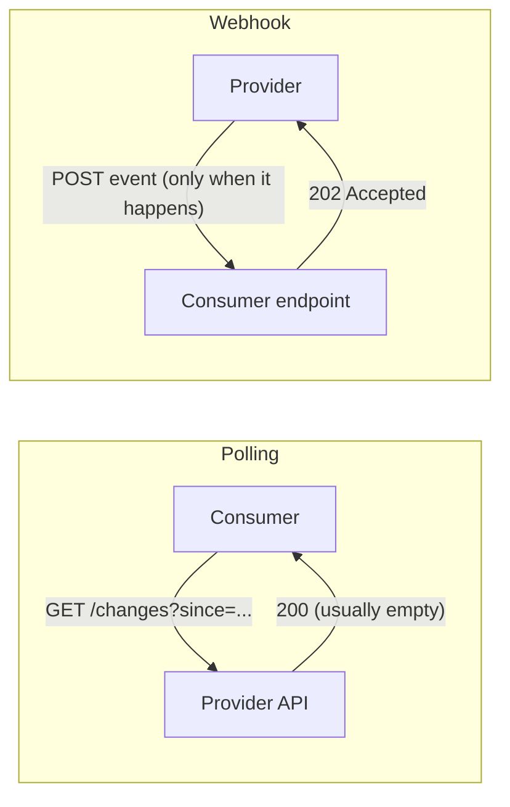

| Dimension | Polling | Webhook |
| --- | --- | --- |
| Latency | Up to one poll interval | Seconds |
| Cost at low event rate | High (mostly empty calls, rate limits) | Low |
| Cost at very high event rate | Efficient (batching: one call returns many changes) | Expensive (one HTTP call per event) |
| Consumer network | Outbound only — works behind firewalls/NAT | Needs inbound public endpoint |
| Reliability | **Consumer controls it** (cursor/checkpoint; no loss if cursor is durable) | Provider controls retry window; events can be lost |
| Ordering | Often possible (ordered change feed / cursor) | Not guaranteed |
| Backpressure | Consumer pulls at its own pace | Provider pushes; consumer must 429/queue |
| Security surface | Smaller | Public attack surface |
| Operational complexity | Scheduler + cursor storage | Endpoint HA, signatures, dedupe |

### Why both exist
Polling is **simple and consumer-controlled** but wasteful and slow. Webhooks are **efficient and
fast** but give up control. Mature integrations use **both**: webhooks for latency, plus a
**reconciliation poll** (every few minutes/hours) that fetches changes since a durable cursor to
catch anything a webhook missed. This is the single best reliability technique for third-party
integration.

### Internals: webhook + reconciliation pattern
```csharp
// Reconciliation worker: pull changes since the last cursor; pass them through the SAME
// idempotent processor used by the webhook path.
public sealed class ReconciliationWorker(
    IProviderApi api, ICursorStore cursors, IEventProcessor processor,
    ILogger<ReconciliationWorker> log) : BackgroundService
{
    protected override async Task ExecuteAsync(CancellationToken ct)
    {
        using var timer = new PeriodicTimer(TimeSpan.FromMinutes(5));
        while (await timer.WaitForNextTickAsync(ct))
        {
            var cursor = await cursors.GetAsync("payments", ct);
            await foreach (var evt in api.ListEventsAsync(createdAfter: cursor, ct))
            {
                await processor.ProcessAsync(evt, source: "reconciliation", ct); // idempotent!
                cursor = evt.Created;
            }
            await cursors.SetAsync("payments", cursor, ct);
        }
    }
}
```

### When to use which
- **Webhook** (+ reconciliation): payments, order status, CI triggers, e-signature completion.
- **Polling only**: consumer cannot expose an endpoint (on-prem behind firewall), provider has no
  webhooks, batch-style data sync, strict cursor-based ordering needed.
- **Neither** (use broker/stream): same-organisation, high volume, strict ordering — Service Bus
  sessions or Event Hubs.

### Mistakes
- Polling every second "to be near real time" and hitting rate limits.
- Webhook-only with no reconciliation (silent data loss).
- Using `updated_since = DateTime.UtcNow` of the poll start (misses events committed during the
  poll). Use the **provider's event timestamp/ID cursor** with a small overlap window and dedupe.

### Interview Q&A
**Q: Why not just poll every 10 seconds?** Cost and limits scale with *consumers × interval*, not
with events; most polls are empty; latency is still up to 10 s; providers rate-limit. A webhook
costs one call per real event.
**Follow-up: When would polling beat webhooks?** Bulk sync of large change sets (one call returns
1,000 changes), consumers behind firewalls, strict ordered consumption via cursor, or when you
need the consumer to control pace.

---

## 3. Webhook versus message queue

### Simple explanation
A webhook is a **phone call** to the other party's door; a queue is a **post box** that both
parties trust. In a queue the broker holds the message until the consumer takes it; with a webhook
the provider must hold it and keep knocking.

### Architect-level depth
| Dimension | Webhook (HTTP callback) | Message queue / topic (e.g. Service Bus) |
| --- | --- | --- |
| Who stores the message while the consumer is down? | **Provider** (its outbox/retry queue, limited window) | **Broker** (durable, until TTL) |
| Consumer must be reachable? | Yes, inbound HTTPS | No: consumer connects **out** to the broker |
| Pull vs push | Push | Pull (or broker-pushed via SDK processor) |
| Backpressure | Weak (429/5xx + provider backoff) | Native (consumer takes at its pace) |
| Ordering | None | Sessions/partitions give ordering |
| Delivery semantics | At-least-once, best-effort window (hours–days) | At-least-once (peek-lock), DLQ, duplicate detection |
| Cross-organisation | **Excellent** — no shared infra | Needs shared broker or federation |
| Auth model | Signature/HMAC/mTLS you implement | SAS / Entra ID / RBAC built in |
| Replay | Provider-dependent | Native (DLQ resubmit, retention in streams) |
| Fan-out | Provider-managed subscriptions | Topics/subscriptions |

### The practical architecture: webhook → queue
The webhook endpoint should be a **thin, fast, secure adapter** whose only job is *verify →
persist/enqueue → 202*. The queue then gives you the broker properties (buffering, retries, DLQ,
competing consumers, ordering by session) **inside your own boundary**. This is the **claim a
webhook receiver is "an HTTP-to-queue gateway"** and it is the pattern behind chapter 16.

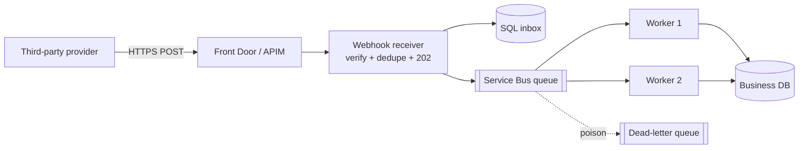

### When to choose
- **Webhook**: the other party is external and offers only HTTP callbacks.
- **Queue/topic**: you control both sides, or the provider can publish directly to your broker
  (e.g. Azure Event Grid → Service Bus; many SaaS offer Event Hubs/SQS-style delivery for
  high-volume tenants).
- **Both**: external webhook in, internal queue behind it. Almost always the right answer for
  third-party integration.

### Mistakes
- Replacing the broker with webhooks *inside* your own microservices: you re-implement retries,
  DLQ, ordering and backpressure badly. Use Service Bus/Event Grid internally.
- Exposing the broker to partners to avoid writing a webhook endpoint (credential and network
  blast radius).

### Interview Q&A
**Q: "Why not have the third party write directly to our Service Bus?"** Possible (SAS scoped to
Send on a single queue, or Event Grid), but you hand a partner credentials and a network path into
your messaging estate, couple to your message schema and lose the ability to validate/authenticate
at your edge. A receiver endpoint gives a clear trust boundary, schema validation, rate limiting
and a stable public contract.
**Q: Is a webhook "event-driven"?** It is an event *notification* transport. Event-driven
architecture is the style; webhook is one (lossy, unordered) channel for it. See
[Event-driven architecture](../02-architectural-styles/04-event-driven-architecture/event-driven-architecture.md).

---

## 4. Webhook architecture and flow

### Simple explanation
Something happens at the provider → provider writes it down → a delivery worker sends it → the
consumer answers "got it" → or the provider tries again later.

### Architect-level depth: end-to-end reference architecture
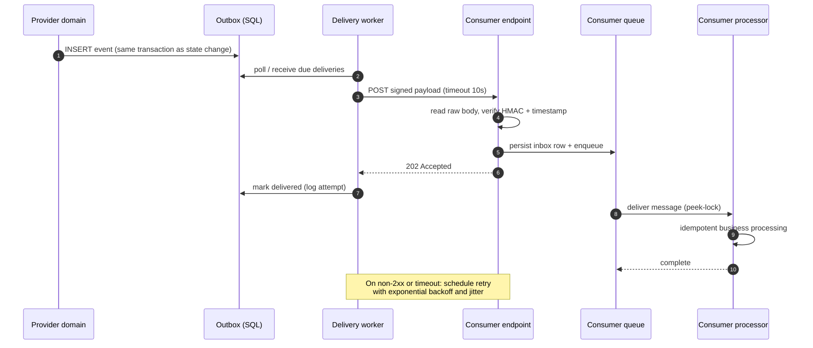

### Why this shape
1. **Outbox at the provider** guarantees an event exists iff the state change committed (no
   dual-write). See [distributed systems patterns](../03-architectural-patterns/distributed-systems-patterns.md).
2. **Asynchronous delivery worker** isolates provider latency from slow consumers.
3. **Fast acknowledgement at the consumer** prevents timeouts → retry storms → duplicates.
4. **Inbox + queue at the consumer** gives durable, idempotent, back-pressured processing.

### Failure points (and the control for each)
| Failure | Control |
| --- | --- |
| Provider crashes after commit, before send | Outbox + worker resumes |
| Network/timeout, consumer processed it anyway | Consumer idempotency + event id |
| Consumer down for hours | Provider retry window; consumer reconciliation poll |
| Consumer slow | Fast 202, async processing; provider timeout ≤ 10 s |
| Forged request | HMAC signature + timestamp window |
| Replay of captured request | Timestamp tolerance + event-id dedupe |
| Poison payload | Validate → DLQ; do not block queue |
| Out-of-order events | Version checks / state-machine guards / refetch |

### Real-world production scenario
An e-commerce platform integrates a payment provider. `payment.succeeded` arrives twice, followed
by an older `payment.pending` event. The receiver stores each event id in an inbox (second delivery
is a no-op), the processor compares `event.version` with the order's last applied version
(discarding the stale `pending`), and a nightly reconciliation job re-reads yesterday's payments
to repair anything missed.

### Interview Q&A
**Q: Walk me through what happens from event creation to successful processing.** Use the sequence
above: outbox → worker → signed POST → verify → inbox/enqueue → 202 → async processing →
idempotent apply → ack; plus the retry branch and the reconciliation safety net.

---

## 5. Webhook provider and consumer

### Simple explanation
The **provider** produces events and calls out. The **consumer** exposes the URL and reacts. In
real life you are often **both**: a consumer of Stripe, a provider to your own customers.

### Architect-level depth: responsibilities
| Concern | Provider must… | Consumer must… |
| --- | --- | --- |
| Durability | Outbox, delivery log, retention | Inbox, queue, DLQ |
| Security | Sign requests, rotate secrets, SSRF-protect user URLs, TLS only | Verify signature, enforce timestamp window, HTTPS, least-privilege secrets |
| Reliability | Retries w/ backoff+jitter, disable unhealthy endpoints, replay UI/API | Idempotency, fast 2xx, reconciliation |
| Contract | Versioned schemas, event catalogue, OpenAPI/AsyncAPI, sample payloads | Tolerant reader (ignore unknown fields), schema validation |
| Operability | Per-endpoint dashboards, alerting, delivery attempt history | Structured logs, correlation by event id, DLQ monitoring |
| Multi-tenancy | Per-tenant secrets, rate limits, isolation (noisy neighbour) | Per-provider secret/config, tenant resolution |

### Provider-side data model (SQL Server)
```sql
CREATE TABLE dbo.WebhookEndpoint (
    EndpointId       uniqueidentifier NOT NULL PRIMARY KEY DEFAULT NEWSEQUENTIALID(),
    TenantId         uniqueidentifier NOT NULL,
    Url              nvarchar(2048)   NOT NULL,
    EventFilter      nvarchar(1000)   NOT NULL,            -- e.g. 'order.*,payment.succeeded'
    SecretCurrent    varbinary(64)    NOT NULL,            -- or a Key Vault secret reference
    SecretPrevious   varbinary(64)    NULL,                -- dual-secret rotation window
    SecretPreviousExpiresUtc datetime2 NULL,
    Status           tinyint          NOT NULL DEFAULT 1,  -- 1=Active 2=Paused 3=AutoDisabled
    ConsecutiveFailures int           NOT NULL DEFAULT 0,
    CreatedUtc       datetime2        NOT NULL DEFAULT SYSUTCDATETIME()
);

CREATE TABLE dbo.WebhookEvent (                            -- the transactional outbox
    EventId      uniqueidentifier NOT NULL PRIMARY KEY,
    TenantId     uniqueidentifier NOT NULL,
    Type         varchar(100)     NOT NULL,
    Version      bigint           NOT NULL,                -- aggregate version for ordering
    PayloadJson  nvarchar(max)    NOT NULL,
    CreatedUtc   datetime2        NOT NULL DEFAULT SYSUTCDATETIME()
);

CREATE TABLE dbo.WebhookDelivery (
    DeliveryId     bigint IDENTITY PRIMARY KEY,
    EventId        uniqueidentifier NOT NULL REFERENCES dbo.WebhookEvent(EventId),
    EndpointId     uniqueidentifier NOT NULL REFERENCES dbo.WebhookEndpoint(EndpointId),
    Attempt        int            NOT NULL DEFAULT 0,
    Status         tinyint        NOT NULL DEFAULT 0,      -- 0=Pending 1=Delivered 2=Failed 3=Dead
    NextAttemptUtc datetime2      NOT NULL DEFAULT SYSUTCDATETIME(),
    LastStatusCode int            NULL,
    LastError      nvarchar(500)  NULL,
    LastDurationMs int            NULL,
    CompletedUtc   datetime2      NULL,
    CONSTRAINT UQ_Delivery UNIQUE (EventId, EndpointId)
);
CREATE INDEX IX_Delivery_Due ON dbo.WebhookDelivery (Status, NextAttemptUtc)
    INCLUDE (EventId, EndpointId, Attempt);                -- the worker's hot query
```

### Related topics
Provider internals continue in chapters 6, 13, 15 and 19; consumer internals in chapters 6, 9, 12
and 16.

### Interview Q&A
**Q: You are asked to *build* a webhook feature for your SaaS. What do customers expect?**
Self-service endpoint registration, event-type selection, a **signing secret** with rotation,
a **test event** button, a delivery log with request/response bodies and **manual redelivery**,
documented retry schedule and timeouts, versioned payloads, IP/egress documentation (or better:
signatures only), and auto-disable notifications. This list is a good answer to "what makes a
webhook platform production grade".

---

# Part B – Building webhooks in ASP.NET Core

## 6. Implementing webhooks in ASP.NET Core

### Simple explanation
Consumer side: an HTTP endpoint that checks "is this really from the provider?", saves the event,
and says "202, got it" within milliseconds. Provider side: a background worker that reads pending
events from a table and POSTs them to every subscribed URL, retrying failures.

### Architect-level depth
Two implementations, one contract. Both should be small, boring and heavily tested because they
sit on a trust boundary. Internals that matter: ASP.NET Core buffers nothing by default, the
request body is a forward-only stream, model binding would **consume and re-serialize** it, and
`HttpClient` handler pooling controls socket reuse on the provider side
(see [ASP.NET Core internals](../10-aspnet-core-web-api-internals/aspnet-core-web-api-internals.md)).

### 6.1 Consumer: the receiver endpoint (Minimal API)

```csharp
// Program.cs (consumer)
var builder = WebApplication.CreateBuilder(args);

builder.Services.AddOptions<WebhookOptions>()
    .BindConfiguration("Webhooks:Provider")        // Secret comes from Key Vault via configuration
    .ValidateDataAnnotations().ValidateOnStart();

builder.Services.AddSingleton(_ => new ServiceBusClient(
    builder.Configuration["ServiceBus:Namespace"],  // e.g. mynamespace.servicebus.windows.net
    new DefaultAzureCredential()));                 // Managed Identity in Azure
builder.Services.AddSingleton<IWebhookSignatureVerifier, StandardWebhookVerifier>();
builder.Services.AddScoped<IInbox, SqlInbox>();
builder.Services.AddRateLimiter(o => o.AddFixedWindowLimiter("webhook", w =>
{
    w.PermitLimit = 600; w.Window = TimeSpan.FromMinutes(1); w.QueueLimit = 0;
}));

var app = builder.Build();
app.UseRateLimiter();

app.MapPost("/webhooks/payments", async (HttpContext ctx, IWebhookSignatureVerifier verifier,
        IInbox inbox, ServiceBusClient sb, IOptions<WebhookOptions> opts, ILogger<Program> log) =>
{
    // 1) Read RAW bytes. Never bind to a DTO before verifying the signature.
    ctx.Request.EnableBuffering();                                   // allows re-read if needed
    using var ms = new MemoryStream();
    await ctx.Request.Body.CopyToAsync(ms, ctx.RequestAborted);      // body size capped (see below)
    var raw = ms.ToArray();
    ctx.Request.Body.Position = 0;

    // 2) Verify signature + timestamp tolerance (constant-time compare inside)
    if (!verifier.TryVerify(ctx.Request.Headers, raw, opts.Value.Secrets, DateTimeOffset.UtcNow, out var eventId))
    {
        log.LogWarning("Webhook rejected: invalid signature or timestamp");
        return Results.Unauthorized();                               // 401, no detail leaked
    }

    // 3) Durable idempotent receive: unique (Provider, EventId)
    var isNew = await inbox.TryInsertAsync("payments", eventId, raw, ctx.RequestAborted);
    if (!isNew) return Results.Accepted();                           // duplicate: ack, do nothing

    // 4) Hand off to the queue; MessageId enables broker-side duplicate detection too
    await using var sender = sb.CreateSender("webhook-payments");
    await sender.SendMessageAsync(new ServiceBusMessage(raw)
    {
        MessageId = eventId,
        ContentType = "application/json",
        Subject = ctx.Request.Headers["x-event-type"].ToString(),
        CorrelationId = ctx.TraceIdentifier
    }, ctx.RequestAborted);

    return Results.Accepted();                                       // 202 — fast
})
.RequireRateLimiting("webhook")
.WithRequestTimeout(TimeSpan.FromSeconds(8))                         // stay under provider timeout
.DisableAntiforgery();                                               // no cookies/CSRF for server-to-server

app.Run();

public sealed class WebhookOptions
{
    [Required] public string[] Secrets { get; init; } = [];          // current + previous (rotation)
}
```

Key points:
- **Body size cap:** configure `Kestrel.Limits.MaxRequestBodySize` (e.g. 256 KB) or
  `[RequestSizeLimit]`; oversize ⇒ 413. Unbounded bodies are a trivial DoS.
- **`EnableBuffering` vs `BodyReader`:** `EnableBuffering` is fine for small payloads. For large
  bodies use `Request.BodyReader` (`PipeReader`) to avoid copying twice.
- **Return codes:** 202 = accepted; 401/403 = bad signature (do not tell attackers why); 400 =
  malformed *after* verification; **never 5xx for a bad payload you could never process** (the
  provider will retry it forever). 5xx means "try again", e.g. broker/DB temporarily down.
- **Durability before ack:** the 202 must be returned only after the inbox row/queue message is
  committed. Otherwise "ack then crash" loses events.

### 6.2 Consumer: inbox (SQL Server) with unique constraint

> Generalised in [Inbox, Outbox and Reliable Messaging](../15-inbox-outbox-and-reliable-messaging/inbox-outbox-and-reliable-messaging.md).

```sql
CREATE TABLE dbo.WebhookInbox (
    InboxId       bigint IDENTITY PRIMARY KEY,
    Provider      varchar(50)    NOT NULL,
    EventId       varchar(200)   NOT NULL,
    ReceivedUtc   datetime2      NOT NULL DEFAULT SYSUTCDATETIME(),
    Status        tinyint        NOT NULL DEFAULT 0,   -- 0=Received 1=Processed 2=Failed 3=Ignored
    ProcessedUtc  datetime2      NULL,
    Attempts      int            NOT NULL DEFAULT 0,
    PayloadHash   binary(32)     NOT NULL,
    Payload       nvarchar(max)  NOT NULL
);
CREATE UNIQUE INDEX UX_WebhookInbox_Event ON dbo.WebhookInbox (Provider, EventId);
```

```csharp
public sealed class SqlInbox(IConfiguration cfg) : IInbox
{
    public async Task<bool> TryInsertAsync(string provider, string eventId, byte[] payload, CancellationToken ct)
    {
        await using var con = new SqlConnection(cfg.GetConnectionString("Db"));
        await con.OpenAsync(ct);
        await using var cmd = new SqlCommand("""
            INSERT INTO dbo.WebhookInbox (Provider, EventId, PayloadHash, Payload)
            VALUES (@p, @e, @h, @body)
            """, con);
        cmd.Parameters.AddWithValue("@p", provider);
        cmd.Parameters.AddWithValue("@e", eventId);
        cmd.Parameters.Add("@h", SqlDbType.Binary, 32).Value = SHA256.HashData(payload);
        cmd.Parameters.AddWithValue("@body", Encoding.UTF8.GetString(payload));
        try { await cmd.ExecuteNonQueryAsync(ct); return true; }
        catch (SqlException ex) when (ex.Number is 2601 or 2627) { return false; }  // duplicate key
    }
}
```
*Why insert-and-catch rather than `IF NOT EXISTS`?* The unique index is the only race-free
arbiter; check-then-insert has a TOCTOU window under concurrency. (A `MERGE ... WITH (HOLDLOCK)`
also works but is more intricate; plain insert + catch is simplest and fastest.)

### 6.3 Provider: outbox-driven delivery worker

```csharp
public sealed class WebhookDeliveryWorker(
    IServiceScopeFactory scopes, IHttpClientFactory http, ISigner signer,
    ILogger<WebhookDeliveryWorker> log) : BackgroundService
{
    private static readonly TimeSpan[] Schedule =        // fixed base delays; jitter added at runtime
        [TimeSpan.FromSeconds(30), TimeSpan.FromMinutes(2), TimeSpan.FromMinutes(10),
         TimeSpan.FromMinutes(30), TimeSpan.FromHours(2), TimeSpan.FromHours(6), TimeSpan.FromHours(12)];

    protected override async Task ExecuteAsync(CancellationToken ct)
    {
        using var timer = new PeriodicTimer(TimeSpan.FromSeconds(1));
        while (await timer.WaitForNextTickAsync(ct))
        {
            try { await DrainDueAsync(ct); }
            catch (Exception ex) when (ex is not OperationCanceledException)
            { log.LogError(ex, "Delivery loop error"); }       // never let the loop die
        }
    }

    private async Task DrainDueAsync(CancellationToken ct)
    {
        using var scope = scopes.CreateScope();
        var repo = scope.ServiceProvider.GetRequiredService<IDeliveryRepository>();

        // Claim a batch atomically (UPDLOCK, READPAST) so multiple workers never double-send.
        var batch = await repo.ClaimDueAsync(maxCount: 50, lease: TimeSpan.FromMinutes(2), ct);

        await Parallel.ForEachAsync(batch, new ParallelOptions { MaxDegreeOfParallelism = 16, CancellationToken = ct },
            async (d, token) =>
            {
                var client = http.CreateClient("webhook-out");   // SSRF-safe handler configured below
                var body = d.PayloadJson;
                var ts = DateTimeOffset.UtcNow.ToUnixTimeSeconds();

                using var req = new HttpRequestMessage(HttpMethod.Post, d.Url)
                { Content = new StringContent(body, Encoding.UTF8, "application/json") };
                req.Headers.Add("webhook-id", d.EventId.ToString());
                req.Headers.Add("webhook-timestamp", ts.ToString());
                req.Headers.Add("webhook-signature", signer.SignStandard(d.EventId, ts, body, d.Secrets));
                req.Headers.Add("x-event-type", d.Type);

                var sw = Stopwatch.StartNew();
                try
                {
                    using var cts = CancellationTokenSource.CreateLinkedTokenSource(token);
                    cts.CancelAfter(TimeSpan.FromSeconds(10));
                    using var resp = await client.SendAsync(req, cts.Token);
                    if (resp.IsSuccessStatusCode) await repo.MarkDeliveredAsync(d, (int)resp.StatusCode, sw.ElapsedMilliseconds, token);
                    else await FailAsync(repo, d, (int)resp.StatusCode, $"HTTP {(int)resp.StatusCode}", sw, token);
                }
                catch (Exception ex) when (ex is HttpRequestException or TaskCanceledException)
                {
                    await FailAsync(repo, d, null, ex.GetType().Name, sw, token);
                }
            });
    }

    private static async Task FailAsync(IDeliveryRepository repo, DeliveryItem d, int? status, string err, Stopwatch sw, CancellationToken ct)
    {
        var attempt = d.Attempt + 1;
        if (attempt > Schedule.Length) { await repo.MarkDeadAsync(d, status, err, ct); return; }   // → DLQ/replay
        var baseDelay = Schedule[attempt - 1];
        var jittered = baseDelay * (0.5 + Random.Shared.NextDouble() * 0.5);                      // 50–100 %
        await repo.ScheduleRetryAsync(d, attempt, DateTime.UtcNow + jittered, status, err, sw.ElapsedMilliseconds, ct);
    }
}
```

`ClaimDueAsync` core SQL (competing workers, no double send):
```sql
;WITH due AS (
    SELECT TOP (@n) *
    FROM dbo.WebhookDelivery WITH (UPDLOCK, READPAST, ROWLOCK)
    WHERE Status IN (0, 2) AND NextAttemptUtc <= SYSUTCDATETIME()
    ORDER BY NextAttemptUtc
)
UPDATE due
   SET Status = 4,                                          -- 4 = InFlight
       NextAttemptUtc = DATEADD(SECOND, @leaseSeconds, SYSUTCDATETIME())  -- lease: reclaimed if worker dies
OUTPUT inserted.*;
```

### 6.4 Provider: SSRF-safe `HttpClient` (user-supplied URLs)

```csharp
builder.Services.AddHttpClient("webhook-out")
    .ConfigurePrimaryHttpMessageHandler(() => new SocketsHttpHandler
    {
        AllowAutoRedirect = false,                       // a redirect can bounce you to 169.254.169.254
        PooledConnectionLifetime = TimeSpan.FromMinutes(5),
        ConnectTimeout = TimeSpan.FromSeconds(5),
        // Resolve DNS ourselves and reject private/link-local/loopback/metadata addresses
        // AT CONNECT TIME (defeats DNS rebinding: validate the IP actually dialled).
        ConnectCallback = async (ctx, ct) =>
        {
            var addrs = await Dns.GetHostAddressesAsync(ctx.DnsEndPoint.Host, ct);
            var safe = addrs.FirstOrDefault(a => !IsInternal(a))
                ?? throw new HttpRequestException("Blocked destination");
            var socket = new Socket(SocketType.Stream, ProtocolType.Tcp) { NoDelay = true };
            try { await socket.ConnectAsync(new IPEndPoint(safe, ctx.DnsEndPoint.Port), ct);
                  return new NetworkStream(socket, ownsSocket: true); }
            catch { socket.Dispose(); throw; }
        }
    });

static bool IsInternal(IPAddress ip) =>
    IPAddress.IsLoopback(ip) || ip.IsIPv6LinkLocal || ip.IsIPv6SiteLocal ||
    ip.ToString().StartsWith("10.") || ip.ToString().StartsWith("192.168.") ||
    ip.ToString().StartsWith("169.254.") ||
    (ip.AddressFamily == AddressFamily.InterNetwork &&
        ip.GetAddressBytes() is [172, >= 16 and <= 31, ..]) ||
    ip.ToString().StartsWith("100.64.") /* CGNAT */ || ip.Equals(IPAddress.Any);
```
Registration-time checks (HTTPS only, no userinfo, port allow-list, hostname not an IP literal) are
*necessary but not sufficient*; the connect-time IP check is what stops DNS rebinding.

### 6.5 Azure Event Grid webhook validation handshake (consumer)
Event Grid refuses to deliver until your endpoint proves it owns the URL.
```csharp
app.MapPost("/webhooks/eventgrid", async (HttpRequest req) =>
{
    var events = await req.ReadFromJsonAsync<EventGridEvent[]>() ?? [];
    foreach (var e in events)
    {
        if (e.EventType == "Microsoft.EventGrid.SubscriptionValidationEvent")
        {
            var code = e.Data.GetProperty("validationCode").GetString();
            return Results.Ok(new { validationResponse = code });          // handshake
        }
        // …otherwise enqueue for processing…
    }
    return Results.Accepted();
});
// CloudEvents v1.0 schema uses an HTTP OPTIONS handshake: echo WebHook-Request-Origin in
// WebHook-Allowed-Origin (and WebHook-Allowed-Rate: *). Prefer Entra-authenticated delivery
// to Service Bus / Functions / Event Hubs destinations where possible instead of webhook.
```

### Real-world use cases
Payment gateway receiver; GitHub → CI trigger; DocuSign Connect; Shopify order sync; a SaaS
platform offering outbound webhooks to its 10k tenants.

### When to use / when NOT to
Use the consumer pattern above for **every** third-party webhook. Build your own provider only if
customers integrate with you by HTTP; if customers are Azure-native, **Event Grid custom topics**
or Service Bus may be a better product than writing your own platform.

### Trade-offs
Build-vs-buy for a *provider*: your own platform (control, tenant UX, cost) vs managed services
(Svix, Hookdeck, Event Grid) that give retries, portals, signing and replay out of the box.

### Common mistakes
Binding the body to a record and re-serializing before HMAC; using `string` body with wrong
encoding; adding `[Authorize]` (webhooks have no bearer token); forgetting body size limits;
returning 500 on malformed JSON; swallowing exceptions in the delivery loop (the `BackgroundService`
dies silently); sending webhooks inline from the request that caused the event.

### Perf / scalability / reliability / security
Fast path is O(read body + HMAC + 1 SQL insert + 1 send). Scale the receiver horizontally (stateless),
scale processors via queue depth. Keep Kestrel/`MaxRequestBodySize` low, use `AddRateLimiter`,
use Managed Identity (no connection strings), and keep secrets in Key Vault.

### Troubleshooting
- `401` for everything → wrong secret/environment, or body modified by a proxy (chapter 9).
- Provider shows timeouts → handler doing real work; move it behind the queue.
- Duplicate key exceptions in logs → expected for retries; log at *Information*, not *Error*.
- Delivery worker stuck → check lease expiry rows (`Status=4` older than lease) and loop exceptions.

### Related topics
[API Gateway](../03-architectural-patterns/04-api-gateway/api-gateway.md) (rate limiting and
edge auth), [ASP.NET Core internals](../10-aspnet-core-web-api-internals/aspnet-core-web-api-internals.md)
(middleware, `IHttpClientFactory`, hosted services).

### Interview Q&A
**Q: Why read the raw body instead of model binding?** Signatures are computed over exact bytes.
Deserialize → re-serialize changes whitespace, property order, number and unicode formatting, so
the HMAC differs. Verify bytes first, then deserialize the same bytes.
**Q: Why 202 not 200?** Semantically "accepted for processing, not completed"; most providers
treat any 2xx as success. It signals honestly that work is queued.
**Q: How do you stop SSRF in an outbound webhook feature?** HTTPS-only, deny-list private/link-local/
metadata ranges, **validate the resolved IP at connect time**, disable redirects, short timeouts,
response size cap, egress through a dedicated proxy/subnet with firewall rules, and never reflect
response bodies to the user beyond status/limited preview.

---

## 7. Webhook endpoint design

### Simple explanation
Design the URL and its behaviour so it is easy to operate, hard to abuse and safe to change.

### Architect-level depth
| Decision | Recommendation | Reason |
| --- | --- | --- |
| URL shape | One endpoint per provider (`/webhooks/{provider}`), not per event type; optionally an unguessable per-tenant segment | Simple routing; secret URL is defence in depth only, **never** the sole control |
| Method | `POST` only; `OPTIONS`/`HEAD` only where handshake requires it | Minimal surface |
| Auth | Signature header; no cookies, no bearer | Server-to-server |
| Body | Limit size; require `Content-Type`; reject others with 415 | Resource protection |
| Response | `202` fast, empty or tiny body; `401` bad auth; `413`; `429` + `Retry-After`; `503` + `Retry-After` for planned unavailability | Providers honour these signals |
| Time budget | Respond < 5 s (many providers cut at 5–10 s; Shopify ~5 s, GitHub ~10 s) | Avoid timeout retries |
| Versioning | `/webhooks/v1/...` and/or `type` + `schemaVersion` in payload | Evolve without breaking |
| Idempotency key | Provider's event/delivery id (`webhook-id`, `X-GitHub-Delivery`, `evt_…`) | Dedupe |
| Tolerant reader | Ignore unknown fields; unknown event types ⇒ 202 and ignore | Provider adds fields/events freely |
| Observability | Log delivery id, event type, outcome, latency; never log secrets/PII | Support |
| Network | Front with Front Door/APIM/WAF; private origin | Edge protection |
| Environment separation | Different URL + secret per environment | Prevents test traffic hitting prod |

### Header conventions you will meet
| Provider | Signature header | Signed content | Notes |
| --- | --- | --- | --- |
| **Standard Webhooks** (spec) | `webhook-signature: v1,<base64>` (space-separated list allows rotation) | `{webhook-id}.{webhook-timestamp}.{body}` HMAC-SHA256; ids in `webhook-id`, `webhook-timestamp` | Secret prefixed `whsec_` (base64) |
| **Stripe** | `Stripe-Signature: t=…,v1=…` | `{t}.{body}` HMAC-SHA256 hex | Tolerance default 5 min |
| **GitHub** | `X-Hub-Signature-256: sha256=<hex>` | raw body | Delivery id in `X-GitHub-Delivery` |
| **Shopify** | `X-Shopify-Hmac-Sha256` base64 | raw body | `X-Shopify-Webhook-Id`; short response deadline |
| **Twilio** | `X-Twilio-Signature` | full URL + sorted form params, HMAC-SHA1 | URL must match exactly (proxies!) |
| **DocuSign Connect** | `X-DocuSign-Signature-1` base64 | raw body | Multiple keys for rotation |

(Verify exact details against each provider's current docs before implementing; they change.)

### Endpoint routing for many providers
```csharp
var webhooks = app.MapGroup("/webhooks").RequireRateLimiting("webhook").DisableAntiforgery();
webhooks.MapPost("/{provider}", async (string provider, HttpContext ctx, IWebhookRouter router) =>
    await router.HandleAsync(provider, ctx));      // strategy per provider: verifier + parser + queue name
```
Use the **Strategy** pattern per provider (verifier, event-id extractor, schema), a common
inbox and a common queue envelope. This is how you add provider #6 without copy-paste.

### Mistakes
Secret-in-URL as the only authentication; one mega-endpoint that parses every provider's JSON;
returning detailed errors; coupling endpoint to internal DTOs; no `Retry-After`; accepting HTTP
and HTTPS; sharing one secret across environments/tenants.

### Troubleshooting
Providers' "test delivery" works but production fails → WAF rules (JSON body inspection false
positives), body size limit, Front Door timeout shorter than the provider's, or required header
stripped by the gateway. Check by logging header **names** and body length (not content).

### Related topics
[API Gateway](../03-architectural-patterns/04-api-gateway/api-gateway.md), API security in
[Broader Architect Skills](../06-broader-architect-skills/Broader%20Architect%20Skills.md).

### Interview Q&A
**Q: What HTTP status codes does a good webhook endpoint return and why?** 202 on durable accept;
401 for failed signature; 413/415 for protocol violations; 429/503 with `Retry-After` to apply
backpressure; never 5xx for permanently bad input because providers retry 5xx.
**Q: Should the URL contain a secret token?** It adds obscurity and per-tenant routing but leaks
via logs/proxies/referrers; use it as a *routing key*, never as authentication.

---

# Part C – Security

## 8. Webhook authentication

### Simple explanation
Anyone on the internet can POST to your URL. Authentication is how you know the call really came
from the provider and was not forged, altered or replayed.

### Architect-level depth
Options, strongest/most common first:

| Mechanism | How it works | Strengths | Weaknesses |
| --- | --- | --- | --- |
| **HMAC signature** (shared secret) | Provider signs `timestamp + body`; you recompute and compare | Integrity + authenticity; works through proxies; industry standard | Shared secret must be stored and rotated; both sides can forge |
| **Asymmetric signature** (Ed25519/RSA/JWS, e.g. Standard Webhooks `v1a`) | Provider signs with private key; you verify with public key/JWKS | Consumer cannot forge; no shared secret to leak | Key distribution/rotation (JWKS), slightly more code |
| **Mutual TLS** | Provider presents a client certificate | Strong transport-level identity | Terminating proxies break it; cert lifecycle; few SaaS support it |
| **Bearer / Basic header** configured at registration | Static token in `Authorization` | Trivial | Replayable; leaks in logs; no payload integrity |
| **Entra ID / OAuth JWT** (Azure-native senders, e.g. Event Grid with Entra auth, Graph change notifications validation tokens) | Sender gets a token for your app | Identity-based, rotating | Only for platforms that support it |
| **IP allow-list** | Accept only provider egress IPs | Cheap extra layer | IPs change, shared clouds, spoofing via proxies; **never sufficient alone** |
| **Secret in URL** | Unguessable path | Easy | Leaks via logs; no integrity |

**Recommended layering (defence in depth):** TLS + signature (HMAC or asymmetric) + timestamp
tolerance + event-id dedupe + (optionally) IP allow-list at Front Door/WAF + rate limiting.
Authentication answers *who*; the signature over the body also answers *was it altered*; the
timestamp + dedupe answers *is it a replay*.

### Why it exists
Your endpoint is unauthenticated by design (no user session). Without a verification step, an
attacker can post fake `payment.succeeded` events and get goods for free, or trigger expensive
processing (DoS), or inject malicious data into your pipeline.

### How it works internally (decision flow)
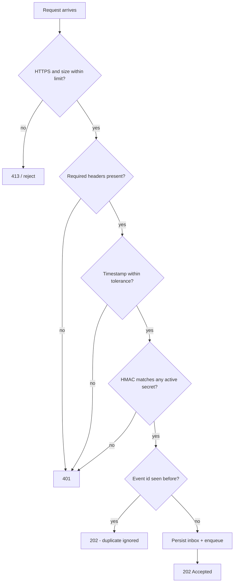

### Secrets management on Azure
- Store signing secrets in **Azure Key Vault**; the app reads them through the Key Vault
  configuration provider using **Managed Identity** (no secrets in app settings or source).
- Support **two active secrets** (current + previous) so rotation is zero-downtime.
- Per-provider, per-environment (and for platforms, per-tenant) secrets.

```csharp
builder.Configuration.AddAzureKeyVault(
    new Uri("https://kv-integrations.vault.azure.net/"), new DefaultAzureCredential());
// Keys: Webhooks--Provider--Secrets--0 (current), Webhooks--Provider--Secrets--1 (previous)
```

### Real-world use cases
Stripe/GitHub/Shopify (HMAC), Microsoft Graph change notifications (clientState + validation
tokens), Azure Event Grid (handshake + optional Entra), banks (mTLS + JWS).

### When to use / when NOT to use each
- HMAC: default for SaaS integrations.
- Asymmetric: when you are the provider with many untrusted consumers (they cannot forge your
  events) or regulated settings.
- mTLS: bank/B2B with PKI maturity.
- IP allow-list: only as a *supplement*.

### Advantages / disadvantages / trade-offs
HMAC is the best effort/benefit ratio but symmetric; asymmetric costs implementation complexity
for stronger non-repudiation. The more you lean on network controls (IPs, mTLS), the more your
integration breaks when infrastructure changes.

### Common mistakes
Relying on IP allow-list or secret URL alone; hard-coding secrets; same secret for dev and prod;
logging the signature secret or full headers; returning *why* verification failed; skipping
verification "temporarily" in production.

### Performance / scalability / reliability / security
HMAC-SHA256 on a few KB is microseconds; cache parsed secrets (decode base64 once); reload on
Key Vault change (options monitor) rather than per request. Reject early (cheap checks first) so
floods cost little. Put WAF/rate limit before the app.

### Troubleshooting
All requests 401 after a deploy → secret mismatch between environments or Key Vault access lost
(Managed Identity role `Key Vault Secrets User` missing). Intermittent 401 → clock skew or a
proxy re-encoding the body.

### Related topics
Zero Trust and API security in
[Broader Architect Skills](../06-broader-architect-skills/Broader%20Architect%20Skills.md);
rate limiting in [distributed systems patterns](../03-architectural-patterns/distributed-systems-patterns.md).

### Interview Q&A
**Q: HMAC vs JWT vs mTLS for webhooks?** HMAC: simplest, integrity + auth with shared secret.
JWT/JWS: asymmetric or claims-based, no shared secret and good for multi-consumer providers.
mTLS: transport identity, great where PKI exists but fragile behind TLS-terminating proxies.
I'd choose HMAC + timestamp for typical SaaS, add asymmetric if I am the provider.
**Q: Is IP whitelisting enough?** No — IPs are shared/changeable and spoofable at layers above;
it reduces noise but does not authenticate payloads or stop replays.

---

## 9. HMAC signature validation

### Simple explanation
Provider and consumer share a secret. The provider mixes the secret with the message to create a
short "fingerprint" (the signature) and sends both. You recompute the fingerprint; if yours
matches, the message is genuine and unmodified.

### Architect-level depth
HMAC-SHA256 = `H((K ⊕ opad) ‖ H((K ⊕ ipad) ‖ message))`. It provides **integrity and authenticity**
(not confidentiality). Because the signed message includes a **timestamp** (and the event id),
an old captured request fails the freshness check, which defeats replay. Critical details:

1. **Sign the raw bytes** exactly as sent (no re-serialisation, no normalisation, no BOM changes).
2. **Constant-time comparison** (`CryptographicOperations.FixedTimeEquals`) to avoid timing
   side-channels that leak the correct signature byte by byte.
3. **Timestamp tolerance** (commonly ±5 minutes) based on a signed value, not an unsigned header.
4. **Multiple signatures/secrets** for rotation: accept if *any* matches.
5. **Decode the secret correctly** (Standard Webhooks: strip `whsec_`, base64-decode; Stripe:
   use as ASCII; GitHub: UTF-8). Wrong key encoding is the #1 "signature never matches" bug.
6. **Hex vs base64** and **case** of the signature differ per provider.

### Reference verifier (Standard Webhooks style)
```csharp
public interface IWebhookSignatureVerifier
{
    bool TryVerify(IHeaderDictionary headers, byte[] body, IReadOnlyList<string> secrets,
                   DateTimeOffset now, out string eventId);
}

public sealed class StandardWebhookVerifier : IWebhookSignatureVerifier
{
    private static readonly TimeSpan Tolerance = TimeSpan.FromMinutes(5);

    public bool TryVerify(IHeaderDictionary h, byte[] body, IReadOnlyList<string> secrets,
                          DateTimeOffset now, out string eventId)
    {
        eventId = "";
        if (!h.TryGetValue("webhook-id", out var id) ||
            !h.TryGetValue("webhook-timestamp", out var tsRaw) ||
            !h.TryGetValue("webhook-signature", out var sigRaw)) return false;

        if (!long.TryParse(tsRaw, out var unix)) return false;
        var sent = DateTimeOffset.FromUnixTimeSeconds(unix);
        if ((now - sent).Duration() > Tolerance) return false;            // replay/clock-skew window

        // signed content = "{id}.{timestamp}.{body}"
        var prefix = Encoding.UTF8.GetBytes($"{id}.{tsRaw}.");
        var signed = new byte[prefix.Length + body.Length];
        prefix.CopyTo(signed, 0); body.CopyTo(signed, prefix.Length);

        // header may carry several space-separated "v1,<base64>" entries (rotation)
        var candidates = sigRaw.ToString().Split(' ', StringSplitOptions.RemoveEmptyEntries)
            .Select(s => s.Split(',', 2)).Where(p => p.Length == 2 && p[0] == "v1")
            .Select(p => SafeFromBase64(p[1])).Where(b => b is not null).ToList();

        foreach (var secret in secrets)
        {
            var key = Convert.FromBase64String(secret.StartsWith("whsec_") ? secret[6..] : secret);
            var expected = HMACSHA256.HashData(key, signed);
            foreach (var cand in candidates)
                if (CryptographicOperations.FixedTimeEquals(expected, cand!)) { eventId = id!; return true; }
        }
        return false;
    }

    private static byte[]? SafeFromBase64(string s)
    { try { return Convert.FromBase64String(s); } catch (FormatException) { return null; } }
}
```

### GitHub-style (hex, raw body) and Stripe-style (`t=…,v1=…`)
```csharp
// GitHub: X-Hub-Signature-256: sha256=<hex>
static bool VerifyGitHub(byte[] body, string header, string secret)
{
    if (!header.StartsWith("sha256=")) return false;
    var expected = HMACSHA256.HashData(Encoding.UTF8.GetBytes(secret), body);
    byte[] provided;
    try { provided = Convert.FromHexString(header[7..]); } catch (FormatException) { return false; }
    return CryptographicOperations.FixedTimeEquals(expected, provided);
}

// Stripe: Stripe-Signature: t=1700000000,v1=<hex>[,v1=<hex>]   signed payload = "{t}.{body}"
static bool VerifyStripeLike(byte[] body, string header, string secret, DateTimeOffset now)
{
    var parts = header.Split(',').Select(p => p.Split('=', 2)).Where(p => p.Length == 2).ToList();
    var t = parts.FirstOrDefault(p => p[0] == "t")?[1];
    if (!long.TryParse(t, out var unix) ||
        (now - DateTimeOffset.FromUnixTimeSeconds(unix)).Duration() > TimeSpan.FromMinutes(5)) return false;
    var signed = Encoding.UTF8.GetBytes($"{t}.").Concat(body).ToArray();
    var expected = HMACSHA256.HashData(Encoding.UTF8.GetBytes(secret), signed);
    return parts.Where(p => p[0] == "v1").Any(p =>
    {
        try { return CryptographicOperations.FixedTimeEquals(expected, Convert.FromHexString(p[1])); }
        catch (FormatException) { return false; }
    });
}
```

### Provider-side signing
```csharp
public sealed class Signer : ISigner
{
    public string SignStandard(Guid id, long ts, string body, IReadOnlyList<byte[]> secrets)
    {
        var signed = Encoding.UTF8.GetBytes($"{id}.{ts}.{body}");
        // emit one v1 signature per active secret → consumers can rotate without downtime
        return string.Join(' ', secrets.Select(k => "v1," + Convert.ToBase64String(HMACSHA256.HashData(k, signed))));
    }
}
```
**Secret rotation runbook:** (1) generate new secret; (2) provider starts signing with *both*;
(3) consumer deploys config with *both* secrets; (4) provider stops signing with old; (5) consumer
removes old. Document the overlap in `SecretPreviousExpiresUtc`.

### Tests you must have
```csharp
[Fact] public void Rejects_modified_body() { /* flip one byte → false */ }
[Fact] public void Rejects_old_timestamp() { /* now - 10 min → false */ }
[Fact] public void Accepts_either_active_secret() { /* previous secret still works */ }
[Fact] public void Uses_known_vectors_from_provider_docs() { /* documented sample payload + signature */ }
```

### Real-world production scenario
After adding a new Azure Front Door WAF rule, ~2 % of Shopify webhooks started failing signature
checks. Cause: the WAF's "body normalisation" policy altered unicode escapes. Fix: exclude the
webhook route from body-rewriting rules and compare byte length + SHA-256 of the body at the edge
and in the app to prove integrity end to end.

### When to use / when NOT
Always when the provider supports a signature. If a provider offers none, compensate: secret
header + IP range + call-back verification (thin events; fetch the resource via API with your
own credentials, which authenticates the *data* even if the notification is forged).

### Advantages / disadvantages
Fast, simple, standard. But shared-secret ⇒ whoever holds the secret can forge; leaked logs or
repo = full compromise; no non-repudiation.

### Common mistakes
- Plain `==`/`string.Equals`/`SequenceEqual` compare (timing leak).
- Parsing JSON, then `JsonSerializer.Serialize` to "get the body".
- Wrong encoding of key or signature; comparing hex case-sensitively.
- Using `DateTime.Now` (local) or not tolerating skew; or tolerance of hours/days.
- Verifying the signature but **not** the timestamp (replay possible) or not de-duplicating.
- Reading the body in middleware and leaving the stream at the end (`Position = 0`).
- Verifying against the URL-decoded form body when the provider signs the raw one.

### Performance / security considerations
Micro-cost; the real risk is secret handling. Use `SecureString`-like discipline: never log; load
once; zero-trust the headers (size-limit them). Enforce constant-time compare and bounded input.

### Troubleshooting signature mismatches (checklist)
1. Log (safe fields only) **body length and SHA-256**; compare with the provider's delivery log.
2. Dump header names; confirm the signature header survived the proxy/WAF/APIM policy.
3. Check the secret **encoding** and environment (test vs live secrets differ).
4. Check you read the *raw* body (not model-bound, not decompressed twice, same charset).
5. Compare timestamps; check server clock (NTP) and tolerance.
6. For URL-in-signature schemes (Twilio): use the **public URL** (scheme/host/port/path/query), not
   the internal one behind Front Door/Nginx (`X-Forwarded-*` / `UseForwardedHeaders`).
7. Reproduce offline with the provider's documented test vector.

### Related topics
[Distributed systems patterns](../03-architectural-patterns/distributed-systems-patterns.md)
(idempotency), [ASP.NET Core internals](../10-aspnet-core-web-api-internals/aspnet-core-web-api-internals.md)
(request body handling, middleware order).

### Interview Q&A
**Q: Why constant-time comparison?** A normal compare returns at the first differing byte; an
attacker measuring response times can discover the correct signature progressively.
`FixedTimeEquals` always inspects all bytes (for equal lengths).
**Q: Does HMAC stop replay?** Not by itself. An attacker can resend a captured valid request.
Include a signed timestamp, enforce a tolerance, and dedupe by event id.
**Q: A partner insists the signature is correct but you reject it. How do you debug?** Follow the
seven-step checklist; the root cause is nearly always body mutation, key encoding or the proxied URL.
**Q: How do you rotate secrets with zero downtime?** Dual-secret acceptance (consumer) / dual
signatures (provider) with an overlap window.

---

## 10. HTTPS and secure webhook delivery

### Simple explanation
HTTPS encrypts the traffic and proves the server is yours. Webhooks carry business data (and
sometimes personal data), so they must never travel over plain HTTP.

### Architect-level depth
| Layer | Control |
| --- | --- |
| Transport | **TLS 1.2+ (prefer 1.3)**; valid public CA certificate for the consumer endpoint; provider **verifies** the certificate (never disable validation "for testing") |
| Edge | Azure Front Door/Application Gateway with WAF, managed certificates, HSTS, custom domain; origin locked to Front Door (`X-Azure-FDID` header check or Private Link) |
| App | Reject HTTP (`UseHttpsRedirection` is *not* enough — redirecting a POST loses the body; simply do not expose port 80 for webhooks) |
| Payload | Sign (integrity); optionally **encrypt sensitive fields** or use thin payloads (data stays in the API behind OAuth) |
| Provider egress | Dedicated egress IPs/NAT gateway (publishable); block internal ranges (SSRF); no redirects; pin max response size |
| Secrets | Key Vault + Managed Identity; rotation; no secrets in logs |
| Data minimisation | Send only what consumers need; mask PII; use references |

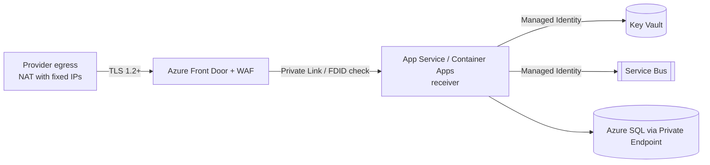

### ASP.NET Core hardening snippets
```csharp
builder.WebHost.ConfigureKestrel(k =>
{
    k.AddServerHeader = false;
    k.Limits.MaxRequestBodySize = 256 * 1024;
    k.Limits.RequestHeadersTimeout = TimeSpan.FromSeconds(10);   // slow-loris protection
    k.Limits.MinRequestBodyDataRate = new MinDataRate(240, TimeSpan.FromSeconds(5));
});
builder.Services.Configure<ForwardedHeadersOptions>(o =>
{
    o.ForwardedHeaders = ForwardedHeaders.XForwardedFor | ForwardedHeaders.XForwardedProto | ForwardedHeaders.XForwardedHost;
    // trust ONLY Front Door / your proxy (KnownNetworks/KnownProxies), never "all"
});
app.UseHsts();
```
Front Door validation of the origin (restrict App Service access to the `AzureFrontDoor.Backend`
service tag and verify `X-Azure-FDID`) prevents attackers bypassing the WAF by hitting the origin
directly.

### Real-world use cases
Regulated industries (healthcare, finance) require TLS 1.2+, WAF, audit logs and data minimised
payloads; B2B integrations may add mTLS or JWS signatures.

### When to use / when NOT
Always HTTPS. **Don't** add custom payload encryption unless you must (key management cost);
prefer thin events plus authenticated API fetch.

### Trade-offs
WAF adds latency and false positives (JSON bodies, SQL-ish text in payloads); inspect/exclude
carefully. Private origins add networking complexity but remove a whole attack class.

### Common mistakes
Accepting self-signed certs in the provider (`ServerCertificateCustomValidationCallback = true`);
providers following redirects to HTTP; exposing the origin publicly; trusting `X-Forwarded-For`
from anyone; putting PII in URLs; leaving old TLS versions enabled.

### Performance / reliability
Front Door gives anycast termination near the provider (lower TLS handshake latency); keep
connection reuse enabled; watch Front Door **origin response timeout** (default ~30 s, must exceed
the app's own budget but your app should answer in < 5 s anyway).

### Troubleshooting
Provider reports `SSL handshake failed` → expired/incomplete chain, unsupported TLS version, SNI
mismatch; check with `openssl s_client -connect host:443 -servername host` and SSL Labs. `421`/`403`
from Front Door → WAF rule or host header mismatch; check WAF logs in Log Analytics.

### Related topics
[Azure services and cloud architecture](../14-azure-services-and-cloud-architecture/azure-services-and-cloud-architecture.md)
(Front Door, private endpoints, Key Vault), [Docker](../09-containers-and-docker/docker-and-containerization.md)
(non-root, minimal images for the receiver).

### Interview Q&A
**Q: HTTPS is enabled, why also sign?** TLS protects the pipe, not the origin of the message: anyone
can open a valid TLS connection and POST. The signature authenticates the sender and detects
tampering behind TLS-terminating intermediaries.
**Q: How do you stop someone calling the origin directly, bypassing Front Door/WAF?** Private Link
or access restrictions by service tag plus `X-Azure-FDID` validation.

---

# Part D – Reliability

## 11. Duplicate webhook notifications

### Simple explanation
The same event can arrive more than once. That is normal, expected, and by design.

### Architect-level depth: why duplicates happen
| Cause | Mechanism |
| --- | --- |
| **Timeout after success** | You processed it, but your 2xx arrived after the provider's timeout ⇒ provider retries |
| **Network loss of the response** | Request reached you, the ACK was dropped |
| **Provider at-least-once design** | Outbox/worker crashes after send but before marking delivered |
| **Multiple subscriptions/endpoints** | Same event delivered to several registered URLs (dev + prod, duplicates in config) |
| **Manual replay** | Operator or customer redelivers from the portal |
| **Reconciliation overlap** | Your own poller re-reads events already pushed by webhook |
| **Semantically duplicate events** | Different event ids but the same business fact (e.g. `charge.succeeded` + `payment_intent.succeeded`) |

Exactly-once *delivery* is impossible over an unreliable network (Two Generals problem). The
achievable goal is **exactly-once *effect*** = at-least-once delivery + idempotent processing.

### Detection strategy
Dedupe on the **provider's stable id**, in this preference order:
1. Event/delivery id (`webhook-id`, `evt_…`, `X-GitHub-Delivery`).
2. A resource id + version (`paymentId` + `version`) when no event id exists.
3. A **content hash** of the raw body (last resort; fragile if provider re-serializes on retry —
   check that retries are byte-identical).

Important distinction: **delivery id** (per attempt vs per event). GitHub's `X-GitHub-Delivery` is
the same across redelivery of the same event; some providers issue a new id per attempt — then
you must use the *event* id inside the payload.

### Layers of de-duplication (use several)
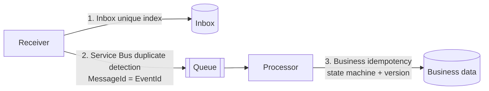
1. **Receiver inbox** (unique `(Provider, EventId)`) — cheap, absolute.
2. **Broker detection** — Service Bus `RequiresDuplicateDetection` with `MessageId`; window up to
   7 days (default 10 min); a best-effort optimisation, **not** a guarantee for your business logic.
3. **Business-level idempotency** — the only layer that can survive manual replays, DLQ resubmits and
   semantic duplicates.

### Mistakes
Using `DateTime`/payload content as the key; using only an in-memory `HashSet`/`MemoryCache`
(lost on restart/scale-out); dedupe check outside the same transaction as the business effect;
treating "duplicate" as an error (it should return 2xx!); logging duplicates at Error level.

### Troubleshooting
Spike in duplicates → consumer latency above the provider timeout; check p95/p99 of the receiver,
cold starts (Functions Consumption), WAF delays. Query: `inbox` rows with `Attempts > 1` and
provider delivery logs showing "timeout" with your 202 recorded.

### Related topics
Idempotency in [distributed systems patterns](../03-architectural-patterns/distributed-systems-patterns.md)
and [distributed transactions](../03-architectural-patterns/distributed-transaction.md).

### Interview Q&A
**Q: Can you guarantee exactly-once?** Not for delivery. We approximate exactly-once *processing
effect* via dedupe keys and idempotent state transitions.
**Q: Which id do you dedupe on if the provider changes the id on retry?** The semantic business
key from the payload (resource id + version/type), possibly hashed; and I'd ask the provider's
docs/support whether retries are the same event.

---

## 12. Idempotent webhook processing

### Simple explanation
Doing the same job twice leaves the world exactly as if done once.

### Architect-level depth
**Idempotent receiver** (EIP). Two common implementations:

**A. Natural idempotency** — the operation is inherently safe to repeat: `SET status='paid'`
(not `balance += 49`), upserts keyed by resource id, "ensure shipment exists".

**B. Idempotency ledger** — record that event X was applied, atomically with its effect:
```sql
BEGIN TRAN;
    INSERT dbo.ProcessedEvent (Provider, EventId, AppliedUtc) VALUES (@p, @e, SYSUTCDATETIME());
    -- unique violation ⇒ already applied: ROLLBACK and return success
    UPDATE dbo.Orders SET Status = 'Paid', PaidUtc = @ts, LastEventVersion = @v
     WHERE OrderId = @o AND LastEventVersion < @v;       -- ordering guard (see chapter 14)
COMMIT;
```
The ledger insert and the business update **commit together**, so a crash cannot apply the effect
without the marker (or vice versa).

### Processor skeleton (Service Bus worker)
```csharp
public sealed class PaymentEventProcessor(ServiceBusClient sb, IServiceScopeFactory scopes,
    ILogger<PaymentEventProcessor> log) : BackgroundService
{
    protected override async Task ExecuteAsync(CancellationToken ct)
    {
        await using var p = sb.CreateProcessor("webhook-payments", new ServiceBusProcessorOptions
        {
            MaxConcurrentCalls = 16,
            AutoCompleteMessages = false,            // we complete explicitly, after durable success
            MaxAutoLockRenewalDuration = TimeSpan.FromMinutes(5),
            PrefetchCount = 32
        });
        p.ProcessMessageAsync += async a =>
        {
            using var scope = scopes.CreateScope();
            var svc = scope.ServiceProvider.GetRequiredService<IPaymentService>();
            var evt = JsonSerializer.Deserialize<PaymentEvent>(a.Message.Body)!;   // validated at this point
            var outcome = await svc.ApplyAsync(evt, a.CancellationToken);           // idempotent (ledger + guard)
            if (outcome == ApplyOutcome.Poison)
                await a.DeadLetterMessageAsync(a.Message, "InvalidSchema", "…", a.CancellationToken);
            else
                await a.CompleteMessageAsync(a.Message, a.CancellationToken);       // Applied / AlreadyApplied / Stale
        };
        p.ProcessErrorAsync += e => { log.LogError(e.Exception, "SB error {Source}", e.ErrorSource); return Task.CompletedTask; };
        await p.StartProcessingAsync(ct);
        await Task.Delay(Timeout.Infinite, ct);
    }
}
```

### Side effects that are not transactional (email, payment capture, external API)
Pattern: **idempotency key to downstream**.
- Send `Idempotency-Key: {eventId}` to downstream APIs that support it.
- Otherwise: write an **outbox row** in the same transaction (`SendEmail(orderId)` with a unique
  key), and let a separate dispatcher perform it with its own dedupe. This is the **outbox
  pattern** applied to the consumer side.

### "Exactly-once effect" payment consumer — decision table
| Step | Failure | Result with this design |
| --- | --- | --- |
| Receive | crash before inbox commit | provider retries ⇒ re-received |
| Inbox + enqueue | crash between them | inbox row exists but no message ⇒ **recovery sweeper** requeues `Status=Received` rows older than N minutes |
| Process | crash after DB commit, before `Complete` | message redelivered ⇒ ledger unique violation ⇒ no-op ⇒ complete |
| External call | timeout | retried with the same idempotency key ⇒ provider returns original result |

(The inbox→queue gap is why many teams make the **inbox the source of truth** and have a relay
publish from it — exactly the outbox pattern in reverse. See chapter 16.)

### Real-world production scenario
A "refund issued" webhook triggered a customer email and a ledger entry. A deploy caused 3-minute
processing delays; the provider retried and the email went out twice. Fix: ledger insert +
`EmailOutbox(UniqueKey=eventId)` in the same transaction; dispatcher dedupes on the key.

### When to use / when NOT
Always for money, inventory, notifications and anything with a side effect. For pure
cache-invalidation or "set the latest value" events natural idempotency may suffice.

### Advantages / disadvantages
Safe retries and replays everywhere; costs an extra table/index write and thinking about every
side effect. TTL/cleanup of the ledger is needed (purge after the provider's maximum retry
horizon plus margin, e.g. 30–90 days).

### Common mistakes
Check-then-act outside a transaction; idempotency in cache only; applying increments (`+=`);
ledger purge shorter than replay horizon; assuming the broker's duplicate detection suffices;
non-idempotent emails/SMS; swallowing exceptions and completing the message (lost event).

### Performance / scalability
Unique index on `(Provider, EventId)` is the contention point only for *identical* ids — different
events do not conflict. Partition ledgers by month for cheap purge; use `PAGE` compression.

### Troubleshooting
Business effect applied twice → inspect the ledger for missing rows (different `EventId` formats,
e.g. upper/lower-case GUIDs) and whether dedupe and effect share a transaction. Use `UPDATE ...
OUTPUT` and the inbox's `Attempts` to trace.

### Related topics
[Outbox/Inbox with Service Bus](../13-azure-service-bus-and-messaging-patterns/azure-service-bus-and-messaging-patterns.md),
[SAGA](../03-architectural-patterns/01-SAGA-pattern/SAGA-pattern.md) (compensation when later steps fail).

### Interview Q&A
**Q: How do you make a webhook handler idempotent?** Choose a stable event key; make the
dedupe record and the business effect one atomic unit; use natural idempotency where possible;
propagate idempotency keys to downstream calls; handle the stale-event case with versions.
**Q: Why not just check `IF EXISTS` first?** Race window between concurrent deliveries; rely on the
unique constraint as the arbiter.

---

## 13. Webhook retries and exponential backoff

### Simple explanation
If delivery fails, try again — but wait longer each time, and add randomness so thousands of
failures do not all retry in the same instant.

### Architect-level depth
**Which failures to retry?**
| Response / error | Retry? | Reason |
| --- | --- | --- |
| 2xx | No | Delivered |
| 3xx | Usually **no** (treat as failure; do not follow redirects, SSRF) | Or provider-specific |
| 408, 429, 5xx, timeout, connection reset, DNS failure | **Yes** (honour `Retry-After`) | Transient |
| 400/401/403/404/410/422 | Mostly **no / limited** | Permanent errors; 410 Gone ⇒ disable endpoint |
| TLS/cert error | Yes a few times, then disable | Often misconfiguration |

**Backoff formulas**
- Exponential: `delay = min(cap, base × 2^attempt)`
- **Full jitter**: `delay = random(0, min(cap, base × 2^attempt))` (best contention reduction)
- **Decorrelated jitter**: `delay = min(cap, random(base, prev × 3))`

Typical provider schedules: Stripe ≈ up to 3 days with exponential backoff; GitHub does not
auto-retry (manual redelivery); Shopify ≈ 8 retries over ~4 hours then may remove subscription;
Event Grid: exponential schedule over 24 h (configurable). Document yours (e.g. 30 s, 2 m, 10 m,
30 m, 2 h, 6 h, 12 h ⇒ ~21 h).

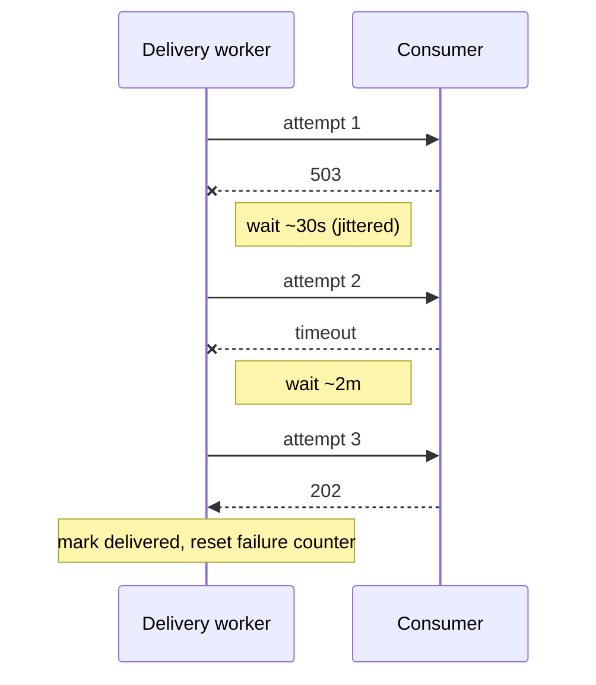

### Endpoint health: circuit breaker + auto-disable
Backoff protects a single *delivery*; you also need protection for the *endpoint*:
- **Per-endpoint circuit breaker** (open after N consecutive failures; half-open probe).
- **Auto-disable** after M days of failure; notify the owner; allow re-enable + replay.
- **Rate-limit per endpoint** so a slow endpoint cannot consume all worker threads
  (**bulkhead**: separate queues or concurrency per tenant/endpoint).

```csharp
// Polly v8 resilience pipeline for outbound webhook HTTP (per attempt inside one worker pass)
services.AddHttpClient("webhook-out")
    .AddResilienceHandler("webhook", b =>
    {
        b.AddTimeout(TimeSpan.FromSeconds(10));                       // hard per-attempt budget
        b.AddCircuitBreaker(new HttpCircuitBreakerStrategyOptions
        {
            FailureRatio = 0.5, MinimumThroughput = 10,
            SamplingDuration = TimeSpan.FromMinutes(1), BreakDuration = TimeSpan.FromMinutes(2)
        });                                                           // note: key breaker per endpoint host
    });
// Long-horizon retry (minutes→hours) belongs in the DURABLE delivery table, not in-process Polly.
```
**Key design point:** in-process Polly retries are for *milliseconds–seconds* (transient blips).
Retries over minutes–days must be **persisted** (`NextAttemptUtc`) so they survive restarts and
scale-out.

### Consumer-side behaviour with retries
Return **429/503 with `Retry-After`** to shed load; return **2xx** for work you have accepted;
return 4xx for permanent rejection. Do not return 5xx deliberately as a throttle unless the provider
documents backoff on it.

### Retry storms
After an outage of the consumer, thousands of queued retries hit at once. Mitigate with:
jitter, per-endpoint concurrency caps, a **slow-start ramp** after circuit closes, and a consumer
that is horizontally scalable and fast (202 only).

### Real-world production scenario
Consumer DB failover lasted 4 minutes. The provider's retries (no jitter) hit the recovering API
simultaneously at +30 s, +60 s…, producing repeated brownouts. Adding jitter and Front Door rate
limiting plus the Service Bus buffer ended the oscillation.

### When to use / when NOT
Always retry transient failures with backoff+jitter; do **not** retry permanent client errors
forever; do **not** retry inline in a request thread for minutes.

### Advantages / disadvantages
Higher delivery success vs. delayed delivery, duplicate risk, extra load on a struggling consumer.

### Common mistakes
Fixed-interval retries; no jitter; infinite retries; retry in memory only; retrying 4xx;
following redirects; no endpoint circuit breaker so one dead tenant starves the queue
("head-of-line blocking"); no manual replay; retrying beyond the idempotency ledger's retention.

### Troubleshooting
Provider dashboard shows "failed — timeout" but your logs show success → receiver latency >
provider timeout (cold start, DB slow, cert/WAF delay). Use Application Insights `requests |
summarize percentile(duration, 99)` and the provider's attempt log timestamps.

### Related topics
Retry/circuit breaker/bulkhead in
[distributed systems patterns](../03-architectural-patterns/distributed-systems-patterns.md);
[ASP.NET Core internals](../10-aspnet-core-web-api-internals/aspnet-core-web-api-internals.md)
(`IHttpClientFactory`, resilience handlers).

### Interview Q&A
**Q: Why jitter?** Without it, many clients that failed together retry together (thundering
herd), re-failing the dependency. Randomising spreads load.
**Q: Where do you implement long retries?** In durable storage with `NextAttemptUtc` (or Service Bus
scheduled messages), not in memory — in-memory retries die with the process and cannot span hours.

---

## 14. Message ordering

### Simple explanation
Webhook events can arrive in the wrong order: "shipped" before "paid", or an old "updated" after a
newer one. You cannot rely on arrival order.

### Architect-level depth
Why order breaks: parallel delivery workers, retries (event 1 fails, event 2 succeeds, event 1
succeeds later), multi-region senders, your own parallel consumers. **Global ordering is neither
provided nor practical**; ordering matters only **per entity** (per order, per customer).

Strategies (best → most expensive):
1. **Design for commutativity / last-writer-wins by version.** Each event carries an entity
   `version`/`sequence`/`occurredAt`; apply only if newer.
   ```sql
   UPDATE dbo.Orders
      SET Status = @status, LastEventVersion = @v
    WHERE OrderId = @id AND LastEventVersion < @v;     -- stale events affect 0 rows ⇒ ignore
   ```
2. **Re-fetch current state** (thin events): ignore the payload's state; GET the resource and
   reconcile. Order-insensitive by construction.
3. **State-machine guards:** only legal transitions apply; early arrivals are **parked** (retry
   later / deferred) until prerequisites arrive.
4. **Per-entity serialization in your pipeline:** Service Bus **sessions** (`SessionId = orderId`)
   give FIFO *within* a session and a single consumer per session, while different sessions run in
   parallel. This preserves your *internal* order but **cannot fix reordering that happened before
   the event reached you** — the receiver does not know the correct order unless the payload has a
   sequence.
5. **Provider-side ordered delivery** (rare): deliver per-endpoint sequentially, blocking on failure
   (head-of-line blocking trade-off).

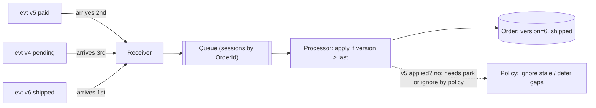
**Gap vs stale:** `version < last` ⇒ stale ⇒ ignore. `version > last + 1` ⇒ **gap** ⇒ either
accept (state-based snapshots) or defer/refetch (delta events). Choose per event semantics:
*snapshots* tolerate gaps; *deltas* (e.g. "item added") do not.

### Real-world production scenario
A CRM sent `contact.updated` events in parallel; older name overwrote newer on ~0.1 % of updates.
Solution: store `LastEventVersion` (CRM `modifiedAt` as tiebreaker + sequence) and use the guarded
`UPDATE`. Sessions were *not* needed.

### When to use which
Last-writer-wins by version: most CRUD-style sync. Sessions: when your own multi-step handling of
one entity must not interleave. Refetch: when the API is cheap and payloads thin. Don't enforce
ordering where commutative updates suffice — ordering costs throughput (chapter 16).

### Trade-offs
Ordering ↔ throughput/availability: strict per-entity FIFO serialises work and creates
head-of-line blocking on poison messages (a session blocked by a failing message).

### Common mistakes
Assuming FIFO because the provider "usually" sends in order; using timestamps from different
clocks as versions; sessions keyed on a low-cardinality value (hot session ⇒ no parallelism);
ordering by *received* time; global single consumer "to keep order".

### Troubleshooting
Check provider docs for ordering guarantees; add `Version`/`ReceivedUtc` to inbox and query for
inversions: `WHERE EventVersion < MAX(EventVersion) OVER (PARTITION BY EntityId ORDER BY ReceivedUtc)`.

### Related topics
Sessions and ordering vs throughput in
[Azure Service Bus and messaging patterns](../13-azure-service-bus-and-messaging-patterns/azure-service-bus-and-messaging-patterns.md);
event sourcing versions in [Event Sourcing](../03-architectural-patterns/03-event-sourcing/event-sourcing.md).

### Interview Q&A
**Q: How do you handle out-of-order webhooks?** Per-entity version check (apply only newer),
or refetch current state; sessions for internal serialisation; park/defer on gaps for delta events.
**Q: Do Service Bus sessions fix webhook reordering?** No — they preserve the order in which *you*
enqueue. If the receiver enqueues in the wrong order, sessions faithfully preserve the wrong order.
Ordering must come from a version in the payload.

---

## 15. Handling failed webhook deliveries

### Simple explanation
When retries are exhausted, don't lose the event: park it where a human or a tool can inspect and
re-send it.

### Architect-level depth
**Provider side** — terminal failure handling:
1. After the retry schedule ends ⇒ `Status = Dead`; keep payload, attempt history (status code,
   latency, truncated response body) for the retention period.
2. **Auto-disable** the endpoint after sustained failure; email/Teams/webhook-to-owner alert.
3. **Replay tools:** per-event "redeliver", bulk replay by time window/endpoint, replay after
   re-enable. Replays must reuse the *same event id* so consumers dedupe.
4. **Dead-letter store** (table / Service Bus DLQ) + dashboard.

**Consumer side** — failures in *your* processing:
1. Transient (DB down): let the queue retry (`MaxDeliveryCount`), abandon with delay.
2. Permanent/poison (schema invalid, business rule violated): **dead-letter with reason**; alert.
3. **Reconciliation poll** as the safety net for events the provider gave up on.
4. **Replay from inbox:** since the raw payload is stored, reprocess without asking the provider.

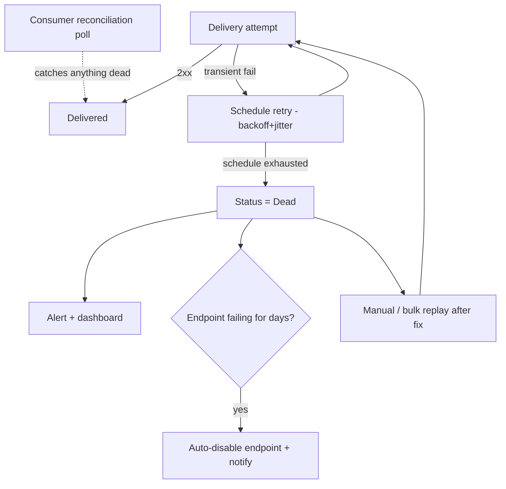

### SQL for operations
```sql
-- Dead deliveries in the last 24h by endpoint
SELECT e.EndpointId, e.Url, COUNT(*) AS Dead, MAX(d.LastError) AS LastError
FROM dbo.WebhookDelivery d JOIN dbo.WebhookEndpoint e ON e.EndpointId = d.EndpointId
WHERE d.Status = 3 AND d.CompletedUtc > DATEADD(HOUR, -24, SYSUTCDATETIME())
GROUP BY e.EndpointId, e.Url ORDER BY Dead DESC;

-- Bulk replay for an endpoint after it is fixed
UPDATE dbo.WebhookDelivery
   SET Status = 0, Attempt = 0, NextAttemptUtc = SYSUTCDATETIME()
 WHERE EndpointId = @endpointId AND Status = 3 AND CompletedUtc >= @since;
```

### Real-world production scenario
A customer's endpoint returned 410 after a decommission. Without handling, the provider kept
retrying 3 days × 10k events. Treating `410` as "unsubscribe + disable" removed the load; the
event backlog was kept for 30 days for replay should they re-enable.

### When to use / when NOT
Always have terminal handling. **Do not** retry indefinitely; **do not** silently drop; **do not**
auto-replay everything on re-enable without rate-limiting (replay storm).

### Common mistakes
No DLQ equivalent (events vanish); replay generating new event ids; no operator tooling (support
tickets for each missed event); alerting on every failed *attempt* instead of on dead/disabled
endpoints and rising failure rates.

### Troubleshooting
Pull the attempt log: status codes, latency histogram, last response body; reproduce with
`curl` + captured payload and signature (in a *test* tenant); check TLS/DNS; compare with the
consumer's logs by event id.

### Related topics
DLQ mechanics in [Service Bus guide](../13-azure-service-bus-and-messaging-patterns/azure-service-bus-and-messaging-patterns.md);
[SAGA](../03-architectural-patterns/01-SAGA-pattern/SAGA-pattern.md) for compensating failed multi-step flows.

### Interview Q&A
**Q: What do you do when a consumer is down for 2 days?** Provider: retries on schedule, then Dead
+ auto-disable + alert + retained payloads + replay. Consumer: after recovery, replay from provider
UI/API and/or run reconciliation poll since the last cursor; all idempotent.
**Q: What's the difference between a failed attempt and a dead delivery?** Attempt = one try;
dead = schedule exhausted and parked for intervention.

---

## 16. Asynchronous webhook processing using Service Bus

### Simple explanation
The endpoint only *receives*; a queue carries the work; workers *process* in the background at a
pace your system can handle.

### Architect-level depth
This is **queue-based load leveling + competing consumers + inbox/outbox**, applied to webhook
ingestion. Why:
- The provider's timeout is seconds; your processing might take longer or hit a slow DB.
- Traffic is bursty (month-end invoices); the queue absorbs the burst.
- You gain retries, DLQ, ordering (sessions), observability and scaling by queue depth.

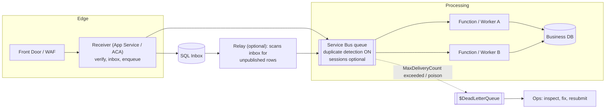

### Design choices
| Choice | Recommendation |
| --- | --- |
| One queue or topic? | **Queue** per provider/purpose when there is one logical consumer; **topic + subscriptions** when several internal systems react (fan-out) |
| Message body | Raw payload bytes (preserve signature evidence) + metadata in `ApplicationProperties` (provider, eventType, receivedUtc, version) |
| `MessageId` | Provider event id ⇒ enables duplicate detection |
| `SessionId` | Entity id when per-entity ordering of *processing* matters |
| Duplicate detection window | ≥ provider retry horizon is impossible (max 7 days); rely on ledger beyond |
| Auth | **Managed Identity** with `Azure Service Bus Data Sender` (receiver) / `Data Receiver` (workers); no SAS strings |
| Peek-lock | Always; complete after durable business commit |
| `MaxDeliveryCount` | 5–10 with backoff by `ScheduleEnqueueTime` re-queue for transient errors |
| TTL | Longer than any expected outage of workers (e.g. 7–14 days) |
| Scale | Queue depth / age → KEDA (Container Apps) or Functions Service Bus trigger autoscale |

### Closing the inbox ↔ queue gap (outbox on the consumer)
Problem: receiver writes inbox then sends to Service Bus; a crash between them leaves an inbox row
with no message (event is acked to the provider but never processed).

Options:
1. **Enqueue first, then inbox?** Then a crash leaves a message without an inbox row — acceptable
   because the processor dedupes anyway; but provider retry may enqueue a second copy (handled by
   duplicate detection + ledger). Simple and robust enough for many systems.
2. **Inbox as source of truth + relay** (recommended for money): receiver commits inbox row
   (`Status=Received`) and returns 202. A **relay** (`BackgroundService` or Function on timer)
   publishes rows with `PublishedUtc IS NULL` to Service Bus, then marks them. Crash-safe; the sweep
   also re-publishes stuck rows.
```csharp
public sealed class InboxRelay(IServiceScopeFactory scopes, ServiceBusClient sb) : BackgroundService
{
    protected override async Task ExecuteAsync(CancellationToken ct)
    {
        await using var sender = sb.CreateSender("webhook-payments");
        using var timer = new PeriodicTimer(TimeSpan.FromSeconds(2));
        while (await timer.WaitForNextTickAsync(ct))
        {
            using var scope = scopes.CreateScope();
            var inbox = scope.ServiceProvider.GetRequiredService<IInbox>();
            foreach (var row in await inbox.ClaimUnpublishedAsync(100, ct))
            {
                await sender.SendMessageAsync(new ServiceBusMessage(row.Payload) { MessageId = row.EventId }, ct);
                await inbox.MarkPublishedAsync(row.InboxId, ct);   // at-least-once; dup detection handles resend
            }
        }
    }
}
```
3. **Skip SQL inbox**, rely on Service Bus alone (duplicate detection + idempotent processor).
   Simplest; acceptable when the consumer is idempotent and you accept the 7-day dedupe horizon.

### Azure Functions consumer
```csharp
public class PaymentFunctions(IPaymentService svc, ILogger<PaymentFunctions> log)
{
    [Function("ProcessPaymentWebhook")]
    public async Task Run(
        [ServiceBusTrigger("webhook-payments", Connection = "ServiceBus", IsSessionsEnabled = false)]
        ServiceBusReceivedMessage msg, ServiceBusMessageActions actions, CancellationToken ct)
    {
        try
        {
            await svc.ApplyAsync(JsonSerializer.Deserialize<PaymentEvent>(msg.Body)!, ct);
            await actions.CompleteMessageAsync(msg, ct);
        }
        catch (PoisonException ex)
        { await actions.DeadLetterMessageAsync(msg, null, "Poison", ex.Message, ct); }
        // other exceptions: bubble ⇒ abandon ⇒ redelivery up to MaxDeliveryCount
    }
}
// host.json: serviceBus.maxConcurrentCalls, prefetchCount, maxAutoLockRenewalDuration
```
Identity-based connection: app settings `ServiceBus__fullyQualifiedNamespace` plus Managed Identity
with `Azure Service Bus Data Receiver`.

### Bicep (queue with DLQ settings and duplicate detection)
```bicep
resource q 'Microsoft.ServiceBus/namespaces/queues@2024-01-01' = {
  parent: sbNamespace
  name: 'webhook-payments'
  properties: {
    requiresDuplicateDetection: true
    duplicateDetectionHistoryTimeWindow: 'P1D'
    maxDeliveryCount: 8
    lockDuration: 'PT1M'
    defaultMessageTimeToLive: 'P7D'
    deadLetteringOnMessageExpiration: true
    requiresSession: false
  }
}
```
(Check the current API version; properties are stable, the version string evolves.)

### Real-world production scenario
Month-end billing produced 40× normal webhook volume. The receiver kept 202 latency < 100 ms,
the queue depth grew to 200k, KEDA scaled workers from 2 to 30, DB write contention capped useful
parallelism at ~20, and the backlog drained in 25 minutes with no provider retries.

### When to use / when NOT
Use whenever processing is non-trivial or bursty. Skip the queue for trivial, fast, idempotent
actions (e.g. update a cache) where an inbox table + in-process work is enough — but still ack
quickly.

### Advantages / disadvantages
Resilience, elasticity, DLQ, observability vs. extra infrastructure, eventual consistency, one more
failure point (broker), and slightly more latency.

### Common mistakes
Processing then enqueueing in the HTTP handler; auto-complete before processing finishes;
massive `MaxConcurrentCalls` that overwhelm the DB; one poison message blocking a session; using SAS
keys in code; no DLQ alerting; forgetting `MessageId`; storing huge payloads in messages (>256 KB
Standard tier limit; 100 MB on Premium) instead of claim-check.

### Performance / scalability / reliability / security
Prefetch + concurrency tune throughput; lock duration > processing time (or auto-renew);
partitioned/premium for throughput; private endpoint for the namespace; RBAC with Managed Identity;
disable local (SAS) auth when possible.

### Troubleshooting
Messages stuck "active" → no receivers / lock lost / session locked; check `ActiveMessageCount`,
`DeadLetterMessageCount`, oldest message age (Azure Monitor metrics). `MessageLockLost` errors →
processing exceeds lock; lengthen lock or renew. DLQ growth → inspect `DeadLetterReason` and
`DeadLetterErrorDescription`.

### Related topics
Full Service Bus depth (peek-lock, sessions, DLQ replay, outbox/inbox) in
[Azure Service Bus and messaging patterns](../13-azure-service-bus-and-messaging-patterns/azure-service-bus-and-messaging-patterns.md);
choosing Service Bus vs Event Grid vs Event Hubs in
[Azure services and cloud architecture](../14-azure-services-and-cloud-architecture/azure-services-and-cloud-architecture.md).

### Interview Q&A
**Q: Why put Service Bus behind a webhook endpoint?** Decouple receiving from processing: fast acks,
burst absorption, retry/DLQ, scaling, ordering by session, and isolation of provider timeouts from
our processing time.
**Q: What if Service Bus is down when the webhook arrives?** Return 503 + `Retry-After` (provider
retries) or persist to the SQL inbox and let the relay publish later. Prefer inbox-first for
critical events; both avoid ack-then-lose.
**Q: Event Grid vs Service Bus for webhooks?** If the source is already an Azure/Event Grid publisher,
subscribe the Service Bus queue as an Event Grid destination (no webhook endpoint); for third-party
HTTP callbacks you need your own receiver in front of Service Bus.

---

# Part E – Operations and scale

## 17. Webhook monitoring and logging

### Simple explanation
You cannot see the other party's systems, so your logs and dashboards are the only evidence of what
arrived, what you did with it, and where it got stuck.

### Architect-level depth
Observe the **whole path**: edge → receiver → inbox → queue → processor → business effect. Use one
**correlation key** (provider event id) plus the W3C `traceparent` where available.

**The four questions an on-call engineer must answer in one minute**
1. Did the event arrive? (receiver log by event id)
2. Was it accepted/rejected, and why? (status, signature result)
3. Was it processed? (inbox `Status`, ledger row, business record)
4. If not, where is it stuck? (queue depth/age, DLQ, lock errors, exceptions)

**What to log (structured)**
```csharp
using (log.BeginScope(new Dictionary<string, object>
{
    ["Provider"] = "payments", ["EventId"] = eventId, ["EventType"] = type,
    ["DeliveryAttempt"] = attempt, ["BodyBytes"] = raw.Length
}))
{
    log.LogInformation("Webhook accepted in {ElapsedMs} ms", sw.ElapsedMilliseconds);
}
```
Never log: signing secrets, full signature headers, authorization headers, raw payload bodies
containing PII/PCI (store payloads in the access-controlled inbox, not in logs). Log hashes and
sizes instead.

**Metrics (OpenTelemetry → Azure Monitor)**
| Metric | Meaning | Alert when |
| --- | --- | --- |
| `webhook.received` by provider/type/result (`accepted`, `invalid_signature`, `duplicate`, `too_large`) | Traffic & rejection mix | `invalid_signature` rate > baseline (attack or secret mismatch) |
| `webhook.receive.duration` (p50/p95/p99) | Receiver latency | p95 > 50 % of provider timeout |
| `webhook.queue.depth` / oldest message age | Processing lag | Age > SLO (e.g. 5 min) |
| `webhook.dlq.count` | Poison/failed | > 0 sustained |
| `webhook.process.duration`, `webhook.process.failures` | Worker health | Failure ratio > X % |
| Provider side: `delivery.success_rate` per endpoint, `delivery.latency`, `endpoint.disabled` | Customer endpoint health | Success < 95 %; auto-disabled |
| `reconciliation.missing_events` | Webhooks you never got | > 0 (investigate) |

```csharp
static readonly Meter Meter = new("Integrations.Webhooks");
static readonly Counter<long> Received = Meter.CreateCounter<long>("webhook.received");
static readonly Histogram<double> Duration = Meter.CreateHistogram<double>("webhook.receive.duration", "ms");
// Received.Add(1, new("provider","payments"), new("result","duplicate"));
```
```csharp
builder.Services.AddOpenTelemetry()
    .UseAzureMonitor()                                  // Azure.Monitor.OpenTelemetry.AspNetCore
    .WithMetrics(m => m.AddMeter("Integrations.Webhooks"))
    .WithTracing(t => t.AddSource("Azure.Messaging.ServiceBus")); // trace across Service Bus
```

**KQL (Application Insights / Log Analytics)**
```kusto
// Rejections by reason in the last hour
requests
| where timestamp > ago(1h) and url has "/webhooks/"
| summarize total=count(), unauthorized=countif(resultCode == "401"),
            p95=percentile(duration, 95) by bin(timestamp, 5m)
| order by timestamp desc

// Trace one event end to end
union requests, traces, dependencies
| where customDimensions.EventId == "evt_9f2" or message has "evt_9f2"
| project timestamp, itemType, name, message, resultCode, duration
| order by timestamp asc

// Service Bus backlog health (platform metrics → AzureMetrics)
AzureMetrics
| where ResourceProvider == "MICROSOFT.SERVICEBUS" and MetricName in ("ActiveMessages","DeadletteredMessages")
| summarize max(Maximum) by MetricName, bin(TimeGenerated, 5m)
```

**Dashboards and alerts:** a single workbook: *received vs processed vs dead*, queue age, p95
latency, rejection rate, reconciliation gaps. Alerts on **symptoms** (queue age, DLQ > 0, rejection
spike, provider endpoint disabled), not on every failed attempt.

**Provider-side observability (product feature):** per-endpoint delivery log with request headers
(secrets redacted), response status/body snippet, latency, attempt number; searchable by event id;
export; webhooks-about-webhooks for disable notifications.

### Why it exists / problems solved
Distributed, cross-organisation flows fail silently. Without per-event traceability, support
spends hours on "did the webhook fire?" disputes.

### Real-world production scenario
Orders silently stopped syncing for 6 hours. Dashboards showed 202 rates normal but **processor
failure ratio 100 %**: a schema change in a new field broke deserialisation, messages cycled to
DLQ. The DLQ alert (count > 0 for 10 min) would have caught it in minutes; it did not exist.
Lesson: alert on the *end* of the pipeline, not only the entrance.

### When to use / when NOT
Always. Adjust sampling for volume (Application Insights adaptive sampling may drop webhook traces
— exempt the webhook route, or log events in an inbox table which is complete by construction).

### Common mistakes
Logging bodies with PII/card data; high-cardinality metric dimensions (event id as a metric tag
explodes cost — put ids in logs/traces, not metrics); no correlation id; alerting on noisy per-attempt
failures; no DLQ alert; sampling out the very errors you need.

### Performance / cost considerations
Log at Information for accepted, Warning for rejected, Error only for genuine faults; use sampling
and retention tiers (Basic Logs) for high-volume ingestion; keep the **inbox table** as the
authoritative audit trail.

### Troubleshooting playbook
| Symptom | First check |
| --- | --- |
| Provider says delivered, nothing happened | Inbox row? queue message? DLQ? ledger? |
| Provider says failed, we see 202 | Latency > provider timeout; response lost on network |
| Sudden 401s | Secret rotated/environment mismatch/clock/WAF body change |
| Processing lag | Queue age; worker concurrency; DB locks (`sys.dm_exec_requests`, blocking chains) |
| Memory/CPU on receiver | Body size, buffering, thread pool starvation (sync-over-async) |

### Related topics
Observability in [Cloud-native .NET on Azure](../07-advanced-topics/Architecting%20Cloud-Native%20NET%20Apps%20for%20Azure.md),
production debugging in [ASP.NET Core internals](../10-aspnet-core-web-api-internals/aspnet-core-web-api-internals.md),
Azure Monitor in [Azure services](../14-azure-services-and-cloud-architecture/azure-services-and-cloud-architecture.md).

### Interview Q&A
**Q: How would you monitor a webhook integration?** End-to-end: receiver rate/latency/rejections,
queue depth+age, DLQ, processor failures, and a reconciliation-gap metric; logs correlated by event
id, no secrets/PII; alerts on symptoms with runbooks.
**Q: How do you know you have *missed* webhooks?** Reconciliation: periodically list events from the
provider API for a window and compare with the inbox; alert on the difference.

---

## 18. Third-party system integration

### Simple explanation
Connecting to someone else's system you cannot change, with their rules, their outages, their
schema changes and their rate limits.

### Architect-level depth: integration design principles
1. **Anti-Corruption Layer (ACL):** translate the provider's model to your domain at the edge so
   their schema never leaks into your core (see
   [Enterprise application patterns](../03-architectural-patterns/enterprise-application-patterns.md)).
2. **Tolerant reader & versioning:** ignore unknown fields/events; pin API/webhook version where the
   provider supports it (Stripe `Stripe-Version`, Shopify API versions); contract-test with recorded
   payloads.
3. **Adapter per provider** behind a common port (hexagonal; see
   [Hexagonal architecture](../02-architectural-styles/06-hexagonal-architecture/hexagonal-architecture.md)).
4. **Both channels:** webhooks for freshness + API polling for reconciliation/backfill.
5. **Sandbox first, replay always:** keep a library of real payloads (sanitised) as test fixtures;
   use provider CLIs (Stripe CLI, GitHub smee/ngrok-style tunnels, Azure Dev Tunnels) for local dev.
6. **Rate limits & quotas:** callback-API calls from your processors must respect provider limits
   (token bucket + 429 handling with `Retry-After`).
7. **Own your SLOs:** define the freshness you promise (e.g. "orders visible within 60 s, 99 %")
   and design the reconciliation interval accordingly.
8. **Operate the relationship:** contacts, status page subscriptions, change-notice process,
   deprecation calendar.

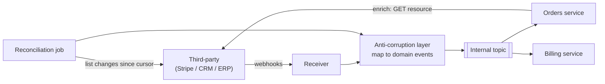

### Common integration scenarios
| Scenario | Notes |
| --- | --- |
| **Payments (Stripe/Adyen)** | Webhook is the source of truth for async outcomes (3DS, bank debits); never fulfil from the browser redirect alone; verify signature; dedupe; handle `charge.refunded`, disputes; reconcile daily with settlement reports |
| **GitHub/Azure DevOps → CI/CD** | Verify `X-Hub-Signature-256`; fast ack; queue builds; ignore events for unsupported branches |
| **Shopify/e-commerce** | Tight response deadline; mandatory GDPR webhooks; rate-limited REST/GraphQL callbacks |
| **DocuSign Connect** | Envelope status; per-account config; HMAC with multiple keys; large payload options |
| **Twilio** | Status callbacks are form-encoded, signature includes full URL ⇒ proxy URL pitfalls |
| **CRM (Salesforce/HubSpot/Dynamics)** | Change events may batch; ordering by modified time; field-level security; rate limits; Dataverse webhooks → Service Bus built in |
| **Microsoft Graph change notifications** | Subscription lifecycle (expiry/renewal), `validationToken` handshake, `clientState`, lifecycle notifications; consider Event Hubs/Event Grid delivery |
| **On-prem ERP** | Cannot receive inbound: use relay (Azure Relay/Service Bus) or the ERP polls an outbound queue |

### Real-world production scenario
A fintech depended on a bank's webhooks for payment confirmations. The bank had a 40-minute
outage and dropped 10 minutes of events without retry. Because the team already ran a 5-minute
reconciliation against the bank's transactions API, all gaps were repaired with no customer impact.
Without it, 200 payments would have stayed "pending".

### When to use / when NOT
Webhook + reconciliation for any business-critical external integration. Pure webhook for
convenience-only features (notifications, chat-ops). If the provider offers a broker/stream
export (Event Hubs, S3 feed, SFTP batches), prefer it for large volumes.

### Advantages / disadvantages / trade-offs
ACL + dual-channel costs more upfront but isolates change and prevents data loss. Thin adapters
are cheap to replace when you swap vendors (vendor lock-in reduction).

### Common mistakes
Leaking provider DTOs into the domain; trusting webhook payload state without refetch for critical
money flows; ignoring provider API version pinning; no sandbox/test mode separation (test events
reaching production); no handling for subscription expiry (Graph); one shared secret/endpoint across
environments; building the integration without reading the provider's retry/timeout/ordering docs.

### Performance / scalability / reliability / security
Respect provider rate limits with a shared token bucket; cache reference data; backfill throttled;
isolate each provider's queue/concurrency (bulkhead); least-privilege API keys stored in Key Vault;
audit which events caused which changes (inbox + ledger).

### Troubleshooting
Contract drift (new required field, renamed property) → deserialisation errors in DLQ: capture the
failing raw payload from DLQ, add a tolerant parse, replay. Provider outage → dashboards from
provider status API/page, extend reconciliation window, communicate ETA. Test events in prod →
check `livemode`/environment flags in payload.

### Related topics
[Integration and communication patterns](../03-architectural-patterns/integration-and-communication-patterns.md),
[Event-driven architecture](../02-architectural-styles/04-event-driven-architecture/event-driven-architecture.md),
[Hexagonal architecture](../02-architectural-styles/06-hexagonal-architecture/hexagonal-architecture.md).

### Interview Q&A
**Q: How do you design integration with an unreliable third party?** ACL at the edge, webhook for
speed + reconciliation for truth, idempotent processing, versioned tolerant readers, per-provider
isolation (queue/bulkhead), SLOs and runbooks.
**Q: The payment webhook says "succeeded" but the order shows pending. What happened?** Possibly
out-of-order (older pending applied later), missed webhook, processor failure/DLQ, or a stale
read model. Check inbox → ledger → business state; refetch from the provider API as source of truth.

---

## 19. Webhook scalability and security

### Simple explanation
Make the system keep working when there are 100× more events and when someone is actively trying
to abuse it.

### Architect-level depth: scalability

**Consumer (receiver) scaling**
| Layer | Technique |
| --- | --- |
| Edge | Front Door caching irrelevant; use WAF + rate limits; keep TLS offload at edge |
| Receiver | Stateless; scale out (App Service autoscale / ACA HTTP concurrency rule / AKS HPA); keep p99 < 200 ms; no blocking I/O (async everywhere) |
| Store | Inbox insert is O(1) append; batch/partition; use `READ_COMMITTED_SNAPSHOT`; avoid hot-page contention (don't cluster on a random GUID — use `IDENTITY`/sequential key + unique non-clustered on `(Provider, EventId)`) |
| Queue | Service Bus Premium for throughput/size, partitioning, multiple queues per provider/tenant tier |
| Workers | KEDA/Functions scale on queue depth; cap `MaxConcurrentCalls` to DB capacity; shard by session/partition key |
| Downstream | Bulkheads, rate limits to downstream APIs, idempotent batching |

**Provider (sender) scaling — 10k tenants / millions of deliveries**
- **Outbox → partitioned queues** (by tenant hash) → delivery workers; fan-out one event to N
  subscriptions asynchronously (don't loop N HTTP calls inside the transaction).
- **Noisy neighbour isolation:** per-endpoint concurrency, per-tenant rate limits, separate
  priority lanes (free vs enterprise), dedicated worker pools for chronically slow endpoints.
- **Connection management:** `SocketsHttpHandler` pooling with sensible `PooledConnectionLifetime`
  and `MaxConnectionsPerServer`; HTTP/2 to endpoints where supported; avoid socket exhaustion
  (see [ASP.NET Core internals](../10-aspnet-core-web-api-internals/aspnet-core-web-api-internals.md)).
- **Delivery table maintenance:** partition by day, purge/archive old rows, filtered index on
  pending rows (`WHERE Status IN (0,2)`), keep payload in a separate table or Blob (claim check)
  to keep the hot table narrow.
- **Backpressure and shedding:** per-endpoint queue length caps; collapse superseded events
  ("latest-state only") for snapshot-type notifications.
- **Batching:** optional batch webhooks (array of events) for high-volume tenants — fewer calls,
  but ordering/partial-failure semantics must be defined.
- **Multi-region:** active/active workers with lease claims in a shared store; regional egress IPs
  documented; consider Event Grid/Service Bus geo-DR for the queue.

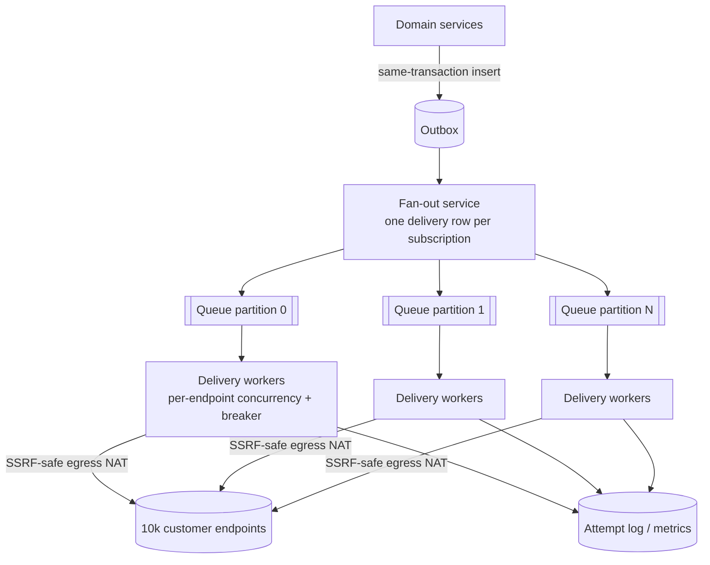

### Architect-level depth: security (consolidated threat model)
| Threat | Control |
| --- | --- |
| Forged events | HMAC/asymmetric signature, secrets in Key Vault |
| Replay | Signed timestamp + tolerance; event-id dedupe; idempotent business logic |
| Tampering in transit | TLS 1.2+; signature over body |
| Information disclosure | Thin payloads; field minimisation; no secrets/PII in logs or URLs |
| DoS on receiver | WAF, rate limits, body-size caps, header timeouts, cheap-first rejection, autoscale, queue buffering |
| **SSRF via provider** (customer-supplied URLs) | HTTPS-only, deny private/link-local/metadata IPs, connect-time IP validation, no redirects, dedicated egress, response size/time limits, allow-listed ports |
| Credential leakage | Dual-secret rotation, separate per tenant/env, redaction, secret scanning in repos |
| Poisoned payload (injection/oversize/unicode) | Schema validation, parameterised SQL, size limits, safe deserialisation (no polymorphic `TypeNameHandling`) |
| Endpoint takeover (provider side) | Verify ownership at registration (challenge/handshake like Event Grid; send a `ping` with a code) |
| Insider / replay tool abuse | RBAC and audit for replay and secret reveal |
| Supply chain | Pin dependencies; minimal container images; non-root |

**Registration-time ownership challenge (provider)**
```csharp
// POST challenge to the URL with a random token; endpoint must echo it back within 10s.
var token = Convert.ToHexString(RandomNumberGenerator.GetBytes(16));
using var resp = await client.PostAsJsonAsync(url, new { type = "webhook.verification", challenge = token });
var echoed = (await resp.Content.ReadFromJsonAsync<Challenge>())?.Challenge;
return echoed is not null &&
       CryptographicOperations.FixedTimeEquals(Encoding.UTF8.GetBytes(token), Encoding.UTF8.GetBytes(echoed));
```

### Why it exists
Webhook endpoints are publicly reachable and handle money/state changes; providers invoke
customer-controlled URLs from inside your network perimeter — both directions are attack surface.

### When to use / when NOT
These controls are not optional at any scale; **scale tactics** vary: for < 100 events/s a single
App Service + Service Bus Standard is plenty. Do not pre-build a partitioned fan-out platform
for 50 tenants.

### Trade-offs
Strict SSRF filtering can break legitimate private-link customers (offer a dedicated "private
delivery" tier). Batching improves throughput but complicates retries and ordering. Premium Service
Bus costs more than Standard but gives isolation and predictable latency.

### Common mistakes
Scaling workers beyond what the DB can absorb; hot partition keys; storing payloads in the
delivery row and bloating the index; SSRF filter by hostname string only; ignoring DNS rebinding;
allowing redirects; shared worker pool for all tenants; no per-tenant quotas; never testing with
10× load.

### Performance / reliability checklist
Load-test receiver at 10× peak; test queue drain time; chaos-test the consumer outage (retry storm
shape); verify autoscale rules; verify graceful shutdown (`StopAsync` completes in-flight lock
renewals; `ShutdownTimeout`); keep health endpoints (`/health/ready` checks DB + Service Bus).

### Troubleshooting
Latency creep → DB lock waits on inbox (check `sys.dm_tran_locks`, wait stats), thread pool
starvation (`dotnet-counters`: `ThreadPool Queue Length`), Service Bus throttling (server busy,
429 from namespace — scale up units or partition). Tenant complains of delays → check their
endpoint breaker state and queue lane.

### Related topics
[Distributed systems patterns](../03-architectural-patterns/distributed-systems-patterns.md) (bulkhead,
rate limiting, circuit breaker), [Azure services](../14-azure-services-and-cloud-architecture/azure-services-and-cloud-architecture.md)
(Front Door, autoscale, private endpoints), [Docker](../09-containers-and-docker/docker-and-containerization.md).

### Interview Q&A
**Q: How would you scale a webhook sender to 10 million deliveries/day?** ≈ 115/s average, maybe
1–2k/s peak: outbox + partitioned queues, stateless workers with per-endpoint concurrency and
breakers, narrow hot tables with partitioning and purge, claim-check payloads, tenant-level
quotas and priority lanes, SSRF-hardened egress NAT, and metrics per endpoint.
**Q: What's the biggest security risk in *sending* webhooks?** SSRF — a user supplies a URL that
points to your internal network/metadata service. Mitigate with connect-time IP validation,
no redirects, egress isolation.
**Q: Biggest risk in *receiving*?** Skipping or mis-implementing signature + timestamp + idempotency,
leading to forged or replayed business events.

---

# Part F – Interview toolkit

## 20. Scenario-based architect questions

### Scenario 1 — Design a webhook platform for 10,000 tenants (you are the provider)
**Requirements given:** tenants self-register HTTPS endpoints, ~5k events/s peak, at-least-once
delivery with retries for 24 h, tenant isolation, audit and replay, SOC 2 expectations.

**Answer structure (use this order in the interview)**
1. **Clarify:** payload size, event types/volume per tenant, ordering expectation, latency SLO
   (e.g. p95 < 10 s), retention, regions, thin vs fat payloads.
2. **Core design:** transactional **outbox** in the domain DB → **fan-out** creates one `Delivery`
   per matching subscription → **partitioned queue(s)** (hash of tenantId) → **stateless delivery
   workers** → **SSRF-safe egress**. Attempt log + payload store (claim check in Blob).
3. **Contract:** Standard-Webhooks-style headers (`webhook-id`, `-timestamp`, `-signature`),
   versioned event types, per-tenant secrets with dual-secret rotation, test/ping and ownership
   challenge, documented retry schedule and timeout.
4. **Reliability:** backoff+jitter schedule persisted in DB; per-endpoint circuit breaker and
   auto-disable; dead state + replay API/UI; reconciliation endpoint (`GET /events?after=`) so
   consumers can backfill.
5. **Isolation:** per-endpoint concurrency cap, per-tenant rate limits, priority lanes, separate
   pools for slow endpoints; head-of-line blocking avoided by *not* using a single FIFO.
6. **Security:** SSRF controls, HTTPS only, secrets in Key Vault/HSM-backed, RBAC on replay/secret
   reveal, audit logs, redaction.
7. **Observability:** per-endpoint success rate/latency, queue age, disabled endpoints, customer
   delivery-log UI.
8. **Trade-offs & alternatives:** build vs buy (Svix/Hookdeck/Event Grid), ordering (none by default,
   optional per-key sequence), batching for heavy tenants, cost of storing payloads.
9. **Evolution:** start with one queue + one worker pool; introduce partitions when queue age SLO is at
   risk (avoid premature platform building).

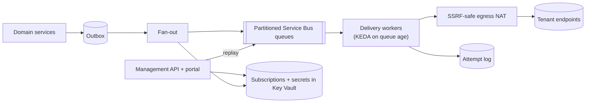

### Scenario 2 — Payment webhooks that must be exactly-once-effect (you are the consumer)
**Problem:** `payment.succeeded` must mark the order paid, reserve stock and send one email — never
twice, never zero times, even with duplicates, reordering and crashes.

**Answer**
- **Receive:** verify HMAC + timestamp; insert inbox `(Provider, EventId)` unique; commit; 202.
- **Publish:** inbox relay → Service Bus (`MessageId = EventId`, `SessionId = OrderId`).
- **Process (one SQL transaction):** insert `ProcessedEvent` (unique) → guarded `UPDATE Orders
  ... WHERE LastEventVersion < @v` → insert `Outbox` rows (`ReserveStock`, `SendEmail` with unique
  keys). Commit. Then `Complete` the message.
- **Side effects:** outbox dispatcher calls stock service/email with idempotency keys.
- **Out of order:** version guard; if payload is a delta, defer until predecessor.
- **Safety nets:** reconciliation against provider's payments list every 5 min; daily settlement
  report match; DLQ alert + resubmit tool.
- **Failure matrix:** crash after commit/before complete → redelivery → ledger no-op; crash before
  commit → redelivery → full apply; provider retry → inbox no-op; manual replay → same.
- **Test:** property/chaos tests that kill the process at each step; duplicate and shuffled event
  streams produce identical final state (idempotence + commutativity check).

### Scenario 3 — "Our webhook consumer falls behind every month-end"
**Diagnose:** receiver latency fine? queue age rising? workers throttled by DB? provider retrying?
**Fix:** ensure the receiver only enqueues; scale workers on queue age with a DB-aware ceiling;
batch writes; tune indexes; use Premium Service Bus if throttled; raise `MaxConcurrentCalls`
carefully; add backpressure with 429/`Retry-After` only if the queue itself is at risk; provision
capacity for the known peak (scheduled scale rule). **Explain the trade-off:** lag is acceptable if
within SLO — don't over-provision for a once-a-month peak when the queue absorbs it.

### Scenario 4 — "We stopped receiving webhooks and nobody noticed for a day"
**Root causes:** provider auto-disabled the subscription after failures; secret rotated; URL changed
behind Front Door; WAF blocking; subscription expired (Graph). **Fixes:** reconciliation job with
alert on gaps; "heartbeat" expectation (no events for N minutes during business hours → alert);
provider API check of subscription status in a health job; runbook to re-enable + replay.

### Scenario 5 — Choose the transport
*"A partner wants real-time order updates from us. They are a small company with one dev. Should we
offer webhooks, a queue or an API?"* Offer **webhooks + a polling events API** (reconciliation) +
signed payloads and a sandbox; offer Service Bus/Event Hubs only for large partners with Azure
maturity and volume. Rationale: lowest friction, universal, but give them the safety net.

---

## 21. Tough follow-up questions

1. **"If I verify the signature, do I still need idempotency?"** Yes. A valid signature proves
   origin and integrity, not uniqueness. Retries and replays carry valid signatures.
2. **"Why not use the signature as the dedupe key?"** With rotation, multiple signatures and
   provider re-signing on retry (new timestamp ⇒ new signature) the same event has different
   signatures. Use the event id.
3. **"How long should the timestamp tolerance be?"** Short enough to limit replay (≈ 5 min),
   long enough for clock skew and retries signed at send time. Providers re-sign each attempt with
   a fresh timestamp, so retries are not penalised by a short window.
4. **"Your processor completes the message but the DB commit was rolled back. What happens?"**
   Never complete before the commit. If you did, the event is lost; the reconciliation poll is the
   safety net. Order must be: commit → complete.
5. **"Service Bus duplicate detection is on. Do you still need a ledger?"** Yes: window limit (≤ 7
   days), only dedupes by `MessageId` on *send*, doesn't cover DLQ resubmits, manual replays,
   semantic duplicates, or business side effects.
6. **"How do you test webhook handling?"** Unit: verifier with known vectors + mutated bodies;
   integration: `WebApplicationFactory` posting signed requests incl. duplicates/old timestamps;
   contract: recorded provider payloads; chaos: kill processor mid-flight; load: 10× peak; E2E in
   provider sandbox with CLI-forwarded events.
7. **"Why 202 and not 200?"** Both are 2xx; 202 is the honest semantic. Be sure the provider treats
   all 2xx as success.
8. **"The provider only retries for 1 hour; our outage was 3 hours. Now what?"** Reconciliation
   poll / provider replay API; that is why we never rely on webhooks alone for critical flows.
9. **"Could you skip the queue and process inline if it's fast enough?"** For trivial idempotent
   work, yes, but you couple provider timeouts and your DB health, lose burst absorption and DLQ.
   Default to the queue; justify the exception.
10. **"How do you prevent your own webhook sender being used to scan internal networks?"**
    SSRF defences: connect-time IP validation, redirect disabling, egress isolation, restrictive
    response handling (don't return bodies), port allow-list, rate-limit registrations.
11. **"Fat or thin events in your own platform?"** Thin + id by default for correctness and security;
    offer fat as an opt-in with version fields; always include `version` and `occurredAt`.
12. **"How do you version webhook payloads?"** Additive changes only within a version; new versions
    via new event type version (`order.created.v2`) or account-level API version; support both for a
    deprecation window; publish a changelog; consumers use tolerant readers.
13. **"What if the consumer's endpoint is slow but healthy?"** Per-endpoint concurrency cap +
    timeout; lower priority lane; don't let it consume the shared pool; notify tenant.
14. **"Webhook vs Event Grid for my own internal events?"** Internal ⇒ Event Grid/Service Bus
    natively (auth, retry, DLQ built in). Webhook delivery is just one *destination type* of Event Grid.
15. **"Where does CQRS/event sourcing fit?"** Webhook events can feed read-model projections (event
    notifications/ECST); they are *integration* events, not your event-sourcing store — don't use a
    third party's lossy, unordered stream as your source of truth.

---

## 22. Cheat sheet

**Consumer golden path:** `HTTPS → size limit → read raw bytes → verify (HMAC + timestamp, constant
time) → inbox insert (unique) → enqueue → 202` · async processor: `peek-lock → ledger+effect in one
txn → complete` · safety net: reconciliation.

**Provider golden path:** `outbox → fan-out → durable delivery rows → signed POST (10 s) → 2xx
done / else backoff+jitter → dead → alert/auto-disable → replay`.

| Topic | Rule of thumb |
| --- | --- |
| Delivery semantics | At-least-once, unordered |
| Ack time | < 5 s (aim < 200 ms) |
| Status codes | 202 ok · 401 bad sig · 413/415 · 429/503+`Retry-After` · avoid 5xx for permanent errors |
| Signature | HMAC-SHA256 over `id.timestamp.body` (raw bytes) |
| Compare | `CryptographicOperations.FixedTimeEquals` |
| Replay window | ±5 min + event-id dedupe |
| Dedupe key | provider event id (fallback: resource id + version) |
| Idempotency | Ledger + effect in one transaction; natural idempotency when possible |
| Retry | exp. backoff + jitter; persisted; ~24 h; 410 ⇒ disable |
| Ordering | per-entity version guard; sessions only for internal serialisation |
| Queue | Service Bus peek-lock, `MessageId=EventId`, DLQ alert, MI auth |
| Secrets | Key Vault, MI, dual-secret rotation |
| SSRF (sender) | HTTPS, deny private IPs at connect time, no redirects, egress NAT |
| Observability | correlate by event id; metrics: rejects, latency, queue age, DLQ, reconciliation gaps |
| Safety net | reconciliation poll with durable cursor |

**Key Vault + MI quick setup**
```powershell
az identity create -g rg -n id-webhook-receiver
az role assignment create --assignee <principalId> --role "Key Vault Secrets User" --scope <kvId>
az role assignment create --assignee <principalId> --role "Azure Service Bus Data Sender" --scope <sbQueueId>
```

**Test a receiver locally with a signed request**
```powershell
$secret = [Convert]::FromBase64String("c2VjcmV0LWtleS1mb3ItdGVzdGluZw==")
$id = "evt_test_1"; $ts = [DateTimeOffset]::UtcNow.ToUnixTimeSeconds()
$body = '{"type":"payment.succeeded","data":{"paymentId":"pay_1"}}'
$hmac = [System.Security.Cryptography.HMACSHA256]::new($secret)
$sig = [Convert]::ToBase64String($hmac.ComputeHash([Text.Encoding]::UTF8.GetBytes("$id.$ts.$body")))
Invoke-RestMethod -Method Post -Uri https://localhost:5001/webhooks/payments -Body $body -ContentType application/json `
  -Headers @{ "webhook-id"=$id; "webhook-timestamp"="$ts"; "webhook-signature"="v1,$sig" }
```

---

## 23. Structured answer framework

Use **C-O-D-E-T** for any webhook/integration design question:

1. **C**larify — who is provider/consumer, volume, latency, ordering, loss tolerance, compliance.
2. **O**ptions — webhook vs polling vs broker/stream; thin vs fat; build vs buy.
3. **D**esign — draw the flow: edge → verify → durable accept → queue → idempotent process →
   safety nets; name the data stores and keys.
4. **E**dge cases — duplicates, reordering, retries/outage, poison, replay, secret rotation, SSRF.
5. **T**rade-offs & validation — what you gave up (ordering/throughput, cost, complexity), how you
   monitor (SLIs/alerts), how you test (chaos/duplicate/shuffle), how it evolves.

**Worked example — "How would you integrate a payment provider's webhooks?"**
*Clarify:* "Money is involved, so correctness beats latency; volume ~50/s peak; provider retries 3
days, unordered." *Options:* "Webhook for freshness, plus polling reconciliation; a broker feed isn't
offered." *Design:* "Front Door+WAF → receiver (raw body, HMAC, timestamp, inbox unique, 202) →
relay → Service Bus (MessageId=eventId, session=orderId) → idempotent processor (ledger+guarded
update+outbox in one transaction) → complete." *Edge cases:* "Duplicates → inbox+ledger; reorder →
version guard/refetch; outage → provider retries then reconciliation; poison → DLQ with alert and
replay tool; rotation → dual secrets." *Trade-offs/validation:* "We accept eventual consistency of
seconds; extra tables and a relay add complexity; we alert on queue age, DLQ, rejection rate and
reconciliation gaps; chaos tests kill the worker at each step and shuffle/duplicate event streams."

---

## 24. Quick-revision checklist

**Fundamentals**
- [ ] Define webhook; push vs pull; at-least-once, unordered, unreliable.
- [ ] Webhook vs polling vs queue (table in chapters 2–3); webhook→queue pattern.
- [ ] Thin vs fat payloads; reconciliation safety net.

**Implementation**
- [ ] Raw body read; no model binding before verification; `EnableBuffering`/`BodyReader`.
- [ ] 202 fast; durable persist before ack; body-size limits; rate limiting.
- [ ] Provider: outbox, durable delivery rows, signing, claim query with `UPDLOCK, READPAST`.

**Security**
- [ ] HMAC-SHA256, constant-time compare, timestamp tolerance, event-id dedupe.
- [ ] Secret in Key Vault via Managed Identity; dual-secret rotation.
- [ ] HTTPS/TLS 1.2+, WAF, private origin; no secrets/PII in logs.
- [ ] SSRF defences for outbound delivery (connect-time IP check, no redirects).

**Reliability**
- [ ] Idempotency: ledger + effect in one transaction; natural idempotency.
- [ ] Backoff + jitter, persisted retries, circuit breaker, auto-disable, DLQ, replay.
- [ ] Ordering via versions; sessions are for internal serialisation, not source ordering.
- [ ] Service Bus: peek-lock, complete after commit, DLQ alerts, duplicate detection ≠ idempotency.

**Operations**
- [ ] Correlate by event id; dashboards: rejects, latency, queue age, DLQ, reconciliation gaps.
- [ ] Runbooks: signature mismatch checklist, replay, consumer outage, provider outage.
- [ ] Load/chaos tests; duplicate and shuffled stream tests.

**Interview communication**
- [ ] State the guarantee first ("at-least-once, so we make effects idempotent").
- [ ] Draw the pipeline; name failure modes and their controls.
- [ ] Close with trade-offs, monitoring and how you would evolve it.

### Where to go next
- [Azure Service Bus and messaging patterns](../13-azure-service-bus-and-messaging-patterns/azure-service-bus-and-messaging-patterns.md)
  — peek-lock, sessions, DLQ replay, outbox/inbox in depth.
- [Azure services and cloud architecture](../14-azure-services-and-cloud-architecture/azure-services-and-cloud-architecture.md)
  — Front Door/APIM, Functions, Container Apps, Key Vault, networking.
- [Integration and communication patterns](../03-architectural-patterns/integration-and-communication-patterns.md),
  [Distributed systems patterns](../03-architectural-patterns/distributed-systems-patterns.md),
  [Event-driven architecture](../02-architectural-styles/04-event-driven-architecture/event-driven-architecture.md).
- [ASP.NET Core Web API internals](../10-aspnet-core-web-api-internals/aspnet-core-web-api-internals.md)
  and [Docker](../09-containers-and-docker/docker-and-containerization.md) for hosting the receiver.
