# Azure Service Bus and Messaging Patterns

> A senior/architect-level interview and design guide: messaging fundamentals, every important Azure
> Service Bus feature (with the internals that interviewers probe), and the messaging patterns used in
> real .NET + Azure systems.
>
> **Status note:** Service Bus limits, quotas, tier features and CLI/Bicep API versions change. Anything
> marked **(verify current)** should be checked against the official Azure documentation before you quote
> it in a design review.

## How to use this guide

- Each chapter follows the same spine: **Simple idea → Architect depth → Why it exists → How it works
  internally → Code → Diagram → Real-world use → When / when NOT → Trade-offs → Mistakes →
  Perf / scale / reliability / security → Troubleshooting → Related topics → Interview Q&A**.
  Small subtopics are merged into one chapter so the spine stays readable; every subtopic is still
  findable by heading.
- Read **Part A** if the vocabulary is shaky, **Part B** for Service Bus mechanics, **Part C** for the
  patterns you will be asked to *design* with.
- Practise the **structured answer framework** at the end on every scenario question.

## Table of contents

**Part A — Messaging fundamentals**
1. [Message queue fundamentals](#1-message-queue-fundamentals)
2. [Point-to-point messaging](#2-point-to-point-messaging)
3. [Publish/Subscribe messaging](#3-publishsubscribe-messaging)
4. [Synchronous versus asynchronous communication](#4-synchronous-versus-asynchronous-communication)
5. [Message broker architecture](#5-message-broker-architecture)
6. [Event-driven systems](#6-event-driven-systems)
7. [Message delivery guarantees](#7-message-delivery-guarantees)

**Part B — Azure Service Bus**
8. [Service Bus overview, tiers and client setup](#8-service-bus-overview-tiers-and-client-setup)
9. [Queues](#9-service-bus-queues)
10. [Topics and topic subscriptions](#10-topics-and-topic-subscriptions)
11. [Subscription filters and rule actions](#11-subscription-filters-and-rule-actions)
12. [Queue versus Topic](#12-queue-versus-topic)
13. [Receive modes: Peek-Lock and Receive-and-Delete](#13-receive-modes-peek-lock-and-receive-and-delete)
14. [Message locks and lock renewal](#14-message-locks-and-lock-renewal)
15. [Settlement: Complete, Abandon, Dead-letter, Defer](#15-settlement-complete-abandon-dead-letter-defer)
16. [MaxDeliveryCount, Dead-Letter Queue and poison messages](#16-maxdeliverycount-dead-letter-queue-and-poison-messages)
17. [Duplicate detection](#17-duplicate-detection)
18. [Message TTL](#18-message-ttl)
19. [Message sessions](#19-message-sessions)
20. [Message ordering](#20-message-ordering)
21. [Scheduled messages](#21-scheduled-messages)
22. [Deferred messages](#22-deferred-messages)
23. [Message size and throughput](#23-message-size-and-throughput)
24. [Retry and exponential backoff](#24-retry-and-exponential-backoff)
25. [DLQ monitoring and replay](#25-dlq-monitoring-and-replay)
26. [Message correlation](#26-message-correlation)
27. [Message versioning and schema evolution](#27-message-versioning-and-schema-evolution)
28. [Idempotent message processing](#28-idempotent-message-processing)
29. [Handling message-processing failures](#29-handling-message-processing-failures)
30. [Scaling consumers and concurrent processing](#30-scaling-consumers-and-concurrent-message-processing)
31. [Message ordering versus throughput](#31-message-ordering-versus-throughput)

**Part C — Azure messaging patterns**
32. [Queue-based load leveling](#32-queue-based-load-leveling)
33. [Competing consumers](#33-competing-consumers)
34. [Publish/Subscribe pattern on Azure](#34-publishsubscribe-pattern-on-azure)
35. [Event notification](#35-event-notification)
36. [Event-carried state transfer](#36-event-carried-state-transfer)
37. [Request-response messaging](#37-request-response-messaging)
38. [Outbox + Service Bus](#38-outbox--service-bus)
39. [Inbox + Service Bus](#39-inbox--service-bus)
40. [Retry and dead-letter strategy](#40-retry-and-dead-letter-strategy)
41. [Message replay and recovery](#41-message-replay-and-recovery)
42. [Service Bus versus Event Grid versus Event Hubs](#42-service-bus-versus-event-grid-versus-event-hubs)

**Interview toolkit**
43. [Troubleshooting playbook](#43-troubleshooting-playbook)
44. [Security, reliability and performance checklist](#44-security-reliability-and-performance-checklist)
45. [How this guide relates to other topics](#45-how-this-guide-relates-to-other-topics)
46. [Scenario-based architect questions](#46-scenario-based-architect-questions)
47. [Cheat sheet](#47-cheat-sheet)
48. [Structured answer framework](#48-structured-answer-framework)
49. [Quick-revision checklist](#49-quick-revision-checklist)

---

# Part A — Messaging fundamentals

## 1. Message queue fundamentals

**Simple idea.** A queue is a mailbox between two programs. The sender drops a letter and walks away;
the receiver picks it up when it is ready. They never have to be awake at the same time.

**Architect depth.** A message queue is a durable, ordered (usually FIFO-ish) buffer with a broker that
owns storage, delivery, and acknowledgement state. The broker decouples producers and consumers across
three axes: **time** (consumer may be down), **rate** (producer bursts, consumer drains steadily), and
**location/identity** (producer does not know who consumes). A message has a *body* (opaque bytes), *system
properties* (id, TTL, sequence number, delivery count) and *application properties* (your metadata).

**Why it exists.** Direct calls couple availability: if B is down, A fails. Queues turn a *temporal*
dependency into a *capacity* dependency (the queue just grows). They also give back-pressure visibility
(queue depth) and a place to hang retry/DLQ policy.

**How it works internally (generic broker).**
1. Producer sends → broker persists (often replicated) → acks the producer (producer-side durability).
2. Consumer receives → broker marks message *in-flight* (lock/visibility timeout) → consumer processes →
   acks (settles) → broker deletes. If no ack before timeout, the message becomes visible again
   (*redelivery*).
3. Broker tracks per-message **delivery count** so repeated failures can be diverted to a **dead-letter**
   location.

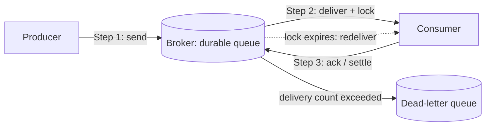

**Real-world use.** Order intake, e-mail/SMS sending, report generation, image processing, ETL staging,
integration with a slow legacy system.

**When to use / NOT.** Use when the work can complete later, when load is spiky, or when the consumer is
less available than the producer. Do **not** use when the caller needs the answer to continue (use a
synchronous call or request-reply deliberately), for huge binary payloads (use blob + claim check), or as a
database (queues are not queryable stores).

**Pros / cons.** + resilience, smoothing, decoupling, independent scaling. − eventual consistency,
operational surface (DLQ, monitoring), at-least-once duplicates, harder debugging/tracing, ordering caveats.

**Common mistakes.** Treating a queue as a database; unbounded retry loops; no idempotency; no
monitoring on queue depth/age; putting 5 MB payloads in the message.

**Perf / scale / reliability / security.** Throughput is limited by broker entity limits and consumer
concurrency; reliability comes from replication + settlement semantics; secure with TLS, identity-based
authorization (RBAC), private networking.

**Troubleshooting.** First questions: depth growing? oldest-message age growing? DLQ growing? consumer
errors? lock lost? (See [§43](#43-troubleshooting-playbook).)

**Related.** [Integration and communication patterns](../03-architectural-patterns/integration-and-communication-patterns.md),
[Distributed systems patterns](../03-architectural-patterns/distributed-systems-patterns.md).

**Interview Q&A.**
- *Q: Queue vs. direct HTTP call?* A: A queue buys temporal decoupling and load smoothing at the price of
  eventual consistency and extra operations. If the caller needs the result now, a queue is the wrong
  default; if the work can be deferred or must survive consumer outages, it is the right one.
- *Follow-up: "Doesn't the queue just move the failure?"* A: It moves it from the user-facing path to a
  place where you can retry, alert and replay. But you must design for poison messages and capacity, or
  you only hide the failure until the queue is huge.

---

## 2. Point-to-point messaging

**Simple idea.** One sender, one *kind* of receiver, and each message is handled by exactly **one**
receiver — even if there are ten receivers waiting. Like a ticket counter with several clerks: each
customer is served by one clerk.

**Architect depth.** Point-to-point = a **queue** with one logical consumer *group*. Multiple instances of
that group compete for messages (see [Competing consumers](#33-competing-consumers)). It models
**commands** ("ChargeCard", "GenerateInvoice"): the sender intends a specific action and knows
roughly who does it, though not which instance.

**Why it exists.** Work distribution and guaranteed single handling (modulo at-least-once) of a task.

**Internals.** The broker hands each message to one receiver at a time (lock). The message is invisible to
other receivers until settled or the lock expires.

**C# (Service Bus queue send/receive minimal).**

```csharp
await using var client = new ServiceBusClient("my-ns.servicebus.windows.net", new DefaultAzureCredential());
ServiceBusSender sender = client.CreateSender("invoices");
await sender.SendMessageAsync(new ServiceBusMessage(BinaryData.FromObjectAsJson(new { OrderId = 42 }))
{
    MessageId = "order-42-invoice",
    Subject   = "GenerateInvoice"
});

ServiceBusReceiver receiver = client.CreateReceiver("invoices");
var msg = await receiver.ReceiveMessageAsync(TimeSpan.FromSeconds(5));
if (msg is not null) await receiver.CompleteMessageAsync(msg);
```

**Real-world.** Invoice generation, payment capture commands, thumbnail generation.
**When NOT.** When more than one independent system needs the same message → pub/sub.
**Mistakes.** Using one queue for many unrelated message types (hard to scale/poison-isolate);
assuming a specific instance handles a given message.
**Interview.** *Q: Is point-to-point the same as "only one consumer process"?* A: No — one logical
consumer, many competing instances; each message goes to exactly one of them.

---

## 3. Publish/Subscribe messaging

**Simple idea.** A newspaper: the publisher prints once, every subscriber gets their own copy.

**Architect depth.** Pub/sub = a **topic** + per-consumer **subscriptions**. Each subscription is its own
queue with its own cursor, lock state, DLQ and filters. It models **events** ("OrderPlaced"): the
publisher states a fact and is *ignorant* of subscribers. That inversion of dependency (publisher doesn't
know consumers) is the architectural value; the price is that you lose easy answers to "who reacted to
this and did it work?"

**Why it exists.** To add new reactions to an event without modifying the producer (open/closed at system
level).

**Internals (Service Bus).** The broker evaluates each subscription's rules on publish and *copies* the
message into every matching subscription's store. So storage and cost scale with fan-out. A slow
subscriber only fills its own subscription, never blocking others.

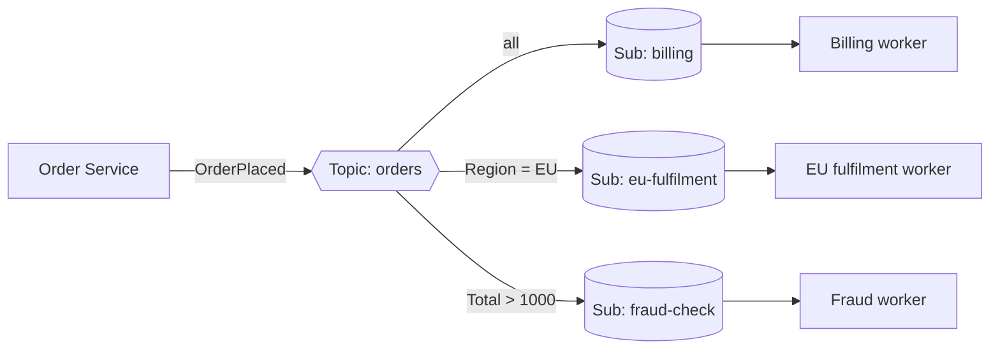

**Real-world.** Domain events fan out to billing, search indexing, notifications, analytics.
**When NOT.** Only one consumer and it is a command → queue. Need replayable history of every event for
new subscribers → log-based streaming (Event Hubs / Kafka), because a topic does not retain consumed
messages.
**Trade-offs.** + extensibility; − invisible coupling through message contracts, eventual consistency,
fan-out cost, harder end-to-end tracing.
**Mistakes.** Publishing "commands" on topics; publishing massive payloads to every subscriber; changing
event contracts without versioning.
**Interview.** *Q: Does a late subscriber receive old events?* A: Not in Service Bus — a subscription only
receives messages published *after* it exists. For replay you need a log (Event Hubs, event store).

---

## 4. Synchronous versus asynchronous communication

**Simple idea.** Sync = phone call (both on the line, wait for answer). Async = e-mail (send, continue,
answer arrives later).

**Architect depth.**

| Dimension | Synchronous (HTTP/gRPC) | Asynchronous (broker) |
|---|---|---|
| Coupling | Temporal + availability | Contract only |
| Latency to caller | Includes callee time | Enqueue time only |
| Failure | Propagates immediately (cascading) | Absorbed, retried, dead-lettered |
| Consistency | Easier (immediate) | Eventual |
| Back-pressure | Caller times out / circuit breaks | Queue grows |
| Debugging | Simple stack/trace | Needs correlation + tracing |
| Throughput shaping | Caller-driven | Consumer-driven |

*Availability math:* a chain of N synchronous dependencies each with availability *a* yields ≈ *aᴺ*
(five 99.9 % services ≈ 99.5 %). Async decouples that product.

**When sync.** Queries, user waiting on a result, strong-consistency validation. **When async.** Commands
that can be deferred, notifications, long work, integration across unreliable boundaries.

**Mistakes.** "Async over sync" — wrapping a request/response in a queue and then blocking the caller
waiting for the reply (all the complexity, none of the benefit); mixing both without a clear rule.

**Hybrid answer (good in interviews):** *accept synchronously, process asynchronously* — return `202
Accepted` with a status URL, enqueue the work, let the client poll or receive a callback/webhook
(see [Webhooks guide](../12-webhooks-and-event-based-integration/webhooks-and-event-based-integration.md)).

```csharp
app.MapPost("/orders", async (CreateOrder cmd, ServiceBusClient client) =>
{
    var sender = client.CreateSender("orders-commands");
    await sender.SendMessageAsync(new ServiceBusMessage(BinaryData.FromObjectAsJson(cmd)) { MessageId = cmd.OrderId.ToString() });
    return Results.Accepted($"/orders/{cmd.OrderId}/status");
});
```

**Interview.** *Q: Why not make everything async?* A: Because eventual consistency, tracing cost and
operational overhead are real; use async where decoupling pays for itself.

---

## 5. Message broker architecture

**Simple idea.** The broker is the post office: it accepts, stores, sorts and delivers mail so senders
and receivers never meet.

**Architect depth.** A broker provides: **protocol endpoints** (AMQP 1.0, HTTPS; Service Bus also
supports AMQP over WebSockets on 443), **entities** (queues/topics/subscriptions), **storage + replication**
(Service Bus persists to replicated storage before acking), **delivery engine** (locks, delivery counts,
sessions, scheduling), **routing** (filters, auto-forwarding), and **control plane** (ARM, RBAC, quotas).

**Two broker families (know the difference).**
- **Message brokers** (Service Bus, RabbitMQ, ActiveMQ): per-message state, per-message ack, rich
  delivery semantics (DLQ, TTL, sessions, scheduling). Consumed messages are *removed*.
- **Log/stream brokers** (Event Hubs, Kafka): append-only partitioned log; consumers track an *offset*;
  messages remain until retention expires; replayable; ordering per partition.

**Service Bus internals worth knowing.**
- **AMQP 1.0** links with credit-based flow: the client grants *credit* (this is what `PrefetchCount`
  controls) and the broker pushes up to that many messages.
- **Message store** is a replicated, durable store; in Premium it is dedicated (isolated CPU/memory per
  *messaging unit*), in Standard it is shared multi-tenant (hence throttling).
- **Auto-forwarding** chains entities server-side (queue/subscription → another queue/topic) — used to
  fan-in or to build a single processing queue from many subscriptions.
- **Geo-disaster recovery** pairs two namespaces and replicates *metadata only* (entity definitions), with
  an alias DNS name that flips on failover; **geo-replication** (Premium) replicates data as well
  **(verify current availability and RPO characteristics)**.

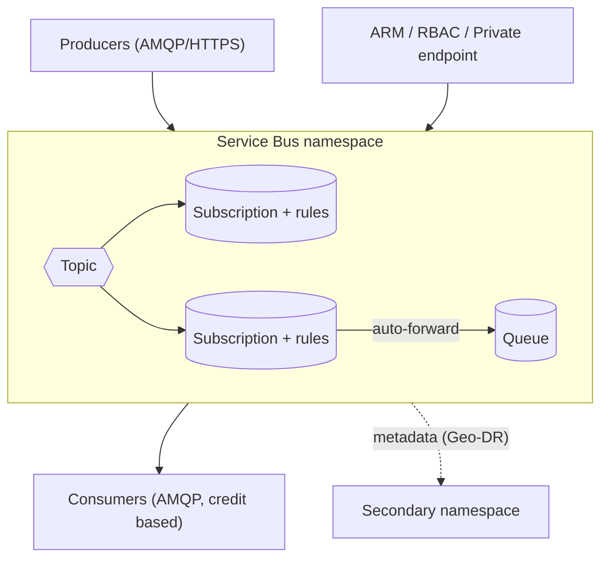

**When to choose a broker.** Reliable task/command delivery, enterprise integration, transactional
semantics, per-message control. **When not.** High-volume telemetry/stream analytics → Event Hubs/Kafka.
**Mistakes.** Using one namespace for everything incl. noisy workloads on Standard; ignoring that Standard
is shared and throttled.

---

## 6. Event-driven systems

**Simple idea.** Services announce *what happened*; others decide what to do about it.

**Architect depth.** Event-driven architecture (EDA) organises systems around **events** (immutable facts
in past tense). Distinguish:
- **Command** — intent, directed, one handler may reject it ("PlaceOrder").
- **Event** — fact, broadcast, cannot be rejected ("OrderPlaced").
- **Query/Reply** — request for data.

Styles: **event notification** (thin event, consumers call back), **event-carried state transfer** (fat
event), **event sourcing** (events are the source of truth), and **choreography vs orchestration** of
sagas. Details live in the [Event-Driven Architecture](../02-architectural-styles/04-event-driven-architecture/event-driven-architecture.md)
and [Saga](../03-architectural-patterns/01-SAGA-pattern/SAGA-pattern.md) guides; this guide supplies the
Azure transport mechanics.

**Why it exists.** Autonomy, scalability, extensibility, audit.
**Trade-offs.** Eventual consistency, hard-to-see flows ("who listens to this?"), schema governance,
duplicate/out-of-order handling.
**Mistakes.** "Event" names that are really commands (`SendEmail`); events with no owner/versioning;
chatty micro-events; no correlation id; hidden temporal coupling (consumer assumes another consumer ran
first).
**Interview.** *Q: How do you keep an event-driven system debuggable?* A: correlation ids and W3C trace
context in every message, a central telemetry store (Application Insights/Log Analytics), event catalog
with owners and schemas, DLQ alerting, and dashboards for depth/age per subscription.

---

## 7. Message delivery guarantees

**Simple idea.** What does the broker promise if things crash mid-way?

| Guarantee | Meaning | How achieved | Risk |
|---|---|---|---|
| **At-most-once** | 0 or 1 delivery | Delete on delivery (Receive-and-Delete) | Message **loss** on consumer crash |
| **At-least-once** | 1..n deliveries | Lock + explicit ack; redeliver on timeout (Peek-Lock) | **Duplicates** |
| **Exactly-once (delivery)** | Exactly 1 | Not achievable end-to-end in general | — |
| **Exactly-once *effect*** | Duplicates occur but effect applied once | At-least-once + idempotent consumer (+ duplicate detection) | Needs design discipline |

**Architect depth.** Two-generals problem: after sending a message and not receiving an ack, a sender cannot
distinguish "lost request" from "lost ack". Hence real systems pick at-least-once and make receivers
idempotent. Service Bus offers building blocks:
- **Peek-Lock** → at-least-once.
- **Duplicate detection** on `MessageId` (producer-side dedup within a time window) removes duplicates
  caused by *producer retries*.
- **Transactions** (`TransactionScope` / `EnableCrossEntityTransactions`) make *receive + send* (and
  settle) atomic **within one namespace** — useful for forwarding/transformation steps.
- It does **not** make your database write and your `Complete` atomic. That gap is why you need an
  **inbox** (see [§39](#39-inbox--service-bus)) or natural idempotency.

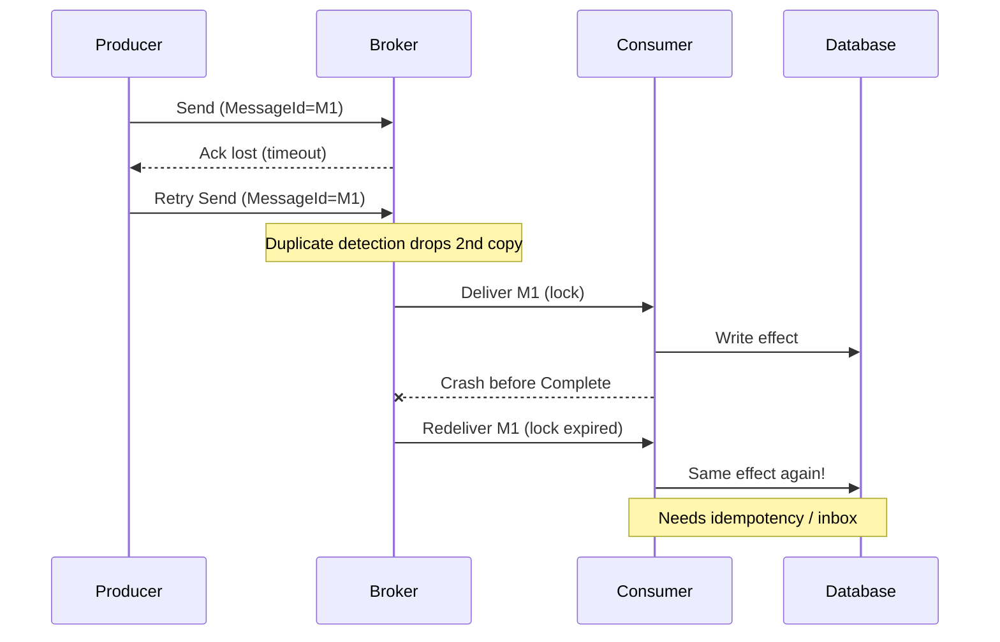

**Mistakes.** Claiming "Service Bus is exactly-once" (it is not, end-to-end); using Receive-and-Delete
for important work; enabling duplicate detection and assuming consumers no longer need idempotency.
**Interview — challenging follow-up.** *"Can you guarantee exactly-once?"* A: Not delivery. I guarantee
exactly-once *effect*: producer retry → duplicate detection with a deterministic MessageId; consumer
redelivery → idempotent handler / inbox table with a unique key written in the same DB transaction as
the business change; cross-service consistency → outbox + saga with compensation.

---

# Part B — Azure Service Bus

## 8. Service Bus overview, tiers and client setup

**Simple idea.** Service Bus is Azure's managed enterprise message broker: queues for one-consumer work,
topics for fan-out, with reliability features (DLQ, sessions, duplicate detection, scheduling,
transactions).

**Tiers (verify current).**

| Aspect | Basic | Standard | Premium |
|---|---|---|---|
| Queues | Yes | Yes | Yes |
| Topics / subscriptions | No | Yes | Yes |
| Resources | Shared | Shared (multi-tenant, throttled) | **Dedicated** (messaging units) |
| Max message size | 256 KB | 256 KB | up to **100 MB** (AMQP; verify current) |
| Private endpoints / VNet | No | No | **Yes** |
| Geo-DR / geo-replication | No | No | **Yes** |
| Pricing | per operation | per operation + base | per messaging unit-hour |
| Predictable latency/throughput | No | No | **Yes** |

**Architect depth.** Standard is cheap and fine for moderate workloads but shares capacity, so you can be
throttled (`ServerBusyException` / HTTP 429-like behaviour). Premium gives isolation, private networking,
bigger messages, JMS 2.0, and CMK. Many enterprises *mandate* Premium for production because of private
endpoints and predictable performance. Use Standard for dev/test or non-critical workloads.

**Client setup (the right way).** Create **one `ServiceBusClient` per namespace and reuse it** — it owns the
AMQP connection; senders/processors are lightweight and created from it. Authenticate with **Managed
Identity / Entra ID**, not SAS connection strings.

```csharp
// Program.cs
builder.Services.AddAzureClients(b =>
{
    b.AddServiceBusClientWithNamespace("my-ns.servicebus.windows.net");
    b.UseCredential(new DefaultAzureCredential());          // MI in Azure, dev login locally
    b.ConfigureDefaults(o => o.Retry.Mode = Azure.Core.RetryMode.Exponential);
});

// Typed sender registration
builder.Services.AddSingleton(sp =>
    sp.GetRequiredService<ServiceBusClient>().CreateSender("orders-commands"));
```

**Provisioning (Bicep).**

```bicep
param location string = resourceGroup().location
resource ns 'Microsoft.ServiceBus/namespaces@2024-01-01' = {   // verify current API version
  name: 'sb-orders-prod'
  location: location
  sku: { name: 'Premium', tier: 'Premium', capacity: 1 }       // messaging units
  properties: { disableLocalAuth: true, minimumTlsVersion: '1.2', publicNetworkAccess: 'Disabled' }
}
resource q 'Microsoft.ServiceBus/namespaces/queues@2024-01-01' = {
  parent: ns
  name: 'orders-commands'
  properties: {
    lockDuration: 'PT1M'
    maxDeliveryCount: 10
    defaultMessageTimeToLive: 'P1D'
    deadLetteringOnMessageExpiration: true
    requiresDuplicateDetection: true
    duplicateDetectionHistoryTimeWindow: 'PT10M'
  }
}
```

```powershell
# RBAC: give the app's managed identity send + receive on one queue (least privilege)
$scope = (az servicebus queue show -g rg-orders --namespace-name sb-orders-prod -n orders-commands --query id -o tsv)
az role assignment create --assignee <principalId> --role "Azure Service Bus Data Receiver" --scope $scope
az role assignment create --assignee <principalId> --role "Azure Service Bus Data Sender"   --scope $scope
```

`disableLocalAuth: true` forces Entra-only access (no SAS keys to leak).

**Why it exists / when NOT.** Use for reliable, enterprise-grade async messaging. Don't use for
streaming telemetry (Event Hubs), reactive platform events (Event Grid), or trivial storage-queue needs
(Azure Storage Queues: cheaper, simpler, no sessions/topics/DLQ-rich features).

**Mistakes.** Creating a `ServiceBusClient` per message (connection storm, port/socket exhaustion); using
a namespace-level SAS key in every app; forgetting to dispose the client on shutdown.

---

## 9. Service Bus Queues

**Simple idea.** A named, durable, first-in-first-out-ish buffer with one logical consumer group.

**Architect depth / internals.** A queue stores messages with `SequenceNumber` (broker-assigned,
monotonic per entity) and `EnqueuedTimeUtc`. Key per-queue settings: `LockDuration` (default 1 min, max 5 min),
`MaxDeliveryCount` (default 10), `DefaultMessageTimeToLive`, `DeadLetteringOnMessageExpiration`,
`RequiresDuplicateDetection`, `RequiresSession`, `MaxSizeInMegabytes` (entity quota, e.g. up to 80 GB —
verify current), `EnablePartitioning` (Standard legacy partitioned entities; verify current),
`ForwardTo` / `ForwardDeadLetteredMessagesTo`. Several of these (sessions, duplicate detection,
partitioning) are **immutable after creation** — decide up front.

**Receiving (processor in a hosted service).**

```csharp
public sealed class OrderCommandWorker(ServiceBusClient client, IServiceScopeFactory scopes,
                                       ILogger<OrderCommandWorker> log) : BackgroundService
{
    protected override async Task ExecuteAsync(CancellationToken ct)
    {
        await using var processor = client.CreateProcessor("orders-commands", new ServiceBusProcessorOptions
        {
            AutoCompleteMessages = false,          // we settle explicitly after success
            MaxConcurrentCalls = 8,
            PrefetchCount = 16,
            MaxAutoLockRenewalDuration = TimeSpan.FromMinutes(5),
            ReceiveMode = ServiceBusReceiveMode.PeekLock
        });

        processor.ProcessMessageAsync += async args =>
        {
            using var scope = scopes.CreateScope();                 // scoped services per message
            var handler = scope.ServiceProvider.GetRequiredService<IOrderCommandHandler>();
            await handler.HandleAsync(args.Message, args.CancellationToken);
            await args.CompleteMessageAsync(args.Message, args.CancellationToken);
        };
        processor.ProcessErrorAsync += args =>
        {
            log.LogError(args.Exception, "SB error {Source} {Entity}", args.ErrorSource, args.EntityPath);
            return Task.CompletedTask;
        };

        await processor.StartProcessingAsync(ct);
        try { await Task.Delay(Timeout.Infinite, ct); } catch (OperationCanceledException) { }
        await processor.StopProcessingAsync();      // graceful: finish in-flight messages
    }
}
```

**Real-world.** Command queues per bounded context: `orders-commands`, `payments-commands`.
**When NOT.** Multiple independent consumers of the same message → topic.
**Pros/cons.** + simple mental model, DLQ built in; − single logical consumer, immutable settings.
**Mistakes.** One mega-queue for all message types; relying on defaults (lock 1 min) for 10-minute handlers;
forgetting graceful shutdown (in-flight messages' locks lapse and they are redelivered).
**Interview.** *Q: What do you decide at queue-creation time that you cannot change later?* A: Whether it
requires sessions, duplicate detection, and (legacy) partitioning — plus the entity's tier-specific
constraints. Plan these up front; changing means recreating and migrating the entity.

---

## 10. Topics and topic subscriptions

**Simple idea.** A topic is a mailing list; each subscription is one subscriber's private inbox, which
can filter what it wants.

**Architect depth / internals.**
- A **topic** accepts messages but has no receive path of its own; only **subscriptions** do.
- A **subscription** is effectively a *virtual queue* with its own `LockDuration`, `MaxDeliveryCount`,
  TTL, DLQ (`<topic>/Subscriptions/<sub>/$deadletterqueue`), sessions setting, and **rules**.
- A new subscription is created with a default **TrueFilter** rule (`$Default`) → receives everything
  until you replace it.
- On publish, the broker evaluates rules per subscription and **stores a copy per match**. Fan-out of
  N subscriptions ⇒ N stored copies (cost, throughput, topic size).
- Subscriptions see **only messages published after creation**.
- Limits (verify current): subscriptions per topic (~2 000), rules per subscription, filter complexity.

```csharp
// Publish an event to a topic
ServiceBusSender sender = client.CreateSender("orders-events");
var evt = new ServiceBusMessage(BinaryData.FromObjectAsJson(new OrderPlaced(orderId, total, "EU")))
{
    MessageId = $"OrderPlaced-{orderId}",
    Subject = "OrderPlaced",
    ContentType = "application/json",
    ApplicationProperties = { ["eventVersion"] = 1, ["region"] = "EU", ["total"] = 1250m }
};
await sender.SendMessageAsync(evt);

// Consume from one subscription
ServiceBusProcessor p = client.CreateProcessor("orders-events", "billing");
```

```bicep
resource topic 'Microsoft.ServiceBus/namespaces/topics@2024-01-01' = {
  parent: ns
  name: 'orders-events'
  properties: { defaultMessageTimeToLive: 'P7D', requiresDuplicateDetection: true }
}
resource subBilling 'Microsoft.ServiceBus/namespaces/topics/subscriptions@2024-01-01' = {
  parent: topic
  name: 'billing'
  properties: { lockDuration: 'PT2M', maxDeliveryCount: 10, deadLetteringOnMessageExpiration: true }
}
```

**Real-world.** `orders-events` → billing, shipping, search-index, notifications, analytics subscriptions.
**When NOT.** Single consumer; or need replay for new consumers (use Event Hubs/event store).
**Mistakes.** Forgetting that a new subscription starts empty (late subscribers miss history); leaving the
default `TrueFilter` on a subscription that was meant to be filtered; one subscription shared by
different services (they then *compete*, not each get a copy).
**Troubleshooting.** "Consumer X didn't get event" → check subscription existed at publish time, rules
(SQL filter references property that isn't set → no match), and that the publisher actually set
the property (not the body!).

---

## 11. Subscription filters and rule actions

**Simple idea.** A filter is a bouncer at each subscription's door; a rule action is a stamp the bouncer
adds on the way in.

**Architect depth.** Three filter types:

| Filter | Evaluates | Cost / use |
|---|---|---|
| **Boolean** (`TrueFilter`/`FalseFilter`) | always / never | default rule; disabling a sub temporarily |
| **SQL filter** (`SqlRuleFilter`) | SQL-92 subset over **system + application properties** | flexible; most expensive |
| **Correlation filter** (`CorrelationRuleFilter`) | equality on `CorrelationId`, `Subject`, `To`, `ReplyTo`, `ContentType`, `MessageId`, `SessionId`, custom properties | **fastest**; prefer when equality suffices |

Filters **cannot inspect the body** — only properties. Hence the discipline "route on properties, carry data
in the body".

A **rule action** (`SqlRuleAction`) mutates properties of the *copy* going into that subscription (e.g.
`SET sys.Label='priority'`, `SET Region='EU'`) — useful for tagging or normalising per consumer. Multiple
rules on one subscription are **OR-ed**; if several match, the subscription still gets **one** copy
(rule actions apply per matching rule; verify exact semantics when you rely on them).

```csharp
var admin = new ServiceBusAdministrationClient("my-ns.servicebus.windows.net", new DefaultAzureCredential());

await admin.CreateSubscriptionAsync(
    new CreateSubscriptionOptions("orders-events", "eu-fulfilment"),
    new CreateRuleOptions("EuOnly", new CorrelationRuleFilter { ApplicationProperties = { ["region"] = "EU" } }));
// remove default rule so it doesn't match everything
await admin.DeleteRuleAsync("orders-events", "eu-fulfilment", "$Default");

await admin.CreateSubscriptionAsync(
    new CreateSubscriptionOptions("orders-events", "fraud"),
    new CreateRuleOptions("Big", new SqlRuleFilter("total > 1000 AND eventVersion >= 1"))
    { Action = new SqlRuleAction("SET priority = 'high'") });
```

```powershell
az servicebus topic subscription rule create -g rg --namespace-name sb --topic-name orders-events `
  --subscription-name fraud -n Big --filter-sql-expression "total > 1000"
```

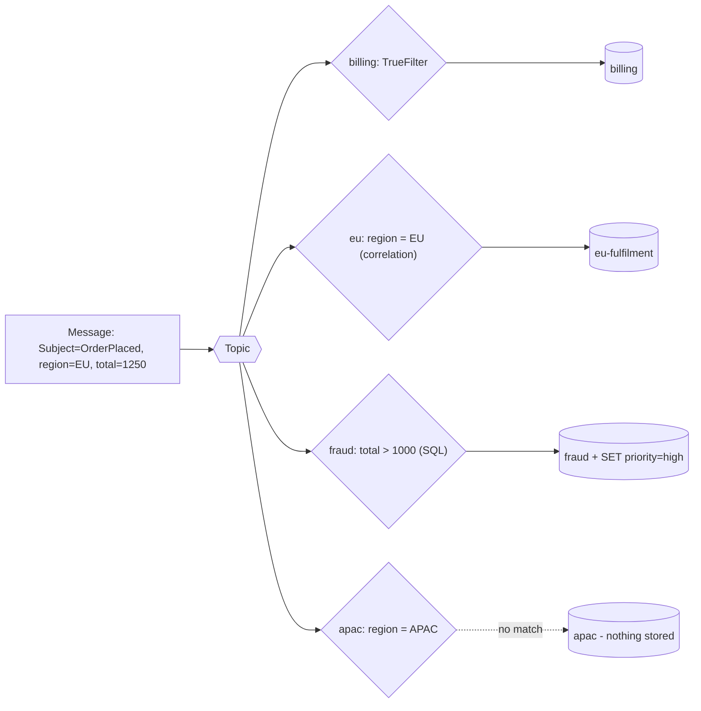

**Perf.** Rule evaluation happens on the publish path; hundreds of SQL rules per topic can slow publishing
and reduce throughput. Prefer **correlation filters**; keep rule count modest; for heavy routing consider
splitting topics or routing in a consumer.
**Mistakes.** Filtering on a property the publisher forgot to set; leaving `$Default` rule in place;
type mismatches in SQL filters (string vs number); using filters for *authorization* (they are routing,
not security).
**Troubleshooting.** Enable filter-evaluation dead-lettering (`EnableDeadLetteringOnFilterEvaluationExceptions`)
and inspect DLQ reason `FilterEvaluationException`; use Service Bus Explorer to peek a subscription.
**Interview.** *Q: Correlation vs SQL filter?* A: Correlation = equality, evaluated cheaply (hash-style
matching); SQL = expressive (ranges, AND/OR/IN/LIKE) but costlier. Use correlation by default, SQL only
for genuine expression needs.

---

## 12. Queue versus Topic

| Question | Queue | Topic + subscriptions |
|---|---|---|
| Who gets a message? | One consumer (competing) | Every matching subscription |
| Message kind | Command (do this) | Event (this happened) |
| Producer knows consumer? | Loosely (target queue) | No |
| Add a new consumer | Changes the competing set, or needs another queue | Add a subscription; no producer change |
| Storage cost | 1 copy | 1 per matching subscription |
| Filtering | No | Yes (rules) |
| Tier | Basic+ | Standard+ |
| Replay for new consumer | No | No (subscription starts empty) |

**Decision heuristic.** *Command → queue. Event → topic.* If there is exactly one consumer today but the
message is a fact others may care about tomorrow, publish to a topic with one subscription — adding the
second consumer is then free.
**Anti-pattern.** Topic with a single subscription and commands in it "just in case" (adds fan-out
machinery with no benefit and blurs intent).
**Interview.** *Q: Can I use a queue and still have two consumers?* A: Only as competing instances of one
consumer; to give two different services each the message use a topic, or have the producer send to two
queues (couples producer to consumers).

---

## 13. Receive modes: Peek-Lock and Receive-and-Delete

**Simple idea.** *Peek-Lock*: the clerk borrows the letter, you read it, then tell the post office "done".
*Receive-and-Delete*: the letter is shredded the moment you take it.

**Architect depth.**

| | Peek-Lock (default) | Receive-and-Delete |
|---|---|---|
| Broker action on receive | Sets a **lock** (message stays, invisible) | **Deletes** immediately |
| Guarantee | **At-least-once** | **At-most-once** |
| Consumer crash mid-processing | Lock expires → redelivery | **Message lost** |
| Settlement calls | Complete/Abandon/DLQ/Defer | None |
| Throughput | Lower (extra round trip to settle) | Higher |
| Deferral, DLQ, retry by count | Yes | No |

**Why both exist.** Loss-tolerant, high-rate, idempotent-by-nature data (telemetry samples, cache
invalidation pings, heartbeat) benefits from R&D's lower overhead; anything with business meaning needs
Peek-Lock.

```csharp
var rd = client.CreateReceiver("cache-invalidations",
    new ServiceBusReceiverOptions { ReceiveMode = ServiceBusReceiveMode.ReceiveAndDelete });
```

**When NOT R&D.** Payments, orders, anything where loss costs money. **Mistake.** Choosing R&D "for
performance" and then adding a retry mechanism — you can't retry a message the broker already deleted.
Better first optimisation: batching, prefetch and concurrency under Peek-Lock.

---

## 14. Message locks and lock renewal

**Simple idea.** While you work on a message you hold a time-limited reservation. If you don't finish or
renew before it expires, someone else gets the message.

**Architect depth / internals.**
- The lock is **broker-side and per message**, identified by a `LockToken`; duration =
  entity `LockDuration` (default 60 s, max 5 min).
- On expiry the message becomes Active again, `DeliveryCount` increments, and settlement of the *old* lock
  fails with `MessageLockLostException`/`ServiceBusFailureReason.MessageLockLost`.
- **Auto-renewal** is a *client-side* feature of the processor: it periodically calls `RenewMessageLock`
  until `MaxAutoLockRenewalDuration` (default 5 min) elapses. Renewal needs a live AMQP link; it does not
  survive a connection drop (then the lock is lost and the message is redelivered).
- The lock timer includes **time spent in the client's prefetch buffer**. With a large `PrefetchCount` and
  slow processing, locks can expire before your handler ever sees the message.
- Session entities lock the **session** (not the message); renewal applies to the session lock.

**Sizing rule.** `LockDuration` ≥ (p99 processing time + safety); renewal covers outliers. If handlers can
legitimately run > 5 min, don't extend locks indefinitely — redesign: hand off long work to a
workflow/durable function and complete the message quickly.

```csharp
var opts = new ServiceBusProcessorOptions
{
    MaxAutoLockRenewalDuration = TimeSpan.FromMinutes(10), // covers long handler; must be >= worst case
    PrefetchCount = 0,                                     // avoid lock aging in buffer for slow handlers
    MaxConcurrentCalls = 4
};
// Manual renewal (receiver API) when you aren't using the processor
await receiver.RenewMessageLockAsync(message);
```

**Mistakes.** Handler time > lock with no renewal → duplicate processing and, after
`MaxDeliveryCount`, a *false* poison classification; huge prefetch with slow handlers; assuming settlement
after lock loss "mostly works".
**Troubleshooting.** `MessageLockLost` spikes ⇒ compare handler duration p99 to lock duration; check
thread-pool starvation (handler delayed before it even runs); check `PrefetchCount`; check deploys that
kill pods without graceful stop.
**Interview.** *Q: A message is processed twice although my handler succeeded both times. Why?* A: Lock
expired mid-handler (or completion failed due to a connection blip), so the broker redelivered. Fix
timing/renewal, and — regardless — make the handler idempotent.

---

## 15. Settlement: Complete, Abandon, Dead-letter, Defer

**Simple idea.** After reading the letter you must tell the post office what happened to it.

| Settlement | Effect | Delivery count | Use when |
|---|---|---|---|
| **Complete** | Removed permanently | — | Success |
| **Abandon** | Lock released; immediately redeliverable | **+1** | Transient failure, retry soon |
| **Dead-letter** | Moved to DLQ with reason/description | — | Cannot ever succeed / needs human |
| **Defer** | Stays in queue but excluded from normal receive; retrievable **only by SequenceNumber** | — | Out-of-order arrival; process later |

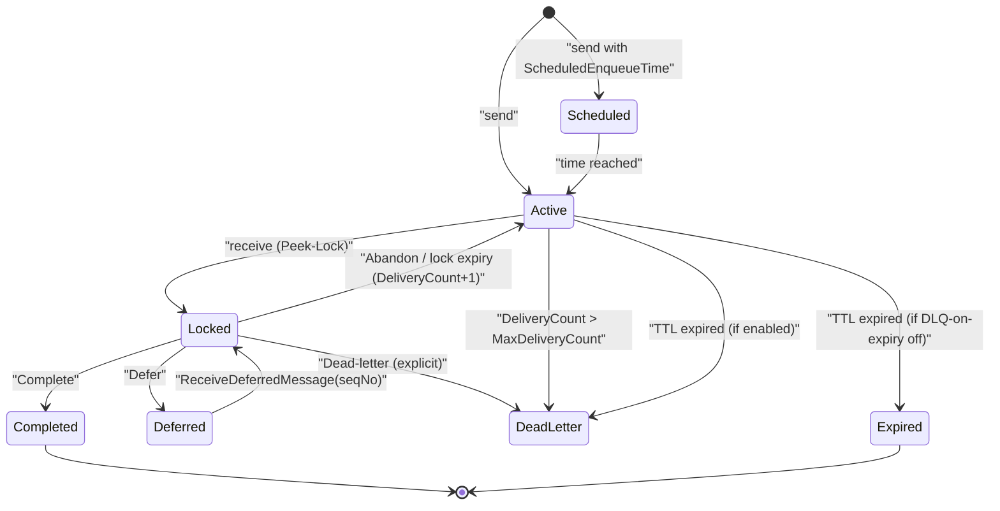

```csharp
processor.ProcessMessageAsync += async args =>
{
    try
    {
        await handler.HandleAsync(args.Message);
        await args.CompleteMessageAsync(args.Message);
    }
    catch (ValidationException ex)                       // permanent: retrying cannot help
    {
        await args.DeadLetterMessageAsync(args.Message,
            deadLetterReason: "ValidationFailed", deadLetterErrorDescription: ex.Message);
    }
    catch (TransientException)                           // transient: let broker redeliver
    {
        await args.AbandonMessageAsync(args.Message);    // DeliveryCount+1
    }
    // any other exception: processor's default => abandon (when AutoComplete is off, lock released on lock expiry)
};
```

**Important behaviour.** If `ProcessMessageAsync` throws and you did not settle, the processor abandons the
message for you (when `AutoCompleteMessages` is true it completes on *success* and abandons on exception).
**Mistakes.** Leaving `AutoCompleteMessages = true` while doing fire-and-forget work inside the handler
(message completed before the work finished → loss); abandoning permanent failures until
`MaxDeliveryCount` burns CPU; dead-lettering without a useful reason; swallowing exceptions inside the
handler so the message is "successfully" completed.
**Interview.** *Q: Abandon vs Defer?* A: Abandon = "I couldn't, give it back (retry)"; it returns to the
normal flow and increments delivery count. Defer = "I can't process it *yet*" — it leaves the normal flow
and I must remember its `SequenceNumber` to fetch it later.

---

## 16. MaxDeliveryCount, Dead-Letter Queue and poison messages

**Simple idea.** If a message fails N times, stop retrying and put it in a "problem" box so it doesn't
block everything or loop forever.

**Architect depth / internals.**
- `DeliveryCount` increments on each delivery attempt that ends in Abandon or lock expiry.
- When it exceeds **`MaxDeliveryCount`** (default 10), the broker moves it to the **DLQ** with
  `DeadLetterReason = MaxDeliveryCountExceeded`.
- Every queue and every subscription has its own **DLQ sub-queue**:
  `orders-commands/$deadletterqueue`, `orders-events/Subscriptions/billing/$deadletterqueue`.
- Other automatic DLQ causes: TTL expiry (if `DeadLetteringOnMessageExpiration`), filter-evaluation errors
  (if enabled), `HeaderSizeExceeded`. Explicit: your code calls `DeadLetterMessageAsync`.
- A DLQ has **no TTL/auto-expiry**, cannot be dead-lettered again, and counts toward entity size.
- A **poison message** is one that deterministically fails (malformed payload, schema mismatch, bug,
  permanently-missing reference). Retrying is futile and — without a DLQ — it would block the consumer
  or burn resources forever.

```csharp
// Reading the DLQ
var dlq = client.CreateReceiver("orders-commands", new ServiceBusReceiverOptions { SubQueue = SubQueue.DeadLetter });
await foreach (var m in dlq.ReceiveMessagesAsync())
{
    Console.WriteLine($"{m.MessageId} reason={m.DeadLetterReason} desc={m.DeadLetterErrorDescription} delivery={m.DeliveryCount}");
}
```

**Real-world.** Bad deploy produces schema-incompatible handler → thousands of messages hit
MaxDeliveryCount → DLQ → alert → fix → **replay** (see [§25](#25-dlq-monitoring-and-replay)).
**When to tune MaxDeliveryCount.** Lower (3–5) when failures are mostly permanent and handlers are
expensive; higher when downstream blips are common — but prefer *app-level backoff* over raw
delivery count (see [§24](#24-retry-and-exponential-backoff)).
**Mistakes.** Treating DLQ as a trash bin (no alert, no owner, no runbook); `MaxDeliveryCount=int.Max`
(effectively infinite loop); not classifying transient vs permanent errors; DLQ-ing without preserving
enough context for diagnosis.
**Troubleshooting.** Group DLQ messages by `DeadLetterReason` + `DeadLetterErrorDescription`; look for a
single deploy timestamp; sample payloads; compare `EnqueuedTimeUtc` to release time.
**Interview — follow-up.** *"What if the DLQ itself fills?"* A: It counts toward entity quota; when the
entity is full, sends fail. Hence alert on DLQ depth and have an automated triage/replay path.

---

## 17. Duplicate detection

**Simple idea.** The broker remembers recent `MessageId`s and silently drops a second message with the
same id.

**Architect depth / internals.**
- Enabled **at entity creation** (`RequiresDuplicateDetection`); cannot be toggled later.
- The broker keeps a **history of MessageIds** for `DuplicateDetectionHistoryTimeWindow` (default 10 min,
  up to 7 days — verify current). A send whose `MessageId` is in the window is accepted (the sender gets a
  success) **but not stored**.
- Protects against **producer-side** duplicates (retry after a lost ack, double-click, replayed outbox row).
- It does **nothing** about consumer-side redelivery (lock expiry), and it is only as good as the
  `MessageId` you choose: random GUIDs per send defeat it. Use a **deterministic business key**
  (`OrderPlaced-{orderId}-v1`, or the outbox row id).
- Partitioned/Premium nuance: dedup scope is the entity (verify current for partitioned entities).

```csharp
new ServiceBusMessage(body) { MessageId = outboxRow.Id.ToString("N") }   // same id on every retry
```

**Trade-offs.** + cheap defence for outbox relays; − window-limited, entity-wide id space, small perf cost.
**Mistakes.** `Guid.NewGuid()` as MessageId; assuming it makes the consumer idempotent; window shorter
than your outbox retry horizon.
**Interview.** *Q: Duplicate detection vs idempotent consumer?* A: Complementary. Detection removes
*producer* duplicates inside a time window; idempotent consumers handle *delivery* duplicates forever.

---

## 18. Message TTL

**Simple idea.** A "best before" date on the message.

**Architect depth.** TTL is the minimum of the message's `TimeToLive` and the entity's
`DefaultMessageTimeToLive` (a message cannot outlive its entity's default). After expiry the message is
**silently removed** — unless `DeadLetteringOnMessageExpiration` is on (queues, subscriptions), in which
case it moves to the DLQ with reason `TTLExpiredException`. Expiry is evaluated lazily by the broker; an
expired message that is currently *locked* isn't expired until its lock ends. For scheduled/deferred
messages see their chapters.

**Why use it.** Stale commands are harmful ("send OTP" 1 hour late; "price quote" after price changed).
**Use when** the business value decays; **not** for must-process-eventually work unless DLQ-on-expiry is
on and monitored.

```csharp
new ServiceBusMessage(body) { TimeToLive = TimeSpan.FromMinutes(2) };   // OTP message
```

**Mistakes.** Long entity default TTL (days) + prolonged outage → resurrected stale commands; TTL
without DLQ-on-expiry so business silently loses messages; mismatched TTL vs retry horizon.
**Interview.** *Q: Why would my message vanish with no DLQ entry?* A: TTL expired and
dead-lettering-on-expiration was off (or the message was Receive-and-Delete'd, or a filter dropped it).

---

## 19. Message sessions

**Simple idea.** A session is a "conversation id": all messages with the same `SessionId` are handled **in
order, by one consumer at a time**.

**Architect depth / internals.**
- Entity created with `RequiresSession = true`; every message **must** carry a `SessionId`.
- A consumer *accepts a session* (broker grants a **session lock**); only that consumer receives that
  session's messages, **FIFO**, until it releases or the lock expires. Other consumers get other sessions.
- Therefore: ordering **within** a session, parallelism **across** sessions. This is the Service Bus way
  to get "per-order / per-customer FIFO at scale" — a partitioned-key ordering model.
- **Session state** (`SetSessionStateAsync`, ≤ 256 KB — verify current) lets a consumer keep workflow
  state with the session (e.g. progress of a multi-step saga) without an external store.
- Also underpins **request-reply with sessions** (`ReplyToSessionId`) and message **batching by key**.

```csharp
await using var sp = client.CreateSessionProcessor("orders-ordered", new ServiceBusSessionProcessorOptions
{
    MaxConcurrentSessions = 16,          // parallelism across sessions
    MaxConcurrentCallsPerSession = 1,    // keep 1 for strict ordering
    SessionIdleTimeout = TimeSpan.FromSeconds(30),
    AutoCompleteMessages = false
});
sp.ProcessMessageAsync += async args =>
{
    var state = await args.GetSessionStateAsync();           // optional workflow state
    await handler.HandleAsync(args.Message);
    await args.CompleteMessageAsync(args.Message);
};

// Producer
new ServiceBusMessage(body) { SessionId = order.Id.ToString() };
```

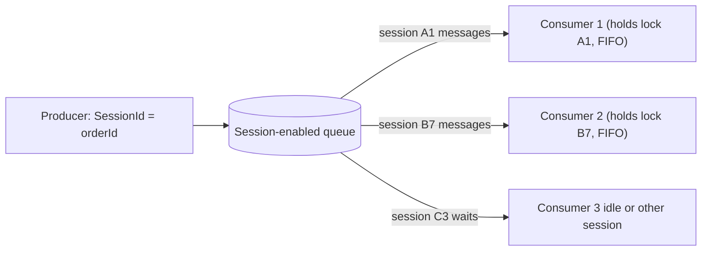

**Real-world.** Per-order state machine; per-device command streams; per-customer ledger updates.
**When NOT.** If order isn't required; if one session key is extremely hot (a single consumer becomes
the bottleneck — **hot session**); if you need many tiny sessions with huge cardinality and consumers
that must poll many (session accept overhead).
**Trade-offs.** + simple FIFO per key, session state; − less throughput per key, session lock management,
idle session cost, consumer count > active sessions leaves consumers idle.
**Mistakes.** Forgetting to set `SessionId` (send fails); `MaxConcurrentCallsPerSession > 1` breaking order;
a single "default" session id for everything (serialises the whole queue); not handling session lock
lost; sessions on topics → each *subscription* must be created with `RequiresSession`.
**Troubleshooting.** Stuck session: the consumer died holding the lock → lock expires → another picks up;
check `SessionLockLost`, idle timeout, hot key skew.
**Interview.** *Q: Sessions vs competing consumers for ordering?* A: Competing consumers give
parallelism but **no ordering**; sessions give **per-key ordering** with parallelism across keys, at the
cost of key-skew sensitivity.

---

## 20. Message ordering

**Simple idea.** "First sent, first processed" — but only under strict conditions.

**Architect depth.** Service Bus guarantees **FIFO** for a single queue/subscription **only if**: one
sender (or ordered sends), one consumer, no abandon/lock-expiry reordering — in practice, guaranteed
through **sessions**. Things that break ordering:
1. **Competing consumers** — message 2 may finish before message 1.
2. **Abandon / lock expiry / retry** — failed message goes back and is reprocessed after later ones.
3. **Defer, scheduled, TTL** — messages leave the normal flow.
4. **Multiple senders / async sends** without awaiting each — arrival order ≠ intended order.
5. **Partitioned entities** (legacy) — order across partitions isn't guaranteed unless a partition/session
   key is used.
6. **Topics with filters** — each subscription is an independent ordered stream.

**Design options.** (a) Sessions keyed by aggregate id; (b) make consumers **order-insensitive** (carry a
version/sequence in the message; discard stale, buffer/defer early); (c) single consumer (kills scale).
Prefer (b)+(a) for aggregate-level correctness: **ordering is a property of an aggregate, not of the
whole system**.

```csharp
// Order-insensitive handler: optimistic concurrency by aggregate version
var incomingVersion = (long)msg.ApplicationProperties["aggregateVersion"];
var rows = await db.Database.ExecuteSqlInterpolatedAsync(
    $"UPDATE Orders SET Status={status}, Version={incomingVersion} WHERE Id={id} AND Version < {incomingVersion}");
// rows == 0 ⇒ stale/duplicate ⇒ safely ignore (complete)
```

**Mistakes.** Assuming "queue = FIFO" under competing consumers; relying on `EnqueuedTimeUtc` for
ordering across senders; global ordering requirements (usually a design smell).
**Interview.** *Q: Do you ever need global ordering?* A: Rarely; I push back and scope ordering to an
aggregate/key, then use sessions or version checks. Global ordering forces a single consumer and caps
throughput.

---

## 21. Scheduled messages

**Simple idea.** "Deliver this at 9:00 tomorrow."

**Architect depth / internals.** Set `ScheduledEnqueueTime` (or call `ScheduleMessageAsync`). The broker
stores the message in a *scheduled* state (invisible) and activates it at the time; the call returns a
**SequenceNumber** you can use to **cancel** (`CancelScheduledMessageAsync`) before activation. Accuracy is
best-effort (seconds-level), not a precision timer. Scheduled messages occupy entity storage and
count toward quota.

```csharp
long seq = await sender.ScheduleMessageAsync(
    new ServiceBusMessage(BinaryData.FromObjectAsJson(new PaymentReminder(invoiceId))),
    DateTimeOffset.UtcNow.AddDays(3));
// invoice paid early:
await sender.CancelScheduledMessageAsync(seq);
```

**Real-world.** Payment reminders, timeouts for sagas (the "if no reply in 15 min, compensate" timer),
delayed retries (**backoff by rescheduling**), SLA escalations.
**When NOT.** Recurring/cron jobs (use Functions timer/Logic Apps/Quartz), thousands of far-future
messages as a poor-man's database (hard to query/cancel by business key → store the sequence number
yourself), precise real-time timing.
**Mistakes.** Losing the `SequenceNumber` so you can't cancel; scheduling millions of long-dated messages;
ignoring that cancel is a race with delivery (handler must tolerate "already paid" arriving anyway).
**Interview.** *Q: How do you implement a saga timeout?* A: Schedule a timeout message when the step
starts, store its sequence number with saga state, cancel on success, and make the timeout handler check
current saga state (idempotent, tolerant of the race).

---

## 22. Deferred messages

**Simple idea.** "I can't deal with this one yet — park it, I'll fetch it by its ticket number."

**Architect depth / internals.** `DeferMessageAsync` leaves the message in the entity but removes it from
normal delivery. It can **only** be retrieved via `ReceiveDeferredMessageAsync(sequenceNumber)`. The broker
does **not** remember you deferred it — **you must persist the `SequenceNumber`** (in a database,
session state, or a "control" message). Deferred messages still count toward quota and still obey TTL
semantics (verify current behaviour re: expiry vs DLQ for deferred messages).

```csharp
// Out-of-order arrival: shipment event arrives before OrderPlaced is processed
if (!await orders.ExistsAsync(evt.OrderId))
{
    await args.DeferMessageAsync(args.Message);
    await deferStore.SaveAsync(evt.OrderId, args.Message.SequenceNumber);   // you must remember it
    return;
}
...
// later, when OrderPlaced is handled
foreach (var seq in await deferStore.TakeAsync(orderId))
{
    var deferred = await receiver.ReceiveDeferredMessageAsync(seq);
    await handler.HandleAsync(deferred);
    await receiver.CompleteMessageAsync(deferred);
}
```

**Real-world.** Resequencing, workflow steps that wait for a prerequisite, rate-limiting/priority lanes.
**When NOT.** If you can simply reschedule (schedule a copy later and complete) — simpler and doesn't
need sequence bookkeeping; or if sessions can enforce ordering.
**Mistakes.** Deferring and losing the sequence numbers → orphaned messages consuming quota forever;
deferring *everything* (a stealth second queue with no visibility).
**Interview.** *Q: Defer vs schedule-a-copy?* A: Defer keeps the original message (preserves
identity/properties, no duplication) but requires external bookkeeping and manual retrieval; scheduling a
copy is stateless and self-healing but creates a new message (new MessageId, new delivery count). I
default to scheduled copies unless I must preserve the original.

---

## 23. Message size and throughput

**Simple idea.** How big can a message be, and how fast can you push them?

**Architect depth (verify current for every number).**
- **Size:** 256 KB (Basic/Standard); Premium up to 100 MB over AMQP (large messages hurt latency,
  memory and prefetch; HTTP/SBMP paths have lower limits). Size includes body + properties/headers.
- **Batch:** `ServiceBusMessageBatch` packs many messages into one send up to the max size; `TryAddMessage`
  tells you when full. Batching is the **single biggest producer throughput lever** (fewer round trips,
  one billable operation per batch call on Standard — verify billing model).
- **Throughput:** Standard is shared → credit-based throttling, variable latency. Premium scales by
  **messaging units (MU: 1, 2, 4, 8, 16)** with dedicated CPU/memory and predictable latency; scale MUs
  up/down (or autoscale on CPU/memory metrics).
- **Partitioning:** legacy partitioned entities spread an entity over multiple brokers (more throughput,
  ordering only per partition key, no cross-partition transactions); Premium partitions are chosen at
  namespace/entity creation and can't be changed later (verify current).
- **Prefetch:** client pulls messages ahead of the handler (credit); boosts receive throughput but ages
  locks.
- **Quotas:** entity max size (1–80 GB, verify), concurrent connections, max topic subscriptions.

**Claim-check pattern for big payloads.** Store payload in Blob Storage; send a small message holding the
blob URI + checksum + metadata.

```csharp
// Producer: claim check
var blob = blobContainer.GetBlobClient($"{orderId}/{Guid.NewGuid():N}.json");
await blob.UploadAsync(BinaryData.FromObjectAsJson(bigDoc));
var msg = new ServiceBusMessage(BinaryData.FromObjectAsJson(new { blobUri = blob.Uri, sha256 })) { Subject = "DocumentReady" };

// Batch send
using ServiceBusMessageBatch batch = await sender.CreateMessageBatchAsync();
foreach (var m in messages)
    if (!batch.TryAddMessage(m)) { await sender.SendMessagesAsync(batch); batch.Dispose(); /* start new */ }
```

**When Premium.** Private networking, >256 KB messages, predictable latency, high sustained throughput,
geo features. **When Standard.** Dev/test, bursty low-volume.
**Mistakes.** Sending one message per call in a loop; storing 5 MB JSON in the body; picking
Premium MUs by guess without load tests; scaling consumers while the *namespace* is the bottleneck (CPU
metric high, `ThrottledRequests` > 0).
**Troubleshooting.** Metrics: `IncomingMessages`, `OutgoingMessages`, `ThrottledRequests`,
`ServerErrors`, Premium `NamespaceCpuUsage`/`NamespaceMemoryUsage` (names: verify). Throttled →
add MUs/batch/partition namespaces by workload.
**Interview.** *Q: Why batch?* A: Amortises network round trips and per-operation overhead; typically
10–100× producer throughput improvement for small messages — at the cost of all-or-nothing batch failures
and slightly higher latency per message.

---

## 24. Retry and exponential backoff

**Simple idea.** If it fails, wait a bit and try again — waiting longer each time.

**Architect depth.** Three *different* retry layers — conflating them is a classic interview error:

| Layer | Who retries | Mechanism |
|---|---|---|
| **SDK transport** | Client library | `ServiceBusRetryOptions` (Exponential, `MaxRetries`, `Delay`, `MaxDelay`, `TryTimeout`) for *Service Bus operations* (send, receive, settle) on transient broker/network faults |
| **Handler-level** | Your code | In-process retry (Polly/`Microsoft.Extensions.Resilience`) around downstream calls, short & bounded |
| **Broker redelivery** | Broker | Abandon/lock expiry → redelivery until `MaxDeliveryCount`. **Immediate**, no backoff! |

Broker redelivery has **no delay** — an abandoned message is available at once, so a failing dependency gets
hammered and `MaxDeliveryCount` burns in seconds. For real backoff you need an **application-level
delayed retry**:

1. **Schedule-a-copy:** on transient failure, send a copy with `ScheduledEnqueueTime = now + backoff(n)`
   and `ApplicationProperties["retryCount"] = n+1`, then **Complete** the original. After N retries →
   dead-letter explicitly.
2. **Retry topology:** `orders` → on failure forward to `orders-retry-1m` (TTL=1 m, auto-forward back) →
   `orders-retry-10m` …
3. **Don't settle, let lock expire** (crude; delay = lock duration; also bumps delivery count).

```csharp
static TimeSpan Backoff(int attempt) =>
    TimeSpan.FromSeconds(Math.Min(300, Math.Pow(2, attempt)) * (0.5 + Random.Shared.NextDouble() / 2)); // jitter

catch (TransientException) when (retry < MaxRetries)
{
    var copy = new ServiceBusMessage(args.Message)             // copies body + props
    {
        MessageId = args.Message.MessageId,                    // keep id (dup detection may drop it within window!)
        ScheduledEnqueueTime = DateTimeOffset.UtcNow + Backoff(retry)
    };
    copy.ApplicationProperties["retryCount"] = retry + 1;
    await sender.SendMessageAsync(copy);
    await args.CompleteMessageAsync(args.Message);
}
catch (TransientException)
{
    await args.DeadLetterMessageAsync(args.Message, "RetriesExhausted", "...");
}
```

> **Gotcha:** if duplicate detection is on and you reuse the same `MessageId` inside the window, the
> retry copy is **dropped**. Use `MessageId = $"{original}-r{retry}"` for retry copies.

**Jitter** avoids synchronized retry storms. **Circuit breaker** around the failing dependency prevents
burning retries (pause the processor: `StopProcessingAsync`, or reduce concurrency).
**Mistakes.** Relying only on `MaxDeliveryCount` as "retry policy"; unbounded retries; no jitter; retrying
permanent errors; retrying non-idempotent operations.
**Interview.** *Q: Where do retries belong?* A: Short bounded in-process retries for blips (Polly), broker
redelivery as a safety net, delayed retries via scheduling for longer outages, then DLQ — each with
metrics, and idempotent handlers underneath.

---

## 25. DLQ monitoring and replay

**Simple idea.** Watch the problem box, and when the cause is fixed, put the messages back.

**Monitoring.**
- **Metrics:** `DeadletteredMessages` (per entity, Azure Monitor) with an **alert** when > 0 (or > baseline)
  for a few minutes; plus `ActiveMessages` growth and **oldest message age** (compute via peek/`EnqueuedTimeUtc`
  or custom metric).
- **Logs:** enable diagnostic settings → Log Analytics; query operational logs for errors/throttling
  (table/schema names: verify current).
- **Runbook:** owner, triage steps, replay procedure, escalation.

```kusto
// Illustrative (verify table/column names in your workspace)
AzureMetrics
| where ResourceProvider == "MICROSOFT.SERVICEBUS" and MetricName == "DeadletteredMessages"
| summarize dlq = max(Maximum) by bin(TimeGenerated, 5m), Resource
| where dlq > 0
```

```bicep
resource dlqAlert 'Microsoft.Insights/metricAlerts@2018-03-01' = {
  name: 'sb-dlq-not-empty'
  location: 'global'
  properties: {
    severity: 2, enabled: true, evaluationFrequency: 'PT5M', windowSize: 'PT5M'
    scopes: [ ns.id ]
    criteria: {
      'odata.type': 'Microsoft.Azure.Monitor.SingleResourceMultipleMetricCriteria'
      allOf: [ { name: 'dlq', metricName: 'DeadletteredMessages', operator: 'GreaterThan', threshold: 0, timeAggregation: 'Maximum', criterionType: 'StaticThresholdCriterion' } ]
    }
    actions: [ { actionGroupId: actionGroup.id } ]
  }
}
```

**Replay (resubmit) tool.** Read from DLQ → inspect → *fix cause* → resend to the **original entity** →
complete the DLQ message. Do it **idempotently, in batches, with a rate limit**, and tag
`ApplicationProperties["replayedFrom"]="dlq"` + `replayId` for traceability.

```csharp
public async Task<int> ReplayAsync(string entity, Func<ServiceBusReceivedMessage, bool> shouldReplay, int max, CancellationToken ct)
{
    await using var dlq = client.CreateReceiver(entity, new ServiceBusReceiverOptions { SubQueue = SubQueue.DeadLetter });
    var sender = client.CreateSender(entity);
    int n = 0;
    while (n < max)
    {
        var batch = await dlq.ReceiveMessagesAsync(50, TimeSpan.FromSeconds(2), ct);
        if (batch.Count == 0) break;
        foreach (var m in batch)
        {
            if (!shouldReplay(m)) { await dlq.AbandonMessageAsync(m, cancellationToken: ct); continue; }
            var copy = new ServiceBusMessage(m)
            {
                MessageId = $"{m.MessageId}-replay-{DateTime.UtcNow:yyyyMMddHHmm}"   // avoid dup-detection drop
            };
            copy.ApplicationProperties["replayedFrom"] = "dlq";
            copy.ApplicationProperties.Remove("retryCount");
            await sender.SendMessageAsync(copy, ct);
            await dlq.CompleteMessageAsync(m, ct);                                  // send first, complete after
            n++;
            await Task.Delay(20, ct);                                               // throttle replay
        }
    }
    return n;
}
```

*Send-then-complete* ordering yields at-least-once replay (a crash in between duplicates, never loses) —
fine because consumers are idempotent. Alternative: **`ForwardDeadLetteredMessagesTo`** to a separate
"parking" queue so triage tooling doesn't touch the production DLQ. Tools: Service Bus Explorer (Azure
portal/desktop), custom Functions/CLI.
**Mistakes.** Replaying *before* fixing the bug (poison loop returns to DLQ); replaying everything at
full speed (re-overloads the system that just failed); losing original headers; no audit trail.
**Interview.** *Q: 200 k messages hit the DLQ after a deploy. What do you do?* → [§46 scenario 2](#46-scenario-based-architect-questions).

---

## 26. Message correlation

**Simple idea.** A tracking number that follows a business transaction across services and queues.

**Architect depth.** Three distinct identifiers:
- **`MessageId`** — identity of *this* message (dedup key).
- **`CorrelationId`** — identity of the *conversation/business flow* (also used for correlation filters and
  reply matching). Set from the incoming request id.
- **Trace context** — W3C `traceparent` for distributed tracing. The Azure SDK propagates
  `Diagnostic-Id` (traceparent-compatible) automatically in application properties and creates
  producer/consumer spans when using `Azure.Core` activity sources / OpenTelemetry.
- Also `SessionId`/`ReplyToSessionId`, `ReplyTo`, `To`, `Subject` for routing semantics.

```csharp
// Enable SDK tracing → OpenTelemetry → Application Insights
builder.Services.AddOpenTelemetry()
    .WithTracing(t => t.AddSource("Azure.*").AddAspNetCoreInstrumentation())
    .UseAzureMonitor();
AppContext.SetSwitch("Azure.Experimental.EnableActivitySource", true);   // verify current need

var msg = new ServiceBusMessage(body)
{
    MessageId = Guid.NewGuid().ToString("N"),
    CorrelationId = httpContext.TraceIdentifier,   // or business flow id
};
msg.ApplicationProperties["tenantId"] = tenantId;
```

KQL join idea: App Insights `requests` → `dependencies` (type "Azure Service Bus") → consumer `requests`
sharing `operation_Id`, so one query shows the whole async flow.
**Mistakes.** New CorrelationId at every hop; putting PII in correlation ids; relying only on logs
without trace context; using MessageId as a correlation id (changes on retry copies).
**Interview.** *Q: How do you trace a request across an async hop?* A: Propagate trace context via message
application properties; the consumer starts a span linked/parented to it; both appear under one
`operation_Id` in Application Insights; add `CorrelationId` for business-level lookup.

---

## 27. Message versioning and schema evolution

**Simple idea.** Messages outlive code: producers and consumers deploy at different times, so message
shapes must evolve safely.

**Architect depth.**
- **Contract = public API.** Treat message schemas like REST contracts: owned, documented, versioned.
- **Compatibility rules (tolerant reader):** *Backward* (new consumer reads old messages) and *forward*
  (old consumer reads new messages). Safe changes: **add optional fields**; consumers **ignore unknown
  fields**. Breaking: rename/remove/retype fields, change semantics.
- **Strategies:** (1) additive-only evolution within a version; (2) explicit version in
  `Subject`/`ApplicationProperties["schemaVersion"]` or in the type name (`OrderPlaced.v2`) with a
  **dual-publish** window; (3) schema registry (Avro/JSON Schema via Azure Schema Registry in Event Hubs
  ecosystem; for Service Bus you typically self-govern with a contract repo + CI compatibility tests);
  (4) **upcasters** in consumers that translate v1→v2 internally.
- **Envelope pattern:** wrap payload with metadata (type, version, id, timestamp, correlation, tenant).
- **Deploy order:** *consumers first* (they accept both), then producers; retire old version after
  DLQ/outstanding messages are drained (remember TTL and long-lived/scheduled/deferred messages!).

```csharp
public record Envelope<T>(string Type, int Version, Guid Id, DateTimeOffset OccurredAt, string CorrelationId, T Data);

// Consumer dispatch + upcast
var type = msg.Subject; var ver = (int)(msg.ApplicationProperties.GetValueOrDefault("schemaVersion") ?? 1);
object evt = (type, ver) switch
{
    ("OrderPlaced", 1) => Upcast(JsonSerializer.Deserialize<OrderPlacedV1>(msg.Body)!),
    ("OrderPlaced", 2) => JsonSerializer.Deserialize<OrderPlacedV2>(msg.Body)!,
    _ => throw new UnknownMessageException(type, ver)      // → dead-letter "UnknownSchema"
};
```

Serializer settings: ignore unknown members (System.Text.Json does by default), use explicit property
names, avoid enums-as-ints without a fallback, avoid type-name serialization (`TypeNameHandling` in
Newtonsoft is a **security risk** when deserialising untrusted messages).
**Mistakes.** Shipping a producer change first; renaming fields "because it's cleaner"; serialising .NET
types with assembly names; no contract tests; ignoring messages already sitting in the DLQ in the old
format.
**Interview.** *Q: How do you roll out a breaking event change with zero downtime?* A: Expand/contract —
publish v2 alongside v1 (dual publish or a transforming subscription), migrate consumers one by one
(tolerant reader), monitor v1 subscription depth to zero (including DLQ/scheduled), then stop v1.

---

## 28. Idempotent message processing

**Simple idea.** Processing the same message twice has the same effect as once.

**Architect depth.** Because delivery is at-least-once, **every handler must be idempotent**. Techniques,
from easiest to most robust:
1. **Naturally idempotent operations** — `SET status='Shipped'`, upsert by key, "ensure exists".
2. **Conditional/versioned updates** — `WHERE Version < @incoming` (see [§20](#20-message-ordering)).
3. **Inbox / processed-message table** with a **unique constraint**, inserted **in the same DB
   transaction** as the business change (see [§39](#39-inbox--service-bus)).
4. **Idempotency keys on downstream calls** — pass a key to payment/e-mail APIs that support it.
5. **Deduplication cache** (Redis `SET NX` with TTL) — only a *best-effort* optimisation (can be lost,
   gap between cache write and effect).

```sql
-- SQL Server: inbox guard + business effect in ONE transaction
BEGIN TRAN;
INSERT INTO dbo.InboxMessage (ConsumerName, MessageId, ReceivedAtUtc)
VALUES (@consumer, @messageId, SYSUTCDATETIME());    -- PK (ConsumerName, MessageId) → dup => error 2627
UPDATE dbo.Orders SET Status = 'Paid' WHERE Id = @orderId;
COMMIT;
```

**Mistakes.** Check-then-act (`IF NOT EXISTS ... INSERT`) without a unique constraint (race); keying on
the broker `MessageId` when the producer regenerates it on retry; non-idempotent side effects (sending
e-mail) executed *before* recording completion; "exactly-once" belief.
**Interview.** *Q: Show me a bulletproof idempotent handler.* A: Unique-key inbox row + business change
in one transaction; on duplicate-key error → treat as success and Complete. Side-effects to external
systems go through an outbox or carry their own idempotency key.

---

## 29. Handling message-processing failures

**Simple idea.** Decide, per failure type, whether to retry, delay, park, or discard.

**Failure taxonomy and response.**

| Failure | Example | Action |
|---|---|---|
| **Transient** | timeout, 503, deadlock (1205), SQL failover | Retry: in-proc bounded → abandon / scheduled retry w/ backoff |
| **Permanent / poison** | invalid JSON, validation, unknown schema | **Dead-letter** with reason immediately (don't burn delivery count) |
| **Business rejection** | insufficient funds | **Complete** + emit a failure event/compensation (it's a *valid outcome*, not an error) |
| **Ordering/precondition** | parent not yet created | Defer / scheduled retry (bounded) |
| **Systemic outage** | DB down | Circuit-break: pause processor, let backlog accumulate, alert |
| **Lock lost / shutdown** | pod evicted | Graceful stop; redelivery; idempotency |

```csharp
catch (Exception ex) when (ex is JsonException or ValidationException)
{ await args.DeadLetterMessageAsync(args.Message, ex.GetType().Name, ex.Message); }
catch (Exception ex) when (IsTransient(ex))
{ await ScheduleRetryAsync(args, ex); }
catch (Exception ex)                                     // unknown → conservative: let broker redeliver, alert on rate
{ log.LogError(ex, "Unhandled {MessageId}", args.Message.MessageId); throw; }
```

Add **telemetry per outcome** (completed/abandoned/DLQ/retry counts), **error budget alerts**, and a
**kill switch** (feature flag to pause a subscription's processor).
**Mistakes.** Catching everything and completing; dead-lettering transient failures; retrying business
rejections; no circuit breaker (retry storm when DB is down); logging payload with PII.
**Interview.** *Q: What's the difference between a business failure and a technical failure in
messaging?* A: Business failures are expected outcomes — handled by completing the message and emitting
a compensating event; technical failures are retried/parked. Mixing them produces false DLQs.

---

## 30. Scaling consumers and concurrent message processing

**Simple idea.** More workers, and each worker doing several messages at once — within safe limits.

**Two scaling axes.**
1. **Scale out** — more instances (pods/instances/functions) as competing consumers on the same
   queue/subscription.
2. **Scale up per instance** — concurrency inside one instance.

**Processor knobs.**

| Option | Meaning | Guidance |
|---|---|---|
| `MaxConcurrentCalls` | parallel handler invocations per processor | Start with 2–4× cores for I/O-bound; 1 for strict serial |
| `PrefetchCount` | messages buffered client-side | 0 for slow/long handlers; ~ `MaxConcurrentCalls × 2–20` for fast ones |
| `AutoCompleteMessages` | complete automatically after handler returns | `false` when you settle manually/conditionally |
| `MaxAutoLockRenewalDuration` | renewal horizon | ≥ worst-case handler time |
| `ReceiveMode` | PeekLock / ReceiveAndDelete | PeekLock for real work |
| Session: `MaxConcurrentSessions`, `MaxConcurrentCallsPerSession` | parallel sessions / calls per session | `PerSession=1` for ordering |

**Azure-side autoscale.**
- **Azure Functions** Service Bus trigger: the scale controller scales instances by queue length/latency;
  tune `host.json` → `extensions.serviceBus` (`maxConcurrentCalls`, `maxConcurrentSessions`,
  `prefetchCount`, `autoCompleteMessages`, `maxAutoLockRenewalDuration`; names/paths: verify current).
- **Azure Container Apps / AKS** with **KEDA** `azure-servicebus` scaler (scale on `messageCount`, can
  scale to zero).
- **App Service** autoscale rules on custom/Service Bus metrics.

```json
{ "version": "2.0",
  "extensions": { "serviceBus": { "maxConcurrentCalls": 16, "prefetchCount": 32, "autoCompleteMessages": false,
                                  "maxAutoLockRenewalDuration": "00:10:00" } } }
```

```yaml
# KEDA ScaledObject for Container Apps (concept)
scale:
  minReplicas: 0
  maxReplicas: 30
  rules:
  - name: sb-depth
    custom:
      type: azure-servicebus
      metadata: { queueName: orders-commands, messageCount: "50" }
      auth: [ { secretRef: sb-conn, triggerParameter: connection } ]   # prefer workload identity
```

**Limits to scaling.** Downstream bottleneck (SQL DTU/connections, API rate limits); sessions (consumers
> active sessions idle); partition key skew; namespace throttling; connection limits.
**Mistakes.** Scaling consumers when the DB is the bottleneck (makes it worse); `MaxConcurrentCalls`
huge with sync-blocking handlers (thread-pool starvation); each replica with high prefetch (a few pods
hoard the backlog while others starve).
**Troubleshooting.** Backlog growing yet CPU low ⇒ I/O-bound handler → raise concurrency; CPU high ⇒
scale out; `MessageLockLost` after scaling ⇒ prefetch/handler duration; DB timeouts ⇒ cap concurrency.
**Interview.** *Q: Backlog is 2 M and growing, consumers autoscaled to 30 but throughput didn't
improve. Why?* A: Likely a downstream bottleneck or contention (single SQL hot row, lock waits),
session/partition skew, or throttling at the namespace. Measure per-stage latency, SQL waits, and
namespace metrics before adding more consumers.

---

## 31. Message ordering versus throughput

**Simple idea.** The more strictly you order, the less you can do in parallel.

| Model | Ordering | Parallelism | Notes |
|---|---|---|---|
| Single consumer, 1 concurrent call | Total (except retries) | 1 | Simple, slow |
| Competing consumers | None | High | Make handlers order-insensitive |
| **Sessions by aggregate** | Per key | Across keys | Hot-key risk |
| Version/sequence check + defer | Logical per key | High | Needs bookkeeping |
| Event Hubs partition key | Per partition | Per partition | Replayable stream |

**Throughput math.** If a session's messages each take 50 ms, one key sustains ~20 msg/s; with 5 000 msg/s
overall you need ≥ 250 *concurrently active* sessions and enough consumers/`MaxConcurrentSessions` to
hold them. Key cardinality and skew determine achievable parallelism (Little's law: concurrency = rate ×
latency → 5 000 × 0.05 = 250).

**Design guidance.** Choose the **weakest ordering that preserves invariants**; pick keys with high
cardinality/even distribution (orderId, not country); keep per-session handlers fast; break "mega
aggregates"; monitor per-session lag.
**Interview.** → [§46 scenario 1](#46-scenario-based-architect-questions).

---

# Part C — Azure messaging patterns

## 32. Queue-based load leveling

**Simple idea.** A shock absorber: the queue soaks up bursts so the backend works at a steady pace.

**Architect depth.** Producers write at spiky rates; a queue sits between them and a consumer sized for the
**average** load (plus headroom) rather than the **peak**. Backlog grows during bursts and drains afterwards.
Key design numbers: *peak rate*, *consumer rate*, *acceptable drain time* → sizing; and a **TTL/SLAs** so
backlog doesn't grow indefinitely.

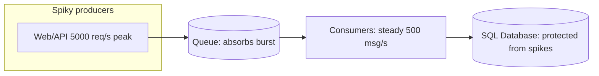

```csharp
app.MapPost("/reports", async (ReportRequest r, ServiceBusSender s) =>
{
    await s.SendMessageAsync(new ServiceBusMessage(BinaryData.FromObjectAsJson(r)) { MessageId = r.Id.ToString() });
    return Results.Accepted($"/reports/{r.Id}");     // 202 + status resource
});
```

**Real-world.** Flash-sale order intake, nightly import bursts, protecting a rate-limited third-party API.
**When NOT.** Caller needs an immediate result; consumers can't ever catch up (sustained arrival >
capacity → unbounded backlog: that needs capacity or load *shedding*, not leveling).
**Trade-offs.** + protects the DB, cheap resilience; − latency becomes variable, need status/feedback
channel, backlog monitoring.
**Mistakes.** No max-age/TTL; no autoscale on depth; UI that implies instant completion.
**Perf/Scale.** Autoscale consumers on queue depth *with a cap* tied to downstream capacity.
**Troubleshooting.** Depth rising + oldest-age rising ⇒ consumers/downstream saturated.
**Interview.** *Q: Leveling vs throttling (rate limiting)?* A: Leveling accepts everything and smooths
processing; rate limiting rejects excess at the edge. Often combined: limit at the edge for abuse, level
inside for legitimate bursts.

---

## 33. Competing consumers

**Simple idea.** Several identical workers pull from one queue; each message goes to one worker.

**Architect depth.** Horizontal scaling and availability for a queue. The broker's per-message lock
guarantees a message isn't processed concurrently by two workers (barring lock expiry). Requirements:
**stateless workers**, **idempotent handlers**, **order-insensitivity** (or sessions), and sensible
**prefetch** to avoid hoarding.

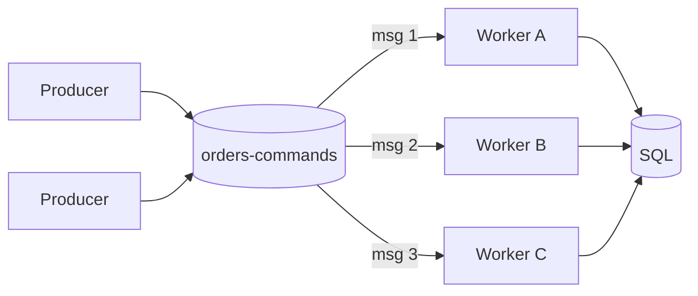

**Real-world.** Image processing, e-mail sending, order handling with autoscaled Functions/ACA replicas.
**When NOT.** Strict ordering (use sessions), non-idempotent handlers, per-message affinity to a
stateful worker.
**Mistakes.** Sharing mutable in-memory state between handlers; assuming order; high prefetch per
instance causing uneven distribution; scaling beyond downstream capacity.
**Troubleshooting.** Uneven load ⇒ prefetch; duplicate effects ⇒ lock expiry or missing idempotency;
messages "stuck" ⇒ locked by a dead/slow worker until lock expiry.
**Interview.** *Q: What breaks when you add the 10th competing consumer?* A: Order assumptions, shared
resource contention (DB connections, hot rows), rate limits of downstream APIs, and any hidden
singleton state. The queue scales; your dependencies may not.

---

## 34. Publish/Subscribe pattern on Azure

Mechanics are in [§3](#3-publishsubscribe-messaging), [§10](#10-topics-and-topic-subscriptions) and
[§11](#11-subscription-filters-and-rule-actions); this chapter is the **pattern-level decision guide**.

**Azure options for pub/sub.** Service Bus topics (reliable enterprise events, per-subscriber DLQ,
filters, sessions); **Event Grid** (push, reactive Azure/system/custom events, HTTP webhook & many native
handlers); **Event Hubs** (stream, replay).

**Design guidelines.**
- Name events in **past tense, domain language** (`OrderPlaced`), publish **facts**, not commands.
- One **topic per bounded context/event family** (not per event type — too many entities; not one global topic —
  hot spot and coupling).
- **Subscription per consuming service**, named after the consumer (`billing`, `search-indexer`).
- Route on **properties** (type, region, tenant), keep rules few & correlation-based.
- Publisher owns the **schema**; consumers must be **tolerant readers** ([§27](#27-message-versioning-and-schema-evolution)).
- Each subscription gets **its own DLQ alerting and owner**.

**Trade-offs.** Decoupling vs invisible dependencies; fan-out cost vs extensibility.
**Mistakes.** Chatty fine-grained events; subscribers depending on each other's order; using topics as a
command bus; unbounded subscription creation per tenant (limits!).
**Interview.** *Q: Event or command?* A: If the sender cares that *something specific* happens and expects
it, it's a command → queue; if it just reports a fact and doesn't care who reacts → event → topic.

---

## 35. Event notification

**Simple idea.** A *thin* event: "Order 42 changed" — the consumer calls back for details if it cares.

**Architect depth.** The event carries only **identity + type (+ maybe timestamp/version)**. Consumers
fetch current state from the source via API.

| | Notification (thin) | State transfer (fat, §36) |
|---|---|---|
| Payload | ids, type | full/delta state |
| Coupling | consumer calls producer API (runtime coupling) | data copied (data coupling) |
| Staleness | fetch gets latest | event snapshot may be stale/out of order |
| Security | payload small, authz at API | sensitive data travels in message |
| Producer load | callback storm possible | none |

```csharp
public sealed record OrderChanged(Guid OrderId, DateTimeOffset At, long Version);
// Consumer
var order = await ordersApi.GetAsync(evt.OrderId);          // callback; handle 404 (deleted) and version >= evt.Version
```

**When to use.** Sensitive data, rapidly changing entities, few interested consumers, desire for the
latest state. **When NOT.** Many consumers (callback storm), consumers must work when producer is down,
high rate (N+1 calls).
**Mistakes.** Callback with no retry/cache; ignoring that the entity may have changed again (fetch gives
v7 for a v5 event — fine if idempotent); no version in the event.
**Interview.** *Q: Thin vs fat events?* A: Thin couples consumers to the producer's availability but
keeps data authoritative and payloads small; fat decouples availability but replicates data and
creates staleness/ordering/privacy concerns. Pick per consumer need; hybrid ("medium") events with key
fields + a link are common.

---

## 36. Event-carried state transfer

**Simple idea.** The event contains the data consumers need, so they keep their own local copy and never
call back.

**Architect depth.** Producers publish `CustomerAddressChanged{ CustomerId, Address, Version }`.
Consumers upsert a **local read model/replica**. This gives autonomy (works if producer is down),
low-latency local reads, and is the backbone of CQRS read-model sync ([CQRS guide](../03-architectural-patterns/02-CQRS-pattern/CQRS-pattern.md)).
Requirements: **idempotent upserts**, **version/last-write-wins** logic (out-of-order tolerant), an
**initial snapshot/backfill** mechanism for new consumers (a topic won't replay history!), and
**deletion/tombstone** events.

```sql
-- Consumer-side upsert, ignores stale/out-of-order events
MERGE dbo.CustomerReplica AS t
USING (SELECT @id AS Id, @name AS Name, @addr AS Address, @version AS Version) AS s
ON t.Id = s.Id
WHEN MATCHED AND t.Version < s.Version THEN UPDATE SET Name=s.Name, Address=s.Address, Version=s.Version
WHEN NOT MATCHED THEN INSERT (Id, Name, Address, Version) VALUES (s.Id, s.Name, s.Address, s.Version);
```

**Real-world.** Product catalog replicated to search/cart/pricing; customer data across services;
reference data distribution.
**When NOT.** Strong consistency required; highly sensitive data (copies multiply compliance scope);
very large entities (payload size) → claim check/medium events.
**Trade-offs.** + autonomy, performance; − eventual consistency, duplicated data, schema coupling,
backfill complexity, GDPR deletion propagation.
**Mistakes.** No version → stale overwrite; no backfill path; unbounded event size; treating replica as
source of truth for writes.
**Troubleshooting.** Replica drift → compare version/checksum; reconcile job; replay from the
authoritative store (or event log) rather than from a topic.
**Interview.** *Q: How does a new service bootstrap its replica?* A: Snapshot export/API pagination from
the owner, then subscribe from a known watermark; handle the overlap by version-based idempotent upserts.

---

## 37. Request-response messaging

**Simple idea.** Send a request over a queue; the reply comes back over another queue, matched by an id.

**Architect depth / internals.** Requester sets `ReplyTo` (reply entity) and `CorrelationId`/`MessageId`;
responder sends the reply to `ReplyTo` with `CorrelationId = request.MessageId`. Two patterns:
- **Shared reply queue + CorrelationId filtering** — requester instances compete; wrong instance may get
  your reply unless you use **sessions**.
- **Reply queue with sessions:** each requester accepts a session = its unique id; sets
  `ReplyToSessionId = myId`; responder copies it into the reply's `SessionId`. Only the intended requester
  receives the reply. (Alternative: per-requester temporary queue/subscription with auto-delete-on-idle.)

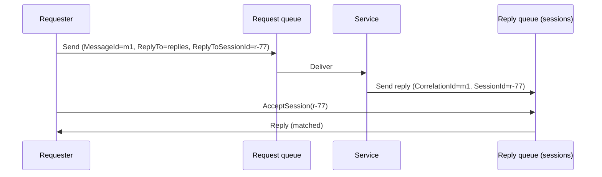

```csharp
// Requester
var req = new ServiceBusMessage(body) { MessageId = id, ReplyTo = "replies", ReplyToSessionId = myInstanceId, TimeToLive = TimeSpan.FromSeconds(30) };
await requestSender.SendMessageAsync(req);
await using var sessionReceiver = await client.AcceptSessionAsync("replies", myInstanceId);
var reply = await sessionReceiver.ReceiveMessageAsync(TimeSpan.FromSeconds(30));    // handle null → timeout
// Responder
var res = new ServiceBusMessage(resultBody) { CorrelationId = incoming.MessageId, SessionId = incoming.ReplyToSessionId };
await client.CreateSender(incoming.ReplyTo).SendMessageAsync(res);
```

**Real-world.** Calling a legacy/on-prem system behind a queue (WebSphere-style integration), long-running
validation with a bounded wait, RPC across unreliable links.
**When NOT.** Latency-sensitive user flows (use HTTP/gRPC); when you'll block a thread waiting (use async
workflow + callback/webhook); high-volume simple queries.
**Trade-offs.** + resilience across unreliable networks/bridges; − complexity, latency, timeouts,
orphaned replies.
**Mistakes.** No timeout/TTL on the request (orphaned work); not handling duplicate replies; per-request
queue creation; synchronous blocking in ASP.NET request threads at scale.
**Interview.** *Q: Why not just use HTTP?* A: Use HTTP unless the responder is intermittently available,
behind a firewall/legacy boundary, or work is long-running — then request-reply messaging (or better,
async 202 + callback/status) buys resilience.

---

## 38. Outbox + Service Bus

> Canonical deep dive: [Inbox, Outbox and Reliable Messaging](../15-inbox-outbox-and-reliable-messaging/inbox-outbox-and-reliable-messaging.md). This chapter is the Service Bus-specific summary.

**Simple idea.** Save the "message to send" in the *same database transaction* as your data change; a
background relay sends it afterwards.

**Architect depth / why.** The **dual-write problem**: updating SQL and publishing to Service Bus can't be
one atomic transaction (no distributed transaction between SQL and Service Bus in the cloud-native model).
Failure windows → "order saved but no event" or "event sent but order rolled back". The **Transactional
Outbox** removes this: write business rows + an `Outbox` row atomically; a **relay** publishes pending rows
at-least-once; consumers are idempotent (and duplicate detection on `MessageId = OutboxId` trims
duplicates).

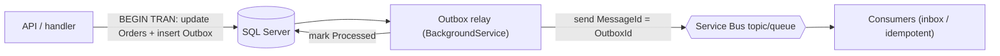

```sql
CREATE TABLE dbo.Outbox (
    Id            UNIQUEIDENTIFIER NOT NULL PRIMARY KEY,
    Type          NVARCHAR(200)  NOT NULL,
    Payload       NVARCHAR(MAX)  NOT NULL,
    Headers       NVARCHAR(MAX)  NULL,              -- correlation, traceparent, schemaVersion
    CreatedAtUtc  DATETIME2(3)   NOT NULL DEFAULT SYSUTCDATETIME(),
    ProcessedAtUtc DATETIME2(3)  NULL,
    Attempts      INT NOT NULL DEFAULT 0
);
-- filtered index keeps the "pending" scan tiny even when the table is large
CREATE INDEX IX_Outbox_Pending ON dbo.Outbox (CreatedAtUtc) INCLUDE (Id) WHERE ProcessedAtUtc IS NULL;
```

**Writing (EF Core).**

```csharp
await using var tx = await db.Database.BeginTransactionAsync(ct);
order.Place();
db.Orders.Add(order);
db.Outbox.Add(new OutboxMessage
{
    Id = Guid.NewGuid(), Type = "OrderPlaced",
    Payload = JsonSerializer.Serialize(new OrderPlaced(order.Id, order.Total)),
    Headers = JsonSerializer.Serialize(new { traceparent = Activity.Current?.Id, correlationId })
});
await db.SaveChangesAsync(ct);          // one atomic commit: data + outbox
await tx.CommitAsync(ct);
```

**Relay (polling, safe for multiple instances).**

```sql
-- claim a batch without blocking other relays; READPAST skips rows locked by others
;WITH cte AS (
  SELECT TOP (@batch) * FROM dbo.Outbox WITH (UPDLOCK, READPAST, ROWLOCK)
  WHERE ProcessedAtUtc IS NULL ORDER BY CreatedAtUtc
)
UPDATE cte SET Attempts = Attempts + 1
OUTPUT inserted.Id, inserted.Type, inserted.Payload, inserted.Headers;
```

```csharp
public sealed class OutboxRelay(IServiceScopeFactory scopes, ServiceBusSender sender, ILogger<OutboxRelay> log) : BackgroundService
{
    protected override async Task ExecuteAsync(CancellationToken ct)
    {
        using var timer = new PeriodicTimer(TimeSpan.FromMilliseconds(500));
        while (await timer.WaitForNextTickAsync(ct))
        {
            using var scope = scopes.CreateScope();
            var db = scope.ServiceProvider.GetRequiredService<AppDbContext>();
            await using var tx = await db.Database.BeginTransactionAsync(ct);          // holds UPDLOCK rows while sending
            var rows = await db.Database.SqlQueryRaw<OutboxMessage>(ClaimSql, new SqlParameter("@batch", 100)).ToListAsync(ct);
            if (rows.Count == 0) { await tx.RollbackAsync(ct); continue; }

            using var batch = await sender.CreateMessageBatchAsync(ct);
            foreach (var r in rows)
            {
                var m = new ServiceBusMessage(r.Payload) { MessageId = r.Id.ToString("N"), Subject = r.Type, ContentType = "application/json" };
                if (!batch.TryAddMessage(m)) throw new InvalidOperationException("batch full - reduce batch size");
            }
            await sender.SendMessagesAsync(batch, ct);                                    // at-least-once
            await db.Database.ExecuteSqlRawAsync("UPDATE dbo.Outbox SET ProcessedAtUtc=SYSUTCDATETIME() WHERE Id IN (...)", ct);
            await tx.CommitAsync(ct);                       // crash before commit ⇒ resend ⇒ dup-detection / inbox absorbs
        }
    }
    const string ClaimSql = "...";   // the CTE above
}
```

Variants: **CDC/Debezium or SQL change tracking** to tail the outbox (lower latency, no polling);
**MassTransit / NServiceBus / Wolverine** ship an EF-integrated transactional outbox (+ inbox) — prefer a
tested library in production; **Cosmos DB change feed** for Cosmos-backed services.
**Housekeeping.** Delete/archive processed rows (partition by date or batch delete); monitor oldest
pending age (the "outbox lag" SLO).
**Trade-offs.** + no dual-write inconsistency, atomic with business change; − extra table & relay,
small latency, at-least-once, ordering per aggregate needs `ORDER BY` + sessions on SB if required.
**Mistakes.** Sending to SB *inside* the business transaction (couples DB commit to broker; long
locks); no cleanup (table bloat → slow scans); relay without `READPAST` (contention) or without locking
(double sends); unstable `MessageId` per retry; storing huge payloads in the outbox.
**Troubleshooting.** Pending count rising ⇒ relay down/throttled/serialisation error; check
`Attempts`; poison outbox row ⇒ park after N attempts + alert; check ordering by aggregate.
**Interview.** *Q: Why not publish after `SaveChanges()` directly?* A: If the process crashes between the
commit and the publish, the event is lost forever; if you publish first and the commit fails, you've
announced a lie. The outbox makes publication a *consequence* of the commit.

---

## 39. Inbox + Service Bus

> Canonical deep dive: [Inbox, Outbox and Reliable Messaging](../15-inbox-outbox-and-reliable-messaging/inbox-outbox-and-reliable-messaging.md). This chapter is the Service Bus-specific summary.

**Simple idea.** The receiver keeps a log of message ids it has processed so redeliveries do nothing.

**Architect depth.** Inbox = idempotency store: `(ConsumerName, MessageId)` unique. The handler, **in one DB
transaction**, (1) inserts into the inbox, (2) performs business changes (and writes any outbox rows for
follow-up events), (3) commits; then **Complete** the Service Bus message. Duplicate delivery → unique-key
violation → skip business logic → Complete. Crash after commit but before Complete → redelivery → inbox
hit → Complete. This yields **exactly-once effect** for DB-local state.

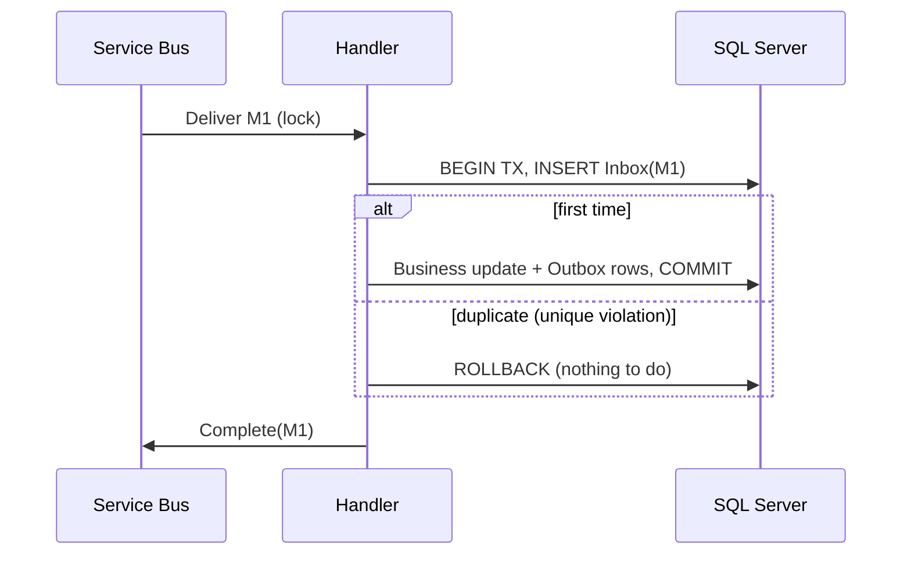

```sql
CREATE TABLE dbo.InboxMessage (
    ConsumerName  NVARCHAR(100)    NOT NULL,
    MessageId     NVARCHAR(128)    NOT NULL,
    ReceivedAtUtc DATETIME2(3)     NOT NULL DEFAULT SYSUTCDATETIME(),
    CONSTRAINT PK_Inbox PRIMARY KEY (ConsumerName, MessageId)
);
-- Retention job: delete rows older than (max redelivery horizon + safety), e.g. > 14 days
DELETE TOP (5000) FROM dbo.InboxMessage WHERE ReceivedAtUtc < DATEADD(DAY,-14,SYSUTCDATETIME());
```

```csharp
processor.ProcessMessageAsync += async args =>
{
    using var scope = scopes.CreateScope();
    var db = scope.ServiceProvider.GetRequiredService<AppDbContext>();
    await using var tx = await db.Database.BeginTransactionAsync(args.CancellationToken);
    try
    {
        db.Inbox.Add(new InboxMessage { ConsumerName = "billing", MessageId = args.Message.MessageId });
        await db.SaveChangesAsync(args.CancellationToken);                       // throws on duplicate
        await ApplyBusinessChangeAsync(db, args.Message, args.CancellationToken);
        await db.SaveChangesAsync(args.CancellationToken);
        await tx.CommitAsync(args.CancellationToken);
    }
    catch (DbUpdateException ex) when (IsUniqueViolation(ex))                    // SqlException 2627/2601
    {
        await tx.RollbackAsync(args.CancellationToken);                          // duplicate ⇒ already processed
    }
    await args.CompleteMessageAsync(args.Message, args.CancellationToken);       // after commit
};
```

**Key choice.** Use a **stable business message id** (outbox row id), not a per-attempt id.
**When NOT.** Naturally idempotent operations; high-volume handlers where an extra insert dominates (then
use conditional/versioned updates); consumers without a transactional store (use idempotency keys
downstream).
**Trade-offs.** + strong idempotency; − extra write per message, table growth/retention, only covers
effects inside the same DB.
**Mistakes.** Inbox insert in a different transaction than the business change; Complete before commit;
no retention (table grows forever); key = message id but the *producer* regenerates it on retry.
**Interview.** *Q: Outbox and inbox together?* A: Outbox guarantees *at-least-once publish*, inbox
guarantees *at-most-once effect* on receive; combined with duplicate detection you get exactly-once
**effect** across services — without distributed transactions.

---

## 40. Retry and dead-letter strategy

A **strategy**, not a setting. Combine the mechanics from [§15](#15-settlement-complete-abandon-dead-letter-defer),
[§16](#16-maxdeliverycount-dead-letter-queue-and-poison-messages), [§24](#24-retry-and-exponential-backoff)
and [§29](#29-handling-message-processing-failures).

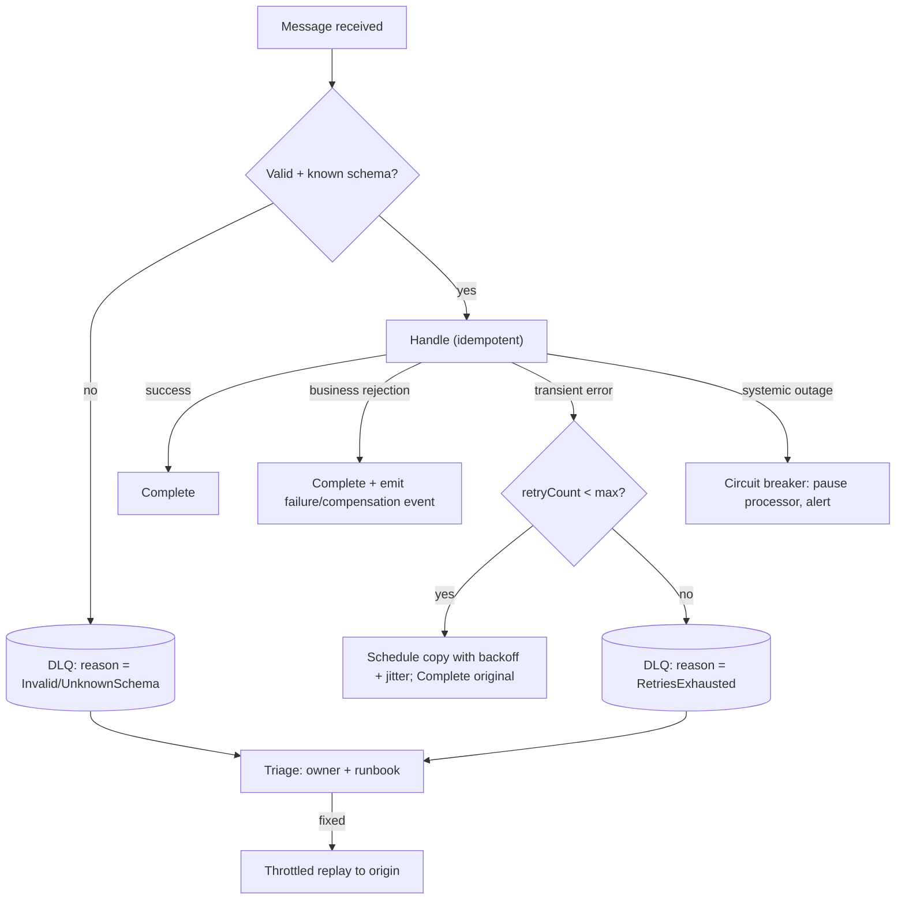

**Policy checklist.** classify errors; max retries (≈3–5 delayed, with total horizon < message TTL);
backoff+jitter; `MaxDeliveryCount` as a safety net (5–10); explicit DLQ reasons; DLQ alert, owner, runbook,
SLA; replay tool; circuit breaker; poison-pill isolation (separate queue per message type); metrics on
retry rates; periodic DLQ review; load test the failure paths.
**Anti-patterns.** Infinite retry; DLQ as a trash can; retry without idempotency; retrying
non-transient errors; replaying blindly.
**Interview.** *Q: Design the retry/DLQ policy for a payments consumer.* A: Validate first (DLQ invalid);
call PSP with idempotency key; transient → scheduled backoff 5 retries over ~30 min, then DLQ
`PspUnavailable`; business decline → complete + `PaymentDeclined` event; DLQ alert page-level; replay
tool gated by approval; circuit breaker when PSP error rate > threshold.

---

## 41. Message replay and recovery

**Simple idea.** Re-run messages after a bug fix or outage — safely.

**Sources of replayable messages and their limits.**

| Source | What you get | Limit |
|---|---|---|
| **DLQ** | Failed messages | Only failures |
| **Outbox table** | Everything the service published | Retention; per-service |
| **Event Hubs / Capture** | Stream within retention (or in Blob/ADLS via Capture) | Not Service Bus |
| **Event store / event sourcing** | Full history | Needs the architecture ([Event Sourcing](../03-architectural-patterns/03-event-sourcing/event-sourcing.md)) |
| **Service Bus** itself | **No** replay of completed messages | Consumed = gone |
| **Auto-forward / archive subscription** | Copy of all messages | You must create it ahead (e.g. forward a "tap" subscription to a queue/Blob via Function) |

**Techniques.**
1. **Replay from DLQ** with throttling ([§25](#25-dlq-monitoring-and-replay)).
2. **Re-publish from the outbox** by resetting `ProcessedAtUtc` for a time range (consumers dedupe via
   inbox/versions).
3. **Archive subscription** (`#` filter) feeding Blob/ADLS (Event Grid/Functions) → rehydrate to a
   replay topic.
4. **Rebuild read models** from the source of truth rather than replaying events.
5. **Disaster recovery:** Geo-DR alias failover (metadata only; in-flight messages may be lost unless
   geo-replication is used — verify current), or **active-active producers with idempotent consumers**.

**Recovery checklist.** stop the bleeding (pause consumers) → fix → replay small canary → throttled bulk →
verify counts/checksums → resume → post-mortem. **Mistakes.** Replaying into a changed schema; skipping
idempotency; no audit of what was replayed; unthrottled replay re-triggering the outage.
**Interview.** *Q: "Can we replay last Tuesday's events from Service Bus?"* A: Not from the broker once
completed. We'd replay from an outbox/archive/event store; if we didn't capture them, we can't — so for
audit/replay needs, design capture (archive subscription, Event Hubs Capture, or event sourcing) up front.

---

## 42. Service Bus versus Event Grid versus Event Hubs

**Simple idea.** Service Bus = reliable **work/messages**; Event Grid = **reactive notifications**
("something happened"); Event Hubs = **firehose/stream** with replay.

| Dimension | **Service Bus** | **Event Grid** | **Event Hubs** |
|---|---|---|---|
| Model | Broker (queues, topics) | Event router (push, pub/sub) | Partitioned log (pull, offsets) |
| Typical payload | Commands/business messages | Discrete events (state change facts) | High-volume telemetry/events |
| Delivery | Pull (receiver) | **Push** (HTTP/webhook, Functions, queues, Event Hubs…) | Pull, consumer groups |
| Guarantee | At-least-once, **per-message ack**, locks | At-least-once, retries with backoff up to ~24 h, dead-letter to Blob | At-least-once, checkpoints; consumer owns position |
| Ordering | FIFO via sessions | Not guaranteed | Per partition |
| Retention/replay | Until consumed (+TTL); no replay | Short retry window; no replay | **Retained (e.g. 1–90 days; verify)**; replayable; Capture to Blob |
| Features | DLQ, sessions, scheduling, dup detection, transactions, filters | Filtering, Azure-native sources (Blob, Resource events), CloudEvents | Partitions, consumer groups, Kafka endpoint, Capture, Schema Registry |
| Throughput | Moderate–high | High (events/s large) | **Very high** (MB/s–GB/s) |
| Per-message processing control | **Excellent** | Limited | Consumer-managed |
| Use when | Order/payment processing, integration, work queues | Blob created, resource changed, reactive serverless triggers, webhook fan-out | Telemetry, clickstream, logs, IoT, stream analytics, CDC feeds |
| Avoid when | Streaming analytics firehose | You need reliable work queue/ordering/DLQ semantics | You need per-message ack/DLQ/scheduling |

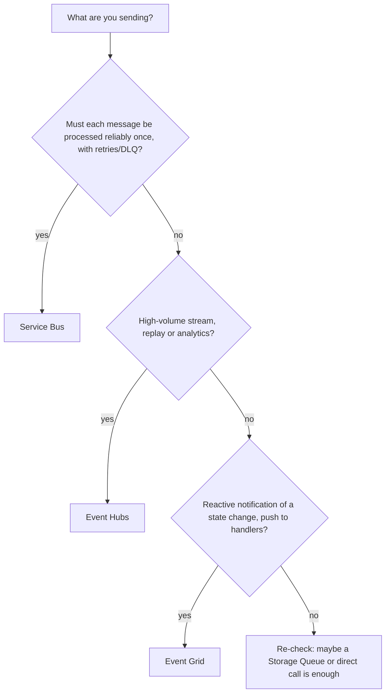

**Combining them (common in real systems).** Blob upload → **Event Grid** → Function → **Service Bus** queue
(reliable processing with DLQ); IoT/telemetry → **Event Hubs** → Stream Analytics/Functions → Service Bus
for actionable alerts; Event Grid **custom topic** for cross-team platform events with webhook
subscribers (see [Webhooks guide](../12-webhooks-and-event-based-integration/webhooks-and-event-based-integration.md)).
Event Grid can deliver *to* a Service Bus queue/topic, bridging reactive events into a reliable workflow.
**Mistakes.** Using Event Grid as a work queue; using Service Bus for 100 k msg/s telemetry; using Event
Hubs when you need per-message retry/DLQ; assuming Event Grid guarantees ordering.
**More choices.** Azure Storage Queues: cheapest/simplest (> 80 GB queues, simple at-least-once, no
topics/sessions/DLQ-poison features natively); use when you need basic buffering at scale and low cost.
**Interview.** *Q: Event Grid vs Service Bus — both do pub/sub, so?* A: Event Grid = lightweight, push,
event notification with serverless/native integration and no per-message processing control; Service Bus
= reliable enterprise messaging with locks, DLQ, sessions, scheduling, duplicate detection. I use Event
Grid for "tell me something happened", Service Bus for "make sure this gets done".

---

# Interview toolkit

## 43. Troubleshooting playbook

**Triage order (always the same).** 1) Is the **namespace healthy/throttled**? 2) Is the **backlog**
(`ActiveMessages`, oldest age) growing? 3) Is the **DLQ** growing, and why (reason)? 4) Are **consumers**
running/connected (`ServerErrors`, `UserErrors`, connection count)? 5) What changed (deploy, schema,
config, dependency)?

| Symptom | Likely causes | How to confirm | Fix |
|---|---|---|---|
| `MessageLockLost` / duplicates | Handler > lock duration; large prefetch; connection drop; pod killed | Handler p99 vs lock; `DeliveryCount` > 1 on successes; consumer restarts | Increase lock/renewal, lower prefetch, graceful shutdown, idempotency |
| `ServerBusy` / `ThrottledRequests` | Standard shared capacity; burst; too many ops | Metrics, SDK retry logs | Batch, back off (SDK retry), Premium/more MUs, split namespaces |
| Growing DLQ | Bad deploy, schema change, poison, downstream outage | Group by `DeadLetterReason`; timestamp vs deploy | Fix, then throttled replay |
| Backlog growing, low CPU | Handler I/O bound; low concurrency; DB bottleneck | Dependency latency, `MaxConcurrentCalls`, SQL waits | Raise concurrency (within DB capacity), optimise queries |
| Backlog growing, high CPU | Under-scaled consumers | CPU, replica count | Scale out; optimise handler |
| Stuck session / no progress | Hot session; consumer holds lock then hangs; wrong `SessionId` | Session lock owner, per-session lag | Fix key choice; timeouts; session idle timeout |
| Messages "disappear" | TTL expiry w/o DLQ-on-expiry; Receive-and-Delete; filter mismatch; dup detection dropped it | Entity settings, rules, MessageId reuse | Enable DLQ-on-expiry; unique retry ids; verify filters |
| Subscription not getting events | Created after publish; rule mismatch; `$Default` removed with bad rule | Peek, Service Bus Explorer, rule list | Fix rule; backfill via replay |
| Slow publishes with many rules | Many SQL filters on topic | Publish latency vs rule count | Correlation filters, fewer rules, split topics |
| Connection / AMQP errors | Firewall/NSG blocking 5671/5672 (or 443 for AMQP-WS); DNS to private endpoint; TLS; expired token/RBAC | Connectivity test, `nslookup`, SDK exceptions (`ServiceCommunicationProblem`, `Unauthorized`) | Open ports/use AMQP over WebSockets; fix private DNS zone `privatelink.servicebus.windows.net`; RBAC |
| Failover surprises | Geo-DR alias flipped but apps cached endpoints; in-flight loss; metadata-only | Alias status, client config | Use alias FQDN; test drills; idempotency; verify geo-replication options |
| High DLQ after scale-out | Concurrency exposes race/dedupe bug | Errors correlating with concurrency | Fix concurrency bug, cap concurrency |

**Tools.** Azure Monitor metrics & alerts; Log Analytics (diagnostic logs); Service Bus Explorer (portal);
Application Insights end-to-end transaction view; `az servicebus ... show` for counts; SDK logging via
`AzureEventSourceListener.CreateConsoleLogger()` (Warning+) when debugging.

```powershell
az servicebus queue show -g rg --namespace-name sb -n orders-commands `
  --query "{active:countDetails.activeMessageCount, dlq:countDetails.deadLetterMessageCount, scheduled:countDetails.scheduledMessageCount}"
```

**Production debugging approach.** Reproduce with a **peeked copy** (peek doesn't lock or change delivery
count), run the handler locally against it, compare schema versions, check correlation id → trace in
Application Insights, then decide fix/replay. Never "purge" a DLQ you haven't triaged.

---

## 44. Security, reliability and performance checklist

**Security**
- **Entra ID + Managed Identity**, `disableLocalAuth = true`; roles `Azure Service Bus Data Sender` /
  `Data Receiver` scoped to the **entity**, never `Data Owner` in apps.
- Avoid SAS keys; if unavoidable, **entity-scoped** policies (Send/Listen only), rotate, store in Key Vault.
- **Private endpoints** (Premium) + `publicNetworkAccess = Disabled`; private DNS zone
  `privatelink.servicebus.windows.net`; or IP firewall/service endpoints (verify tier support).
- **TLS 1.2+**; **customer-managed keys** (Premium) for encryption at rest if required; Defender/diagnostics.
- Treat messages as **untrusted input**: validate, size-limit, no polymorphic type deserialisation, no PII in
  properties/logs, tenant isolation checks on every message.
- Webhook/HTTP endpoints that *feed* the bus must authenticate and validate (see Webhooks guide).

**Reliability**
- Peek-Lock + explicit settlement; idempotent handlers; outbox/inbox; DLQ alert/owner/runbook;
  graceful shutdown; circuit breaker; health probes; zone redundancy (Premium; verify), Geo-DR/geo-replication
  for region failure; DR drills; capacity headroom.

**Performance**
- Singleton `ServiceBusClient`; batch sends; tuned prefetch/concurrency; claim check for big payloads;
  correlation filters; avoid chatty tiny messages when a batch would do; right-size MUs; load test with
  failure injection.

**Cost**
- Standard vs Premium break-even (verify pricing); fewer topics/rules; avoid long-lived scheduled
  message hoards; clean DLQs; autoscale MUs and consumers (scale to zero with KEDA/Functions).

**Operational excellence**
- IaC (Bicep) for entities; naming conventions; dashboards per entity (depth, age, DLQ, throttling,
  consumer count); SLOs on oldest-message age; schema registry/contract tests; runbooks.

---

## 45. How this guide relates to other topics

| Topic | Relationship |
|---|---|
| [Event-Driven Architecture](../02-architectural-styles/04-event-driven-architecture/event-driven-architecture.md) | The style; this guide is the Azure transport and delivery mechanics |
| [Saga](../03-architectural-patterns/01-SAGA-pattern/SAGA-pattern.md) | Choreography/orchestration over queues/topics, sessions for state, scheduled timeouts, DLQ for compensation |
| [Distributed systems patterns](../03-architectural-patterns/distributed-systems-patterns.md) | Retry, idempotency, outbox/inbox, circuit breaker, bulkhead are the reliability toolkit used here |
| [Integration and communication patterns](../03-architectural-patterns/integration-and-communication-patterns.md) | Queue vs pub/sub vs streams vs webhooks selection |
| [CQRS](../03-architectural-patterns/02-CQRS-pattern/CQRS-pattern.md) | Event-carried state transfer feeds read models |
| [Event Sourcing](../03-architectural-patterns/03-event-sourcing/event-sourcing.md) | Replay/recovery source of truth |
| [ASP.NET Core Web API internals](../10-aspnet-core-web-api-internals/aspnet-core-web-api-internals.md) | `BackgroundService`, hosted-service shutdown, DI scopes per message, resilient HttpClient in handlers |
| [Webhooks and event-based integration](../12-webhooks-and-event-based-integration/webhooks-and-event-based-integration.md) | Webhook receivers enqueue to Service Bus for asynchronous processing; Event Grid webhooks |
| [Azure services and cloud architecture](../14-azure-services-and-cloud-architecture/azure-services-and-cloud-architecture.md) | Service selection, networking (private endpoints), identity, monitoring, DR for the whole platform |
| [Cloud migration](../11-cloud-migration-and-modernization/cloud-migration-and-legacy-modernization.md) | Messaging as seam for strangler/anti-corruption; hybrid messaging; parallel run via topic fan-out |
| [Docker and containerization](../09-containers-and-docker/docker-and-containerization.md) | Packaging workers; KEDA scale on queue depth in ACA/AKS |

---

## 46. Scenario-based architect questions

### Scenario 1 — Per-order ordering at 5 000 msg/s

*"An order has events Created → Paid → Shipped. They must be processed in order per order; overall load is
5 000 msg/s. Design it."*

**Answer.** (1) Clarify: order scope = per order, not global; per-message processing time (say 50 ms);
peak vs average; loss tolerance (none). (2) **Sessions keyed by `orderId`** on a Premium namespace queue/
subscription: FIFO per order, parallel across orders. (3) Concurrency by Little's law: 5 000 msg/s × 0.05 s
= **250** in-flight → run e.g. 10 replicas × `MaxConcurrentSessions` 30, `MaxConcurrentCallsPerSession`
= 1. (4) Producer: set `SessionId`, batch sends (batch across orders; order within a session preserved as
long as sends for one session are sequential), deterministic `MessageId`. (5) Consumer: idempotent
(inbox/version check), `AutoCompleteMessages=false`, lock renewal sized, session state only for small
progress data. (6) Pitfalls: hot orders (rare for orders; for "customer" key it could skew), idle session
timeouts, producer parallelism reordering — send per session sequentially or carry `aggregateVersion` and
make the consumer order-tolerant. (7) Monitoring: per-entity depth/age, DLQ, session lock lost, DB waits.
(8) Fallback/trade-off: if some events can arrive out of order harmlessly, drop sessions and use version
checks + defer → higher throughput.

### Scenario 2 — 200 000 messages in the DLQ after a bad deploy

**Answer.** *Stabilise* (pause the failing consumer or roll back; stop new DLQ growth) → *Diagnose*
(group by `DeadLetterReason`/description; correlate with deploy time; sample payloads; peek—don't
purge) → *Fix* (code/schema) and ship → *Canary replay* (e.g. 100 messages via the replay tool; verify
results/idempotency) → *Throttled bulk replay* to the origin entity with new `MessageId`s + `replayedFrom`
tag (watch DB/CPU; use `ForwardDeadLetteredMessagesTo` parking queue if you want separation) → *Verify*
(counts, business reconciliation, DLQ zero) → *Prevent* (contract tests, canary deploy, DLQ alert < minutes,
`MaxDeliveryCount` review, error classification so schema errors DLQ immediately instead of 10 retries,
blue-green/consumer-first deploys). Mention business impact comms and the post-mortem.

### Scenario 3 — "Make it exactly-once"

**Answer.** Challenge the term: exactly-once *delivery* is impossible end-to-end (two generals). Provide
**exactly-once effect**: producer side — transactional outbox + deterministic MessageId + duplicate
detection; consumer side — inbox with unique key in the same DB transaction as the business change, or
naturally idempotent/versioned updates; external side effects — idempotency keys; cross-service
consistency — saga with compensation, not 2PC. Service Bus transactions only make send/receive/settle
atomic *within the namespace*. State the residual risk (inbox retention horizon, effects outside the DB)
and how you monitor it (duplicate-hit counters).

### Scenario 4 — Replace synchronous service-to-service calls in a checkout flow

**Answer.** Keep synchronous only where the user needs the answer (price/stock check, payment
authorisation via PSP with idempotency key). Make the rest events: `OrderPlaced` published via **outbox**
to a **topic**; billing, inventory, notification, analytics each have a **subscription** with DLQ alert;
fulfilment uses a **saga** (orchestrator with sessions or durable workflow) with compensation and
scheduled timeouts; API returns 202 + status; UI polls/SignalR/webhook. Discuss trade-offs: eventual
consistency UX, tracing (traceparent + CorrelationId), schema governance, ops (DLQ). Provide migration
path: Strangler seam via topic, shadow-consume first ([cloud migration guide](../11-cloud-migration-and-modernization/cloud-migration-and-legacy-modernization.md)).

### Scenario 5 — Choose messaging for an IoT + order system

**Answer.** Telemetry (millions/s, replay, analytics) → **Event Hubs** (partition by deviceId, Capture
to ADLS, Stream Analytics/Functions). Actionable alerts and commands to devices/back office →
**Service Bus** (queues/topics, DLQ, TTL for stale commands). Blob/resource lifecycle notifications →
**Event Grid** → Function → Service Bus for reliable processing. Justify each with guarantees, retention,
consumption model, cost, ops.

### Scenario 6 — Consumers keep losing locks after autoscaling

**Answer.** Hypothesis: prefetch × slow handlers → locks age in the buffer; DB contention increases
handler time with more replicas; thread-pool starvation from sync I/O; pods evicted without graceful stop
(KEDA scale-in kills in-flight). Verify with handler duration metrics, `DeliveryCount`, SDK logs, thread
pool counters ([ASP.NET Core internals](../10-aspnet-core-web-api-internals/aspnet-core-web-api-internals.md)).
Fix: `PrefetchCount` low, concurrency cap tied to DB capacity, lock renewal ≥ p99, `terminationGracePeriodSeconds`
> max handler time + `StopProcessingAsync`, async I/O, idempotency.

### Scenario 7 — Multi-tenant fan-out

*"500 tenants, each with their own webhook subscribers."* **Answer.** Don't create a subscription per
tenant (entity limits, rule overhead). Publish tenant-stamped events to one topic; a **dispatcher**
service consumes, looks up tenant endpoints and delivers via webhooks with retry/backoff/DLQ per
tenant (isolate noisy tenants with per-tenant queues/sessions or rate limits) — see the
[Webhooks guide](../12-webhooks-and-event-based-integration/webhooks-and-event-based-integration.md).

---

## 46b. Rapid-fire interview questions with answers

1. **Queue vs topic?** Queue = one logical consumer (commands); topic = one copy per matching subscription (events).
2. **Default lock duration / max?** 1 minute default, up to 5 minutes (verify); extend via renewal.
3. **What increments DeliveryCount?** Abandon and lock expiry (each delivery attempt that isn't settled with complete/DLQ/defer).
4. **Where does a message go after MaxDeliveryCount?** The entity's DLQ with reason `MaxDeliveryCountExceeded`.
5. **Can I receive from the DLQ with a processor?** Yes: processor/receiver with `SubQueue = SubQueue.DeadLetter`.
6. **Can duplicate detection be enabled later?** No — at entity creation.
7. **What does duplicate detection key on?** `MessageId` within the history window.
8. **Does Service Bus guarantee FIFO?** Only with sessions (and single sender/ordered sends); not with competing consumers or retries.
9. **Why do I need to store the SequenceNumber of a deferred message?** It's the only way to retrieve it.
10. **How do I cancel a scheduled message?** `CancelScheduledMessageAsync(sequenceNumber)`.
11. **Filter on message body?** No — only system/application properties.
12. **Correlation vs SQL filter?** Correlation = equality, fast; SQL = expressive, costlier.
13. **What do `PrefetchCount` and lock duration have in common?** Prefetched messages' locks tick while buffered.
14. **AutoCompleteMessages true — risk?** If you hand off work asynchronously, message completes before work finishes → loss.
15. **Why one ServiceBusClient?** It owns the connection; per-message clients exhaust sockets/connections.
16. **How do you secure access?** Managed identity + RBAC roles, local auth disabled, private endpoint, TLS.
17. **Receive-and-Delete use case?** Loss-tolerant, high-rate, idempotent data (cache invalidation, heartbeats).
18. **How to scale on queue depth?** KEDA `azure-servicebus` scaler or Functions scale controller.
19. **Standard vs Premium?** Shared/throttled vs dedicated MUs; Premium: private endpoints, large messages, geo features, predictable latency.
20. **Geo-DR vs geo-replication?** Geo-DR replicates metadata + alias failover; geo-replication also replicates data (Premium; verify current).

### Tough follow-ups an interviewer may ask

- *"Your handler is idempotent, so why bother with MaxDeliveryCount?"* → Idempotency makes retries safe, not finite; a poison message still loops forever and wastes capacity.
- *"Duplicate detection is on. Do you still need an inbox?"* → Yes: it covers producer duplicates in a window only; consumer redelivery and long-gap replays remain.
- *"You scheduled a retry copy and completed the original; the process crashed between the two."* → Order matters: send-then-complete yields a duplicate (safe with idempotency); complete-then-send risks loss. Use the Service Bus **transaction** (send + complete atomically in the same namespace) or accept duplicate + idempotency.
- *"Why not use a database table as a queue?"* → You can for small scale (outbox does!), but you re-implement locks, backoff, DLQ, fan-out, monitoring and scale; polling load and contention grow with volume.
- *"How would you test failure paths?"* → Fault injection (kill pods mid-handler, throttle DB, poison payloads), contract tests, replay drills, chaos experiments; assert DLQ routing and idempotent outcomes.
- *"Sessions or Kafka-style partitions?"* → Sessions: dynamic keys, per-key lock, no replay; partitions: fixed count, replay, higher throughput, consumer-managed offsets — pick by need for per-message ack/DLQ vs streaming/replay.

---

## 47. Cheat sheet

**Processor settings**

| Setting | Typical start | Note |
|---|---|---|
| `ReceiveMode` | PeekLock | |
| `AutoCompleteMessages` | `false` | settle explicitly |
| `MaxConcurrentCalls` | 4–16 | bound by downstream capacity |
| `PrefetchCount` | 0–2×concurrency (slow handlers: 0) | locks age in buffer |
| `MaxAutoLockRenewalDuration` | ≥ p99 handler time | not a substitute for redesign |
| Entity `LockDuration` | 1–5 min | |
| Entity `MaxDeliveryCount` | 5–10 | safety net; use delayed retries |
| Entity `DefaultMessageTimeToLive` | business-driven | enable DLQ on expiry |
| Duplicate detection window | ≥ producer retry horizon | needs deterministic MessageId |
| Session: `MaxConcurrentSessions` | = target concurrent keys / replicas | `PerSession=1` for order |

**Settlement outcomes**

| Action | Message | DeliveryCount | Visible again? |
|---|---|---|---|
| Complete | deleted | — | No |
| Abandon | stays | +1 | Immediately |
| DeadLetter | → DLQ | — | Only via DLQ receiver |
| Defer | stays, hidden | — | Only by SequenceNumber |
| Lock expires | stays | +1 | Yes |
| Schedule | stays, hidden | — | At scheduled time |

**RBAC roles:** `Azure Service Bus Data Sender` · `Azure Service Bus Data Receiver` · `Azure Service Bus Data Owner` (admin only).
**DLQ paths:** `queue/$deadletterqueue`, `topic/Subscriptions/sub/$deadletterqueue`.
**Metrics to alert on:** `DeadletteredMessages`, `ActiveMessages` (+ age), `ThrottledRequests`, `ServerErrors`, Premium CPU/memory.
**Immutable at creation:** sessions, duplicate detection, (partitioning), tier.

---

## 48. Structured answer framework

Use for any design or "why" question — it also answers the feedback about explaining technical decisions.

1. **Clarify** — functional need, volume (avg/peak), latency, ordering, loss/duplicate tolerance, consumers, compliance.
2. **Choose the interaction model** — command (queue) / event (topic) / stream (Event Hubs) / notification (Event Grid) / sync call.
3. **Draw the flow** — producers → broker entity → consumers → stores; mark failure points.
4. **Specify delivery semantics** — Peek-Lock, idempotency (inbox/versions), dedup, outbox.
5. **Handle failure** — error taxonomy, backoff, DLQ owner, replay, circuit breaker.
6. **Scale & limits** — concurrency math (Little's law), partitions/sessions, tier, downstream cap.
7. **Secure & operate** — identity, private network, metrics/alerts, tracing, runbooks, IaC.
8. **State trade-offs & alternatives** — what you gave up (latency, consistency, complexity) and when you'd switch.
9. **Validate** — load/chaos test, canary, replay drill.

**Worked mini-example (one breath).** "Order placement: the API commits order + outbox in one SQL transaction
and returns 202; a relay publishes `OrderPlaced` with a deterministic MessageId to a Premium topic;
billing and inventory subscribe, each with an inbox for idempotency, retries with jittered scheduled
backoff, DLQ alerts and a throttled replay tool; ordering per order via sessions only for the fulfilment
subscription. Trade-off: eventual consistency and operational overhead in exchange for resilience and
independent scaling; if volume were tiny and a single team owned everything, a modular monolith with a
database transaction would be simpler."

---

## 49. Quick-revision checklist

- [ ] Can explain at-most / at-least / exactly-once **effect** and why delivery exactly-once is impossible.
- [ ] Queue vs topic vs Event Grid vs Event Hubs vs Storage Queue — with one-line selection rules.
- [ ] Peek-Lock vs Receive-and-Delete; lock duration, renewal, prefetch interplay.
- [ ] Complete/Abandon/DLQ/Defer outcomes and delivery-count effects.
- [ ] MaxDeliveryCount, DLQ paths, poison messages, reasons, monitoring, throttled replay.
- [ ] Duplicate detection (MessageId, window, creation-time) vs idempotent consumer (inbox).
- [ ] Sessions: per-key FIFO, session lock/state, hot-session risk, request-reply with sessions.
- [ ] Scheduled vs deferred messages; sequence number bookkeeping; delayed retry via scheduling.
- [ ] Filters: boolean/SQL/correlation, rule actions, properties-only, `$Default` rule.
- [ ] Throughput levers: batching, prefetch, concurrency, MUs, claim check, correlation filters.
- [ ] Autoscale: Functions, KEDA, App Service; downstream limits.
- [ ] Patterns: load leveling, competing consumers, pub/sub, notification vs state transfer, request-reply.
- [ ] Outbox (UPDLOCK/READPAST relay, filtered index, cleanup) and inbox (unique key, same transaction).
- [ ] Versioning: tolerant reader, additive changes, consumer-first deploys, envelope, upcasters.
- [ ] Security: Managed Identity, RBAC roles, disable SAS, private endpoints, CMK.
- [ ] Troubleshooting: lock lost, throttling, DLQ spike, stuck sessions, connectivity/DNS.
- [ ] Can run the structured answer framework on a fresh scenario in under 3 minutes.
