# Azure Services and Cloud Architecture

> **Audience:** senior .NET developer / technical lead / software architect preparing for interviews.
> **Scope:** the core Azure services a .NET architect is expected to know *in depth*, how to choose between them, and how to design for security, resilience, cost and operability.
> **Currency note:** written against .NET 10 (LTS) and the Azure platform as of late 2026. Azure product names, SKUs, limits, API versions and CLI flags drift quickly. Anything marked **(verify current)** should be checked against Microsoft Learn before you quote it as fact in an interview or put it in an IaC template.

---

## How to use this guide

1. **Part A – Core services (Chapters 1–17):** one chapter per service. Each chapter follows the same shape so you can revise quickly: *Simple view → Architect depth → Why it exists → Internals → Examples → Use cases → When / when NOT → Pros & cons → Mistakes → Perf / scale / reliability / security → Troubleshooting → Related topics → Interview Q&A*.
2. **Part B – Architecture and service selection (Chapters 18–34):** the decisions interviewers actually probe (compute choice, messaging choice, data choice, identity, networking, DR, cost, Well-Architected).
3. **Part C – Interview toolkit:** scenario questions, a service-selection cheat sheet, a framework for structuring answers, and a revision checklist.

**Interview feedback this guide targets:** (1) database performance troubleshooting → Chapter 9 and Chapter 33; (2) API design/security → Chapters 8, 19, 24, 26; (3) architecture trade-offs → Part B throughout; (4) Azure services and messaging in real implementations → Chapters 5–7, 18–20; (5) structured problem solving → Part C framework.

### Table of contents

**Part A – Core services**
1. [Azure App Service](#1-azure-app-service)
2. [Azure Functions](#2-azure-functions)
3. [Azure Container Apps](#3-azure-container-apps)
4. [Azure Kubernetes Service (AKS)](#4-azure-kubernetes-service-aks)
5. [Azure Service Bus](#5-azure-service-bus)
6. [Azure Event Grid](#6-azure-event-grid)
7. [Azure Event Hubs](#7-azure-event-hubs)
8. [Azure API Management](#8-azure-api-management)
9. [Azure SQL Database](#9-azure-sql-database)
10. [Azure Blob Storage](#10-azure-blob-storage)
11. [Azure Cache for Redis](#11-azure-cache-for-redis)
12. [Azure Key Vault](#12-azure-key-vault)
13. [Azure Managed Identity](#13-azure-managed-identity)
14. [Azure Monitor](#14-azure-monitor)
15. [Application Insights](#15-application-insights)
16. [Log Analytics](#16-log-analytics)
17. [Azure AI Foundry](#17-azure-ai-foundry)

**Part B – Architecture and service selection**
18. [App Service vs Azure Functions](#18-app-service-vs-azure-functions)
19. [Azure Container Apps vs AKS](#19-azure-container-apps-vs-aks)
20. [Service Bus vs Event Grid vs Event Hubs](#20-service-bus-vs-event-grid-vs-event-hubs)
21. [Azure SQL vs Cosmos DB](#21-azure-sql-vs-cosmos-db)
22. [Blob Storage vs database file storage](#22-blob-storage-vs-database-file-storage)
23. [Redis caching architecture](#23-redis-caching-architecture)
24. [API Management as API gateway](#24-api-management-as-api-gateway)
25. [Managed Identity vs connection strings and secrets](#25-managed-identity-vs-connection-strings-and-secrets)
26. [Key Vault integration](#26-key-vault-integration)
27. [Azure networking fundamentals](#27-azure-networking-fundamentals)
28. [Private endpoints and virtual networks](#28-private-endpoints-and-virtual-networks)
29. [Load balancing and autoscaling](#29-load-balancing-and-autoscaling)
30. [Availability zones and regions](#30-availability-zones-and-regions)
31. [Disaster recovery](#31-disaster-recovery)
32. [Backup and restore strategies](#32-backup-and-restore-strategies)
33. [Azure Well-Architected Framework](#33-azure-well-architected-framework)
34. [Cost optimization](#34-cost-optimization)
35. [Security and operational excellence](#35-security-and-operational-excellence)

**Part C – Interview toolkit**
36. [Reference architecture](#36-reference-architecture-net-microservices-on-azure)
37. [Scenario-based questions](#37-scenario-based-questions)
38. [Cheat sheet](#38-cheat-sheet)
39. [Structured answer framework](#39-structured-answer-framework)
40. [Quick-revision checklist](#40-quick-revision-checklist)

---

# Part A – Core services

## 1. Azure App Service

### Simple view
A managed web host. You give it code (or a container); Azure runs it on VMs it patches and monitors, puts a load balancer and TLS in front, and lets you scale by adding instances.

### Architect depth
App Service is a **PaaS web hosting platform** built around an **App Service Plan**: the plan is the compute (VM size/tier, instance count, region); apps are *tenants of the plan*. All apps in a plan share the same instances, so CPU/memory contention between apps in one plan is real. Tiers: Free/Shared (dev only), Basic, Standard, Premium (v3, and newer v4 **(verify current)**), and **Isolated v2 (App Service Environment)** for single-tenant, VNet-injected deployments.

### Why it exists
Teams spent time on OS patching, IIS tuning, load-balancer config, certificates and deployment scripts for plain web apps. App Service removes undifferentiated heavy lifting for HTTP workloads.

### How it works internally
- **Front ends** (shared, multi-tenant reverse proxies) terminate TLS and route by hostname to **workers** (the plan instances). Requests carry an ARR affinity cookie if *ARR Affinity* is on.
- **Deployment slots** (Standard+): each slot is a full app with its own hostname and settings living on the *same plan instances*. A **swap** warms the staging slot (hitting the root or a configured warm-up path), then atomically switches the routing — giving near-zero-downtime release and instant rollback by swapping back. *Slot-sticky* settings stay with the slot; others travel with the code.
- **Always On** keeps the worker process loaded; without it, the app unloads after ~20 min idle (cold start). Required for WebJobs/background threads on Basic+.
- **Autoscale** uses Azure Monitor autoscale rules (metric- or schedule-based) to change instance count; **automatic scaling** (Premium) is a platform-managed alternative with pre-warmed instances **(verify current)**.
- **Networking:** inbound via *private endpoint* or *access restrictions*; outbound via *regional VNet integration* (so the app can reach private resources); outbound internet from a shared pool is subject to **SNAT port limits** (see Chapter 27).
- **Health check** path removes unhealthy instances from rotation and can replace them.

### Examples

**ASP.NET Core minimal setup with health endpoint, forwarded headers and App Insights**
```csharp
var builder = WebApplication.CreateBuilder(args);
builder.Services.AddHealthChecks()
    .AddCheck("self", () => HealthCheckResult.Healthy())
    .AddSqlServer(builder.Configuration.GetConnectionString("Sql")!, tags: new[] { "ready" });

// App Service terminates TLS at the front end; honour X-Forwarded-* headers
builder.Services.Configure<ForwardedHeadersOptions>(o =>
    o.ForwardedHeaders = ForwardedHeaders.XForwardedFor | ForwardedHeaders.XForwardedProto);

var app = builder.Build();
app.UseForwardedHeaders();
app.MapHealthChecks("/healthz/live", new() { Predicate = _ => false });          // liveness: no deps
app.MapHealthChecks("/healthz/ready", new() { Predicate = r => r.Tags.Contains("ready") });
app.MapGet("/", () => "hello");
app.Run();
```

**Bicep: plan + app + staging slot + system-assigned identity (verify current API versions)**
```bicep
param location string = resourceGroup().location
resource plan 'Microsoft.Web/serverfarms@2023-12-01' = {
  name: 'plan-orders-prod'
  location: location
  sku: { name: 'P1v3', capacity: 2 }
  properties: { zoneRedundant: true }          // zone redundancy needs >=3 instances in some SKUs - verify current
}
resource app 'Microsoft.Web/sites@2023-12-01' = {
  name: 'app-orders-prod'
  location: location
  identity: { type: 'SystemAssigned' }
  properties: {
    serverFarmId: plan.id
    httpsOnly: true
    siteConfig: { alwaysOn: true, minTlsVersion: '1.2', ftpsState: 'Disabled', healthCheckPath: '/healthz/ready' }
  }
}
resource staging 'Microsoft.Web/sites/slots@2023-12-01' = {
  parent: app
  name: 'staging'
  location: location
  properties: { serverFarmId: plan.id }
}
```

```powershell
# deploy to staging, smoke test, then swap (rollback = swap again)
az webapp deployment slot swap -g rg-orders -n app-orders-prod --slot staging --target-slot production
```

### Real-world use cases
Line-of-business APIs and sites, Blazor/Angular/Vue back ends, migrated .NET Framework web apps (lift-and-reshape), webhook receivers (see the sibling [webhooks guide](../12-webhooks-and-event-based-integration/webhooks-and-event-based-integration.md)).

### When to use / when NOT
- **Use:** standard HTTP workloads, small-to-mid teams, you want slots, easy auth, built-in autoscale, minimal ops.
- **Do NOT use:** many independently scaling microservices with sidecars/Dapr (prefer Container Apps), event-driven scale-to-zero (Functions/ACA), custom OS-level dependencies or privileged containers (AKS/VMs), long-running multi-process topologies.

### Pros / cons / trade-offs
| + | – |
|---|---|
| Least operational effort for web apps, slots, easy auth, deep Visual Studio/Azure DevOps/GitHub integration | Plan-level scale (all apps in the plan scale together); noisy neighbours *within* your plan |
| Predictable per-plan pricing | Pay for idle (no scale-to-zero); less granular scaling than ACA |
| Mature, stable, zone-redundant option | Limited control of OS/network internals vs AKS/VMs |

### Common mistakes / anti-patterns
- **Plan sprawl:** one plan per app → paying for many underused VMs; *or* the opposite, a noisy "everything plan" with no isolation.
- Leaving **ARR Affinity** on for stateless APIs → uneven load; leaving **Always On** off → cold starts.
- Putting secrets in App Settings in plain text instead of Key Vault references (Chapter 26).
- Running a single instance with no health check and calling it "HA".
- Swapping slots with *non-sticky* connection strings pointing production data at staging tests.
- Forgetting **warm-up** (`applicationInitialization`) so the first swapped traffic hits a cold app.

### Performance / scalability / reliability / security
- Scale **out** for throughput, **up** for per-request CPU/memory; ≥2 instances and zone redundancy for production.
- Use **private endpoints** + access restrictions for inbound; **VNet integration** for outbound; managed identity instead of secrets; TLS 1.2+; disable FTP/basic auth publishing credentials.
- Reliability: health check, autoscale with a sensible *max* (cost guard), multi-region via Front Door (Chapter 31).

### Troubleshooting
- **Kudu** (`<app>.scm.azurewebsites.net`) → process explorer, logs, env, `dotnet-dump` via diagnostics.
- *Diagnose and solve problems* blade, **Log stream**, **Application Insights Live Metrics**.
- Symptoms: 502/503 after deploy → startup crash, port mismatch (containers: set `WEBSITES_PORT`), failed health check; intermittent outbound failures → **SNAT exhaustion** (reuse `HttpClient` via `IHttpClientFactory`, add NAT Gateway/private endpoints); slow first request → Always On/warm-up.

```kusto
// App Service HTTP 5xx by instance (requires diagnostic settings -> Log Analytics)
AppServiceHTTPLogs
| where TimeGenerated > ago(1h) and ScStatus >= 500
| summarize count() by bin(TimeGenerated, 5m), CsHost, _ResourceId
```

### Related topics
[ASP.NET Core internals](../10-aspnet-core-web-api-internals/aspnet-core-web-api-internals.md) (pipeline, HttpClient, health checks), [Docker](../09-containers-and-docker/docker-and-containerization.md) (Web App for Containers), [migration](../11-cloud-migration-and-modernization/cloud-migration-and-legacy-modernization.md) (slots for blue-green/canary), Chapter 18 (vs Functions).

### Interview Q&A
**Q: What is an App Service Plan and why does it matter for cost and noisy neighbours?**
A: The plan *is* the compute (VM SKU × instance count). Apps in it share those instances, so you pay per plan not per app. Cheap consolidation is good for small, similar-lifecycle apps; apps with different scaling profiles or criticality should be separated so one runaway app cannot starve another.

**Q: How do slot swaps give zero downtime, and what can still go wrong?**
A: The staging slot runs on the same instances; swap warms it, then flips routing (and swaps settings except slot-sticky ones). Risks: un-warmed app, slot-sticky vs non-sticky config mistakes, and **database schema incompatibility** between old and new versions — which is why you need backwards-compatible (expand/contract) migrations before swapping.
*Follow-up:* "What does swap-with-preview do?" → applies production settings to staging and pauses so you can validate before completing the swap.

---

## 2. Azure Functions

### Simple view
Small pieces of code that run in response to an event (HTTP call, queue message, timer, blob upload) without you managing servers, and — on some plans — you only pay when they run.

### Architect depth
Functions is an **event-driven compute abstraction** built on the **WebJobs SDK** and a **scale controller** that watches event sources and adds/removes host instances. You write *functions* bound to *triggers* (exactly one) and optional *bindings*. For .NET use the **isolated worker model** (your code runs in a separate process from the Functions host, supports DI, middleware, any .NET version). The legacy in-process model reached end of support in **November 2026 (verify current)** — new work and migrations should be isolated.

### Why it exists
Spiky, event-driven work (process a file, react to a message, run a nightly job) is wasteful on always-on servers; Functions maps cost and scale to events.

### How it works internally
- **Hosting plans:**
  | Plan | Scale | Cold start | VNet | Notes |
  |---|---|---|---|---|
  | **Consumption** (legacy for new Linux apps) | 0→N, scale controller | Yes | Limited | Max 5–10 min execution; being superseded **(verify current)** |
  | **Flex Consumption** | 0→N, per-function scaling, always-ready instances | Reduced via always-ready | Yes (VNet integration, private endpoints) | Current recommended serverless plan; Linux **(verify current)** |
  | **Premium (Elastic Premium)** | min pre-warmed instances → N | No (pre-warmed) | Yes | Unbounded execution, predictable perf |
  | **Dedicated (App Service plan)** | Manual/auto-scale | No (Always On) | Yes | Reuse existing plan |
  | **Container Apps hosting** | KEDA | Depends | Yes | Functions in ACA environment |
- **Scale controller** polls trigger metrics (queue length, event-hub lag, HTTP concurrency) and decides instance count. Per-trigger concurrency settings (`maxConcurrentCalls`, `batchSize`, partition-based for Event Hubs) cap throughput.
- **Durable Functions:** orchestrator functions (deterministic, replayed from event-sourced history in Storage/Netherite/MSSQL) coordinate activities → function chaining, fan-out/fan-in, human interaction, monitors, eternal orchestrations. *Orchestrator code must be deterministic* (no `DateTime.Now`, random, I/O).
- **Cold start:** runtime + worker process + your DI container + first JIT. Mitigate with always-ready/pre-warmed instances, ReadyToRun/trimming, smaller dependency graphs.

### Examples

**Isolated worker: Service Bus triggered function with idempotency and DI**
```csharp
public class OrderFunctions(ILogger<OrderFunctions> log, IOrderProcessor processor)
{
    [Function(nameof(ProcessOrder))]
    public async Task ProcessOrder(
        [ServiceBusTrigger("orders", Connection = "ServiceBus")] ServiceBusReceivedMessage msg,
        ServiceBusMessageActions actions, CancellationToken ct)
    {
        // Identity-based connection: set ServiceBus__fullyQualifiedNamespace, no secret needed
        try
        {
            await processor.HandleAsync(msg.MessageId, msg.Body.ToString(), ct); // idempotent by MessageId
            await actions.CompleteMessageAsync(msg, ct);
        }
        catch (TransientException) { throw; }                      // retry via lock expiry / MaxDeliveryCount
        catch (Exception ex) when (ex is not OperationCanceledException)
        {
            log.LogError(ex, "Poison {Id}", msg.MessageId);
            await actions.DeadLetterMessageAsync(msg, deadLetterReason: "ProcessingFailed",
                deadLetterErrorDescription: ex.Message, cancellationToken: ct);
        }
    }
}
// Program.cs
var host = new HostBuilder()
    .ConfigureFunctionsWebApplication()
    .ConfigureServices(s => { s.AddApplicationInsightsTelemetryWorkerService(); s.ConfigureFunctionsApplicationInsights();
                              s.AddScoped<IOrderProcessor, OrderProcessor>(); })
    .Build();
host.Run();
```

**Durable fan-out/fan-in (sketch)**
```csharp
[Function("Orchestrator")]
public static async Task<int> Run([OrchestrationTrigger] TaskOrchestrationContext ctx)
{
    var items = await ctx.CallActivityAsync<string[]>("GetWork");
    var tasks = items.Select(i => ctx.CallActivityAsync<int>("Process", i));
    return (await Task.WhenAll(tasks)).Sum();
}
```

### Real-world use cases
Service Bus/Event Grid consumers, webhook receivers that enqueue and return 202, scheduled jobs, blob-triggered image/PDF processing, lightweight APIs, Durable workflows (approvals, sagas — see [Saga](../03-architectural-patterns/01-SAGA-pattern/SAGA-pattern.md)).

### When / when NOT
- **Use:** bursty/event-driven, glue code, short-running tasks, per-event cost model.
- **Do NOT use:** latency-critical APIs on a cold-start-prone plan, long CPU-bound jobs on Consumption, large stateful services, workloads needing a single steady high-throughput connection (consider ACA/AKS), or where vendor-lock to triggers/bindings is unacceptable.

### Pros / cons
+ Scale-to-zero, per-execution billing, rich bindings, fast to build. – Cold starts, execution-time limits per plan, debugging distributed flows, **function sprawl** (hundreds of tiny functions with hidden coupling), retry semantics that differ per trigger.

### Mistakes / anti-patterns
- Function calling function over HTTP (use queues/Durable).
- **Non-idempotent** handlers with at-least-once triggers.
- Unbounded fan-out overwhelming a downstream DB (cap concurrency; use queues for load leveling).
- Creating `HttpClient`/`SqlConnection` badly per invocation (static/`IHttpClientFactory`, pooled).
- Shared storage account for `AzureWebJobsStorage` across many apps causing throttling.
- Using in-process model / ignoring isolated worker migration deadlines.

### Performance / scalability / reliability / security
- Tune trigger concurrency; Event Hubs scale ≤ partition count; Service Bus session triggers scale by session.
- Identity-based connections (`ServiceBus__fullyQualifiedNamespace`) instead of connection strings; function-level auth keys are *not* real security for public HTTP → front with APIM/Easy Auth.
- Reliability: retry policies (`fixedDelay`/`exponentialBackoff`) for non-queue triggers; queue triggers rely on peek-lock + DLQ.

### Troubleshooting
- Not triggering → wrong connection setting name, app stopped, scale controller can't reach source (firewall/private endpoint), trigger disabled.
- Duplicate processing → lock expiry (long function vs lock duration) or non-idempotency.
- Cold-start spikes → check plan; Application Insights `requests | where duration > …`.
```kusto
requests
| where cloud_RoleName == "func-orders" and timestamp > ago(1h)
| summarize p50=percentile(duration,50), p95=percentile(duration,95), failures=countif(success==false) by bin(timestamp,5m)
```

### Related
Chapter 5 (Service Bus), [Serverless architecture](../02-architectural-styles/02-serverless/serverless.md), Chapter 18.

### Interview Q&A
**Q: Consumption vs Flex Consumption vs Premium?** A: All serverless-ish. Consumption: scale-to-zero with cold starts and limited networking. Flex: scale-to-zero *plus* always-ready instances, VNet support and per-function scaling. Premium: always-warm min instances, unbounded duration, richest networking, higher baseline cost. Pick by cold-start tolerance, VNet needs and cost profile.
**Q: How do you make a queue-triggered function safe?** A: Idempotent handler keyed by message/business id, explicit settlement, bounded concurrency, DLQ + alert, lock duration > p99 processing or renew locks, poison handling.
*Follow-up:* "Why must Durable orchestrators be deterministic?" → they are replayed from history; non-deterministic code produces a different path on replay and corrupts the orchestration.

---

## 3. Azure Container Apps

### Simple view
Run containers without managing Kubernetes. Give it an image; it handles HTTPS ingress, scaling (even to zero) and revisions.

### Architect depth
ACA is a **serverless container platform on top of Kubernetes**, with **KEDA** (event-driven autoscaling), **Dapr** (optional sidecar building blocks) and **Envoy** ingress, but **without exposing the Kubernetes API**. Unit hierarchy: **Environment** (shared VNet/log destination; the isolation and networking boundary) → **Container App** (like a microservice) → **Revision** (immutable snapshot per version/config change) → **Replicas**. Also **Jobs** (manual, scheduled, event-driven run-to-completion tasks).

### Why it exists
Teams wanted containers/microservices without paying the "Kubernetes tax" (cluster upgrades, node patching, networking, RBAC, capacity). See the Azure doc's guidance: [ACA is the default for containerised microservices unless you can name a capability it lacks](../07-advanced-topics/Architecting%20Cloud-Native%20NET%20Apps%20for%20Azure.md).

### How it works internally
- **Workload profiles:** *Consumption* (per-second billing of vCPU/memory, scale to zero) and *Dedicated* (D/E-series, GPU) profiles in the same environment — mixing is possible.
- **Revisions:** *single revision mode* (new revision replaces old after health probes pass) or *multiple revision mode* with **traffic splitting by weight** and labels → blue-green/canary natively.
- **Scale rules:** HTTP concurrent requests, TCP, CPU/memory, or any **KEDA scaler** (Service Bus queue length, Event Hubs lag, Kafka, cron, …). `minReplicas: 0` enables scale-to-zero (cold-start trade-off).
- **Ingress:** external or internal; HTTP/1.1, HTTP/2, gRPC; custom domains + managed certs; IP restrictions; mTLS options.
- **Dapr:** pub/sub, state, bindings, service invocation via sidecar when enabled — portable but adds a moving part.
- **Networking:** environment can be VNet-integrated (workload-profile environments support UDRs, NAT/firewall egress, private endpoints) **(verify current)**.
- **Identity:** system/user-assigned managed identity; **secrets** and **Key Vault references**; identity-based pull from ACR.

### Examples

**Dockerfile hint + probes in ACA YAML/Bicep (conceptual)**
```bicep
resource app 'Microsoft.App/containerApps@2024-03-01' = {
  name: 'ca-orders'
  location: location
  identity: { type: 'UserAssigned', userAssignedIdentities: { '${uami.id}': {} } }
  properties: {
    managedEnvironmentId: env.id
    configuration: {
      activeRevisionsMode: 'Multiple'
      ingress: { external: false, targetPort: 8080, transport: 'auto' }
      registries: [ { server: 'myacr.azurecr.io', identity: uami.id } ]       // no admin password
      secrets: [ { name: 'sql-conn', keyVaultUrl: 'https://kv-prod.vault.azure.net/secrets/sql-conn', identity: uami.id } ]
    }
    template: {
      containers: [ {
        name: 'orders', image: 'myacr.azurecr.io/orders:1.4.2'
        resources: { cpu: json('0.5'), memory: '1Gi' }
        env: [ { name: 'ConnectionStrings__Sql', secretRef: 'sql-conn' } ]
        probes: [
          { type: 'Liveness',  httpGet: { path: '/healthz/live',  port: 8080 } }
          { type: 'Readiness', httpGet: { path: '/healthz/ready', port: 8080 } }
        ] } ]
      scale: { minReplicas: 1, maxReplicas: 20, rules: [
        { name: 'http', http: { metadata: { concurrentRequests: '50' } } }
        { name: 'sb', custom: { type: 'azure-servicebus', metadata: { queueName: 'orders', messageCount: '100' }, auth: [ { secretRef: 'sb-conn', triggerParameter: 'connection' } ] } } ] }
    }
  }
}
```
```powershell
# canary: 10% to new revision (verify current CLI)
az containerapp ingress traffic set -n ca-orders -g rg-orders --revision-weight ca-orders--v2=10 ca-orders--v1=90
```

### Real-world use cases
Microservices behind APIM, queue workers scaled by backlog, scheduled jobs, internal APIs, AI inference/GPU workloads (dedicated profiles), Functions-in-containers.

### When / when NOT
- **Use:** containerised microservices/workers, event-driven scale, small platform team, need canary/blue-green without a mesh.
- **Do NOT use:** need Kubernetes API (CRDs/operators), custom CNI/service mesh control, DaemonSets/privileged pods, StatefulSets with complex storage, or strict node-level tuning → AKS.

### Pros / cons
+ No cluster ops, KEDA/Dapr built-in, per-second billing, revisions. – Less control, some limits per environment/app, cold starts at zero, platform-specific concepts (not portable YAML), fewer ecosystem tools than raw K8s.

### Mistakes
- `minReplicas: 0` on latency-sensitive APIs; unrealistic `maxReplicas` causing runaway cost; probes missing or pointing at heavy dependency checks (liveness must not check the DB).
- Admin-user ACR pulls and plaintext secrets instead of managed identity/Key Vault.
- Putting many unrelated teams in one environment (shared blast radius, networking, quotas).
- Ignoring that secrets/config change creates a **new revision**.

### Performance / scalability / reliability / security
Right-size replicas (1 replica = vCPU/memory slice); use zone-redundant environments (verify current) for HA; internal ingress + APIM/Front Door in front; scale rules tuned for *lag per replica*; restrict egress via UDR/firewall; Defender for Containers scanning ACR images.

### Troubleshooting
- Revision stuck `Provisioning`/`Failed`: image pull (identity lacks `AcrPull`), probe failing, port mismatch, secret/KV reference unresolved.
```powershell
az containerapp logs show -n ca-orders -g rg-orders --follow
az containerapp revision list -n ca-orders -g rg-orders -o table
```
```kusto
ContainerAppSystemLogs_CL | where TimeGenerated > ago(30m) | where Reason_s in ("ContainerCrashing","ProbeFailed","FailedPull") | project TimeGenerated, ContainerAppName_s, Reason_s, Log_s
ContainerAppConsoleLogs_CL | where ContainerAppName_s == "ca-orders" | order by TimeGenerated desc | take 100
```

### Related
Chapter 19 (vs AKS), [Docker guide](../09-containers-and-docker/docker-and-containerization.md), [Microservices](../02-architectural-styles/01-microservices-architecture/microservices-architecture.md).

### Interview Q&A
**Q: Why ACA over AKS for most microservice teams?** A: It delivers the benefits teams actually want — containers, autoscale (incl. KEDA), revisions, ingress, Dapr — without operating a cluster. AKS is a permanent operational commitment justified only by capabilities ACA lacks.
**Q: How do you do a canary on ACA?** A: Multiple-revision mode, deploy the new revision at 0%, shift weight (e.g., 10→50→100) while watching error rate/latency; rollback by setting weights back.
*Follow-up:* "What happens to in-flight requests when scaling to zero?" → scale-in only occurs when there is no traffic; the first request after zero waits for a replica to start (cold start), so use `minReplicas ≥ 1` for latency-sensitive services.

---

## 4. Azure Kubernetes Service (AKS)

### Simple view
Managed Kubernetes. Azure runs the control plane; you run the workloads (and, in standard mode, the node pools).

### Architect depth
AKS provides a managed **control plane** (API server, etcd, scheduler, controller manager) — free tier (no SLA), **Standard** (uptime SLA, recommended for prod) and **Premium** tiers (long-term support) **(verify current)** — and **node pools** (VM Scale Sets) you size and upgrade. **System node pools** host critical add-ons (CoreDNS, metrics-server); **user node pools** host workloads (can be spot, GPU, ARM, per-zone). **AKS Automatic** is an opinionated mode that manages more (nodes, scaling, networking defaults) **(verify current)**.

### Why it exists
When you genuinely need the Kubernetes API (operators/CRDs, service mesh control, custom schedulers, StatefulSets, GPU scheduling, existing K8s tooling/skills) or multi-cloud portability of manifests/Helm.

### How it works internally
- **Networking:** *Azure CNI* (pods get VNet IPs; plan IP space!), *Azure CNI Overlay* (pods in overlay CIDR; conserves VNet IPs), *Cilium* data plane/network policy, kubenet (legacy). Ingress via NGINX/Application Gateway for Containers/Istio add-on; internal/public Load Balancer services.
- **Identity:** **Workload Identity** (OIDC issuer + federated credential → pods get Entra tokens for a managed identity; replaces pod-identity/AAD pod identity). Entra-integrated RBAC for the API server.
- **Scaling:** HPA (pods), **KEDA** add-on (events), Cluster Autoscaler / **Node Auto Provisioning (Karpenter-based)** **(verify current)** for nodes, VPA.
- **Upgrades:** control plane and node image upgrades are *your* responsibility on a schedule (auto-upgrade channels, planned maintenance windows, surge settings, PDBs).
- **Storage:** Azure Disk (RWO), Azure Files/Blob CSI (RWX), via CSI drivers; zonal disks pin pods to zones.

### Examples
```yaml
# Deployment with probes, resources, topology spread, workload identity
apiVersion: apps/v1
kind: Deployment
metadata: { name: orders }
spec:
  replicas: 3
  selector: { matchLabels: { app: orders } }
  template:
    metadata: { labels: { app: orders, azure.workload.identity/use: "true" } }
    spec:
      serviceAccountName: orders-sa          # annotated with the managed identity client id
      topologySpreadConstraints:
        - { maxSkew: 1, topologyKey: topology.kubernetes.io/zone, whenUnsatisfiable: ScheduleAnyway, labelSelector: { matchLabels: { app: orders } } }
      containers:
        - name: orders
          image: myacr.azurecr.io/orders:1.4.2
          ports: [ { containerPort: 8080 } ]
          resources: { requests: { cpu: 250m, memory: 256Mi }, limits: { memory: 512Mi } }
          readinessProbe: { httpGet: { path: /healthz/ready, port: 8080 } }
          livenessProbe:  { httpGet: { path: /healthz/live,  port: 8080 } }
```
```powershell
az aks create -g rg-aks -n aks-prod --tier standard --zones 1 2 3 --network-plugin azure --network-plugin-mode overlay `
  --enable-oidc-issuer --enable-workload-identity --enable-managed-identity --attach-acr myacr   # verify current flags
```

### Real-world use cases
Large multi-team platforms, ML/GPU workloads, stateful data services, regulated enterprises standardised on K8s, portability requirements, service mesh (mTLS, traffic policy).

### When / when NOT
- **Use:** need K8s API/ecosystem, platform team exists, scale/complexity justify it.
- **Do NOT use:** "because everyone does", <10 services, no platform skills, simple web/API workloads (App Service/ACA are cheaper in people-time). *Defaulting to AKS "for flexibility" is a common interview red flag.*

### Pros / cons
+ Full K8s power and portability, huge ecosystem. – Operational burden (upgrades, node patching, networking, RBAC, policy, cost governance), steep learning curve, easy to misconfigure security.

### Mistakes
- Undersized pod CIDR/subnet; one giant namespace; no resource requests/limits; no PodDisruptionBudgets; public API server without authorised IP ranges/private cluster; running as root; storing secrets in plain Kubernetes Secrets; no upgrade cadence (falling out of support); single-zone node pools.

### Perf / scale / reliability / security
Requests/limits drive scheduling and QoS; spread across zones; PDBs + surge upgrades; network policies; Azure Policy for Kubernetes; Defender for Containers; private cluster + private ACR; Key Vault CSI/External Secrets; image signing/admission control.

### Troubleshooting
```powershell
kubectl get pods -A | Select-String -Pattern "Pending|CrashLoop|ImagePull|Error"
kubectl describe pod <p>            # events: FailedScheduling (resources/taints), ImagePullBackOff (ACR auth), OOMKilled
kubectl logs <p> --previous         # crashed container's last logs
kubectl top pods; kubectl get events --sort-by=.lastTimestamp
```
`Pending` → insufficient CPU/memory, node selector/taint mismatch, PVC zone mismatch, IP exhaustion. `CrashLoopBackOff` → app crash/probe kill/OOM (exit 137). DNS issues → CoreDNS, NetworkPolicy.

### Related
Chapter 19, [Docker guide](../09-containers-and-docker/docker-and-containerization.md) (orchestration fundamentals), [Cloud-native Azure](../07-advanced-topics/Architecting%20Cloud-Native%20NET%20Apps%20for%20Azure.md).

### Interview Q&A
**Q: What do you own on AKS vs what does Azure own?** A: Azure owns the control plane; you own node pool sizing/upgrades (or delegate partly with auto-upgrade/Automatic), workload manifests, networking design, policy/RBAC, and cost.
**Q: How do pods access Azure resources without secrets?** A: Workload Identity: the cluster's OIDC issuer signs a service-account token; Entra trusts it via a federated credential on a managed identity and exchanges it for an access token.
*Follow-up:* "Why Azure CNI Overlay?" → avoids consuming one VNet IP per pod, simplifying IP planning at scale; trade-off is that pod IPs are not directly routable from the VNet.

---
## 5. Azure Service Bus

> Full depth (sessions, locks, DLQ replay, outbox/inbox, schema evolution) lives in the sibling guide: [Azure Service Bus and Messaging Patterns](../13-azure-service-bus-and-messaging-patterns/azure-service-bus-and-messaging-patterns.md). This chapter is the *service-in-context* view.

### Simple view
A reliable enterprise message broker: producers drop messages into a **queue** (one consumer processes each) or a **topic** (many subscriptions each get a copy); the broker stores them until a consumer successfully processes them.

### Architect depth
Service Bus is a **brokered, transactional, at-least-once** messaging service with **peek-lock** settlement, **dead-lettering**, **sessions** (FIFO per session key + session state), **duplicate detection**, **scheduled/deferred messages**, **auto-forwarding**, and **filtered subscriptions** (SQL/correlation filters with actions). Tiers: **Basic** (queues only), **Standard** (topics, shared capacity, variable latency), **Premium** (dedicated messaging units, VNet/private endpoint, larger messages up to 100 MB, geo-disaster recovery, predictable latency). Use the AMQP 1.0 protocol; SDK is `Azure.Messaging.ServiceBus`.

### Why it exists
Decouple producers and consumers in time and availability, absorb load spikes (queue-based load leveling), fan out domain events, and give transactional, ordered, retryable processing that raw HTTP calls cannot.

### How it works internally
- Messages live in broker storage; a receiver **locks** a message (default 30–60 s, max 5 min, renewable) — if not settled before the lock expires it reappears and `DeliveryCount` increments; at `MaxDeliveryCount` (default 10) it moves to the **DLQ**.
- **Prefetch** + **`ServiceBusProcessor`** (`MaxConcurrentCalls`, `AutoCompleteMessages`, `MaxAutoLockRenewalDuration`) drive throughput.
- **Partitioned entities** (Standard) spread load; Premium uses messaging units. Throughput scales with MUs/partitions, concurrent receivers and batching; ordering is *per session / per partition key*, not global.

### Examples
```csharp
// Identity-based client (no connection string)
builder.Services.AddAzureClients(c =>
{
    c.AddServiceBusClientWithNamespace("sb-prod.servicebus.windows.net");
    c.UseCredential(new DefaultAzureCredential());
});

public sealed class OrderWorker(ServiceBusClient client, IOrderHandler handler, ILogger<OrderWorker> log) : BackgroundService
{
    protected override async Task ExecuteAsync(CancellationToken ct)
    {
        await using var p = client.CreateProcessor("orders", new ServiceBusProcessorOptions
        { MaxConcurrentCalls = 16, AutoCompleteMessages = false, PrefetchCount = 32,
          MaxAutoLockRenewalDuration = TimeSpan.FromMinutes(5) });
        p.ProcessMessageAsync += async a =>
        {
            await handler.HandleAsync(a.Message.MessageId, a.Message.Body, a.CancellationToken); // idempotent
            await a.CompleteMessageAsync(a.Message, a.CancellationToken);
        };
        p.ProcessErrorAsync += a => { log.LogError(a.Exception, "SB error {Src}", a.ErrorSource); return Task.CompletedTask; };
        await p.StartProcessingAsync(ct);
        await Task.Delay(Timeout.Infinite, ct).ContinueWith(_ => { });
        await p.StopProcessingAsync();
    }
}
```
```bicep
resource ns 'Microsoft.ServiceBus/namespaces@2022-10-01-preview' = {
  name: 'sb-prod', location: location, sku: { name: 'Premium', capacity: 1 }
  properties: { zoneRedundant: true, disableLocalAuth: true, minimumTlsVersion: '1.2', publicNetworkAccess: 'Disabled' }
}
```
`disableLocalAuth: true` forces Entra auth (no SAS keys) — a security best practice.

### Real-world use cases
Order/payment pipelines, integration backbone between microservices, webhook ingestion buffering (see [webhooks guide](../12-webhooks-and-event-based-integration/webhooks-and-event-based-integration.md)), saga command/reply channels, load leveling to a slow ERP.

### When / when NOT
- **Use:** commands and business events needing reliable delivery, ordering by key, DLQ, transactions.
- **Do NOT use:** telemetry/stream analytics at millions/sec (Event Hubs), lightweight reactive notifications to many handlers (Event Grid), ultra-low-latency in-process calls, or as a database/event store with indefinite retention.

### Pros / cons
+ Rich semantics, DLQ, sessions, transactions, Entra auth, zone redundancy, geo-DR. – Throughput/price ceilings per tier, at-least-once (you must be idempotent), ordering reduces concurrency, ops of DLQs/poison messages, no native long-term replay (it is not a log).

### Mistakes
Non-idempotent handlers; swallowing exceptions then `Complete`; lock duration shorter than processing time; infinite retry loops without DLQ alerts; huge messages instead of **claim-check** (store blob, send pointer); one subscription per consumer instance (should be per consuming *service*); SAS keys in config; using sessions without need (kills parallelism).

### Perf / scale / reliability / security
Batch sends, prefetch, multiple concurrent receivers; Premium for predictable latency; geo-DR (metadata replication) or active/active with dual-namespace producers; private endpoints; RBAC roles `Azure Service Bus Data Sender/Receiver`.

### Troubleshooting
Growing active-message count → consumers slow/stopped; growing DLQ → poison/bug; `MessageLockLostException` → processing > lock; throttling (`ServerBusy`/429) → raise tier/MUs, back off.
```kusto
AzureMetrics | where ResourceProvider == "MICROSOFT.SERVICEBUS" and MetricName in ("ActiveMessages","DeadletteredMessages")
| summarize max(Maximum) by MetricName, Resource, bin(TimeGenerated, 5m)
```

### Related
[Event-driven architecture](../02-architectural-styles/04-event-driven-architecture/event-driven-architecture.md), [Saga](../03-architectural-patterns/01-SAGA-pattern/SAGA-pattern.md), [distributed-systems patterns (outbox/inbox/idempotency)](../03-architectural-patterns/distributed-systems-patterns.md), Chapter 20.

### Interview Q&A
**Q: At-least-once delivery — how do you get "effectively once"?** A: Idempotent consumers (dedupe by MessageId/business key in an inbox table or via natural idempotency), transactional outbox on the producer, optional broker duplicate detection (time-windowed by MessageId).
**Q: Why did my message end up in the DLQ with `MaxDeliveryCountExceeded`?** A: Repeated abandon/lock expiry. Check handler exceptions, lock duration vs processing time, and poison payloads; fix, then replay from the DLQ.
*Follow-up:* "Queue vs topic?" → queue = competing consumers, single logical receiver; topic = pub/sub with per-subscriber copies and filters.

---

## 6. Azure Event Grid

### Simple view
A fully managed **event router**: something happens (a blob is created, a resource changes, your app raises a custom event) and Event Grid pushes a lightweight notification to whoever subscribed.

### Architect depth
Two families **(verify current naming)**: **Event Grid (topics, system topics, domains, partner topics)** — *push* delivery of discrete events to webhooks, Functions, Service Bus, Event Hubs, Storage Queues; and **Event Grid namespaces** — adds **pull delivery** (queue-like) and **MQTT broker** for IoT. Event schema: prefer **CloudEvents v1.0**. Characteristics: **at-least-once**, **no ordering guarantee**, retry with exponential backoff up to 24 h (configurable), **dead-lettering to Blob**, filtering by subject/type/advanced filters, **webhook validation handshake** (subscription validation event or CloudEvents `OPTIONS` abuse-protection).

### Why it exists
Reactive programming on Azure resource and application events without polling, with serverless economics and fan-out.

### How it works internally
Publisher → topic → subscription filters evaluated → delivery per subscription with retry/DLQ. Event Grid does *not* store events for later replay; it is not a log. Delivery to an endpoint expects `2xx` fast (ack) — handlers should enqueue and return.

### Examples
```csharp
// Publish a custom CloudEvent with managed identity
var client = new EventGridPublisherClient(new Uri("https://eg-orders.westeurope-1.eventgrid.azure.net/api/events"),
                                          new DefaultAzureCredential());
var ev = new CloudEvent("/orders/service", "Orders.OrderPlaced", new { orderId = 42, total = 99.5m })
{ Subject = "orders/42" };
await client.SendEventAsync(ev);

// Receiving via Azure Function (isolated)
[Function("OnBlobCreated")]
public void Run([EventGridTrigger] CloudEvent e) => _log.LogInformation("{Type} {Subject}", e.Type, e.Subject);
```
```powershell
az eventgrid event-subscription create --name sub-blob --source-resource-id <storage-id> `
  --endpoint-type azurefunction --endpoint <function-id> --included-event-types Microsoft.Storage.BlobCreated
```

### Real-world use cases
Blob upload → processing; resource lifecycle automation (policy/compliance); fan-out of domain "notifications" (thin events); custom SaaS event delivery; IoT via MQTT.

### When / when NOT
- **Use:** reactive, loosely coupled notifications, platform events, serverless glue.
- **Do NOT use:** where ordering, long retention, or high-volume streaming/replay is needed (Event Hubs), or for commands requiring transactional/queued processing with sessions (Service Bus).

### Pros / cons
+ Zero-ops, cheap per event, native Azure sources, filters, many sinks. – No ordering, no replay, limited payload size (1 MB), push means endpoint must be reachable/validated, at-least-once duplicates.

### Mistakes
Treating Event Grid as a queue/log; heavy synchronous processing in the webhook (timeouts → retries → duplicates); ignoring validation handshake; no dead-letter destination; exposing a public unauthenticated endpoint (use Entra-secured delivery/private delivery where supported — verify current).

### Perf / scale / reliability / security
Return 200 quickly and enqueue; dead-letter container with alert; Entra-authenticated delivery to Functions/webhooks; private link on topics/namespaces; managed identity for delivery.

### Troubleshooting
Check subscription **delivery & dead-letter metrics** (`DeliverySuccessCount`, `DeadLetteredCount`, `DroppedEventCount`), validation failures, endpoint 4xx/5xx; inspect dead-letter blob for reason.

### Related
Chapter 20, [event-driven architecture](../02-architectural-styles/04-event-driven-architecture/event-driven-architecture.md) (event notification vs event-carried state transfer), [webhooks guide](../12-webhooks-and-event-based-integration/webhooks-and-event-based-integration.md) (Event Grid is itself a managed webhook provider).

### Interview Q&A
**Q: Is Event Grid reliable?** A: At-least-once with retries and dead-lettering, so yes for notifications — but consumers must be idempotent and must not assume order.
**Q: How would you protect a webhook endpoint that receives Event Grid events?** A: Validate subscription handshake, require Entra auth/shared secret or CloudEvents abuse protection, TLS, validate event schema/source, enqueue to Service Bus and return 200.

---

## 7. Azure Event Hubs

### Simple view
A giant, durable **append-only log** for high-volume event streams (telemetry, clickstream, logs). Many independent readers can read at their own pace.

### Architect depth
Event Hubs is a **partitioned commit log** (Kafka-like). Concepts: **namespace → event hub → partitions** (ordered sequence per partition; partition key hashes to a partition), **consumer groups** (independent views/offsets), **checkpointing** (consumer stores offset/sequence, typically in Blob via `EventProcessorClient`), **retention** (1–7 days Standard; longer on Premium/Dedicated), **Capture** (auto-archive to Blob/ADLS in Avro), **Kafka endpoint** (Kafka protocol compatibility), throughput units / processing units / capacity units depending on tier **(verify current)**.

### Why it exists
Ingest millions of events/sec, decouple producers from analytics/stream processors, and allow replay/reprocessing — which queue brokers are not built for.

### How it works internally
- Ordering only **within a partition**; use partition key (e.g., deviceId) to preserve per-entity order.
- Parallelism ≤ number of partitions *per consumer group* (each partition owned by one processor instance at a time; `EventProcessorClient` balances ownership via blob leases).
- **At-least-once** reads: on restart, a consumer resumes from its last checkpoint → duplicates possible; checkpoint after successful processing (batch trade-off).
- Partition count is fixed at creation on Standard (cannot decrease; increase limited by tier) — **design it up front**.

### Examples
```csharp
var processor = new EventProcessorClient(
    new BlobContainerClient(new Uri("https://stcheckpoints.blob.core.windows.net/eh-checkpoints"), new DefaultAzureCredential()),
    "analytics-cg", "eh-telemetry.servicebus.windows.net", "telemetry", new DefaultAzureCredential());

processor.ProcessEventAsync += async a =>
{
    await HandleAsync(a.Data);
    if (a.Data.SequenceNumber % 100 == 0)              // checkpoint every N events to limit blob writes
        await a.UpdateCheckpointAsync(a.CancellationToken);
};
processor.ProcessErrorAsync += a => { Log(a.Exception); return Task.CompletedTask; };
await processor.StartProcessingAsync();

// Producer: batch with partition key to preserve per-device order
await using var producer = new EventHubProducerClient("eh-telemetry.servicebus.windows.net", "telemetry", new DefaultAzureCredential());
using var batch = await producer.CreateBatchAsync(new CreateBatchOptions { PartitionKey = deviceId });
batch.TryAdd(new EventData(BinaryData.FromObjectAsJson(reading)));
await producer.SendAsync(batch);
```

### Real-world use cases
IoT telemetry, clickstream, centralized logging, CDC streams (Debezium → Event Hubs Kafka endpoint, see [migration guide](../11-cloud-migration-and-modernization/cloud-migration-and-legacy-modernization.md)), real-time analytics (Stream Analytics/Spark/Fabric), event sourcing feeds.

### When / when NOT
- **Use:** very high throughput, need replay, ordered per key, multiple independent consumers.
- **Do NOT use:** per-message settlement, DLQ, scheduled/deferred delivery, small command workloads (Service Bus), or simple notifications (Event Grid).

### Pros / cons
+ Massive throughput, replay, Kafka compat, Capture. – No per-message ack/DLQ (poison events block a partition unless you handle), partition-bound parallelism, hot partitions, checkpoint management, you build your own retry/poison logic.

### Mistakes
Too few partitions; hot partition from a skewed key; checkpoint on every event (blob throttling) or never (huge replay on restart); sharing one consumer group among unrelated consumers; processing exceptions that stop the partition; treating it as a queue.

### Perf / scale / reliability / security
Batch sends; scale consumers ≤ partitions; monitor **consumer lag**, throttled requests, `IncomingBytes`; zone redundancy; Geo-replication/geo-DR **(verify current)**; Entra RBAC (`Azure Event Hubs Data Sender/Receiver`), private endpoints.

### Troubleshooting
Lag growing → consumers slow or fewer than partitions; throttling → raise capacity; duplicated processing after restarts → checkpoint cadence; one partition far busier → key skew.

### Related
Chapter 20, [event sourcing](../03-architectural-patterns/03-event-sourcing/event-sourcing.md), [event-driven](../02-architectural-styles/04-event-driven-architecture/event-driven-architecture.md).

### Interview Q&A
**Q: How do you guarantee ordering in Event Hubs?** A: Only per partition. Use a partition key for the entity whose order matters; global order is not available at scale.
**Q: A consumer crashes mid-batch — what happens?** A: The partition lease expires and another processor resumes from the last checkpoint; events after it are re-read (at-least-once), so processing must be idempotent.

---

## 8. Azure API Management

### Simple view
A managed front door for your APIs: authentication, rate limits, caching, transformations, versioning, a developer portal and analytics, applied by policy instead of code.

### Architect depth
APIM has a **gateway** (data plane, runs the **policy pipeline**), a **management plane** (config/ARM) and a **developer portal**. Policies (XML) execute in four sections: `inbound`, `backend`, `outbound`, `on-error`, at scopes **global → product → API → operation**. Tiers: **Consumption** (serverless, pay-per-call), **Developer** (non-prod), **Basic/Standard/Premium** (classic; Premium = multi-region, zones, VNet), and **v2 tiers (Basic v2/Standard v2/Premium v2)** **(verify current)**. **Self-hosted gateway** (container) runs the data plane on-prem/other clouds, managed from Azure.

### Why it exists
Cross-cutting API concerns (authn/z, throttling, observability, versioning, backend abstraction) should be **centralised and consistent**, not re-implemented in every service. See [API Gateway pattern](../03-architectural-patterns/04-api-gateway/api-gateway.md).

### How it works internally
Request → gateway → inbound policies (validate-jwt, rate-limit, set-header, rewrite-uri, cache-lookup) → backend (with `retry`, circuit breaker defined on the *backend* entity) → outbound (cache-store, transform) → response. **Products** group APIs and attach subscription keys/policies; **revisions** (non-breaking, safe iteration) vs **versions** (breaking, exposed to consumers via path/header/query scheme).

### Examples
```xml
<policies>
  <inbound>
    <base />
    <validate-jwt header-name="Authorization" failed-validation-httpcode="401" require-scheme="Bearer">
      <openid-config url="https://login.microsoftonline.com/{tenant}/v2.0/.well-known/openid-configuration" />
      <audiences><audience>api://orders-api</audience></audiences>
      <required-claims><claim name="roles" match="any"><value>Orders.Read</value></claim></required-claims>
    </validate-jwt>
    <rate-limit-by-key calls="100" renewal-period="60" counter-key="@(context.Request.Headers.GetValueOrDefault("Authorization","").AsJwt()?.Subject)" />
    <cache-lookup vary-by-developer="false" vary-by-developer-groups="false" downstream-caching-type="none" />
    <set-header name="X-Correlation-Id" exists-action="skip"><value>@(Guid.NewGuid().ToString())</value></set-header>
  </inbound>
  <backend><forward-request timeout="10" /></backend>
  <outbound><base /><cache-store duration="30" /></outbound>
  <on-error><base /></on-error>
</policies>
```
Backend circuit breaker (Bicep, verify current API version):
```bicep
resource backend 'Microsoft.ApiManagement/service/backends@2023-09-01-preview' = {
  parent: apim, name: 'orders-be'
  properties: { url: 'https://ca-orders.internal.example.com', protocol: 'http'
    circuitBreaker: { rules: [ { name: 'trip5xx', failureCondition: { count: 5, interval: 'PT1M', statusCodeRanges: [ { min: 500, max: 599 } ] }, tripDuration: 'PT30S' } ] } }
}
```

### Real-world use cases
Public/partner API façade, versioning during migrations (Strangler façade — [migration guide](../11-cloud-migration-and-modernization/cloud-migration-and-legacy-modernization.md)), monetised/rate-limited APIs, JWT offload, GraphQL/WebSocket passthrough, AI gateway features (token limits, semantic caching for LLM APIs **(verify current)**).

### When / when NOT
- **Use:** many APIs/consumers, need governance, throttling, consistent security, developer portal.
- **Do NOT use:** a single internal API with no cross-cutting needs; as a place for **business logic/orchestration** (keep policies thin); as a replacement for service-level authorization.

### Pros / cons
+ Centralised policy, no code deploys for cross-cutting changes, analytics. – Cost (Premium is expensive), added hop/latency, policy XML complexity, gateway becomes a bottleneck/single point of failure if mis-sized, long provisioning times for classic tiers.

### Mistakes
Business logic in policies; no backend network restriction (clients bypass APIM — lock backends to APIM IP/private link/JWT); trusting subscription keys as security; no caching/limits; one global policy no one understands; ignoring revisions vs versions; single instance for prod.

### Perf / scalability / reliability / security
Scale units/capacity metric; cache read-heavy GETs; keep policy expressions cheap; zone/multi-region on Premium; validate JWT *and* validate content (`validate-content`) against the OpenAPI schema; mTLS to backends; Defender for APIs **(verify current)**.

### Troubleshooting
Enable request tracing (`Ocp-Apim-Trace` for dev), Application Insights logger, `ApiManagementGatewayLogs` in Log Analytics:
```kusto
ApiManagementGatewayLogs | where TimeGenerated > ago(1h)
| summarize total=count(), fails=countif(ResponseCode >= 500), p95=percentile(TotalTime,95) by ApiId, bin(TimeGenerated,5m)
```
`401` → audience/issuer/clock skew; `429` → rate-limit policy; `500` with backend timeout → backend slow/unreachable (NSG/DNS), forward-request timeout.

### Related
Chapter 24, [API Gateway pattern](../03-architectural-patterns/04-api-gateway/api-gateway.md), [Broader architect skills – API security](../06-broader-architect-skills/Broader%20Architect%20Skills.md).

### Interview Q&A
**Q: APIM revision vs version?** A: Revisions are non-breaking, internal iterations of the same API (can be made current); versions are distinct, consumer-visible API versions (v1/v2) for breaking changes.
**Q: How do you ensure only APIM can call the backend?** A: Private networking (backend only reachable via VNet/private endpoint from APIM), plus an APIM-issued JWT or mTLS the backend validates; don't rely on obscurity or IP lists alone.

---

## 9. Azure SQL Database

### Simple view
SQL Server as a managed service: Azure handles patching, backups, HA and (optionally) scaling; you manage schema, queries and indexes.

### Architect depth
Deployment options: **Azure SQL Database** (single database / elastic pool), **SQL Managed Instance** (near-100% instance compat, VNet-native — migration favourite), **SQL on VM** (full control). Purchase models: **DTU** (bundled, simple) and **vCore** (explicit compute/storage; General Purpose, Business Critical, **Hyperscale**; **provisioned vs serverless** with auto-pause/auto-scale). **Hyperscale** separates compute, page servers and log service → up to ~100 TB, fast backups/restore and named replicas. **Elastic pools** share resources across many databases with varying peaks (multi-tenant SaaS).

### Why it exists
Run relational workloads with built-in HA (99.99%+ SLA with zone redundancy options), automatic backups/PITR and no OS/engine patching overhead.

### How it works internally
- **HA:** GP uses remote storage + failover; BC uses Always On–style local replicas (readable secondary); zone-redundant configs spread replicas across zones.
- **Backups:** full/diff/log automatically; **PITR** 1–35 days; **LTR** up to 10 years.
- **Query Store** is on by default; **Automatic tuning** can *force last good plan* and manage indexes **(verify current defaults)**.
- **Geo-replication / Failover groups:** async replication to another region; failover groups give a listener endpoint that follows the primary (Chapter 31).
- **Resource governance:** CPU, IO, log rate, workers, sessions, tempdb are capped per SKU → symptoms like `RESOURCE_SEMAPHORE`, `LOG_RATE_GOVERNOR`, `THREADPOOL`.

### Examples — performance & troubleshooting (a stated interview weakness)
```sql
-- 1) Is the DB resource-bound? (last ~1 hour at 15s granularity)
SELECT TOP (60) end_time, avg_cpu_percent, avg_data_io_percent, avg_log_write_percent, max_worker_percent, max_session_percent
FROM sys.dm_db_resource_stats ORDER BY end_time DESC;

-- 2) Top CPU / duration queries from Query Store (last 24h)
SELECT TOP (20) q.query_id, qt.query_sql_text,
       SUM(rs.count_executions) AS execs,
       SUM(rs.avg_cpu_time * rs.count_executions)/1000.0 AS total_cpu_ms,
       AVG(rs.avg_duration)/1000.0 AS avg_ms
FROM sys.query_store_query q
JOIN sys.query_store_query_text qt ON q.query_text_id = qt.query_text_id
JOIN sys.query_store_plan p ON q.query_id = p.query_id
JOIN sys.query_store_runtime_stats rs ON p.plan_id = rs.plan_id
JOIN sys.query_store_runtime_stats_interval i ON rs.runtime_stats_interval_id = i.runtime_stats_interval_id
WHERE i.start_time > DATEADD(hour,-24,SYSUTCDATETIME())
GROUP BY q.query_id, qt.query_sql_text ORDER BY total_cpu_ms DESC;

-- 3) Queries with multiple plans (parameter-sniffing suspects)
SELECT q.query_id, COUNT(DISTINCT p.plan_id) AS plans
FROM sys.query_store_query q JOIN sys.query_store_plan p ON q.query_id = p.query_id
GROUP BY q.query_id HAVING COUNT(DISTINCT p.plan_id) > 1 ORDER BY plans DESC;

-- 4) Wait stats in Azure SQL DB
SELECT TOP (10) wait_type, wait_time_ms, waiting_tasks_count FROM sys.dm_db_wait_stats ORDER BY wait_time_ms DESC;

-- 5) Missing index hints (validate; do not blindly create)
SELECT TOP (10) migs.avg_total_user_cost*migs.avg_user_impact*(migs.user_seeks+migs.user_scans) AS score,
       mid.statement, mid.equality_columns, mid.inequality_columns, mid.included_columns
FROM sys.dm_db_missing_index_group_stats migs
JOIN sys.dm_db_missing_index_groups mig ON migs.group_handle = mig.index_group_handle
JOIN sys.dm_db_missing_index_details mid ON mig.index_handle = mid.index_handle ORDER BY score DESC;

-- 6) Force a known-good plan (temporary mitigation for a regression)
EXEC sp_query_store_force_plan @query_id = 123, @plan_id = 456;
```
Parameter-sniffing mitigations: `OPTION (RECOMPILE)` for highly skewed params, `OPTIMIZE FOR UNKNOWN`, Query Store hints (`sys.sp_query_store_set_hints`) **(verify current)**, filtered/covering indexes, avoid `SELECT *`, SARGable predicates, keep statistics current, avoid implicit conversions (type mismatch `nvarchar` vs `varchar`).

**.NET side:** resiliency to transient faults and pooled connections.
```csharp
builder.Services.AddDbContextPool<AppDb>(o => o.UseSqlServer(
    builder.Configuration.GetConnectionString("Sql"),          // "Server=tcp:x.database.windows.net;Authentication=Active Directory Default;Database=app;"
    sql => sql.EnableRetryOnFailure(maxRetryCount: 5, maxRetryDelay: TimeSpan.FromSeconds(10), errorNumbersToAdd: null)
              .CommandTimeout(30)));
// avoid N+1; project; no-tracking for reads
var rows = await db.Orders.AsNoTracking().Where(o => o.CustomerId == id)
    .Select(o => new OrderDto(o.Id, o.Total, o.Lines.Count)).ToListAsync(ct);
```
`Authentication=Active Directory Default` uses managed identity/DefaultAzureCredential — no password.

### Real-world use cases
OLTP back ends, multi-tenant SaaS with elastic pools or DB-per-tenant, reporting via readable secondary, migration target ([migration guide](../11-cloud-migration-and-modernization/cloud-migration-and-legacy-modernization.md)).

### When / when NOT
- **Use:** relational, transactional, strongly consistent, T-SQL ecosystem.
- **Do NOT use:** massive globally-distributed low-latency key-value (Cosmos DB), analytical scans at petabyte scale (Fabric/Synapse), blob/file storage (Chapter 22), cross-database features heavily used on-prem (→ Managed Instance).

### Pros / cons
+ Managed HA/backup, Query Store/auto-tuning, Entra auth, elastic pools, Hyperscale. – Resource caps per SKU, cost at high tiers, no OS access, some SQL Server features missing (use MI), cross-region latency for geo-replication, serverless auto-pause cold resume.

### Mistakes
No retry on transient errors (error 40613, 10928/10929, 40501 throttling); connection-pool exhaustion from unclosed connections or `async over sync`; scaling up to mask bad queries; missing indexes/over-indexing; using `NOLOCK` as a fix; long transactions; running reports on the primary; public endpoint with firewall `0.0.0.0` rule; SQL auth instead of Entra.

### Performance / scalability / reliability / security
Index and query tuning first, then scale; read scale-out (`ApplicationIntent=ReadOnly`) on BC/Hyperscale; partition/archive large tables; batch writes; zone-redundant + failover groups; TDE (default), Always Encrypted for column secrets, Defender for SQL, auditing to Log Analytics, private endpoint, `disable public network access`.

### Troubleshooting flow (say this in interviews)
1. **Define the symptom** (latency, timeouts, CPU?) and *when it started* (deploy? data growth? plan change?).
2. **Resource view:** `sys.dm_db_resource_stats` / Azure Monitor metrics (CPU %, Data IO %, Log IO %, workers %).
3. **Waits:** `sys.dm_db_wait_stats` → CPU (`SOS_SCHEDULER_YIELD`), IO (`PAGEIOLATCH_*`), locks (`LCK_M_*`), log (`WRITELOG`/`LOG_RATE_GOVERNOR`), memory grants (`RESOURCE_SEMAPHORE`).
4. **Query level:** Query Store top consumers/regressions; actual execution plan (scans, key lookups, spills, estimates vs actual rows).
5. **Blocking:** `sys.dm_exec_requests` (`blocking_session_id`), deadlock graphs via extended events/`sys.event_log`.
6. **Fix & verify:** index/rewrite/stats/plan forcing; re-measure with Query Store comparison; add alerts.

### Related
Chapter 21 (vs Cosmos), Chapter 33 (WAF), [migration guide's post-migration tuning](../11-cloud-migration-and-modernization/cloud-migration-and-legacy-modernization.md), [ASP.NET Core internals (N+1, pooling)](../10-aspnet-core-web-api-internals/aspnet-core-web-api-internals.md).

### Interview Q&A
**Q: Query was fast yesterday and slow today with no code change — approach?** A: Check Query Store for a plan change/regression for that query; compare plans; look for parameter sniffing, stats update/auto-update, data skew, or index changes; mitigate by forcing the last good plan, then fix root cause (indexing/hints/recompile).
**Q: DTU vs vCore?** A: DTU bundles CPU/IO/memory — simple but opaque; vCore gives transparent resources, Hybrid Benefit eligibility, reserved capacity, serverless and Hyperscale — preferred for production sizing/cost control.
*Follow-up:* "When would you pick Hyperscale?" → very large databases (>4 TB), fast scale/restore needs, high log throughput, read scale-out via named replicas; trade-offs: cost and a different storage architecture.

---
## 10. Azure Blob Storage

### Simple view
Cheap, durable, internet-scale storage for files (documents, images, backups, logs) accessed over HTTPS — not a file system you mount for databases.

### Architect depth
Part of a **Storage account** (general-purpose v2). Blob types: **block** (default; up to ~190 TB per blob), **append** (logs), **page** (VHDs). **Hierarchical namespace** turns it into **ADLS Gen2** (real directories, POSIX ACLs) for analytics. **Redundancy:** LRS, ZRS, GRS, GZRS (+ RA- read-access variants). **Access tiers:** Hot, Cool, **Cold**, Archive (offline; hours to rehydrate) with lifecycle management policies. **Consistency:** strongly consistent for read-after-write within the account.

### Why it exists
Databases and web servers are the wrong (and expensive) place to put large binary data; object storage scales independently, is cheap, and serves content directly to clients via CDN/SAS.

### How it works internally
- Flat namespace of `account/container/blob`; HTTP REST; blocks are staged (`Put Block`) then committed (`Put Block List`) — enabling parallel/resumable uploads.
- **Authorization:** Entra ID (RBAC: `Storage Blob Data Reader/Contributor/Owner`) — preferred; **shared key** (account key — disable it); **SAS** tokens: *account/service SAS* signed by the account key, and **user-delegation SAS** signed with an Entra-derived key — prefer user-delegation. Stored access policies allow revocation of service SAS.
- **Data protection:** soft delete (blob & container), **versioning**, change feed, point-in-time restore (block blobs), **immutability (WORM)** policies and legal hold.
- **Events:** `BlobCreated` etc. publish to Event Grid ([Chapter 6](#6-azure-event-grid)).

### Examples
```csharp
// Upload with identity; hand out a short-lived read-only user-delegation SAS (no account key anywhere)
var svc = new BlobServiceClient(new Uri("https://stdocs.blob.core.windows.net"), new DefaultAzureCredential());
var container = svc.GetBlobContainerClient("invoices");
var blob = container.GetBlobClient($"{tenantId}/{invoiceId}.pdf");
await blob.UploadAsync(stream, new BlobUploadOptions { HttpHeaders = new() { ContentType = "application/pdf" },
    TransferOptions = new() { MaximumConcurrency = 4 } }, ct);

var key = await svc.GetUserDelegationKeyAsync(DateTimeOffset.UtcNow, DateTimeOffset.UtcNow.AddMinutes(10), ct);
var sas = new BlobSasBuilder(BlobSasPermissions.Read, DateTimeOffset.UtcNow.AddMinutes(10))
          { BlobContainerName = container.Name, BlobName = blob.Name, Resource = "b" };
var uri = new BlobUriBuilder(blob.Uri) { Sas = sas.ToSasQueryParameters(key.Value, svc.AccountName) }.ToUri();
```
```bicep
resource st 'Microsoft.Storage/storageAccounts@2023-05-01' = {
  name: 'stdocsprod', location: location, kind: 'StorageV2', sku: { name: 'Standard_ZRS' }
  properties: { allowSharedKeyAccess: false, minimumTlsVersion: 'TLS1_2', allowBlobPublicAccess: false, supportsHttpsTrafficOnly: true
    networkAcls: { defaultAction: 'Deny', bypass: 'AzureServices' } }
}
```
Lifecycle (move to Cool after 30 days, Archive after 180, delete after 7 years) is declared as a `managementPolicies` rule.

### Real-world use cases
Document/image storage, media, backups, data lake landing zone, static website hosting, **claim-check** payloads for messaging, export files.

### When / when NOT
- **Use:** unstructured/large objects, direct-to-storage upload/download, archival.
- **Do NOT use:** low-latency random-write workloads/DB files (use managed disks/Azure Files/SQL), transactional metadata queries (keep metadata in SQL, bytes in Blob), mounted POSIX shared FS (Azure Files/NetApp Files).

### Pros / cons
+ Very cheap/durable, tiers/lifecycle, direct client access, immutability. – Eventual cost surprises (transactions, egress, early deletion on Cool/Archive), no query capability, archive rehydration latency, SAS leakage risk.

### Mistakes
Public containers; account keys or long-lived account SAS in code/config; proxying all downloads through the API (use SAS/CDN); millions of tiny blobs with chatty listing; storing blobs *and* referencing by predictable names without authorization; no soft delete/versioning; archive-tiering data that is read frequently.

### Perf / scale / reliability / security
Parallel block uploads; prefix-spread naming for very high request rates; CDN for public read; ZRS/GZRS; private endpoint + disable public access; Defender for Storage malware scanning **(verify current)**; CMK encryption if required.

### Troubleshooting
`403` → RBAC/propagation delay, SAS expiry/clock skew/permissions/IP restriction, firewall/private DNS; `409`/`412` → lease/ETag conditions; `503 ServerBusy` → throttling, back off; slow uploads → concurrency/block size.
```kusto
StorageBlobLogs | where TimeGenerated > ago(1h) | summarize count(), avg(DurationMs) by StatusCode, OperationName
```

### Related
Chapter 22, Chapter 28 (private endpoints), Chapter 32 (backup).

### Interview Q&A
**Q: How does a browser upload a 2 GB file safely without passing through your API?** A: API authenticates/authorises the user, issues a short-lived user-delegation SAS scoped to one blob path with create/write only; browser uploads in blocks directly to Storage; Event Grid `BlobCreated` triggers validation/processing; API stores only the blob reference and metadata.
**Q: Why prefer user-delegation SAS?** A: It is signed with an Entra-derived key tied to an identity's RBAC, expires with the delegation key (max 7 days), and avoids distributing account keys.

---

## 11. Azure Cache for Redis

> **Product-lifecycle note (verify current):** Microsoft has positioned **Azure Managed Redis** (Redis Enterprise–based) as the successor to Azure Cache for Redis tiers (Basic/Standard/Premium/Enterprise), with announced retirement timelines for the older tiers. The *concepts* below (cache-aside, TTL, eviction, clustering, client behaviour) apply to both; confirm SKU names and dates before recommending a specific SKU.

### Simple view
An in-memory key-value store you put in front of slow data (database, remote API) so repeated reads are answered in microseconds.

### Architect depth
Redis is a single-threaded-per-shard in-memory data structure server: strings, hashes, lists, sets, sorted sets, streams, bitmaps, HyperLogLog (+ modules in Enterprise/Managed Redis). Tiers historically: **Basic** (single node, no SLA), **Standard** (replicated primary/replica), **Premium** (clustering, persistence, VNet/private link, geo-replication), **Enterprise** (modules, active geo-replication). Persistence: RDB snapshots / AOF (Premium+). **Clustering** shards the keyspace into 16384 hash slots.

### Why it exists
Reduce latency and database load, share state across scaled-out instances (distributed cache, session, rate-limit counters, locks, pub/sub).

### How it works internally
- Commands are processed serially per shard, so **slow commands (`KEYS *`, big `SMEMBERS`, large values) block everyone**.
- **Eviction policy** (`volatile-lru`, `allkeys-lru`, `noeviction`, …) decides what happens at `maxmemory`; Azure defaults to `volatile-lru` historically — if keys have no TTL they are never evicted and writes can fail **(verify current)**.
- Clients keep a **multiplexed** connection (`ConnectionMultiplexer`) — one per process, not per request.
- Maintenance/patching causes **failovers**; clients must reconnect (Polly/StackExchange.Redis retry with `ReconnectRetryPolicy`).

### Examples
See the full cache-aside, stampede protection and `HybridCache` implementation in [Chapter 23](#23-redis-caching-architecture).
```csharp
// Connection with Entra auth (no access key) – package Microsoft.Azure.StackExchangeRedis
var opts = await ConfigurationOptions.Parse("cache-prod.redis.cache.windows.net:6380").ConfigureForAzureWithTokenCredentialAsync(new DefaultAzureCredential());
opts.AbortOnConnectFail = false;  opts.ConnectRetry = 3;
builder.Services.AddSingleton<IConnectionMultiplexer>(await ConnectionMultiplexer.ConnectAsync(opts));
```

### Real-world use cases
Read-through/aside caching, session/token caches, distributed rate limiting, leaderboards, idempotency keys, distributed locks (with caveats), pub/sub fan-out (non-durable).

### When / when NOT
- **Use:** hot reads, derived/expensive data, ephemeral shared state.
- **Do NOT use:** as the **system of record**, for data that must survive loss, as a durable queue (use Service Bus), or for large blobs.

### Pros / cons
+ Sub-ms latency, rich structures. – Memory is expensive, eviction/staleness, cache-invalidation complexity, thundering herd, single-threaded hot shard, failover blips.

### Mistakes
Redis as primary store; no TTLs; `KEYS *` in prod; huge keys/values; `new ConnectionMultiplexer` per request; no stampede protection; caching per-user data under shared keys (data leak); ignoring serialization versioning; no fallback when Redis is down (cache must be an optimisation, not a dependency).

### Perf / scale / reliability / security
Pipeline/batch; keep values small; set TTL with jitter; monitor server load, memory fragmentation, evictions, connected clients; private endpoint, TLS 1.2, Entra auth, no public access.

### Troubleshooting
`RedisTimeoutException` → large values/slow commands, thread-pool starvation on the client (async!), CPU-bound shard, network/SNAT; `OOM command not allowed` → memory/eviction; sudden miss-ratio spike → failover/restart/eviction; client connection limit → many multiplexers.

### Related
Chapter 23, [distributed-systems patterns – caching](../03-architectural-patterns/distributed-systems-patterns.md).

### Interview Q&A
**Q: Cache-aside vs read-through vs write-through?** A: Cache-aside: app checks cache, loads DB on miss, populates cache (most common, app-controlled). Read-through: cache layer loads on miss. Write-through: writes go through cache to DB synchronously (consistent but slower writes). Write-behind: async DB writes (fast, risk of loss).

---

## 12. Azure Key Vault

### Simple view
A locked safe for **secrets** (passwords, connection strings), **keys** (crypto keys that never leave the vault) and **certificates**, with access control and audit logs.

### Architect depth
Objects: **secrets**, **keys** (software or HSM-backed), **certificates** (lifecycle, auto-renew with integrated CAs). Tiers: **Standard** (software keys) and **Premium** (HSM-backed keys); **Managed HSM** for dedicated FIPS 140-3 L3 HSMs. **Authorization:** prefer **Azure RBAC** (`Key Vault Secrets User`, `Key Vault Crypto User`, `Key Vault Administrator`…) over legacy **access policies**. **Protection:** soft delete (always on), **purge protection** (strongly recommended for prod), versioning, **backup/restore** per object, **private endpoint**, firewall, diagnostic logs to Log Analytics.

### Why it exists
Centralised secret/cert/key lifecycle, rotation, separation of duties, audit, HSM protection — instead of secrets in repos, pipelines and config files.

### How it works internally
Clients authenticate to Entra, get a token for `https://vault.azure.net`, call the vault REST API; vaults enforce **per-vault/per-region throttling** (429) — so cache secrets in-process rather than reading on every request. Secrets are versioned; "latest" resolves at read time; **Key Vault references** in App Service/Functions/ACA resolve via the platform's identity and refresh periodically **(verify current)**. **Event Grid events** (`SecretNearExpiry`, `SecretNewVersionCreated`) trigger rotation automation.

### Examples
```csharp
// Configuration provider (secrets become IConfiguration keys; "--" maps to ":")
builder.Configuration.AddAzureKeyVault(new Uri("https://kv-prod.vault.azure.net/"), new DefaultAzureCredential(),
    new AzureKeyVaultConfigurationOptions { ReloadInterval = TimeSpan.FromMinutes(15) });
// secret "ConnectionStrings--Sql" → Configuration["ConnectionStrings:Sql"]

// Data protection keys in Blob protected by a Key Vault key (multi-instance cookies/antiforgery)
builder.Services.AddDataProtection().PersistKeysToAzureBlobStorage(new Uri(blobUri), cred)
                .ProtectKeysWithAzureKeyVault(new Uri("https://kv-prod.vault.azure.net/keys/dp-key"), cred);
```
```bicep
resource kv 'Microsoft.KeyVault/vaults@2023-07-01' = {
  name: 'kv-prod', location: location
  properties: { sku: { family: 'A', name: 'standard' }, tenantId: tenant().tenantId
    enableRbacAuthorization: true, enableSoftDelete: true, enablePurgeProtection: true
    publicNetworkAccess: 'Disabled', networkAcls: { defaultAction: 'Deny', bypass: 'AzureServices' } }
}
```
```powershell
az role assignment create --assignee-object-id <miPrincipalId> --assignee-principal-type ServicePrincipal `
  --role "Key Vault Secrets User" --scope $(az keyvault show -n kv-prod --query id -o tsv)
```

### Real-world use cases
Connection strings/API keys for third-party systems (webhook signing secrets — see [webhooks guide HMAC chapter](../12-webhooks-and-event-based-integration/webhooks-and-event-based-integration.md)), TLS certificates, CMK for SQL/Storage, Data Protection key encryption, signing keys.

### When / when NOT
- **Use:** any secret/cert/key that must exist; prefer *eliminating* secrets with Managed Identity first.
- **Do NOT use:** as a general config store (App Configuration), high-frequency per-request reads (cache), or for non-sensitive settings.

### Pros / cons
+ Audit, rotation, HSM, RBAC, integrations. – Throttling, availability dependency at startup/reload, regional resource, extra setup; RBAC propagation delays; secrets in Key Vault are still *secrets* — copied into app memory/env.

### Mistakes
One vault for everything across environments; access policies with broad `Get,List` for all identities; no purge protection; reading secrets per request; failing app start when the vault is briefly unavailable (cache last-known-good); logging secret values; no rotation plan; giving humans standing access in prod.

### Perf / scale / reliability / security
Vault per environment/app boundary; cache with refresh; handle 429 with backoff honouring `Retry-After`; geo-replicated read availability within pairs (platform-managed); private endpoint + `privatelink.vaultcore.azure.net` DNS zone; PIM for human admins; alert on `SecretGet` anomalies.

### Troubleshooting
`403 Forbidden` → missing RBAC role or private-DNS/firewall, *Forbidden* with network rules; `401` → wrong tenant/audience; `429` → throttling; Key Vault reference shows red in portal → identity lacks permission/secret disabled/URL wrong.
```kusto
AzureDiagnostics | where ResourceProvider == "MICROSOFT.KEYVAULT" and TimeGenerated > ago(1h)
| summarize count() by OperationName, ResultSignature, CallerIPAddress
```

### Related
Chapters 13, 25, 26; [Broader Architect Skills – secrets & Zero Trust](../06-broader-architect-skills/Broader%20Architect%20Skills.md).

### Interview Q&A
**Q: RBAC vs access policies?** A: RBAC is the recommended, unified model (granular roles, scope inheritance, PIM, conditional access, Azure Policy); access policies are legacy vault-level permission sets with coarser control.
**Q: What do soft delete and purge protection give you?** A: Soft delete retains deleted vault/objects for a retention period; purge protection prevents permanent deletion during it — defence against accidental or malicious deletion (and a prerequisite for CMK scenarios).

---

## 13. Azure Managed Identity

### Simple view
An identity that Azure automatically creates and manages for your app, so the app can authenticate to other Azure services **without any password or key** in code or config.

### Architect depth
A **managed identity (MI)** is a service principal in Entra ID whose credentials are managed by the platform and never exposed. **System-assigned:** tied 1:1 to a resource's lifecycle. **User-assigned:** standalone resource, reusable across resources, pre-provisionable (RBAC set before deploy), survives resource deletion. Access is granted via **Azure RBAC role assignments** (and database-level `CREATE USER ... FROM EXTERNAL PROVIDER` for SQL). **Federated identity credentials** extend the concept to external IdPs (GitHub Actions OIDC, Kubernetes service accounts → AKS Workload Identity) so CI/CD and pods get tokens with **no secrets**.

### Why it exists
Credential sprawl — keys in config files, rotated manually, leaked in repos — is the number-one cloud breach vector. MI removes the secret entirely (the "secret zero" problem).

### How it works internally
The compute host exposes a local **token endpoint** (VMs: IMDS `169.254.169.254`; App Service/Functions/ACA: `IDENTITY_ENDPOINT` + `IDENTITY_HEADER`). The SDK asks it for a token for a **resource/scope** (e.g., `https://database.windows.net/.default`); Entra issues a short-lived JWT (cached ~24 h, refreshed proactively by the platform). The target service validates the token and checks RBAC.

### Examples
```csharp
// Local dev: Azure CLI / VS credential. In Azure: managed identity. Same code.
var cred = new DefaultAzureCredential();   // chain: env → workload identity → managed identity → VS/CLI/azd…
// Production hardening: be explicit to avoid a slow/ambiguous chain and surprise credentials
TokenCredential prod = new ManagedIdentityCredential(ManagedIdentityId.FromUserAssignedClientId(clientId));
var cred2 = builder.Environment.IsDevelopment() ? new DefaultAzureCredential() : prod;
```
```bicep
resource uami 'Microsoft.ManagedIdentity/userAssignedIdentities@2023-01-31' = { name: 'id-orders', location: location }
resource ra 'Microsoft.Authorization/roleAssignments@2022-04-01' = {
  name: guid(sb.id, uami.id, 'sbReceiver'), scope: sb
  properties: { principalId: uami.properties.principalId, principalType: 'ServicePrincipal'
    roleDefinitionId: subscriptionResourceId('Microsoft.Authorization/roleDefinitions','4f6d3b9b-027b-4f4c-9142-0e5a2a2247e0') } // Azure Service Bus Data Receiver (verify id)
}
```
```sql
-- Azure SQL: grant the identity DB access (run as Entra admin)
CREATE USER [app-orders-prod] FROM EXTERNAL PROVIDER;
ALTER ROLE db_datareader ADD MEMBER [app-orders-prod];
ALTER ROLE db_datawriter ADD MEMBER [app-orders-prod];
```
GitHub Actions: `azure/login@v2` with OIDC (`client-id`, `tenant-id`, `subscription-id`), no stored secret — federated credential trusts the repo/branch/environment subject.

### Real-world use cases
App → SQL/Storage/Service Bus/Key Vault/Event Hubs, ACR pull, CI/CD deployment, AKS pods → Azure APIs, Functions identity-based triggers.

### When / when NOT
- **Use:** always, for Azure-to-Azure auth.
- **Do NOT use:** for authenticating *end users* (use Entra ID/OIDC), for third-party APIs that only support API keys (store those in Key Vault), or where the target does not support Entra auth.

### Pros / cons
+ No secrets, automatic rotation, auditable, RBAC-governed. – RBAC propagation delay (minutes), more IaC wiring, local-dev parity needs `DefaultAzureCredential` chain, system-assigned identity is lost if the resource is recreated (re-grant roles), some services still need secrets.

### Mistakes
Over-broad roles (`Contributor` at subscription); `DefaultAzureCredential` in prod picking an unintended credential or adding seconds of latency on failure (use `ManagedIdentityCredential` or `ExcludeXxx` options); using system-assigned for many resources that need the same access (use user-assigned); forgetting the SQL `CREATE USER`; multiple user-assigned identities on one resource without specifying `ClientId`; not caching credential/clients (create `DefaultAzureCredential` once as singleton).

### Perf / scale / reliability / security
Singleton credential (token cache); least privilege at the narrowest scope; avoid hitting IMDS rate limits via per-request credential creation; audit role assignments; use Conditional Access *Workload ID* policies for service principals **(verify current)**.

### Troubleshooting
`CredentialUnavailableException`/`ManagedIdentityCredential authentication unavailable` → identity not enabled/wrong env; `403 AuthorizationPermissionMismatch` → missing role or propagation; SQL `Login failed for user '<token-identified principal>'` → missing `CREATE USER`; enable `Azure.Core` diagnostics logging (`AzureEventSourceListener.CreateConsoleLogger()`).

### Related
Chapter 25, Chapter 12, [Broader Architect Skills – Entra ID, Zero Trust](../06-broader-architect-skills/Broader%20Architect%20Skills.md).

### Interview Q&A
**Q: System- vs user-assigned?** A: System: simplest, lifecycle-coupled, one resource. User: reusable, pre-provisioned RBAC (avoids chicken-and-egg in IaC), shared across a scale set/slots/multiple apps. Prefer user-assigned for multi-resource or slot-swapping scenarios.
**Q: How does GitHub Actions deploy to Azure with no secret?** A: OIDC token from GitHub is exchanged for an Entra token via a federated credential matching issuer/subject (`repo:org/repo:environment:prod`).

---

## 14. Azure Monitor

### Simple view
The umbrella service that collects, stores, analyses and alerts on telemetry from everything in Azure (and beyond).

### Architect depth
Two core data stores: **Metrics** (numeric time-series, near-real-time, ~93-day retention by default, cheap, platform metrics free) and **Logs** (rich records in **Log Analytics workspaces**, queried with KQL). Components: **platform metrics/resource logs** (via *diagnostic settings*), **Activity Log** (control-plane), **Application Insights** (APM), **Container/VM/Prometheus insights**, **Alerts** (metric, log search, activity log, smart detection) + **Action groups**, **Workbooks**/dashboards/**Managed Grafana**, **autoscale**, **Data Collection Rules (DCR)** for agent/ingestion pipelines, **Azure Monitor Agent**.

### Why it exists
You cannot operate what you cannot see. A unified platform for metrics, logs, traces and alerts avoids stitching many tools.

### How it works internally
Resources emit platform metrics automatically; **resource logs** are *off until you create a diagnostic setting* routing to Log Analytics / Storage / Event Hubs. Alert rules evaluate metrics or scheduled KQL against thresholds/dynamic baselines → action groups (email, webhook, Logic App, Function, ITSM).

### Examples
```bicep
resource diag 'Microsoft.Insights/diagnosticSettings@2021-05-01-preview' = {
  name: 'to-law', scope: app
  properties: { workspaceId: law.id
    logs: [ { categoryGroup: 'allLogs', enabled: true } ], metrics: [ { category: 'AllMetrics', enabled: true } ] }
}
resource alert 'Microsoft.Insights/metricAlerts@2018-03-01' = {
  name: 'alert-5xx', location: 'global'
  properties: { severity: 2, enabled: true, scopes: [ app.id ], evaluationFrequency: 'PT1M', windowSize: 'PT5M'
    criteria: { 'odata.type': 'Microsoft.Azure.Monitor.SingleResourceMultipleMetricCriteria'
      allOf: [ { name: 'Http5xx', metricName: 'Http5xx', operator: 'GreaterThan', threshold: 10, timeAggregation: 'Total', criterionType: 'StaticThresholdCriterion' } ] }
    actions: [ { actionGroupId: ag.id } ] }
}
```

### Real-world use cases
Autoscale on metrics, SLO alerts, cost anomaly dashboards, security log collection, platform health, capacity planning.

### When / when NOT
- **Use:** default observability backbone for Azure workloads.
- **Do NOT use:** as the only tool when you need vendor-neutral long-term trace analytics at massive scale (consider OTel pipeline + other backends), or to retain petabytes of cold logs cheaply (use Storage/ADX/Basic logs tiers).

### Pros / cons
+ Native, integrated, powerful KQL. – Log ingestion cost can balloon, many overlapping features (confusing), query learning curve, alert noise if untuned.

### Mistakes
No diagnostic settings; alerting on causes (CPU) not symptoms (SLO burn); static thresholds everywhere; alerts with no owner/runbook; one giant workspace with no cost controls; retaining everything at high-cost tier.

### Perf / scalability / reliability / security
Alert on **symptoms + SLOs** (error rate, latency, saturation), use multi-window burn-rate; separate workspaces by environment/compliance; RBAC on logs (table-level); reduce volume with DCR transformations and sampling.

### Troubleshooting
Missing logs → diagnostic setting absent/wrong category; ingestion delay (~minutes); alert did not fire → evaluation window/aggregation, action group suppression; use *Alerts → Alert processing rules* during maintenance only.

### Related
Chapters 15, 16, 35; [Cloud-native observability](../07-advanced-topics/Architecting%20Cloud-Native%20NET%20Apps%20for%20Azure.md).

### Interview Q&A
**Q: Metrics vs logs?** A: Metrics are cheap numeric time series for fast alerts/autoscale; logs are rich events for investigation. Use metrics to detect, logs/traces to diagnose.

---

## 15. Application Insights

### Simple view
Application performance monitoring: shows requests, dependencies (SQL, HTTP), exceptions, traces and end-to-end transaction flow for your app.

### Architect depth
**Workspace-based** App Insights (classic is retired) stores telemetry in a Log Analytics workspace (tables: `requests`, `dependencies`, `exceptions`, `traces`, `customEvents`, `customMetrics`, `pageViews`, `availabilityResults`). Modern .NET integration uses the **Azure Monitor OpenTelemetry Distro** (`Azure.Monitor.OpenTelemetry.AspNetCore`) — OpenTelemetry for traces/metrics/logs exported to Azure Monitor; the classic Application Insights SDK still works but OTel is the strategic direction **(verify current)**. Features: Application Map, Live Metrics, transaction search/end-to-end, failures/performance blades, availability tests, smart detection, **sampling**.

### Why it exists
Distributed systems need correlated request traces across services to find *where* time or failures come from.

### How it works internally
W3C **trace context** (`traceparent`) propagates across HTTP/Service Bus (message application properties) so spans link into one operation (`operation_Id`). **Sampling** (fixed/adaptive/rate-limited) reduces volume at the SDK; sampled-out items are not billed or stored (metrics pre-aggregated remain accurate). Cloud role name/instance identify components on the Application Map.

### Examples
```csharp
// .NET 10: one line OTel distro; connection string from APPLICATIONINSIGHTS_CONNECTION_STRING
builder.Services.AddOpenTelemetry().UseAzureMonitor(o => { o.SamplingRatio = 0.2f; })   // 20% of traces
    .ConfigureResource(r => r.AddService("orders-api", serviceVersion: "1.4.2"))
    .WithTracing(t => t.AddSource("Orders.Domain"));                                      // custom ActivitySource
var src = new ActivitySource("Orders.Domain");
using var a = src.StartActivity("PlaceOrder"); a?.SetTag("order.id", id);
```
```kusto
// Slowest dependencies and failure rate
dependencies | where timestamp > ago(1h)
| summarize calls=count(), failed=countif(success==false), p95=percentile(duration,95) by target, type
| order by p95 desc
// Follow one operation end-to-end
union requests, dependencies, exceptions, traces | where operation_Id == "<id>" | order by timestamp asc | project timestamp, itemType, name, resultCode, duration, message
```

### Real-world use cases
Latency/error triage, dependency health (SQL/HTTP), release comparison, availability monitoring, user flows (client-side SDK).

### When / when NOT
- **Use:** APM for Azure-hosted or hybrid .NET apps.
- **Do NOT use:** to log high-volume verbose debug data (cost); as an audit/security log store; as the only business-metrics store.

### Pros / cons
+ Auto-instrumentation, correlation, KQL, Azure-native. – Cost with high volume; sampling hides rare events; telemetry privacy (PII in URLs/exceptions); vendor-specific features beyond OTel.

### Mistakes
100% sampling of high-traffic APIs; logging PII/secrets; missing `cloud_RoleName`; creating telemetry per loop iteration; relying only on exceptions without dependency tracking; not setting up availability tests/alerts; catching exceptions and swallowing them so they never reach telemetry.

### Perf / scalability / reliability / security
Sampling + filtering (`TelemetryProcessor`/OTel processors), daily cap as a **safety net** not a plan, Entra-authenticated ingestion (disable local auth), private link for AMPLS, scrub PII.

### Troubleshooting
No data → wrong connection string, outbound blocked (private network/AMPLS), sampling too aggressive, ingestion delay; missing dependency correlation across Service Bus → ensure SDK versions propagate `Diagnostic-Id`/`traceparent`.

### Related
Chapters 14, 16; [ASP.NET Core internals – logging & troubleshooting](../10-aspnet-core-web-api-internals/aspnet-core-web-api-internals.md).

### Interview Q&A
**Q: How do you trace a request across API → Service Bus → worker?** A: W3C trace context in HTTP headers and in message properties; both services export to the same workspace; query by `operation_Id` or use the Application Map/end-to-end transaction view.

---

## 16. Log Analytics

### Simple view
The searchable database behind Azure Monitor logs. You write KQL queries to answer "what happened?".

### Architect depth
A **Log Analytics workspace** stores data in tables with **retention** (interactive vs long-term/archive) and **table plans** (Analytics, Basic, Auxiliary **(verify current)**) trading query capability for cost. Pricing: **ingestion GB/day** (pay-as-you-go or **commitment tiers**) + retention beyond free. Data sources: diagnostic settings, agents (AMA + DCR), App Insights, custom logs via **Logs Ingestion API**, Defender/Sentinel.

### Why it exists
Central, queryable store for correlated operational and security data.

### How it works internally
Ingestion pipeline (DCR transformations can filter/shape at ingestion) → tables backed by Azure Data Explorer technology → KQL engine; **cross-workspace queries** possible; **table-level RBAC** and resource-context access.

### Examples (KQL you should be fluent in)
```kusto
// Error rate per 5 min with a threshold test
requests | where timestamp > ago(6h)
| summarize total=count(), failed=countif(success == false) by bin(timestamp, 5m)
| extend errRate = todouble(failed)/total | where errRate > 0.02

// Cost control: what is eating ingestion?
Usage | where TimeGenerated > ago(30d) | where IsBillable == true
| summarize GB = sum(Quantity)/1024 by DataType | top 10 by GB desc

// Slow SQL by statement via App Insights dependencies
dependencies | where type == "SQL" | summarize p95=percentile(duration,95), n=count() by name | top 10 by p95

// Joins / let / parse
let bad = requests | where resultCode startswith "5" | project operation_Id;
traces | where operation_Id in (bad) | where severityLevel >= 3 | project timestamp, message
```

### Real-world use cases
Incident forensics, SLO reporting, security detections (Sentinel), cost analysis, compliance retention.

### When / when NOT
- **Use:** operational + security log analytics in Azure.
- **Do NOT use:** infinite retention of raw verbose logs at Analytics tier (archive/Storage/ADX), or as a transactional data store.

### Pros / cons
+ Powerful KQL, integrated alerts/workbooks. – Ingestion cost, per-query limits, eventual ingestion latency.

### Mistakes
Ingesting debug logs from all environments; one workspace for everything including noisy dev; no table retention policies; open access to all tables; no query packs/saved queries for on-call.

### Perf / scalability / reliability / security
Commitment tier once volume is stable; transform/drop at ingestion; Basic tier for high-volume low-query logs; separate prod workspace; restrict by RBAC; **workspace-level geo-redundancy** considerations for DR (Chapter 31).

### Troubleshooting
Slow queries → add time filter first, filter early, avoid `*` search, use `summarize` before `join`; no data → DCR/agent health, diagnostic category; unexpected bill → `Usage` table by `DataType`/`ResourceUri`.

### Related
Chapters 14, 15, 34.

### Interview Q&A
**Q: Log volume cost doubled — what do you do?** A: Identify top tables/resources via `Usage`, cut verbosity (log levels, sampling), DCR transformations to drop noise, move high-volume rarely queried tables to Basic/Auxiliary, set commitment tier, shorten interactive retention with archive.

---

## 17. Azure AI Foundry

> **Naming note (verify current):** the Azure AI platform has been renamed several times (Azure AI Studio → Azure AI Foundry → *Microsoft Foundry*). The concepts below — projects, model catalog, deployments, agents, evaluation, safety — are stable; confirm current names, SDK packages and API versions in Microsoft Learn.

### Simple view
A platform to build AI apps: pick a model (OpenAI, Meta, Mistral, Microsoft, …), deploy it behind an endpoint, connect it to your data (RAG), build agents, evaluate and secure it.

### Architect depth
Core concepts:
- **Hub/Project** (resource organisation, shared connections, RBAC) and **model catalog** with **deployments** (serverless pay-per-token, or provisioned throughput/PTU for predictable latency).
- **Inference API:** OpenAI-compatible and the model-agnostic **Azure AI Inference / Foundry SDK**; in .NET use **`Microsoft.Extensions.AI`** (`IChatClient`, `IEmbeddingGenerator`) to stay provider-neutral.
- **RAG:** embed documents → **Azure AI Search** (hybrid keyword + vector + semantic ranker) → ground the prompt with retrieved chunks → cite sources.
- **Agents:** orchestrate models + tools (function calling, file search, Azure AI Search, code interpreter, OpenAPI/MCP tools) with thread/memory management; **Microsoft Agent Framework / Semantic Kernel** for code-first orchestration **(verify current)**.
- **Safety & governance:** Azure AI **Content Safety** filters, prompt shields (jailbreak/injection), groundedness detection, red-teaming and **evaluations** (quality, safety), tracing via OpenTelemetry.
- **Cost controls:** token quotas (TPM/RPM) per deployment, `max_tokens`, caching, smaller models for simple tasks, APIM AI gateway policies (token limit/metrics) **(verify current)**.

### Why it exists
Productionising generative AI needs more than an API key: model choice, data grounding, safety, evaluation, quota/cost governance and enterprise identity/networking.

### How it works internally
Request → your app → (optional APIM AI gateway: auth, token rate limit, logging) → Foundry model deployment → content filters pre/post → response. RAG adds a retrieval step before inference: query → embed → vector/hybrid search → rerank → build prompt within context window → generate → post-check groundedness.

### Examples
```csharp
// Provider-neutral chat with managed identity (no API key)
builder.Services.AddChatClient(sp =>
    new AzureOpenAIClient(new Uri("https://my-foundry.openai.azure.com/"), new DefaultAzureCredential())
        .GetChatClient("gpt-deployment").AsIChatClient())
    .UseOpenTelemetry().UseFunctionInvocation();

app.MapPost("/ask", async (AskDto dto, IChatClient chat, ISearchService search, CancellationToken ct) =>
{
    var docs = await search.HybridAsync(dto.Question, top: 5, ct);                    // Azure AI Search
    var msgs = new List<ChatMessage>
    {
        new(ChatRole.System, "Answer ONLY from the sources. If unsure, say you don't know. Cite source ids."),
        new(ChatRole.User, $"Sources:\n{string.Join("\n---\n", docs.Select(d => $"[{d.Id}] {d.Text}"))}\n\nQuestion: {dto.Question}")
    };
    var r = await chat.GetResponseAsync(msgs, new ChatOptions { MaxOutputTokens = 600, Temperature = 0.1f }, ct);
    return Results.Ok(new { answer = r.Text, sources = docs.Select(d => d.Id) });
});
```
RBAC: `Cognitive Services OpenAI User` (or the current Foundry equivalent) for the app's managed identity; disable key auth.

### Real-world use cases
Enterprise knowledge assistants (RAG), document extraction/classification, support copilots, code assistants, agentic workflows with tool use and human-in-the-loop.

### When / when NOT
- **Use:** need managed, enterprise-governed LLM access, private networking, content safety, Microsoft ecosystem integration.
- **Do NOT use:** deterministic logic that rules/SQL solve cheaper and more reliably; sending regulated data without data-residency/contract review; unbounded agent autonomy over irreversible actions without approval gates.

### Pros / cons
+ Enterprise identity/networking, model choice, safety tooling, Search integration. – Cost/token variability, quota limits (429), model deprecation churn, non-determinism, evaluation effort, rapid product renames.

### Mistakes
API keys in code; no output validation; stuffing whole documents into context; no chunking strategy/overlap; ignoring prompt injection from retrieved content; no evaluation set; no per-user/tenant quota → one tenant burns budget; logging raw prompts with PII; treating the LLM as a database or authorisation layer.

### Perf / scalability / reliability / security
Stream responses; cache embeddings/answers; retry with backoff on 429/5xx; PTU for steady load, serverless for spiky; private endpoints; filter retrieved content by caller entitlements (**security trimming** in Search); least-privilege tool permissions; human approval for write actions.

### Troubleshooting
`429` → TPM/RPM quota, add backoff/queue/another deployment/region; poor answers → retrieval quality (chunking, hybrid + semantic rerank, top-k), prompt, model; latency → context size, model choice, streaming; content filter blocks → inspect `finish_reason`/filter result categories.

### Related
[Broader Architect Skills – security](../06-broader-architect-skills/Broader%20Architect%20Skills.md), Chapter 24 (APIM as AI gateway), Chapter 23 (semantic/embedding caches).

### Interview Q&A
**Q: Design a RAG system on Azure.** A: Ingest (Blob → chunk → embeddings → Azure AI Search index with metadata/ACLs) → query path (auth, rewrite, hybrid search with security trimming, rerank, prompt assembly within token budget, generation, citations, groundedness/safety checks) → observability (OTel traces, token/cost metrics) → evaluation harness (golden Q&A set) → quotas and cost caps via APIM.
**Q: How do you stop prompt injection via retrieved documents?** A: Treat retrieved text as untrusted data; delimit and instruct the model not to follow instructions in sources; apply Prompt Shields; restrict tool permissions; validate/allow-list tool arguments; human approval for side effects.

---
# Part B – Architecture and service selection

> Part A told you *what each service is*. Part B is *how to decide* — which is what senior interviews test. For each decision: (1) the question to ask, (2) the criteria, (3) the trade-off, (4) the default, (5) what would change your mind.

## 18. App Service vs Azure Functions

### Simple view
App Service = an always-available web host you size. Functions = code that runs when an event arrives and scales with the event rate.

### Architect depth
Both can host HTTP APIs, both run on the same Antares/App Service heritage (Dedicated Functions *is* an App Service plan). The real differences:
| Dimension | App Service | Functions |
|---|---|---|
| Unit of deployment | A web app (many endpoints, one process) | Function app (many triggered functions; per-function scaling on Flex) |
| Trigger model | HTTP (plus WebJobs/background threads) | HTTP, queue, Service Bus, Event Hubs, timer, Event Grid, blob, Cosmos… |
| Scale | Plan-level instance count, autoscale rules | Event-driven scale controller; to zero on serverless plans |
| Cost model | Pay per plan-hour whether idle or not | Pay per execution/GB-s (Consumption/Flex) or per pre-warmed instance (Premium) |
| Cold start | None with Always On | Yes on scale-to-zero plans |
| Execution limits | None (long-lived requests limited by LB 230 s idle) | Plan-dependent timeouts |
| State/in-process caches | Fine (but beware scale-out) | Ephemeral instances; don't rely on memory |
| Best at | Rich ASP.NET Core APIs/sites, steady traffic | Event handlers, glue, bursty/scheduled work |

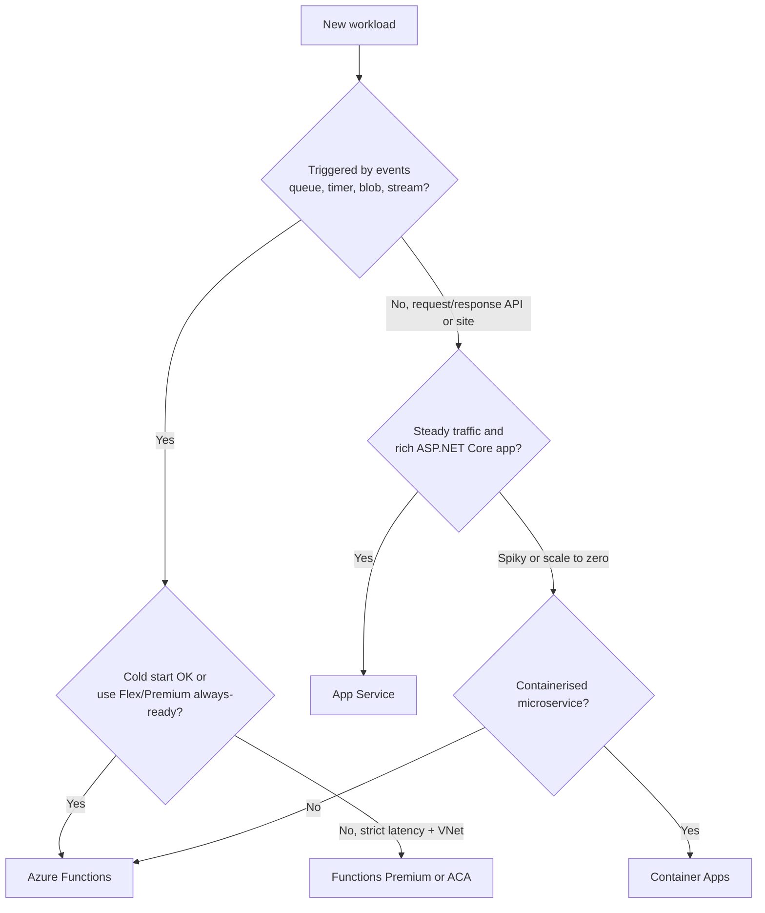

### Why it matters
Choosing Functions for a chatty, low-latency monolith API gives cold starts and sprawl; choosing App Service for sporadic file-processing wastes money 24×7.

### Internals worth stating
- Functions HTTP-triggered apps can use **ASP.NET Core integration** (`ConfigureFunctionsWebApplication`) so you keep controllers/middleware.
- Functions scale **independently per function app** (Flex: per function group), App Service per plan — so a spike in one app within a shared plan can starve others.
- Both support slots (Functions slots on Premium/Dedicated/Flex differently **(verify current)**), managed identity, VNet integration, Easy Auth.

### Example
Hybrid pattern: **App Service API accepts a request → enqueues to Service Bus → Function (queue trigger) processes asynchronously** (queue-based load leveling). The API stays responsive (202 Accepted + status URL); the Function scales with backlog.
```csharp
app.MapPost("/reports", async (ReportRequest r, ServiceBusSender sender) =>
{
    var id = Guid.NewGuid();
    await sender.SendMessageAsync(new ServiceBusMessage(BinaryData.FromObjectAsJson(new { id, r })) { MessageId = id.ToString() });
    return Results.Accepted($"/reports/{id}", new { id });
});
```

### When to use which / when NOT
- App Service: steady APIs, existing ASP.NET apps, need slots/Always On/predictable latency, team new to serverless.
- Functions: event handlers, scheduled jobs, spiky, integration glue, fan-out processing.
- **NOT** Functions: large cohesive APIs with shared in-memory state, strict p99 latency without always-ready, heavy CPU > time limits. **NOT** App Service: wanting scale-to-zero or per-event billing.

### Pros / cons / trade-offs
Cost vs latency (scale-to-zero ⇄ cold start); simplicity vs granularity (one app vs many functions); portability (Functions bindings are Azure-specific; plain ASP.NET Core is portable).

### Mistakes
"Everything serverless"; "everything in one plan"; microservices as dozens of HTTP functions calling each other; using Consumption for latency-sensitive APIs; ignoring Premium/Flex always-ready; not separating APIs from background workers.

### Perf / scale / reliability / security
Same identity/network model; protect HTTP Functions behind APIM or Easy Auth (function keys are *not* user auth); size concurrency on both; use health checks (App Service) and retries/DLQ (Functions).

### Troubleshooting
Slow first call (Functions cold start vs App Service no Always On); throttled downstream because Functions scaled out too far (set `maxConcurrentCalls`, `WEBSITE_MAX_DYNAMIC_APPLICATION_SCALE_OUT`).

### Related
Chapters 1, 2, 19; [Serverless](../02-architectural-styles/02-serverless/serverless.md).

### Interview Q&A
**Q: Customer wants a REST API with ~50 rps steady plus nightly batch imports. Choose.** A: App Service (or ACA) for the API (steady, latency sensitive); Functions timer/queue triggered for the nightly import — different scaling profiles, separate deployables, shared Service Bus/SQL. Justify with cost, cold start, blast radius.
*Follow-up:* "Why not put everything in Functions?" → Cold start/latency, per-function coupling, observability complexity, and no benefit for steady load.

---

## 19. Azure Container Apps vs AKS

### Simple view
ACA = "run my containers, I don't want to run Kubernetes". AKS = "give me Kubernetes."

### Architect depth
| Dimension | Container Apps | AKS |
|---|---|---|
| K8s API access | No | Full |
| Ops burden | Very low | High (upgrades, node pools, networking, policy) |
| Scale | HTTP + KEDA, to zero | HPA/KEDA/CA/NAP, to zero only with KEDA (nodes remain) |
| Extensibility | Dapr, jobs, revisions | CRDs, operators, Helm, service mesh, custom schedulers |
| Networking | VNet integration, internal/external ingress | Any CNI, NetworkPolicy, mesh, multiple ingress controllers |
| Cost model | Per-second vCPU/memory (consumption) or dedicated profile | Pay for nodes (idle capacity) + your ops time |
| Portability | Container images portable; platform config not | Manifests/Helm portable across K8s |
| Team fit | App teams, small platform team | Dedicated platform/SRE team |

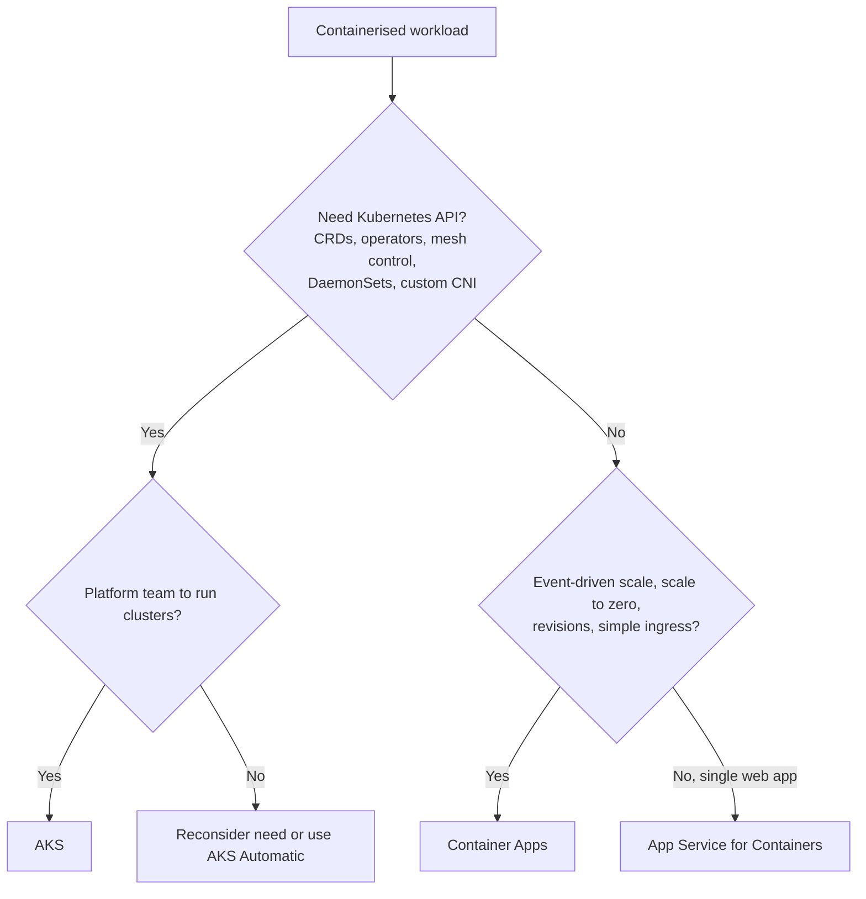

### Why it matters
Kubernetes is a platform *for building platforms*. Most product teams want an app runtime; the operational tax of AKS must be justified by capabilities.

### How to evaluate (use as a checklist)
1. **Capability gap:** can you *name* what ACA lacks that you need?
2. **Team:** who patches nodes, handles upgrades, writes policies at 2 a.m.?
3. **Scale/cost shape:** many small bursty services favour ACA consumption; steady high-density workloads can be cheaper on well-packed AKS nodes/reservations.
4. **Compliance/network:** need for custom egress inspection, service mesh mTLS policy, privileged workloads?
5. **Exit strategy:** containers + 12-factor config keep you portable either way.

### Example
Migration path: start on ACA; keep images/health probes/config via env vars; if a CRD/mesh need appears, move that workload to AKS — the Docker artefacts are unchanged. See the [Docker guide](../09-containers-and-docker/docker-and-containerization.md) (Docker vs Kubernetes, orchestration fundamentals).

### When / when NOT
- ACA: default for microservices/workers/jobs; small teams; event-driven.
- AKS: platform engineering orgs, GPU/stateful/operator-heavy, existing K8s investment, mesh/policy needs.
- **NOT AKS** for "future flexibility" or because of résumé-driven design. **NOT ACA** if you need DaemonSets, privileged containers, bespoke schedulers.

### Pros / cons
ACA: speed and low ops vs less control and some platform limits. AKS: power/portability vs complexity, cost of expertise, security surface.

### Mistakes
AKS for 3 services; ACA with `min 0` for latency-critical APIs; running stateful databases in containers without a backup/HA plan; ignoring AKS upgrade cadence; one cluster for all environments.

### Perf / scale / reliability / security
Both: zone spread, probes, resource requests, managed identity, private networking, image scanning. AKS: network policies, Azure Policy, PDBs, node image upgrades. ACA: revision traffic split, internal ingress behind APIM.

### Troubleshooting
ACA: system logs for probe/pull failures. AKS: `kubectl describe/events`, node pressure, CNI IP exhaustion, autoscaler logs.

### Related
Chapters 3, 4, 8; [Cloud-native Azure doc](../07-advanced-topics/Architecting%20Cloud-Native%20NET%20Apps%20for%20Azure.md).

### Interview Q&A
**Q: A team proposes AKS for 6 .NET services and 2 workers. Your response?** A: Ask which Kubernetes-only capability they need; absent that, recommend ACA with KEDA scale rules, APIM at the edge, managed identity and private networking — lower TCO and faster delivery; document the decision as an ADR with the trigger conditions that would justify revisiting AKS.

---

## 20. Service Bus vs Event Grid vs Event Hubs

> Deep dive on Service Bus patterns and the full comparison with decision scenarios: [Azure Service Bus and Messaging Patterns](../13-azure-service-bus-and-messaging-patterns/azure-service-bus-and-messaging-patterns.md). This chapter keeps the architecture-level view.

### Simple view
- **Service Bus** = reliable *work and business messages* ("do this", "this order was placed").
- **Event Grid** = *reactive notifications* ("something happened"), fan-out, push.
- **Event Hubs** = *firehose stream/log* of telemetry events, replayable.

### Architect depth
| | Service Bus | Event Grid | Event Hubs |
|---|---|---|---|
| Intent | Command/business event | Event notification | Event streaming |
| Model | Broker (queue/topic) | Push router (pull in namespaces) | Partitioned log, consumer pulls |
| Delivery | At-least-once, peek-lock, exactly-once-ish with dedupe | At-least-once, retry/DLQ to blob | At-least-once, checkpoint |
| Ordering | Sessions (per key) | None | Per partition |
| Replay | No (DLQ only) | No | Yes (retention window, Capture) |
| Per-message settlement/DLQ | Yes | Retry + DLQ only | No |
| Throughput | Thousands–tens of thousands/s | High, per event | Millions/s |
| Typical consumers | Services processing work | Functions/webhooks/handlers | Stream processors, analytics |
| Latency | ms–tens ms | sub-second typical | ms; consumer-pull |

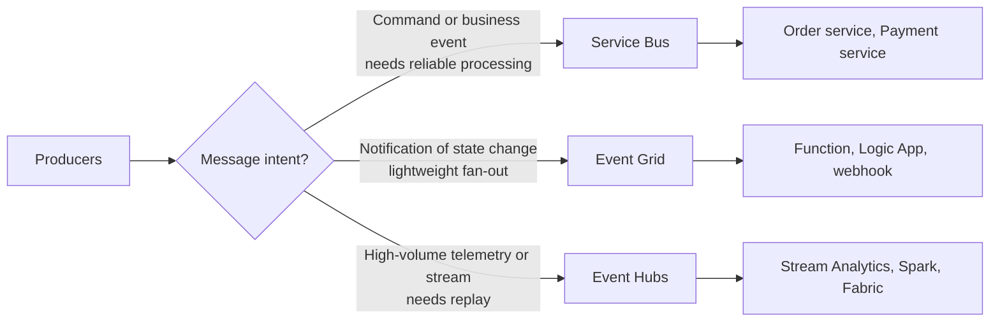

### Combinations you should know
- **Blob → Event Grid → Service Bus → worker** (reactive trigger + reliable processing).
- **Event Hubs (telemetry) → stream processor → Service Bus (alerts/commands)**.
- **Outbox → Service Bus topic → subscriptions per service**, with Event Grid for platform events.

### When / when NOT / mistakes
Using Event Hubs as a work queue (no DLQ/settlement), Event Grid as a log, Service Bus for 100k msgs/s telemetry; one tool for everything out of familiarity.

### Interview Q&A
**Q: Order placed → inventory, billing, email must react. Which?** A: Service Bus topic with one subscription per consuming service (reliable, filtered, DLQ, independent retry), published via transactional outbox. Event Grid only if consumers are lightweight and loss-tolerant notifications suffice.
**Q: IoT sends 200k events/s and analysts need replay.** A: Event Hubs with partition key = deviceId, Capture to ADLS, consumer groups for each processor; alerts to Service Bus.

---

## 21. Azure SQL vs Cosmos DB

### Simple view
SQL = relational, strongly consistent, joins and transactions. Cosmos DB = globally distributed, horizontally partitioned NoSQL with tunable consistency and predictable single-digit-ms latency.

### Architect depth
| | Azure SQL | Cosmos DB (NoSQL API) |
|---|---|---|
| Model | Relational, schema, joins, constraints | JSON documents, partition key, denormalised |
| Scale | Scale-up (+ read replicas, Hyperscale); sharding is DIY | Scale-out by physical partitions automatically |
| Consistency | Strong (ACID, multi-statement transactions) | 5 levels (strong…eventual); transactions *within a partition* |
| Query | T-SQL, ad-hoc joins, reporting | SQL-like over JSON, cross-partition queries cost more RUs |
| Pricing | Compute/storage (vCore/DTU) | RU/s (provisioned/autoscale/serverless) + storage |
| Global distribution | Geo-replication/failover groups (async) | Multi-region writes, turnkey |
| Strengths | OLTP with relations, reporting, complex integrity | Massive scale, low-latency key lookups, flexible schema, global |

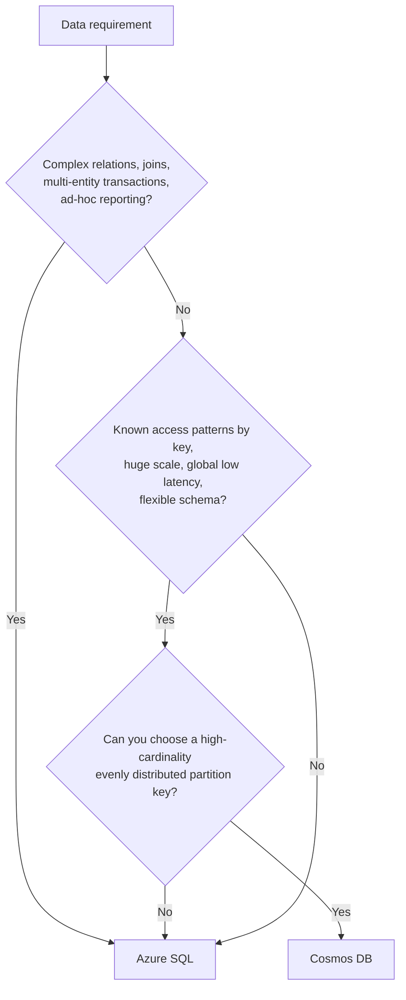

### Why it exists
Relational engines scale up well but sharding is hard; Cosmos trades relational flexibility for turnkey horizontal scale and global distribution.

### How Cosmos works internally
Items are routed by **partition key hash** to **logical partitions** (≤20 GB each) mapped to **physical partitions** (each with RU/s share). Every operation costs **Request Units**; a **hot partition** gets throttled (429) even if total RU/s are unused. **Change feed** emits ordered changes per partition key (great for projections, CQRS read models, event-driven integration). Choose partition key so that most queries are **single-partition** and write load spreads evenly (e.g., `tenantId` + `id` hierarchical keys).

### Examples
```csharp
// Cosmos: point read is the cheapest op (1 RU for 1 KB); always pass partition key
var item = await container.ReadItemAsync<Order>(id, new PartitionKey(tenantId), cancellationToken: ct);
// Avoid cross-partition scans in hot paths
var q = new QueryDefinition("SELECT * FROM c WHERE c.tenantId = @t AND c.status = @s").WithParameter("@t", tenantId).WithParameter("@s", "Open");
using var it = container.GetItemQueryIterator<Order>(q, requestOptions: new() { PartitionKey = new PartitionKey(tenantId) });
```

### When / when NOT
- **SQL:** default for line-of-business OLTP, strong integrity, reporting, team T-SQL skills.
- **Cosmos:** catalogues, profiles, IoT/event documents, session/state, multi-region active-active, very high throughput with key-based access.
- **NOT Cosmos:** relational/reporting-heavy, unknown access patterns, cost-sensitive small workloads needing joins, wanting ad-hoc analytics. **NOT SQL:** need multi-region writes with low latency, or schemaless at planetary scale.

### Pros / cons
SQL: familiarity, integrity, tooling; limits scaling out/global writes. Cosmos: elasticity, SLA-backed latency, global; RU cost modelling, partition design risk, denormalisation/consistency burden, limited cross-document transactions.

### Mistakes
Cosmos with a low-cardinality or monotonically increasing partition key (hot partition); modelling relational data with cross-partition joins; ignoring RU charge in queries; indexing everything (default) without tuning; choosing Cosmos "because NoSQL scales"; **polyglot persistence with no sync/consistency plan**.

### Perf / scalability / reliability / security
Cosmos: autoscale RU/s, indexing policy, TTL, integrated cache, session consistency for most apps, Entra RBAC (disable keys), private endpoints. SQL: see Chapter 9.

### Troubleshooting
Cosmos 429s → check `x-ms-request-charge`, hot partition metrics (*Normalized RU Consumption by PartitionKeyRangeId*); high latency → cross-partition queries, large documents, region distance. SQL → Chapter 9 flow.

### Related
Chapter 9, [CQRS](../03-architectural-patterns/02-CQRS-pattern/CQRS-pattern.md) (SQL write model, Cosmos read model via change feed), [Cloud-native data patterns](../07-advanced-topics/Architecting%20Cloud-Native%20NET%20Apps%20for%20Azure.md).

### Interview Q&A
**Q: When do you pick Cosmos over SQL, and what is the biggest risk?** A: Pick it when access patterns are known, scale/latency/global distribution requirements exceed what vertical scaling and replicas can deliver, and data is naturally document-shaped. Biggest risk: partition key design — a poor key causes hot partitions, throttling and expensive cross-partition queries that are hard to fix later (requires data migration).

---

## 22. Blob Storage vs database file storage

### Simple view
Store the *bytes* of files in Blob Storage and the *metadata and pointers* in your database.

### Architect depth
| | Blob Storage | Database (varbinary(max)/FILESTREAM) |
|---|---|---|
| Cost/GB | Very low (tiers: Hot→Archive) | High (premium IOPS, backups multiply) |
| Scale | Petabytes, parallel I/O | Bloats DB, backup/restore time, replication cost |
| Direct client access | SAS/CDN, bypass API | Must stream through API/DB |
| Transactional consistency with metadata | Eventual/compensating (two stores) | Single transaction |
| Operations | Lifecycle, immutability, tiering | Index/stat maintenance impacted, larger log |

**Default decision:** Blob for anything beyond small (~<1 MB) opaque payloads. Use DB blobs only if transactional atomicity with row data is mandatory and sizes are tiny.

### How the pattern works (claim-check + SAS)
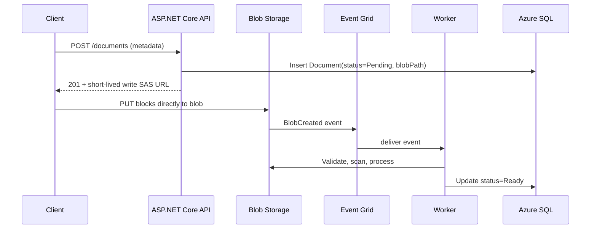
**Consistency strategy:** DB row created first with `Pending`; a reconciler job finds rows pending > N hours or blobs without rows (orphans) and cleans up — because the two stores cannot share a transaction.

### Tiers, lifecycle, security
- Tiers: Hot (frequent), Cool (≥30 days), Cold (≥90 days), Archive (≥180 days, hours to rehydrate). Early-deletion fees apply; **lifecycle policies** automate tier/delete by age or last-access.
- **SAS best practices:** user-delegation SAS, shortest expiry, minimal permissions, single-blob scope, HTTPS-only, IP-restrict if feasible, never log URLs with tokens, stored access policy for revocation (service SAS).
- **Validate uploads:** content type sniffing, size limits, antivirus/Defender for Storage, don't trust client file names, put uploads in a quarantine container until scanned.

### Example
Lifecycle rule (Bicep fragment):
```bicep
resource lifecycle 'Microsoft.Storage/storageAccounts/managementPolicies@2023-05-01' = {
  parent: st, name: 'default'
  properties: { policy: { rules: [ { name: 'age-out', enabled: true, type: 'Lifecycle'
    definition: { filters: { blobTypes: [ 'blockBlob' ], prefixMatch: [ 'invoices/' ] }
      actions: { baseBlob: { tierToCool: { daysAfterModificationGreaterThan: 30 }, tierToArchive: { daysAfterModificationGreaterThan: 180 }, delete: { daysAfterModificationGreaterThan: 2555 } } } } } ] } }
}
```

### When / when NOT
Use Blob for documents/media/backups/exports. Use the DB only for tiny, transactionally-bound binary data. **NOT Blob** as a mounted shared file system for legacy apps (Azure Files).

### Pros / cons
Blob: cost/scale/CDN vs two-store consistency and operational glue. DB: simple atomicity vs cost, bloat, slow backups.

### Mistakes
Images in SQL; streaming every download through the API; long-lived SAS; no orphan cleanup; archive tier for hot data; single huge container with no naming strategy; no content scanning.

### Perf / scale / reliability / security
Parallel uploads, CDN, ZRS/GZRS, versioning + soft delete, private endpoint, disable shared key. 

### Troubleshooting
403 on SAS (expiry/clock skew/permissions/IP), CORS errors for browser uploads (configure storage CORS), orphan blobs (reconcile), slow listing (flat prefix design).

### Related
Chapter 10, [claim-check pattern in the Service Bus guide](../13-azure-service-bus-and-messaging-patterns/azure-service-bus-and-messaging-patterns.md), [Enterprise application patterns](../03-architectural-patterns/enterprise-application-patterns.md).

### Interview Q&A
**Q: Why not store PDFs in SQL for transactional consistency?** A: Cost, DB bloat, slower backups/restores/replication, API bottleneck. Instead use Blob + metadata row with a status state machine and a reconciler; consistency is eventual but acceptable and operationally far cheaper.

---

## 23. Redis caching architecture

### Simple view
Keep hot data in memory next to the app; fall back to the database on a miss; expire or invalidate when data changes.

### Architect depth
Cache layers: **L1 in-process** (`IMemoryCache`, nanoseconds, per-instance) and **L2 distributed** (Redis, sub-ms, shared). .NET **`HybridCache`** (GA since .NET 9) combines L1+L2 with **stampede protection** (single-flight per key), serialization, tags, and configurable expiry — recommended over hand-rolled `IDistributedCache` code.

### Cache-aside flow
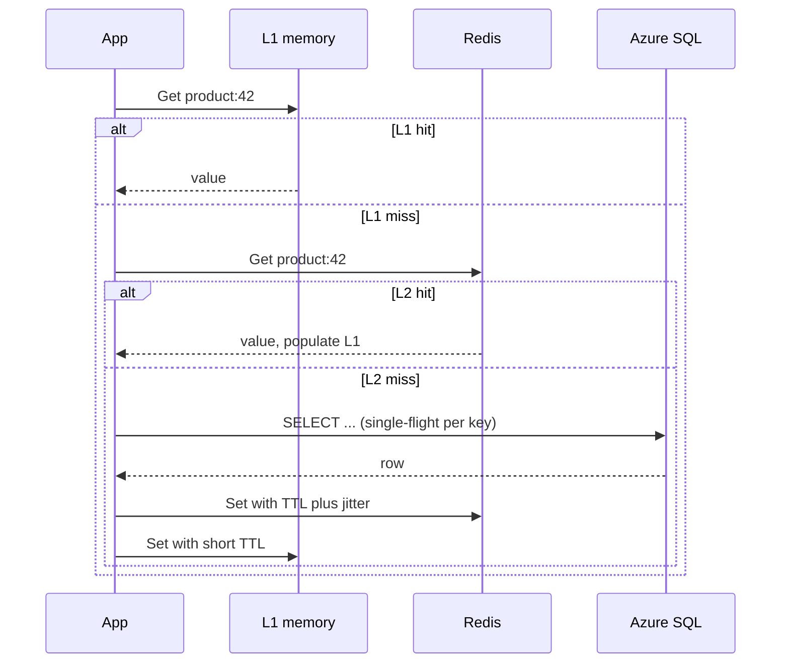

### Example
```csharp
builder.Services.AddStackExchangeRedisCache(o => o.Configuration = "cache-prod.redis.cache.windows.net:6380,ssl=True"); // L2 (or Entra-based config)
builder.Services.AddHybridCache(o =>
{
    o.MaximumPayloadBytes = 1024 * 1024;
    o.DefaultEntryOptions = new HybridCacheEntryOptions { Expiration = TimeSpan.FromMinutes(10), LocalCacheExpiration = TimeSpan.FromMinutes(1) };
});

public sealed class ProductService(HybridCache cache, AppDb db)
{
    public ValueTask<ProductDto?> GetAsync(int id, CancellationToken ct) =>
        cache.GetOrCreateAsync($"product:v2:{id}",                      // version in key for schema changes
            async token => await db.Products.AsNoTracking().Where(p => p.Id == id).Select(p => new ProductDto(p.Id, p.Name, p.Price)).FirstOrDefaultAsync(token),
            tags: new[] { "products" }, cancellationToken: ct);

    public async Task UpdateAsync(Product p, CancellationToken ct)
    {
        await db.SaveChangesAsync(ct);
        await cache.RemoveAsync($"product:v2:{p.Id}", ct);              // invalidate on write
    }
}
```

### Invalidation, stampede, eviction
- **Invalidation:** TTL (simple, bounded staleness) + explicit delete on write + event-driven invalidation (domain event / Service Bus / change feed) for cross-service caches. "There are only two hard things…" — prefer short TTLs and accept bounded staleness.
- **Stampede (thundering herd):** many requests miss simultaneously and hit the DB. Defences: single-flight (HybridCache), TTL **jitter**, stale-while-revalidate, request coalescing, pre-warming, negative caching with short TTL.
- **Eviction:** at `maxmemory` Redis evicts by policy (`allkeys-lru`/`volatile-lru`/`noeviction`). Decide intentionally; keys without TTL under `volatile-*` are never evicted → OOM risk.
- **Consistency:** two-store updates are racy (update DB then delete cache; a concurrent reader may re-populate stale). Mitigate with short TTL, versioned keys, or delayed double-delete for critical data.
- **Security:** never cache per-user data under shared keys; include tenant/user in the key; encrypt sensitive cached values; private endpoint.
- **Resilience:** treat the cache as optional — on failure fall back to DB with circuit breaker + timeouts (otherwise Redis outage = outage).

### When / when NOT
Use for read-heavy, expensive, tolerant-to-staleness data; rate-limit counters; session/token caches. **NOT** for source of truth, strongly consistent financial balances, or write-heavy data with low reuse.

### Pros / cons
Latency/DB offload vs staleness, complexity, memory cost, new failure mode.

### Mistakes
Caching without measuring hit ratio; unbounded keyspace (per-query keys); no TTL; large objects; caching errors; double serialization; cache keys without versioning/tenant; cache as a queue/lock service without fencing tokens.

### Perf / scale / reliability / security
Monitor hit ratio, evictions, latency, server load, connected clients; cluster for scale; avoid hot keys (replicate via L1); backoff on reconnect.

### Troubleshooting
Low hit ratio → TTL too short/keys too specific; timeouts → thread-pool starvation (sync-over-async), big values, slow commands; stale data → missing invalidation path.

### Related
Chapter 11, [distributed-systems patterns: caching](../03-architectural-patterns/distributed-systems-patterns.md), [ASP.NET Core internals: output caching, HybridCache](../10-aspnet-core-web-api-internals/aspnet-core-web-api-internals.md).

### Interview Q&A
**Q: How do you prevent a cache stampede after a Redis failover wipes the cache?** A: Single-flight loading (HybridCache), jitter, rate-limited DB access with bulkhead, stale-while-revalidate/L1 fallback, gradual warm-up, and capacity headroom on the DB.
**Q: DB update then cache delete vs delete then DB update?** A: Update-then-delete is generally safer (a reader between steps sees old value for a brief window), but races exist; critical data uses short TTL/versioning or event-driven invalidation.

---
## 24. API Management as API gateway

### Simple view
Put APIM in front of your backends so security, throttling, versioning and monitoring are applied consistently in one place.

### Architect depth
APIM implements the [API Gateway pattern](../03-architectural-patterns/04-api-gateway/api-gateway.md) as a managed service. Chapter 8 covered the mechanics; here is the *design* view: what belongs in the gateway, what does not, and how to keep it from becoming the new monolith.

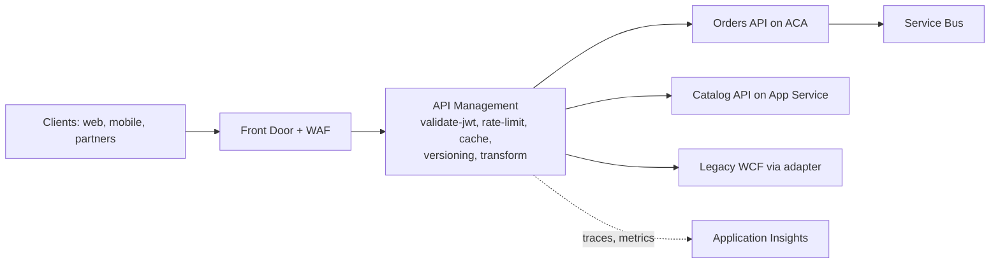

### Gateway responsibilities (good) vs anti-responsibilities (bad)
| Belongs in APIM | Does NOT belong |
|---|---|
| JWT/OIDC validation, audience/scope/role checks (coarse) | Business rules, per-entity authorisation |
| Rate limiting & quotas by key/subscription/user | Workflow orchestration, long-running aggregation |
| Request validation against OpenAPI schema | Data access or heavy transformations |
| Response caching, compression | State |
| Versioning/revisions, URL rewrite, header normalisation | Hiding broken API design |
| Backend routing, retry, **circuit breaker** | Replacing service-level authz and input validation |
| Analytics, correlation id injection | Secrets embedded in policy XML (use named values + Key Vault) |

### Key design topics
- **Versioning strategy:** path (`/v2/orders`) is the most cacheable and discoverable; header/query alternatives exist. Use **revisions** for non-breaking iterations; **versions** for breaking changes; publish deprecation headers and sunset dates.
- **Authentication layers:** Entra ID/OAuth2 JWT validated in APIM; backend *re-validates* (defence in depth) or trusts a gateway-signed token over a private path. Subscription keys identify *consumers/products*, not users — do not treat them as authentication.
- **Rate limiting:** `rate-limit` (per subscription, coarse), `rate-limit-by-key` (by user/IP/claim), `quota-by-key` (long windows). Return `429` with `Retry-After`. Use a distributed key (APIM counters are per-gateway unit in multi-instance setups, so counts are approximate **(verify current)**).
- **Backend protection:** backend reachable only from APIM (private networking). Otherwise attackers bypass the gateway entirely.
- **Resilience:** `retry` policy for idempotent GETs only; backend **circuit breaker**; sensible timeouts; fallback responses.
- **Self-hosted gateway:** containerised gateway deployed next to on-prem/edge backends, configuration pulled from the cloud management plane; use for hybrid ([migration guide: hybrid](../11-cloud-migration-and-modernization/cloud-migration-and-legacy-modernization.md)).
- **Multi-region:** Premium multi-region deployment or separate instances behind Front Door; config as code (DevOps Resource Kit / `apiops`).
- **Developer experience:** developer portal, OpenAPI as the source of truth, mock responses for contract-first development.

### Example: transform and version a legacy backend
```xml
<inbound>
  <base />
  <rewrite-uri template="/legacy/orders/{orderId}" />          <!-- hide legacy URL shape -->
  <set-backend-service backend-id="legacy-orders" />
  <validate-content unspecified-content-type-action="prevent" max-size="102400" size-exceeded-action="prevent" errors-variable-name="errs">
    <content type="application/json" validate-as="json" action="prevent" />
  </validate-content>
</inbound>
<outbound>
  <base />
  <find-and-replace from="legacyFieldName" to="fieldName" />
  <set-header name="Deprecation" exists-action="override"><value>true</value></set-header>
</outbound>
```

### When / when NOT
Use when ≥3 APIs/consumers, partners, or governance needed. **Not** for one internal service where ACA ingress/Front Door suffices, and **not** as an ESB.

### Pros / cons / trade-offs
Consistency and speed of change vs cost, extra hop, operational dependency, policy sprawl; Premium for HA/multi-region vs Consumption for spiky low-volume (cold starts, fewer features); v2 tiers offer faster provisioning/scaling **(verify current)**.

### Mistakes
Using APIM as orchestrator; skipping backend lockdown; subscription keys as auth; global policies nobody owns; no CI/CD for APIM config (portal edits drift); caching authenticated responses without `vary-by`; leaking internal errors (`on-error` should sanitise).

### Perf / scalability / reliability / security
Cache GETs; watch gateway capacity %, latency, backend duration; scale units; zone redundancy; WAF at Front Door; TLS 1.2+, disable legacy ciphers; mTLS client cert validation where needed; OWASP API Top 10 mapping (BOLA → still must be enforced in the service; excessive data exposure → response filtering; unrestricted resource consumption → quotas).

### Troubleshooting
Trace with `Ocp-Apim-Trace`, check `ApiManagementGatewayLogs`; differentiate APIM-generated (401/403/429) vs backend (5xx) using `BackendResponseCode`; DNS/NSG issues to private backends cause 500/timeouts.

### Related
Chapter 8; [API Gateway pattern](../03-architectural-patterns/04-api-gateway/api-gateway.md); [ASP.NET Core internals: API security essentials](../10-aspnet-core-web-api-internals/aspnet-core-web-api-internals.md).

### Interview Q&A
**Q: What does APIM *not* protect you from?** A: Broken object-level authorisation inside your services, business-logic abuse, and direct backend access if the backend is publicly reachable. Gateway = coarse-grained perimeter; services enforce fine-grained authorisation.
**Q: How would you migrate consumers off v1 to v2 safely?** A: Run both versions via APIM, publish deprecation/sunset headers, monitor v1 usage by subscription, notify consumers, apply rate-limit decay or brownouts before removal.

---

## 25. Managed Identity vs connection strings and secrets

### Simple view
Prefer "who you are" (identity) over "what you know" (a password in config). Identity-based auth removes secrets that can leak, expire or need rotation.

### Architect depth
| | Managed identity (Entra token) | Connection string/key/SAS |
|---|---|---|
| Secret exists? | No | Yes (must be stored, rotated, protected) |
| Rotation | Automatic (platform) | Manual/automated (Key Vault + app restart/reload) |
| Granularity | RBAC per resource, per role | Often full access to the resource (account keys) |
| Audit | Per-principal in Entra/resource logs | Shared key → "who?" unknown |
| Revocation | Remove role assignment | Rotate key → outage risk |
| Local dev | `DefaultAzureCredential` (CLI/VS) | Copy secret to laptop (risk) |
| Works with | Most first-party services (SQL, Storage, Service Bus, Event Hubs, Key Vault, Cosmos, ACR, AI) | Everything incl. third-party |

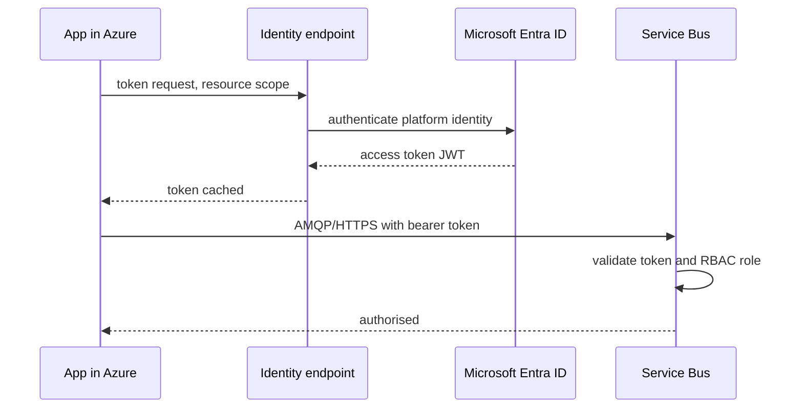

### System- vs user-assigned (decision)
- **System-assigned:** one resource, simple, auto-cleanup. Re-created resource ⇒ new principal ⇒ re-grant.
- **User-assigned:** shared by several resources (app + slot + function), created *before* the resource so role assignments exist at first deployment (avoids "app starts before RBAC propagates"), survives redeploys. Recommended for IaC pipelines and blue/green with slots.

### DefaultAzureCredential pitfalls
1. **Ambiguous chain** in prod: environment variables (leftover `AZURE_CLIENT_SECRET`) can silently win; set `ExcludeEnvironmentCredential` etc. or use `ManagedIdentityCredential` explicitly.
2. **Latency on failure:** chain tries sources sequentially (IMDS probing can take seconds when unavailable) — noticeable at startup/in tests.
3. **Multiple user-assigned identities** require `ManagedIdentityClientId`.
4. **Not caching:** create one credential/client per process (singleton), not per call.
5. **Local dev ≠ prod identity:** developer permissions differ; test with the real MI in a dev environment.

### Federated credentials for CI/CD and Kubernetes
No stored secret: GitHub Actions OIDC, Azure DevOps workload identity federation, AKS Workload Identity. Scope the federated credential's *subject* tightly (`repo:org/repo:environment:prod`), not `repo:org/*`.

```yaml
# GitHub Actions
permissions: { id-token: write, contents: read }
steps:
  - uses: azure/login@v2
    with: { client-id: ${{ vars.AZURE_CLIENT_ID }}, tenant-id: ${{ vars.AZURE_TENANT_ID }}, subscription-id: ${{ vars.AZURE_SUBSCRIPTION_ID }} }
  - run: az deployment group create -g rg-prod -f main.bicep
```

### When secrets are still needed
Third-party APIs, legacy systems without Entra, webhook signing secrets, SMTP creds. Store in Key Vault, fetch via MI, cache, rotate on a schedule; consider *dual-secret overlap* during rotation.

### Pros / cons
Strong security posture and ops simplicity vs identity/RBAC design effort, propagation delays and local-dev friction.

### Mistakes
Giving MI `Contributor`/`Owner`; mixing `UseDevelopmentStorage` configs; disabling key auth before every client supports identity (check Functions/triggers, legacy SDKs); not planning break-glass access.

### Perf / scale / reliability / security
Token endpoint is highly available but rate-limited — cache; handle 401 by refreshing; least privilege; monitor sign-in logs for service principals; `disableLocalAuth`/`allowSharedKeyAccess:false` via Azure Policy to *enforce*.

### Troubleshooting
See Chapter 13; enable Azure SDK logging; check role assignments at the right *scope* (resource group vs resource) and wait for propagation; `az account get-access-token` locally to verify identity.

### Related
Chapters 12, 13, 26; [Broader Architect Skills](../06-broader-architect-skills/Broader%20Architect%20Skills.md).

### Interview Q&A
**Q: "How do you handle secrets in Azure?"** A: *Eliminate* them first (MI + RBAC, federated credentials). For the rest, Key Vault with RBAC, private endpoint, soft-delete/purge protection, cached reads, rotation via Event Grid-triggered automation, and policy to deny local auth/keys. Never in repos, images, pipelines variables in clear, or logs.
*Follow-up:* "Your app can't use identity for SQL in a legacy tool — now what?" → SQL auth with long random password stored in Key Vault, rotated, restricted network path, least-privilege login; plan to retire.

---

## 26. Key Vault integration

### Simple view
Your app reads secrets from Key Vault at runtime — via configuration, platform references, or SDK — using its managed identity.

### Architect depth
Integration options and trade-offs:
| Option | How | Pros | Cons |
|---|---|---|---|
| **Key Vault reference (App Service/Functions)** | App setting `@Microsoft.KeyVault(SecretUri=...)` resolved by the platform | No code; rotation picked up; app is unaware | Needs app restart/refresh timing **(verify current)**; platform-resolution failures show as literal string |
| **ACA/AKS secrets from KV** | ACA `keyVaultUrl` secret; AKS Secrets Store CSI driver / External Secrets | Native | Changes may create new revision/pod restart |
| **`AddAzureKeyVault` config provider** | SDK pulls on startup, optional reload | Works anywhere; hot reload | App-level dependency; throttling; startup coupling |
| **Direct SDK calls** (`SecretClient`) | On demand | Full control (keys, certs, crypto ops) | You manage caching/retry |
| **Crypto operations** | `CryptographyClient` wrap/unwrap/sign | Key never leaves vault | Latency, throttling → envelope encryption |

### Design guidance
- **RBAC vs access policies:** use RBAC (`Key Vault Secrets User` for apps; `Crypto User` for crypto; humans via PIM-eligible roles). Access policies lack scope inheritance and are harder to audit.
- **Vault topology:** one vault per *application × environment* (blast radius, throttling isolation, RBAC clarity); shared vault only for truly shared platform certs. Avoid cross-environment vault sharing.
- **Rotation:** two models — (1) **auto-rotation** for supported keys/certs and storage keys; (2) **event-driven**: Event Grid `SecretNearExpiry` → Function rotates credential at target system → writes new secret version → apps pick it up (reload interval/restart). Use **two-secret overlap** (primary/secondary) to avoid downtime.
- **Soft delete & purge protection:** both on for production; understand that a deleted vault *name* remains reserved during retention.
- **Availability:** KV is regional with built-in replication to paired region (read-only failover); design apps to start with cached last-known-good if KV is briefly unreachable; for DR, replicate secrets by IaC/pipeline or use backup/restore.
- **Throttling:** per-vault limits per 10 seconds per operation type; cache secrets, don't call per request; honour `Retry-After`.
- **Network:** private endpoint + `privatelink.vaultcore.azure.net` private DNS zone; disable public access; trusted-service bypass for platform integrations as needed.

### Examples
```bicep
// App Service setting using Key Vault reference with user-assigned identity
resource app 'Microsoft.Web/sites@2023-12-01' = {
  name: 'app-orders', location: location, identity: { type: 'UserAssigned', userAssignedIdentities: { '${uami.id}': {} } }
  properties: { keyVaultReferenceIdentity: uami.id, serverFarmId: plan.id
    siteConfig: { appSettings: [ { name: 'ConnectionStrings__Sql', value: '@Microsoft.KeyVault(SecretUri=https://kv-orders-prod.vault.azure.net/secrets/sql-conn/)' } ] } }
}
```
```csharp
// Resilient secret read with in-memory cache; avoids per-request KV calls
public sealed class SecretCache(SecretClient client, IMemoryCache cache)
{
    public Task<string> GetAsync(string name, CancellationToken ct) =>
        cache.GetOrCreateAsync(name, async e =>
        {
            e.AbsoluteExpirationRelativeToNow = TimeSpan.FromMinutes(10);
            return (await client.GetSecretAsync(name, cancellationToken: ct)).Value.Value;
        })!;
}
```

### When / when NOT
Use for any secret/cert/key. **Not** for non-secret config (App Configuration), large payloads, or high-volume crypto (use envelope encryption: KV protects the key-encryption key; a local data key encrypts data).

### Pros / cons
Central control/audit/rotation vs dependency, throttling and complexity.

### Mistakes
Reading per request; giving apps `Key Vault Administrator`; shared vault across prod/non-prod; no purge protection; failing hard on KV outage at startup; storing config (non-secret) in KV leading to throttling/cost; forgetting that KV references need the right identity (`keyVaultReferenceIdentity`) when using user-assigned MI.

### Perf / scale / reliability / security
Cache with TTL; stagger reload intervals across instances (jitter); monitor 429 and latency; Defender for Key Vault; log to Log Analytics; alert on unusual `SecretGet` volume or access from new IPs.

### Troubleshooting
Reference unresolved (portal shows error) → identity/role/network; app sees old value → refresh interval/restart; `ForbiddenByRbac` vs `ForbiddenByFirewall` messages differentiate causes; private DNS not resolving `*.vault.azure.net` to private IP.

### Related
Chapters 12, 25, 28.

### Interview Q&A
**Q: How do you rotate a database password with zero downtime?** A: Dual-credential strategy: create secondary credential at the DB, update Key Vault to the new secret version, apps reload config/restart gradually, verify no use of old credential (DB audit), then retire the old one. Better: move to MI/Entra auth so there is nothing to rotate.

---

## 27. Azure networking fundamentals

### Simple view
A **Virtual Network (VNet)** is your private IP network in Azure. You carve it into **subnets**, control traffic with **NSGs**, route with **route tables**, connect to others with **peering/VPN/ExpressRoute**, and expose apps via **load balancers/gateways**.

### Architect depth
Building blocks:
- **VNet/subnet:** address space (CIDR) planned up front — overlapping ranges block peering/VPN. Some services need *dedicated/delegated subnets* (App Service VNet integration, ACA environment, APIM v2/Premium, SQL MI, Application Gateway, Bastion `AzureBastionSubnet`, Firewall `AzureFirewallSubnet`).
- **NSG:** stateful L3/L4 allow/deny rules per subnet/NIC (priority-ordered; default rules allow VNet-to-VNet and outbound internet, deny inbound internet). Use **service tags** (`Storage`, `AzureCloud`) and **ASGs**.
- **UDR (route tables):** override system routes (e.g., force 0.0.0.0/0 through Azure Firewall/NVA).
- **Peering:** low-latency private connectivity between VNets (non-transitive!); **hub-spoke** uses a hub with shared services (Firewall, VPN/ExpressRoute gateway, DNS, Bastion) and spokes per workload. **Azure Virtual WAN** automates at scale.
- **DNS:** Azure-provided DNS (168.63.129.16), **Private DNS zones** (linked to VNets), custom DNS/DNS forwarders — the #1 source of private endpoint issues.
- **Egress:** default outbound access (being retired for new subnets **(verify current)**) → use **NAT Gateway** (static IPs, 64k SNAT ports per IP) or Firewall. **SNAT exhaustion** is a classic production failure.
- **Hybrid:** Site-to-site VPN, **ExpressRoute** (private, predictable), P2S VPN.

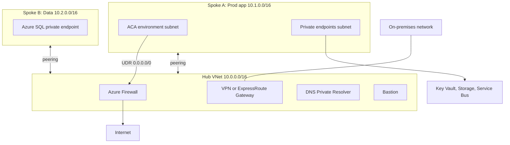

### Edge and load-balancing services (choose correctly)
| Service | Layer | Scope | Use for |
|---|---|---|---|
| **Azure Front Door** (+WAF) | L7 HTTP(S) | Global, anycast, CDN, TLS offload | Global web/API entry, multi-region failover, caching, WAF |
| **Application Gateway** (+WAF) | L7 | Regional | Regional HTTP routing, WAF, path-based/multi-site, private-VNet apps; **App Gateway for Containers** for AKS |
| **Azure Load Balancer** | L4 TCP/UDP | Regional (Standard is zone-redundant) | Non-HTTP, internal L4, NAT |
| **Traffic Manager** | DNS | Global | DNS-based routing for any endpoint (no data path, TTL-bound failover) |
| **Azure Firewall / NVA** | L3–L7 | Hub | Egress filtering, FQDN rules, threat intel |
| **NAT Gateway** | Egress | Subnet | Predictable outbound IP, more SNAT ports |
| **Bastion** | Admin access | VNet | RDP/SSH without public IPs |

### Example (Bicep): subnet with NSG, NAT gateway
```bicep
resource nsg 'Microsoft.Network/networkSecurityGroups@2023-11-01' = { name: 'nsg-app', location: location
  properties: { securityRules: [ { name: 'deny-inet-in', properties: { priority: 4000, direction: 'Inbound', access: 'Deny', protocol: '*', sourceAddressPrefix: 'Internet', sourcePortRange: '*', destinationAddressPrefix: '*', destinationPortRange: '*' } } ] } }
resource vnet 'Microsoft.Network/virtualNetworks@2023-11-01' = { name: 'vnet-spoke-a', location: location
  properties: { addressSpace: { addressPrefixes: [ '10.1.0.0/16' ] }
    subnets: [ { name: 'snet-app', properties: { addressPrefix: '10.1.0.0/24', networkSecurityGroup: { id: nsg.id }, natGateway: { id: nat.id } } }
               { name: 'snet-pe',  properties: { addressPrefix: '10.1.1.0/24', privateEndpointNetworkPolicies: 'Enabled' } } ] } }
```

### When / when NOT
Hub-spoke for multiple workloads/shared inspection; simple single-VNet for small apps. **Not** a flat /16 shared by all teams; **not** Traffic Manager when you need fast failover and WAF (Front Door).

### Pros / cons
Strong isolation/control vs complexity, cost of firewalls/gateways, DNS and routing pitfalls.

### Mistakes
Overlapping CIDRs; undersized subnets (ACA/AKS/CNI IP exhaustion); assuming peering is transitive; NSGs that block Azure platform probes (`AzureLoadBalancer` tag); forgetting UDR asymmetric routing with firewalls; no private DNS strategy; public IPs everywhere "temporarily".

### Perf / scale / reliability / security
Accelerated networking; zone-redundant gateways/firewalls; flow logs/Traffic Analytics; DDoS Protection for public exposure; WAF in prevention mode; segment by tiers; deny-by-default egress with FQDN allow-lists.

### Troubleshooting
**Network Watcher** (IP flow verify, next hop, connection troubleshoot, NSG flow logs); `nslookup`/`Resolve-DnsName` from the workload; effective routes/security rules on NIC; SNAT: `SnatConnectionCount`/`SNAT port exhaustion` diagnostics on App Service (`Diagnose and solve`), fix with `IHttpClientFactory`, connection reuse, NAT Gateway, private endpoints.

### Related
Chapter 28; [Docker networking](../09-containers-and-docker/docker-and-containerization.md); [ASP.NET Core HttpClient / socket exhaustion](../10-aspnet-core-web-api-internals/aspnet-core-web-api-internals.md).

### Interview Q&A
**Q: Front Door vs Application Gateway vs Traffic Manager?** A: Front Door = global L7 with anycast, WAF, caching, fast failover; App Gateway = regional L7 (and good for fronting VNet-private apps); Traffic Manager = DNS-level steering only, TTL-dependent failover, any protocol. Often Front Door (global) → App Gateway or APIM (regional) → app.

---

## 28. Private endpoints and virtual networks

### Simple view
A **private endpoint** gives a PaaS service (SQL, Storage, Key Vault, Service Bus…) a **private IP in your VNet**, so traffic never uses the public internet and you can switch the public endpoint off.

### Architect depth
Three related-but-different mechanisms — a classic interview trap:
| | Private Endpoint | Service Endpoint | VNet integration |
|---|---|---|---|
| Direction | Inbound to PaaS resource | Optimised route to PaaS | Outbound from your PaaS app into a VNet |
| Mechanism | NIC with private IP (Private Link) | Subnet identity over Microsoft backbone, **public IP remains** | App's outbound traffic injected to a delegated subnet |
| Public endpoint can be disabled? | **Yes** | No (firewall allows subnet) | n/a |
| Reachable from on-prem/peered VNets | **Yes** (with DNS) | No | n/a |
| Cost | Per endpoint + data processed | Free | Included (plan-dependent) |
| Scope | Specific resource instance | Whole service type in region | The app |

### How it works internally (DNS is everything)
Without DNS, the app still resolves `sql.database.windows.net` to the **public IP**. Creating a private endpoint adds a CNAME `sql.privatelink.database.windows.net` and you link a **private DNS zone** (`privatelink.database.windows.net`) to the VNet so the name resolves to the private IP.

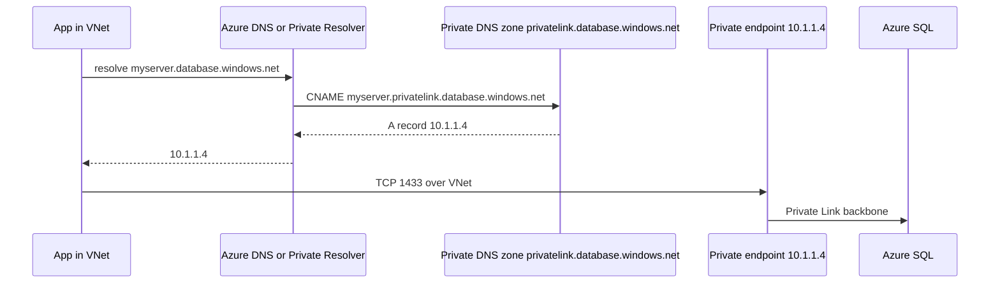
**On-prem / hub-spoke DNS:** on-prem DNS forwards `privatelink.*` zones to **Azure DNS Private Resolver** (or a DNS forwarder in the hub) that is linked to the private DNS zones; spokes use custom DNS = resolver IP. Centralise zones in the hub (one zone per service) to avoid duplicates.

### Example (Bicep + az)
```bicep
resource pe 'Microsoft.Network/privateEndpoints@2023-11-01' = {
  name: 'pe-sql', location: location
  properties: { subnet: { id: peSubnetId }
    privateLinkServiceConnections: [ { name: 'sql', properties: { privateLinkServiceId: sqlServer.id, groupIds: [ 'sqlServer' ] } } ] }
}
resource zone 'Microsoft.Network/privateDnsZones@2020-06-01' = { name: 'privatelink${environment().suffixes.sqlServerHostname}', location: 'global' }
resource link 'Microsoft.Network/privateDnsZones/virtualNetworkLinks@2020-06-01' = {
  parent: zone, name: 'link-spoke-a', location: 'global'
  properties: { virtualNetwork: { id: vnet.id }, registrationEnabled: false }
}
resource group 'Microsoft.Network/privateEndpoints/privateDnsZoneGroups@2023-11-01' = {
  parent: pe, name: 'default'
  properties: { privateDnsZoneConfigs: [ { name: 'cfg', properties: { privateDnsZoneId: zone.id } } ] }
}
```
```powershell
# verify from inside the VNet (Kudu console / VM / ACA exec)
Resolve-DnsName myserver.database.windows.net     # expect 10.x.x.x
Test-NetConnection myserver.database.windows.net -Port 1433
```

### Design: a PaaS-only architecture with no public endpoints
- Front Door (Premium) with **Private Link origins** (or App Gateway) as the *only* public ingress; WAF on.
- App tier: App Service/ACA with **VNet integration** (outbound) + private endpoint/internal ingress (inbound).
- Data/messaging/secrets: SQL, Storage, Service Bus (Premium), Key Vault, Redis, ACR, Event Hubs — private endpoints; `publicNetworkAccess: Disabled`.
- Egress: UDR → Firewall with FQDN allow-list; NAT Gateway if no firewall.
- CI/CD: self-hosted/managed-VNet agents (hosted agents cannot reach private endpoints); deploy via private ACR/ARM.
- Admin: Bastion, JIT, PIM; no public management ports.
- Monitoring: Azure Monitor Private Link Scope (AMPLS) for Log Analytics/App Insights ingestion.
- Policy: deny public network access, deny local auth, require private endpoints (Azure Policy).

### When / when NOT
Use for regulated/sensitive data, zero-trust posture, data exfiltration control. **Not** necessary for every dev/test resource (cost/complexity) — use firewall+identity there.

### Pros / cons
Strong network isolation, on-prem reach vs DNS complexity, cost per endpoint, CI/CD and troubleshooting friction, some features not private-link capable.

### Mistakes
No private DNS zone link (resolves to public IP → blocked); zone linked to wrong VNet; duplicate zones in each spoke with conflicting records; leaving public access enabled "as backup"; NSG/UDR assumptions for private endpoints (policies off by default; enable `privateEndpointNetworkPolicies` to apply); hosted build agents failing; custom DNS not forwarding to 168.63.129.16/Resolver; using service endpoints and believing the resource is private.

### Perf / scale / reliability / security
Private endpoints are regional; plan per-region endpoints for DR (geo-replicas need their own); account for per-endpoint limits; use Private Link for **cross-tenant** service exposure when publishing your own service.

### Troubleshooting
1. `Resolve-DnsName` returns public IP → DNS zone/link/forwarder problem.
2. Resolves private but times out → NSG/UDR/firewall, endpoint in `Pending/Disconnected` state, wrong port.
3. `403` from PaaS firewall → public access disabled and caller isn't going private; check `publicNetworkAccess`.
4. Intermittent → multiple DNS servers disagree; check conditional forwarders.
5. Network Watcher → Connection troubleshoot / Next hop / Effective routes.

### Related
Chapters 27, 31, 35; [Zero Trust](../06-broader-architect-skills/Broader%20Architect%20Skills.md).

### Interview Q&A
**Q: Private endpoint vs service endpoint?** A: Private endpoint = private IP for a *specific* resource instance, supports disabling public access and on-prem access. Service endpoint = optimised route + subnet-based firewall, but the service's public IP remains, scoped to service type, no on-prem reach.
**Q: App can't reach Key Vault after enabling private endpoint?** A: Almost always DNS: confirm the name resolves to the private IP from the workload, check private DNS zone link/forwarders, then NSG/UDR and the vault's firewall settings.

---
## 29. Load balancing and autoscaling

### Simple view
Load balancing spreads requests over healthy instances. Autoscaling adds or removes instances automatically as demand changes.

### Architect depth
**Scale up** (bigger instance) vs **scale out** (more instances). Scale out needs **stateless** services (externalise sessions to Redis/DB, files to Blob). Autoscale types:
- **Reactive, metric-based:** CPU/memory/queue length/HTTP concurrency/custom metrics (Azure Monitor autoscale for App Service/VMSS; KEDA for ACA/AKS/Functions).
- **Scheduled:** known peaks (business hours, month-end).
- **Predictive:** platform forecasts (VMSS predictive autoscale **(verify current)**).
- **Event-driven (KEDA):** scale by *work backlog*, e.g., Service Bus messages per replica — the right signal for workers.

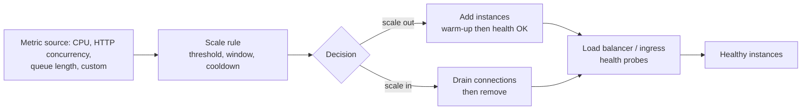

### Key design knobs
- **Min/max instances:** min ≥2 across zones for HA; **max is your cost and downstream-protection guardrail** (don't let 200 instances hammer a 4-vCore SQL DB).
- **Scale-out rule** aggressive (short window), **scale-in** conservative (long cool-down) to avoid **flapping**; keep a hysteresis gap between out/in thresholds (e.g., out at 70% CPU, in at 40%).
- **Right metric:** CPU is a poor proxy for I/O-bound .NET APIs (async) — prefer **HTTP concurrency/requests per instance**, latency, or queue depth/lag per replica.
- **Warm-up:** App Service `applicationInitialization`/health check path, pre-warmed instances (Premium/Functions), ACA startup/readiness probes; don't route traffic until ready.
- **Connection draining / graceful shutdown:** handle `SIGTERM` (`IHostApplicationLifetime`), finish in-flight work, `terminationGracePeriodSeconds`; ASP.NET Core `HostOptions.ShutdownTimeout`.
- **Downstream limits:** scale-out multiplies connections (SQL pool × instances), SNAT ports, Redis connections, rate limits — **scale the bottleneck, not just the front**.
- **Load-balancing algorithms:** round robin, least connections/requests, session affinity (avoid), health-probe based removal; Front Door latency-based routing; AG path-based.
- **Probes:** liveness (restart) vs readiness (traffic) — readiness may check critical dependencies *lightly*; liveness must not (cascading restarts).

### Examples
```bicep
resource autoscale 'Microsoft.Insights/autoscalesettings@2022-10-01' = {
  name: 'as-orders', location: location
  properties: { enabled: true, targetResourceUri: plan.id
    profiles: [ { name: 'default', capacity: { minimum: '2', maximum: '10', default: '2' }
      rules: [
        { metricTrigger: { metricName: 'CpuPercentage', metricResourceUri: plan.id, timeGrain: 'PT1M', statistic: 'Average', timeWindow: 'PT5M', timeAggregation: 'Average', operator: 'GreaterThan', threshold: 70 }
          scaleAction: { direction: 'Increase', type: 'ChangeCount', value: '2', cooldown: 'PT5M' } }
        { metricTrigger: { metricName: 'CpuPercentage', metricResourceUri: plan.id, timeGrain: 'PT1M', statistic: 'Average', timeWindow: 'PT15M', timeAggregation: 'Average', operator: 'LessThan', threshold: 35 }
          scaleAction: { direction: 'Decrease', type: 'ChangeCount', value: '1', cooldown: 'PT15M' } } ] } ] }
}
```
```csharp
// Graceful shutdown + readiness separate from liveness
builder.Services.Configure<HostOptions>(o => o.ShutdownTimeout = TimeSpan.FromSeconds(30));
app.Lifetime.ApplicationStopping.Register(() => readiness.MarkNotReady());   // stop receiving new traffic first
```

### When / when NOT
Autoscale for variable load; **not** a substitute for fixing inefficient code, and not safe for stateful/session-bound apps without refactoring. Prefer fixed capacity (reserved) for flat steady workloads.

### Pros / cons
Cost efficiency and resilience vs lag (scale-out takes minutes), flapping, complexity, downstream saturation.

### Mistakes
Single instance prod; CPU-only rules for async APIs; scale-in too aggressive (dropping warmed caches); no max cap; autoscale on a metric lacking granularity; forgetting that scale-out resets in-memory state; sticky sessions masking statefulness.

### Perf / scalability / reliability / security
Load-test to find per-instance capacity then set thresholds; combine schedule + reactive; test scale-in under load; zone spread; protect downstream with queues/bulkheads/rate limits ([distributed-systems patterns](../03-architectural-patterns/distributed-systems-patterns.md)).

### Troubleshooting
Scale not triggering → autoscale activity log, metric aggregation window/cooldown, max reached, quota exceeded (regional vCPU quota!); flapping → widen hysteresis/cooldown; 503s during scale-out → readiness/warm-up; errors during scale-in → no graceful drain.

### Related
Chapters 1–4, 7, 27; [ASP.NET Core internals: performance & production troubleshooting](../10-aspnet-core-web-api-internals/aspnet-core-web-api-internals.md).

### Interview Q&A
**Q: API p95 latency rises at peak yet CPU is 40% — autoscale rule?** A: CPU isn't the bottleneck (I/O, locks, downstream, thread-pool/connection limits). Scale on HTTP concurrency/queue depth or latency, and investigate the real bottleneck (e.g., DB DTU, pool exhaustion) before adding instances.

---

## 30. Availability zones and regions

### Simple view
A **region** is a geographic area with several datacentres. **Availability Zones (AZs)** are physically separate datacentre groups inside a region (separate power/cooling/network). Spread across zones to survive a datacentre failure; spread across regions to survive a regional disaster.

### Architect depth
- **Zonal** resources are pinned to one zone (VM, disk) — you spread them yourself. **Zone-redundant** resources are replicated by the platform across zones (ZRS storage, zone-redundant SQL/Service Bus Premium/App Service plan/Front Door/Standard LB). **Non-zonal** resources may land anywhere in the region.
- **Region pairs:** each region has a paired region (≥300 miles) for sequenced platform updates and some geo-redundant services (GRS fallback). Pairing is *not* a DR design on its own; choose your DR region deliberately (data residency, capacity, latency, service availability).
- **SLAs** are composite: serial dependencies multiply (99.95% × 99.99% × …). Zone redundancy improves component SLAs; multi-region improves availability but adds cost/complexity/data-consistency problems.
- **Regional capacity/quota** can block failover — pre-provision or reserve capacity for DR.

| Pattern | Description | RTO/RPO | Cost |
|---|---|---|---|
| Single region, zone-redundant | Survives AZ failure | Minutes / ~0 | Low–medium |
| Active/Passive (warm standby) | Secondary scaled-down, data replicated | Minutes–1 h / seconds–minutes | Medium |
| Active/Passive (pilot light / cold) | Minimal infra + IaC to rebuild | Hours / minutes–hours | Low |
| Active/Active multi-region | Both serve traffic; global DB or partitioned writes | Seconds / ~0 (design dependent) | High + complex |

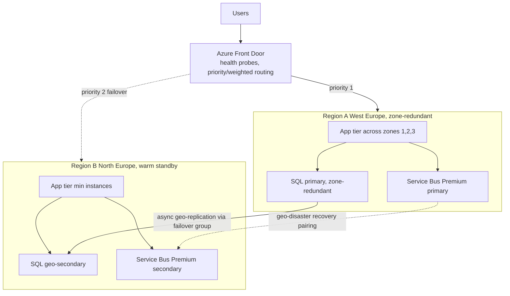

### Example
```bicep
// Zone-redundant SQL database + failover group (verify current properties)
resource db 'Microsoft.Sql/servers/databases@2023-08-01-preview' = {
  parent: sqlA, name: 'orders', location: location
  sku: { name: 'GP_Gen5', tier: 'GeneralPurpose', family: 'Gen5', capacity: 4 }
  properties: { zoneRedundant: true, requestedBackupStorageRedundancy: 'Zone' }
}
resource fog 'Microsoft.Sql/servers/failoverGroups@2023-08-01-preview' = {
  parent: sqlA, name: 'fog-orders'
  properties: { readWriteEndpoint: { failoverPolicy: 'Automatic', failoverWithDataLossGracePeriodMinutes: 60 }
    partnerServers: [ { id: sqlB.id } ], databases: [ db.id ] }
}
```
App connection string points at the **failover group listener** (`fog-orders.database.windows.net`) so the app needs no config change on failover.

### When / when NOT
- Zone redundancy: default for production tier-1/2 workloads.
- Multi-region: only when business RTO/RPO/regulation justifies cost; **not** for dev/test or low-criticality apps.
- Active/active: only with a data strategy (Cosmos multi-write, conflict resolution, partitioned tenancy). Don't claim active/active with a single-writer SQL DB.

### Pros / cons
Higher availability vs cost (2–3× infra), data consistency/latency trade-offs, operational complexity, DR drills required.

### Mistakes
Calling a single-zone deployment "HA"; assuming paired region = automatic DR; stateful in-region dependencies (storage, queues, secrets) not replicated; DNS TTL too high for failover; untested failover; capacity not available in DR region; config drift between regions; ignoring that SLA math includes *your* weakest component.

### Perf / scalability / reliability / security
Latency between zones is low (~1–2 ms) but non-zero → chatty cross-zone calls add cost/latency (inter-zone data charges may apply **(verify current)**); keep data residency/compliance in mind; replicate Key Vault secrets/certs/identity/RBAC via IaC to the secondary region.

### Troubleshooting
Check **Azure Service Health** and **Resource Health**; failover group status/lag (`sys.dm_geo_replication_link_status`, `replication_lag_sec`); Front Door origin health probes; verify secondary region capacity and quota before drills.

### Related
Chapters 31, 32; [migration guide: disaster recovery & hybrid](../11-cloud-migration-and-modernization/cloud-migration-and-legacy-modernization.md).

### Interview Q&A
**Q: Availability zone vs region?** A: AZ = isolated datacentres in one region (low latency, synchronous replication feasible) protecting against datacentre failure; region = geographic area; multi-region protects against regional outages at the cost of async replication (non-zero RPO) and complexity.
**Q: How do you compute composite SLA?** A: Multiply SLAs of serial dependencies; parallel redundancy combines as 1−(1−a)(1−b). Always include the weakest dependency (e.g., a single-region queue negates multi-region compute).

---

## 31. Disaster recovery

### Simple view
A plan (and tested automation) for getting your system working again after something big breaks — a region outage, data corruption, ransomware, a bad deployment, or deleted resources.

### Architect depth
Core terms: **RPO** (max tolerable data loss, time) and **RTO** (max tolerable downtime). **DR ≠ HA:** HA keeps you up through *component* failures; DR restores service after *site/data* loss. Define per workload tier:
| Tier | RTO | RPO | Strategy |
|---|---|---|---|
| 0 mission-critical | seconds–minutes | ~0 | Active/active, sync/near-sync data |
| 1 | < 1 h | minutes | Warm standby, geo-replicated DB, automated failover |
| 2 | 4–8 h | 1 h | Pilot light, backups geo-copied, IaC rebuild |
| 3 | 24 h+ | 24 h | Backup/restore |

### Azure DR toolbox by layer
| Layer | Mechanism |
|---|---|
| Traffic | Front Door (priority/health probes), Traffic Manager (DNS; mind TTL) |
| Compute | IaC redeploy, ACA/App Service in second region, **Azure Site Recovery** (VMs), AKS multi-cluster |
| Azure SQL | **Active geo-replication**, **Auto-failover groups** (listener endpoints, planned/forced failover), geo-restore (RPO up to ~1 h, slower) |
| Cosmos DB | Multi-region reads/writes, automatic failover priorities |
| Storage | GRS/GZRS/RA-GRS, customer-managed failover **(verify current)**, object replication |
| Service Bus/Event Hubs | **Geo-disaster recovery** (metadata + alias; *data is not replicated* in classic geo-DR) or **geo-replication** (Premium, data replication) **(verify current)** — design for in-flight message loss/duplication |
| Secrets/identity | Key Vault backup/restore & IaC; Entra is global; re-create role assignments via IaC |
| Config | App Configuration replicas; everything as code |
| Observability | Secondary Log Analytics workspace/cluster; alerting must live outside the failing region |

### Failover design
- **Detection → decision → execution → validation → failback.** Decide *who* can declare a disaster (human-in-the-loop vs automatic). Automatic SQL failover with data loss can create split-brain/inconsistency; many orgs prefer **manual** with a runbook for tier-1 data.
- **Idempotent, reconcilable workflows:** after failover, in-flight messages (Service Bus geo-DR) and uncommitted transactions may be lost/duplicated → idempotent consumers, outbox, and reconciliation jobs. Cross-link: [Saga/outbox/inbox](../03-architectural-patterns/distributed-systems-patterns.md).
- **Failback:** treat as a new migration; resync before returning; avoid ping-pong.
- **DR for the control plane:** IaC repo, pipelines, container registry (geo-replicated ACR), secrets, DNS — if your pipeline lives only in the failed region you cannot recover.
- **DR drills:** quarterly game days; measure *actual* RTO/RPO; chaos experiments (Azure Chaos Studio); update runbooks; record in ADRs.

### Example: SQL failover-group drill
```powershell
# planned failover (no data loss) – drill
az sql failover-group set-primary -g rg-b -s sql-b -n fog-orders
# forced (data loss possible) – real disaster only
az sql failover-group set-primary -g rg-b -s sql-b -n fog-orders --allow-data-loss
```
```sql
-- check replication health/lag before failover
SELECT partner_server, role_desc, replication_state_desc, replication_lag_sec, last_replication
FROM sys.dm_geo_replication_link_status;
```
Runbook skeleton: 1) declare incident; 2) confirm scope (Service Health); 3) freeze deployments; 4) verify secondary health & lag; 5) fail over data; 6) scale up secondary app tier; 7) switch traffic (Front Door priority); 8) smoke test; 9) comms; 10) post-incident, failback plan.

### When / when NOT
DR investment proportional to business impact; **not** every service needs multi-region. Don't pay for hot standby for reports tier.

### Pros / cons
Business continuity/compliance vs cost, complexity and the risk that untested DR fails when needed.

### Mistakes
No defined RTO/RPO; backups never restore-tested; DR in the same region; secrets/pipelines/DNS not covered; DR runbooks in a wiki hosted in the failed region; ignoring dependencies (third-party APIs, identity); failing over only compute not data; treating geo-replication as backup (it replicates corruption/deletes too).

### Perf / scalability / reliability / security
Pre-scale secondary; reserved capacity; keep secondary patched/deployed via same pipeline; secure replicated data identically (encryption, private endpoints in secondary); least-privilege DR access with break-glass.

### Troubleshooting
Failover didn't happen → grace period/policy, health probe config; app still points at old server → connection strings to server instead of listener; users still hitting old region → DNS TTL/Traffic Manager caching; secondary slow → cold caches, under-provisioned.

### Related
Chapters 30, 32; [migration guide: DR & rollback](../11-cloud-migration-and-modernization/cloud-migration-and-legacy-modernization.md).

### Interview Q&A
**Q: Geo-replication vs backup?** A: Geo-replication gives low-RPO failover for infrastructure failure but faithfully replicates logical errors (bad delete, ransomware). Backups (PITR/LTR/immutable) protect from corruption/deletion. You need both.
**Q: How do you know your DR works?** A: Scheduled failover drills with measured RTO/RPO, restore tests of backups, automated runbooks, and findings fed back into design.

---

## 32. Backup and restore strategies

### Simple view
Copies of your data you can restore from — to a point in time, after accidental deletion, corruption or attack. Backups are only real if you've **restored** from them.

### Architect depth
The **3-2-1** principle (3 copies, 2 media, 1 offsite) adapts to cloud as: multiple versions, separate failure domain (region/subscription/tenant), immutable/air-gapped copy.

| Service | Built-in protection | Notes |
|---|---|---|
| **Azure SQL DB** | Automated full/diff/log; **PITR** 1–35 days; **LTR** up to 10 yrs; backup storage redundancy (LRS/ZRS/GRS/GZRS) | Restore = *new database*; `RESTORE` over existing not supported; test restore time for large DBs; deleted-DB restore within retention |
| **SQL MI** | Same + native `COPY_ONLY` backups to URL | Useful for migrations |
| **Cosmos DB** | Continuous (7/30 days PITR) or periodic backup | Restore to new account |
| **Blob** | **Soft delete** (blob/container), **versioning**, change feed, **PITR for block blobs**, **immutability (WORM)**, legal hold | Soft delete ≠ backup against account deletion → use **resource locks** + **Azure Backup for Blobs** (vaulted) **(verify current)** |
| **Azure Files** | Snapshots + Azure Backup | |
| **Key Vault** | Soft delete/purge protection; per-object **backup** blobs (restore only to same geography/subscription) | Keep IaC for vault + secret rotation scripts |
| **VMs/AKS PVs** | **Azure Backup** (Recovery Services/Backup vault), snapshots | AKS backup for PVs/cluster state **(verify current)** |
| **Config/IaC** | Git (Bicep/Terraform), pipelines | *"Infrastructure as code is your DR for stateless"* |
| **Service Bus/Event Hubs** | Not a backup target — messages are transient; Event Hubs **Capture** archives stream | Design replay from source of truth |

### Restore design
- **Restore-test automation:** monthly job restores SQL to a scratch DB, runs integrity checks (`DBCC CHECKDB` equivalent validations, row counts, business checks), records time-to-restore, tears it down.
- **RPO/RTO math:** restoring a 2 TB database takes time — measure; Hyperscale restores are near-constant-time due to snapshot architecture.
- **Granular recovery:** table-level recovery via restore to new DB then `INSERT…SELECT`/BCP; keep **temporal tables**/soft-delete columns for app-level undo.
- **Backup security:** encryption (TDE/CMK), RBAC separation (backup admins ≠ DB admins), immutable vaults with multi-user authorisation (**Resource Guard**) to resist ransomware, private endpoints for vaults.
- **Retention/compliance:** GDPR right-to-erasure vs long-term retention conflict → documented policy and crypto-shredding strategies.
- **Cross-tenant/subscription copy:** protects against subscription compromise/deletion.

### Examples
```powershell
# SQL point-in-time restore to a new DB
az sql db restore -g rg-sql -s sql-a -n orders --dest-name orders-restore-0930 --time "2026-09-30T08:15:00Z"
# Resource lock to stop accidental deletes (does not stop data-plane deletes!)
az lock create --name nodelete --lock-type CanNotDelete -g rg-data
```
```bicep
resource ltr 'Microsoft.Sql/servers/databases/backupLongTermRetentionPolicies@2023-08-01-preview' = {
  parent: db, name: 'default'
  properties: { weeklyRetention: 'P8W', monthlyRetention: 'P12M', yearlyRetention: 'P5Y', weekOfYear: 1 }
}
resource blobProps 'Microsoft.Storage/storageAccounts/blobServices@2023-05-01' = {
  parent: st, name: 'default'
  properties: { deleteRetentionPolicy: { enabled: true, days: 30 }, isVersioningEnabled: true
    containerDeleteRetentionPolicy: { enabled: true, days: 30 }
    restorePolicy: { enabled: true, days: 14 }, changeFeed: { enabled: true } }
}
```

### When / when NOT
Always for stateful data. **Not** a substitute for HA/DR; **not** for in-transit messages.

### Pros / cons
Protects from logical corruption/ransomware vs storage cost, restore time, compliance/PII retention complexity.

### Mistakes
Never testing restores; assuming PaaS "backs up everything" (blob soft delete off, Key Vault purge not protected); backups in the same subscription/region/credentials as production; no immutability; forgetting dependent data (blobs + SQL out of sync after restore → restore both to the same point or use reconciliation); ignoring app-level secrets/config in recovery.

### Perf / scalability / reliability / security
Stagger backup windows; monitor backup job failures; alert on missing backups; verify restore SLAs; encrypt and isolate.

### Troubleshooting
Restore failed → retention elapsed, name conflicts, permissions; slow restore → size/tier; missing LTR → policy not applied/weekOfYear; blob "deleted" but not recoverable → soft delete not enabled at deletion time.

### Related
Chapters 9, 10, 31; [migration guide: rollback strategy](../11-cloud-migration-and-modernization/cloud-migration-and-legacy-modernization.md).

### Interview Q&A
**Q: Developer ran `DELETE FROM Orders` without WHERE at 14:03 — what do you do?** A: Stop writes if needed; PITR restore to a *new* database at 14:02; compare/extract Orders (and dependents) and merge back via scripts under change control; or swap databases if acceptable; document, add guardrails (least privilege, change review, soft delete, temporal tables).

---
## 33. Azure Well-Architected Framework

### Simple view
A structured checklist of five pillars Microsoft recommends for judging and improving a workload's architecture, with explicit **trade-offs** between pillars.

### Architect depth
The five pillars: **Reliability, Security, Cost Optimization, Operational Excellence, Performance Efficiency**. The framework gives *design principles*, *checklists and recommendations per pillar*, *tradeoffs*, *workload-type guidance* (e.g., AI, mission-critical), and tooling: **Azure Advisor** (recommendations), the **WAF Assessment** (questionnaire, Azure Review), **Azure Resource Graph** queries and **Azure Policy** for enforcement. The skill an interviewer tests is not reciting pillars but **reasoning about the tension between them**.

| Pillar | Core question | Typical Azure levers | Checklist (sample) | Trades off against |
|---|---|---|---|---|
| **Reliability** | Does it keep working and recover? | Zones, multi-region, retries/circuit breaker/bulkhead, health probes, queue-based load leveling, backups, chaos tests | Defined SLOs/RTO/RPO; zone-redundant prod; failure-mode analysis (FMA); tested DR | Cost (redundancy), complexity, performance (sync replication) |
| **Security** | Is it protected end-to-end? | Entra/MI/RBAC, private endpoints, WAF, Key Vault, Defender, Policy, encryption, network segmentation | No public PaaS endpoints; no standing admin; secrets eliminated; threat model done | Operational overhead, cost, developer velocity, performance (inspection) |
| **Cost Optimization** | Are we paying only for value? | Right-size, autoscale, reservations/savings plans, Hybrid Benefit, tiering, budgets, tagging | Budgets/alerts; idle resource cleanup; reservation coverage; unit-cost metrics | Reliability (redundancy cost), performance (headroom) |
| **Operational Excellence** | Can we run, change and observe it safely? | IaC, CI/CD with gates, deployment slots/canary, Monitor/App Insights/OTel, runbooks, incident reviews | Everything as code; SLO-based alerts; automated rollback; on-call runbooks | Speed vs. governance; investment in tooling |
| **Performance Efficiency** | Does it meet demand efficiently? | Caching, CDN, async messaging, partitioning, autoscale, right data store, load tests | Load/perf tests; capacity model; bottleneck-aware scaling; p95/p99 budgets | Cost, reliability (more moving parts), consistency |

### Making trade-offs explicit (what to say)
- **Reliability ↑ ⇒ Cost ↑:** multi-region active/passive doubles infra; justify via business impact of downtime (cost of 1 hour of outage vs. DR spend).
- **Security ↑ ⇒ Velocity ↓ / Ops ↑:** private endpoints complicate CI/CD and debugging; mitigate via IaC modules and managed agents.
- **Performance ↑ ⇒ Cost ↑ & Consistency ↓:** caching adds staleness; read replicas add lag.
- **Cost ↓ ⇒ Reliability ↓:** single instance, Basic tiers, no zones. Record the decision as an **ADR** with accepted risk ([Foundations: ADRs](../01%20Foundations.md)).

### How to apply it (process)
1. Identify workload **criticality tier** and *flows* (user flows and their SLOs).
2. Run a **failure mode analysis** per component: what if it's slow/unavailable/corrupt? What's the blast radius, detection, mitigation?
3. Run the WAF assessment/Advisor; prioritise by risk × effort; convert to backlog + Azure Policy guardrails.
4. Re-review at milestones (pre-prod, after incidents, yearly).

### Example: Azure Resource Graph query used in a WAF review
```kusto
// App Services that are not zone redundant / HTTPS-only off / FTP enabled
resources
| where type == "microsoft.web/sites"
| extend https = properties.httpsOnly, ftps = properties.siteConfig.ftpsState
| where https != true or ftps != "Disabled"
| project name, resourceGroup, location, https, ftps
```
```bicep
// Policy-as-guardrail: deny public network access on Storage (assignment sketch)
resource assign 'Microsoft.Authorization/policyAssignments@2022-06-01' = {
  name: 'deny-storage-public', properties: { displayName: 'Deny public network access for Storage'
    policyDefinitionId: '/providers/Microsoft.Authorization/policyDefinitions/<built-in-id-verify>', enforcementMode: 'Default' }
}
```

### When / when NOT
Use WAF as a **review lens and conversation tool**, early and recurring. Don't treat it as a compliance checkbox or apply every recommendation to every workload — proportionality matters.

### Mistakes
Checklist worship without context; optimising one pillar (cost) at the expense of another (reliability) without recording the decision; reviewing once at go-live; no owner for recommendations; ignoring workload-specific guidance (AI, SaaS multi-tenant, mission-critical).

### Troubleshooting a failing review
Recommendations ignored → tie to risk/SLO/cost with owners and dates; too many findings → prioritise by blast radius; drift after remediation → Policy + IaC enforcement.

### Related
[Cloud-native Azure doc (WAF mention)](../07-advanced-topics/Architecting%20Cloud-Native%20NET%20Apps%20for%20Azure.md), [Foundations: quality attributes & trade-offs](../01%20Foundations.md), Chapters 30–35.

### Interview Q&A
**Q: Name two pillars in tension and how you'd resolve it for an e-commerce checkout.** A: Reliability vs cost — checkout is revenue-critical so I'd pay for zone redundancy + warm-standby DR + queue-based load leveling, while using autoscale-to-min and reservations for the steady base and leaving back-office reporting single-region. Decision recorded in an ADR with RTO/RPO and cost impact.
**Q: What does a failure mode analysis look like?** A: Table: component, failure mode, impact, likelihood, detection, mitigation, recovery. E.g., Service Bus namespace unavailable → API can't enqueue → outbox retains messages in SQL, relay resumes; alert on outbox age.

---

## 34. Cost optimization

### Simple view
Pay for the capacity and features you actually need — and make cost visible, owned and continuously managed (**FinOps**).

### Architect depth
Cost has three levers: **(1) rate** (what you pay per unit), **(2) usage** (how many units), **(3) architecture** (how many units you *need*). Pricing models: pay-as-you-go, **Reservations** (1/3-yr, specific SKU/region, big discount), **Savings Plans** (commit $/hour across eligible compute, more flexible), **Spot** (interruptible, up to ~90% off), **Azure Hybrid Benefit** (bring Windows Server/SQL Server licences), **Dev/Test pricing**, **Enterprise Agreement/MCA** discounts. (Discount sizes vary — **verify current**.)

### Cost levers by service
| Area | Levers |
|---|---|
| Compute | Right-size (Advisor/metrics), autoscale with sensible min/max, **scale to zero** (Functions, ACA), scheduled shutdown for non-prod, Spot for batch, ARM/Graviton-like (Cobalt) SKUs **(verify current)**, consolidate App Service plans thoughtfully |
| Azure SQL | vCore + **serverless auto-pause** for dev/intermittent, **elastic pools** for multi-tenant, reserved capacity, Hybrid Benefit, tune queries before scaling, right-size backup retention/redundancy (GRS costs more) |
| Storage | **Tiering** (Hot→Cool→Cold→Archive) via lifecycle, delete old versions/snapshots, avoid chatty small-object transactions, ZRS vs GRS by need |
| Messaging | Service Bus Standard vs Premium (Premium has a fixed floor), Event Hubs throughput/processing units, Event Grid per-operation |
| Observability | Sampling, log levels, DCR transforms, Basic tier logs, commitment tiers, retention policy, **daily cap as safety net** |
| Network | **Egress** (inter-region, internet) and inter-zone data, NAT/Firewall hourly + data processing, private endpoint per-hour + GB, Front Door vs App Gateway costs |
| AI | Model choice, prompt/context size, caching, provisioned vs pay-per-token, quotas per tenant |
| Licensing | Hybrid Benefit, dev/test subscriptions |

### Governance and FinOps practices
- **Tagging** (`env`, `owner`, `costCenter`, `app`) enforced by Policy; **management groups/subscriptions** per environment/workload for natural chargeback.
- **Budgets and alerts** at 50/80/100% + anomaly alerts; **Cost Management** cost analysis; exports to storage for BI.
- **Unit economics:** cost per tenant/order/1k requests — the metric that guides architecture decisions (e.g., ACA vs App Service).
- **Review cadence:** monthly cost review, quarterly reservation coverage review (target ~70–80% steady-state coverage, not 100%).
- **Lift-and-shift trap:** VMs oversized from on-prem specs → right-size after 2–4 weeks of metrics ([migration guide: cost](../11-cloud-migration-and-modernization/cloud-migration-and-legacy-modernization.md)).

### Examples
```bicep
resource budget 'Microsoft.Consumption/budgets@2023-05-01' = {
  name: 'budget-orders-prod'
  properties: { category: 'Cost', amount: 8000, timeGrain: 'Monthly'
    timePeriod: { startDate: '2026-12-01' }
    notifications: { at80: { enabled: true, operator: 'GreaterThan', threshold: 80, contactEmails: [ 'finops@contoso.com' ], thresholdType: 'Actual' }
                     forecast100: { enabled: true, operator: 'GreaterThan', threshold: 100, contactEmails: [ 'finops@contoso.com' ], thresholdType: 'Forecasted' } } }
}
```
```kusto
// Resource Graph: untagged resources (governance gap)
resources | where isempty(tags['costCenter']) | summarize count() by type, subscriptionId | order by count_ desc
```

### Case: reduce a $40k/month bill (structure your answer)
1. **Baseline & visibility:** Cost analysis by service/resource group/tag; find top 5 items (usually 80% of spend); identify unowned/untagged.
2. **Quick wins (0–2 weeks):** delete orphaned disks/IPs/idle resources; shut down non-prod off-hours; right-size from metrics; fix log ingestion (Usage table); stop-over-retention.
3. **Commitments (2–4 weeks):** reservations/savings plan on steady compute/SQL; Hybrid Benefit; dev/test pricing.
4. **Architecture (1–3 months):** tier storage, serverless/elastic pools, scale-to-zero, caching to cut DB tier, move chatty cross-region calls, consolidate plans, review AKS node packing / ACA profiles.
5. **Guardrails:** budgets/alerts, Policy (SKU allow-list, tags), IaC defaults, FinOps cadence, unit-cost dashboard.
6. **Validate:** don't sacrifice reliability/security (WAF trade-off); measure impact; keep SLOs.

### When / when NOT
Optimise continuously, but **not** at the expense of SLOs/security; don't over-commit reservations for workloads you may re-architect.

### Pros / cons
Savings and predictability vs commitment risk, effort, and potential reliability impact if cut blindly.

### Mistakes
Reserving before right-sizing; leaving autoscale max unbounded; premium tiers in dev; log everything at Analytics tier; forgetting egress; no tags (nobody owns cost); Event Hubs/Service Bus Premium for low-volume; dev/test databases running 24×7; keeping every backup/version forever.

### Perf / reliability / security considerations
Cost cuts must be tested against SLOs; keep security controls (they have cost — Firewall, Defender) as non-negotiable baselines for prod.

### Troubleshooting
Spend spike → Cost Management anomaly, filter by meter/resource, correlate with deployments/autoscale events; runaway autoscale; log ingestion burst; unexpected egress/NAT data processing; leaked key mining crypto (check Defender alerts, compute spikes).

### Related
[Migration guide: cost & performance](../11-cloud-migration-and-modernization/cloud-migration-and-legacy-modernization.md), Chapters 16, 29, 33.

### Interview Q&A
**Q: Reservations vs savings plans?** A: Reservations: biggest discount, locked to SKU/region (SQL, VM, etc.), best for very stable workloads. Savings plans: commit $/hour across eligible compute services/regions — flexible but slightly lower discount. Cover the stable base with commitments, keep variable load on-demand/autoscale.

---

## 35. Security and operational excellence

### Simple view
**Security:** assume breach — verify explicitly, least privilege, encrypt, monitor. **Operational excellence:** everything is code, deployments are safe and reversible, and you can see and respond to problems fast.

### Security architecture on Azure
- **Identity first:** Entra ID, Conditional Access/MFA, **PIM** (just-in-time privileged roles), **managed identities** for workloads, **RBAC** at least-privilege scope, avoid standing Owner/Contributor, separate break-glass accounts.
- **Zero Trust:** verify explicitly (strong auth, device, risk), least privilege, assume breach (segmentation, encryption, monitoring) — see [Broader Architect Skills](../06-broader-architect-skills/Broader%20Architect%20Skills.md).
- **Defence in depth:** Front Door/WAF → APIM → app auth → service authz → data-level controls. Network: private endpoints, NSGs, Firewall egress allow-lists, DDoS Protection.
- **Data protection:** TLS 1.2+/1.3, TDE (default) + CMK where required, Always Encrypted, column/row-level security, Key Vault, Purview/data classification **(verify current)**.
- **Posture & threat protection:** **Microsoft Defender for Cloud** (CSPM + CWPP: Defender for Servers, Containers, SQL, Storage, App Service, Key Vault, APIs), secure score, regulatory compliance dashboard, **Microsoft Sentinel** (SIEM/SOAR) on Log Analytics.
- **Governance:** **Azure Policy** (deny/audit/deploy-if-not-exists: no public PaaS, require tags, allowed regions/SKUs, deny local auth/shared keys), **management groups**, **landing zones** (CAF), **resource locks**, **Blueprint-style** IaC.
- **Supply chain:** ACR with Defender scanning, signed images, SBOM, pinned base images, dependency scanning, secret scanning in repos, OIDC federated deploys.
- **API/app security:** OWASP Top 10 & API Top 10 — authn/z, input validation, rate-limiting, CORS, secure headers, SSRF protection (restrict egress), logging without PII.

### Operational excellence on Azure
- **Infrastructure as Code:** Bicep/Terraform modules, **Azure Verified Modules**, PR reviews, what-if/plan, drift detection, environments from the same templates.
- **CI/CD with deployment safety:** build once/promote artifact, environment gates/approvals, **progressive delivery** (slots, ACA revisions, canary via Front Door/APIM weights), **feature flags** (App Configuration), automatic rollback on SLO breach, DB migrations via expand/contract ([migration guide](../11-cloud-migration-and-modernization/cloud-migration-and-legacy-modernization.md); [Branching strategy](../08-software-development-process/Branching%20Strategy.md)).
- **Observability → SLOs:** define SLIs (availability, latency, error rate) and **SLOs** with error budgets; **burn-rate alerts** (fast + slow windows) rather than raw CPU alerts; dashboards/workbooks per service; distributed tracing (OTel); synthetic availability tests.
- **Runbooks & automation:** documented, tested runbooks, Azure Automation/Logic Apps/Functions remediation, **Action Groups**; on-call rotation, incident management, blameless **post-incident reviews**, error-budget policy.
- **Change management:** small frequent changes, testing in production safely, game days, **Chaos Studio** experiments, capacity reviews.
- **Config management:** Azure App Configuration (+ Key Vault refs), environment parity, no manual portal changes (lock or Policy-detect).

### Examples
```yaml
# GitHub Actions: build once, deploy with what-if gate and OIDC (no secrets)
jobs:
  deploy:
    runs-on: ubuntu-latest
    environment: prod            # protection rules = approval gate
    permissions: { id-token: write, contents: read }
    steps:
      - uses: actions/checkout@v4
      - uses: azure/login@v2
        with: { client-id: ${{ vars.CLIENT_ID }}, tenant-id: ${{ vars.TENANT_ID }}, subscription-id: ${{ vars.SUB_ID }} }
      - run: az deployment group what-if -g rg-prod -f infra/main.bicep -p infra/prod.bicepparam
      - run: az deployment group create  -g rg-prod -f infra/main.bicep -p infra/prod.bicepparam
```
```kusto
// Fast-burn SLO alert idea: availability SLO 99.9% => error budget 0.1%; alert if error rate > 14.4 x budget over 5m AND 1h
let slo = 0.999;
requests | where timestamp > ago(1h)
| summarize err = 1.0 * countif(success == false) / count()
| extend burn = err / (1 - slo) | where burn > 14.4
```

### When / when NOT
Apply the full control set to production/regulated workloads; scale controls proportionally for dev/sandbox. **Not** security theatre: controls must be verified (pen tests, Defender secure score, Policy compliance).

### Pros / cons
Resilience, auditability and speed vs upfront investment, friction for developers, cost of tooling.

### Mistakes
Portal "ClickOps" changes; shared admin accounts; no PIM; Policy in audit-only forever; alerts on noisy causes; no runbooks; secrets in pipeline variables; production access from developer laptops; deploying Friday afternoon with no rollback; no tested incident process; ignoring Defender recommendations backlog.

### Perf / scalability / reliability considerations
Security controls add latency/cost (WAF inspection, Firewall) — measure; automation reduces human error and MTTR; SLO-driven alerting reduces alert fatigue.

### Troubleshooting (security/ops incidents)
Suspicious activity → Defender alerts, Entra sign-in/audit logs, Activity Log, resource logs in Log Analytics/Sentinel; deployment failures → what-if diffs, Activity Log, deployment operations; drift → compare IaC state, Resource Graph.

### Related
[Broader Architect Skills](../06-broader-architect-skills/Broader%20Architect%20Skills.md) (DevOps, IaC, security), [Branching Strategy](../08-software-development-process/Branching%20Strategy.md), Chapters 13, 14, 25–28, 33.

### Interview Q&A
**Q: Walk me through securing a new PaaS .NET workload end-to-end.** A: Identity (MI, RBAC least privilege, PIM for humans), network (Front Door+WAF → APIM → private ACA; private endpoints, public access off, egress via Firewall), data (TDE/CMK, Key Vault, no shared keys), supply chain (scanned images, OIDC deploys), posture (Defender, Policy guardrails), monitoring (diagnostic settings to Log Analytics/Sentinel, alerts), and verified via threat model and pen test.
**Q: What's an error budget and how does it drive release decisions?** A: SLO 99.9% → 0.1% allowed failure per window. Budget remaining = freedom to ship; budget burned = freeze features, prioritise reliability.

---
# Part C – Interview toolkit

## 36. Reference architecture: .NET microservices on Azure

### The picture
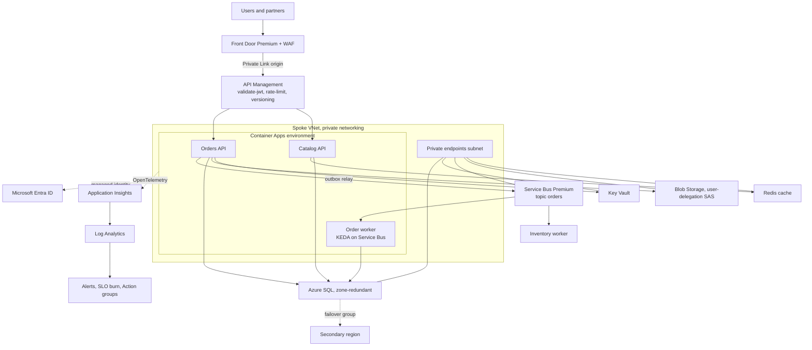

### Walkthrough (use this as an interview narrative)
1. **Edge:** Front Door + WAF (global entry, TLS, DDoS, caching) → APIM (JWT validation, throttling, versioning). Backends reachable *only* through APIM/private network.
2. **Compute:** Container Apps environment in a VNet; APIs scale on HTTP concurrency, workers scale on Service Bus backlog (KEDA). Revisions provide canary/rollback.
3. **Messaging:** commands/events via Service Bus topic with **transactional outbox** from the Orders API and **idempotent inbox** consumers; DLQ monitored with alerts; Event Grid for blob-created reactions.
4. **Data:** Azure SQL zone-redundant with failover group; Redis for read-heavy catalogue; Blob for documents via SAS/claim-check.
5. **Identity/secrets:** managed identities everywhere (RBAC), Key Vault only for unavoidable secrets, local auth disabled by Policy.
6. **Observability:** OpenTelemetry → Application Insights/Log Analytics; SLO burn-rate alerts; dashboards; synthetic probes.
7. **Resilience/DR:** zones in-region, warm standby in paired/secondary region, Front Door priority failover, tested runbooks; backups (PITR/LTR, blob versioning).
8. **Delivery:** Bicep + GitHub Actions OIDC, what-if gates, expand/contract DB migrations, feature flags.
9. **Cost:** consumption profile + scale limits, serverless/elastic pools where fitting, tiering, budgets/tags, commitments for the steady base.

### Consolidated troubleshooting playbook
| Symptom | First checks | Typical root causes | Fix |
|---|---|---|---|
| **Cold starts** (Functions/ACA zero) | Plan type, `min replicas`, App Insights p95 by first request | Scale-to-zero, large startup, JIT | Flex always-ready/Premium/`minReplicas ≥ 1`, ReadyToRun, lazy init, warm-up |
| **HTTP 429 / throttling** (SQL 10928/10929, Cosmos, KV, Service Bus `ServerBusy`, OpenAI) | Metrics for the resource, response headers (`Retry-After`, `x-ms-request-charge`) | Burst exceeding quota/RU/vCore/TPM | Backoff+jitter, queue leveling, cache, raise tier/PTU, partition keys |
| **SNAT exhaustion** (intermittent outbound timeouts) | App Service/ACA/LB SNAT diagnostics, count of outbound connections | `new HttpClient` per call, no pooling, many short connections to the same destination | `IHttpClientFactory`/`SocketsHttpHandler`, connection reuse, NAT Gateway, private endpoints/service endpoints |
| **Private endpoint DNS** | `Resolve-DnsName` from workload, private DNS zone links | Resolves public IP; zone not linked; forwarders missing | Link zone, DNS forwarder/Private Resolver, check `publicNetworkAccess` |
| **Key Vault throttling / 403** | Diagnostic logs `ResultSignature`, `429` rate | Per-request reads; missing RBAC; firewall | Cache secrets, RBAC role, private endpoint + DNS |
| **Redis timeouts** | Server load, memory, evictions, client logs | Big values, slow commands, sync-over-async, thread-pool starvation, failover | Smaller values, async, `ConnectionMultiplexer` singleton, retry, scale up/cluster |
| **SQL CPU/DTU saturation** | `sys.dm_db_resource_stats`, Query Store top CPU, waits | Plan regression, missing index, N+1, scans, parameter sniffing | Index/rewrite, force plan, batch, cache, then scale |
| **ACA revision failed** | `ContainerAppSystemLogs`, revision status | Image pull (identity lacks `AcrPull`), probe failures, port mismatch, unresolved KV secret | Fix identity/probes/port, redeploy, traffic stays on old revision |
| **AKS pod Pending/CrashLoop** | `kubectl describe pod`, events, `logs --previous` | Insufficient resources/taints/PVC zone mismatch/IP exhaustion; OOMKilled (137); bad config | Adjust requests/limits, scale pool, fix config/probes |
| **Service Bus DLQ growth** | DLQ reason/description, `DeliveryCount` | Poison payload, bug, lock expiry | Fix, replay from DLQ idempotently, alerts |

```kusto
// One-stop investigation: failing operations with dependency causes (App Insights)
let failed = requests | where timestamp > ago(30m) and success == false | project operation_Id, name, resultCode;
dependencies | where timestamp > ago(30m) and success == false
| join kind=inner failed on operation_Id
| summarize n=count() by name, target, type, resultCode
| order by n desc
```

---

## 37. Scenario-based questions

### S1. Design a multi-tenant SaaS platform on Azure
**Clarify:** tenant count/size distribution, isolation/compliance (regulated?), noisy-neighbour tolerance, customisation, data residency, SLA, growth, budget.

**Tenancy models for data (the central trade-off):**
| Model | Isolation | Cost/tenant | Ops complexity | Fit |
|---|---|---|---|---|
| Shared DB, shared schema (`TenantId` column + RLS) | Low–medium | Lowest | Low (one schema) but noisy-neighbour risk | Many small tenants |
| Schema/DB per tenant in **elastic pool** | Medium–high | Medium | Medium (migrations ×N) | Hundreds–thousands of tenants, varying load |
| **Database per tenant** (dedicated/hyperscale) | High | High | High (provision/migrate automation) | Large/regulated tenants |
| **Stamp / deployment per tenant** (cell-based) | Highest | Highest | Highest, but blast-radius isolation | Enterprise/regulated/sovereign |

**Recommended hybrid:** *Pooled* tier (shared compute, DB-per-tenant in elastic pools or RLS) for small tenants and *siloed* stamps for large/regulated tenants — a **deployment-stamp (cell) architecture** behind a global tenant-routing layer.

**Architecture sketch:** Front Door (global, per-tenant custom domains + WAF) → tenant resolution (catalog DB/Cosmos mapping tenant → stamp) → stamp = APIM/ACA/SQL elastic pool/Service Bus/Blob/Key Vault in region; control plane for provisioning, billing/metering, feature flags (App Configuration).
**Key design points:**
- **Tenant context** propagates via JWT claim (`tid`/custom `tenant_id`) → middleware sets tenant scope → EF Core **global query filter** + SQL **Row-Level Security** (`SESSION_CONTEXT`) as defence in depth.
```csharp
// Tenant-scoped DbContext with global filter + SESSION_CONTEXT for RLS
protected override void OnModelCreating(ModelBuilder b) =>
    b.Entity<Order>().HasQueryFilter(o => o.TenantId == _tenant.Id);
// per connection: EXEC sp_set_session_context @key=N'TenantId', @value=@t, @read_only=1;
```
```sql
CREATE FUNCTION sec.fn_tenant(@TenantId int) RETURNS TABLE WITH SCHEMABINDING AS
RETURN SELECT 1 AS ok WHERE @TenantId = CAST(SESSION_CONTEXT(N'TenantId') AS int);
CREATE SECURITY POLICY sec.TenantPolicy ADD FILTER PREDICATE sec.fn_tenant(TenantId) ON dbo.Orders, ADD BLOCK PREDICATE sec.fn_tenant(TenantId) ON dbo.Orders;
```
- **Noisy neighbour:** per-tenant rate limits (APIM `rate-limit-by-key`), queue partitioning/priority queues, elastic pool caps (`max vCore per DB`), workload isolation by tier, Service Bus separate topics/queues for big tenants.
- **Messaging:** tenant id in message properties; per-tenant sessions if ordering needed; DLQ per tenant triage.
- **Data protection:** per-tenant encryption keys (CMK in Key Vault) for premium, tenant-scoped SAS paths/containers in Blob, per-tenant backup/restore capability (DB-per-tenant makes tenant-level restore trivial).
- **Onboarding automation:** idempotent provisioning pipeline (Bicep/Terraform + app-level migration), schema migration orchestration across N tenant DBs (batched, canary tenants first).
- **Metering/cost:** tag/measure per-tenant usage (requests, storage, compute) to build unit economics and pricing.
- **Observability:** tenant id as a dimension in telemetry (mind cardinality), per-tenant SLO dashboards.
- **DR:** per-stamp failover groups; tenant catalog replicated; RPO/RTO by tier (premium tenants get active/passive).

**Trade-offs to state:** pooled is cheap but needs rigorous isolation and noisy-neighbour control; siloed is safe but costly and ops-heavy. Choose by tenant value/regulation, and keep a **migration path** between tiers (tenant move tooling).

### S2. Choose compute for five workloads
| Workload | Choice | Why / trade-off |
|---|---|---|
| 1. Public REST API, steady 100 rps, p95 < 200 ms | **App Service** (P-tier, zone-redundant) or **ACA min 2** | Predictable latency, slots/revisions; avoid scale-to-zero |
| 2. Nightly CSV import (2 h) + file-arrival processing | **Functions (Flex/Consumption) or ACA Job** with Blob/Event Grid trigger | Event-driven, pay per use; Durable/queue if long & multi-step |
| 3. 12 microservices + async workers, small platform team | **Container Apps** + KEDA + APIM | Containers/revisions without cluster ops |
| 4. ML inference on GPU + custom operators/service mesh, 40 services, dedicated SRE | **AKS** (GPU node pool, mesh) | K8s API/ecosystem needed; justify ops cost |
| 5. Legacy .NET Framework WCF/WebForms app | **App Service (Windows)** or **VMs / AKS Windows** per dependencies | Replatform first; see [migration guide](../11-cloud-migration-and-modernization/cloud-migration-and-legacy-modernization.md) |
State assumptions, the decision criteria (latency, scale shape, ops capacity, portability, cost) and the conditions that would change your pick.

### S3. Reduce a $40k/month Azure bill
Use the six-step structure in [Chapter 34](#34-cost-optimization): visibility → quick wins → commitments → architecture → guardrails → validate against SLOs. Quote concrete levers (right-sizing, off-hours shutdown, log ingestion via `Usage`, storage tiering, reservations on steady SQL/compute, Hybrid Benefit, serverless/pools for dev, egress review) and **what you will not cut** (prod redundancy, security baselines).

### S4. Secure a PaaS-only architecture with no public endpoints
Use the checklist in [Chapter 28](#28-private-endpoints-and-virtual-networks): Front Door Premium → Private Link origins/APIM internal; VNet-integrated apps; private endpoints + disabled public access for SQL/Storage/Service Bus/Key Vault/Redis/ACR; private DNS zones and DNS Private Resolver for hybrid; egress through Firewall/NAT with FQDN allow-lists; self-hosted CI agents in the VNet; AMPLS for monitoring; Bastion/PIM for admin; Policy to enforce `publicNetworkAccess=Disabled`, `disableLocalAuth`, no shared keys. Call out the **operational costs**: DNS complexity, CI/CD agents, debugging, per-endpoint cost.

### S5. Production incident: API intermittently times out after a deploy
1. **Scope & timeline:** which endpoints/regions/instances; start time vs deploy/autoscale/config change (Activity Log, release annotations).
2. **Golden signals:** latency/error rate/saturation per tier in App Insights; compare with last release.
3. **Dependencies:** `dependencies` table → slow/failing targets (SQL, Redis, Service Bus, third-party); throttling (429), SNAT, DNS, KV.
4. **Resource saturation:** instance CPU/memory/thread pool (dotnet-counters), SQL `dm_db_resource_stats`/Query Store regressions, connection-pool exhaustion.
5. **Mitigate first:** roll back (slot swap/ACA traffic shift), scale out if saturation, enable circuit breaker/feature flag off; then root-cause.
6. **Prevent:** add test/alert/SLO, load test in CI, canary with automated rollback, runbook update, blameless review.

### Tough follow-ups an interviewer may ask
- "Your Service Bus consumer is idempotent but processes the same payment twice — why?" → idempotency key must be **business-level** (payment id) persisted *atomically with the effect* (unique constraint/inbox), not just in memory/MessageId; lock expiry + retries.
- "Front Door failed over but users still see errors" → origin health probe path/auth, DNS TTL/cached routing, stateful dependencies still in primary, cold secondary, quota.
- "Why not just use Cosmos for everything with global distribution?" → access patterns/partition design, RU cost, transaction scope, reporting, team skills; polyglot only with clear ownership.
- "Managed identity works locally but 403s in Azure" → local uses *your* identity; MI lacks role/propagation/scope/`CREATE USER`.
- "We disabled public access and Functions stopped triggering" → scale controller/trigger access to the storage and event source over private networking; need VNet-trigger support and private endpoints for the host storage.

---

## 38. Cheat sheet

### Service selection
| Need | Choose |
|---|---|
| Steady web/API, minimal ops | App Service |
| Event-driven glue, scale to zero | Functions (Flex) |
| Containers/microservices without K8s ops | Container Apps |
| Need K8s API, operators, mesh, GPU | AKS |
| Reliable business messages, ordering, DLQ | Service Bus |
| Reactive notifications, fan-out | Event Grid |
| High-volume stream/replay | Event Hubs |
| API governance/security/versioning | API Management |
| Relational OLTP | Azure SQL (MI for max compat) |
| Global, key-based, massive scale | Cosmos DB |
| Files/documents/media | Blob Storage (+ metadata in DB) |
| Hot data cache | Redis / Azure Managed Redis (+ HybridCache) |
| Secrets/keys/certs | Key Vault (prefer MI to avoid secrets) |
| Telemetry/APM/KQL | Azure Monitor, App Insights, Log Analytics |
| GenAI apps | Foundry + AI Search + Content Safety |
| Global HTTP entry + failover | Front Door |
| Regional L7/WAF | Application Gateway |
| Private connectivity to PaaS | Private Endpoint + Private DNS |

### Commands and snippets
```powershell
az webapp deployment slot swap -g rg -n app --slot staging
az containerapp ingress traffic set -n ca -g rg --revision-weight new=10 old=90
az sql failover-group set-primary -g rg-b -s sql-b -n fog
az role assignment create --assignee-object-id <id> --assignee-principal-type ServicePrincipal --role "Key Vault Secrets User" --scope <kv-id>
az deployment group what-if -g rg -f main.bicep
kubectl describe pod <p>; kubectl logs <p> --previous; kubectl get events --sort-by=.lastTimestamp
```

### SLA / tier / limit gotchas to verify before quoting
- Functions plan names and Flex availability/regions; in-process model end of support.
- App Service tiers (Premium v3/v4), slot counts per tier, zone-redundancy instance minimums.
- Service Bus Premium-only features (VNet/private endpoint tiers, large messages, geo-replication).
- Event Hubs tier names (Standard/Premium/Dedicated) and retention limits.
- APIM v2 tier feature parity (VNet, multi-region), Consumption cold behaviour.
- Redis → Azure Managed Redis migration timelines; SKU parity.
- SQL Hyperscale/serverless regions & feature support; automatic tuning defaults; LTR/PITR maximums.
- Key Vault per-vault throttling limits; Managed HSM.
- Foundry naming, model availability by region, quota defaults.
- Composite SLA numbers — always cite from the current *SLA for Online Services* document.

---

## 39. Structured answer framework

Use **C-R-O-T-V** for any "design/choose/explain" question — it demonstrates the structured problem-solving the interview feedback asked for:

1. **C – Clarify & constrain:** functional needs, NFRs (SLO, RTO/RPO, scale, latency), compliance, team skills, budget, existing estate.
2. **R – Reason with options:** present 2–3 viable options (not one), with a comparison table by *decision criteria*.
3. **O – Opinionated recommendation:** pick one, state the **default** and why; mention the runner-up.
4. **T – Trade-offs & risks:** what you give up (cost, complexity, lock-in, consistency), the failure modes, and mitigations; connect to WAF pillars.
5. **V – Validate & evolve:** how you'd prove it (load test, failover drill, cost model, PoC), metrics/SLOs, and **what would make you change the decision** (triggers recorded in an ADR).

### Worked example — "Where should we host our new order-processing microservices?"
- **C:** 6 services + 2 workers, spikes at promotions, 99.9% SLO, team of 8 with no K8s experience, EU data residency, cost-sensitive.
- **R:** (A) App Service per service; (B) Container Apps; (C) AKS. Criteria: ops effort, event-driven scale, independent scaling/rollout, portability, cost.
- **O:** Container Apps — containers and revisions, KEDA backlog-based worker scaling, no cluster ops, internal ingress behind APIM, managed identity to SQL/Service Bus.
- **T:** Less control than AKS, no K8s API/CRDs; platform-specific config; scale-to-zero cold starts (mitigate with min replicas on user-facing APIs); zone redundancy for the 99.9% SLO costs ≈ extra replicas.
- **V:** Load-test promo traffic to set scale rules; canary via revision weights; ADR states "revisit AKS if we need service mesh policy, custom operators or >40 services with a platform team"; cost per 1k orders tracked monthly.

### Phrases that signal seniority
"What are the failure modes?", "What's the blast radius?", "What are we optimising for?", "Here's what I'd measure to validate it", "This is reversible/irreversible — so…", "The trade-off is…, and I accept it because…".

---

## 40. Quick-revision checklist

**Compute**
- [ ] App Service plan/slots/Always On/warm-up; swap & rollback; ARR affinity off for stateless
- [ ] Functions plans (Consumption/Flex/Premium/Dedicated), cold starts, isolated worker, Durable determinism
- [ ] ACA environment/revision/KEDA/min replicas/probes; canary with traffic weights
- [ ] AKS only with a named K8s need; Workload Identity; CNI Overlay; upgrade cadence
**Messaging**
- [ ] Service Bus: peek-lock, MaxDeliveryCount, DLQ, sessions, idempotency, outbox/inbox
- [ ] Event Grid: push, at-least-once, no ordering/replay, webhook validation
- [ ] Event Hubs: partitions, consumer groups, checkpointing, ordering per partition
- [ ] Which one and why (intent: command vs notification vs stream)
**Data**
- [ ] Azure SQL: DTU vs vCore, serverless/Hyperscale/pools, Query Store, waits, parameter sniffing, retry on transient errors, MI auth
- [ ] SQL vs Cosmos (partition key!, RU, consistency, transactions)
- [ ] Blob: SAS vs user-delegation SAS, tiers/lifecycle, claim-check, soft delete/versioning/immutability
- [ ] Redis: cache-aside, TTL+jitter, stampede protection, eviction, not source of truth, HybridCache
**Security & identity**
- [ ] MI (system vs user-assigned), DefaultAzureCredential pitfalls, federated credentials
- [ ] Key Vault: RBAC, purge protection, cache secrets, references, rotation
- [ ] APIM: validate-jwt, rate-limit, backend lockdown, revisions vs versions
- [ ] Private endpoint vs service endpoint vs VNet integration; **private DNS zones**
- [ ] Defender, Policy, PIM, Zero Trust
**Resilience & operations**
- [ ] AZ vs region; zone-redundant vs zonal; composite SLA math
- [ ] RPO/RTO; failover groups; Front Door; DR drills; geo-replication ≠ backup
- [ ] PITR/LTR/soft delete/immutability; restore tests
- [ ] Autoscale metrics, min/max, flapping, warm-up, graceful shutdown, downstream limits
- [ ] Monitor vs App Insights vs Log Analytics; OTel; sampling; KQL basics; SLO burn alerts
**Governance**
- [ ] WAF five pillars + trade-offs; failure mode analysis; ADRs
- [ ] Cost: reservations vs savings plans, Hybrid Benefit, tiering, egress, tagging, budgets, unit cost
- [ ] IaC (Bicep), CI/CD OIDC, slots/revisions canary, expand/contract migrations
**Communication**
- [ ] C-R-O-T-V framework rehearsed with 3 worked examples
- [ ] Can state at least two "what would change my mind" triggers per decision
- [ ] Verified-current flags noted for volatile facts (SKUs, limits, product names)

---

*End of guide. Related guides in this repository: [Docker and Containerization](../09-containers-and-docker/docker-and-containerization.md) · [ASP.NET Core Web API Internals](../10-aspnet-core-web-api-internals/aspnet-core-web-api-internals.md) · [Cloud Migration and Legacy Modernization](../11-cloud-migration-and-modernization/cloud-migration-and-legacy-modernization.md) · [Webhooks and Event-Based Integration](../12-webhooks-and-event-based-integration/webhooks-and-event-based-integration.md) · [Azure Service Bus and Messaging Patterns](../13-azure-service-bus-and-messaging-patterns/azure-service-bus-and-messaging-patterns.md)*
