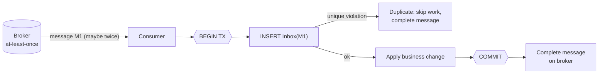
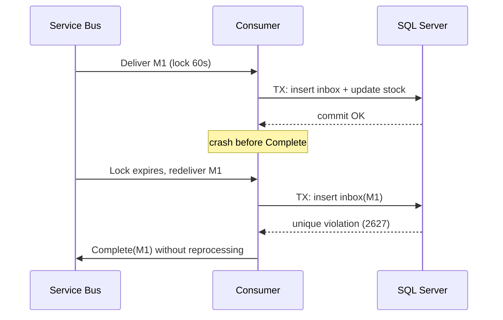
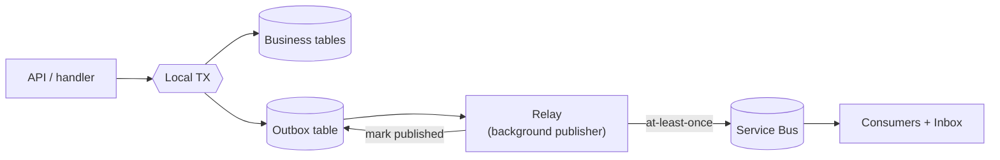
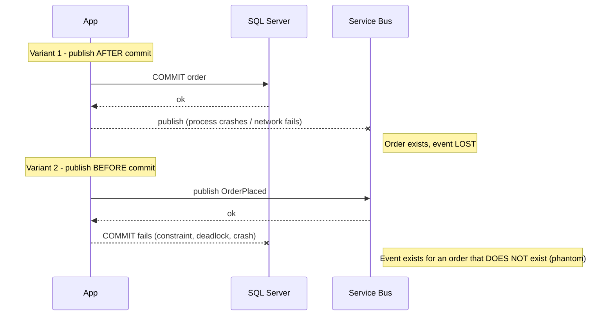
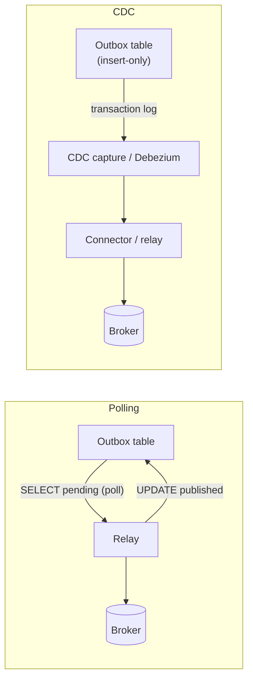
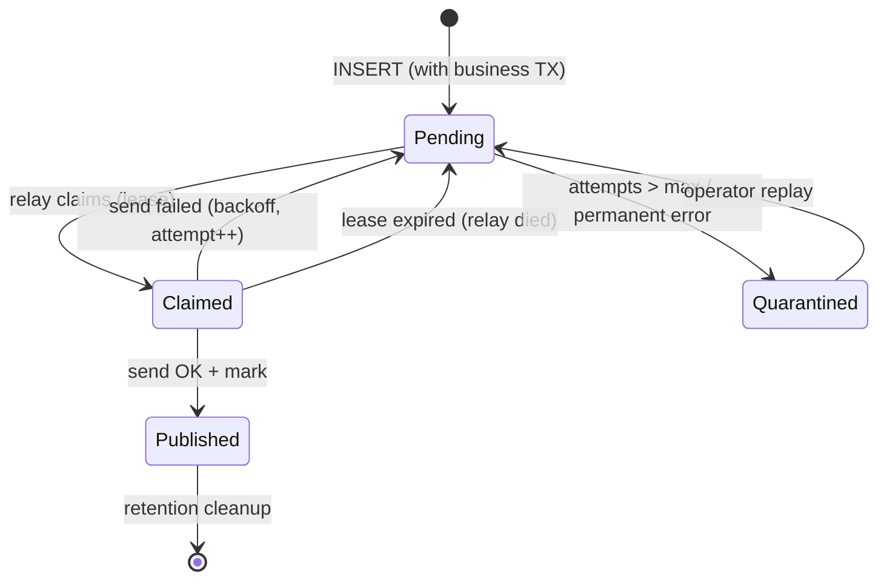
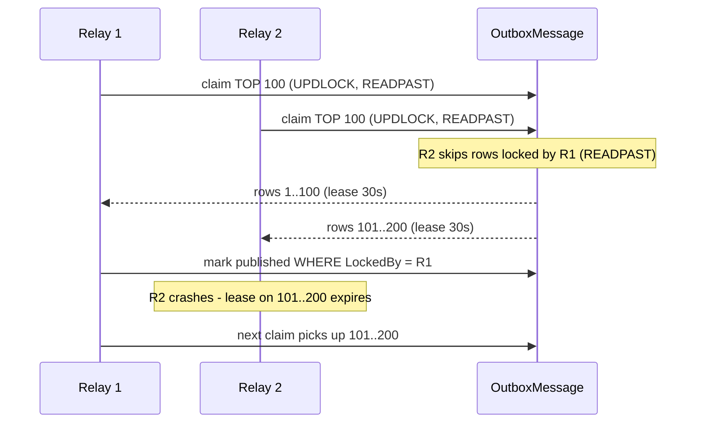
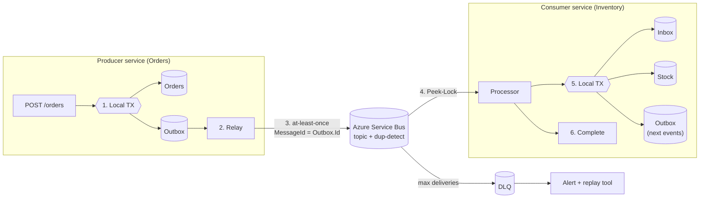
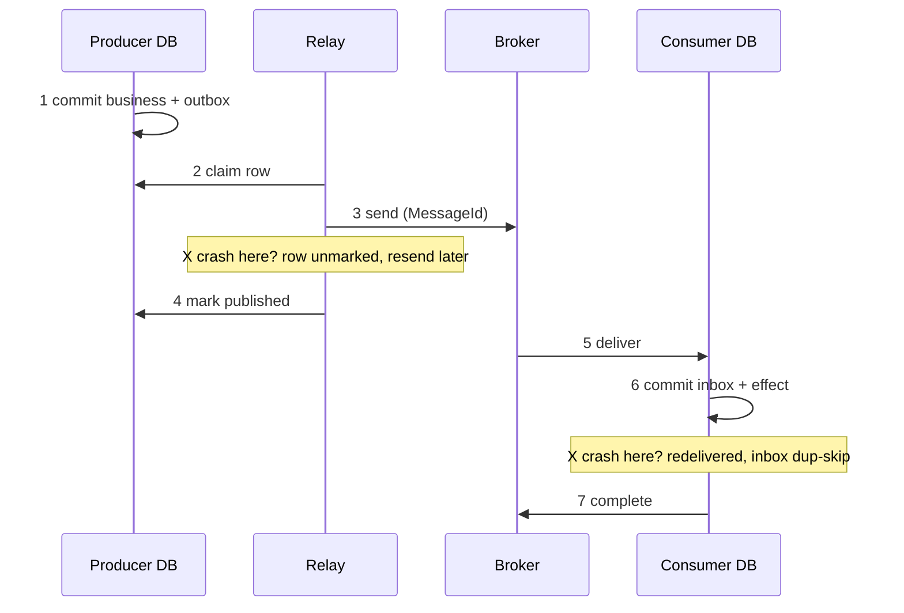
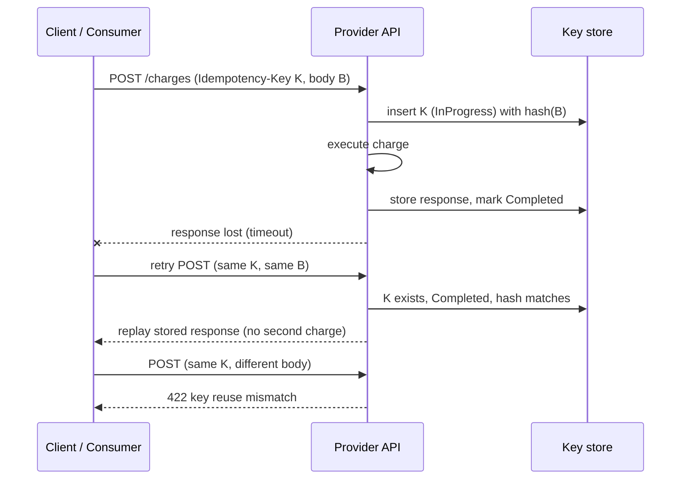

# Inbox Pattern, Outbox Pattern and Reliable Messaging

> **Canonical deep dive.** The [Azure Service Bus guide](../13-azure-service-bus-and-messaging-patterns/azure-service-bus-and-messaging-patterns.md)
> and the [Webhooks guide](../12-webhooks-and-event-based-integration/webhooks-and-event-based-integration.md)
> contain shorter outbox/inbox sections for their own context. This guide is the full treatment and is
> self-contained: it covers the Inbox, the Outbox, and how they combine into an *effectively-once*
> event-driven architecture on SQL Server + Azure Service Bus + .NET 10.

## How to use this guide

1. Read **Part A (Inbox)** and **Part B (Outbox)** in order the first time; each chapter follows the same shape:
   *Simple explanation → Architect depth → Why it exists → Internals → Code → When / when not → Trade-offs → Mistakes → Perf/security → Troubleshooting → Related → Interview Q&A*.
2. **Part C** joins them end to end and enumerates every crash window.
3. **Part D** is the interview toolkit: follow-ups, scenarios, cheat sheet, answer framework, revision checklist.
4. Limits, API versions, CLI flags and third-party library behaviour marked *(verify current)* come from memory and change; confirm against current docs before using them in production.

**The one-paragraph version.** A broker gives you *at-least-once* delivery, a database gives you *atomic local transactions*, and you can never make a network call and a database commit atomic together. The **Outbox** makes the *producer* side safe: the event is written in the same local transaction as the business change, and a relay publishes it later (so an event is never lost). The **Inbox** makes the *consumer* side safe: the message-id is recorded in the same local transaction as the business effect (so a redelivered message is never applied twice). Together: at-least-once transport + idempotent consumption = **effectively-once processing**.

## Table of contents

  - [How to use this guide](#how-to-use-this-guide)
- **[Part A – Inbox Pattern](#part-a--inbox-pattern)**
  - [1. What is the Inbox pattern?](#1-what-is-the-inbox-pattern)
  - [2. Problems solved by Inbox](#2-problems-solved-by-inbox)
  - [3. Duplicate message delivery](#3-duplicate-message-delivery)
  - [4. At-least-once delivery](#4-at-least-once-delivery)
  - [5. Consumer-side idempotency](#5-consumer-side-idempotency)
  - [6. Inbox database table design](#6-inbox-database-table-design)
  - [7. Message ID as a unique key](#7-message-id-as-a-unique-key)
  - [8. Atomic transaction between Inbox record and business update](#8-atomic-transaction-between-inbox-record-and-business-update)
  - [9. Duplicate message detection](#9-duplicate-message-detection)
  - [10. Handling concurrent message processing](#10-handling-concurrent-message-processing)
  - [11. Inbox cleanup and retention](#11-inbox-cleanup-and-retention)
  - [12. Inbox pattern with Azure Service Bus](#12-inbox-pattern-with-azure-service-bus)
  - [13. Inbox pattern limitations](#13-inbox-pattern-limitations)
- **[Part B – Outbox Pattern](#part-b--outbox-pattern)**
  - [14. What is the Outbox pattern?](#14-what-is-the-outbox-pattern)
  - [15. The dual-write problem](#15-the-dual-write-problem)
  - [16. Atomic business transaction and event persistence](#16-atomic-business-transaction-and-event-persistence)
  - [17. Outbox database table design](#17-outbox-database-table-design)
  - [18. Background publisher implementation](#18-background-publisher-implementation)
  - [19. Polling-based Outbox](#19-polling-based-outbox)
  - [20. CDC-based Outbox](#20-cdc-based-outbox)
  - [21. Message publishing and retry](#21-message-publishing-and-retry)
  - [22. Atomic message claiming](#22-atomic-message-claiming)
  - [23. Handling concurrent publishers](#23-handling-concurrent-publishers)
  - [24. Ordering guarantees](#24-ordering-guarantees)
  - [25. Backoff and retry strategies](#25-backoff-and-retry-strategies)
  - [26. Outbox cleanup and retention](#26-outbox-cleanup-and-retention)
  - [27. Outbox pattern with Azure Service Bus](#27-outbox-pattern-with-azure-service-bus)
- **[Part C – Combined Inbox + Outbox Architecture](#part-c--combined-inbox--outbox-architecture)**
  - [28. Producer database transaction](#28-producer-database-transaction)
  - [29. Outbox event publishing and Service Bus delivery](#29-outbox-event-publishing-and-service-bus-delivery)
  - [30. Consumer Inbox processing](#30-consumer-inbox-processing)
  - [31. Idempotent business operations](#31-idempotent-business-operations)
  - [32. At-least-once versus at-most-once delivery](#32-at-least-once-versus-at-most-once-delivery)
  - [33. Why exactly-once processing is difficult](#33-why-exactly-once-processing-is-difficult)
  - [34. Handling third-party side effects](#34-handling-third-party-side-effects)
  - [35. Idempotency keys for external APIs](#35-idempotency-keys-for-external-apis)
  - [36. Dead-letter handling](#36-dead-letter-handling)
  - [37. Message replay and recovery](#37-message-replay-and-recovery)
  - [38. Production-grade reliable event-driven architecture](#38-production-grade-reliable-event-driven-architecture)
  - [39. Framework support: MassTransit, Wolverine, NServiceBus and others](#39-framework-support-masstransit-wolverine-nservicebus-and-others)
  - [40. Anti-patterns catalogue](#40-anti-patterns-catalogue)
  - [41. Troubleshooting playbook](#41-troubleshooting-playbook)
  - [42. When to use, when not to use, trade-offs and relationships](#42-when-to-use-when-not-to-use-trade-offs-and-relationships)
- **[Part D – Interview Toolkit](#part-d--interview-toolkit)**
  - [43. Core interview questions and answers](#43-core-interview-questions-and-answers)
  - [44. Challenging follow-up questions](#44-challenging-follow-up-questions)
  - [45. Scenario-based architect questions](#45-scenario-based-architect-questions)
  - [46. Cheat sheet](#46-cheat-sheet)
  - [47. A structured way to answer reliability questions](#47-a-structured-way-to-answer-reliability-questions)
  - [48. Quick-revision checklist](#48-quick-revision-checklist)

---

# Part A – Inbox Pattern

## 1. What is the Inbox pattern?

**Simple.** Before a consumer does the work for a message, it writes "I have seen message X" into its own database. If the same message arrives again, it finds the note and skips the work. The note and the work are saved together, so either both happen or neither.

**Architect depth.** The Inbox is a **consumer-side deduplication store** co-located with the consumer's business data so that *"record the message as processed"* and *"apply the business effect"* commit in a **single local ACID transaction**. It converts a broker's *at-least-once* guarantee into *effectively-once* **effects** inside that database. It does not make delivery exactly-once; it makes *re-delivery harmless*.



**Why it exists.** Brokers redeliver: lock expiry, consumer crash after commit but before ack, network partition on ack, producer retry. Without a durable, atomic "already processed" marker, redelivery causes double charges, double stock decrements and duplicate emails.

**Internals.** The mechanism is nothing more than a table with a **unique constraint** on the message identity. The unique index is the arbiter: whichever concurrent transaction inserts first wins; the others block on the key lock and then fail (or proceed if the first rolled back).

**Use when:** handlers are not naturally idempotent (increments, appends, state transitions with side effects), money/inventory is involved, or the broker/provider is at-least-once (Service Bus, webhooks, Kafka consumers).
**Do not use when:** the handler is *naturally idempotent* (an upsert of "latest state" keyed by id with a version check), or the cost of a duplicate is trivial and a table per message is not worth it (see Ch. 5 and Ch. 31).

**Interview Q&A.**
*Q: What does the Inbox guarantee that the broker's duplicate detection does not?*
A: Broker duplicate detection only suppresses duplicates *at the producer-to-broker hop*, within a time window, keyed on `MessageId`. It does nothing for redelivery from broker to consumer (lock expiry, crash before ack), nor for duplicates produced outside the window or by different producers. The Inbox protects the *effect* in the consumer's own database, permanently (for the retention period), atomically with the business change.

---

## 2. Problems solved by Inbox

| Problem | Without Inbox | With Inbox |
|---|---|---|
| Redelivery after lock expiry | Handler runs twice | Second run hits unique key, skipped |
| Crash after DB commit, before `Complete` | Message redelivered, effect doubled | Redelivery recognised as duplicate |
| Producer retry (relay crashed after send) | Two copies on the queue | Second copy skipped |
| Replay / DLQ resubmit | Re-applies old effects | Only unseen messages applied (or controlled reprocess) |
| Webhook provider retries | Duplicate orders | Provider event-id deduped |
| Concurrent consumers get the same message (lock lost) | Race, double effect | Key lock serialises; loser skips |

**Architect view.** The Inbox moves correctness from *"hope the broker never repeats"* to *"the database refuses to apply twice"*. It also provides a useful audit trail (what was received, when, which handler) and a hook for observability (duplicate rate is a health signal).

**Mistake to avoid.** Treating the Inbox as a *queue*. It is a *ledger of processed ids*, not a work source. (Some designs use it as a staging table processed asynchronously - that is the "inbox as buffer" variant, covered in Ch. 6.)

---

## 3. Duplicate message delivery

**Simple.** The same message can legitimately arrive more than once.

**Where duplicates come from (enumerate these in interviews):**

1. **Broker redelivery**: lock expired (`MessageLockLost`), `Abandon`, consumer crash, `MaxDeliveryCount` retries.
2. **Producer retries**: timeout on send where the broker actually accepted the message; relay crash between `send` and `mark published` (Ch. 21).
3. **Upstream retries**: HTTP client retries, webhook provider retries, saga step retries.
4. **Operational replay**: DLQ resubmit, backfills, manual replays, consumer offset reset.
5. **Duplicate business events**: user double-clicks "Pay" and the API emits two events (this is *not* a transport duplicate; the ids differ. Fix with API idempotency keys, Ch. 35).

**Key distinction.** *Transport duplicates* share a **message id**; *business duplicates* have **different message ids but the same intent**. The Inbox solves the first. The second needs a **business key** (order id + step, payment intent id) enforced by a unique constraint or an idempotency key.



---

## 4. At-least-once delivery

**Simple.** The broker would rather deliver a message twice than lose it.

**Architect depth.** Delivery semantics are defined by *when the ack is sent relative to the effect*:

| Semantics | Ack timing | Failure outcome | Typical mode |
|---|---|---|---|
| **At-most-once** | Ack *before* processing | Crash ⇒ message **lost** | Service Bus *Receive-and-Delete* |
| **At-least-once** | Ack *after* processing | Crash ⇒ message **redelivered** (duplicate) | Service Bus *Peek-Lock* |
| **Exactly-once (delivery)** | Impossible end-to-end over an unreliable network | n/a | Marketing term; see Ch. 33 |

Service Bus Peek-Lock + `Complete` after success = at-least-once. Kafka with commit-after-process = at-least-once. Webhooks with retries = at-least-once.

**Why the broker cannot do better.** The ack itself can be lost (Two Generals problem). If the consumer commits and then the ack is lost, the broker cannot distinguish that from "consumer crashed before commit". The only safe choice for the broker is to redeliver. Therefore **the consumer must be idempotent**.

**Interview Q&A.**
*Q: Why not just use Receive-and-Delete to avoid duplicates?*
A: It trades duplicates for **loss**: if the process crashes after receiving and before the effect commits, the message is gone. For business-critical events, loss is worse than duplication; duplication is solvable with idempotency, loss is not solvable at all.

---

## 5. Consumer-side idempotency

**Simple.** Doing it twice has the same result as doing it once.

**Architect depth.** *Idempotency* is a property of the **effect**, not the call count. Three tiers, from cheapest to most general:

1. **Naturally idempotent operations**: `SET status = 'Shipped'`, `UPSERT customer profile (id, version)`, `DELETE WHERE id=...`. No Inbox needed (see Ch. 31 for the version-check technique).
2. **Conditionally idempotent**: guarded by a state/version predicate: `UPDATE ... SET Status='Paid' WHERE Id=@id AND Status='Pending'` (0 rows affected on replay).
3. **Inbox-guarded**: non-idempotent effects (`Stock -= qty`, `Balance += amt`, "append ledger line", "send command to a third party") protected by a recorded message-id in the same transaction.

**Decision rule.** Prefer 1 or 2 when the domain allows; fall back to 3 when it does not. Many teams apply the Inbox *uniformly* (via a decorator, Ch. 8) because a uniform mechanism is easier to reason about than a per-handler analysis, at the cost of one extra insert per message.

```csharp
// Tier 2: conditional update; replay-safe without an inbox
var rows = await db.Database.ExecuteSqlInterpolatedAsync($@"
    UPDATE dbo.Orders SET Status = 'Paid', PaidAtUtc = SYSUTCDATETIME()
    WHERE OrderId = {evt.OrderId} AND Status = 'PendingPayment'", ct);
if (rows == 0) logger.LogInformation("Order {OrderId} already paid or not payable; ignoring", evt.OrderId);
```

---

## 6. Inbox database table design

**Simple.** One row per (consumer, message).

**Two designs.**

*Design 1 - "Processed ledger" (recommended default).* Row exists ⇔ message effect committed. Insert happens in the **same transaction** as the business update, so there is no intermediate "in progress" state.

```sql
CREATE TABLE dbo.InboxMessage
(
    InboxId        bigint         IDENTITY(1,1) NOT NULL,
    ConsumerName   nvarchar(100)  NOT NULL,          -- logical handler/subscription
    MessageId      nvarchar(128)  NOT NULL,          -- producer-assigned id (= outbox id)
    MessageType    nvarchar(200)  NOT NULL,
    ReceivedAtUtc  datetime2(3)   NOT NULL CONSTRAINT DF_Inbox_Received DEFAULT SYSUTCDATETIME(),
    CONSTRAINT PK_InboxMessage PRIMARY KEY CLUSTERED (InboxId),
    CONSTRAINT UQ_InboxMessage_Consumer_Message UNIQUE (ConsumerName, MessageId)
);
-- Cleanup/retention scans by time:
CREATE INDEX IX_InboxMessage_ReceivedAtUtc ON dbo.InboxMessage (ReceivedAtUtc);
```

*Design 2 - "Status/lease" (needed when part of the handler is non-transactional).* Adds `Status` (`Processing`, `Processed`, `Failed`), `LeaseUntilUtc`, `AttemptCount`, `LastError`, `ProcessedAtUtc`. Required when the handler calls third parties or runs long: the first transaction claims the message (`Processing` + lease), the work happens, a second transaction marks `Processed`. It costs two transactions and needs lease recovery logic (Ch. 10).

*Variant - "Inbox as buffer".* Receive → insert raw payload into Inbox → complete the broker message immediately → a separate worker processes inbox rows. This decouples broker consumption from processing (good for bursty brokers, bad for added latency and a second queue to operate). Use when the broker has aggressive limits or you want SQL-side retries/visibility.

**Column notes.**
- `ConsumerName` scopes ids per handler so two subscriptions in the *same* database can each process the same message once.
- `MessageId` is `nvarchar` (ids may be GUIDs, ULIDs or provider strings such as `evt_1Nxyz`). Use a **binary collation** (`Latin1_General_100_BIN2`) on the column for faster, case-exact comparison if ids are opaque.
- Cluster on the identity (append-only, no page splits). Put the **unique** index on the natural key; it is the arbiter.
- Do not store large payloads; store ids, type and timestamps (payload lives in the business tables or the broker).

---

## 7. Message ID as a unique key

**Simple.** The id must be the same on every copy of the message.

**Architect depth.** Deduplication is only as good as the **stability and uniqueness** of the id.

| Choice | Verdict |
|---|---|
| **Outbox row id (GUID/ULID) assigned at event creation** and used as the Service Bus `MessageId` | ✅ Best. Same id across relay retries, DLQ resubmits and replays |
| Service Bus system `SequenceNumber` | ❌ Broker-assigned per entity per *send*; a resend gets a new one |
| `Guid.NewGuid()` generated by the *consumer* | ❌ Defeats dedup entirely |
| Hash of payload | ⚠️ Collapses legitimately identical events (two identical "+1" messages) |
| Provider event id (webhooks) | ✅ Use it, scoped by provider |
| Business key (`OrderId` + `Step`) | ✅ For business-level dedup; combine with message id |

**Rules.** (1) The **producer** assigns the id once, persists it in the outbox row, and never changes it. (2) Scope uniqueness by `(ConsumerName, MessageId)`. (3) Treat the id as opaque. (4) Include a version for *replays that are intended to reprocess* (e.g. `MessageId + ":v2"`) so an intentional reprocess is not suppressed (Ch. 37).

**.NET detail.** Prefer **time-ordered ids (UUIDv7)**: `Guid.CreateVersion7()` (.NET 9+) keeps inserts roughly sequential, which matters if you ever index by the id.

```csharp
var evt = new OutboxMessage
{
    Id = Guid.CreateVersion7(),          // stable; becomes ServiceBusMessage.MessageId
    Type = "orders.order-placed.v1",
    ...
};
```

---

## 8. Atomic transaction between Inbox record and business update

**Simple.** "Mark as seen" and "do the work" must be saved in one go.

**Architect depth.** This is the *heart* of the Inbox. If the inbox insert and the business update are in **different** transactions, you reintroduce a crash window: insert-then-crash ⇒ message is marked seen but the effect never happened (**lost effect**); work-then-crash-before-insert ⇒ effect happened but not recorded (**duplicate on redelivery**). One local transaction eliminates both windows.

**Consumer with `ServiceBusProcessor` + EF Core (manual settlement):**

```csharp
public sealed class OrderPlacedConsumer(
    IDbContextFactory<InventoryDbContext> dbFactory,
    ILogger<OrderPlacedConsumer> log)
{
    private const string Consumer = "inventory.order-placed";

    public async Task HandleAsync(ProcessMessageEventArgs args)
    {
        var msg = args.Message;
        var evt = msg.Body.ToObjectFromJson<OrderPlacedV1>();
        await using var db = await dbFactory.CreateDbContextAsync(args.CancellationToken);

        // ExecutionStrategy-friendly: the whole unit is retried as one block.
        var strategy = db.Database.CreateExecutionStrategy();
        var outcome = await strategy.ExecuteAsync(async () =>
        {
            db.ChangeTracker.Clear();
            await using var tx = await db.Database.BeginTransactionAsync(args.CancellationToken);
            try
            {
                db.Inbox.Add(new InboxMessage(Consumer, msg.MessageId, msg.Subject ?? "unknown"));
                await db.SaveChangesAsync(args.CancellationToken);       // throws on duplicate

                foreach (var line in evt.Lines)
                    await db.Database.ExecuteSqlInterpolatedAsync($@"
                        UPDATE dbo.Stock SET Reserved = Reserved + {line.Qty}
                        WHERE Sku = {line.Sku} AND (OnHand - Reserved) >= {line.Qty}",
                        args.CancellationToken);

                await db.SaveChangesAsync(args.CancellationToken);
                await tx.CommitAsync(args.CancellationToken);
                return Outcome.Processed;
            }
            catch (DbUpdateException ex) when (IsUniqueViolation(ex))
            {
                await tx.RollbackAsync(args.CancellationToken);
                return Outcome.Duplicate;
            }
        });

        if (outcome == Outcome.Duplicate)
            log.LogInformation("Duplicate {MessageId} for {Consumer}; completing", msg.MessageId, Consumer);

        await args.CompleteMessageAsync(msg, args.CancellationToken);    // after commit (or dup)
    }

    private static bool IsUniqueViolation(DbUpdateException ex) =>
        ex.InnerException is Microsoft.Data.SqlClient.SqlException { Number: 2627 or 2601 };
}

enum Outcome { Processed, Duplicate }
```

Key points:
- **`Complete` is the last step.** Commit first; if the process dies before `Complete`, redelivery hits the unique key (Outcome.Duplicate) and just completes.
- `2627` = unique *constraint* violation, `2601` = unique *index* violation. Catch both.
- A unique violation **aborts only the statement**, but EF's `SaveChanges` failure leaves the transaction unusable for further work in practice; roll back and treat as duplicate. The business statements run *after* the insert, so nothing has been applied when the duplicate is detected.
- With `SqlServerRetryingExecutionStrategy` a manual transaction must be wrapped in `strategy.ExecuteAsync` (shown), otherwise EF throws.

**A generic decorator** removes the boilerplate and makes the pattern uniform:

```csharp
public interface IMessageHandler<in T> { Task HandleAsync(T message, MessageContext ctx, CancellationToken ct); }

public sealed class IdempotentHandler<T>(
    IMessageHandler<T> inner, AppDbContext db, string consumerName) : IMessageHandler<T>
{
    public async Task HandleAsync(T message, MessageContext ctx, CancellationToken ct)
    {
        await using var tx = await db.Database.BeginTransactionAsync(ct);
        try
        {
            db.Inbox.Add(new InboxMessage(consumerName, ctx.MessageId, typeof(T).Name));
            await db.SaveChangesAsync(ct);
            await inner.HandleAsync(message, ctx, ct);   // uses the SAME db / transaction
            await db.SaveChangesAsync(ct);
            await tx.CommitAsync(ct);
        }
        catch (DbUpdateException ex) when (SqlErrors.IsUniqueViolation(ex))
        {
            await tx.RollbackAsync(ct);
            throw new DuplicateMessageException(ctx.MessageId);   // transport layer completes the message
        }
    }
}
```

**Constraint.** The inner handler **must use the same `DbContext`/connection** so its writes join the transaction. If it calls another database or service, that effect is *outside* the atomic unit (Ch. 34).

**When not to use:** if the business write lives in a **different database** than the inbox, you cannot get one local transaction. Keep the inbox in the same database as the effect, or fall back to idempotent-by-design writes.

**Interview Q&A.**
*Q: Why not check `SELECT ... WHERE MessageId=@id` first and then insert?*
A: Check-then-act is a race: two consumers both see "not found" and both proceed. The **unique constraint** is the only race-free arbiter; the insert *is* the check. A pre-check is only a cheap optimisation to skip work on obvious duplicates.

---

## 9. Duplicate message detection

**Simple.** How the system notices "I've done this one already".

**Layers of defence (use them together, trust only the last):**

| Layer | Scope | Reliability |
|---|---|---|
| Producer: stable `MessageId` | Prerequisite | Required |
| Broker duplicate detection (Service Bus) | Producer→broker, windowed (minutes–days), per entity | Best-effort optimisation |
| **Consumer Inbox unique key** | Permanent (retention), per consumer, atomic with effect | **Authoritative** |
| Business constraints (unique `(OrderId, PaymentAttemptId)`) | Domain-level | Authoritative for business duplicates |
| In-memory cache of recent ids | Per-process | Optimisation only; lost on restart/scale-out |

**Detection outcomes the handler must distinguish:**
- `Processed` (first time) → apply and commit.
- `Duplicate` (already processed) → complete without side effects.
- `InProgress` (another instance holds a lease; Design 2) → abandon/delay and let it retry later.
- `Failed` repeatedly → dead-letter.

**Fast pre-check (optional optimisation)** to avoid starting a transaction for obvious duplicates:

```sql
-- Cheap read; NOT a substitute for the unique constraint.
SELECT 1 FROM dbo.InboxMessage WITH (NOLOCK) WHERE ConsumerName = @c AND MessageId = @id;
```
*Caveat*: `NOLOCK` may miss an in-flight insert; that is fine because the constraint still protects correctness. Use `READ COMMITTED SNAPSHOT` (default on Azure SQL) rather than `NOLOCK` where possible.

---

## 10. Handling concurrent message processing

**Simple.** Two workers get the same message at once; only one may win.

**How it happens.** Lock expiry while the first worker is still running (long handler, GC pause), `MaxConcurrentCalls > 1` with a session-less queue and duplicates on the queue, scaled-out consumers receiving a producer duplicate.

**Design 1 (single transaction): serialisation is automatic.** Both transactions try `INSERT` of the same key. The second blocks on the unique-key lock until the first commits (→ unique violation → duplicate) or rolls back (→ second proceeds). No extra code. Keep the transaction **short** so the loser does not wait long, and set a lock timeout so a stuck winner does not hold others forever.

```sql
SET LOCK_TIMEOUT 5000;   -- fail fast instead of queueing behind a stuck transaction
```

**Design 2 (status + lease): claim, work, finish.**

```sql
-- 1) Claim: insert Processing row OR take over an expired lease. Returns 1 if we own it.
MERGE dbo.InboxMessage WITH (HOLDLOCK) AS t
USING (SELECT @c AS ConsumerName, @id AS MessageId) AS s
   ON t.ConsumerName = s.ConsumerName AND t.MessageId = s.MessageId
WHEN NOT MATCHED THEN
    INSERT (ConsumerName, MessageId, MessageType, Status, LeaseUntilUtc, AttemptCount)
    VALUES (@c, @id, @type, 0, DATEADD(SECOND, @leaseSec, SYSUTCDATETIME()), 1)
WHEN MATCHED AND t.Status = 0 AND t.LeaseUntilUtc < SYSUTCDATETIME() THEN
    UPDATE SET LeaseUntilUtc = DATEADD(SECOND, @leaseSec, SYSUTCDATETIME()),
               AttemptCount = t.AttemptCount + 1
OUTPUT $action;   -- INSERT or UPDATE = we own it; no row = Processed or held by someone else
```
Prefer an explicit `UPDATE ... WHERE Status = 0 AND LeaseUntilUtc < now` followed by `INSERT` in try/catch over `MERGE` if your team distrusts MERGE (it has historical bugs; `HOLDLOCK` is required to make it race-safe). Whatever you pick, the **unique key** is the safety net.

After the work: `UPDATE InboxMessage SET Status = 1, ProcessedAtUtc = ... WHERE ... AND Status = 0` (a **fencing check**: if our lease was taken over, 0 rows ⇒ we were superseded; the business effect must therefore itself be idempotent because both owners may have run it).

**Service Bus side.** Use `MaxAutoLockRenewalDuration` ≥ worst-case processing time so locks do not expire mid-handler; size `MaxConcurrentCalls` to what the database can take; for *per-entity* serialisation use **sessions** (SessionId = aggregate id) so the broker never gives two workers the same aggregate.

**Troubleshooting.** Spikes of 2627 errors = duplicates (expected at low rate; investigate if sustained: lock duration too short, handler too slow). Lock waits on the inbox index = hot key (same message-id contention) or oversized transactions.

---

## 11. Inbox cleanup and retention

**Simple.** The table grows forever unless you trim it.

**Architect depth.** Retention must be **≥ the longest time a duplicate can still arrive**: max broker TTL + max DLQ dwell time + replay horizon + producer retry horizon. If you delete an id and the same message is replayed later, it will be applied twice. Typical: 7–30 days; for webhooks match the provider's retry window (often 3 days) plus margin; for financial replays, keep longer or archive.

**Batch delete (avoid lock escalation at ~5,000 locks and log bloat):**

```sql
DECLARE @cutoff datetime2(3) = DATEADD(DAY, -14, SYSUTCDATETIME());
WHILE 1 = 1
BEGIN
    DELETE TOP (2000) FROM dbo.InboxMessage WHERE ReceivedAtUtc < @cutoff;
    IF @@ROWCOUNT = 0 BREAK;
    WAITFOR DELAY '00:00:00.200';      -- let log backup / other work breathe
END
```

**High volume: partition by time and switch out** old partitions (metadata-only, instant, no log storm):

```sql
-- Monthly partitions on ReceivedAtUtc; SWITCH the oldest partition to a staging table, then TRUNCATE it.
ALTER TABLE dbo.InboxMessage SWITCH PARTITION 1 TO dbo.InboxMessage_Staging PARTITION 1;
TRUNCATE TABLE dbo.InboxMessage_Staging;
```
(Note: the unique key on a partitioned table must include the partition column, so dedup across partitions needs care; at that scale many teams use `ReceivedAtUtc` in a *secondary* index and keep the unique `(ConsumerName, MessageId)` on a non-aligned structure, or switch to a dedicated dedup store. Evaluate before committing.)

**Run the cleanup** as a `BackgroundService`, an Azure Function timer, a SQL Agent job (Managed Instance) or an Elastic Job (Azure SQL DB). Make it idempotent and observable (rows deleted, duration).

**Mistake:** retention shorter than DLQ/replay horizon → silent double-processing on replay. **Mistake:** one giant `DELETE` at 3am that escalates to a table lock and blocks the consumers.

---

## 12. Inbox pattern with Azure Service Bus

**Simple.** Use the Service Bus `MessageId` as the inbox key, complete only after commit.

**Wiring checklist.**
1. Producer sets `MessageId` = outbox row id (Ch. 27).
2. Consumer uses **Peek-Lock**, `AutoCompleteMessages = false`, manual `Complete/Abandon/DeadLetter`.
3. Inbox insert + business effect in one transaction (Ch. 8); then `Complete`.
4. Unique violation ⇒ `Complete` (it is a duplicate, not a failure).
5. Transient DB failure ⇒ `Abandon` (delivery count increments; backoff via scheduled resubmit or lock-duration tuning).
6. Permanent/poison failure ⇒ `DeadLetter` with reason; never loop forever.
7. Lock renewal ≥ handler duration; `MaxDeliveryCount` sized so transient storms do not dead-letter good messages.

```csharp
// Registration (Azure.Messaging.ServiceBus + Microsoft.Extensions.Azure)
builder.Services.AddAzureClients(c =>
    c.AddServiceBusClientWithNamespace("sb-contoso.servicebus.windows.net")
     .WithCredential(new DefaultAzureCredential()));     // managed identity, no connection string

builder.Services.AddHostedService<ServiceBusInboxWorker>();

public sealed class ServiceBusInboxWorker(ServiceBusClient client, OrderPlacedConsumer consumer, ILogger<ServiceBusInboxWorker> log)
    : BackgroundService
{
    protected override async Task ExecuteAsync(CancellationToken stop)
    {
        await using var processor = client.CreateProcessor("order-placed", "inventory", new ServiceBusProcessorOptions
        {
            AutoCompleteMessages = false,
            MaxConcurrentCalls = 8,
            PrefetchCount = 16,
            MaxAutoLockRenewalDuration = TimeSpan.FromMinutes(5),
            ReceiveMode = ServiceBusReceiveMode.PeekLock
        });

        processor.ProcessMessageAsync += async args =>
        {
            try { await consumer.HandleAsync(args); }
            catch (PermanentFailureException ex)
            {
                await args.DeadLetterMessageAsync(args.Message, "PermanentFailure", ex.Message, args.CancellationToken);
            }
            // any other exception -> bubbles to ProcessErrorAsync and the message is abandoned by the SDK
        };
        processor.ProcessErrorAsync += e => { log.LogError(e.Exception, "SB error {Source}", e.ErrorSource); return Task.CompletedTask; };

        await processor.StartProcessingAsync(stop);
        try { await Task.Delay(Timeout.Infinite, stop); } catch (OperationCanceledException) { }
        await processor.StopProcessingAsync();       // graceful: in-flight handlers finish
    }
}
```

**Azure Functions variant (isolated worker).** The Service Bus trigger with `AutoCompleteMessages = false` and `ServiceBusMessageActions` gives the same flow; set `maxConcurrentCalls` and `maxAutoLockRenewalDuration` in `host.json` *(verify current)*. The inbox logic is identical; Functions only replaces the hosting loop.

```csharp
[Function("InventoryOrderPlaced")]
public async Task Run(
    [ServiceBusTrigger("order-placed", "inventory", Connection = "ServiceBus", AutoCompleteMessages = false)]
    ServiceBusReceivedMessage message, ServiceBusMessageActions actions, CancellationToken ct)
{
    await consumer.HandleAsync(message, ct);           // inbox insert + effect in one transaction
    await actions.CompleteMessageAsync(message, ct);
}
```

**Duplicate detection on the entity** (enabled at creation; cannot be toggled later) reduces how many duplicates reach the consumer but never replaces the inbox (Ch. 27 and the [Service Bus guide](../13-azure-service-bus-and-messaging-patterns/azure-service-bus-and-messaging-patterns.md)).

---

## 13. Inbox pattern limitations

| Limitation | Consequence / mitigation |
|---|---|
| **Same-database requirement** | Inbox and business data must share a transaction. Cross-database effects need idempotent design or a saga |
| **Does not cover non-transactional side effects** | Emails, payments, HTTP calls can still duplicate. Use idempotency keys / outbox for commands (Ch. 34-35) |
| **Write amplification** | One extra insert + index maintenance per message; hot table at high throughput. Partition/shard, short retention |
| **Retention window is a correctness boundary** | Replays older than retention are not deduped |
| **Does not provide ordering** | Dedup ≠ order. Use sessions/version checks (Ch. 24) |
| **Duplicates with different ids** (business duplicates) | Need business keys / idempotency keys |
| **Contention** | A single hot consumer table across many handlers; mitigate with `ConsumerName` scoping and good keys |
| **Operational burden** | Cleanup jobs, monitoring, schema per service |
| **Poison messages still need DLQ handling** | Inbox only records *successful* processing |

**When an Inbox is overkill.** Naturally idempotent handlers (`UPSERT` with version), read-model projections that can be rebuilt, or analytics ingestion where duplicates are filtered downstream.

**Related:** [Distributed Systems Patterns](../03-architectural-patterns/distributed-systems-patterns.md) (idempotency, inbox/outbox overview), [Event-Driven Architecture](../02-architectural-styles/04-event-driven-architecture/event-driven-architecture.md).

---

# Part B – Outbox Pattern

## 14. What is the Outbox pattern?

**Simple.** Instead of sending the message directly, write it into an "outbox" table in the same database transaction as the business change. A separate process reads the outbox and sends the messages. If the app crashes, the rows are still there to be sent.

**Architect depth.** The Outbox is a **producer-side transactional staging area** that turns *"update state AND publish event"* (impossible to do atomically across a database and a broker) into *"update state AND insert event row"* (one local ACID transaction) followed by *"deliver row at-least-once"* (a retryable, idempotent relay). It guarantees **no lost events** and **no phantom events** (an event is published only if the business transaction committed).



**Why it exists.** Microservices own their data; to keep other services informed you publish events. Doing that reliably without distributed transactions (2PC) is the Outbox's job. It is the standard remedy for the **dual-write problem** (Ch. 15) and a cornerstone of the [Saga pattern](../03-architectural-patterns/01-SAGA-pattern/SAGA-pattern.md), [CQRS](../03-architectural-patterns/02-CQRS-pattern/CQRS-pattern.md) read-model feeding, and [event-driven architectures](../02-architectural-styles/04-event-driven-architecture/event-driven-architecture.md).

**Use when:** a state change must reliably trigger an event/command to another system and losing it is unacceptable (orders, payments, ledger, provisioning).
**Do not use when:** the event is best-effort (telemetry, cache invalidation hints) and a rare loss is acceptable; or you already use event sourcing where the event store *is* the source of truth and is itself published (Ch. 14 callout below).

> **Event sourcing and the outbox.** In an [event-sourced](../03-architectural-patterns/03-event-sourcing/event-sourcing.md) system the append-only event store is the transactional record; publishing it is a "relay from the event store" and the separate outbox table is unnecessary (you still need at-least-once relay + consumer idempotency).

**Interview Q&A.**
*Q: Is the Outbox "exactly-once publishing"?*
A: No. It guarantees *at-least-once* publishing. The relay can crash after sending and before marking the row published, which causes a duplicate send. Duplicates are neutralised downstream by broker duplicate detection (partially) and the consumer Inbox (fully).

---

## 15. The dual-write problem

**Simple.** Writing to two systems (database and broker) is two separate operations; one can succeed while the other fails.



**Architect depth.** There is no ordering of the two writes that is safe:
- *DB then broker*: lost events on crash between them. State and downstream views diverge silently, the worst kind of bug.
- *Broker then DB*: phantom events; consumers act on facts that never became true.
- *Both inside one `TransactionScope`*: Service Bus is not an enlistable XA resource in the general case; there is no distributed transaction coordinator across SQL Server and Service Bus in modern cloud-native .NET (MSDTC does not apply to the Service Bus SDK over AMQP in this way), and 2PC would couple availability of both systems anyway. Service Bus *does* support transactions **within** its own entities (send-via, multiple operations on one namespace), which is useful for the relay-to-consumer hop but cannot include the SQL commit.
- *Retry loops around the publish*: fix transient failures but not process death; the in-memory retry is lost with the process.

**The generalisation.** Any two non-transactional resources (database + broker, database + HTTP API, database + cache, database + search index) have the dual-write problem. The Outbox is the general answer: make **one** of them the source of truth (the database) and derive the others reliably.

**Mistakes to name in interviews:** "I'll catch the exception and retry" (not durable), "I'll publish in a `finally`" (still races the crash), "We use `TransactionScope` so it is fine" (it is not, with AMQP brokers).

---

## 16. Atomic business transaction and event persistence

**Simple.** The business row and the event row are saved in the same `SaveChanges`.

**EF Core: aggregate + domain events → outbox rows via an interceptor** (so handlers never forget):

```csharp
public interface IDomainEvent { Guid EventId { get; } DateTime OccurredAtUtc { get; } string Type { get; } }
public abstract class AggregateRoot
{
    private readonly List<IDomainEvent> _events = new();
    public IReadOnlyList<IDomainEvent> DomainEvents => _events;
    protected void Raise(IDomainEvent e) => _events.Add(e);
    public void ClearEvents() => _events.Clear();
    public long Version { get; protected set; }           // used as per-aggregate sequence
}

public sealed class OutboxInterceptor : SaveChangesInterceptor
{
    public override ValueTask<InterceptionResult<int>> SavingChangesAsync(
        DbContextEventData eventData, InterceptionResult<int> result, CancellationToken ct = default)
    {
        var db = eventData.Context!;
        var aggregates = db.ChangeTracker.Entries<AggregateRoot>()
                           .Where(e => e.Entity.DomainEvents.Count > 0).ToList();

        foreach (var entry in aggregates)
        {
            foreach (var e in entry.Entity.DomainEvents)
            {
                db.Set<OutboxMessage>().Add(new OutboxMessage
                {
                    Id            = e.EventId,                         // stable message id
                    AggregateType = entry.Entity.GetType().Name,
                    AggregateId   = entry.Property("Id").CurrentValue!.ToString()!,
                    Type          = e.Type,                            // e.g. orders.order-placed.v1
                    Payload       = JsonSerializer.Serialize(e, e.GetType()),
                    OccurredAtUtc = e.OccurredAtUtc,
                    TraceParent   = Activity.Current?.Id,              // W3C traceparent for correlation
                    CreatedAtUtc  = DateTime.UtcNow
                });
            }
            entry.Entity.ClearEvents();
        }
        return base.SavingChangesAsync(eventData, result, ct);
    }
}

// registration
services.AddDbContext<OrdersDbContext>((sp, o) => o
    .UseSqlServer(cs, sql => sql.EnableRetryOnFailure())
    .AddInterceptors(new OutboxInterceptor()));
```

Because `SaveChanges` wraps *all* tracked changes in one transaction, the order row, its lines and the outbox row **commit or roll back together**. No explicit transaction is needed for the single-`SaveChanges` case; use an explicit transaction only when several `SaveChanges` (or raw SQL) must be atomic.

**Without EF (raw SQL / Dapper):**

```csharp
await using var conn = new SqlConnection(cs); await conn.OpenAsync(ct);
await using var tx = (SqlTransaction)await conn.BeginTransactionAsync(ct);
await conn.ExecuteAsync("INSERT dbo.Orders(...) VALUES(...)", order, tx);
await conn.ExecuteAsync(@"INSERT dbo.OutboxMessage(Id, AggregateType, AggregateId, Type, Payload, OccurredAtUtc, TraceParent)
                          VALUES(@Id,@AggregateType,@AggregateId,@Type,@Payload,@OccurredAtUtc,@TraceParent)", evt, tx);
await tx.CommitAsync(ct);
```

**Design choice: event content.** *Thin events* (ids only) force consumers to call back (coupling, load); *fat events / event-carried state transfer* include the data consumers need (autonomy, larger payloads). Pick deliberately and version the schema (`...v1`).

**Mistakes:** raising domain events in memory and publishing them in a `SaveChanges` *post*-hook (that is variant 1 of the dual-write); forgetting to add events for changes made through bulk `ExecuteUpdate` (these bypass the change tracker; write the outbox row explicitly).

---

## 17. Outbox database table design

```sql
CREATE TABLE dbo.OutboxMessage
(
    OutboxId        bigint           IDENTITY(1,1) NOT NULL,       -- relay ordering / clustering
    Id              uniqueidentifier NOT NULL,                      -- stable MessageId (producer-assigned)
    AggregateType   nvarchar(100)    NOT NULL,
    AggregateId     nvarchar(100)    NOT NULL,                      -- ordering/partition key
    AggregateVersion bigint          NULL,                          -- per-aggregate sequence for consumers
    Type            nvarchar(200)    NOT NULL,                      -- 'orders.order-placed.v1'
    Payload         nvarchar(max)    NOT NULL,                      -- JSON (keep small; claim-check for big)
    TraceParent     nvarchar(64)     NULL,                          -- W3C trace context
    CorrelationId   nvarchar(100)    NULL,
    TenantId        nvarchar(64)     NULL,
    CreatedAtUtc    datetime2(3)     NOT NULL CONSTRAINT DF_Outbox_Created DEFAULT SYSUTCDATETIME(),
    OccurredAtUtc   datetime2(3)     NOT NULL,
    -- relay state
    Status          tinyint          NOT NULL CONSTRAINT DF_Outbox_Status DEFAULT 0,   -- 0 Pending, 1 Published, 2 Quarantined
    AttemptCount    int              NOT NULL CONSTRAINT DF_Outbox_Attempts DEFAULT 0,
    NextAttemptAtUtc datetime2(3)    NOT NULL CONSTRAINT DF_Outbox_Next DEFAULT SYSUTCDATETIME(),
    LockedBy        nvarchar(100)    NULL,                          -- relay instance id (lease owner)
    LockedUntilUtc  datetime2(3)     NULL,                          -- lease expiry (visibility timeout)
    PublishedAtUtc  datetime2(3)     NULL,
    LastError       nvarchar(1000)   NULL,
    CONSTRAINT PK_OutboxMessage PRIMARY KEY CLUSTERED (OutboxId),
    CONSTRAINT UQ_OutboxMessage_Id UNIQUE (Id)
);

-- The relay's hot path: only pending rows, ordered. A FILTERED index keeps it tiny as history grows.
CREATE INDEX IX_Outbox_Pending
    ON dbo.OutboxMessage (NextAttemptAtUtc, OutboxId)
    INCLUDE (AggregateId, LockedUntilUtc)
    WHERE Status = 0;

-- Retention scans of published rows:
CREATE INDEX IX_Outbox_Published ON dbo.OutboxMessage (PublishedAtUtc) WHERE Status = 1;

-- Per-aggregate ordering checks (Ch. 24):
CREATE INDEX IX_Outbox_Aggregate ON dbo.OutboxMessage (AggregateId, OutboxId) WHERE Status = 0;
```

**Design notes.**
- **Cluster on the identity**: inserts are append-only at the tail (cheap); the relay scans the head. Do *not* cluster on a random GUID.
- **Filtered indexes** need queries whose predicate matches (`WHERE Status = 0` as a literal, not a parameter, so the optimizer can use them; parameterised predicates may not match the filter, use `OPTION (RECOMPILE)` or literals).
- `Id` (GUID) is what travels as `MessageId`; `OutboxId` is local ordering only.
- **Payload size**: keep well under the broker limit (Service Bus Standard 256 KB, Premium up to 100 MB *(verify current)*). For large documents use the **claim-check** pattern: store the blob in Blob Storage and put a reference in the event.
- **Do not store secrets or unnecessary PII** in payloads (Ch. 38, GDPR).
- `Status` as `tinyint` + small filtered indexes beats a nullable `PublishedAtUtc`-only design for readability, but a `PublishedAtUtc IS NULL` filter works equally well; choose one convention.
- **Multi-tenant**: keep `TenantId` for routing/quotas; consider per-tenant fairness in claiming if one tenant can flood the table.

**Anti-pattern:** a "generic outbox" without `AggregateId`/version, making per-entity ordering impossible later.

---

## 18. Background publisher implementation

**Simple.** A loop that claims a few pending rows, sends them, and marks them published.

```csharp
public sealed class OutboxRelay(
    IOutboxStore store, ServiceBusClient client, IOptions<OutboxOptions> opt, ILogger<OutboxRelay> log) : BackgroundService
{
    private readonly string _owner = $"{Environment.MachineName}:{Guid.NewGuid():N}";
    private static readonly ActivitySource Source = new("Outbox.Relay");

    protected override async Task ExecuteAsync(CancellationToken stop)
    {
        var o = opt.Value;
        await using var sender = client.CreateSender(o.QueueOrTopic);
        using var timer = new PeriodicTimer(o.PollInterval);              // e.g. 500 ms
        do
        {
            try
            {
                int claimed;
                do   // drain without sleeping while there is work
                {
                    var batch = await store.ClaimAsync(_owner, o.BatchSize, o.Lease, stop);   // atomic claim (Ch. 22)
                    claimed = batch.Count;
                    if (claimed > 0) await PublishBatchAsync(sender, batch, stop);
                } while (claimed == o.BatchSize && !stop.IsCancellationRequested);

                // small random jitter avoids synchronized polling stampedes across instances
                await Task.Delay(Random.Shared.Next(0, 100), stop);
            }
            catch (OperationCanceledException) when (stop.IsCancellationRequested) { }
            catch (Exception ex) { log.LogError(ex, "Outbox relay iteration failed"); }
        }
        while (await timer.WaitForNextTickAsync(stop).ConfigureAwait(false));
    }

    private async Task PublishBatchAsync(ServiceBusSender sender, IReadOnlyList<OutboxRow> rows, CancellationToken ct)
    {
        var sent = new List<long>(); var failed = new List<(OutboxRow Row, Exception Ex)>();
        foreach (var row in rows)       // sequential to preserve order within the claimed batch
        {
            try
            {
                var m = new ServiceBusMessage(BinaryData.FromString(row.Payload))
                {
                    MessageId   = row.Id.ToString(),             // stable -> broker dedup + consumer inbox key
                    Subject     = row.Type,
                    ContentType = "application/json",
                    CorrelationId = row.CorrelationId,
                    SessionId   = row.AggregateId               // only if the destination requires sessions (Ch. 24)
                };
                m.ApplicationProperties["traceparent"] = row.TraceParent;
                m.ApplicationProperties["aggregateVersion"] = row.AggregateVersion;
                m.ApplicationProperties["schema"] = row.Type;
                await sender.SendMessageAsync(m, ct);
                sent.Add(row.OutboxId);
            }
            catch (Exception ex) when (!ct.IsCancellationRequested)
            {
                failed.Add((row, ex));
                break;           // stop at first failure to keep per-aggregate order; remaining rows are released
            }
        }
        await store.MarkPublishedAsync(_owner, sent, ct);                 // one UPDATE ... WHERE LockedBy = @owner
        var unsent = rows.Where(r => !sent.Contains(r.OutboxId)).ToList();
        await store.ReleaseOrBackoffAsync(_owner, unsent, failed, ct);   // failed row: back-off; later rows: just release lease
    }
}
```

**Production concerns built in:**
- **Graceful shutdown**: `stop` token cancels the wait; in-flight rows keep their lease and are retried by another instance after expiry; no cleanup needed.
- **Multiple instances are safe** because claiming is atomic (Ch. 22).
- **Reuse one `ServiceBusClient`/`ServiceBusSender`** (they are thread-safe, long-lived); creating per-iteration causes connection churn.
- **Batching**: for throughput use `sender.CreateMessageBatchAsync()` + `TryAddMessage` and send in one round trip; handle the "batch full" case. (The sample sends one by one for clarity of per-row error handling; Ch. 27 shows the batch variant.)
- Hosting: ACA/App Service/AKS worker or a dedicated Container Apps *job*. With Functions, prefer a timer/queue-triggered design only if you accept cold-start latency; a long-running worker gives lower publish latency.

**Latency tuning.** Poll interval is the publish-latency floor. Options: shorter interval + `Task.Delay` back-off when idle; **in-process signal** (a `Channel<T>` poked after a successful commit by the same process - optimisation only, polling remains the safety net); SQL `WAITFOR`/Service Broker/notification-style signals are possible but add complexity.

---

## 19. Polling-based Outbox

**How it works.** The relay periodically queries the outbox for pending rows (`WHERE Status = 0 AND NextAttemptAtUtc <= now`), claims, publishes and marks.

| Aspect | Polling outbox |
|---|---|
| Implementation | Plain SQL + a worker; trivial to host anywhere |
| Latency | Poll interval (50 ms-seconds) + publish time |
| Load | Constant light read load on a *small filtered index*; negligible if the pending set is small |
| Ordering | You control it in the claim query (Ch. 24) |
| Dependencies | None beyond the database and broker |
| Failure model | Everything visible in a table; easy to inspect and repair by hand |
| Scaling | Multiple relays via claiming; partition by aggregate hash for strict ordering |

**Sample hot-path query plan expectations.** `IX_Outbox_Pending` is a filtered index; the claim `TOP (@n)` is an index seek on `(NextAttemptAtUtc, OutboxId)` + key lookups only for the claimed rows. If it ever scans the clustered index, a parameter-sniffing/filter-mismatch problem exists (check with the actual plan and `OPTION (RECOMPILE)`).

**Choose polling when:** you want simplicity, portability, low operational dependencies, strong control of ordering, and event rates up to tens of thousands per minute per database. It is the right default.

**Mistakes:** polling with `SELECT *` and no filtered index (full scans as history grows); a `Thread.Sleep(5000)` loop that adds 5 s of latency to every event; ordering by `CreatedAtUtc` (clock/time-resolution ties, see Ch. 24).

---

## 20. CDC-based Outbox

**Simple.** Instead of the app polling a table, the database's **change log** is tailed and every insert into the outbox table is streamed out.



**Mechanics (SQL Server).**
```sql
EXEC sys.sp_cdc_enable_db;
EXEC sys.sp_cdc_enable_table
     @source_schema = N'dbo', @source_name = N'OutboxMessage',
     @role_name = NULL, @supports_net_changes = 0;
-- Reads: cdc.fn_cdc_get_all_changes_dbo_OutboxMessage(@from_lsn, @to_lsn, N'all')
```
The capture job reads the transaction log into `cdc.dbo_OutboxMessage_CT`; a consumer tracks the last processed **LSN** and reads changes in commit order. **Debezium** (SQL Server connector) does this and its **Outbox Event Router** SMT maps outbox columns to Kafka topics/keys; on Azure you can point Debezium at **Event Hubs' Kafka endpoint**, or write a custom LSN-tailing relay that publishes to Service Bus *(verify current connector and Azure SQL CDC support/tier requirements)*. A common refinement: insert the outbox row and **delete it in the same transaction**; the table stays empty while the log still carries the insert, so no cleanup job and no growth (the connector ignores delete events).

**Trade-offs.**

| | Polling | CDC |
|---|---|---|
| Latency | Poll interval | Near-real-time (log read; capture job interval ~seconds) |
| DB load | Query load on outbox | Log-reader + CT tables; extra writes |
| Ordering | Your design | **Commit order** from the log (per source, strong) |
| Infra | Just a worker | CDC enablement, Debezium/Kafka Connect or custom LSN consumer, schema/permissions |
| Retries/back-off/quarantine | Natural (row state) | You must build it in the connector/consumer |
| Failure modes | Simple | **Log truncation held by capture** (`log_reuse_wait_desc = REPLICATION`) if the job lags; CDC job misconfig; LSN gaps after restore |
| Portability | Any SQL | DB-specific |

**Choose CDC when:** very high throughput, you need commit-order streaming, you already run Kafka/Debezium, or you cannot afford polling load. **Choose polling** otherwise. Related background on CDC mechanics and its migration use: [Cloud Migration guide](../11-cloud-migration-and-modernization/cloud-migration-and-legacy-modernization.md).

**Change Tracking and Temporal tables are not substitutes.** Change Tracking records *that* a row changed (no history of values); temporal tables record row versions but are not designed as an event stream.

**Troubleshooting.** CDC capture falling behind ⇒ log growth, disk alerts: monitor `sys.dm_cdc_log_scan_sessions`, `sys.dm_db_log_space_usage`, and the capture job; fix by increasing `maxtrans`/`maxscans`, reducing write bursts, or disabling and re-enabling after a long outage (with a full re-sync plan).

---

## 21. Message publishing and retry

**Simple.** Sending can fail; the row stays pending and is tried again.

**Failure taxonomy the relay must handle:**

| Failure | Example | Action |
|---|---|---|
| **Transient broker/network** | `ServiceBusException` with `IsTransient`, timeouts, throttling (`ServerBusy`) | Back off and retry; SDK already retries a few times |
| **Throttled (quota)** | `QuotaExceeded`, `ServerBusy` | Slow the whole relay (adaptive), not just the row |
| **Permanent for this message** | Message too large, invalid properties, entity disabled/deleted | Quarantine row after N attempts; alert |
| **Ambiguous** | Timeout where the broker may have accepted the message | Treat as failure and retry; duplicate is expected and handled (dedup + inbox) |
| **Relay crash** | Between send and mark | Lease expires, another relay re-sends; duplicate expected |

**The ambiguity is the point.** After a send you either know it succeeded (the SDK returned) or you do not. If you do not know, you must resend. Hence *at-least-once*; hence stable `MessageId`.

**Row state machine.**



**Store operations.**

```csharp
public async Task MarkPublishedAsync(string owner, IReadOnlyCollection<long> ids, CancellationToken ct)
{
    if (ids.Count == 0) return;
    // Fenced by LockedBy: if our lease was taken over, we update 0 rows (and a duplicate send may have occurred).
    await using var conn = new SqlConnection(cs); await conn.OpenAsync(ct);
    await conn.ExecuteAsync(@"
        UPDATE dbo.OutboxMessage
           SET Status = 1, PublishedAtUtc = SYSUTCDATETIME(), LockedBy = NULL, LockedUntilUtc = NULL
         WHERE OutboxId IN @ids AND LockedBy = @owner AND Status = 0",
        new { ids, owner });
}

public async Task BackoffAsync(string owner, long id, int attempt, Exception ex, int maxAttempts, CancellationToken ct)
{
    var delay = Backoff.FullJitter(attempt, TimeSpan.FromSeconds(1), TimeSpan.FromMinutes(5));
    await using var conn = new SqlConnection(cs); await conn.OpenAsync(ct);
    await conn.ExecuteAsync(@"
        UPDATE dbo.OutboxMessage
           SET LockedBy = NULL, LockedUntilUtc = NULL,
               Status = CASE WHEN AttemptCount >= @max THEN 2 ELSE 0 END,        -- quarantine after N
               NextAttemptAtUtc = DATEADD(MILLISECOND, @delayMs, SYSUTCDATETIME()),
               LastError = LEFT(@err, 1000)
         WHERE OutboxId = @id AND LockedBy = @owner",
        new { id, owner, max = maxAttempts, delayMs = (int)delay.TotalMilliseconds, err = ex.Message });
}
```

**Mistakes:** retrying in a tight loop without back-off (hammers a throttled namespace); infinite retries on a permanently bad row (blocks the head of the queue); resetting `AttemptCount` on every claim; swallowing the exception without recording `LastError` (no diagnosability).

---

## 22. Atomic message claiming

**Simple.** Each relay must "grab" rows so that two relays never take the same row at the same time.

**The pattern: `UPDATE TOP ... WITH (UPDLOCK, READPAST, ROWLOCK) ... OUTPUT`** - select candidate rows, skip rows locked by others, set a lease, and return them, all in one atomic statement.

```sql
-- Claim up to @batch pending, due, un-leased rows for @owner for @leaseSec seconds.
;WITH cte AS
(
    SELECT TOP (@batch) *
    FROM dbo.OutboxMessage WITH (UPDLOCK, READPAST, ROWLOCK)
    WHERE Status = 0
      AND NextAttemptAtUtc <= SYSUTCDATETIME()
      AND (LockedUntilUtc IS NULL OR LockedUntilUtc < SYSUTCDATETIME())
    ORDER BY OutboxId
)
UPDATE cte
   SET LockedBy       = @owner,
       LockedUntilUtc = DATEADD(SECOND, @leaseSec, SYSUTCDATETIME()),
       AttemptCount   = AttemptCount + 1
OUTPUT inserted.OutboxId, inserted.Id, inserted.AggregateType, inserted.AggregateId,
       inserted.AggregateVersion, inserted.Type, inserted.Payload, inserted.TraceParent,
       inserted.CorrelationId, inserted.AttemptCount;
```

**Why each hint matters.**
- `UPDLOCK`: take update locks while reading so two relays cannot both read the same row and then both update it (avoids the classic lost-claim/deadlock between S→X conversions).
- `READPAST`: **skip** rows locked by another relay instead of waiting. This is what makes multiple relays scale rather than queue behind each other.
- `ROWLOCK`: discourage page/table lock escalation for small batches.
- `OUTPUT`: return the claimed rows in the same atomic statement (no second query, no gap). `OUTPUT` row order is **not guaranteed**; sort by `OutboxId` client-side.

**Lease = visibility timeout.** The claim sets `LockedUntilUtc`. If the relay dies, the lease expires and the row becomes claimable again, with no "stuck" state and no manual cleanup. Choose `lease` > worst-case publish time of a batch (e.g. 30-60 s), and keep batches small so one slow send does not hold many rows hostage.



**Alternative: `sp_getapplock`** (one logical lock per aggregate or per partition) when you need strict mutual exclusion per key and the volume is modest. **Alternative: single active relay** via a blob lease/leader election (Ch. 23) when strict global sequencing matters more than parallelism.

**Pitfall: `READPAST` and ordering.** `READPAST` can let relay B publish a *later* row of aggregate A while relay A still holds an *earlier* row of A. See Ch. 24 for how to keep per-aggregate order.

**Pitfall: the claimed set must come from an index.** Without `IX_Outbox_Pending`, the `TOP` scan walks the clustered index past published rows while holding update locks; throughput collapses as history grows.

---

## 23. Handling concurrent publishers

**Why run several.** Availability (a second instance takes over), throughput, rolling deployments, autoscaling.

**Strategies.**

| Strategy | Mechanism | Ordering | Throughput | Complexity |
|---|---|---|---|---|
| **Competing relays + atomic claim** | `READPAST` claim (Ch. 22) | Per-aggregate guard needed | High | Low-medium |
| **Hash-partitioned relays** | Relay *k* of *N* claims `WHERE ABS(CHECKSUM(AggregateId)) % N = k` (or a persisted `PartitionId` column) | Per-aggregate order preserved naturally | High | Medium (rebalancing, partition ownership via leases) |
| **Single active relay (leader election)** | Blob lease / `sp_getapplock` / Kubernetes leader election; standbys wait | Strong | Limited to one publisher | Low; failover seconds |
| **One relay per tenant/shard** | Per-database or per-tenant worker | Per tenant | Scales with tenants | Operational overhead |

**Persisted `PartitionId`.** Compute at insert time (`ABS(CHECKSUM(AggregateId)) % 16`) and index `(PartitionId, OutboxId)`. Relays own partitions through short leases in a small `OutboxPartitionLease` table. This gives parallelism *and* per-aggregate order *and* simple scaling.

**Blob lease leader election (Azure)** for the single-active option:

```csharp
var blob = container.GetBlobClient("outbox-relay-leader");
await blob.UploadAsync(BinaryData.FromString("x"), overwrite: false, ct);   // ignore if exists
var lease = blob.GetBlobLeaseClient();
try
{
    await lease.AcquireAsync(TimeSpan.FromSeconds(30), cancellationToken: ct);   // only one holder
    using var renew = RenewEvery(lease, TimeSpan.FromSeconds(10), ct);
    await RunRelayLoopAsync(ct);                                                   // publish while we hold it
}
catch (RequestFailedException e) when (e.ErrorCode == "LeaseAlreadyPresent") { /* standby */ }
```
If the lease is lost mid-batch, stop immediately; fencing via `LockedBy` still prevents bad marks, and a duplicate send is possible and harmless.

**Autoscaling note.** On Container Apps/AKS you can scale relay replicas with KEDA on the SQL pending count, but more replicas only help if claiming is `READPAST` and the broker is not the bottleneck. Always cap the replica count.

**Troubleshooting concurrency.** Deadlocks in the claim: confirm hints and a supporting index, keep batches small, avoid mixing the claim with unrelated updates in the same transaction. Blocked relays: someone is updating pending rows with a long transaction (e.g. an admin `UPDATE`); use `READPAST` and short lock timeouts.

---

## 24. Ordering guarantees

**Simple.** Events about the *same thing* should arrive in the order they happened; events about *different things* do not need a relative order.

**What can be guaranteed (and what cannot).**
- **Global total order across all aggregates: not achievable** with a scalable, redundant system, and not needed. It would force a single publisher *and* a single consumer *and* no retries.
- **Per-aggregate order: achievable** with a deliberate design end to end.

**Where order breaks.**
1. **Concurrent relays** publish aggregate A's event 2 before event 1 (Ch. 22 pitfall).
2. **Retry of a failed row** while a later row of the same aggregate succeeded.
3. **Identity gaps / commit order**: `IDENTITY` values are assigned at insert, **not at commit**; transaction T1 (id 10) may commit after T2 (id 11). A relay using a high-water mark `OutboxId > lastSeen` can **skip** id 10 forever. *Fix: select by state (`Status = 0`) not by high-water mark; or use CDC commit order.*
4. **Broker**: multiple competing consumers process in parallel; redelivery reorders.
5. **Using `DateTime` for order**: clock skew between instances and ties at millisecond resolution. Never order by wall-clock time.

**Techniques (combine as needed):**

| Layer | Technique |
|---|---|
| Producer | Per-aggregate **monotonic version** (`AggregateVersion`, from the aggregate's optimistic-concurrency version or a sequence) stored in the outbox row |
| Relay | Claim excludes aggregates that already have an earlier pending/claimed row, or partition relays by aggregate hash (Ch. 23); stop the batch at the first failure |
| Broker | **Service Bus sessions**: `SessionId = AggregateId` gives FIFO per session and one consumer at a time per session; or a partitioned topic keyed by aggregate |
| Consumer | **Version check**: apply only if `event.Version == lastApplied + 1`; ignore `<=` (duplicate/old); defer or park `>` (gap) until the missing one arrives; or use "last-write-wins on version" for state projections |

**Claim query that preserves per-aggregate order with parallel relays:**

```sql
;WITH cte AS
(
    SELECT TOP (@batch) o.*
    FROM dbo.OutboxMessage o WITH (UPDLOCK, READPAST, ROWLOCK)
    WHERE o.Status = 0 AND o.NextAttemptAtUtc <= SYSUTCDATETIME()
      AND (o.LockedUntilUtc IS NULL OR o.LockedUntilUtc < SYSUTCDATETIME())
      AND NOT EXISTS (            -- no earlier unpublished row for the same aggregate
            SELECT 1 FROM dbo.OutboxMessage e
            WHERE e.AggregateId = o.AggregateId AND e.OutboxId < o.OutboxId AND e.Status IN (0))
    ORDER BY o.OutboxId
)
UPDATE cte SET LockedBy=@owner, LockedUntilUtc=DATEADD(SECOND,@leaseSec,SYSUTCDATETIME()), AttemptCount+=1
OUTPUT inserted.*;
```
Caveats: (a) an earlier row currently *claimed* by another relay still has `Status = 0`, so later rows of that aggregate wait, which is the intent; (b) because the guard sees every earlier pending row, a claim returns **at most one row per aggregate**, so a hot aggregate advances one event per poll cycle (use a short poll interval, or the hash-partitioned design of Ch. 23 which can send several same-aggregate rows in `OutboxId` order in one batch); (c) the `NOT EXISTS` needs `IX_Outbox_Aggregate`; (d) a **quarantined** row (`Status = 2`) intentionally *does not* block (it is excluded from `IN (0)`), so decide the policy: blocking the aggregate preserves order but stalls it; not blocking keeps flow but lets later events overtake, which the consumer's version-gap handling must then tolerate.

**Ordering vs throughput trade-off.** Strict per-aggregate order caps one aggregate at one in-flight message but costs nothing across aggregates. Hot aggregates (one tenant, one account) become the bottleneck: split the aggregate, or relax to "last-write-wins".

**Interview Q&A.** *Q: How do you order events per aggregate with multiple relays?* A: Partition relays by aggregate hash (or claim with a `NOT EXISTS` earlier-row guard), publish a batch in `OutboxId` order and stop at the first failure, set `SessionId = AggregateId` on Service Bus, and make consumers verify `AggregateVersion` so any residual reordering is detected rather than silently applied.

---

## 25. Backoff and retry strategies

**Principles.** Exponential growth to cap, **full jitter** to de-synchronise, bounded attempts, distinguish transient from permanent, and apply **adaptive throttling** when the broker says "busy".

```csharp
public static class Backoff
{
    // AWS-style "full jitter": delay = random(0, min(cap, base * 2^attempt))
    public static TimeSpan FullJitter(int attempt, TimeSpan baseDelay, TimeSpan cap)
    {
        var exp = Math.Min(cap.TotalMilliseconds, baseDelay.TotalMilliseconds * Math.Pow(2, Math.Min(attempt, 20)));
        return TimeSpan.FromMilliseconds(Random.Shared.NextDouble() * exp);
    }
}
```

| Layer | Retry owner | Notes |
|---|---|---|
| Service Bus SDK | `ServiceBusRetryOptions` (Mode=Exponential, MaxRetries 3-5, Delay, MaxDelay, TryTimeout) | Handles transient *within one send*; keep modest |
| Relay row | `AttemptCount` + `NextAttemptAtUtc` | Long-horizon retry with jittered back-off, survives restarts |
| Consumer | Abandon + redelivery, or scheduled re-enqueue with delay | `MaxDeliveryCount` bounds it, then DLQ |

**Whole-relay circuit breaker.** If N consecutive sends fail with throttling/auth errors, pause the *entire* relay (e.g. 30 s, doubling) instead of burning attempts on every row. This protects `AttemptCount` budgets during a broker outage so that good rows are not quarantined by an incident.

**Attempt budgets.** Time-based quarantine ("older than 24 h") is often better than count-based for incidents: a 2-hour outage should not quarantine 10,000 events. Prefer `max(attempts, age)` rules and alert, never silently drop.

**Mistakes:** same delay for every row (retry storms after an outage), no cap (rows scheduled days ahead), retrying permanent errors forever, jitter-less back-off that synchronises replicas.

---

## 26. Outbox cleanup and retention

**Why.** Published rows are history. Keep them long enough to **debug and replay**, then delete.

**Retention policy.** Typically 3-14 days of published rows (enough for incident investigation and DLQ forensics), longer if the outbox doubles as an audit log (then archive to cheaper storage instead). **Never delete a row before the broker acknowledged it** (`Status = 1`), and never delete quarantined rows automatically.

```sql
DECLARE @cutoff datetime2(3) = DATEADD(DAY, -7, SYSUTCDATETIME());
WHILE 1 = 1
BEGIN
    DELETE TOP (2000) FROM dbo.OutboxMessage
    WHERE Status = 1 AND PublishedAtUtc < @cutoff;          -- served by IX_Outbox_Published
    IF @@ROWCOUNT = 0 BREAK;
    WAITFOR DELAY '00:00:00.250';
END
```

- **Batch size < ~5,000** to avoid lock escalation to a table lock that would block the producer's inserts.
- Watch **transaction log growth** and let log backups keep up (Azure SQL handles it automatically, but long deletes still raise I/O and `log_reuse_wait`).
- **Ghost record cleanup** and index fragmentation: occasional `ALTER INDEX ... REORGANIZE` on the clustered index; the filtered pending index stays tiny.
- **High volume**: time-partition the table and `SWITCH` out the oldest partition; or write a rolling set of tables (`Outbox_2026_11`); or, with CDC-outbox, insert-then-delete in one transaction so the table is always near-empty (Ch. 20).
- **Archive before delete** when compliance requires it (copy to Blob/Data Lake in the same job); do not make the hot table the archive.

**Mistakes:** unbounded growth until the relay's `TOP` slows down; a nightly mass `DELETE` that blocks inserts; deleting rows the relay is still retrying; forgetting that quarantined rows need an operator workflow, not a TTL.

---

## 27. Outbox pattern with Azure Service Bus

**Mapping.**

| Outbox column | Service Bus property |
|---|---|
| `Id` | `MessageId` (enables **duplicate detection** on the entity) |
| `Type` | `Subject` (and subscription rules / correlation filter) |
| `CorrelationId` | `CorrelationId` |
| `AggregateId` | `SessionId` (only for session-enabled entities) / `PartitionKey` |
| `TraceParent`, `AggregateVersion`, `TenantId` | `ApplicationProperties` |
| `Payload` | Body (`application/json`) |
| `CreatedAtUtc` + TTL policy | `TimeToLive` |

**Duplicate detection.** Enable on the queue/topic **at creation** (cannot be toggled later), set a history window (default 10 minutes; configurable up to days *(verify current)*). Because the relay may resend the same row, a stable `MessageId` lets the broker drop the second copy *if it falls in the window*. It is an optimisation that reduces consumer-side duplicates; it does not remove the need for the Inbox (different window, different scope, redelivery to consumers is not covered).

```bicep
resource queue 'Microsoft.ServiceBus/namespaces/queues@2024-01-01' = {   // verify current API version
  parent: ns
  name: 'order-events'
  properties: {
    requiresDuplicateDetection: true
    duplicateDetectionHistoryTimeWindow: 'PT1H'
    maxDeliveryCount: 10
    lockDuration: 'PT1M'
    deadLetteringOnMessageExpiration: true
    defaultMessageTimeToLive: 'P7D'
    requiresSession: false
  }
}
```

**Batch send for throughput.**

```csharp
await using var sender = client.CreateSender("order-events");
ServiceBusMessageBatch batch = await sender.CreateMessageBatchAsync(ct);
var inBatch = new List<long>();
foreach (var row in rows)                                  // rows already ordered by OutboxId
{
    var msg = ToMessage(row);
    if (!batch.TryAddMessage(msg))
    {
        await sender.SendMessagesAsync(batch, ct); await store.MarkPublishedAsync(owner, inBatch, ct);
        batch.Dispose(); batch = await sender.CreateMessageBatchAsync(ct); inBatch.Clear();
        if (!batch.TryAddMessage(msg)) throw new PermanentPublishException(row.OutboxId, "message exceeds max batch size");
    }
    inBatch.Add(row.OutboxId);
}
if (batch.Count > 0) { await sender.SendMessagesAsync(batch, ct); await store.MarkPublishedAsync(owner, inBatch, ct); }
```
A batch send is **all-or-nothing** at the broker; on failure none of that batch was accepted (or the outcome is ambiguous, so resend all; duplicates are expected).

**Sessions for ordering.** If the destination is session-enabled, every message **must** carry a `SessionId`; use `AggregateId`. Consumers then use a `ServiceBusSessionProcessor`. Hot sessions limit parallelism; choose keys with good cardinality.

**Authentication.** Relay uses **managed identity** with the *Azure Service Bus Data Sender* role (no connection strings); consumers get *Data Receiver*. See the [Azure services guide](../14-azure-services-and-cloud-architecture/azure-services-and-cloud-architecture.md) for identity and private-endpoint setup.

**Alternative: send via transactions.** Service Bus transactions (`ServiceBusClient` with `EnableCrossEntityTransactions`) let you atomically complete an incoming message and send outgoing messages *within Service Bus*. That is useful for **broker-only workflows** (read a message, emit another) but **cannot include a SQL commit**, so it does not replace the outbox when state lives in a database.

**Large payloads: claim-check.** Upload to Blob, put the URI (+ checksum) in the event; consumers fetch. Make the blob immutable and keep it at least as long as the event can be replayed.

**Related:** [Service Bus guide](../13-azure-service-bus-and-messaging-patterns/azure-service-bus-and-messaging-patterns.md) (queues/topics, DLQ, throttling), [Webhooks guide](../12-webhooks-and-event-based-integration/webhooks-and-event-based-integration.md) (the same outbox drives outbound webhook delivery).

---

# Part C – Combined Inbox + Outbox Architecture



## 28. Producer database transaction

**What happens.** The API validates, mutates the aggregate, and `SaveChanges` writes business rows **and** outbox rows atomically (Ch. 16). The HTTP response (201/202) is returned after commit; the event is *guaranteed to be published eventually*, not necessarily before the response.

**Architect depth.**
- **Consistency boundary = the transaction.** Everything that must be atomic with the event (order + lines + reservation request) goes in one transaction; anything else becomes a downstream effect.
- **Eventual consistency is part of the contract.** Callers must tolerate "order created, inventory not yet reserved". Expose status (`Pending`) and design UX/APIs around it (202 + status resource, or `Idempotency-Key` + 201 with a `Pending` state).
- **Keep the transaction short.** Serialising JSON and inserting a row is cheap; do not call external services or the broker inside it.
- **Isolation.** Default `READ COMMITTED` (RCSI on Azure SQL) is fine. If the handler reads-then-writes (check stock then reserve) use optimistic concurrency (`rowversion`) or `UPDATE ... WHERE` guards, not long-held serializable locks.
- **Idempotent API surface.** The same client request retried must not create two orders and two outbox rows: enforce with a unique business key or an `Idempotency-Key` (Ch. 35).

**Interview Q&A.** *Q: Why return 202 instead of waiting for the downstream result?* A: Waiting couples the request's latency and success to every downstream service and defeats the point of async messaging; the outbox guarantees the event will be sent, so the API only needs to commit locally and expose progress (polling endpoint, webhook, or push).

## 29. Outbox event publishing and Service Bus delivery

**Publishing leg (producer → broker).** The relay claims rows, sends with `MessageId = Outbox.Id`, marks published (Ch. 18-22). Delivery leg (broker → consumer): **Peek-Lock** with lock duration ≥ typical handler time, `MaxDeliveryCount` sized for transient storms, DLQ on expiry/max deliveries.

**Delivery properties to set deliberately.**

| Concern | Setting |
|---|---|
| Duplicate suppression at broker | `requiresDuplicateDetection` + window ≥ relay's worst-case retry horizon |
| Expiry | `TimeToLive` per message type: stale commands should expire; facts should not |
| Fan-out | Topic + one subscription per consumer service; SQL/correlation filters on `Subject`/properties |
| Poison isolation | `MaxDeliveryCount` (e.g. 10) + DLQ + alert |
| Throughput | Batching on send, `PrefetchCount` on receive, Premium for predictable latency/size *(verify current)* |

**Failure path example (relay crash after send):** broker already has M1; row still `Claimed`, lease expires, relay B re-sends M1. With dup-detection on and within window the broker drops the copy; otherwise the consumer receives M1 twice and the **Inbox** dedups. *Both layers are intentionally redundant.*

## 30. Consumer Inbox processing

The consumer path is Ch. 8 + Ch. 12: receive (Peek-Lock) → **one transaction** {insert inbox, apply effect, **insert its own outbox rows for follow-on events**} → commit → `Complete`. The consumer is simultaneously an *inbox consumer* and an *outbox producer*; this "inbox + outbox in one transaction" is the glue that makes multi-step flows ([sagas](../03-architectural-patterns/01-SAGA-pattern/SAGA-pattern.md)) reliable without distributed transactions.

```csharp
await using var tx = await db.Database.BeginTransactionAsync(ct);
db.Inbox.Add(new InboxMessage("inventory.order-placed", msg.MessageId, msg.Subject!));
await db.SaveChangesAsync(ct);                                    // dup => 2627 => skip
var reservation = Reservation.For(evt.OrderId, evt.Lines);       // aggregate raises StockReserved
db.Reservations.Add(reservation);
await db.SaveChangesAsync(ct);                                    // OutboxInterceptor adds outbox row(s) here
await tx.CommitAsync(ct);
await args.CompleteMessageAsync(msg, ct);
```

**Propagate context.** Copy `traceparent` from `ApplicationProperties` into an `Activity` parent before the handler runs, and pass `CorrelationId` to outgoing outbox rows (Ch. 38) so a single trace spans producer → relay → broker → consumer → next producer.

## 31. Idempotent business operations

**Goal.** Make the *effect* safe to repeat even if the Inbox is bypassed (replay with a new id, a lease takeover, a manual fix).

| Technique | Example | Notes |
|---|---|---|
| **Natural idempotency** | `SET Status='Shipped'`, `DELETE`, upsert of latest state | Best; no extra storage |
| **Conditional update** | `UPDATE ... WHERE Id=@id AND Status='Pending'` | 0 rows ⇒ already done |
| **Version / sequence check** | `WHERE Id=@id AND Version=@expected` or `@eventVersion = LastAppliedVersion + 1` | Also detects gaps/reordering |
| **Unique business key** | `UNIQUE (OrderId, PaymentAttemptId)`; insert ⇒ 2627 on repeat | Dedups business duplicates with different message ids |
| **Deterministic ids** | `ReservationId = hash(OrderId, Sku)`; second insert collides | Turns "create" into "create-or-noop" |
| **Set-based upsert** | `MERGE`/`INSERT ... WHERE NOT EXISTS` with `UPDLOCK, HOLDLOCK` | Beware races without the lock hints |
| **Commutative/CRDT-style** | Add to a set, max(), counters keyed by source id | Order-insensitive |

```sql
-- Version-gated projection update (idempotent AND order-aware)
UPDATE dbo.OrderView
   SET Status = @status, LastEventVersion = @eventVersion
 WHERE OrderId = @orderId AND LastEventVersion < @eventVersion;   -- replay/old event => 0 rows
```

**Anti-patterns.** `Balance = Balance + @amount` with no dedup key; generating a *new* random id for the created entity inside the handler (a replay creates a second one); relying on application-level `if (!exists)` without a unique constraint.

## 32. At-least-once versus at-most-once delivery

| | At-most-once | At-least-once |
|---|---|---|
| Ack | Before processing | After processing |
| Failure | Lose messages | Duplicate messages |
| Service Bus mode | Receive-and-Delete | Peek-Lock + Complete |
| Requires | Tolerance of loss | **Idempotent consumers** |
| Suits | Telemetry, cache hints, ephemeral notifications | Orders, payments, state replication |
| Latency | Slightly lower (no ack round trip) | Slightly higher |

**Rule of thumb.** For anything with business meaning choose **at-least-once + idempotency** (loss is unrecoverable, duplication is manageable). The Outbox (producer) and Inbox (consumer) are precisely the two components that deliver that combination. At-most-once producers (fire-and-forget after commit) re-introduce loss on the producer side, so "at-least-once on the broker" alone does not save you.

## 33. Why exactly-once processing is difficult

**The theory.** The **Two Generals problem**: two parties communicating over an unreliable channel cannot reach certainty that both have performed an action, because the last acknowledgement may itself be lost. In messaging: after the consumer commits, it must tell the broker; if that ack is lost, the broker cannot tell success from failure and must redeliver. Exactly-once *delivery* is impossible in the general case; what is achievable is **exactly-once *effect*** = at-least-once delivery + idempotent processing (a.k.a. "effectively-once").

**Frameworks that claim exactly-once** (Kafka transactions, Flink checkpoints) get it only *within a closed system* (read-process-write inside the same cluster/transaction domain) and still need idempotent sinks for external effects.

**Crash-window analysis.** Steps: ① producer TX commit (business + outbox) → ② relay claims → ③ relay sends to broker → ④ relay marks published → ⑤ broker delivers → ⑥ consumer TX commit (inbox + effect) → ⑦ consumer completes.

| Crash / failure point | State left behind | Recovery | Net effect |
|---|---|---|---|
| Before ① commit | Nothing (TX rolled back) | Client retries (idempotency key) | None |
| After ①, before ② | Pending outbox row | Relay will claim it | Delayed, not lost |
| After ②, before ③ | Row claimed, nothing sent | Lease expires, re-claimed | Delayed |
| After ③, before ④ | Message on broker, row still pending | Re-claimed, **re-sent** (duplicate) | Dup absorbed by broker dedup (if in window) and Inbox |
| After ④, before ⑤ | Published, message waiting | Normal delivery | None |
| After ⑤, before ⑥ commit | Lock held then expires | **Redelivery**; TX never committed | Processed once (on retry) |
| After ⑥ commit, before ⑦ | Effect + inbox committed, message unacked | **Redelivery** → inbox unique violation → `Complete` | Effect applied **once** |
| ⑦ complete lost in transit | Same as above | Redelivery → dup → complete | Once |
| DB unavailable during ⑥ | Nothing committed | Abandon/redelivery; DLQ after max | Once or DLQ |
| Poison payload | Fails every time | DLQ after `MaxDeliveryCount` | Operator action |



**Conclusion to state in interviews.** There is no single step that is "exactly once". Each hop is at-least-once; the *composition* has exactly-once **effect** because every duplicate is rendered harmless at a point where an atomic local decision (unique key) can be made.

## 34. Handling third-party side effects

**The problem.** Sending an email, charging a card, calling an ERP: these are **not part of your database transaction** and may not be idempotent. Inbox protects your database effects, not the outside world.

**Strategies, in order of preference:**

1. **Provider-level idempotency key**: pass a deterministic key (`<messageId>` or `<orderId>:<step>`) so the provider dedups (Stripe `Idempotency-Key`, many payment/ERP APIs; Ch. 35).
2. **Command through your own outbox**: the handler writes a `ChargeCard`/`SendEmail` *command* row in the same transaction as its inbox row; a dedicated dispatcher performs the call with the idempotency key and records the outcome (`Sent`, `ProviderRef`). The external call is outside the consumer transaction but **driven by durable state**, retried safely.
3. **Check-then-act with a durable status**: record "intent" (`Charging`) → call provider → record result; on retry, if intent exists, **query the provider by key/reference** before repeating.
4. **Accept duplicates when harmless**: e.g. a second notification email; add dedup text or rate-limit per recipient.
5. **Compensate** when the provider has no idempotency: refund/void after detecting a double effect (saga compensation).

**Anti-pattern.** Calling the provider *inside* the consumer's open database transaction: holds locks during network I/O, and if the commit then fails you have charged a card with no record.

**Order of operations for money:** persist intent → call provider with key → persist result. Never "call then record" without a key.

## 35. Idempotency keys for external APIs

**Simple.** The caller sends a unique key with a request; if the same key arrives again the server returns the *original* result instead of repeating the work.

**Server behaviour (Stripe-style):**

| Situation | Response |
|---|---|
| New key | Execute, store response, return it |
| Same key, same request fingerprint, finished | Replay stored response (same status/body) |
| Same key, **different** request body | `422`/`400` - key reuse with different parameters |
| Same key, still executing | `409 Conflict` (or `425/429` + `Retry-After`) |
| Key expired (TTL, e.g. 24 h) | Treated as new |

```sql
CREATE TABLE dbo.IdempotencyKey
(
    [Key]          nvarchar(128)  NOT NULL,
    Scope          nvarchar(100)  NOT NULL,                 -- tenant/client/endpoint: keys are scoped, never global
    RequestHash    binary(32)     NOT NULL,                 -- SHA-256 of method+path+normalized body
    Status         tinyint        NOT NULL,                 -- 0 InProgress, 1 Completed
    ResponseCode   int            NULL,
    ResponseBody   nvarchar(max)  NULL,
    LockedUntilUtc datetime2(3)   NULL,
    CreatedAtUtc   datetime2(3)   NOT NULL DEFAULT SYSUTCDATETIME(),
    ExpiresAtUtc   datetime2(3)   NOT NULL,
    CONSTRAINT PK_IdempotencyKey PRIMARY KEY CLUSTERED (Scope, [Key])
);
```

**ASP.NET Core endpoint filter (server side):**

```csharp
public sealed class IdempotencyFilter(IIdempotencyStore store) : IEndpointFilter
{
    public async ValueTask<object?> InvokeAsync(EndpointFilterInvocationContext ctx, EndpointFilterDelegate next)
    {
        var http = ctx.HttpContext;
        if (!http.Request.Headers.TryGetValue("Idempotency-Key", out var keyVals) || string.IsNullOrWhiteSpace(keyVals))
            return Results.Problem("Idempotency-Key header required.", statusCode: 400);

        var scope = $"{http.User.FindFirstValue("sub")}:{http.Request.Path}";
        var hash  = await RequestHasher.HashAsync(http.Request);           // buffered body + method + path

        var begin = await store.TryBeginAsync(scope, keyVals!, hash, TimeSpan.FromMinutes(2));   // INSERT InProgress
        switch (begin.State)
        {
            case IdemState.Replay:   return Results.Content(begin.Body, "application/json", statusCode: begin.Code);
            case IdemState.Mismatch: return Results.Problem("Idempotency-Key reused with a different request.", statusCode: 422);
            case IdemState.InFlight: http.Response.Headers.RetryAfter = "1"; return Results.Problem("Request in progress.", statusCode: 409);
        }
        var result = await next(ctx);                                      // run the real handler (it writes its own outbox row)
        await store.CompleteAsync(scope, keyVals!, ToStored(result));      // better: same TX as the business write
        return result;
    }
}
```
**Best practice:** make "complete the key record" part of the **business transaction** (or have the business unique key stand in for it) so there is no window where work is done but the key is `InProgress` forever. A janitor reclaims `InProgress` keys whose `LockedUntilUtc` passed (the retry then re-executes; the downstream effect itself must be safe).

**Client side (typed `HttpClient` calling a payment provider):**

```csharp
public sealed class PaymentsClient(HttpClient http)
{
    public async Task<ChargeResult> ChargeAsync(Guid messageId, ChargeRequest req, CancellationToken ct)
    {
        using var msg = new HttpRequestMessage(HttpMethod.Post, "v1/charges") { Content = JsonContent.Create(req) };
        msg.Headers.Add("Idempotency-Key", $"charge:{messageId}");       // deterministic: same message => same key
        using var res = await http.SendAsync(msg, ct);                    // safe to retry with the same key
        res.EnsureSuccessStatusCode();
        return (await res.Content.ReadFromJsonAsync<ChargeResult>(ct))!;
    }
}
// AddStandardResilienceHandler would retry POSTs only if you opt in; it is safe here BECAUSE of the key.
```



**Key design rules.** Generate the key **once per logical operation** and persist it *before* the first attempt (derive it from the message id or business key; never `Guid.NewGuid()` per retry). Scope keys per tenant/client. Set a TTL covering the retry horizon (24 h typical). Hash the request so a changed payload is detected. Never reuse a key across different endpoints. Document the in-progress behaviour for callers.

## 36. Dead-letter handling

**Simple.** Messages that cannot be processed after several tries are moved aside so healthy traffic continues.

**Architect depth.** The DLQ is a **quarantine with an owner**, not a bin. Messages arrive there by: exceeding `MaxDeliveryCount`, TTL expiry (if `deadLetteringOnMessageExpiration`), explicit `DeadLetterMessageAsync` (poison/permanent failure), or subscription filter evaluation errors.

**Classify before you dead-letter.**

| Failure class | Action |
|---|---|
| Transient (DB timeout, deadlock, dependency 503) | `Abandon` / let lock expire; redelivery with back-off; do **not** dead-letter early |
| Permanent, data problem (schema invalid, unknown type, business rule violation) | `DeadLetter` immediately with reason + description; no point retrying |
| Duplicate | `Complete` (Inbox hit); never DLQ |
| Out-of-order gap (version gap) | Defer / re-enqueue with delay for a bounded time, then DLQ |
| Poison due to a bug | DLQ; fix the code; **replay after fix** (Ch. 37) |

```csharp
catch (ValidationException ex)  // permanent
{
    await args.DeadLetterMessageAsync(args.Message,
        deadLetterReason: "InvalidPayload", deadLetterErrorDescription: ex.Message, cancellationToken: ct);
}
```

**Operate the DLQ.**
- **Alert** on DLQ depth > 0 for a sustained period and on **DLQ age** (oldest message); depth alone hides slow leaks. Azure Monitor metrics: `DeadletteredMessages`, `ActiveMessages` *(verify current names)*.
- **Triage tooling**: peek DLQ (`ServiceBusReceiver` with `SubQueue.DeadLetter`), group by `DeadLetterReason`, show payload + headers, then **resubmit** (clone to the original entity with the **same MessageId**, so the Inbox still guards against double effects) or **discard with audit**.
- **Outbox-side DLQ**: quarantined outbox rows (`Status = 2`) are the producer's DLQ; same triage discipline.
- **Poison message isolation**: with sessions, a poison message blocks its session; dead-letter it or the whole aggregate stalls.

```csharp
await using var dlqReceiver = client.CreateReceiver("order-placed", "inventory",
    new ServiceBusReceiverOptions { SubQueue = SubQueue.DeadLetter });
await foreach (var m in dlqReceiver.ReceiveMessagesAsync(ct))
{
    var clone = new ServiceBusMessage(m) { /* keeps MessageId, body, application properties */ };
    clone.ApplicationProperties["resubmittedFrom"] = "dlq"; clone.ApplicationProperties["resubmitCount"] =
        (m.ApplicationProperties.TryGetValue("resubmitCount", out var c) ? (int)c : 0) + 1;
    await sender.SendMessageAsync(clone, ct);
    await dlqReceiver.CompleteMessageAsync(m, ct);                  // remove from DLQ only after resubmit succeeds
}
```
**Mistake:** resubmitting with a **new** MessageId (the Inbox cannot dedup a message that was partially processed); resubmitting before the bug is fixed (poison loop); no cap on `resubmitCount`.

## 37. Message replay and recovery

**Why replay.** Fix-forward after a bug, rebuild a read model, onboard a new consumer, recover from data loss, re-drive after an outage.

| Scenario | Mechanism | Inbox interaction |
|---|---|---|
| Messages stuck in DLQ | Resubmit (same MessageId) | Unprocessed ids are applied; processed ids are skipped |
| Published but lost downstream (broker incident) | Reset outbox rows to `Pending` (`UPDATE ... SET Status=0, PublishedAtUtc=NULL WHERE PublishedAtUtc BETWEEN ...`) | Dedupes already-applied events |
| New consumer / rebuild projection | Replay from outbox (within retention) or from an **event archive** (Blob/Data Lake) / event store | New consumer = new `ConsumerName` ⇒ empty inbox scope ⇒ all applied |
| **Intentional reprocess** of already-processed messages (bug had applied wrong effect) | Reprocess with a **new version of the key** (`MessageId:replay-2`) or delete specific inbox rows, plus a compensating step | Must override the dedup deliberately; audit it |
| Consumer DB restored to an earlier point | Replay messages since the restore point | Inbox was restored too, so it matches the restored state, and only newer messages apply |

**Safe replay rules.**
1. Replay **by selection** (time range, type, aggregate, ids), not "everything".
2. Keep **original MessageId** unless you are *intentionally* reprocessing.
3. Throttle replay (rate-limit the relay) so it does not starve live traffic; use a separate queue/subscription for bulk replays if needed.
4. Make replays **observable and reversible** (who, when, why, how many) and run them first in a lower environment.
5. Handlers must tolerate **old events**: version check (`LastEventVersion`), schema versions (`v1` → upcasters), unknown fields ignored.
6. Retention of the event source must exceed the recovery horizon; if the outbox retention is 7 days but you may need 90, archive events.

```sql
-- Re-drive published-but-lost events from a time window (operator tool; audited)
UPDATE dbo.OutboxMessage
   SET Status = 0, PublishedAtUtc = NULL, AttemptCount = 0, NextAttemptAtUtc = SYSUTCDATETIME(), LockedBy = NULL, LockedUntilUtc = NULL
 WHERE Status = 1 AND PublishedAtUtc >= @from AND PublishedAtUtc < @to AND Type = @type;
```

**Schema evolution.** Version event types (`orders.order-placed.v1`), add fields **additively** (consumers ignore unknown), never repurpose a field, publish `v2` alongside `v1` during migration, and keep consumers for both until `v1` messages have drained or aged out of retention. Maintain consumer-driven contract tests.

## 38. Production-grade reliable event-driven architecture

**Reference checklist.** Everything below is what separates a demo from a system you can run at 3 a.m.

### 38.1 Observability

| Signal | How | Alert |
|---|---|---|
| **Outbox lag** (pending count, **oldest unpublished age**) | SQL gauge + `System.Diagnostics.Metrics` | Oldest age > SLO (e.g. 60 s) |
| **Publish rate / failure rate / quarantined count** | Counters in relay | Failure ratio, `Status=2 > 0` |
| **Inbox duplicates** | Counter on 2627/2601 | Sustained rate above baseline (lock too short?) |
| **DLQ depth and age** | Azure Monitor on Service Bus | Depth > 0 for 5-15 min |
| **Handler latency / retries** | Histogram + delivery count | p95 vs lock duration |
| **End-to-end latency** (event created → effect committed) | `occurredAt` in payload vs consumer clock | SLO breach |
| **Trace continuity** | `traceparent` stored in outbox row, restored in consumer | Broken traces = missing propagation |

```csharp
static readonly Meter Meter = new("Outbox");
static readonly Counter<long> Published = Meter.CreateCounter<long>("outbox.published");
static readonly Counter<long> Failed    = Meter.CreateCounter<long>("outbox.publish_failed");
// ObservableGauge reading the DB (cached ~5-10 s) for pending + oldest age:
Meter.CreateObservableGauge("outbox.oldest_pending_age_s", () => lagCache.OldestAgeSeconds);
Meter.CreateObservableGauge("outbox.pending", () => lagCache.Pending);
```

```sql
-- Lag query (served by the filtered pending index)
SELECT COUNT(*) AS Pending,
       ISNULL(DATEDIFF(SECOND, MIN(CreatedAtUtc), SYSUTCDATETIME()), 0) AS OldestAgeSec,
       SUM(CASE WHEN AttemptCount > 3 THEN 1 ELSE 0 END) AS Struggling
FROM dbo.OutboxMessage WHERE Status = 0;
```

**Trace propagation through the outbox.** Store `Activity.Current.Id` at write time; in the relay start an activity with a **link** (not parent) to the stored context (a relay span is async to the request); set `traceparent` on the message; the consumer restores it:

```csharp
// consumer
ActivityContext.TryParse(args.Message.ApplicationProperties["traceparent"] as string, null, out var parent);
using var act = Source.StartActivity("inventory.order-placed", ActivityKind.Consumer, parent);
act?.SetTag("messaging.message_id", args.Message.MessageId);
```
Export with OpenTelemetry to Application Insights (`Azure.Monitor.OpenTelemetry.AspNetCore`) and add `AddSource("Outbox.Relay")`.

```kusto
// App Insights: duplicates vs processed by consumer (custom metrics/events)
customMetrics | where name in ("inbox.duplicates","inbox.processed")
| summarize v=sum(value) by name, bin(timestamp, 5m), tostring(customDimensions.consumer) | render timechart
```

### 38.2 Health checks and runbooks
- **Liveness**: process alive. **Readiness**: can reach SQL + broker. **Relay health**: *oldest pending age* within threshold (degraded when exceeded) rather than "the loop is running".
- **Runbooks** (write them before the incident): *Outbox lag growing*, *DLQ growing*, *Duplicate storm*, *Broker outage* (relay circuit breaker, expected backlog, recovery rate), *Bad deploy producing poison messages* (stop consumers → fix → replay), *Restore from backup* (inbox/outbox reconciliation).

### 38.3 Scalability and performance
- Relay throughput ≈ `batch / (claim + send + mark)`; tune batch 50-500, use batch send, and **mark with one UPDATE** per batch.
- Keep the pending set small (healthy ⇒ near-zero); a growing pending set is the primary KPI.
- Separate **hot** outbox from **history** (retention/partitioning).
- Consumers: size `MaxConcurrentCalls` to **DB capacity**, not CPU; watch lock waits on the inbox index; one inbox per service database.
- Autoscale consumers on queue length (KEDA); relays on pending count with a cap.
- Sustained 100k events/min ≈ 1,700/s: feasible with batching, partitioned relays and a Premium namespace; verify against current Service Bus limits and the DB's write IOPS since *every event costs ≥ 3 writes* (outbox insert, mark, inbox insert) *(verify current)*.

### 38.4 Reliability
- Everything idempotent; retries bounded and jittered; poison isolation; DLQ owned and alerted; relay and consumers stateless and restartable; **no in-memory-only state** that matters; graceful shutdown; multi-instance safe; chaos-test the crash windows (Ch. 33).
- **Geo-DR**: if using Service Bus geo-replication/geo-DR, remember message ids/ordering semantics during failover *(verify current)*; the outbox gives you a durable source to re-drive after failover.

### 38.5 Security and privacy
- Managed identity + RBAC (Data Sender/Receiver); private endpoints; TLS; no secrets in payloads; sign/encrypt sensitive fields if needed.
- **GDPR / PII**: outbox and inbox are *copies* of personal data; minimise payloads (ids not names), set short retention, support erasure (delete or **crypto-shred** per-subject keys), avoid PII in `LastError`/logs, and document the data map.
- **Multi-tenant**: carry `TenantId`, enforce tenant isolation in consumers, apply per-tenant quotas/fairness so a noisy tenant cannot starve the relay; consider per-tenant partitions or databases.
- Validate and size-limit payloads on the consumer; treat messages as untrusted input.

### 38.6 Testing strategy
1. **Unit**: handler idempotency (run twice ⇒ same state), version-check logic, backoff function.
2. **Integration with real SQL Server (Testcontainers)** - an in-memory provider cannot test locks, unique violations, `READPAST` or transactions:

```csharp
public sealed class SqlFixture : IAsyncLifetime
{
    private readonly MsSqlContainer _sql = new MsSqlBuilder().WithImage("mcr.microsoft.com/mssql/server:2022-latest").Build();
    public string ConnectionString => _sql.GetConnectionString();
    public Task InitializeAsync() => _sql.StartAsync();       // then apply migrations / DDL from this guide
    public Task DisposeAsync() => _sql.DisposeAsync().AsTask();
}

[Fact] public async Task Same_message_delivered_concurrently_applies_effect_once()
{
    var msg = TestMessage.New();
    await Parallel.ForEachAsync(Enumerable.Range(0, 20), async (_, ct) =>
        await consumer.HandleAsync(msg, ct).ContinueWith(_ => { }));            // dups throw/skip
    (await db.Stock.SingleAsync(s => s.Sku == "A")).Reserved.Should().Be(msg.Qty);   // exactly once
}
```
3. **Fault injection**: decorate `ServiceBusSender`/the store so that it throws *after* the send and *before* the mark (crash window ③→④), *after* the DB commit before `Complete` (⑥→⑦), and on every Nth call. Assert **no lost events** (every row eventually published ≥ 1) and **effects exactly once**.
4. **Concurrency**: run 3 relays + 4 consumers against a seeded table; assert per-aggregate order and exactly-once effects.
5. **Contract tests** for event schemas; **soak/chaos** in staging (kill pods mid-batch, throttle the broker, pause the DB).

## 39. Framework support: MassTransit, Wolverine, NServiceBus and others

Hand-rolling teaches the mechanics; for many teams a library is the right production choice. Know *how* each implements the pattern so you can explain trade-offs.

| Library | Outbox / Inbox approach | Notes |
|---|---|---|
| **MassTransit** (EF Core outbox) | `AddEntityFrameworkOutbox<TDbContext>(o => { o.UseSqlServer(); o.UseBusOutbox(); })`; tables `OutboxMessage`, `OutboxState`, `InboxState`. *Bus outbox* stores outgoing messages in your DbContext transaction; a delivery service publishes them. *Consumer (inbox) outbox* records `MessageId` per consumer in `InboxState` and holds outgoing messages until the consumer's transaction commits. | Rich saga support. **Check the current licensing/version policy** (the project has announced commercial terms for newer major versions *(verify current)*) |
| **Wolverine** | Durable *inbox/outbox* via `UseEntityFrameworkCoreTransactions()`/SQL Server persistence and `Policies.UseDurableOutboxOnAllSendingEndpoints()` / `UseDurableInboxOnAllListeners()`; message persistence in `wolverine_incoming/outgoing_envelopes` *(verify current)* | Low ceremony, mediator + messaging in one; transactional middleware |
| **NServiceBus** | `EnableOutbox()`: deduplication store + storing outgoing messages *in the same transaction as business data*, then dispatching; configurable de-dup retention | Commercial; mature; also provides sagas and monitoring (ServicePulse) |
| **CAP** (DotNetCore.CAP) | Local message table (published/received), background dispatcher, dashboard | Lightweight, supports many brokers |
| **Rebus / Brighter** | Outbox/inbox support via transaction-aware sending | Smaller ecosystems |
| **Debezium + Kafka Connect** | CDC outbox (log tailing) | Infra-heavy, best at scale/commit-order |
| **Azure Functions + Durable Functions** | No built-in outbox; combine with your own outbox or use durable orchestration for workflow reliability | Orchestrator replays are deterministic, *not* a substitute for DB-to-broker atomicity |

**Choose a library when** you want battle-tested semantics, sagas, retries, dashboards and have team familiarity; **hand-roll when** the requirement is narrow, you want zero framework lock-in, you must control SQL (claiming, ordering) precisely, or licensing is a concern. Whatever you pick, **verify it uses the same database transaction as your business writes** (same `DbContext`/connection); outbox libraries that use a *different* connection silently reintroduce the dual-write problem.

## 40. Anti-patterns catalogue

| Anti-pattern | Why it hurts | Fix |
|---|---|---|
| Publish **inside** the DB transaction before commit | Phantom events if the commit fails | Outbox |
| Publish **after** commit without an outbox | Lost events on crash | Outbox |
| Inbox insert in a **separate** transaction from the business update | Lost effect or duplicate effect window | One transaction |
| Deduplicate **in memory only** | Lost on restart/scale-out | Durable unique key |
| Order by **`DateTime`** / rely on arrival order | Skew, ties, reordering | Per-aggregate version + sessions |
| **Unbounded** outbox/inbox growth | Scans slow, storage, locks | Retention + filtered indexes + partitioning |
| One **giant publisher without claiming** | Duplicates when scaled out, SPOF | `READPAST` claim or leader election |
| Delete outbox rows **before broker ack** | Lost events | Mark published first; delete later |
| Relying on **Service Bus duplicate detection alone** | Window-limited, producer-hop only | Inbox as the authority |
| **Poison outbox row** blocking an aggregate with no quarantine | Stalled flow | Attempt/age limits → quarantine + alert |
| **Non-idempotent third-party calls** | Double charges/emails | Idempotency keys / command outbox |
| Storing **huge payloads** | Slow inserts, broker limits | Claim-check |
| `Guid.NewGuid()` generated **per retry** for the message id | Dedup impossible | Stable id assigned once at creation |
| Treating DLQ as a **trash bin** | Silent data loss | Alert, triage, replay |
| Using **high-water-mark** (`OutboxId > last`) polling | Skips late-committing lower ids | State-based selection or CDC |
| Calling the broker/HTTP inside the **consumer's DB transaction** | Long locks, inconsistent outcomes | Outbox for outgoing, keys for third parties |
| Outbox on a **different connection** than business writes | Reintroduces dual-write | Same `DbContext`/transaction |
| No **metrics/alerts** on lag, DLQ, duplicates | Failures found by customers | Section 38.1 |

## 41. Troubleshooting playbook

| Symptom | Likely causes | Diagnose | Fix |
|---|---|---|---|
| **Outbox lag growing** | Relay down/crashing; broker throttling or auth failure; claim query scanning (missing filtered index); poison row blocking; DB contention | Relay logs; `SELECT` lag query; actual plan of claim; broker metrics (throttled requests, `ServerBusy`); `AttemptCount`/`LastError` | Restart/scale relay; fix identity/RBAC; add index; quarantine poison; reduce batch/lease contention |
| **Duplicate publishes** | Crash after send before mark; lease shorter than publish time; two relays w/o fencing | Compare `MessageId` counts; relay lease vs send latency | Longer lease, smaller batch, fenced mark (`LockedBy`), dup-detection; accept and rely on Inbox |
| **Relay deadlocks** | Claim without `UPDLOCK/READPAST`; missing index; overlapping admin updates | Deadlock graph (`xml_deadlock_report`, Query Store) | Correct hints + supporting index; shorter transactions |
| **Lock escalation / blocked producers** | Large `DELETE`/`UPDATE` batches > ~5,000 locks | `sys.dm_tran_locks`, wait stats (`LCK_M_*`) | Batch ≤ 2,000, off-peak, partition switch |
| **Inbox hot spot / contention** | Sequential-key insert contention on the tail page (very high rates), big transactions, many consumers on one table | `PAGELATCH_EX` waits on last page; wait stats | `OPTIMIZE_FOR_SEQUENTIAL_KEY = ON` on the clustered index *(SQL 2019+)*, shorter TX, shard by consumer/tenant |
| **Unique-violation storms (2627)** | Lock duration < handler time; redelivery loops; replay of old data; two subscriptions sharing one `ConsumerName` | Duplicate counter; delivery counts; lock-lost logs | Tune lock renewal; fix `ConsumerName` scoping; expected after replay |
| **Ordering inversions** | Competing relays/consumers; retries; high-water polling | Compare `AggregateVersion` sequence at consumer | Partition relays, sessions, version gates (Ch. 24) |
| **Stuck leases / rows never retried** | `LockedUntilUtc` far in the future (bad lease config, clock) or claim predicate excludes them | `SELECT ... WHERE LockedUntilUtc > now AND LockedBy NOT IN (live relays)` | Lease sane, use `SYSUTCDATETIME()` consistently, manual lease reset tool |
| **CDC falling behind** | Capture job throttled by log volume; many tables enabled; long transactions | `sys.dm_cdc_log_scan_sessions`, `msdb.dbo.cdc_jobs`, latency columns | Tune `maxtrans/maxscans/pollinginterval`; reduce enabled tables (only the outbox); scale log I/O |
| **Log truncation blocked by CDC** | `log_reuse_wait_desc = REPLICATION` (capture not caught up) | `SELECT name, log_reuse_wait_desc FROM sys.databases` | Fix capture lag; monitor log % used; do not disable CDC without a re-sync plan |
| **`MessageLockLost`** | Handler longer than lock; lock renewal disabled; consumer CPU starvation | Handler p99 vs `LockDuration`; renewal settings | Increase `MaxAutoLockRenewalDuration`, split work, async-ify DB calls |
| **DLQ growing after deploy** | Breaking schema change, bug, dependency outage | `DeadLetterReason` grouping; sample payload | Roll back/fix; resubmit same ids; add contract tests |
| **Events published for rolled-back orders** | Publishing outside the outbox, or outbox on a different connection | Compare outbox rows vs business rows | Same transaction; remove direct publishing |

## 42. When to use, when not to use, trade-offs and relationships

### Decision guide

| Situation | Recommendation |
|---|---|
| State change **must** emit an event; loss unacceptable | **Outbox** (polling default) |
| Very high rate, commit-order streaming, Kafka/Debezium already present | **CDC outbox** |
| Consumer effect is not idempotent (counters, ledger, stock) | **Inbox** (+ unique business keys) |
| Consumer is naturally idempotent (upsert with version) | Skip Inbox; version check suffices |
| Only Service Bus operations (receive → send) with no DB state | **Service Bus transactions** (`EnableCrossEntityTransactions`) may suffice; no outbox needed |
| Event-sourced aggregate | Relay from the event store; no separate outbox table |
| Best-effort telemetry/notifications | Fire-and-forget after commit is acceptable; no outbox |
| Cross-service workflow with compensation | Outbox + Inbox as the reliability layer of a **Saga** |
| Need synchronous consistency across services | Re-evaluate boundaries (see [Distributed Transactions](../03-architectural-patterns/distributed-transaction.md)) |
| Cannot use a single DB transaction for state + outbox | Outbox is not possible as-is; consider CDC on the source or event sourcing |

### Why not 2PC / distributed transactions?
Cloud brokers do not participate in MSDTC/XA with SQL Server; 2PC couples availability (both must be up), holds locks across the network, reduces throughput, and has blocking failure modes on coordinator loss. Outbox/Inbox trade *immediate* atomicity for *eventual* consistency with **no distributed locks**, which is the standard choice for microservices ([Distributed Transactions](../03-architectural-patterns/distributed-transaction.md), [Saga](../03-architectural-patterns/01-SAGA-pattern/SAGA-pattern.md)).

### Advantages
Atomicity without 2PC; no lost/phantom events; resilience to broker outages (events queue in the DB); decoupled producer latency from broker; replayability and audit trail; simple, inspectable failure model.

### Disadvantages / costs
Eventual consistency; extra tables, writes and operational jobs (relay, cleanup, monitoring); publish latency ≥ poll interval; duplicates are inherent so *every* consumer needs idempotency; ordering requires deliberate design; DB becomes part of the messaging path (capacity, backup, GDPR copies).

### Trade-off summary

| Dimension | Polling outbox | CDC outbox | Inbox | No pattern |
|---|---|---|---|---|
| Correctness | High | High | High (consumer) | Low (loss/dups) |
| Latency | Poll interval | Lowest | + one insert | Lowest |
| Complexity | Low-medium | Medium-high | Low | Lowest |
| Throughput ceiling | Tens of k/min per DB | Highest | DB write rate | Broker |
| Ops burden | Cleanup + relay | CDC + connector + log monitoring | Cleanup | None |

### Relationships to other topics
- **[Service Bus & messaging patterns](../13-azure-service-bus-and-messaging-patterns/azure-service-bus-and-messaging-patterns.md)**: delivery guarantees, duplicate detection, sessions, DLQ operations.
- **[Webhooks](../12-webhooks-and-event-based-integration/webhooks-and-event-based-integration.md)**: inbound webhooks use an *inbox* (provider event id) + async Service Bus processing; outbound webhooks use an *outbox* with signed delivery and retries.
- **[Distributed systems patterns](../03-architectural-patterns/distributed-systems-patterns.md)**: idempotency, retries/backoff, circuit breaker, bulkhead.
- **[Saga](../03-architectural-patterns/01-SAGA-pattern/SAGA-pattern.md) / [Distributed transactions](../03-architectural-patterns/distributed-transaction.md)**: Outbox+Inbox make each saga step reliable.
- **[CQRS](../03-architectural-patterns/02-CQRS-pattern/CQRS-pattern.md) / [Event sourcing](../03-architectural-patterns/03-event-sourcing/event-sourcing.md)**: feed read models from outbox events; event store replaces the outbox.
- **[Event-driven architecture](../02-architectural-styles/04-event-driven-architecture/event-driven-architecture.md)**: event notification vs event-carried state transfer choices.
- **[Cloud migration (CDC, data sync)](../11-cloud-migration-and-modernization/cloud-migration-and-legacy-modernization.md)**: replacing dual writes during modernisation; CDC mechanics.
- **[Azure services](../14-azure-services-and-cloud-architecture/azure-services-and-cloud-architecture.md)**: managed identity, private endpoints, Azure SQL, Monitor.

---

# Part D – Interview Toolkit

## 43. Core interview questions and answers

**Q1. What problem do the Inbox and Outbox patterns solve?**
Reliable messaging without distributed transactions. The Outbox solves the producer's *dual-write problem* (state change and event publish cannot be atomic across SQL and a broker) by writing the event to a table in the same local transaction and relaying it later at-least-once. The Inbox solves the consumer's *duplicate delivery* problem by recording the message id in the same local transaction as the business effect, so redeliveries are ignored. Together they give effectively-once effects on top of at-least-once transport.

**Q2. Walk me through what happens if the system crashes at each step.**
Use the crash-window table (Ch. 33): before commit nothing; after commit the outbox row persists and will be relayed; after send before mark the message is re-sent and dedup (broker window + inbox) absorbs it; after consumer commit before complete the redelivery hits the inbox unique key and is completed without reprocessing. No step loses an event and none applies an effect twice.

**Q3. Why is exactly-once impossible, and what do you offer instead?**
Because acks can be lost (Two Generals): the sender cannot distinguish "not processed" from "processed but ack lost", so it must retry. We provide exactly-once *effect* via at-least-once delivery + idempotent processing, with the decision made by a unique key inside a local ACID transaction.

**Q4. Polling vs CDC outbox?**
Polling is simple, portable, gives control over retries/ordering/quarantine, and is enough up to tens of thousands of events per minute. CDC gives near-real-time commit-order streaming and offloads the relay from the application, but needs CDC/Debezium infrastructure and monitoring (log truncation, capture lag) and moves retry/backoff logic into the connector. Default to polling; choose CDC for very high throughput or when Kafka/Debezium already exists.

**Q5. How do you let multiple relays run without double publishing?**
Atomic claiming: `UPDATE TOP(n) ... WITH (UPDLOCK, READPAST, ROWLOCK) ... OUTPUT` sets an owner and lease; `READPAST` skips rows other relays hold; leases expire so crashed relays' rows are retaken; marks are fenced by `LockedBy`. Double publishing is still possible after a crash, so the consumer must be idempotent.

**Q6. How do you guarantee ordering?**
Only per aggregate. Version each aggregate's events, ensure one in-flight publisher per aggregate (hash-partition relays or an earlier-row guard in the claim), stop a batch at the first failure, use Service Bus sessions keyed by aggregate id, and have consumers check version continuity. Global order is neither achievable at scale nor required.

**Q7. How long do you retain inbox/outbox rows?**
Outbox: days (enough for forensics and replay), delete only published rows in small batches or partition-switch. Inbox: at least the longest duplicate horizon (max TTL + DLQ dwell + replay window + producer retry horizon); shorter retention silently re-enables duplicates.

**Q8. Is Service Bus duplicate detection enough?**
No. It dedups only sends to that entity within a time window and only by MessageId; it does not cover redelivery to consumers, duplicates outside the window, different producers, or replays. It reduces load; the Inbox is the authority.

**Q9. How do you handle a non-idempotent third-party API?**
Persist intent, call with a deterministic idempotency key derived from the message/business key, persist the result; on retry reuse the key. If the provider lacks keys, drive the call from a command outbox with a status record and query the provider by reference before retrying; otherwise compensate.

**Q10. What would you monitor?**
Outbox pending count and oldest-unpublished age, publish failures and quarantined rows, inbox duplicate rate, DLQ depth/age, handler latency vs lock duration, end-to-end latency, and trace continuity; plus CDC lag/log usage if applicable.

## 44. Challenging follow-up questions

| Follow-up | Strong answer |
|---|---|
| **"What if the relay crashes after publish but before marking sent?"** | The row is still pending/leased; after the lease expires another relay re-sends the **same MessageId**. Service Bus dedup may drop it (within window); otherwise the consumer's Inbox unique key makes the second delivery a no-op. Net: duplicate on the wire, single effect. |
| **"Can you get exactly-once?"** | Not delivery. Effectively-once effect, via idempotent consumers; Kafka/Flink "exactly-once" holds only inside their closed systems and still needs idempotent external sinks. |
| **"How do you order events per aggregate with multiple relays?"** | Hash-partition relays (or earlier-row `NOT EXISTS` guard), ordered batch send with stop-on-failure, `SessionId = AggregateId`, consumer version gate. Accept that quarantine policy decides block vs overtake. |
| **"Why not 2PC?"** | No XA between SQL and Service Bus; availability coupling; lock duration; coordinator failure blocking; poor throughput. Eventual consistency + idempotency scales and is simpler to operate. |
| **"The consumer's inbox insert succeeds but the business update throws, what then?"** | They are in one transaction, so the insert rolls back with the failure; the message is abandoned and retried. That is exactly why they must share a transaction. |
| **"Inbox and business data are in different databases?"** | Then you cannot get one local transaction. Options: co-locate the inbox with the effect, make the effect naturally idempotent (version/unique key), or use a saga/process manager and compensations. |
| **"IDENTITY gaps and polling by high-water mark?"** | Identity is assigned at insert, not commit; a lower id may commit later and be skipped. Poll by state (`Status = 0`) or use CDC commit order. |
| **"What if the outbox table becomes the bottleneck?"** | Filtered indexes, batch + one UPDATE per batch, partitioned relays, short retention, CDC outbox with insert-then-delete, sharding by tenant/aggregate, or event sourcing. |
| **"How do you handle poison messages without losing ordering?"** | Classify; quarantine with attempts/age limits and alert; for session-ordered flows decide explicitly whether to block the aggregate or let later events overtake and rely on version gaps; fix and replay with original ids. |
| **"GDPR erasure vs immutable event history?"** | Keep PII out of events (ids only), short retention, or crypto-shred per-subject keys so retained events become unreadable; document in the data map. |
| **"What if the lease expires while the relay is still sending?"** | Another relay may claim and send the same row: a duplicate. The `LockedBy` fence prevents the stale relay from marking over the new owner; idempotent consumers make the duplicate harmless. Prevent by lease > worst-case batch time and small batches. |
| **"Isn't the Inbox just a distributed lock?"** | No: it is a durable record of completed effects with an arbiter (unique key); with the lease variant it also acts as a short-lived claim, but correctness relies on the atomic commit, not on lease timing. |

## 45. Scenario-based architect questions

### Scenario 1 - A payment service that must never double-charge
**Design.**
1. **API**: `POST /payments` requires `Idempotency-Key`; stored with request hash; in-flight = 409, mismatch = 422, replay returns stored response (Ch. 35).
2. **Transaction**: create `Payment(Pending)` + `ChargeRequested` **outbox command** in one TX (unique `(OrderId, Attempt)`).
3. **Dispatcher**: relay publishes to a `payments.commands` queue (MessageId stable). **Consumer with Inbox** calls the PSP with `Idempotency-Key = payment-<PaymentId>` (same key on every retry), records the PSP reference/result in the same TX that writes `PaymentCaptured` to the outbox.
4. **Ambiguous timeouts** from the PSP: never assume failure; retry with the same key, or query by key/reference; only after the PSP says "not found" for that key mark failed.
5. **Reconciliation**: nightly PSP settlement report vs ledger; unmatched items raise alerts; refunds as compensations.
6. **Observability/DR**: DLQ alerts, outbox lag SLO, trace end to end, runbooks; ledger is append-only with unique business keys.
**Trade-offs to mention:** latency vs safety, why synchronous capture inside the request is avoided, why the PSP key is the *final* line of defence, and compensation when providers lack idempotency.

### Scenario 2 - Migrate a dual-write system to the outbox with zero downtime
1. **Add** the `OutboxMessage` table (backward compatible) and the relay, **disabled**.
2. **Dual-run phase**: keep the existing direct publish; additionally write outbox rows in the same TX (flag-controlled). Relay runs in **shadow mode** (compare, do not publish), measuring parity: every directly published event should have an outbox row (reconcile by event id).
3. **Make consumers idempotent first** (Inbox/unique keys), since the cutover will produce duplicates during overlap.
4. **Cutover per event type** with a feature flag: relay publishes; direct publish off. Keep the stable `MessageId` identical across both paths so dedup works in the overlap window.
5. **Verify** with lag/dup/parity dashboards; keep a rollback flag (re-enable direct publish; relay paused; replay any gap from the outbox).
6. **Remove** the direct-publish code; enable retention cleanup.
Relate to the strangler/parallel-run techniques in the [Migration guide](../11-cloud-migration-and-modernization/cloud-migration-and-legacy-modernization.md).

### Scenario 3 - Design the relay for 100,000 events/min (~1,700/s)
- **Budget**: each event = outbox insert + mark update (+ consumer inbox insert); size DB IOPS/log throughput accordingly; Azure SQL tier/Hyperscale sized for ≥ 3× write amplification headroom.
- **Throughput**: batch claims of 200-500, **batched Service Bus sends** (`CreateMessageBatchAsync`), **one UPDATE per batch** to mark, pooled long-lived clients, Premium namespace with enough messaging units *(verify current limits)*.
- **Parallelism**: 8-16 **hash-partitioned** relays (persisted `PartitionId`, leases per partition) so per-aggregate order holds; KEDA/auto-scale up to the partition count.
- **Pending set small**: filtered index; short retention; partition-switch cleanup; consider **CDC outbox with insert-then-delete** if polling load becomes significant.
- **Backpressure**: relay circuit breaker on `ServerBusy`; adaptive batch size; alert on oldest-age not just count.
- **Consumers**: topic + per-service subscriptions; `MaxConcurrentCalls` tuned to DB limits; sessions only where ordering is needed; claim-check for big payloads.
- **Verify** by load test with fault injection (kill relays mid-batch) asserting zero loss and exactly-once effects.

### Scenario 4 - 200k messages land in the DLQ after a bad deploy
Stop or scale down the faulty consumer; **do not purge**. Group DLQ by reason and sample payloads to confirm the bug; fix and deploy; **resubmit in rate-limited batches with original MessageIds** (Inbox ensures anything partially processed isn't repeated); watch duplicates and DLQ depth; for effects that were applied wrongly, run compensating corrections; write a post-incident action (contract test, canary release, DLQ alert thresholds).

### Scenario 5 - "Inventory shows wrong stock, we think some events were processed twice"
Check whether the handler used an Inbox/unique key; query inbox for duplicate ids (should be impossible) vs stock movements keyed by message id; look for **different message ids with the same business meaning** (producer double-emit, no API idempotency); check replays with new ids; fix with a unique business key on movements and an API idempotency key; reconcile stock from the movement ledger.

## 46. Cheat sheet

**Tables (summary DDL).**

```sql
-- OUTBOX (producer DB)           -- INBOX (consumer DB)
OutboxId bigint IDENTITY PK       InboxId bigint IDENTITY PK
Id uniqueidentifier UNIQUE        ConsumerName nvarchar(100)
AggregateType/AggregateId         MessageId nvarchar(128)   -- UNIQUE (ConsumerName, MessageId)
AggregateVersion bigint           MessageType nvarchar(200)
Type, Payload(json)               ReceivedAtUtc datetime2(3)
TraceParent, CorrelationId        [Status, LeaseUntilUtc, AttemptCount, ProcessedAtUtc]  -- lease variant only
Status(0/1/2), AttemptCount
NextAttemptAtUtc, LockedBy, LockedUntilUtc
PublishedAtUtc, LastError
-- Indexes: filtered pending (Status=0), published (Status=1) for cleanup, (AggregateId, OutboxId) for ordering
```

**Crash-point matrix (one line each).** Pre-commit → nothing; post-commit → relay will publish; post-send/pre-mark → duplicate send; pre-consumer-commit → redelivery; post-commit/pre-complete → redelivery + inbox skip.

**Settings.**

| Setting | Typical value | Why |
|---|---|---|
| Relay poll interval | 200-1000 ms (+ jitter) | Latency floor vs load |
| Claim batch size | 50-500 | Throughput vs lease risk |
| Lease (`LockedUntil`) | 30-60 s (> batch publish time) | Crash recovery speed |
| Max attempts / age | 10 attempts or 24 h → quarantine | Don't quarantine during incidents |
| Back-off | Full jitter, base 1 s, cap 5 min | Avoid retry storms |
| Cleanup batch | 2,000 rows + 250 ms pause | Avoid lock escalation |
| Outbox retention | 3-14 days (published) | Forensics/replay |
| Inbox retention | ≥ max duplicate horizon (7-30 days) | Prevent silent re-processing |
| SB `lockDuration` | 1-5 min + `MaxAutoLockRenewalDuration` | No lock loss |
| SB `maxDeliveryCount` | 5-10 | Transient tolerance before DLQ |
| SB duplicate-detection window | ≥ relay retry horizon (e.g. 1 h-1 d) | Absorb relay duplicates |
| Idempotency-key TTL | 24 h (≥ retry horizon) | Replay window |
| Error numbers | 2627 (constraint), 2601 (index) | Unique-violation detection |

**Command snippets.**
```powershell
# Service Bus: queue with duplicate detection (verify current flags)
az servicebus queue create -g rg -n order-events --namespace-name sb-contoso `
  --enable-duplicate-detection true --duplicate-detection-history-time-window PT1H --max-delivery-count 10 --lock-duration PT1M
# DLQ depth
az servicebus queue show -g rg --namespace-name sb-contoso -n order-events --query "countDetails"
```

## 47. A structured way to answer reliability questions

Use **C-R-O-D-V**: **C**ontext → **R**equirements (loss tolerance, ordering, latency, volume) → **O**ptions with trade-offs → **D**ecision → **V**alidation/operations.

*Worked example ("How do you reliably publish an event after saving an order?").*
- **Context**: Orders service on SQL Server, publishes to Service Bus; 2k orders/min; losing an `OrderPlaced` event breaks fulfilment.
- **Requirements**: no loss, no phantom events, duplicates tolerated, per-order ordering, < 5 s publish latency, no distributed transactions.
- **Options**: (1) publish after commit: loses on crash; (2) publish before commit: phantoms; (3) 2PC: unavailable/costly; (4) **polling outbox**; (5) CDC outbox.
- **Decision**: polling outbox with atomic claiming; stable MessageId; Service Bus duplicate detection as optimisation; consumer **Inbox** for the authoritative dedup; sessions keyed by OrderId for ordering; revisit CDC at > 50k events/min.
- **Validation**: fault-injection tests for each crash window; SLOs and alerts on oldest-pending age, DLQ age, duplicate rate; runbooks; retention and replay procedures.
State **trade-offs and what would change your mind** (volume, ordering strictness, existing Kafka, team skills).

## 48. Quick-revision checklist

- [ ] I can explain the **dual-write problem** and the two failure variants (lost vs phantom events).
- [ ] I can draw the Outbox flow and the Inbox flow, and the **combined** end-to-end diagram.
- [ ] I can state why the **Inbox insert and business update share one transaction** and why check-then-insert is wrong.
- [ ] I know unique-violation errors **2627/2601** and how to treat them (duplicate ⇒ complete).
- [ ] I can write the **atomic claim** (`UPDLOCK, READPAST, ROWLOCK` + `OUTPUT` + lease) and explain each hint.
- [ ] I can explain **lease/visibility timeout** and **fencing** with `LockedBy`.
- [ ] I can enumerate **every crash window** and the outcome.
- [ ] I can explain why **exactly-once is impossible** but effectively-once is achievable.
- [ ] I know **ordering**: per-aggregate only, versions, sessions, partitioned relays; identity-gap trap; never `DateTime`.
- [ ] I can compare **polling vs CDC** outbox and name CDC failure modes (log truncation, LSN lag).
- [ ] I can design **idempotency keys** for external APIs (hash, TTL, scope, 409/422 behaviour).
- [ ] I know **retention** rules (inbox ≥ duplicate horizon; outbox days; batch deletes; partition switch).
- [ ] I can run **DLQ triage and replay** (same MessageId, rate-limited, audited).
- [ ] I know the **observability** set: lag, oldest age, duplicates, DLQ depth/age, trace propagation.
- [ ] I can compare **hand-rolled vs MassTransit/Wolverine/NServiceBus/CAP** and the same-transaction caveat.
- [ ] I can explain **when not** to use these patterns.
- [ ] I can apply **C-R-O-D-V** to a scenario and name trade-offs.
