# Advanced Software Architecture and Microservices

A senior/architect-level synthesis guide. It does **not** re-teach what this repository already covers in depth; it (1) maps every subtopic to where it is deepest, (2) teaches the **gaps** and the **cross-cutting synthesis** topics in full, and (3) gives you the interview toolkit — Q&A, follow-ups, scenarios, a structured answer framework, a cheat sheet and a revision checklist.

## How to use this guide

1. Read the **Coverage Map** (Part 0) once. Every subtopic you were given is listed with a link to the deepest treatment in this repo.
2. Read the **full-depth chapters** (Parts 1–4) for topics flagged *covered here in depth*. Each chapter follows the same shape: simple idea → architect depth → why it exists → how it works → code → Azure → diagram → real world → when / when not → trade-offs → mistakes → performance / scale / reliability / security → troubleshooting → related topics → interview Q&A.
3. Finish with Part 5 (trade-offs + ADRs) and Part 6 (interview toolkit).

Conventions: C# on .NET 10 (LTS); Azure API versions, SKUs and CLI flags are flagged *(verify current)*; SQL is SQL Server / Azure SQL.

## Table of contents

- [Part 0 — Coverage map](#part-0--coverage-map)
- Part 1 — Architecture fundamentals (gaps)
  - [1. Clean Architecture and Onion Architecture](#1-clean-architecture-and-onion-architecture)
  - [2. Distributed systems fundamentals](#2-distributed-systems-fundamentals)
  - [3. CAP and consistency vs availability in practice](#3-cap-and-consistency-vs-availability-in-practice)
  - [4. Service boundaries and decomposition](#4-service-boundaries-and-decomposition)
  - [5. Database-per-service in practice](#5-database-per-service-in-practice)
- Part 2 — Communication and resilience patterns
  - [6. REST vs gRPC](#6-rest-vs-grpc)
  - [7. Timeout, retry, circuit breaker, bulkhead in .NET](#7-timeout-retry-circuit-breaker-bulkhead-in-net)
  - [8. Service discovery](#8-service-discovery)
  - [9. Distributed caching and cache invalidation](#9-distributed-caching-and-cache-invalidation)
- Part 3 — Reliability, scalability, operations
  - [10. Horizontal vs vertical scaling, statelessness, load balancing](#10-horizontal-vs-vertical-scaling-statelessness-load-balancing)
  - [11. Fault tolerance, HA, resilience, graceful degradation, failure isolation](#11-fault-tolerance-ha-resilience-graceful-degradation-failure-isolation)
  - [12. Observability: tracing, correlation IDs, logging, metrics, alerting](#12-observability-tracing-correlation-ids-logging-metrics-alerting)
  - [13. Health checks](#13-health-checks)
  - [14. Microservices deployment strategies](#14-microservices-deployment-strategies)
  - [15. Service versioning and schema evolution](#15-service-versioning-and-schema-evolution)
  - [16. Handling partial failures](#16-handling-partial-failures)
  - [17. Avoiding distributed monoliths](#17-avoiding-distributed-monoliths)
- Part 4 — Trade-offs
  - [18. Monolith vs modular monolith vs microservices](#18-monolith-vs-modular-monolith-vs-microservices)
  - [19. Team ownership, Conway's law, operational complexity](#19-team-ownership-conways-law-operational-complexity)
  - [20. Latency, network overhead, cost vs scalability](#20-latency-network-overhead-cost-vs-scalability)
  - [21. Architecture decision records (three worked ADRs)](#21-architecture-decision-records-three-worked-adrs)
- Part 5 — Interview toolkit
  - [22. Interview Q&A (30+)](#22-interview-qa)
  - [23. Scenario-based architect questions](#23-scenario-based-architect-questions)
  - [24. Structured problem-solving framework + two worked examples](#24-structured-problem-solving-framework--two-worked-examples)
  - [25. One-page cheat sheet](#25-one-page-cheat-sheet)
  - [26. Revision checklist](#26-revision-checklist)

---

# Part 0 — Coverage map

Legend: **Deepest** = the best existing treatment; **Here** = *covered here in depth* (a gap or synthesis topic) with the chapter number. Where an existing doc is the canonical source, this guide only adds interview framing and links.

## Architecture fundamentals

| Subtopic | Deepest coverage in this repo | Here |
|---|---|---|
| Monolithic architecture | [Microservices §When to Avoid][micro], [Modular Monolith][modular] | Ch. 18 (decision matrix) |
| Modular monolithic architecture | [Modular Monolith][modular] (all sections) | Ch. 18 |
| Microservices architecture | [Microservices][micro] (Definition → Production checklist) | Ch. 18–20 (trade-offs) |
| Distributed systems fundamentals | [Distributed Systems Patterns §Start with Failure Boundaries][dsp] | **Ch. 2** |
| Layered architecture | [Layered Architecture][layered] | Ch. 1 (comparison) |
| Clean Architecture | brief mentions only ([Architectural Styles][styles], [SOLID][solid]) | **Ch. 1** |
| Hexagonal Architecture | [Hexagonal Architecture][hex] | Ch. 1 (comparison) |
| Onion Architecture | brief mention in [Hexagonal §Related Architectures][hex] | **Ch. 1** |
| Domain-Driven Design | [DDD guide][ddd]; tactical C# in [Advanced Topics][adv] | Ch. 4 (boundaries) |
| Bounded Contexts | [DDD §Strategic Design][ddd]; [Advanced Topics §Bounded Contexts][adv] | Ch. 4 |
| Aggregates and entities | [DDD §Building Blocks][ddd]; [Advanced Topics §Aggregates][adv] | Ch. 4 (sizing) |
| Domain services | [DDD §Building Blocks][ddd]; [Layered §Domain Layer][layered] | Ch. 1 |
| Domain events | [DDD][ddd]; [Event Sourcing][es]; [Saga][saga] | Ch. 16 |
| Service boundaries and decomposition | partial in [Microservices][micro] | **Ch. 4** |
| Database-per-service pattern | one-line mention in [Architectural Patterns][patterns] | **Ch. 5** |

## Microservices communication

| Subtopic | Deepest coverage | Here |
|---|---|---|
| Synchronous / asynchronous communication | [Integration & Communication Patterns §Sync and Async][icp] | Ch. 6, 16 |
| REST versus gRPC | [Integration & Communication Patterns §Synchronous API Options][icp]; [Cloud-Native §gRPC][azurenative] | **Ch. 6** |
| Message queues; Publish/Subscribe | [Service Bus & Messaging Patterns][sb] Part A–C | — |
| Event-driven architecture | [Event-Driven Architecture][eda] | — |
| Eventual consistency | [Foundations][found], [CQRS][cqrs], [Saga][saga] | Ch. 3 |
| Distributed transactions | [Distributed Transactions][dt] | Ch. 16 |
| CAP theorem | [Foundations §CAP / PACELC][found] | **Ch. 3** (Azure in practice) |
| Consistency vs availability trade-offs | [Foundations §Trade-offs][found] | **Ch. 3, 20** |

## Distributed design patterns

| Subtopic | Deepest coverage | Here |
|---|---|---|
| Saga; choreography vs orchestration | [Saga][saga] | Ch. 16 |
| Outbox pattern; Inbox pattern; Idempotent consumer | [Inbox, Outbox & Reliable Messaging][outbox] (canonical); summaries in [DSP §Reliable Message Processing][dsp] | Ch. 16 |
| CQRS | [CQRS][cqrs] | Ch. 5 (read models) |
| Event Sourcing | [Event Sourcing][es] | — |
| API Gateway pattern | [API Gateway][gw]; [Azure Services Ch. 24][azsvc] | — |
| Strangler Fig pattern | [Cloud Migration §4.4][mig] | Ch. 14 |
| Circuit Breaker, Retry, Timeout, Bulkhead | one-liners in [DSP §Resilience Patterns][dsp]; Polly in [API Gateway][gw] | **Ch. 7** |
| Service discovery | [DSP §Service Discovery][dsp] | **Ch. 8** |
| Distributed caching | [DSP §Distributed Caching][dsp]; [Azure Services Ch. 11, 23][azsvc] | **Ch. 9** |
| Cache invalidation | not covered | **Ch. 9** |

## Reliability and scalability

| Subtopic | Deepest coverage | Here |
|---|---|---|
| Horizontal vs vertical scaling; load balancing | [Azure Services Ch. 29][azsvc]; [Cloud-Native §2][azurenative] | **Ch. 10** |
| Fault tolerance; high availability; resilience | [Cloud-Native §5][azurenative]; [Azure Services Ch. 30–31][azsvc] | **Ch. 11** |
| Graceful degradation; failure isolation | not covered | **Ch. 11** |
| Distributed tracing; correlation IDs; centralized logging | [Cloud-Native §6][azurenative]; [ASP.NET Core §10 Logging][aspnet] | **Ch. 12** |
| Health checks | [ASP.NET Core §23][aspnet]; [Azure Services][azsvc] | **Ch. 13** |
| Monitoring and alerting | [Azure Services Ch. 14–16][azsvc] | **Ch. 12** |
| Microservices deployment strategies | [Cloud Migration §6][mig] (blue-green, canary) | **Ch. 14** |
| Service versioning; schema evolution | [Event Sourcing §Event Versioning][es]; [DSP §Contracts and Message Evolution][dsp] | **Ch. 15** |
| Handling partial failures | scattered | **Ch. 16** |
| Avoiding distributed monoliths | not covered | **Ch. 17** |

## Architecture trade-offs

| Subtopic | Deepest coverage | Here |
|---|---|---|
| Monolith vs microservices; when a modular monolith wins | [Microservices][micro], [Modular Monolith][modular] | **Ch. 18** |
| Service boundaries and team ownership | not covered | **Ch. 19** |
| Independent deployment and scaling; operational complexity | [Microservices §Production Readiness][micro] | **Ch. 19** |
| Distributed transaction challenges | [Distributed Transactions][dt]; [Saga][saga] | Ch. 16 |
| Network latency and communication overhead | not covered | **Ch. 20** |
| Cost versus scalability | [Azure Services Ch. 34][azsvc]; [Migration §10][mig] | **Ch. 20** |
| Consistency versus availability | [Foundations][found] | Ch. 3, 20 |

[micro]: ../02-architectural-styles/01-microservices-architecture/microservices-architecture.md
[modular]: ../02-architectural-styles/07-modular-monolith/modular-monolith.md
[layered]: ../02-architectural-styles/05-layered-architecture/layered-architecture.md
[hex]: ../02-architectural-styles/06-hexagonal-architecture/hexagonal-architecture.md
[ddd]: ../02-architectural-styles/03-domain-driven-design-DDD/domain-driven-design-DDD.md
[eda]: ../02-architectural-styles/04-event-driven-architecture/event-driven-architecture.md
[styles]: ../02-architectural-styles/architectural-styles.md
[saga]: ../03-architectural-patterns/01-SAGA-pattern/SAGA-pattern.md
[cqrs]: ../03-architectural-patterns/02-CQRS-pattern/CQRS-pattern.md
[es]: ../03-architectural-patterns/03-event-sourcing/event-sourcing.md
[gw]: ../03-architectural-patterns/04-api-gateway/api-gateway.md
[dsp]: ../03-architectural-patterns/distributed-systems-patterns.md
[dt]: ../03-architectural-patterns/distributed-transaction.md
[icp]: ../03-architectural-patterns/integration-and-communication-patterns.md
[patterns]: ../03-architectural-patterns/architectural-patterns.md
[solid]: ../05-design-principles/SOLID/SOLID.md
[found]: ../01%20Foundations.md
[adv]: ../07-advanced-topics/07%20Advanced%20Topics.md
[azurenative]: ../07-advanced-topics/Architecting%20Cloud-Native%20NET%20Apps%20for%20Azure.md
[docker]: ../09-containers-and-docker/docker-and-containerization.md
[aspnet]: ../10-aspnet-core-web-api-internals/aspnet-core-web-api-internals.md
[mig]: ../11-cloud-migration-and-modernization/cloud-migration-and-legacy-modernization.md
[web]: ../12-webhooks-and-event-based-integration/webhooks-and-event-based-integration.md
[sb]: ../13-azure-service-bus-and-messaging-patterns/azure-service-bus-and-messaging-patterns.md
[azsvc]: ../14-azure-services-and-cloud-architecture/azure-services-and-cloud-architecture.md
[outbox]: ../15-inbox-outbox-and-reliable-messaging/inbox-outbox-and-reliable-messaging.md

---

# Part 1 — Architecture fundamentals (gaps)

## 1. Clean Architecture and Onion Architecture

### Simple idea
Put the business rules in the middle and make everything else (UI, database, queues, frameworks) depend **on** them, never the other way round. You can then swap SQL Server for Cosmos DB or MVC for Minimal APIs without touching the rules.

### Architect depth
Hexagonal ("ports and adapters", Cockburn), Onion (Palermo) and Clean (Martin) are the same core idea expressed with different vocabulary: **the dependency rule — source-code dependencies point inward only**. They differ in emphasis:

| Aspect | Layered (classic) | Hexagonal | Onion | Clean |
|---|---|---|---|---|
| Core metaphor | Stack of layers | Hexagon with ports/adapters | Concentric rings | Concentric circles |
| Direction of dependency | Downward (UI → BLL → DAL) | Inward to the application core | Inward to the domain model | Inward to entities/use cases |
| Where the DB lives | Bottom, the foundation | An adapter at the edge | Outer ring (infrastructure) | Outer ring (frameworks & drivers) |
| Distinctive idea | Separation by technical concern | Symmetry: driving vs driven ports | Domain model at the centre; domain services ring | Use cases (interactors) as first-class; entities vs use-case rules |
| Typical .NET shape | Web / BLL / DAL projects | `Domain`, `Application`, adapters | `Domain`, `Domain.Services`, `Application`, `Infrastructure` | `Domain`, `Application`, `Infrastructure`, `WebApi` |

In practice, a modern .NET "Clean Architecture" solution **is** a hexagonal/onion solution with use-case-per-class naming. The classic layered style inverts the data dependency: the business layer references the data layer, so business code is coupled to persistence. See [Layered][layered] and [Hexagonal][hex] for the base styles.

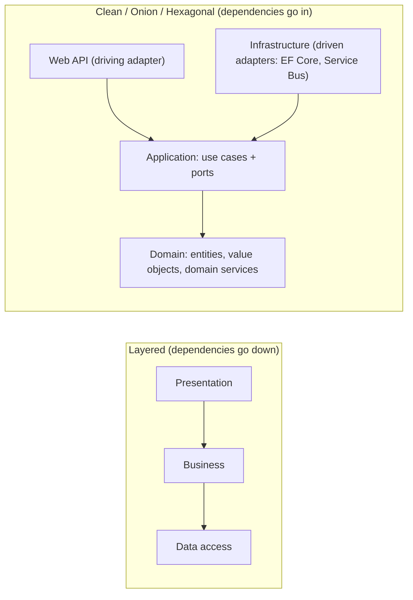

### Why it exists
Layered architecture lets persistence concerns leak upward (entities shaped by the ORM, queries in services), making business rules hard to test without a database and hard to migrate. The dependency rule isolates what changes slowly (business rules) from what changes quickly (frameworks, vendors, UI).

### How it works (the mechanics)
1. **Domain** — entities, value objects, aggregates, domain services, domain events. No references to EF Core, ASP.NET, Azure SDKs.
2. **Application** — use cases (commands/queries/handlers) and **ports** (interfaces such as `IOrderRepository`, `IClock`, `IEventPublisher`). References Domain only.
3. **Infrastructure** — implements ports (EF Core `DbContext`, Service Bus publisher). References Application (and Domain). Registered via DI at the composition root.
4. **Presentation / Host** — ASP.NET Core Web API; the **composition root** references everything and wires DI. It is the only place that knows all concrete types.

```csharp
// Domain (no framework references)
public sealed class Order : AggregateRoot
{
    private readonly List<OrderLine> _lines = new();
    public OrderId Id { get; }
    public IReadOnlyList<OrderLine> Lines => _lines;
    public OrderStatus Status { get; private set; } = OrderStatus.Draft;

    public Result Submit()
    {
        if (_lines.Count == 0) return Result.Fail("Order has no lines");
        Status = OrderStatus.Submitted;
        Raise(new OrderSubmitted(Id, DateTimeOffset.UtcNow));
        return Result.Ok();
    }
}

// Application: a port + a use case
public interface IOrderRepository
{
    Task<Order?> GetAsync(OrderId id, CancellationToken ct);
    Task AddAsync(Order order, CancellationToken ct);
}

public sealed record SubmitOrder(Guid OrderId) : ICommand;

public sealed class SubmitOrderHandler(IOrderRepository orders, IUnitOfWork uow)
    : ICommandHandler<SubmitOrder>
{
    public async Task<Result> Handle(SubmitOrder cmd, CancellationToken ct)
    {
        var order = await orders.GetAsync(new OrderId(cmd.OrderId), ct);
        if (order is null) return Result.NotFound();
        var result = order.Submit();
        if (result.IsSuccess) await uow.SaveChangesAsync(ct); // outbox row written in same tx
        return result;
    }
}

// Infrastructure: adapter implementing the port
internal sealed class EfOrderRepository(AppDbContext db) : IOrderRepository
{
    public Task<Order?> GetAsync(OrderId id, CancellationToken ct) =>
        db.Orders.Include(o => o.Lines).SingleOrDefaultAsync(o => o.Id == id, ct);
    public async Task AddAsync(Order order, CancellationToken ct) => await db.Orders.AddAsync(order, ct);
}

// Host (composition root)
builder.Services.AddScoped<IOrderRepository, EfOrderRepository>();
builder.Services.AddScoped<ICommandHandler<SubmitOrder>, SubmitOrderHandler>();
app.MapPost("/orders/{id:guid}/submit",
    async (Guid id, ICommandHandler<SubmitOrder> h, CancellationToken ct) =>
        (await h.Handle(new SubmitOrder(id), ct)).ToHttpResult());
```

**Enforce the rule with architecture tests** (otherwise it erodes within months):

```csharp
// NetArchTest.Rules (or ArchUnitNET) — runs in CI
[Fact]
public void Domain_must_not_depend_on_outer_layers()
{
    var result = Types.InAssembly(typeof(Order).Assembly)
        .ShouldNot().HaveDependencyOnAny("Microsoft.EntityFrameworkCore",
            "Microsoft.AspNetCore", "Azure.Messaging.ServiceBus", "MyApp.Infrastructure")
        .GetResult();
    Assert.True(result.IsSuccessful, string.Join(", ", result.FailingTypeNames ?? []));
}

[Fact]
public void Application_must_not_depend_on_infrastructure() =>
    Assert.True(Types.InAssembly(typeof(SubmitOrderHandler).Assembly)
        .ShouldNot().HaveDependencyOn("MyApp.Infrastructure").GetResult().IsSuccessful);
```

**MediatR or not?** MediatR (now a commercial licence for newer versions *(verify current)*) gives a pipeline for cross-cutting behaviours (validation, logging, transactions). You do not need it: a small `ICommandHandler<T>` interface plus decorators (Scrutor) gives the same with less indirection, and in Minimal APIs you can inject handlers directly. Choose a mediator when you genuinely want pipeline behaviours across dozens of handlers; avoid it as a reflex because it hides call paths and makes navigation harder.

**Pragmatic vertical slices.** Horizontal layers (Controllers/Services/Repositories folders) scatter one feature over five folders. A *vertical slice* organises by feature (`Features/Orders/SubmitOrder.cs` containing endpoint, command, handler, validator). A pragmatic hybrid: keep the **dependency rule** (domain isolated) but organise Application **by feature**, and let simple CRUD slices talk to `DbContext` directly while complex slices use the rich domain model. This avoids "repository per table" ceremony.

### Real-world
Long-lived line-of-business systems (insurance, finance) where the persistence technology or messaging vendor will change within the system's life; domains with heavy rules that need fast, database-free unit tests.

### When / when not
- **Use** when the domain has non-trivial rules, expected lifetime of 5+ years, multiple delivery channels (API, jobs, messaging), or likely infrastructure change.
- **Do not use** for CRUD admin apps, prototypes, thin BFFs or data-pipeline glue — the ports/handlers/mapping ceremony costs more than it saves. A vertical-slice minimal API is better.

### Advantages / disadvantages
| + | − |
|---|---|
| Domain testable without infrastructure | More projects, interfaces, mapping |
| Swap adapters (DB, bus) with limited blast radius | Over-abstraction ("one interface per class") |
| Clear dependency direction, enforceable by tests | Learning curve; juniors scatter logic into handlers (anaemic domain) |

### Common mistakes and anti-patterns
- Domain entities annotated with EF/JSON attributes, or returning `IQueryable` from repositories (leaks persistence).
- **Anaemic domain model**: all logic in handlers, entities are bags of setters.
- Interface-per-class with a single implementation "for testability" (interfaces should be at architectural boundaries, not everywhere).
- Application layer referencing `HttpContext`, `IConfiguration`, or Azure SDK types.
- Using Clean Architecture for each microservice *and* a shared "Common" library that couples them (see Ch. 17).

### Performance / scalability / reliability / security
Indirection cost is negligible compared to I/O. Reliability gain: transaction boundaries (unit of work + outbox) live in one place. Security: authorisation checks belong in use cases (or pipeline behaviours), not only in controllers, so non-HTTP entry points (consumers, jobs) cannot bypass them.

### Troubleshooting
Symptom: handler tests need a database → a port is missing or the domain depends on EF. Symptom: circular project references → a type lives in the wrong ring; move the interface to Application/Domain and the implementation outward. Symptom: slow queries from "clean" repositories → add a dedicated read-model/query path (CQRS-lite) that bypasses the aggregate for reads (see [CQRS][cqrs]).

### Related
[Hexagonal][hex], [Layered][layered], [DDD][ddd], [SOLID][solid] (DIP), [Modular Monolith][modular] (each module can be a small clean/hexagonal core).

### Interview Q&A
**Q: How do Clean, Onion and Hexagonal differ?** Same dependency rule; Hexagonal stresses ports/adapters and driving vs driven sides, Onion stresses the domain model at the centre with concentric rings, Clean adds explicit use-case (interactor) objects and the entities-vs-use-case-rules split. In .NET they converge on the same project layout.
**Follow-up: Where does the DTO↔domain mapping live?** At the boundary that owns the shape: API contracts map in the Web layer, persistence mapping in Infrastructure (EF configuration or mapper), never the domain referencing either.
**Q: Is a repository needed with EF Core?** `DbContext` already implements Unit of Work and repository-like `DbSet`. Wrap it behind a repository per **aggregate root** when you need to keep the domain persistence-ignorant; skip repositories for simple CRUD slices or read-side queries.
**Q: How do you stop a team eroding the architecture?** Architecture tests in CI, a small ADR set, code owners on the Domain project, and periodic dependency-graph review.

---

## 2. Distributed systems fundamentals

### Simple idea
The moment a call crosses a network, it can be slow, lost, duplicated, reordered or half-finished — and you often cannot tell which. A distributed system is one where the failure of a computer you didn't know existed can render your own computer unusable (Lamport).

### Architect depth
**The eight fallacies of distributed computing** (Deutsch, Gosling): the network is reliable; latency is zero; bandwidth is infinite; the network is secure; topology doesn't change; there is one administrator; transport cost is zero; the network is homogeneous. Every resilience pattern below exists because one of these is false.

Key concepts:
- **Partial failure** — some components fail while others continue; the caller cannot distinguish "slow", "dead" and "done but reply lost". The **timeout is the only failure detector** and it is unreliable (it detects *suspected* failure).
- **Latency vs throughput** — latency compounds across hops (Ch. 20); tail latency (p99) dominates user experience because a request touching N services is as slow as its slowest call (fan-out amplification).
- **Clocks** — wall clocks drift and are not comparable across machines; never use `DateTime.UtcNow` to order events across nodes. Use logical clocks (version vectors/Lamport), database sequences, or per-aggregate version numbers.
- **Consensus at a glance** — agreeing on one value despite failures (Paxos/Raft). You rarely implement it; you **consume** it (etcd for Kubernetes, SQL Server Always On quorum, Cosmos DB replication, Service Bus Premium's replicas). Quorum rule: reads+writes must overlap (R+W>N).
- **Idempotency** — an operation is idempotent if repeating it has the same effect as once. It is the only practical answer to "did my request happen?" Combined with at-least-once delivery it yields *effectively-once* ([Inbox/Outbox guide][outbox]).
- **Backpressure** — when consumers are slower than producers, queues grow without bound. Provide bounded queues, rate limits, load shedding, or pull-based consumption (Service Bus prefetch/`MaxConcurrentCalls`, `Channel<T>` with `BoundedChannelOptions`).
- **Delivery semantics** — at-most-once (may lose), at-least-once (may duplicate), exactly-once *effect* (at-least-once + idempotent receiver). True exactly-once delivery over an unreliable network is impossible (two-generals problem).

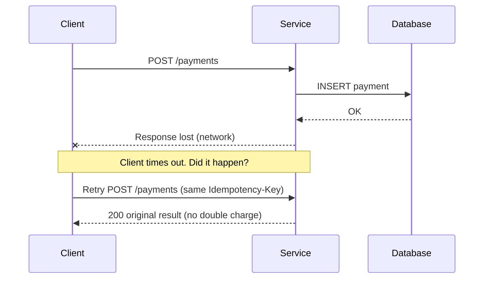

```csharp
// Bounded channel = backpressure inside a service
var channel = Channel.CreateBounded<WorkItem>(new BoundedChannelOptions(1_000)
{
    FullMode = BoundedChannelFullMode.Wait,   // producer awaits => natural backpressure
    SingleReader = false
});
```

### Why it exists / real-world
These ideas explain real incidents: retry storms taking down a recovering dependency, duplicate charges after timeouts, "split-brain" after failover, ordering bugs from clock skew, cascading failure from an unbounded queue.

### When / when not
Treat every remote call as a failure point **by default**. Do not apply the full toolkit to in-process calls — a modular monolith avoids all of this for intra-module calls (Ch. 18).

### Trade-offs
Each defence costs something: timeouts add false positives; retries add load and duplicates; idempotency adds storage and design effort; quorum adds latency. Choose per call based on cost of failure vs cost of mitigation.

### Mistakes
Assuming `HttpClient` default timeout (100 s) is acceptable; retrying non-idempotent POSTs; using wall-clock timestamps as ordering keys; unbounded in-memory queues; "exactly-once" claims without an idempotent receiver.

### Performance / security
Tail-latency budgets and fan-out limits matter more than average latency. Security: the network is hostile — mutual TLS or workload identity between services, not "internal = trusted" (Zero Trust).

### Troubleshooting
Check p99 vs p50 divergence, retry counts, queue age, thread-pool starvation, connection-pool saturation; use distributed traces (Ch. 12) to find the slow hop.

### Related
[Distributed Systems Patterns][dsp] (resilience, idempotency), [Distributed Transactions][dt], [Foundations][found] (CAP/PACELC).

### Interview Q&A
**Q: Why can't we have exactly-once delivery?** A sender can't know whether a lost acknowledgement means the message wasn't processed or the ack was lost (two generals). So brokers give at-least-once; the receiver makes processing idempotent to get an exactly-once *effect*.
**Follow-up: How do you detect duplicates at scale?** Natural idempotency (upsert by key, conditional update), or a unique-constrained inbox table updated in the same transaction as the business change, with retention ≥ the maximum redelivery window.
**Q: Why are timeouts hard to tune?** Too low → false failures and retry storms; too high → resource exhaustion. Derive from the dependency's p99 under load plus the caller's own deadline budget, and propagate deadlines (a child call must time out before the parent does).

---

## 3. CAP and consistency vs availability in practice

CAP's formal statement and PACELC are in [Foundations][found]. This chapter applies them.

### Simple idea
When the network splits, a replicated system must choose: keep answering (maybe with stale data) or refuse until it can be sure (consistent but unavailable). **Even without a partition** there is a latency-vs-consistency trade-off (PACELC): the more replicas you wait for, the slower and the more consistent.

### Architect depth
CAP is about behaviour **during a partition** for a single data item; it is not a three-way menu ("CA" systems that tolerate no partitions don't exist on a real network). Real products expose **tunable** points:

| Azure technology | Knob | Consistency choice | Availability/latency effect |
|---|---|---|---|
| Cosmos DB | Five consistency levels: Strong, Bounded Staleness, Session, Consistent Prefix, Eventual | Strong = linearizable (single-region write or limited multi-region); Session = read-your-writes per client (default) | Strong costs latency/RU and restricts multi-region writes; Session is the usual sweet spot |
| Azure SQL / SQL MI | Active geo-replication, failover groups | Primary is the single writer; secondaries asynchronous | Failover can lose the last few seconds (RPO > 0 for async); zone-redundant uses synchronous replicas within region |
| Service Bus | Premium geo-replication / Geo-DR *(verify current)* | Metadata or data replication depending on feature; sync vs async mode | Async replication: failover may lose in-flight messages — design consumers to be idempotent |
| Redis | Replication is async by default | Replica reads may be stale; failover may lose acknowledged writes | Fine for cache, wrong as system of record |
| Blob Storage | LRS/ZRS/GRS/RA-GRS | RA-GRS secondary read is eventually consistent | Read availability during primary outage with stale reads |

```csharp
// Cosmos DB: choose consistency per request when a stronger read is needed
var options = new ItemRequestOptions { ConsistencyLevel = ConsistencyLevel.Strong }; // can only be same or WEAKER than account default
var item = await container.ReadItemAsync<Product>(id, new PartitionKey(pk), options, ct);
// NB: a request can only relax, not strengthen, the account-level default.
```

**Pick consistency per use case, not per system:**

| Scenario | Choice | Reason |
|---|---|---|
| Inventory decrement / seat booking | Strong (single writer, pessimistic or optimistic concurrency) | Overselling is costly; accept latency or reject writes when partitioned |
| Product catalogue, recommendations | Eventual/Session | Stale for seconds is harmless |
| Shopping cart | Availability-first (Dynamo style) with merge | Never lose "add to cart" |
| Bank ledger | Strong within an account; sagas between accounts | Invariants per aggregate |
| Search index | Eventual (rebuild from source) | Derived data |

```sql
-- Single-writer invariant using optimistic concurrency (SQL Server): "never oversell"
UPDATE Inventory
SET    Reserved = Reserved + @qty, RowVer = RowVer + 1
WHERE  Sku = @sku AND OnHand - Reserved >= @qty AND RowVer = @rowVer;
-- @@ROWCOUNT = 0 => someone else won, or insufficient stock: re-read, retry or fail.
```

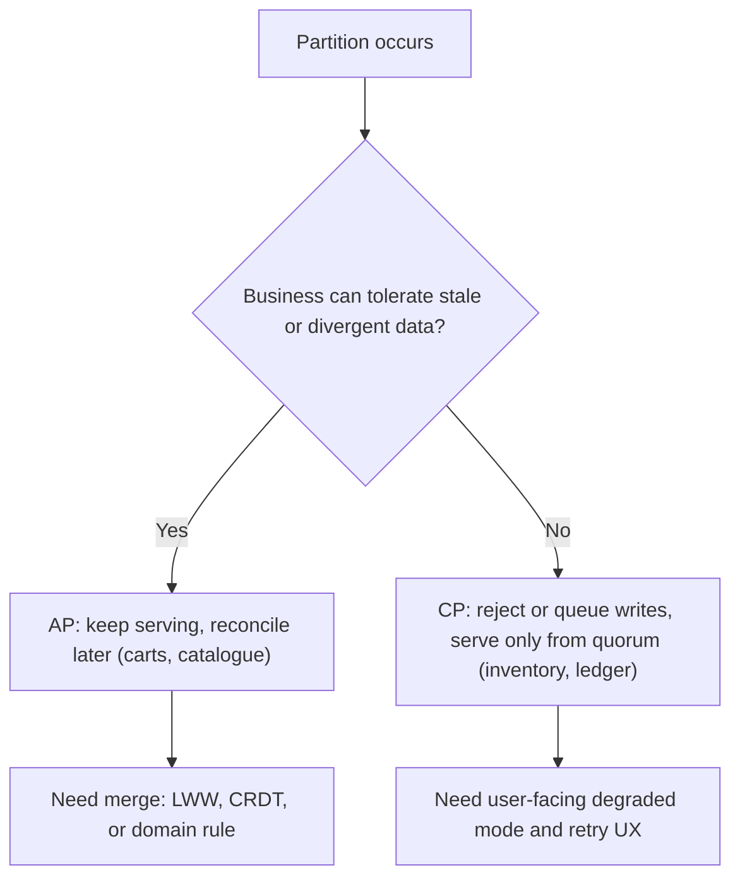

### Why it exists
It forces an explicit, per-feature decision instead of an accidental one made by a default configuration.

### When / when not
Use strong consistency inside an aggregate and eventual consistency **between** aggregates/services. Avoid globally strong multi-region writes unless the business truly demands it — it caps availability and adds cross-region latency on every write.

### Mistakes
Calling a system "CA"; using Redis or a read replica as source of truth; reading from an async replica immediately after a write (read-your-writes violation) — fix with session consistency, reading from primary after write, or returning the written state to the client.

### Performance / reliability / security
Strong consistency across regions adds WAN round-trips; plan RPO/RTO explicitly ([Cloud Migration §7][mig], [Azure Services Ch. 31][azsvc]).

### Troubleshooting
"User saved but sees old data" → read replica lag, cache not invalidated, or eventual read model (CQRS). Check replica lag metrics, cache TTL, and event-processing lag.

### Interview Q&A
**Q: Is it CP or AP when you use Cosmos DB?** Depends on the level and configuration; Strong behaves CP-like (refuses stale reads), Eventual AP-like. Say "it depends on the consistency level per request/account" and give the inventory vs catalogue example.
**Follow-up: Why not always Strong?** Latency (quorum/WAN), RU cost, reduced multi-region write availability.

---

## 4. Service boundaries and decomposition

### Simple idea
Split the system along **business capabilities** where change happens together, so a typical feature touches one team and one service. Wrong boundaries are the #1 cause of microservice failure.

### Architect depth
**Heuristics for a good boundary**
1. **High cohesion, low coupling** — things that change together live together; calls across the boundary are few and coarse.
2. **Own your data** — the service is the single writer/owner of its data (Ch. 5).
3. **Business capability / subdomain** — align with DDD bounded contexts, not with technical layers or entities ("OrderService, CustomerService, ProductService" CRUD-by-noun is an anti-pattern).
4. **Team-sized** — a team can own it end-to-end (Ch. 19).
5. **Independent change and deploy** — a change to the contract is rare and versioned.
6. **Transaction boundary = aggregate**; cross-service invariants become sagas — if most use cases need a distributed transaction, the boundary is wrong.

**Discovery tools:** Event Storming (domain events → commands → aggregates → bounded contexts → context map), subdomain classification (core/supporting/generic — invest microservices in *core*), dependency/change-coupling analysis from Git history (files that change together), call graphs from traces.

**Granularity — "right-sized", not "micro".** Start coarser (modular monolith, Ch. 18). Split when a module needs independent scaling, deploy cadence, technology, or team ownership. Rule of thumb: if you cannot describe a service's purpose in one sentence without "and", or it can't be rewritten by a team in a few weeks, reconsider the size.

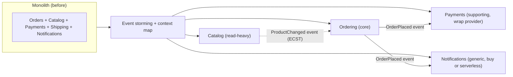

**Context map relationships (strategic DDD)** — Partnership, Shared Kernel (use sparingly: it couples), Customer/Supplier, Conformist, **Anti-Corruption Layer** (protect your model from a legacy/vendor model — see [Enterprise Patterns][enterprise]), Open Host Service / Published Language.

**Aggregate sizing:** small aggregates, reference others by ID, one transaction per aggregate (Vernon's rules). An "Order" containing "Customer" and "Product" objects is a smell; it contains `CustomerId` and a *snapshot* of price/name.

**Decomposition anti-patterns:** entity services (CRUD per table), nano-services, shared database, chatty services requiring many synchronous calls per request, "common" library containing domain types, splitting by layer (UI service / logic service / data service), premature split before the domain is understood.

### Real-world
A retailer splitting a monolith: Catalogue (read-heavy, cache, search) and Checkout (strong consistency, PCI scope) have very different scaling and compliance profiles → natural boundary. Notifications are generic → buy/serverless.

### When / when not
Decompose when there are independent scaling needs, team contention on the codebase, or divergent compliance/tech. Don't decompose a domain you don't yet understand — the boundaries will be wrong and expensive to move (data migration across services is hard).

### Trade-offs / mistakes
Finer = more autonomy but more network, more sagas, more ops. Common mistake: decomposing by *data model* rather than *behaviour*, creating a distributed monolith (Ch. 17).

### Performance / security
Boundaries are also security and blast-radius boundaries (PCI/PII scope reduction by isolating the payments service).

### Troubleshooting a bad boundary (symptoms)
Features regularly need coordinated releases across services; one request triggers a call chain of 5+ synchronous hops; sagas for ordinary use cases; teams blocked on each other. Remedy: merge the services back (yes, it's allowed) or move the responsibility.

### Related
[DDD][ddd], [Microservices][micro], [Modular Monolith][modular], [Cloud Migration §4][mig] (seams, strangler).

### Interview Q&A
**Q: How do you decide service boundaries?** Event storming to find bounded contexts, classify subdomains, check data ownership and transaction boundaries, validate against team structure and change-coupling data; start coarse; confirm with a "walk the top-10 use cases" test — each should touch ≤1–2 services.
**Follow-up: Two services need each other's data constantly — what now?** Probably one boundary: merge, or replicate the needed read data via events (event-carried state transfer) so there's no synchronous call.

---

## 5. Database-per-service in practice

### Simple idea
Each service owns its schema; nobody else reads or writes its tables. Others get data via its API or events. This gives autonomy at the price of losing cross-service joins and ACID transactions.

### Architect depth
Why: a shared database is a hidden, ungoverned integration contract — any schema change can break unknown consumers, and teams can't deploy independently (Ch. 17).

**"Database per service" ≠ "server per service".** Options, ordered by isolation: separate server/instance; separate database on a shared server; **separate schema + separate credentials** on shared SQL Server / Azure SQL elastic pool (pragmatic, cost-aware — enforce with permissions so a service's login can't touch other schemas); logical ownership in a modular monolith (schema per module, verified by architecture tests).

**Cross-service queries — the four options**
| Need | Technique | Notes |
|---|---|---|
| Show an order with customer name | **API composition** (gateway/BFF calls both and merges) | Simple; latency = slowest; partial failure handling needed |
| Frequent joined list/search | **Replicated read model** built from events (CQRS read side / ECST) | Eventually consistent; fastest reads; see [CQRS][cqrs] |
| Reporting/analytics | Change feed/CDC → data lake/warehouse (Fabric/Synapse) | Never run BI against OLTP replicas of many services directly |
| Invariant across services | **Saga** (not distributed transactions) | See [Saga][saga] |

```csharp
// API composition in a BFF/gateway with partial-failure tolerance
app.MapGet("/orders/{id}", async (Guid id, IOrdersApi orders, ICustomersApi customers, CancellationToken ct) =>
{
    var order = await orders.GetAsync(id, ct);
    if (order is null) return Results.NotFound();
    var customerTask = customers.GetSummaryAsync(order.CustomerId, ct);
    CustomerSummary? customer = null;
    try { customer = await customerTask; }
    catch (Exception ex) when (ex is HttpRequestException or TimeoutRejectedException)
    { /* degrade: return order without customer name; flag partial */ }
    return Results.Ok(new OrderView(order, customer, isPartial: customer is null));
});
```

```sql
-- Replicated read model owned by the Ordering service (denormalised snapshot of customer name)
CREATE TABLE ordering.OrderView (
  OrderId UNIQUEIDENTIFIER PRIMARY KEY,
  CustomerId UNIQUEIDENTIFIER NOT NULL,
  CustomerNameSnapshot NVARCHAR(200) NOT NULL,   -- updated by CustomerRenamed event
  Total DECIMAL(18,2) NOT NULL,
  SourceVersion BIGINT NOT NULL                    -- ignore out-of-order older events
);
-- Idempotent, order-safe projection update:
UPDATE ordering.OrderView SET CustomerNameSnapshot=@name, SourceVersion=@ver
WHERE CustomerId=@cid AND SourceVersion < @ver;
```

**Migrating off a shared database** (expand/contract, strangler): (1) identify table ownership per module; (2) forbid cross-owner writes first (views/permissions), then reads; (3) introduce an API/event for each cross-owner read; (4) replicate the data the other side needs; (5) move tables to a new schema/DB; (6) remove old access. Use CDC to keep copies in sync during transition ([Cloud Migration §5][mig]).

**Polyglot persistence** is *allowed*, not *required*: choose Cosmos/Redis/Search per service need ([Azure Services Ch. 21][azsvc]); default to the team's best-known relational store.

### Real-world / when-not
Use per-service data for services with their own lifecycle. For a modular monolith or small team, a single database with **schema-per-module** and enforced ownership gives the discipline without the operational cost. Don't split a database where you need frequent strongly consistent joins — that is a sign the boundary is wrong.

### Trade-offs / mistakes
- + Independent deploy/scale/evolve; failure isolation; tech freedom. − No joins/ACID across services; data duplication; reporting complexity; more backup/DR surfaces; cost.
- Mistakes: "shared DB" kept forever "temporarily"; cross-service foreign keys; reading another service's tables via views; two services writing the same table; N+1 API composition calls; using distributed transactions (MSDTC/2PC) to patch the problem.

### Performance / security
API composition → fan-out latency; cap with timeouts and cache. Security: least-privilege per-service credentials/managed identity; secrets in Key Vault; row-level isolation for multi-tenant.

### Troubleshooting
Orphan references (deleted customer) → soft-delete or tombstone events; stale replicated data → monitor projection lag and offer rebuild-from-events; reconciliation jobs comparing source and replica counts/checksums.

### Interview Q&A
**Q: How do you do a report spanning five services' data?** Publish change events/CDC into an analytics store (lake/warehouse), build the report there; do not join across OLTP stores.
**Q: Can two services share one SQL Server?** Yes, if each has its own schema and credentials and nobody crosses — that's database-per-service logically; it's a cost/ops decision. The rule is *ownership of data*, not physical separation.

---

# Part 2 — Communication and resilience patterns

## 6. REST vs gRPC

Sync vs async styles and the broader menu (GraphQL, queues, streams, webhooks) are in [Integration & Communication Patterns][icp]. This chapter is the **decision and implementation** for REST vs gRPC between .NET services.

### Simple idea
REST sends human-readable JSON over HTTP — easy for browsers, partners and debugging. gRPC sends compact binary Protocol Buffers over HTTP/2 using a strongly typed contract — faster and stricter, best between your own services.

### Architect depth
| Dimension | REST/JSON (HTTP/1.1 or 2) | gRPC (HTTP/2 + Protobuf) |
|---|---|---|
| Contract | OpenAPI (optional, often drifts) | `.proto` file is the contract; code generated both sides |
| Payload | Text JSON, larger, reflection-based serialisation | Binary, ~3–10× smaller *(workload dependent)*, fast |
| Streaming | SSE/WebSockets bolted on | First-class: unary, server, client, bidirectional |
| Browser | Native | Needs gRPC-Web/transcoding |
| Caching / CDN / gateways | Excellent (HTTP semantics, ETag) | Poor (POST-only, opaque) |
| Tooling/debug | curl, Postman, browser | grpcurl, BloomRPC-style tools; harder to eyeball |
| Evolution | Versioned URLs/headers; tolerant reader | Field numbers; add-only fields give compatibility by design |
| Load balancing | Per-request easy | **Long-lived HTTP/2 connection** → L4 balancers pin all calls to one pod; need L7/client-side LB |
| Deadlines | Per-HttpClient timeout | Native **deadline propagation** across hops |

**Decision rule:** *external/public/partner/browser-facing → REST* (or GraphQL for flexible clients). *Internal, chatty, latency-sensitive, polyglot, streaming → gRPC.* Mixed is normal: REST at the edge via the gateway, gRPC internally. Async messaging beats both when the caller doesn't need an immediate answer.

```proto
// orders.proto — the contract. Never reuse or renumber field numbers.
syntax = "proto3";
option csharp_namespace = "Orders.Contracts";
service OrderService {
  rpc GetOrder (GetOrderRequest) returns (OrderReply);
  rpc WatchOrder (GetOrderRequest) returns (stream OrderStatusUpdate);
}
message GetOrderRequest { string order_id = 1; }
message OrderReply {
  string order_id = 1;
  string customer_id = 2;
  int64 total_minor_units = 3;   // money as integer minor units, not double
  reserved 4;                    // removed field: reserve, never reuse
  string currency = 5;           // added later: backward compatible
}
```

```csharp
// Server (ASP.NET Core)
builder.Services.AddGrpc(o => { o.EnableDetailedErrors = builder.Environment.IsDevelopment(); });
builder.Services.AddGrpcHealthChecks().AddCheck("self", () => HealthCheckResult.Healthy());
app.MapGrpcService<OrderGrpcService>();
app.MapGrpcHealthChecksService();

public sealed class OrderGrpcService(IOrderQueries q) : OrderService.OrderServiceBase
{
    public override async Task<OrderReply> GetOrder(GetOrderRequest req, ServerCallContext ctx)
    {
        var o = await q.GetAsync(Guid.Parse(req.OrderId), ctx.CancellationToken); // honours deadline/cancel
        return o is null
            ? throw new RpcException(new Status(StatusCode.NotFound, "order"))
            : new OrderReply { OrderId = req.OrderId, CustomerId = o.CustomerId.ToString(), TotalMinorUnits = o.TotalMinor, Currency = o.Currency };
    }
}

// Client with resilience, deadline and gRPC-aware retry (service config)
builder.Services.AddGrpcClient<OrderService.OrderServiceClient>(o => o.Address = new Uri("https://orders"))
    .ConfigureChannel(o => o.ServiceConfig = new ServiceConfig
    {
        MethodConfigs = { new MethodConfig
        {
            Names = { MethodName.Default },
            RetryPolicy = new RetryPolicy { MaxAttempts = 3, InitialBackoff = TimeSpan.FromMilliseconds(100),
                MaxBackoff = TimeSpan.FromSeconds(1), BackoffMultiplier = 2,
                RetryableStatusCodes = { StatusCode.Unavailable } } } } })
    .ConfigureHttpClient(_ => { });
// Call with a deadline (propagated, absolute time):
var reply = await client.GetOrderAsync(new() { OrderId = id }, deadline: DateTime.UtcNow.AddSeconds(2), cancellationToken: ct);
```

**Load balancing gotcha.** One HTTP/2 connection multiplexes many calls, so a Kubernetes ClusterIP Service (L4) sends all calls to one pod. Fix: headless service + client-side round-robin (`dns:///` address with `round_robin` policy), an L7 proxy (Envoy/Linkerd/Istio, Azure Container Apps ingress does L7), or periodic channel recycling (`SocketsHttpHandler.PooledConnectionLifetime`).

**Versioning.** Protobuf rules: add fields with new numbers; never change type/number; `reserved` removed ones; treat unknown fields as ignorable; prefer new RPC or new package version (`orders.v2`) for breaking change. REST: URL/header/media-type versioning (Ch. 15).

### Real-world
Pricing/inventory lookups between services at thousands of calls/second, internal streaming of status updates, polyglot (Go/Java) services needing a shared contract.

### When / when not
Avoid gRPC for public APIs, browser clients without gRPC-Web, or when HTTP caching/CDN matters. Avoid REST for high-fan-out internal calls where payload/CPU overhead dominates, or for streaming. **Avoid both** where an event/queue would remove temporal coupling.

### Mistakes
- gRPC without deadlines (calls hang); L4 load balancer pinning; reusing field numbers; exposing the gRPC contract package as a shared "domain" library across all services (coupling, Ch. 17); using `double` for money; retrying non-idempotent RPCs.
- REST: chatty fine-grained endpoints, leaking internal entities, no versioning policy, 200-with-error-body.

### Performance / scalability / reliability / security
Reuse channels (`GrpcChannel` is expensive; one per target, DI-managed). Enable HTTP/2 keep-alive pings for idle connections behind NAT/load balancers. Secure with TLS/mTLS and JWT per call metadata; on Azure Container Apps use internal ingress + managed identity/Entra tokens.

### Troubleshooting
`Unavailable` bursts → connection resets/LB idle timeouts (keepalive); `DeadlineExceeded` → missing/too tight deadline or downstream saturation; uneven pod CPU → L4 pinning. Use `GRPC_VERBOSITY`/`Grpc.Net.Client` logging at Debug, and distributed traces.

### Related
[ASP.NET Core Internals §18–21][aspnet] (HttpClient), [API Gateway][gw] (transcoding at edge), Ch. 7 (resilience), Ch. 15 (versioning).

### Interview Q&A
**Q: When would you pick gRPC over REST?** Internal service-to-service, low latency/high throughput, strict contracts, streaming, polyglot. Public/browser/partner APIs and cache-friendly reads stay REST.
**Follow-up: What breaks first in production with gRPC on Kubernetes?** Load balancing (HTTP/2 connection pinning), then missing deadlines. Solve with L7 or client-side balancing and mandatory deadlines.

---

## 7. Timeout, retry, circuit breaker, bulkhead in .NET

(One-line definitions live in [DSP §Resilience Patterns][dsp]; Polly appears in [API Gateway][gw]. Here: how they compose, with .NET 10 code.)

### Simple idea
- **Timeout**: stop waiting after a limit.
- **Retry**: try again for transient failures — with backoff and a limit.
- **Circuit breaker**: after repeated failures stop calling for a while so the dependency can recover and you fail fast.
- **Bulkhead**: cap concurrency per dependency so one slow dependency can't use up all your threads/connections (ship compartments).

### Architect depth
**Order matters.** A standard outer→inner pipeline for an outbound call:

`Total request timeout` → `Retry (with jitter)` → `Circuit breaker` → `Per-attempt timeout` → (`Bulkhead/concurrency limiter` at the outside or per-handler) → HTTP.

Why: the **total timeout** bounds the user's wait; **retry** wraps the breaker so each attempt is evaluated by it; the breaker wraps the **attempt timeout** so slow calls count as failures; the attempt timeout cuts each try. `AddStandardResilienceHandler()` encodes exactly this: rate limiter → total timeout → retry → circuit breaker → attempt timeout.

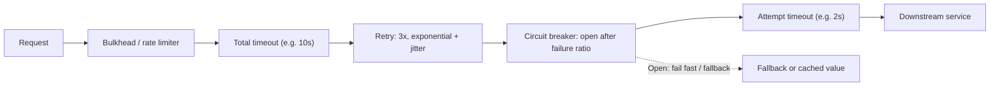

```csharp
// Microsoft.Extensions.Http.Resilience (Polly v8 under the hood)
builder.Services.AddHttpClient<IInventoryClient, InventoryClient>(c => c.BaseAddress = new Uri("https://inventory"))
    .AddStandardResilienceHandler(o =>
    {
        o.TotalRequestTimeout.Timeout = TimeSpan.FromSeconds(8);
        o.Retry.MaxRetryAttempts = 3;
        o.Retry.BackoffType = DelayBackoffType.Exponential;
        o.Retry.UseJitter = true;                              // de-synchronise clients: avoids retry storms
        o.Retry.ShouldHandle = args => ValueTask.FromResult(   // retry only transient & idempotent
            args.Outcome.Result?.StatusCode is HttpStatusCode.RequestTimeout or HttpStatusCode.BadGateway
              or HttpStatusCode.ServiceUnavailable or HttpStatusCode.GatewayTimeout
            || args.Outcome.Exception is HttpRequestException);
        o.CircuitBreaker.FailureRatio = 0.5;                   // open at 50% failures
        o.CircuitBreaker.MinimumThroughput = 20;               // ...with at least 20 calls in window
        o.CircuitBreaker.SamplingDuration = TimeSpan.FromSeconds(30);
        o.CircuitBreaker.BreakDuration = TimeSpan.FromSeconds(15);
        o.AttemptTimeout.Timeout = TimeSpan.FromSeconds(2);
    });

// Non-idempotent POST? Don't retry unless the call carries an Idempotency-Key:
// .AddResilienceHandler("no-retry-post", b => b.AddTimeout(TimeSpan.FromSeconds(3)))

// Hedging: for idempotent, latency-critical reads, send a 2nd request if the 1st is slow (cuts tail latency, adds load)
builder.Services.AddHttpClient("catalog").AddStandardHedgingHandler();

// Custom pipeline incl. concurrency bulkhead
builder.Services.AddResiliencePipeline("pricing", p => p
    .AddConcurrencyLimiter(permitLimit: 20, queueLimit: 10)        // bulkhead: max 20 in flight, 10 queued, rest rejected
    .AddTimeout(TimeSpan.FromSeconds(3)));
```

**Retry budgets & storms.** With 3 retries at each of 4 layers, one user request can become 81 calls (3⁴) against a struggling dependency — a **retry storm / amplification**. Mitigate: retry at **one layer** (usually the edge client), cap retries with a budget (e.g. retries ≤ 10% of requests), use jitter, honour `Retry-After`, and let the circuit breaker stop retries when failure is systemic.

**Circuit breaker states:** Closed (normal) → Open (fail fast for BreakDuration) → Half-Open (trial calls) → Closed/Open. Tune `MinimumThroughput` so a quiet service doesn't trip on 1 failure.

**Bulkhead variants in .NET:** `ConcurrencyLimiter` per dependency; separate `HttpClient`/connection pool per dependency (`MaxConnectionsPerServer`); separate thread/worker pools or `Channel` consumers per workload; per-tenant rate limiting (ASP.NET Core `AddRateLimiter` partitioned limiter); separate queues/consumers for priority classes; at infrastructure level, separate node pools / Container Apps / cells (Ch. 11).

**What to retry:** transient network errors, 408/429 (with `Retry-After`), 502/503/504. **Never** 4xx business errors, validation failures, non-idempotent operations without an idempotency key.

### Why it exists / real-world
Dependencies fail partially and slowly. A single slow payment provider without timeout + bulkhead exhausts the thread pool and takes down the entire checkout, then the whole site (cascading failure).

### When / when not
Apply to every remote call by default. Don't wrap in-process calls. Don't retry inside a message handler *and* rely on broker redelivery without thinking — pick one retry owner (broker redelivery with backoff is usually better for async; see [Service Bus Ch. 24, 40][sb]).

### Advantages / disadvantages
+ Contain failures, shorter outages, predictable latency. − Added complexity, harder to reason about worst-case latency (sum of retries × timeouts), masks problems if not monitored, can amplify load if misconfigured.

### Mistakes
Retrying without jitter (thundering herd); retries at every tier; timeouts longer than the caller's timeout (child outlives parent); one global breaker for all endpoints of a host; breaker with `MinimumThroughput=1`; ignoring cancellation tokens; swallowing breaker-open exceptions and returning 500 instead of a degraded response; `new HttpClient()` per call ([ASP.NET Core §18–20][aspnet]).

### Performance / scalability / reliability / security
Surface metrics: retries, breaker state, rejected-by-bulkhead — emitted by `Microsoft.Extensions.Resilience` to OpenTelemetry. Security: don't retry authentication failures in a loop (lockouts); cap retries on 401/403.

### Troubleshooting
Latency spikes with healthy dependency → retries amplifying or attempt timeout too low; `BrokenCircuitException` bursts → check dependency health and `BreakDuration`; `RateLimiterRejectedException` → bulkhead too small or traffic spike; check resilience metrics (`resilience.polly.*`) and traces.

### Related
[DSP §Resilience][dsp], [API Gateway §Circuit Breaker][gw], [Web API Internals §18][aspnet], [Webhooks retry storms][web], Ch. 11, 16.

### Interview Q&A
**Q: Retry, circuit breaker, timeout — in what order and why?** Total timeout outermost to bound user wait; retry wraps breaker so each attempt is counted and retries stop when open; attempt timeout innermost so slow calls become failures.
**Follow-up: What is a retry storm and how do you prevent it?** Layered retries multiply load against a degraded service; retry at one layer with jitter + budget, fail fast with a breaker, shed load.
**Q: Bulkhead vs rate limiter vs circuit breaker?** Bulkhead caps *concurrency* to isolate resources; rate limiter caps *rate* (protect the callee); breaker stops calls based on *observed failures*.

---

## 8. Service discovery

([DSP §Service Discovery][dsp] gives the summary.)

### Simple idea
Instances come and go (scale-out, redeploy, crash), so callers can't hard-code IPs. Something must answer "where is `orders` right now?"

### Architect depth
| Approach | How | Examples |
|---|---|---|
| **DNS-based, platform-provided** | Stable name resolves to current healthy endpoints | Kubernetes Service (`orders.ns.svc`), Azure Container Apps internal FQDN, App Service, Service Fabric naming |
| Client-side registry | Client queries a registry and load-balances | Consul, Eureka, Aspire/`Microsoft.Extensions.ServiceDiscovery` |
| Server-side (load balancer/gateway) | Clients call one address; LB picks instance | Azure Load Balancer/Application Gateway/Front Door, APIM, Envoy |
| Service mesh | Sidecar resolves & balances, adds mTLS/retries | Linkerd, Istio, Dapr service invocation |

On Azure the *default* is platform DNS — you rarely run your own registry. Health is integrated: only instances passing readiness probes receive traffic (Ch. 13).

```csharp
// .NET service discovery abstraction: logical names resolved by config/DNS/orchestrator
builder.Services.AddServiceDiscovery();
builder.Services.ConfigureHttpClientDefaults(h => h.AddServiceDiscovery());
builder.Services.AddHttpClient<IOrdersClient>(c => c.BaseAddress = new Uri("https+http://orders")); // scheme preference + logical name
// appsettings: "Services": { "orders": { "https": [ "https://orders.internal.<env>.azurecontainerapps.io" ] } }
```
```yaml
# Kubernetes: a ClusterIP Service gives a stable DNS name; headless Service gives per-pod records (needed for gRPC client-side LB)
apiVersion: v1
kind: Service
metadata: { name: orders }
spec:
  clusterIP: None     # headless
  selector: { app: orders }
  ports: [ { port: 8080 } ]
```

### Why / real-world
Autoscaling and rolling deployments change endpoints constantly; discovery decouples caller from topology.

### When / when not
Use platform DNS by default. Add a registry or mesh only for multi-cluster/hybrid, advanced routing, or mTLS requirements. Avoid running Consul/Eureka on Kubernetes/ACA just to replicate what the platform already does.

### Mistakes
Caching DNS forever (static `HttpClient` without `PooledConnectionLifetime` never sees new pods — [ASP.NET Core §19][aspnet]); hard-coded URLs in config per environment copy-pasted; discovery without health filtering (traffic to unready pods); L4 balancing with gRPC (Ch. 6).

### Perf / reliability / security
DNS TTL and connection lifetime determine how fast clients follow topology changes. Use readiness probes to drain before termination (`preStop` + graceful shutdown). Restrict who can resolve/call with network policies/private endpoints.

### Troubleshooting
Intermittent connection refused after deploy → endpoints removed but connections still pooled; fix connection lifetime/graceful shutdown. `Name or service not known` → wrong namespace/FQDN, or private DNS zone not linked ([Azure Services Ch. 28][azsvc]).

### Interview Q&A
**Q: Client-side vs server-side discovery?** Client-side: client picks instance (fewer hops, smarter LB, needs library). Server-side: LB/gateway picks (simple clients, extra hop, central policy). Platform DNS + L7 ingress is the pragmatic default.

---

## 9. Distributed caching and cache invalidation

([DSP §Distributed Caching][dsp] and [Azure Services Ch. 11, 23][azsvc] cover the basics and Redis. Invalidation is the gap.)

### Simple idea
Keep a copy of expensive-to-get data close to the consumer. The hard part: knowing when the copy is no longer true — "there are only two hard things in computer science: cache invalidation and naming things."

### Architect depth
**Cache layers:** client/browser/CDN → gateway/output cache → in-process memory (`IMemoryCache`) → distributed cache (Redis) → database buffer pool. Each layer trades freshness for speed.

**Patterns:** cache-aside (most common), read-through, write-through, write-behind, refresh-ahead. In microservices the cache is **owned by the data's owner**; other services cache *your API's response* or a replicated read model — never reach into your Redis.

**Invalidation strategies**
| Strategy | Mechanism | Freshness | Cost/risk |
|---|---|---|---|
| **TTL (expiry)** | Entry expires after N seconds | Bounded staleness | Simple; staleness = TTL; use jittered TTL |
| **Explicit delete on write** | Writer deletes/updates key after commit | Near-real-time | Race: reader repopulates old value between write and delete |
| **Event-based** | Owner publishes `ProductChanged`; subscribers evict | Seconds | Needs reliable events (outbox, [Inbox/Outbox][outbox]); missed event = stale until TTL → always keep a TTL as safety net |
| **Versioned keys** | Key includes version/etag: `product:42:v17` | Exact | Old versions linger until TTL; need version source |
| **Tag-based** | Tag entries, evict by tag (HybridCache tags, output cache tags) | Precise group eviction | Needs tag support |
| **Stale-while-revalidate** | Serve stale, refresh in background | Low latency, bounded stale | Complexity |

**Stampede (thundering herd):** a hot key expires, 1,000 requests all hit the database. Defences: single-flight/lock per key, probabilistic early refresh, jittered TTL, serving stale. .NET's **HybridCache** gives built-in stampede protection (concurrent requests for the same key share one factory call), L1 (in-memory) + L2 (distributed) tiers, and tag invalidation.

```csharp
builder.Services.AddStackExchangeRedisCache(o => o.Configuration = builder.Configuration["Redis:ConnectionString"]);
builder.Services.AddHybridCache(o => o.DefaultEntryOptions = new HybridCacheEntryOptions
{
    Expiration = TimeSpan.FromMinutes(5),          // L2 (Redis) TTL
    LocalCacheExpiration = TimeSpan.FromSeconds(30) // L1 per-instance TTL: bounds cross-instance staleness
});

public sealed class ProductReader(HybridCache cache, IProductsDb db)
{
    public ValueTask<ProductDto?> GetAsync(int id, CancellationToken ct) =>
        cache.GetOrCreateAsync($"product:{id}",
            async token => await db.LoadAsync(id, token),          // runs once per key even under concurrency
            tags: ["products", $"product:{id}"], cancellationToken: ct);

    public ValueTask InvalidateAsync(int id, CancellationToken ct) => cache.RemoveByTagAsync($"product:{id}", ct);
}

// Event-based invalidation consumer (idempotent by nature: delete is safe to repeat)
public async Task Handle(ProductChanged e, CancellationToken ct) => await reader.InvalidateAsync(e.ProductId, ct);
```

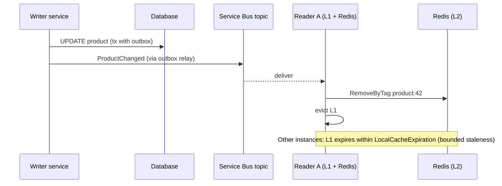

**L1 (in-process) invalidation across instances** is the subtle part: Redis delete doesn't clear other instances' memory. Options: short L1 TTL (simplest), Redis pub/sub notification to evict L1, or event subscription per instance (topic subscription per instance, or fan-out through Redis channels).

**Redis operational facts:** eviction policy (`allkeys-lru`/`volatile-lru`), memory limits, persistence off for pure cache, one slow command (`KEYS *`, big values) blocks the single-threaded server, connection multiplexing via a singleton `ConnectionMultiplexer`. Treat Redis as **losable**: the system must work (slower) if it's empty — never as system of record.

### Real-world
Product catalogue (long TTL + event invalidation); user permissions (short TTL + invalidate on role change); rate-limit counters (Redis atomic ops); session/state for stateless web tier.

### When / when not
Cache read-heavy, slow-to-compute, tolerant-of-staleness data. Don't cache highly dynamic data with strict consistency requirements, per-user data with low reuse, or to hide a slow query you should fix first (check indexes/Query Store before adding a cache).

### Advantages / disadvantages
+ Latency, DB offload, resilience to dependency blips (serve stale). − Staleness, extra infrastructure/failure mode, invalidation bugs, cold-start stampedes, memory cost.

### Mistakes
No TTL (unbounded staleness if an event is missed); caching null/errors without short TTL; caching per-user data under shared keys (data leak); key design without tenant/version/culture; deleting cache *before* DB commit (reader repopulates stale); unbounded key cardinality (OOM); `GetOrCreate` without single-flight → stampede; using cache invalidation as a substitute for fixing consistency requirements.

### Performance / scalability / reliability / security
Measure hit ratio, evictions, latency, memory. Use compression/serialisation (MessagePack/protobuf) for large values. Reliability: circuit-break Redis — on Redis failure, fall back to DB with a bulkhead so you don't stampede the database. Security: Redis in a private endpoint, Entra auth/TLS, no sensitive data unencrypted, tenant-scoped keys.

### Troubleshooting
Low hit ratio → key cardinality/TTL too short/varying key parts. DB CPU spikes at fixed intervals → synchronised TTL expiry (add jitter). `RedisTimeoutException` → large values/blocking commands/thread-pool starvation/network. Stale data complaints → trace the write→event→evict chain; check event lag.

### Related
[CQRS][cqrs] (read models are a persistent cache), [Event-Driven][eda], [Outbox][outbox], [ASP.NET Core §22.4][aspnet] (response/output caching), [API Gateway §Caching][gw].

### Interview Q&A
**Q: How do you invalidate caches across many service instances?** Event-based eviction from the data owner (published reliably via outbox) + short L1 TTL as safety net + tag/versioned keys; accept bounded staleness and state it.
**Q: What is a cache stampede and the fixes?** Many concurrent misses on an expired hot key hitting the origin; single-flight per key (HybridCache), jittered TTL, early/background refresh, serving stale.
**Follow-up: Write-through vs cache-aside?** Write-through keeps the cache coherent on writes at the cost of write latency and coupling; cache-aside is simpler and resilient but has a stale window and race on invalidate.

---

# Part 3 — Reliability, scalability, operations

## 10. Horizontal vs vertical scaling, statelessness, load balancing

### Simple idea
**Vertical** = bigger machine (scale up). **Horizontal** = more machines (scale out). Horizontal only works if any instance can serve any request — i.e. the service is **stateless** — and something spreads the traffic: a load balancer.

### Architect depth
| | Vertical (up) | Horizontal (out) |
|---|---|---|
| Mechanism | Larger SKU / more vCPU, RAM | More instances behind a balancer |
| Limits | Hardware ceiling; usually requires restart/downtime | Near-linear until a shared bottleneck (DB, lock, cache) |
| Availability | Single instance = single point of failure | Instances spread across zones tolerate loss |
| Cost curve | Super-linear at the high end | Linear, pay-as-you-go with autoscale |
| Best for | Databases (SQL primary), legacy stateful apps, quick relief | Stateless web/API tiers, consumers, jobs |

**Statelessness** — no request-affine data in process memory: session in Redis/cookie/JWT, uploads in Blob, caches rebuildable, in-memory queues replaced with Service Bus. Keep **sticky sessions** (ARR affinity) off unless forced; they unbalance load and complicate drain.

**What actually limits scale-out:** the shared stateful tier. Scale the *database* with read replicas/readable secondaries, caching, partitioning/sharding, CQRS read stores, Hyperscale; scale consumers by partition/session count (Service Bus sessions cap parallelism per session — [SB guide][sb]); Amdahl's law — serial sections (a lock, a single-writer queue) cap speed-up.

**Load balancing algorithms:** round-robin, weighted round-robin, least connections / least outstanding requests, power-of-two-choices, consistent hashing (cache locality, affinity), latency-based (Front Door), geo/priority routing (Traffic Manager). Use **least-outstanding-requests** when request cost varies; round-robin is fine for uniform short requests. Layers: L4 (Azure Load Balancer) vs L7 (Application Gateway, Front Door, ACA/K8s ingress, APIM) — see [Azure Services Ch. 27–29][azsvc].

**Autoscaling** — scale on the *right* signal: CPU for CPU-bound, concurrent HTTP requests per replica for APIs, **queue length / message age (KEDA)** for consumers, custom metrics for business load. Add cooldowns to avoid flapping; set `min` ≥ 2 across zones for HA and `max` to cap cost and protect the database from a scaled-out stampede.

```bicep
// Azure Container Apps: scale on HTTP concurrency and Service Bus backlog (KEDA) — API versions: verify current
scale: {
  minReplicas: 2
  maxReplicas: 20
  rules: [
    { name: 'http', http: { metadata: { concurrentRequests: '50' } } }
    { name: 'sb-backlog', custom: {
        type: 'azure-servicebus'
        metadata: { queueName: 'orders', messageCount: '100' }
        auth: [ { secretRef: 'sb-conn', triggerParameter: 'connection' } ] } }   // or workload identity
  ]
}
```

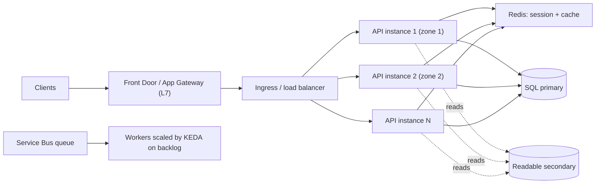

### Real-world
Black-Friday web tier scaled 3→60 instances while SQL stays vertically sized with a read replica and a Redis cache absorbing 90% of reads.

### When / when not
Scale out stateless tiers by default. Scale up the database first (cheap, simple), then add replicas/caching, and only then shard. Don't scale out a service whose bottleneck is a downstream lock or a single hot partition — you just increase contention.

### Trade-offs / mistakes
Horizontal adds distribution problems (consistency, coordination); vertical is simple but a SPOF. Mistakes: in-memory session/state; autoscaling on CPU for an I/O-bound API; `max` too high overwhelming the DB connection pool (N instances × pool size > DB max connections); no warm-up (cold JIT/caches during scale events); sticky sessions; ignoring zone redundancy.

### Performance / reliability / security
Measure saturation (utilisation, queue depth), not just CPU. Connection budget: `instances × MaxPoolSize ≤ DB limit`. Use graceful shutdown (stop accepting, drain in-flight) during scale-in.

### Troubleshooting
Scaling doesn't help latency → bottleneck elsewhere (check DB wait stats, lock waits, downstream); uneven load → affinity/L4 pinning/long-lived connections; flapping replicas → cooldown/threshold mismatch.

### Interview Q&A
**Q: Horizontal vs vertical for SQL Server?** Vertical (and read scale-out via replicas/caching) first — writes go to one primary; horizontal write scale needs sharding/partitioning or a different store, which has major design cost.
**Q: What makes a service horizontally scalable?** Statelessness, idempotent handlers, externalised state/config, health-probed instances, shared-nothing design, connection-pool budgeting.

---

## 11. Fault tolerance, HA, resilience, graceful degradation, failure isolation

### Simple idea
- **Fault tolerance**: keep working correctly despite a failure (redundancy + failover).
- **High availability (HA)**: minimise downtime — measured as a percentage (SLA/SLO).
- **Resilience**: recover and adapt; absorb, respond to, and learn from failures.
- **Graceful degradation**: lose *features*, not the whole product.
- **Failure isolation**: a failure's blast radius is bounded.

### Architect depth
**Availability math:** `serial availability = A₁ × A₂ × …`; `parallel (redundant) = 1 − (1−A)ⁿ`. A request path through 5 dependencies each at 99.9% yields ≈ 99.5% (≈ 3.6 h/month downtime) — microservice call chains **reduce** availability unless you decouple (async), cache, or degrade. Targets: 99.9% ≈ 43 min/month, 99.95% ≈ 22 min, 99.99% ≈ 4.3 min. Composite SLA is *at most* the product of dependency SLAs.

**HA building blocks:** ≥ 2 instances across **availability zones**; health-probe-based routing; stateless tiers; zone-redundant data tier (zone-redundant Azure SQL, ZRS storage, zone-redundant Service Bus Premium *(verify current)*); multi-region active-passive/active-active for regional failure ([Azure Services Ch. 30–31][azsvc], [Migration §7][mig]); automated failover with tested runbooks; infrastructure as code for rebuild.

**Graceful degradation toolkit**
| Tool | Example |
|---|---|
| Fallback / cached value | Recommendations down → show bestsellers; price from last-known cache |
| Feature flag kill switch | Disable heavy feature under load (Azure App Configuration) |
| Load shedding | Reject low-priority/anonymous work with 429/503 + `Retry-After` when saturated; ASP.NET Core rate limiter/concurrency limiter |
| Async decoupling | Accept order, confirm later ("we'll email you") — queue absorbs the outage ([queue-based load levelling][sb]) |
| Read-only mode | Writes disabled during DB failover; browse still works |
| Timeouts + bulkheads | Ch. 7 |

```csharp
// Fallback with Polly v8: serve last-known-good when the dependency is unavailable
builder.Services.AddResiliencePipeline<string, Recommendations>("recs", p => p
    .AddFallback(new FallbackStrategyOptions<Recommendations>
    {
        ShouldHandle = new PredicateBuilder<Recommendations>().Handle<BrokenCircuitException>().Handle<TimeoutRejectedException>().Handle<HttpRequestException>(),
        FallbackAction = _ => Outcome.FromResultAsValueTask(Recommendations.BestSellersCached())
    })
    .AddTimeout(TimeSpan.FromMilliseconds(300)));

// Load shedding at the edge
builder.Services.AddRateLimiter(o =>
{
    o.RejectionStatusCode = StatusCodes.Status503ServiceUnavailable;
    o.AddConcurrencyLimiter("heavy", c => { c.PermitLimit = 50; c.QueueLimit = 0; });
    o.OnRejected = (ctx, _) => { ctx.HttpContext.Response.Headers.RetryAfter = "5"; return ValueTask.CompletedTask; };
});
app.MapGet("/reports/big", Handler).RequireRateLimiting("heavy");
```

**Failure isolation / blast-radius control:** bulkheads (Ch. 7), separate pools per workload, **cell-based architecture** (the system is replicated into N independent cells each serving a slice of tenants; a bad deploy or failure hits one cell), separate subscriptions/resource groups per environment, per-tenant quotas, separate queues for poison/priority, **deployment rings** (Ch. 14), no shared DB between services, dependency tiering (a non-critical dependency must never block a critical path — call it async or with a short timeout and fallback).

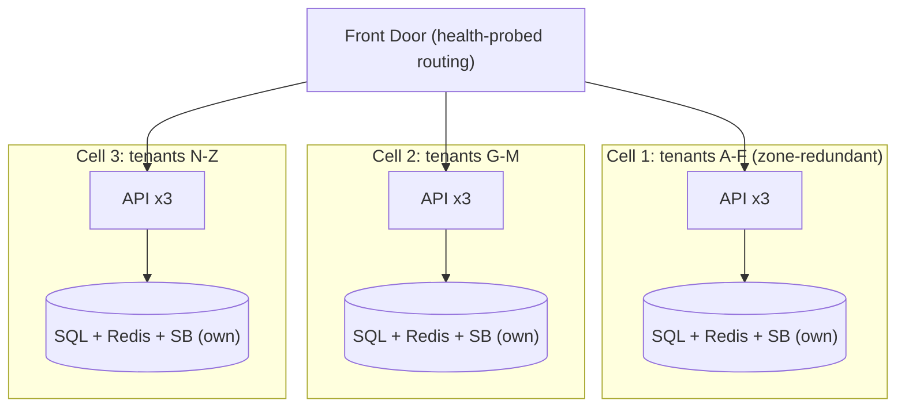

**Chaos engineering / testing resilience:** Azure Chaos Studio *(verify current)*, fault injection in tests (Polly `Simmy` chaos strategies, Toxiproxy), game days, failover drills. A DR plan never exercised is a hypothesis.

### Real-world
Netflix-style: recommendation outage never prevents playback. Banks: payments accepted into a durable queue during core-banking maintenance windows.

### When / when not
Invest proportionally to business impact: tier services (Tier-0 revenue path vs Tier-3 reporting). Don't buy multi-region active-active for an internal tool; do buy zone redundancy + tested restore.

### Trade-offs / mistakes
HA costs money and complexity (2–3× infra, data replication, consistency choices). Mistakes: redundancy without health checks; backups never restored; single-region "HA"; retries that cause the outage; shared dependency (one Redis, one SQL) that couples every service's availability; failover that depends on the failed region's control plane; no capacity headroom in the surviving region.

### Performance / reliability / security
Plan capacity for N+1 (survive losing a zone with the remainder at ≤ ~60–70% utilisation). Failover must keep security controls (identity, keys, network rules) available in the secondary.

### Troubleshooting
During an incident: stabilise first (shed load, disable features, roll back), then diagnose. Check dependency health, breaker states, queue age, saturation (USE method: utilisation, saturation, errors) and recent changes.

### Interview Q&A
**Q: How would you design for 99.99%?** Compute the composite SLA; remove serial dependencies via async/caching/degradation; zone-redundant everything; multi-region with automated failover for the critical path; tested DR; progressive deployment; SLO-based alerting; error budget policy. Admit that 99.99% ≈ 4 minutes/month means automation — humans can't respond fast enough.
**Follow-up: What do you do when a non-critical dependency is down?** Degrade: timeout + fallback + breaker; never let it block the critical path.

---

## 12. Observability: tracing, correlation IDs, logging, metrics, alerting

([Cloud-Native §6][azurenative], [ASP.NET Core §10][aspnet], [Azure Services Ch. 14–16][azsvc] cover tools; this chapter is the cross-service design.)

### Simple idea
When one user action fans out across ten services and a queue, you need to **follow it**: one ID that travels everywhere (trace/correlation ID), structured logs you can query, and numbers (metrics) that show health. Observability = being able to ask new questions of a running system without redeploying.

### Architect depth
**Three pillars + events:** *traces* (a request's path, spans with timing), *metrics* (aggregated numbers: rate, errors, duration, saturation), *logs* (discrete events with context). Tie them together with a shared **trace ID**.

- **W3C Trace Context:** `traceparent: 00-<trace-id>-<parent-span-id>-<flags>` propagates over HTTP automatically in .NET (`Activity`). **Across messaging you must propagate it yourself**: put `traceparent` in Service Bus `ApplicationProperties` (the Azure SDK has built-in support for tracing *(verify current)*; with an **outbox**, store `traceparent` in the outbox row so the relay continues the trace — [Outbox guide][outbox]).
- **Correlation ID vs trace ID:** the trace ID is the technical correlation. A *business* correlation ID (order ID, saga ID) is a separate, searchable log field — keep both.
- **Structured logging:** log message templates with named properties (`"Order {OrderId} submitted for {CustomerId}"`), not interpolated strings; include `TraceId`, `SpanId`, service name, version, tenant. Use logging **scopes** so every line within a request carries context. Never log secrets/PII.
- **Golden signals / RED / USE:** Latency, Traffic, Errors, Saturation; per service RED (Rate, Errors, Duration); per resource USE (Utilisation, Saturation, Errors).
- **SLIs/SLOs/error budgets:** SLI = measured indicator (% requests < 300 ms and non-5xx); SLO = target (99.9% over 30 days); error budget = allowed unreliability that gates risky releases. **Alert on symptoms (SLO burn rate), not causes** (CPU 80%); page for user-impacting, ticket for the rest — multi-window burn-rate alerts reduce noise.
- **Sampling:** head sampling (decide at start; cheap) vs tail sampling (keep errors/slow; needs a collector). Keep 100% of errors/slow traces; sample the healthy majority to control cost.

```csharp
// OpenTelemetry in ASP.NET Core -> Azure Monitor (workspace-based Application Insights)
builder.Services.AddOpenTelemetry()
    .UseAzureMonitor()                                   // Azure.Monitor.OpenTelemetry.AspNetCore
    .WithTracing(t => t
        .AddSource("Azure.Messaging.ServiceBus")         // SB SDK spans (enable experimental switch if required — verify current)
        .AddSource("MyApp.Orders")
        .AddSqlClientInstrumentation())
    .WithMetrics(m => m.AddMeter("MyApp.Orders"));

static readonly ActivitySource Source = new("MyApp.Orders");

// Propagate trace context into a message (manual, e.g. from an outbox row)
var msg = new ServiceBusMessage(body) { CorrelationId = orderId.ToString() };
msg.ApplicationProperties["traceparent"] = Activity.Current?.Id;     // W3C format
// Consumer: continue the trace
var parent = args.Message.ApplicationProperties.TryGetValue("traceparent", out var tp) ? tp?.ToString() : null;
using var activity = Source.StartActivity("ProcessOrder", ActivityKind.Consumer, parentId: parent);

// Structured logging with scope
using (logger.BeginScope(new Dictionary<string, object> { ["OrderId"] = orderId, ["Tenant"] = tenantId }))
    logger.LogInformation("Order {OrderId} submitted, total {Total}", orderId, total);
```

```kusto
// Application Insights / Log Analytics (KQL): follow one operation across services
union requests, dependencies, traces, exceptions
| where operation_Id == "4bf92f3577b34da6a3ce929d0e0e4736"
| project timestamp, itemType, cloud_RoleName, name, resultCode, duration, message
| order by timestamp asc

// p95 latency + error rate per service, 5-minute bins (SLI input)
requests
| where timestamp > ago(1h)
| summarize p95=percentile(duration,95), failures=countif(success==false), total=count() by cloud_RoleName, bin(timestamp,5m)
| extend errorRate = todouble(failures)/total
```

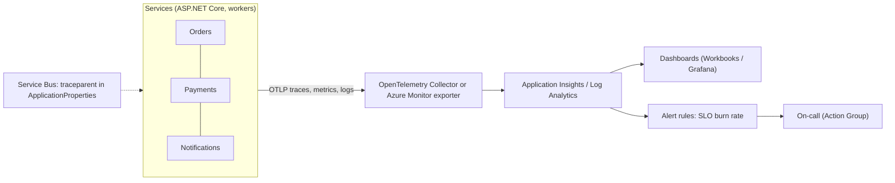

### Real-world
Debugging "checkout is slow": trace shows 1.8 s inside Payments → dependency span to provider → p99 spike correlates with retries; alert fired on burn-rate, not CPU.

### When / when not
Always, from day one in microservices — it's a prerequisite, not an add-on. Don't log everything at Debug in production (cost in Log Analytics: ingestion is billed per GB).

### Trade-offs / mistakes
Telemetry costs money and performance (sampling, log levels). Mistakes: logging strings not structures; no trace propagation through queues (broken traces at every async hop); high-cardinality metric labels (user ID) exploding cost; alerts on causes → alert fatigue; no ownership/runbook per alert; PII in logs; inconsistent service names (`cloud_RoleName`); relying on logs without traces; clock-skewed timestamps used for ordering.

### Performance / security
Async/batched exporters; bounded buffers; sampling. Mask PII; restrict workspace RBAC; retention/archive tiers for compliance.

### Troubleshooting a broken trace
Trace breaks at a queue → propagate `traceparent`; two traces for one request → missing instrumentation or non-W3C header; missing spans → sampling or exporter backlog; no logs correlated → no `TraceId` enrichment.

### Interview Q&A
**Q: How do you trace a request across HTTP and Service Bus?** W3C `traceparent` over HTTP (automatic via `Activity`), and manual/SDK propagation via message `ApplicationProperties`; store it in the outbox row; consumer starts an `Activity` with the parent; business correlation ID logged separately.
**Q: What do you alert on?** SLO burn rate on user-facing SLIs (availability, latency); plus saturation/queue-age leading indicators; not raw CPU.
**Follow-up: How do you control observability cost?** Tail/head sampling, log level discipline, metric cardinality limits, retention tiers, drop noisy health-check requests.

---

## 13. Health checks

### Simple idea
A cheap endpoint the platform polls to decide: *is this instance alive? should it receive traffic? has it finished starting?*

### Architect depth
Three distinct probes (Kubernetes/ACA vocabulary; App Service has a "health check" path for instance eviction):
| Probe | Question | Failure action | Should check |
|---|---|---|---|
| **Startup** | Has it finished booting (migrations, warm-up)? | Don't send traffic / don't run other probes yet | Slow initialisation completed |
| **Liveness** | Is the process hung/deadlocked? | **Restart** the container | **Only** in-process health — never dependencies |
| **Readiness** | Can it serve right now? | **Remove from load balancer** (no restart) | Critical dependencies (DB reachable) *with caution*, warm caches, not overloaded |

Critical rule: **never fail liveness because a dependency is down** — a database outage would restart every pod simultaneously (restart storm) and make recovery worse. Readiness may reflect dependencies, but a shared dependency failing marks *all* instances unready → total outage even though degraded mode would work; prefer a degraded-but-ready state when a fallback exists.

```csharp
builder.Services.AddHealthChecks()
    .AddCheck("self", () => HealthCheckResult.Healthy(), tags: ["live"])
    .AddSqlServer(builder.Configuration.GetConnectionString("Db")!, name: "sql", tags: ["ready"], timeout: TimeSpan.FromSeconds(2))
    .AddAzureServiceBusQueue(/* ns, queue, credential */ "ns.servicebus.windows.net", "orders", new DefaultAzureCredential(), name: "bus", tags: ["ready"]);

app.MapHealthChecks("/health/live",  new HealthCheckOptions { Predicate = r => r.Tags.Contains("live") });
app.MapHealthChecks("/health/ready", new HealthCheckOptions { Predicate = r => r.Tags.Contains("ready") });
// Startup probe can reuse /health/ready with a longer failureThreshold, or a dedicated flag set after warm-up.
```
```yaml
# Container Apps / Kubernetes probes (ACA schema: verify current)
probes:
  - type: Startup   # gives a slow-starting app up to periodSeconds*failureThreshold
    httpGet: { path: /health/ready, port: 8080 }
    periodSeconds: 5
    failureThreshold: 30
  - type: Liveness
    httpGet: { path: /health/live, port: 8080 }
    periodSeconds: 10
  - type: Readiness
    httpGet: { path: /health/ready, port: 8080 }
    periodSeconds: 5
```

**Graceful shutdown pairs with readiness:** on SIGTERM, flip readiness to failing so the balancer drains, finish in-flight work (`HostOptions.ShutdownTimeout`), then exit — otherwise deployments drop requests ([ASP.NET Core §16–17][aspnet]).

**Health check endpoints are not monitoring.** They answer a binary routing question; use metrics/traces for the rest. Keep them fast (<1 s), unauthenticated-but-minimal (no detailed dependency info publicly), and not on the application's main thread-pool path if the app is saturated (separate port for probes is an option).

### Real-world / when-not
Every service. Don't add expensive deep checks (full DB query) to a probe hit every 5 s by dozens of instances — use a cheap `SELECT 1`/connection check with a cached result.

### Mistakes
Liveness checking the database (restart storm); one endpoint for all three probes; slow checks that time out under load and cause cascading unready/restart; no startup probe so slow starts are killed by liveness; exposing detailed health JSON publicly; health that is always "200" (useless).

### Troubleshooting
`CrashLoopBackOff` with healthy app → liveness too aggressive or startup too slow; instances flapping in/out → readiness depends on a flaky dependency; deployment drops requests → no readiness drain/`preStop`.

### Interview Q&A
**Q: Liveness vs readiness?** Liveness = restart me if I'm broken; readiness = don't route to me right now. Liveness must not depend on external systems.
**Follow-up: Why not check the database in liveness?** A DB outage would trigger mass restarts of healthy processes, amplifying the incident.

---

## 14. Microservices deployment strategies

Blue-green, canary and zero-downtime for **migration** are covered in [Cloud Migration §6][mig]. This chapter is the steady-state microservices view.

### Simple idea
Ship changes to a service without downtime and with a cheap, fast way back.

### Architect depth
| Strategy | How | Rollback | Cost/risk | Best for |
|---|---|---|---|---|
| **Rolling** | Replace instances gradually (maxSurge/maxUnavailable) | Roll forward/back (minutes) | Cheap; mixed versions run concurrently → needs backward-compatible contracts/schemas | Default for stateless services |
| **Blue-green** | Two full environments; switch traffic | Instant (flip back) | 2× capacity during switch; DB must be compatible with both | Big/risky releases, fast rollback |
| **Canary** | Send 1–5% to new version, watch SLIs, ramp | Instant (route to 0%) | Needs traffic splitting + automated analysis | High-traffic services, risk reduction |
| **Feature flags** | Deploy dark; enable by cohort at runtime | Toggle off | Flag debt; combinatorial states | **Decouples deploy from release**; trunk-based dev |
| **Ring / progressive** | Internal → canary region/cell → region by region | Stop & revert ring | Slow but safest | Large fleets, multi-region, cells |
| **Shadow / dark launch** | Mirror production traffic to the new version, discard responses | n/a | Doubles read load; side effects must be suppressed | Validating rewrites ([Migration §6 parallel run][mig]) |

**Independent deployability requires** backward-compatible APIs/events (Ch. 15), expand/contract database migrations, no lock-step releases, consumer-driven contract tests, and a pipeline per service. If two services must always release together, they're one deployable (Ch. 17).

```bicep
// Container Apps: multiple revisions + traffic weights (canary) — API version: verify current
configuration: { activeRevisionsMode: 'Multiple'
  ingress: { traffic: [ { revisionName: 'orders--v41', weight: 95 }, { revisionName: 'orders--v42', weight: 5 } ] } }
```
```yaml
# GitHub Actions / Azure DevOps shape of a progressive pipeline (conceptual)
# build -> contract tests -> deploy canary 5% -> automated SLO check (5-15 min) -> 25% -> 100% -> auto-rollback on burn-rate alert
```

**Database changes with rolling/blue-green:** expand/contract — (1) add nullable column/new table (backward compatible), (2) deploy code writing both/reading new, (3) backfill, (4) switch reads, (5) drop old in a later release. Never ship code and a breaking schema change together.

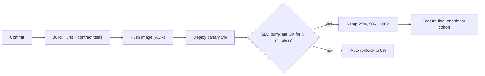

### Real-world / when-not
Rolling for most services; canary + flags for revenue-critical; blue-green for schema-heavy or platform changes. Don't do canary on low-traffic services (not enough signal) — use blue-green or rings with synthetic checks.

### Mistakes
Rollback plan that requires a DB restore; incompatible mixed versions during rolling; flags never removed; canary without automated analysis ("watch the dashboard"); deploying all services together weekly ("release train" = distributed monolith); changing a message schema in the producer before consumers are ready.

### Troubleshooting
Errors only during rollout → version incompatibility; stuck rollout → readiness failing for new pods; canary shows no difference → insufficient traffic or wrong metric.

### Interview Q&A
**Q: Blue-green vs canary?** Blue-green swaps all traffic at once (fast rollback, 2× cost, big-bang exposure); canary exposes a small slice progressively (limits blast radius, needs traffic shaping and metrics).
**Q: How do you release a breaking DB change with zero downtime?** Expand/contract across ≥ 2–3 releases with backward-compatible intermediate state.

---

## 15. Service versioning and schema evolution

([Event Sourcing §Event Versioning][es] and [DSP §Contracts and Message Evolution][dsp] cover events; here: HTTP/gRPC/messages/database together.)

### Simple idea
Producers and consumers deploy at different times, so for a while old and new versions coexist. Contracts must evolve **compatibly** so nobody breaks.

### Architect depth
**Compatibility vocabulary:** *Backward compatible* — new code reads old data. *Forward compatible* — old code reads new data (ignores unknown). *Full* = both. In rolling deployments you need **both** for messages (old consumers see new events; new consumers replay old).

**Safe (non-breaking) changes:** add optional fields/new endpoints/new enum values (if consumers tolerate unknown) · **Breaking:** remove/rename field, change type/semantics, make optional→required, change URL/semantics of an operation, reorder positional protobuf numbers.

**Strategies**
| Layer | Technique |
|---|---|
| **HTTP API** | Prefer *evolution without versions* (additive) + **tolerant reader** (ignore unknown fields, don't depend on field order). When breaking: URL (`/v2/orders`), header, or media-type versioning; Asp.Versioning library; sunset/deprecation headers (`Deprecation`, `Sunset`); support N-1 with a published policy |
| **gRPC/Protobuf** | Add fields with new numbers; `reserved` for removed; new package `v2` for breaking |
| **Events/messages** | Version in `Subject`/`type` (`OrderPlaced.v2`) or schema registry; **upcasters** convert old→new on read; publish both versions during transition (dual publish) or use **event-carried envelope** with `schemaVersion`; keep events immutable; never rewrite history |
| **Database** | **Expand/contract** (parallel change) |
| **Contract testing** | **Consumer-driven contracts (Pact)**: consumers publish expectations; provider CI verifies it won't break any known consumer — replaces slow end-to-end tests |

```csharp
// ASP.NET Core API versioning (Asp.Versioning.Http)
builder.Services.AddApiVersioning(o =>
{
    o.DefaultApiVersion = new ApiVersion(1, 0);
    o.AssumeDefaultVersionWhenUnspecified = true;
    o.ReportApiVersions = true;                       // api-supported-versions / api-deprecated-versions headers
    o.ApiVersionReader = ApiVersionReader.Combine(new UrlSegmentApiVersionReader(), new HeaderApiVersionReader("x-api-version"));
}).AddApiExplorer();
var v1 = app.NewVersionedApi("Orders").MapGroup("/v{version:apiVersion}/orders").HasApiVersion(1.0).HasDeprecatedApiVersion(0.9);

// Tolerant reader + versioned event envelope
public sealed record Envelope(string Type, int SchemaVersion, Guid MessageId, DateTimeOffset OccurredAt, JsonElement Data);
public static OrderPlaced Upcast(Envelope e) => e.SchemaVersion switch
{
    1 => JsonSerializer.Deserialize<OrderPlacedV1>(e.Data)!.ToV2(currency: "USD"),   // default for old events
    2 => JsonSerializer.Deserialize<OrderPlaced>(e.Data)!,
    _ => throw new UnsupportedSchemaException(e.SchemaVersion)                        // dead-letter, don't guess
};
```
```csharp
// Consumer-driven contract (Pact.Net, consumer side) — concept
var pact = Pact.V3("web-bff", "orders-api", cfg);
pact.UponReceiving("get order").WithRequest(HttpMethod.Get, "/v1/orders/42")
    .WillRespond().WithStatus(200).WithJsonBody(new { orderId = Match.Type("42"), total = Match.Decimal(10.5m) });
// Provider pipeline verifies against all published consumer pacts before deploy ("can-i-deploy").
```

### When / when not
Always have a compatibility policy before the second consumer appears. Don't create `v2` for additive changes. Don't version internal-only contracts that are always deployed together (they're one unit — Ch. 17).

### Mistakes
Renaming a field "because it's cleaner"; changing the meaning of a field while keeping its name (silent corruption); enum additions that crash strict deserialisers; versioning by copy-pasting the whole service; no deprecation process; schema in a shared NuGet "contracts" package forcing lock-step upgrades (publish *schemas*, let consumers generate their own models); no consumer tests so you can't tell who you'd break.

### Performance / reliability / security
Dual-publish costs bandwidth; keep transition windows short and tracked. Dead-letter unknown versions rather than dropping. Validate input schema at the edge (JSON Schema/FluentValidation) — security and robustness.

### Troubleshooting
After deploy, consumer DLQ growing with deserialisation errors → incompatible change; check `schemaVersion` distribution; replay after fixing consumer ([DLQ replay][sb]).

### Interview Q&A
**Q: How do you evolve an event schema?** Additive changes first; tolerant readers; version in the envelope; upcast on read; dual-publish for breaking changes during migration; consumer-driven contract tests; never mutate stored events.
**Follow-up: Backward vs forward compatibility — which do you need for Service Bus consumers?** Both, because during rolling deploy old consumers get new messages (forward) and new consumers process old backlog/replays (backward).

---

## 16. Handling partial failures

### Simple idea
A multi-step operation across services fails in the middle — payment taken, inventory not reserved. There is no automatic rollback across services. You must design the **forward path and the compensation path** and be able to see and repair inconsistencies.

### Architect depth
Toolkit (each links to the deep dive):
1. **Make steps idempotent** — safe to retry ([Inbox/Outbox][outbox]; idempotency keys for APIs).
2. **Atomic local change + message** — outbox so "state changed" and "event published" can't diverge ([Outbox][outbox]).
3. **Saga** with compensations for business-level undo (refund, release stock, cancel shipment) — orchestration for complex flows, choreography for simple ones ([Saga][saga]). Compensations must be idempotent and *semantic* (a refund, not a delete). Some steps are **non-compensatable** (email sent): order them last ("pivot" transaction, then retryable steps).
4. **Timeouts and deadlines** — every step and every saga has a deadline; on expiry, compensate or escalate.
5. **Reconciliation** — periodic jobs compare systems of record (payments provider vs ledger vs orders) and repair/alert; the safety net for everything above.
6. **Dead-letter + replay** — failures that exhaust retries go to a place humans/automation can inspect and resubmit ([SB DLQ][sb]).
7. **Distributed transactions (2PC/MSDTC)** — generally avoided in cloud microservices (blocking, lock-holding, unsupported by most PaaS); see [Distributed Transactions][dt] for when coordination is warranted.
8. **User-facing states** — expose "Pending/Processing/Failed — we'll retry" rather than pretending atomicity.

```csharp
// Orchestrated saga step with timeout + compensation (conceptual, state persisted per saga instance)
public sealed class CheckoutSaga : ISagaOrchestrator<CheckoutState>
{
    public async Task Run(CheckoutState s, CancellationToken ct)
    {
        await Step(s, "ReserveStock",  () => stock.Reserve(s.OrderId, s.Lines, ct),        undo: () => stock.Release(s.OrderId, ct));
        await Step(s, "ChargePayment", () => pay.Charge(s.OrderId, s.Total, idempotencyKey: $"charge-{s.OrderId}", ct), undo: () => pay.Refund(s.OrderId, ct));
        await Step(s, "CreateShipment",() => ship.Create(s.OrderId, ct),                    undo: () => ship.Cancel(s.OrderId, ct));
        // pivot/final: notifications are retriable and non-compensatable -> last
        await outbox.Enqueue(new OrderConfirmed(s.OrderId));
    }
}
```
```sql
-- Reconciliation: payments the provider captured but our ledger doesn't know about
SELECT p.ProviderTxnId, p.Amount
FROM   staging.ProviderCaptures p
LEFT JOIN ledger.Payments l ON l.ProviderTxnId = p.ProviderTxnId
WHERE  l.ProviderTxnId IS NULL AND p.CapturedAt < DATEADD(MINUTE,-15,SYSUTCDATETIME());
```

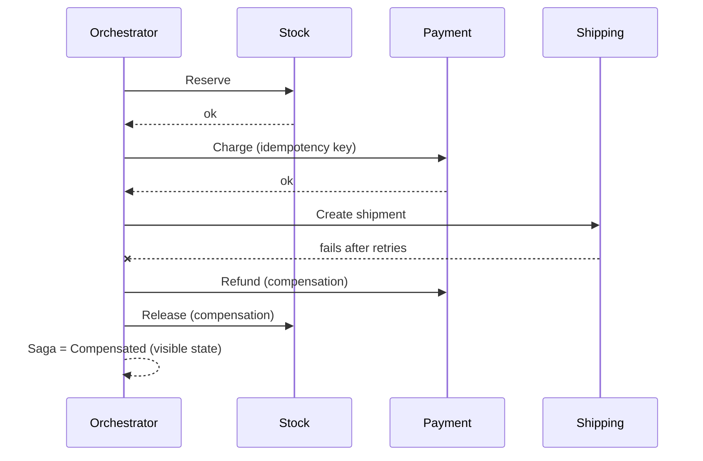

### Mistakes
Distributed transaction attempts across HTTP; compensations that can fail with no retry; non-idempotent compensations; no saga timeout (stuck forever); ignoring the "pivot"; hiding failures from users and operators; no reconciliation; sagas for operations that could be one local transaction (boundary smell, Ch. 4).

### Troubleshooting
Dashboard of saga instances by state/age; alert on "stuck > N minutes"; manual compensation runbook; trace by saga/correlation ID.

### Interview Q&A
**Q: Payment succeeded but inventory reservation failed. What now?** Orchestrated saga compensates: idempotent refund, mark order Failed, notify; if refund fails, retry with backoff, then escalate to manual queue; reconciliation catches residual drift.
**Q: Why not 2PC?** Blocking, availability-reducing, coordinator is a SPOF, unsupported by most cloud services and message brokers, and locks resources across network latency.

---

## 17. Avoiding distributed monoliths

### Simple idea
A distributed monolith has all the **costs** of microservices (network, ops, eventual consistency) and none of the **benefits** (independent deploy, scale, fail). It's a monolith that happens to talk over HTTP.

### Architect depth
**Symptoms (diagnostic checklist)**
- Services must be released **together** or in a specific order.
- A change in one service routinely forces changes in others (high change coupling in Git history).
- **Shared database** or shared tables between services.
- A "common"/"shared" library holding domain types/DTOs referenced by all services (lock-step NuGet upgrades).
- **Long synchronous call chains** (A→B→C→D) on the request path; one service down = everything down.
- Integration tests across many services are the only way to verify correctness.
- Services need each other's data for nearly every request (chatty).
- One team's backlog blocks several services; or one team owns 20 services.
- Same on-call page triggers for multiple services at once (correlated failure).

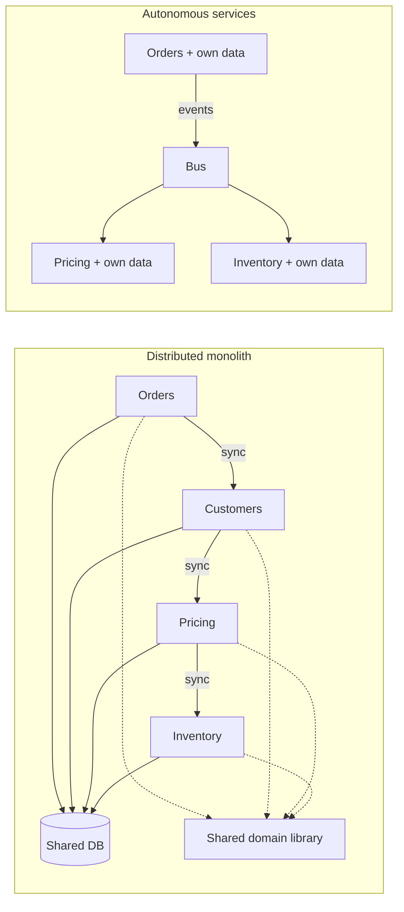

**Causes:** boundaries by noun/entity not capability (Ch. 4); shared DB "for now"; lack of async; splitting too early; no contract discipline; organisational structure not aligned (Conway).

**Remediation playbook**
1. **Measure** coupling: change coupling from Git (files/services that change together), dependency graph from traces, deployment ordering history.
2. **Cut data coupling first**: assign table ownership; forbid cross-service writes then reads; replicate needed read data via events (Ch. 5).
3. **Cut temporal coupling**: replace sync calls with events/queues where the caller doesn't need an immediate answer; add caches/replicas for reads; timeouts + fallbacks for the rest (Ch. 7, 11).
4. **Cut contract coupling**: replace shared domain library with published schemas (OpenAPI/proto/JSON Schema); consumer-driven contract tests (Ch. 15).
5. **Re-draw boundaries** — if two services always change together, **merge them** (a modular monolith module is a legitimate end state — Ch. 18).
6. **Align teams** to the new boundaries (Ch. 19).

**Tests for "independent":** Can I deploy this service alone on a Tuesday afternoon? Can it start and serve its core function with all other services down (degraded)? Can its team change its database schema without asking anyone? If any answer is no, it isn't autonomous yet.

### When / when not
This is a "what to avoid" chapter: if you can't achieve the independence tests, **stay modular monolith**.

### Mistakes
"Fixing" coupling by adding an API gateway or service mesh (they don't remove coupling); adding more services to solve coupling; centralising logic into an orchestrator service that knows every other service's internals (a distributed *god service*).

### Interview Q&A
**Q: How do you recognise a distributed monolith?** Lock-step releases, shared DB/library, long sync chains, cascading failures, cross-service integration test dependence.
**Q: You inherit one — first step?** Don't add services. Map change/data/runtime coupling, pick the worst offender (usually shared DB or a sync chain on the critical path), break that one with events/ownership, and consider merging services whose boundary was wrong.

---

# Part 4 — Trade-offs

## 18. Monolith vs modular monolith vs microservices

Each style is described in its own guide ([Microservices][micro], [Modular Monolith][modular], [Layered][layered]). This chapter is the **decision**.

### Simple idea
Microservices are an **organisational and operational scaling tool**, not a better default architecture. Start with the simplest thing that meets today's constraints and keep the option to split.

### Architect depth — comparison
| Dimension | Classic monolith (layered, big ball) | **Modular monolith** | Microservices |
|---|---|---|---|
| Deployable units | 1 | 1 | many |
| Internal boundaries | Weak / by convention | **Enforced** modules (assemblies, schemas, architecture tests) | Process + network boundary |
| Data | One shared schema | Schema-per-module, no cross-module joins | Database-per-service |
| Consistency | ACID everywhere | ACID within a deploy; modules communicate via interfaces/events | Eventual across services; sagas |
| Latency between components | in-process (ns–µs) | in-process | network (ms), see Ch. 20 |
| Independent deploy / scale / tech | No | No (but can extract) | **Yes** |
| Team autonomy | Low (merge contention) | Medium (module owners) | High (if boundaries right) |
| Ops complexity | Low | Low–medium | **High** (observability, CI/CD per service, discovery, security, versioning) |
| Failure isolation | None (shared process) | None | Yes (if designed) |
| Cost at small scale | Lowest | Low | Highest (platform + people) |
| Refactoring across boundaries | Easy but unsafe | Easy and compiler-checked | Hard (contracts, data migration) |

**Decision matrix — score your context**
| Factor | Favours monolith / modular monolith | Favours microservices |
|---|---|---|
| Team size | < ~15–20 engineers, one or two teams | Many teams needing autonomy |
| Domain understanding | Evolving, boundaries unclear | Stable, well-understood bounded contexts |
| Deployment cadence | Same cadence for all parts | Parts need very different release rhythms |
| Scaling profile | Uniform load | Wildly different (one hot component 100× others) |
| Tech heterogeneity | One stack fine | Genuine need (ML in Python, etc.) |
| Compliance isolation | Not needed | PCI/PII scope isolation |
| Ops maturity | Little DevOps/observability | Strong CI/CD, IaC, observability, on-call |
| Consistency | Strong ACID across features | Tolerates eventual consistency |

**Rule of thumb:** *monolith first / modular monolith by default*; extract a **module** into a service only when a concrete driver appears (independent scaling, team ownership, compliance, deploy cadence, tech). The "microservice premium" (Fowler): you pay for it with productivity until the system is complex enough to repay it.

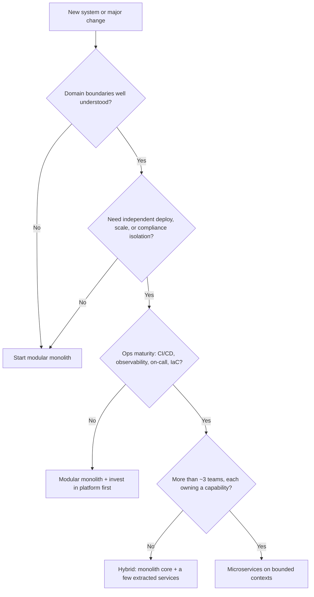

**Hybrid is normal**: a modular monolith core plus a handful of services extracted for real reasons (image processing, search, payments isolation, ML). **Extraction path** from a module: it already has its own schema and interface → replace the in-process call with a gRPC/HTTP/event adapter behind the same port → move the schema → deploy separately (strangler — [Migration §4][mig]). This is why a *modular* monolith is a cheap option on microservices.

### Real-world
Many successful companies run large modular monoliths (and some reverted from microservices to a monolith after the operational cost outweighed benefits). Teams of 8 building a new product → modular monolith in one repo, one pipeline, one database with schemas.

### When NOT microservices
Small team, unclear domain, startup/MVP, strong consistency across most operations, low ops maturity, limited budget, simple CRUD domain. **When NOT a (modular) monolith:** teams blocked by shared release cadence, one component needs 50× scale, regulatory isolation, genuinely independent products.

### Mistakes
Microservices as résumé-driven design; "monolith" meaning "big ball of mud" (a modular monolith is *not* that); splitting before modularising; one team operating 30 services; keeping a shared DB after extraction.

### Interview Q&A
**Q: When is a modular monolith better than microservices?** Small/medium teams, evolving domain, need for ACID and simple ops/deploys, uncertain boundaries; it keeps compiler-checked refactoring and leaves the extraction option open.
**Follow-up: How do you keep it from decaying into a ball of mud?** Enforced module boundaries (separate assemblies, `internal` by default, schema-per-module, no cross-module DB access), public contracts/interfaces and events between modules, architecture tests in CI, module ownership.

---

## 19. Team ownership, Conway's law, operational complexity

### Simple idea
Systems mirror the communication structure of the organisation that builds them (Conway, 1967). If you want independent services, you need independent teams; if teams must coordinate on everything, you will build a distributed monolith.

### Architect depth
- **Inverse Conway manoeuvre**: shape teams to match the architecture you want (stream-aligned teams owning a business capability end-to-end).
- **Team Topologies** vocabulary: *stream-aligned* teams (own a service/capability), *platform* team (self-service paved road: CI/CD templates, observability defaults, identity, IaC modules — reduces per-team cognitive load), *enabling* teams (coach), *complicated-subsystem* teams. **Cognitive load** is the real limit: a team should own what it can hold in its head (often 1–3 services).
- **You build it, you run it**: the owning team is on call for its service; ownership includes SLOs, runbooks, cost, security patching.
- **Ownership metadata**: every service has an owner, tier, SLO, runbook, dashboard, on-call, data classification (a service catalogue — Backstage etc.).
- **Independent deployment & scaling** are *capabilities of the org+platform*, not of the code: they require automated pipelines, contract tests, backward-compatible changes, feature flags and observability.

**Operational complexity — the microservices prerequisites checklist (Fowler's "MicroservicePrerequisites")**
- [ ] Rapid provisioning (IaC, minutes not weeks) · [ ] basic monitoring/centralised logging/tracing · [ ] rapid application deployment (CI/CD per service, automated rollback) · [ ] DevOps culture (dev + ops together) · [ ] API governance & versioning policy · [ ] secrets/identity (managed identity, Key Vault) · [ ] network & platform (ingress, service discovery, private networking) · [ ] cost visibility (tags/FinOps) · [ ] runbooks, incident process, SLOs · [ ] data ownership and migration discipline · [ ] platform team or paved road.
If you can't tick most of these, microservices will hurt.

**The cost you take on per service (a rough checklist):** repo + pipeline + environments, container/hosting config, health checks, logging/metrics/alerts, identity/permissions, secrets, API docs & versioning, contract tests, data store + backup/DR, security patching, on-call. Multiply by N.

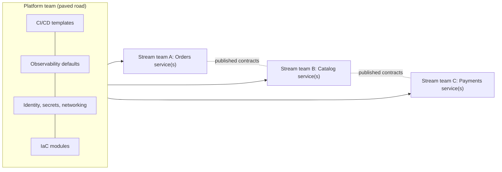

### Real-world
Amazon's "two-pizza teams" owning services end-to-end; Spotify-style squads; a small company with a single team succeeding with a modular monolith because there's no coordination problem to solve with services.

### When / when not
Use team-aligned boundaries when you have multiple teams colliding. Don't create a service per developer or a service boundary that cuts through a team's work.

### Mistakes
Services owned by "the architecture team"; component teams (UI team / API team / DB team) forcing every feature to cross teams; shared ownership ("everyone owns it" = no one); no platform → each team reinvents pipelines; ignoring cognitive load.

### Troubleshooting org symptoms
Cross-team tickets for every feature → boundary/ownership mismatch; frequent coordinated releases → coupling; slow onboarding to a service → insufficient docs/paved road.

### Interview Q&A
**Q: How does Conway's law affect your design?** Boundaries that cross team lines create coordination overhead; align service boundaries with stream-aligned team ownership (and adjust teams if the architecture needs it).
**Q: Team of 8 — should they adopt microservices?** Almost certainly not: one team, one codebase, modular monolith, invest in modularity and a fast pipeline; extract only for a concrete driver.

---

## 20. Latency, network overhead, cost vs scalability

### Network latency and communication overhead — the math
In-process call ≈ 10–100 ns. Same-AZ network call ≈ 0.5–2 ms (plus serialisation, TLS, queueing); cross-AZ ≈ 1–3 ms; cross-region ≈ 20–150+ ms *(order-of-magnitude figures; measure your own)*. So splitting a function call into a service call costs **10⁴–10⁶×** per call.

**Chatty-call example.** A page needing 40 sequential calls to services at 5 ms p50 each ⇒ 200 ms p50 — and p99 compounds: if each call has a 1% chance of being slow (500 ms), the chance at least one of 40 is slow ≈ 1 − 0.99⁴⁰ ≈ **33%** (tail-latency amplification). Mitigate: coarser APIs, parallel fan-out (`Task.WhenAll` with timeouts), batch endpoints, BFF/API composition, caching, replicated read models, async decoupling, co-location of chatty services (same zone/environment), gRPC, and **fewer hops**. Sequential chain latency = sum; parallel fan-out latency = max (but max of N is worse than the mean).

```csharp
// Parallel fan-out with per-call timeout and bounded degradation (max, not sum)
var (price, stock, recs) = await (
    pricing.GetAsync(id, ct).WithTimeout(300), stock.GetAsync(id, ct).WithTimeout(300),
    recs.GetAsync(id, ct).WithTimeoutOrDefault(200, Recommendations.Empty));   // optional dependency => fallback
```
(Where `WithTimeout*` are small helpers over `Task.WaitAsync(TimeSpan, ct)`.)

**Other overheads:** serialisation CPU, TLS handshakes (reuse connections), connection-pool limits, retries (Ch. 7), distributed tracing/log volume, data duplication storage, egress charges between zones/regions ($ per GB), and **cognitive/organisational** overhead (dominant in practice).

### Cost vs scalability
| Lever | Effect | Note |
|---|---|---|
| Right-size and autoscale | Pay for use; scale to zero for bursty workloads (Functions/ACA/KEDA) | Beware cold starts, min replicas for latency-critical |
| Reserved instances / savings plans / Hybrid Benefit | 30–70% on steady baselines *(verify current)* | Commit only to baseline |
| Fewer, larger services vs many tiny | Per-service fixed overhead (always-on replicas ×2–3 for HA, monitoring, DBs) | Nano-services multiply fixed cost |
| Shared platform (ACA environment / AKS cluster) | Bin-packing efficiency | Noisy neighbours, blast radius |
| Database-per-service on shared elastic pool | Cost-efficient isolation | Pool contention; know your DTU/vCore sharing |
| Caching / read replicas | Offload expensive tier | Extra infra + staleness |
| Egress & cross-region replication | Surprise cost | Keep chatty services in one region/zone |
| Observability volume | Log Analytics ingestion billed per GB | Sampling, levels, retention tiers |
| Over-provisioned HA | Multi-region active-active ≈ 2×+ | Match to tiered business need |

**Scalability is not free and not always needed.** Premature scaling architecture wastes money; failing to scale when needed loses revenue. Tie decisions to measured load, growth forecast, and cost per transaction. Build **FinOps** in: tags/cost allocation per service/team, budgets and alerts, anomaly detection, regular right-sizing. Cost is a **quality attribute** — put it in the ADR ([Azure Services Ch. 34][azsvc], [Migration §10][mig]).

### Consistency vs availability vs cost (recap triangle)
Stronger consistency and higher availability both cost latency and money; choose per capability (Ch. 3, 11).

### Mistakes
Ignoring egress; always-on min replicas for 40 tiny services; microservices on AKS with idle nodes; chatty cross-region calls after partial migration; scaling the app tier while the DB is the bottleneck (paying for nothing).

### Interview Q&A
**Q: Why can microservices be slower than a monolith?** Network hops, serialisation, tail-latency amplification across sequential calls, retries; mitigate with coarse-grained APIs, parallel fan-out, caching, async, co-location.
**Q: How do you reduce a $40k/month Azure bill without hurting reliability?** Measure first (cost analysis by tag): right-size/autoscale, reservations for baseline, eliminate idle/zombie resources, tier storage, reduce log ingestion, fix egress/cross-region chatter, consolidate low-traffic services onto shared plans/environments, review HA tier per service importance.

---

## 21. Architecture decision records (three worked ADRs)

ADR template and guidance: [Foundations §ADRs][found]. Three examples tied to this guide:

### ADR-016: Start with a modular monolith for the Billing platform
- **Status:** Accepted. **Date:** 2026-11-18. **Deciders:** Architecture group, Eng leads.
- **Context:** One product team of 9; domain still being discovered (3 pricing models changing quarterly); strong cross-entity consistency needs (invoices ↔ payments ↔ ledger); no platform team; a single-region deployment; time-to-market pressure.
- **Decision:** One deployable ASP.NET Core application, structured as modules (`Invoicing`, `Payments`, `Ledger`, `Customers`) in separate assemblies with `internal` types, public contracts per module, **schema-per-module** in one Azure SQL database, in-process events with an **outbox** table for integration events, NetArchTest rules in CI.
- **Alternatives considered:** (a) Microservices per module — rejected: team size, unclear boundaries, ops cost, ACID needs. (b) Classic layered monolith — rejected: no enforceable boundaries.
- **Consequences:** + Fast delivery, ACID, simple ops, cheap refactoring; − single scale unit, shared deploy cadence, discipline needed. **Revisit trigger:** a module needing independent scaling/compliance/team ownership, or > 3 teams contending. **Extraction path:** replace module interface with HTTP/gRPC adapter, move schema, deploy separately.

### ADR-017: Use asynchronous events via Azure Service Bus (topics) between Ordering, Payments and Notifications; REST at the edge, gRPC for internal pricing lookups
- **Context:** Order placement must survive downstream outages; notification latency tolerant; pricing lookups are synchronous, high-volume, internal.
- **Decision:** Ordering publishes `OrderPlaced` via **transactional outbox** to a Service Bus topic; Payments and Notifications have their own subscriptions with DLQ alerts and idempotent inbox handlers; public API REST/JSON via APIM; internal pricing via gRPC with 300 ms deadline, standard resilience pipeline, and cached fallback.
- **Alternatives:** Synchronous REST chain (rejected: availability product, coupling); Event Grid (rejected: needs ordering/sessions/DLQ semantics → Service Bus); Event Hubs (streaming, not command/event workflow).
- **Consequences:** + decoupling, load levelling, resilience; − eventual consistency (UI shows "Processing"), need idempotency, replay runbooks, trace propagation work. **Metrics:** outbox lag, DLQ depth, end-to-end order-to-payment latency p95.

### ADR-018: Per-tenant cell architecture for the multi-tenant SaaS
- **Context:** Noisy neighbours and a bad release took out all tenants twice; enterprise customers demand blast-radius limits; 99.95% SLO.
- **Decision:** Deploy N identical **cells** (ACA environment + Azure SQL elastic pool + Redis + Service Bus namespace) each hosting ≤ 200 tenants; a thin global router (Front Door + tenant-to-cell map in Cosmos DB) directs traffic; deployments progress by **rings** (internal cell → 1 cell → 10% cells → all) with automated SLO gates.
- **Alternatives:** Single shared stack (rejected: blast radius); a stack per tenant (rejected: cost for small tenants — offered as premium tier).
- **Consequences:** + isolation, safer rollouts, capacity planning per cell; − higher fixed cost, router is a critical component, tenant migration between cells tooling, cross-cell reporting needs a data pipeline. **Revisit:** if cell count > 50, evaluate automation/cost.

---

# Part 5 — Interview toolkit

## 22. Interview Q&A

**Fundamentals**
1. **Monolith vs modular monolith vs microservices — how do you choose?** Constraints first: team size/structure, domain maturity, scaling and compliance needs, ops maturity, consistency requirements. Default to modular monolith; extract with a concrete driver (Ch. 18).
2. **What is a bounded context and how does it relate to a microservice?** A boundary within which a model/language is consistent. A microservice commonly maps to one bounded context (or a part of it); a context should not be split across services, though one team may own several contexts.
3. **Aggregate vs entity vs value object?** Entity has identity; value object is defined by values (immutable); aggregate is a consistency boundary with a root — one transaction per aggregate, reference others by ID.
4. **Clean vs Hexagonal vs Onion vs Layered?** Same inward dependency rule for the first three; layered points dependencies downward toward persistence. In .NET all three converge on Domain/Application/Infrastructure/Host (Ch. 1).
5. **How do you stop the domain model leaking infrastructure?** Persistence-ignorant entities, ports in Application, adapters in Infrastructure, architecture tests, mapping at the edges.
6. **Domain service vs application service?** Domain service holds business logic that doesn't belong on one entity (pure domain, no I/O); application service orchestrates use cases, transactions, and ports.
7. **What are the fallacies of distributed computing and which matter most?** Network reliable / latency zero / bandwidth infinite / secure / topology static / one admin / zero transport cost / homogeneous. Reliability and latency drive most resilience design (Ch. 2).

**Communication and consistency**
8. **Sync vs async between services?** Sync for queries needing an immediate answer; async for commands/events where temporal decoupling, load-levelling and resilience matter. Sync chains multiply failure probability.
9. **REST vs gRPC?** Public/browser/cacheable → REST; internal/chatty/streaming/polyglot → gRPC; watch HTTP/2 LB pinning and always set deadlines (Ch. 6).
10. **Explain CAP in practice.** Under partition choose consistency (reject/queue) or availability (serve possibly stale) *per feature*; no partition → latency vs consistency (PACELC). Examples: inventory CP, catalogue AP (Ch. 3).
11. **Eventual consistency — how do you make it tolerable?** Bounded staleness SLOs, read-your-writes via session/primary reads, UI "pending" states, idempotent handlers, reconciliation, monitoring of lag.
12. **Why avoid distributed transactions?** Blocking, availability-reducing, coordinator SPOF, poor PaaS/broker support, long-held locks; use sagas + outbox + idempotency instead (Ch. 16).
13. **Choreography vs orchestration?** Choreography: services react to events (loose coupling, hard to see the flow); orchestration: central coordinator with explicit state (visible, easier to change/compensate, central component). Use orchestration for complex multi-step flows.
14. **Outbox and inbox — what problem each solves?** Outbox solves dual-write (state change + publish atomically); inbox solves duplicate delivery on the consumer (dedupe by message ID in the same transaction as the business change). Together = effectively-once ([Outbox guide][outbox]).
15. **Can you get exactly-once?** Not delivery; you get exactly-once *effect* via at-least-once + idempotent receivers.

**Patterns and resilience**
16. **Circuit breaker vs retry vs timeout vs bulkhead — composition?** Total timeout → retry (jitter) → breaker → attempt timeout, bulkhead to cap concurrency (Ch. 7).
17. **What is a retry storm?** Layered retries multiply load; fix by retrying at one layer, jitter, budgets, breaker, load shedding.
18. **How do you handle a slow dependency?** Timeout, bulkhead, breaker, fallback/cache, async decoupling, shed load, and alert on saturation.
19. **How do you design cache invalidation across instances?** Owner publishes change events (via outbox); subscribers evict by tag/key; short L1 TTL and a TTL safety net; stampede protection (Ch. 9).
20. **CQRS — when and when not?** Different read/write shapes or scale, read models across services; avoid for simple CRUD (ceremony + eventual consistency). Event Sourcing is optional and separate.
21. **API gateway vs service mesh vs BFF?** Gateway: edge concerns for north-south traffic (auth, rate limit, routing); mesh: east-west mTLS/retries/observability via sidecars; BFF: client-specific aggregation.
22. **Strangler Fig in one paragraph.** Put a facade (gateway/YARP/Front Door) in front of the legacy system, route feature-by-feature to new implementations, retire legacy pieces, with anti-corruption layers and data sync ([Migration §4.4][mig]).
23. **Service discovery on Azure?** Platform DNS (ACA/K8s/App Service) + L7 ingress; client-side discovery libraries only when needed; health-based endpoints (Ch. 8).

**Reliability and operations**
24. **Horizontal vs vertical scaling for a SQL-backed API?** Scale API tier out (stateless), DB up first, then replicas/caching/partitioning; budget connection pools (Ch. 10).
25. **Liveness vs readiness vs startup probes?** Restart vs route vs boot-time grace; liveness never checks dependencies (Ch. 13).
26. **How do you trace across HTTP and queues?** W3C `traceparent` header and message `ApplicationProperties`, saved in outbox rows; consumer continues the `Activity` (Ch. 12).
27. **What do you alert on?** SLO burn-rate on user-facing SLIs + saturation indicators; page on user pain, ticket otherwise.
28. **Deployment strategy for a breaking change?** Expand/contract across releases; canary with automated SLO gates; feature flags; never couple a breaking schema change with code (Ch. 14, 15).
29. **How do you version APIs and events?** Additive-first, tolerant readers, URL/header versioning for breaking HTTP changes, protobuf field rules, schema version + upcasters for events, consumer-driven contract tests (Ch. 15).
30. **How do you handle partial failure in a checkout?** Idempotent steps + outbox + saga with compensations + timeouts + reconciliation + visible states (Ch. 16).
31. **What makes a distributed monolith, and how do you fix one?** Lock-step releases, shared DB/library, long sync chains; fix by cutting data/temporal/contract coupling or merging services (Ch. 17).
32. **Graceful degradation examples?** Fallback/cached data, feature kill-switches, load shedding with `Retry-After`, async acceptance, read-only mode (Ch. 11).
33. **How do you secure service-to-service calls?** mTLS or workload identity (managed identity + Entra tokens), least privilege RBAC, private endpoints, no shared secrets, input validation at each boundary.
34. **How do you migrate a shared database to database-per-service?** Establish ownership → forbid cross-writes then reads → APIs/events + replicated reads → move schema → CDC for transition ([Migration §5][mig]).

### Challenging follow-ups an interviewer may use
- *"Your orchestrator calls five services synchronously — isn't that a distributed monolith?"* — It can be: the orchestrator becomes a god service and availability is the product of five. Prefer commands over durable queues with saga state; limit sync calls to those needing an immediate answer; make steps independently retriable.
- *"Redis is down — what happens?"* — Cache is optional by design: breaker around Redis, fall back to DB with a bulkhead and stampede protection; never treat Redis as source of truth.
- *"You said eventual consistency; the PM says users see old data after saving. Fix?"* — Read-your-writes: return written state, session consistency/primary read after write, optimistic UI, or wait for projection with a bounded timeout.
- *"How do you prove the architecture is actually decoupled?"* — Independence tests: deploy alone, run degraded with deps down, schema change without coordination; change-coupling analysis; contract tests green.
- *"Why not just use Kubernetes for everything?"* — Operational burden; Container Apps/App Service/Functions cover most needs; AKS when you need the Kubernetes API/operators/mesh/GPU and have a platform team ([Cloud-Native §2][azurenative], [Azure Services][azsvc]).

## 23. Scenario-based architect questions

**S1. Split an e-commerce monolith.** *Answer:* Clarify drivers (why split? deploy contention, scale hot spots, team growth). Event-storm → contexts: Catalogue (read-heavy), Ordering/Checkout (consistency, PCI), Payments (isolation), Inventory (strong consistency), Notifications (generic). First **modularise inside** the monolith (schema-per-module, no cross-module DB access). Extract in value order: Catalogue/Search (read model + events), Notifications (serverless), then Payments behind an ACL via strangler (YARP/Front Door). Use CDC/outbox to sync data; expand/contract; canary per route. Keep checkout/inventory in the core until boundaries are proven. Measure change-coupling and DORA metrics to confirm benefit. *Pitfalls:* entity services, shared DB, extracting before modularising.

**S2. Design for 99.99% with multi-region.** *Answer:* 99.99% ≈ 4.3 min/month ⇒ automation. Compute composite SLA, remove serial dependencies on the critical path (cache, async, degrade). Zone-redundant tiers in each region; active-active or active-passive per component: Front Door for routing/health, SQL failover group (async ⇒ RPO seconds, document it) or Cosmos multi-region with chosen consistency, Service Bus Geo-replication/DR (idempotent consumers), Blob GZRS. Stateless compute, config/secrets per region, IaC for identical stacks, capacity for N+1 region. Deploy by rings, SLO-based alerts, automated failover with human approval gates where data loss possible, quarterly game days. Call out cost (≈2×) and which features degrade in a regional failure.

**S3. A distributed monolith with cascading failures — fix it.** *Answer:* Stabilise first: add timeouts/bulkheads/breakers, shed load, cap retries (kill retry storms), add health-probe correctness (liveness ≠ dependency). Then diagnose coupling (call graph from traces, shared DB, release ordering). Cut the worst coupling: asynchronous events for non-critical downstream; replicate read data; fallbacks for optional dependencies; separate pools per dependency. Merge services with wrong boundaries; introduce contract tests; align team ownership. Track MTTR, blast radius, and deploy independence.

**S4. Consistency model for inventory.** *Answer:* Overselling is costly → single-writer per SKU (aggregate = SKU stock) with optimistic concurrency/conditional update; reservations with TTL (`Reserved` counts) instead of immediate decrement; commit on payment via saga; strong consistency inside the Inventory service, eventual to the catalogue (shows "low stock" approximated); during partition prefer reject/queue (CP) for decrement, serve stale for display (AP). Handle flash-sale hot rows via partitioned counters/queue serialisation per SKU.

**S5. A team of 8 asks to adopt microservices.** *Answer:* Ask for the driver; evaluate prerequisites (Ch. 19); recommend modular monolith with enforced boundaries, a fast pipeline, observability, and ADR with revisit triggers; extract later where a real driver exists. Explain costs (ops, consistency, versioning) and the hybrid path.

**S6. Order placed twice / double charge after timeouts.** *Answer:* Diagnose: client retries + non-idempotent POST + no dedupe. Fix: `Idempotency-Key` on the API (store key→response with TTL), idempotency key to payment provider, inbox dedupe on consumers, outbox for publishing, reconciliation against provider, monitoring duplicates. Test with fault injection (kill after commit before ack).

**S7. Black Friday readiness for a 10× traffic spike.** *Answer:* Load-test with realistic mix; identify bottlenecks (DB wait stats, connection pools, locks); cache read paths (HybridCache/Redis/CDN), queue-level load levelling for orders, autoscale on right signals with max caps and warm-up, pre-scale ahead of the event, read replicas, rate limiting/load shedding for non-critical endpoints, feature kill-switches, capacity for N+1, runbooks, war-room dashboards, rollback plan, freeze changes.

**S8. Roll out a breaking event schema change with zero downtime.** *Answer:* Additive v2 alongside v1; consumers upgraded to tolerant/upcasting first (deploy consumers before producers); producer dual-publishes or sets `schemaVersion`; contract tests verify; monitor DLQ and lag; remove v1 after all consumers confirmed (tracked via subscription metrics/ownership); never edit stored events; use replay to rebuild projections.

**S9. Customers in EU must have data isolated; design for tenant isolation.** *Answer:* Cell/stamp per region (data residency), tenant→cell routing map, per-cell identity boundaries and keys (CMK per tenant tier), no cross-cell data flow except anonymised analytics via pipeline; policy-as-code for region restrictions; DR within geography (paired region in same legal boundary).

## 24. Structured problem-solving framework + two worked examples

### The framework (say it out loud in interviews)
1. **Clarify** — functional scope, users, scale (RPS, data volume, growth), SLAs/SLOs, consistency needs, compliance, team/budget/time. *Ask, don't assume.*
2. **Quality attributes** — rank the top 3–5 (availability, latency, consistency, scalability, security, cost, evolvability). State the **trade-offs you'll make**.
3. **Constraints** — existing stack/skills/legacy, cloud/vendor, regulatory, deadlines.
4. **High-level design** — context → containers (components, data stores, sync vs async) → key flows. Draw it.
5. **Options & trade-offs** — 2–3 realistic options for each *significant* decision, with pros/cons against the ranked qualities.
6. **Decision** — choose, justify with the ranked attributes, record as an ADR.
7. **Failure and scale analysis** — what breaks first? partial failure, hot spots, data growth, DR. Add the patterns that address them (and only those).
8. **Operate** — observability, deployment, security, cost.
9. **Risks & validation** — what you'd prototype/measure, revisit triggers, how it evolves.

### Worked example A — "Design an order-processing system that survives payment-provider outages"
1. *Clarify:* 200 orders/s peak, 99.9%, orders must never be lost or double-charged, provider outages of up to 30 min occur.
2. *Qualities:* durability/correctness > availability of confirmation > latency. Accept eventual payment confirmation.
3. *Design:* API (APIM → ASP.NET Core Orders API on ACA) writes `Order(Pending)` + **outbox** row in one SQL transaction → relay publishes `OrderPlaced` to **Service Bus** → Payments worker (competing consumers, scaled by KEDA) calls provider with **idempotency key** via resilient `HttpClient` (breaker/timeout) → publishes `PaymentCaptured/Failed` via its own outbox → Orders updates state (inbox dedupe) → notifications.
4. *Options:* sync call to the provider in the request path (simple, but outage = no orders; rejected); queue-based async (chosen); event sourcing (overkill here).
5. *Failure analysis:* provider down → breaker opens, messages retry with backoff then stay in queue (TTL generous) — orders accepted, user sees "Payment processing"; relay crash → outbox ensures publish later; duplicate deliveries → inbox + provider idempotency; poison → DLQ with alert and replay tool; reconciliation job vs provider daily.
6. *Operate:* trace via `traceparent` in outbox; SLIs: order-accept success, payment-latency p95, outbox lag, DLQ depth; canary deploys.
7. *Risks:* queue growth during long outage (capacity/TTL), UX for delayed failure (email + retry link), validate with fault-injection tests.

### Worked example B — "Choose an architecture for a new B2B SaaS with a 9-person team"
1. *Clarify:* 50 tenants year 1, ~500 RPS peak, strong consistency for billing, domain uncertain, 6-month MVP, no platform team.
2. *Qualities:* time-to-market, evolvability, correctness, moderate availability (99.9%), low ops burden.
3. *Options:* (A) microservices on AKS; (B) modular monolith on Azure Container Apps + one Azure SQL; (C) serverless functions. Score against qualities: (A) high ops cost, wrong boundaries risk; (C) cold starts, ACID spread, vendor patterns for complex domain; **(B)** wins.
4. *Decision/ADR:* modular monolith (schema-per-module, architecture tests), outbox for integration events, Service Bus for async to the few external integrations, Redis only after measuring, Front Door + ACA zone-redundant, SQL zone-redundant + PITR, OpenTelemetry from day one, feature flags, trunk-based CI/CD with canary revision.
5. *Scale/failure analysis:* scale API tier horizontally (stateless), DB vertical + read replica later; tenant isolation by `TenantId` + row-level security now, cell split later (documented trigger: > 200 tenants or enterprise isolation requirement).
6. *Risks/revisit:* extraction candidates identified (reporting, document generation); revisit at 3 teams or independent scaling need.

## 25. One-page cheat sheet

| Topic | Remember |
|---|---|
| Style choice | Modular monolith by default; microservices need a driver + ops maturity + team ownership |
| Dependency rule | Dependencies point inward (Clean/Onion/Hexagonal); enforce with architecture tests |
| Boundaries | Business capability/bounded context; own your data; one transaction = one aggregate; start coarse |
| Data | DB-per-service = data ownership; cross-service reads via API composition / replicated read models / analytics pipeline |
| CAP/PACELC | Per feature: inventory CP, catalogue AP; strong in aggregate, eventual between |
| Sync vs async | Sync for immediate queries; async for commands/events; sync chains multiply failure |
| REST vs gRPC | Edge/public REST; internal/streaming gRPC; deadlines; watch L4 pinning |
| Resilience order | Total timeout → retry+jitter → breaker → attempt timeout; bulkhead to cap concurrency; retry at one layer |
| Reliable messaging | Outbox (publish) + inbox (dedupe) + idempotent handlers + DLQ/replay = effectively-once |
| Saga | Compensations idempotent; pivot step; timeouts; reconciliation |
| Caching | Owner-published invalidation events + TTL safety net + tags/versioned keys + stampede protection |
| Scaling | Stateless out; DB up first, then replicas/cache/partition; autoscale on queue/concurrency; budget connection pools |
| Probes | Startup / liveness (no deps!) / readiness; drain on SIGTERM |
| Observability | traceparent over HTTP + message props; structured logs; RED/USE; SLO burn-rate alerts |
| Deployment | Rolling default; canary + flags for risk; blue-green for big changes; expand/contract DB |
| Versioning | Additive-first, tolerant reader, protobuf rules, schemaVersion + upcasters, Pact |
| Distributed monolith | Lock-step release, shared DB/lib, long sync chains → cut data/time/contract coupling or merge |
| Latency | 40 sequential 5 ms calls = 200 ms; tail amplification 1−0.99ⁿ; fan-out in parallel; fewer hops |
| Cost | Reserve baseline, autoscale burst, watch egress/logs, avoid nano-services' fixed costs |
| Availability math | Serial multiplies; parallel redundancy 1−(1−A)ⁿ; 99.99% ≈ 4.3 min/month |

## 26. Revision checklist

- [ ] Can I justify monolith vs modular monolith vs microservices for a given context with a decision matrix?
- [ ] Can I draw Clean/Onion/Hexagonal vs Layered and state the dependency rule and how to enforce it?
- [ ] Can I list the fallacies of distributed computing and explain partial failure and idempotency?
- [ ] Can I apply CAP/PACELC to inventory vs catalogue and name Cosmos DB consistency levels?
- [ ] Can I decompose a domain (event storming, subdomains, data ownership, team alignment) and spot decomposition anti-patterns?
- [ ] Can I solve cross-service queries (API composition, read models, analytics) without shared DBs?
- [ ] Can I choose REST vs gRPC and explain gRPC deadlines, versioning and load-balancing pitfalls?
- [ ] Can I write and order a timeout/retry/breaker/bulkhead pipeline and explain retry storms?
- [ ] Can I explain outbox/inbox/idempotent consumer and why exactly-once delivery is impossible?
- [ ] Can I design cache invalidation (events + TTL + tags) and stop stampedes?
- [ ] Can I explain scaling out vs up, statelessness, LB algorithms and autoscale signals?
- [ ] Can I compute composite availability and design graceful degradation and failure isolation (cells, bulkheads, load shedding)?
- [ ] Can I design cross-service tracing incl. message propagation, structured logging and SLO alerting?
- [ ] Can I define liveness/readiness/startup and the "never check dependencies in liveness" rule?
- [ ] Can I compare rolling/blue-green/canary/flags and do expand/contract DB changes?
- [ ] Can I version APIs/events/protobuf compatibly and use consumer-driven contracts?
- [ ] Can I recognise and remediate a distributed monolith?
- [ ] Can I explain Conway's law/team topologies and the microservices prerequisites?
- [ ] Can I quantify latency overhead and cost levers?
- [ ] Can I run the 9-step framework out loud on a new problem and write an ADR?

---

## Related topics in this repository

[Microservices][micro] · [Modular Monolith][modular] · [Layered][layered] · [Hexagonal][hex] · [DDD][ddd] · [Event-Driven][eda] · [Saga][saga] · [CQRS][cqrs] · [Event Sourcing][es] · [API Gateway][gw] · [Distributed Systems Patterns][dsp] · [Distributed Transactions][dt] · [Integration & Communication][icp] · [Foundations][found] · [Cloud-Native on Azure][azurenative] · [Docker][docker] · [ASP.NET Core Internals][aspnet] · [Cloud Migration][mig] · [Webhooks][web] · [Service Bus][sb] · [Azure Services][azsvc] · [Inbox/Outbox][outbox]

[enterprise]: ../03-architectural-patterns/enterprise-application-patterns.md
