# SQL Server Internals, Query Tuning and Concurrency

> **Part 1 of 2** of the *Database Performance Optimization and Troubleshooting* guide.
> Part 2 — [Database Architecture, Scaling and Troubleshooting](02-database-architecture-scaling-and-troubleshooting.md) —
> covers partitioning, sharding, replicas, caching, high availability and the production troubleshooting toolbox
> (Query Store, Extended Events, DMVs, wait analysis).

## How to use this guide

Database performance is the area where interviewers separate people who *use* SQL Server from people who can *explain* it.
A strong answer never starts with "add an index". It starts with **measure → hypothesize → verify → fix → prevent**
(see [chapter 30](#30-structured-answer-framework)) and then reasons from how the engine actually works.

Every chapter follows the same shape so you can revise quickly:

| Block | What it gives you |
| --- | --- |
| **Simple idea** | One-paragraph plain-language explanation |
| **Architect depth** | Why it exists, how it works internally |
| **Hands-on** | T-SQL (runnable against the [lab](#0-lab-setup)) and C# / EF Core 10 |
| **Production view** | Use cases, when *not* to, trade-offs, mistakes and anti-patterns |
| **Performance, reliability, security, Azure** | Non-functional considerations and Azure SQL differences |
| **Troubleshooting** | How to prove the diagnosis in production |
| **Interview Q&A** | Questions, detailed answers and the follow-ups interviewers actually ask |

> **Versions.** Behaviour is described for SQL Server 2022 / Azure SQL Database unless noted. Features that depend on
> the database **compatibility level** are called out because the same query can behave differently at level 110, 130, 150 or 160.
> Anything labelled *verify current* changes between releases — check the Microsoft docs before quoting numbers in an interview.

## Table of contents

**Lab**
- [0. Lab setup](#0-lab-setup)

**Part A — SQL Server fundamentals and query tuning**
- [1. SQL Server architecture and query execution lifecycle](#1-sql-server-architecture-and-query-execution-lifecycle)
- [2. Query parsing, optimization and execution](#2-query-parsing-optimization-and-execution)
- [3. Execution plans, estimated versus actual](#3-execution-plans-estimated-versus-actual)
- [4. Cost-based query optimization](#4-cost-based-query-optimization)
- [5. Index fundamentals](#5-index-fundamentals) (clustered, non-clustered, composite, covering, filtered, unique)
- [6. Index fragmentation and maintenance](#6-index-fragmentation-and-maintenance)
- [7. Index seeks versus index scans](#7-index-seeks-versus-index-scans)
- [8. Key lookups and bookmark lookups](#8-key-lookups-and-bookmark-lookups)
- [9. Statistics and cardinality estimation](#9-statistics-and-cardinality-estimation)
- [10. Parameter sniffing and parameter-sensitive plans](#10-parameter-sniffing-and-parameter-sensitive-plans)
- [11. Query optimization techniques](#11-query-optimization-techniques)
- [12. SARGable versus non-SARGable queries](#12-sargable-versus-non-sargable-queries)
- [13. JOIN optimization](#13-join-optimization)
- [14. Subqueries versus CTEs](#14-subqueries-versus-ctes)
- [15. Pagination optimization](#15-pagination-optimization)
- [16. Stored procedure optimization](#16-stored-procedure-optimization)
- [17. Avoiding unnecessary columns (no SELECT star)](#17-avoiding-unnecessary-columns-no-select-star)
- [18. The N plus 1 query problem](#18-the-n-plus-1-query-problem)
- [19. Normalization and denormalization](#19-normalization-and-denormalization)

**Part B — Concurrency and transactions**
- [20. ACID properties](#20-acid-properties)
- [21. Transaction isolation levels](#21-transaction-isolation-levels)
- [22. Locking and blocking](#22-locking-and-blocking)
- [23. Deadlocks and deadlock graphs](#23-deadlocks-and-deadlock-graphs)
- [24. Optimistic versus pessimistic concurrency](#24-optimistic-versus-pessimistic-concurrency)
- [25. Row versioning](#25-row-versioning)
- [26. Long-running transactions](#26-long-running-transactions)
- [27. Connection pooling and pool exhaustion](#27-connection-pooling-and-pool-exhaustion)

**Part C — Putting it together**
- [28. Scenario-based questions](#28-scenario-based-questions)
- [29. Cheat sheet](#29-cheat-sheet)
- [30. Structured answer framework](#30-structured-answer-framework)
- [31. Revision checklist](#31-revision-checklist)

---

## 0. Lab setup

All examples reuse one schema so you can reproduce every behaviour on a developer instance (SQL Server 2019+/2022 Developer
edition, or an Azure SQL Database). The data is **deliberately skewed** (customer 1 owns about half of all orders) because skew is what
produces parameter sniffing, bad estimates and lopsided plans in real systems.

```sql
-- 0.1 Database and schema
CREATE DATABASE PerfLab;
GO
ALTER DATABASE PerfLab SET COMPATIBILITY_LEVEL = 160;   -- SQL Server 2022 behaviour (use 150 on 2019)
ALTER DATABASE PerfLab SET QUERY_STORE = ON;            -- default ON in 2022 new DBs and Azure SQL, explicit here
GO
USE PerfLab;
GO

CREATE TABLE dbo.Customers
(
    CustomerId   INT           NOT NULL CONSTRAINT PK_Customers PRIMARY KEY CLUSTERED,
    Email        VARCHAR(200)  NOT NULL,          -- NOTE: VARCHAR (not NVARCHAR) on purpose, see chapter 12
    FullName     NVARCHAR(100) NOT NULL,
    CountryCode  CHAR(2)       NOT NULL,
    CreatedAt    DATETIME2(0)  NOT NULL
);

CREATE TABLE dbo.Orders
(
    OrderId      BIGINT        NOT NULL IDENTITY(1,1) CONSTRAINT PK_Orders PRIMARY KEY CLUSTERED,
    CustomerId   INT           NOT NULL,
    OrderDate    DATETIME2(0)  NOT NULL,
    Status       TINYINT       NOT NULL,          -- 0 New, 1 Paid, 2 Shipped, 3 Cancelled
    TotalAmount  DECIMAL(12,2) NOT NULL,
    CountryCode  CHAR(2)       NOT NULL,
    ExternalRef  VARCHAR(40)   NULL,
    Notes        NVARCHAR(400) NULL,
    RowVer       ROWVERSION
);

CREATE TABLE dbo.OrderItems
(
    OrderItemId  BIGINT        NOT NULL IDENTITY(1,1) CONSTRAINT PK_OrderItems PRIMARY KEY CLUSTERED,
    OrderId      BIGINT        NOT NULL,
    ProductId    INT           NOT NULL,
    Quantity     INT           NOT NULL,
    UnitPrice    DECIMAL(12,2) NOT NULL
);
GO
```

```sql
-- 0.2 Data generator (portable: no GENERATE_SERIES needed). Scale @OrderRows down to 200000 on a laptop.
DECLARE @CustomerRows INT = 100000, @OrderRows INT = 2000000;

;WITH n AS (
    SELECT TOP (@CustomerRows) ROW_NUMBER() OVER (ORDER BY (SELECT NULL)) AS n
    FROM sys.all_objects a CROSS JOIN sys.all_objects b)
INSERT dbo.Customers (CustomerId, Email, FullName, CountryCode, CreatedAt)
SELECT n,
       CONCAT('user', n, '@example.com'),
       CONCAT(N'Customer ', n),
       CHOOSE(1 + n % 5, 'US', 'GB', 'DE', 'IN', 'FR'),
       DATEADD(DAY, -(n % 1500), SYSUTCDATETIME())
FROM n;

;WITH n AS (
    SELECT TOP (@OrderRows) ROW_NUMBER() OVER (ORDER BY (SELECT NULL)) AS n
    FROM sys.all_objects a CROSS JOIN sys.all_objects b CROSS JOIN sys.all_objects c)
INSERT dbo.Orders (CustomerId, OrderDate, Status, TotalAmount, CountryCode, ExternalRef, Notes)
SELECT CASE WHEN n % 2 = 0 THEN 1                                   -- skew: customer 1 owns ~50% of orders
            ELSE 1 + ABS(CHECKSUM(NEWID())) % @CustomerRows END,
       DATEADD(MINUTE, -(n % 1051200), SYSUTCDATETIME()),            -- ~2 years of data
       ABS(CHECKSUM(NEWID())) % 4,
       CAST(ABS(CHECKSUM(NEWID())) % 100000 AS DECIMAL(12,2)) / 100,
       CHOOSE(1 + n % 5, 'US', 'GB', 'DE', 'IN', 'FR'),
       CONCAT('EXT-', n),
       REPLICATE(N'x', 50)
FROM n;

INSERT dbo.OrderItems (OrderId, ProductId, Quantity, UnitPrice)
SELECT o.OrderId, 1 + (o.OrderId * x.k) % 5000, 1 + (o.OrderId + x.k) % 5, o.TotalAmount / 2
FROM dbo.Orders o CROSS JOIN (VALUES (1),(2)) x(k);
GO

-- Baseline: PK-only. We add indexes chapter by chapter so you can see each effect.
CREATE NONCLUSTERED INDEX IX_OrderItems_OrderId ON dbo.OrderItems (OrderId);   -- FK-supporting index
UPDATE STATISTICS dbo.Customers WITH FULLSCAN;
UPDATE STATISTICS dbo.Orders WITH FULLSCAN;
UPDATE STATISTICS dbo.OrderItems WITH FULLSCAN;
```

**Measurement preamble used throughout.** Run this in each session before a test so you see *logical reads* — the most
stable tuning metric (elapsed time is noisy; logical reads are deterministic for a given plan and data):

```sql
SET STATISTICS IO ON;
SET STATISTICS TIME ON;
-- In SSMS also press Ctrl+M ("Include Actual Execution Plan") before running.
```

**C# lab connection.** All EF Core samples assume:

```csharp
builder.Services.AddDbContext<ShopDb>(o => o
    .UseSqlServer(builder.Configuration.GetConnectionString("PerfLab"),
        sql => sql.EnableRetryOnFailure(maxRetryCount: 5))   // transient-fault resilience (Azure SQL)
    .LogTo(Console.WriteLine, LogLevel.Information));          // see the SQL EF generates — essential for tuning

public class Order
{
    public long OrderId { get; set; }
    public int CustomerId { get; set; }
    public DateTime OrderDate { get; set; }
    public byte Status { get; set; }
    public decimal TotalAmount { get; set; }
    public string CountryCode { get; set; } = "";
    public string? ExternalRef { get; set; }
    public string? Notes { get; set; }
    [Timestamp] public byte[] RowVer { get; set; } = [];
    public List<OrderItem> Items { get; set; } = [];
}
public class OrderItem { public long OrderItemId { get; set; } public long OrderId { get; set; } public int ProductId { get; set; } public int Quantity { get; set; } public decimal UnitPrice { get; set; } }
public class Customer { public int CustomerId { get; set; } public string Email { get; set; } = ""; public string FullName { get; set; } = ""; public string CountryCode { get; set; } = ""; public DateTime CreatedAt { get; set; } }

public class ShopDb(DbContextOptions<ShopDb> options) : DbContext(options)
{
    public DbSet<Order> Orders => Set<Order>();
    public DbSet<OrderItem> OrderItems => Set<OrderItem>();
    public DbSet<Customer> Customers => Set<Customer>();
}
```

---

# Part A — SQL Server fundamentals and query tuning

## 1. SQL Server architecture and query execution lifecycle

**Simple idea.** SQL Server is two cooperating engines. The **relational engine** decides *how* to run your query (parse, optimize,
plan). The **storage engine** actually fetches and modifies data (pages, locks, logging). Everything is cached in memory;
disk is the slow path.

**Architect depth.**

- **Network layer.** Clients speak **TDS** (Tabular Data Stream) over TCP 1433 (Azure SQL: gateway on 1433 with redirect/proxy mode and a
  `10928`/`40613` family of governance errors). Encryption (TLS) is negotiated at login.
- **Relational engine (the "brain").** *Parser* (syntax) → *Binder/Algebrizer* (resolve names, types, produce a logical tree) → *Optimizer*
  (cost-based search for a physical plan) → *Query executor* (runs operators, an iterator tree where each operator pulls rows from its children).
- **Storage engine (the "hands").** *Access methods* (heap, B-tree, columnstore), *buffer manager* (the **buffer pool**: cache of 8 KB data pages),
  *lock manager*, *transaction manager* and the **transaction log** (write-ahead logging).
- **SQLOS.** SQL Server's own mini operating system: cooperative **schedulers** (one per logical CPU), **workers** (threads), **memory clerks**,
  I/O. A worker runs until it must wait (I/O, lock, memory grant) or yields (~4 ms quantum). This is why *wait statistics* are the primary diagnostic:
  every moment a request is not running on CPU, it is waiting on something, and SQL Server records what.
- **Pages and extents.** Data lives in **8 KB pages**; eight contiguous pages form a **64 KB extent**. A row must fit on one page (≈8,060 bytes in-row; large
  values spill to LOB/row-overflow pages). Cost of a query is dominated by **how many pages it touches** (logical reads) and how many of those
  are *not* in the buffer pool (physical reads).
- **Data structures.** Tables are either a **heap** (unordered pages, found via IAM pages) or a **clustered index** (a B+tree whose leaf level *is* the table).
  Non-clustered indexes are separate B+trees whose leaf rows hold the index key columns (+ INCLUDEd columns) and a locator back to the base row
  (the clustering key, or a RID for heaps).
- **Transaction log and WAL.** A change is made on the page in memory and a log record is hardened to the log **before** the commit returns.
  Dirty pages are flushed later by **checkpoint/lazy writer**. Log write latency (`WRITELOG` waits) bounds your commit rate.
- **tempdb.** Shared scratch space: temp tables, table variables, sorts/hash spills, version store (when row versioning is used), worktables.
  A contended tempdb slows the whole instance.
- **Memory grants.** Sorts and hash operators request workspace memory *before* running, sized from the optimizer's row estimates. Under-estimate →
  spill to tempdb; over-estimate → wasted memory and `RESOURCE_SEMAPHORE` queueing for other queries.

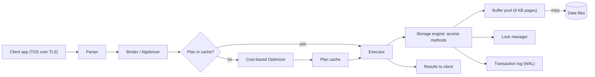

**Hands-on: see the lifecycle in the plan cache and waits.**

```sql
-- What is cached, how often reused, and what it costs (CPU in microseconds)
SELECT TOP 10
       qs.execution_count,
       qs.total_worker_time / 1000 AS total_cpu_ms,
       qs.total_logical_reads,
       qs.query_hash, qs.query_plan_hash,
       SUBSTRING(st.text, (qs.statement_start_offset/2)+1,
         ((CASE qs.statement_end_offset WHEN -1 THEN DATALENGTH(st.text) ELSE qs.statement_end_offset END
           - qs.statement_start_offset)/2)+1) AS statement_text
FROM sys.dm_exec_query_stats qs
CROSS APPLY sys.dm_exec_sql_text(qs.sql_handle) st
ORDER BY qs.total_worker_time DESC;

-- Is the buffer pool doing its job? (page life expectancy is a *trend*, not a magic 300)
SELECT counter_name, cntr_value
FROM sys.dm_os_performance_counters
WHERE counter_name IN ('Page life expectancy','Buffer cache hit ratio','Memory Grants Pending');
```

**Real-world scenario.** A report that "was fast yesterday" is slow today. Same query text, same plan — but the nightly ETL evicted the
working set from the buffer pool, so the same plan now does physical reads (`PAGEIOLATCH_SH` waits). Lesson: *plan quality* and *cache state* are separate causes.

**When it matters / when not.** You need this mental model for every other chapter. You do **not** need to tune the buffer pool itself — add memory or reduce
reads; SQL Server manages the pool.

**Trade-offs and mistakes.**
- Mistake: reading "buffer cache hit ratio 99%" as healthy — it hides scans of cached data burning CPU.
- Mistake: "restart SQL Server to clear the problem" — it wipes plan cache *and* buffer pool and causes a cold-start stampede.
- Mistake: setting `max server memory` unset on a shared box → OS starved (leave headroom; typical guidance is to reserve several GB for the OS).

**Performance / reliability / security / Azure.** Azure SQL Database enforces **resource governance** (CPU, worker, log-rate, memory limits per service
objective); you hit *governed* limits (`10928`/`10929`, log-rate waits `LOG_RATE_GOVERNOR`) long before you hit "hardware" limits. Use `sys.dm_db_resource_stats`
(15-second granularity, ~1 hour) and `sys.resource_stats` (5-minute, 14 days) to see which dimension is saturated.

**Troubleshooting.** First question is always *"waiting or running?"* → `sys.dm_exec_requests` (status, wait_type, blocking_session_id) + `sys.dm_os_wait_stats`
deltas. See [Part 2](02-database-architecture-scaling-and-troubleshooting.md) for the full toolbox.

**Related.** [Chapter 2](#2-query-parsing-optimization-and-execution), [chapter 22](#22-locking-and-blocking), [ASP.NET Core internals — thread pool starvation as seen from the API](../10-aspnet-core-web-api-internals/aspnet-core-web-api-internals.md).

### Interview Q&A — chapter 1

**Q: Walk me through what happens when my API runs `SELECT ... WHERE CustomerId = @id`.**
A: The driver sends it over TDS. The parser validates syntax; the algebrizer binds names and types and builds a logical tree. The engine hashes the batch text and checks the
plan cache — a hit skips optimization. On a miss, the cost-based optimizer explores equivalent plans using statistics and picks the cheapest estimate, caches it, and the executor runs
the iterator tree. Access methods ask the buffer pool for pages; misses are physical reads. Locks (or row versions) are taken per isolation level, changes are logged before commit.
Results stream back as the client consumes them.

**Q: Why do we look at logical reads rather than elapsed time?**
A: Logical reads are deterministic for a given plan and data — unaffected by cache warmth, concurrent load or network — so you can compare before/after objectively. Elapsed time and
CPU are still needed for the final verdict, but they are noisy.

*Follow-ups.* "What is a worker and what happens when workers run out?" → `THREADPOOL` waits; new connections stall; usually a symptom (blocking chain holding many workers), not the cause.
"Why does a restart make things *worse* before better?" → cold plan cache (compile storm, CPU) and cold buffer pool (I/O storm).

---

## 2. Query parsing, optimization and execution

**Simple idea.** SQL is *declarative*: you say what you want, not how. The optimizer turns it into a *procedural* plan. Compiling is expensive, so plans are cached and reused.

**Architect depth.**

1. **Parse/bind.** Produces a logical operator tree. Views are expanded, `*` is resolved, constants may be folded.
2. **Simplification.** Predicate pushdown, contradiction detection, join elimination (a join to a table whose columns aren't used and that has a trusted FK/unique key can be removed — *trusted constraints matter*).
3. **Trivial plan.** If there is only one sensible plan (e.g. `SELECT ... WHERE pk = @x`), the optimizer skips cost-based exploration. Visible in plan XML as `StatementOptmLevel="TRIVIAL"`.
4. **Cost-based phases.** *Search 0* (transaction-processing plans: nested loops, simple), *Search 1* (adds more rules, still modest), *Search 2* (full, includes parallelism/bushy). The optimizer stops when it finds a plan that is "good enough" relative to a cost threshold or when it hits a **time/memory budget** (`StatementOptmEarlyAbortReason = TimeOut` — the plan is "best found so far", not necessarily good; very complex queries with many joins are the usual victims).
5. **Plan cache and reuse.** Keyed by (text hash, SET options, database, user/schema context, etc.). Ad hoc statements with literals each get their own entry unless **simple parameterization** or **forced parameterization** applies. Parameterized/ prepared statements (`sp_executesql`, EF Core) and stored procedures reuse one plan across parameter values — which is exactly where parameter sniffing ([chapter 10](#10-parameter-sniffing-and-parameter-sensitive-plans)) comes from.
6. **Recompilation.** Plans are invalidated or recompiled on: statistics change beyond threshold, schema change, `SET` option change, temp table cardinality change, `OPTION (RECOMPILE)`, `sp_recompile`, memory pressure eviction.
7. **Execution.** Row-mode operators are pull-based iterators (`GetRow()` cascades). **Batch mode** (columnstore, and since 2019 batch mode on rowstore) processes ~900 rows at a time — big CPU wins for analytics. **Parallelism** (Exchange operators, DOP) divides work across schedulers when cost exceeds *cost threshold for parallelism* (default 5 — usually too low on modern servers; 30–50 is a common starting point).
8. **Intelligent Query Processing (IQP).** Compat 140–160 adds adaptive joins, memory-grant feedback, table-variable deferred compilation, scalar UDF inlining, batch mode on rowstore, PSP optimization, DOP feedback, CE feedback (2022). These let the engine self-correct *after* a bad first execution.

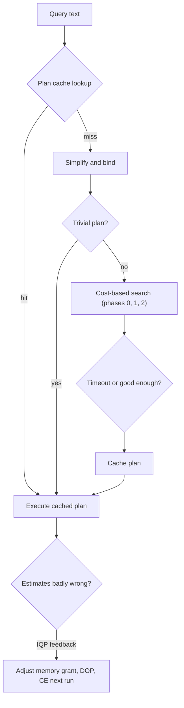

**Hands-on.**

```sql
-- Compilation cost visible
SET STATISTICS TIME ON;      -- "SQL Server parse and compile time"
SELECT OrderId FROM dbo.Orders WHERE OrderId = 12345;   -- trivial plan

-- Ad hoc vs parameterized: how many plan-cache entries for "the same" query?
DBCC FREEPROCCACHE;   -- LAB ONLY. Never on production; use DBCC FREEPROCCACHE(plan_handle) or sp_recompile surgically.
SELECT COUNT(*) FROM dbo.Orders WHERE CustomerId = 5;
SELECT COUNT(*) FROM dbo.Orders WHERE CustomerId = 6;
SELECT cp.usecounts, cp.objtype, st.text
FROM sys.dm_exec_cached_plans cp CROSS APPLY sys.dm_exec_sql_text(cp.plan_handle) st
WHERE st.text LIKE '%FROM dbo.Orders WHERE CustomerId%' AND st.text NOT LIKE '%dm_exec%';
-- Typically "Prepared" (simple parameterization) shows one entry with usecounts=2 for trivial shapes; otherwise 2 "Adhoc" entries.

-- Detect single-use plan bloat
SELECT objtype, COUNT(*) plans, SUM(size_in_bytes)/1048576 AS mb
FROM sys.dm_exec_cached_plans WHERE usecounts = 1 GROUP BY objtype;
EXEC sys.sp_configure 'optimize for ad hoc workloads', 1; RECONFIGURE;  -- stores a stub first time; cuts bloat
```

```csharp
// EF Core always parameterizes values → plan reuse. The classic anti-pattern is concatenating SQL:
// BAD  (plan per literal + SQL injection): db.Orders.FromSqlRaw("SELECT * FROM dbo.Orders WHERE ExternalRef = '" + input + "'")
// GOOD (FromSql with an interpolated string becomes a real SQL parameter):
var good = await db.Orders.FromSql($"SELECT * FROM dbo.Orders WHERE ExternalRef = {input}").ToListAsync();
```

**Real-world.** Multi-tenant SaaS with a unique SQL string per tenant (tenant id concatenated) → plan cache holds hundreds of thousands of near-identical plans, constant compile CPU, evictions of useful plans. Fix: parameterize; consider `optimize for ad hoc workloads`; as a last resort, forced parameterization (a database-level setting with its own risks — it can *introduce* sniffing).

**When not / trade-offs.** Forcing plans or recompile-everything is a blunt instrument: recompile every execution costs CPU and removes reuse benefits; plan forcing (Query Store) can become stale when data changes.

**Mistakes.** Using `DBCC FREEPROCCACHE` in production; assuming the query "is cached so it is optimal"; ignoring `TimeOut` early-abort; `SET` option differences between SSMS and the application creating separate plan entries (see scenario in [chapter 28](#28-scenario-based-questions)).

**Performance / security / Azure.** Parameterization is both a performance *and* security feature (injection). In Azure SQL, **Automatic Plan Correction** (Automatic Tuning `FORCE_LAST_GOOD_PLAN`) detects a plan regression using Query Store and forces the previous plan — verify it is enabled and check `sys.dm_db_tuning_recommendations`.

**Troubleshooting.** Compile storm → `sys.dm_os_performance_counters` (`SQL Compilations/sec` vs `Batch Requests/sec`, healthy ratio is low), `sys.dm_exec_query_stats` `creation_time` clustering, plan-cache single-use stats above.

**Related.** [Chapter 3](#3-execution-plans-estimated-versus-actual), [10](#10-parameter-sniffing-and-parameter-sensitive-plans), [16](#16-stored-procedure-optimization).

### Interview Q&A — chapter 2

**Q: Why are plans cached and what invalidates them?**
A: Optimization is CPU-expensive; most OLTP statements repeat. Caching amortizes the compile cost. Plans are recompiled when stats change enough, schema changes, relevant `SET` options differ, `RECOMPILE` is requested, the plan is evicted under memory pressure, or the server restarts / failover occurs.

**Q: A query has a timeout in its plan's optimization reason. Does it matter?**
A: Yes — the optimizer ran out of budget and returned the best plan found so far. For many-join queries the plan can be mediocre; simplify the query (materialize intermediate results, break it up), add statistics, or reduce join complexity.

*Follow-ups.* "How is a trivial plan different from a cheap plan?" → trivial skips exploration entirely; cheap is a *cost* judgement after exploration. "Does a stored procedure get its own optimizer?" → no; it is just a batch whose statements are compiled and cached per procedure, with the parameter values at first compile used for estimates.

---

## 3. Execution plans, estimated versus actual

**Simple idea.** A plan is the engine's route map. The **estimated** plan is the route chosen from *predictions*. The **actual** plan is the same route annotated with *what really happened*. The gap between the two is where almost all tuning insight lives.

**Architect depth.**

- **Estimated plan** (`SET SHOWPLAN_XML ON` or Ctrl+L): compiled but *not executed*. Shows estimated rows, cost, operators. Cheap and safe on production for a long-running statement.
- **Actual plan** (`SET STATISTICS XML ON` or Ctrl+M): executed; adds **actual rows**, **actual executions**, **actual elapsed/CPU per operator** (2016 SP1+ in lightweight form), memory grant used vs granted, spill warnings, wait stats per plan (2016+), and `ActualExecutionMode` (Row/Batch).
- **Cost percentages are estimates** even in an actual plan — "this operator is 90% of the cost" can be *wrong* if its estimate was wrong. Trust actual rows, actual time and logical reads, not cost%.
- **Reading order.** Data flows right → left (leaves to root), but logically the plan *starts* at the top-left operator which pulls from the right. Arrow thickness reflects row counts.
- **What to scan for first:**
  1. **Estimated vs actual rows** — a 100× gap on any operator means a statistics, parameter or predicate problem.
  2. **Warnings** — yellow triangles: spills to tempdb (`Sort`/`Hash` spill), implicit conversion (`CONVERT_IMPLICIT` in a seek predicate), missing statistics, no join predicate, residual predicate on a scan.
  3. **Scans on big tables**, **Key Lookups with high executions**, **Nested Loops with a huge outer input**, **Sort** (non-covering order), **Eager Spool**, **Table Spool** repeating.
  4. **Memory grant** — `GrantedMemory` vs `MaxUsedMemory` (wasted vs spilling).
  5. **Parallelism** — skewed row distribution across threads; `CXCONSUMER`/`CXPACKET` waits are usually benign, a *thread that does everything* is not.
  6. **Seek Predicates vs Predicate** on a seek/scan: a Predicate (residual) is applied *after* reading rows — the index is helping less than you think.
- **Live Query Statistics / `sys.dm_exec_query_statistics_xml`** show a *running* query's actual progress — the way to diagnose "it has been running for 20 minutes".
- **Lightweight profiling and last actual plan.** `ALTER DATABASE SCOPED CONFIGURATION SET LAST_QUERY_PLAN_STATS = ON` then `sys.dm_exec_query_plan_stats(plan_handle)` returns the last *actual* plan for a cached query without anyone attaching a debugger — priceless in production.

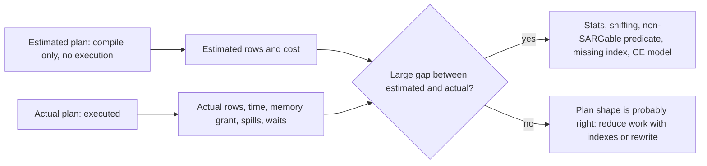

**Hands-on.**

```sql
SET STATISTICS IO, TIME ON;

-- No supporting index on CustomerId yet: expect a clustered index scan of ~2M rows
SELECT OrderId, OrderDate, TotalAmount
FROM dbo.Orders
WHERE CustomerId = 4242;
-- STATISTICS IO: Table 'Orders'. Scan count 1, logical reads ~ (number of pages in the table)

-- Get the actual plan of a cached statement later without re-running it
ALTER DATABASE SCOPED CONFIGURATION SET LAST_QUERY_PLAN_STATS = ON;
SELECT TOP 5 qs.execution_count, p.query_plan
FROM sys.dm_exec_query_stats qs
CROSS APPLY sys.dm_exec_query_plan_stats(qs.plan_handle) p
ORDER BY qs.last_execution_time DESC;

-- Find plans with implicit conversions or missing indexes in the cache
SELECT TOP 20 qs.total_logical_reads, qp.query_plan
FROM sys.dm_exec_query_stats qs CROSS APPLY sys.dm_exec_query_plan(qs.plan_handle) qp
WHERE CAST(qp.query_plan AS NVARCHAR(MAX)) LIKE '%CONVERT_IMPLICIT%'
ORDER BY qs.total_logical_reads DESC;
```

```csharp
// Make the actual SQL and its cost visible from the app: log slow commands and tag queries for correlation.
var q = db.Orders.TagWith("OrdersByCustomer: GET /api/customers/{id}/orders")   // appears as a comment in SQL and in Query Store text
               .Where(o => o.CustomerId == id)
               .Select(o => new { o.OrderId, o.OrderDate, o.TotalAmount });
Console.WriteLine(q.ToQueryString());   // shows parameterized SQL EF will send
```

**Real-world.** A team "fixed" a slow query by adding the index SSMS's green hint suggested; the plan still scanned because the predicate wrapped the column in `ISNULL()`. The actual plan showed `Predicate` (residual) on the scan — the signal that the index could not be sought.

**When not / limitations.** Estimated plans can differ from what runs (parameter values, temp tables not created yet, table variables, runtime IQP adjustments). Plans don't show *blocking* — a "fast plan, slow query" is a wait problem, not a plan problem.

**Mistakes.** Optimizing by cost%; trusting the missing-index hint blindly (it ignores existing indexes and write cost and column order is naive); comparing plans from different parameter values without noting sniffing; reading elapsed times from a cold cache.

**Performance / security / Azure.** Plans contain literal values and object names — treat as sensitive when sharing. In Azure SQL, Query Store captures runtime stats and plans per interval; the *Query Performance Insight* and *Regressed Queries* views are your first stop.

**Troubleshooting.** Capture the plan **for the parameter values that were slow**, not for a "typical" value. Query Store stores the compile-time parameters in the plan XML (`ParameterCompiledValue`) alongside `ParameterRuntimeValue` in actual plans.

**Related.** [Chapter 9](#9-statistics-and-cardinality-estimation), [10](#10-parameter-sniffing-and-parameter-sensitive-plans); Part 2 — Query Store and plan analysis.

### Interview Q&A — chapter 3

**Q: Estimated versus actual — when do they differ and why does it matter?**
A: The estimated plan is built from statistics and the parameter values at compile time; the actual plan is the executed plan with real counts. Gaps reveal cardinality-estimation errors: stale/low-sample stats, skew, correlated predicates, table variables (pre-2019), multi-statement TVFs, non-SARGable predicates, or parameter sniffing. Bad estimates choose the wrong join type, wrong access method, undersized memory grants (spills).

**Q: A plan operator shows 85% cost but runs in 10 ms. What do you do?**
A: Ignore the percentage — cost is an estimate. Check actual elapsed time per operator, actual rows and logical reads. Tune what is *measured* to be expensive.

*Follow-ups.* "Can a query have a good plan and still be slow?" → yes: blocking (`LCK_M_*`), slow client consuming rows (`ASYNC_NETWORK_IO`), log flush (`WRITELOG`), memory grant queue (`RESOURCE_SEMAPHORE`). "How do you get the actual plan from production without running the query?" → `LAST_QUERY_PLAN_STATS` + `dm_exec_query_plan_stats`, Query Store runtime stats, or an Extended Events `query_post_execution_showplan` session on a narrow filter (expensive — use sparingly).

---

## 4. Cost-based query optimization

**Simple idea.** The optimizer doesn't know the fastest plan; it *estimates* the cost of many plans using table statistics and picks the cheapest. Wrong statistics → wrong estimate → wrong plan. It optimizes for *its model of cost*, not wall-clock time.

**Architect depth.**

- **Inputs:** statistics (row counts, histograms, density), constraints (PK/FK/unique/check — *trusted* ones enable transformations), indexes available, hardware hints (CPU count, memory), SET options, hints, compatibility level (which **cardinality estimator** version).
- **Cost model:** each operator has a CPU and I/O cost formula calibrated on a reference machine decades ago. Costs are **unitless**, relative, and assume cold cache by default (I/O costs dominate), which biases toward plans that minimize page reads. It does *not* model contention, blocking, network or your SSD.
- **Row goals.** `TOP`, `EXISTS`, `FAST n` make the optimizer prefer plans that produce the first rows quickly (nested loops) — correct when the assumed distribution holds, disastrous when matching rows are rare (the engine scans far more than estimated to find them).
- **Search.** Transformation-rule-based exploration of a "memo" of equivalent plans with pruning. Joins with many tables explode the search space → timeouts → mediocre plans.
- **Why bad estimates → bad plans.** Join-type choice is sensitive: nested loops are cheap for small outer inputs but catastrophic for large ones; hash joins need memory grants; an under-estimated hash input spills. Index choice flips between seek+lookup and scan at the **tipping point** ([chapter 8](#8-key-lookups-and-bookmark-lookups)).
- **Hints** override the optimizer: `OPTION (RECOMPILE)`, `OPTIMIZE FOR`, `FORCESEEK`, `USE HINT('...')`, join hints (`LOOP/HASH/MERGE JOIN`), `MAXDOP`, index hints (`WITH (INDEX(...))`), `FORCE ORDER`. They fix *a* plan but freeze a decision as data changes and bypass IQP adaptivity. Prefer in order: (1) fix statistics/indexes/query shape, (2) Query Store hints or plan forcing (no code change), (3) query-level hints, (4) plan guides.

**Hands-on.**

```sql
-- Optimizer view of cost: compare two shapes by IO, not by cost %
SET STATISTICS IO ON;
SELECT COUNT(*) FROM dbo.Orders WHERE Status = 2;                    -- scan
SELECT COUNT(*) FROM dbo.Orders WITH (INDEX(PK_Orders)) WHERE Status = 2;  -- same, forced

-- Query-level USE HINT options (2016 SP1+) are safer than trace flags
SELECT OrderId FROM dbo.Orders WHERE CustomerId = 1
OPTION (USE HINT('FORCE_LEGACY_CARDINALITY_ESTIMATION'));            -- A/B test the old CE (model 70)
SELECT OrderId FROM dbo.Orders WHERE CustomerId = 1
OPTION (USE HINT('DISABLE_PARAMETER_SNIFFING'));                      -- like OPTIMIZE FOR UNKNOWN for this query

-- Cost threshold and MAXDOP are server/database knobs
EXEC sp_configure 'cost threshold for parallelism', 50; RECONFIGURE;   -- default 5 is a 1990s number
ALTER DATABASE SCOPED CONFIGURATION SET MAXDOP = 8;                    -- per database; align to NUMA/core guidance
```

**Real-world.** A `SELECT TOP (20) ... WHERE Status = 3 ORDER BY OrderDate DESC` on a table where Status 3 is rare: the optimizer assumes matches are evenly spread, picks an ordered scan on `OrderDate` expecting to find 20 matches quickly, and reads half the table. Fix: composite index `(Status, OrderDate DESC)` or `OPTION (DISABLE_OPTIMIZER_ROWGOAL)`.

**When to use hints / when not.** Use when you have *proven* the optimizer's model is wrong for a specific query and a durable fix (stats/index/rewrite) is impractical. Don't sprinkle `NOLOCK`/`FORCESEEK`/join hints as folklore: they are technical debt that outlives the data distribution that justified them.

**Trade-offs.** Hint = predictability now, fragility later. Recompile = fresh estimates, CPU every call. Forced plan = stability, but can't adapt (and fails silently if the forced plan becomes invalid — monitor `force_failure_count`).

**Mistakes.** Treating the optimizer as buggy rather than misinformed; adding `MAXDOP 1` globally to "fix" parallelism waits; blanket `WITH (NOLOCK)`; using `FORCE ORDER` and then adding tables.

**Performance / reliability / security / Azure.** In Azure SQL Database, cost threshold/MAXDOP for the *database* are scoped configuration; the service-tier vCores cap actual parallelism. Query Store hints (`sys.sp_query_store_set_hints`) let you apply `USE HINT` without changing the application — ideal for third-party apps and EF-generated SQL.

**Troubleshooting.** To see *why* the optimizer chose something: compare estimated vs actual rows, check `OptimizerStatsUsage` in the plan XML (which stats, last update, sampling), check `StatementOptmEarlyAbortReason`, `CardinalityEstimationModelVersion`, and `QueryTimeStats`.

**Related.** [Chapter 9](#9-statistics-and-cardinality-estimation), [10](#10-parameter-sniffing-and-parameter-sensitive-plans).

### Interview Q&A — chapter 4

**Q: Why would the optimizer pick a "bad" plan?**
A: It optimizes estimated cost from statistics, not actual time. Causes: stale or sampled stats, skew the histogram cannot represent, correlated predicates assumed independent, parameter sniffing, table variables/MSTVFs (fixed or deferred estimates), non-SARGable predicates hiding the column, row-goal assumptions, optimizer timeout on complex joins, or a cost model that doesn't match your hardware.

**Q: When is a hint acceptable?**
A: When the diagnosis is proven, the data pattern is stable, there's a regression test or monitoring (Query Store) around it, and a durable fix isn't feasible — and it is documented with the reason and a review date.

*Follow-ups.* "Hash join vs nested loops: when does each win?" → nested loops for small outer input with an index on the inner; hash join for large unsorted inputs (needs memory); merge join when both inputs are sorted on the join key. "What does `OPTIMIZE FOR UNKNOWN` do?" → uses average density rather than a specific value; stable but mediocre for skewed data.

---
## 5. Index fundamentals

**Simple idea.** An index is a sorted copy of some columns that lets the engine jump to rows instead of reading the whole table — like a book index versus reading every page. Every index speeds some reads and slows every write that touches its columns.

**Architect depth.**

- **B+tree structure.** Root → intermediate levels → **leaf**. Each level is a doubly linked list of 8 KB pages. For a 2M-row table a seek is typically 3–4 page reads (tree depth), regardless of table size — that is *why* indexes scale logarithmically.
- **Clustered index.** Defines the physical order of the table; its leaf level *is* the data. One per table. Good clustering keys are **narrow, static, unique, ever-increasing** (identity/sequence/`NEWSEQUENTIALID()`), because the key is copied into *every* non-clustered index as the row locator. A wide or random key (random `GUID`, `NEWID()`) bloats all indexes and causes page splits and fragmentation. A table without a clustered index is a **heap** (rows found via RID; forwarded records; usually only right for staging/bulk-load tables).
- **Non-clustered index.** Separate B+tree: key columns (sorted) + clustering key (or RID) + optional `INCLUDE` columns at the leaf. Up to 999 per table in theory; in practice every one costs space, memory, log and lock work on writes.
- **Composite index.** Sorted by the first key column, then the second within it, and so on. Rules of thumb:
  1. **Equality columns first, then the range/sort column** — `WHERE CustomerId = @c AND OrderDate >= @d ORDER BY OrderDate` → `(CustomerId, OrderDate)`.
  2. Selectivity matters *for the leading column when it is the only one used*, but equality-then-range beats "most selective first" when queries use both.
  3. An index on `(A,B)` serves `WHERE A=…` and `WHERE A=… AND B=…`, **not** `WHERE B=…` alone (no seek; at best a scan).
  4. `ORDER BY` can be satisfied *for free* if the index order matches (including direction) after the equality prefix.
- **Covering index.** An index that contains *every column the query needs* (key + `INCLUDE`) so no lookup to the base table is needed. `INCLUDE` columns live only at the leaf, aren't sorted, and don't count toward the 900-byte (clustered) / 1700-byte (non-clustered) key limit.
- **Filtered index.** `WHERE` clause on the index: small, cheap, perfect for skewed/sparse data (`WHERE Status = 0` for "open" orders, `WHERE DeletedAt IS NULL`). Caveats: query predicate must *imply* the filter; with parameters the optimizer often can't prove it (use `OPTION (RECOMPILE)` or literal values); filtered-index statistics only describe the filtered rows.
- **Unique index.** Enforces uniqueness *and* gives the optimizer cardinality certainty (at most one row), enabling better plans and join elimination. Prefer a unique constraint/index to an app-level check — races defeat the latter.
- **Columnstore (at a glance).** Column-oriented, compressed, batch-mode — for analytics/scans on large facts (10–100× compression, big scan speedups). Nonclustered columnstore on an OLTP table gives real-time operational analytics at some write cost; clustered columnstore suits warehouse tables. Not a point-lookup tool.
- **Index design methodology.** (1) Capture the **workload** (Query Store top consumers by reads/CPU, not guesses). (2) Index for the *queries that matter*: predicates, joins, ordering, covering. (3) Consolidate overlapping indexes (`(A)` is redundant if `(A,B)` exists, unless uniqueness or filtered). (4) Check **write cost** (INSERT/UPDATE/DELETE touch each index). (5) Check **usage** (`sys.dm_db_index_usage_stats`, reset on restart — observe over a business cycle). (6) Validate with logical reads before/after. (7) Remove unused indexes.

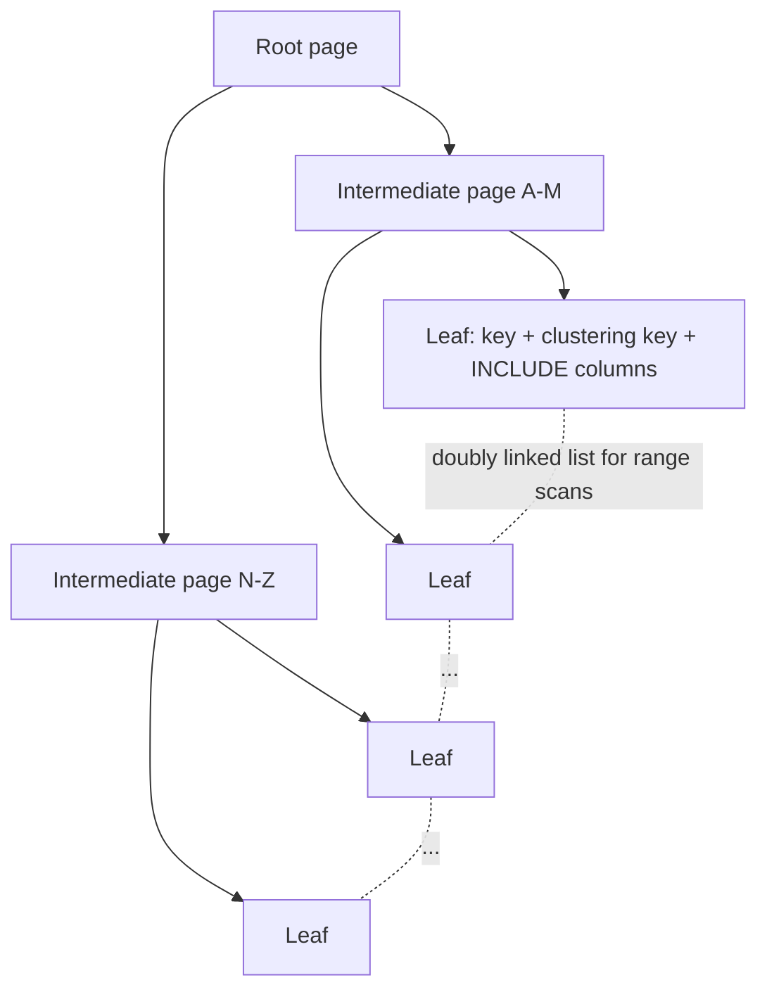

**Hands-on.**

```sql
SET STATISTICS IO ON;

-- Baseline: no index on CustomerId → clustered index scan
SELECT OrderId, OrderDate, TotalAmount FROM dbo.Orders WHERE CustomerId = 4242;      -- reads ≈ all table pages

-- 1) Plain NC index: seek, but needs Key Lookups for OrderDate/TotalAmount
CREATE NONCLUSTERED INDEX IX_Orders_CustomerId ON dbo.Orders (CustomerId);
SELECT OrderId, OrderDate, TotalAmount FROM dbo.Orders WHERE CustomerId = 4242;      -- seek + lookups

-- 2) Composite + INCLUDE = covering for the dashboard query (equality, then range/sort)
DROP INDEX IX_Orders_CustomerId ON dbo.Orders;
CREATE NONCLUSTERED INDEX IX_Orders_Customer_Date
    ON dbo.Orders (CustomerId, OrderDate DESC) INCLUDE (TotalAmount, Status);
SELECT TOP (20) OrderId, OrderDate, TotalAmount, Status
FROM dbo.Orders WHERE CustomerId = 4242 ORDER BY OrderDate DESC;                     -- seek, no sort, no lookup, ~3-5 reads

-- 3) Filtered index for the hot subset (open orders are ~25% here; real systems often <1%)
CREATE NONCLUSTERED INDEX IX_Orders_Open ON dbo.Orders (OrderDate) INCLUDE (CustomerId, TotalAmount) WHERE Status = 0;

-- 4) Unique index as a business rule
CREATE UNIQUE NONCLUSTERED INDEX UX_Orders_ExternalRef ON dbo.Orders (ExternalRef) WHERE ExternalRef IS NOT NULL;

-- Usage vs write cost: read/seek counts vs updates per index
SELECT OBJECT_NAME(i.object_id) tbl, i.name idx, s.user_seeks, s.user_scans, s.user_lookups, s.user_updates
FROM sys.indexes i
LEFT JOIN sys.dm_db_index_usage_stats s ON s.object_id = i.object_id AND s.index_id = i.index_id AND s.database_id = DB_ID()
WHERE OBJECTPROPERTY(i.object_id,'IsUserTable') = 1 AND i.type > 0
ORDER BY (ISNULL(s.user_seeks,0)+ISNULL(s.user_scans,0)+ISNULL(s.user_lookups,0)) ASC;   -- unused/expensive at the top

-- Missing-index DMV: a *hint* generator, not a design tool
SELECT TOP 10 d.statement, d.equality_columns, d.inequality_columns, d.included_columns,
       s.user_seeks, s.avg_total_user_cost, s.avg_user_impact
FROM sys.dm_db_missing_index_details d
JOIN sys.dm_db_missing_index_groups g ON g.index_handle = d.index_handle
JOIN sys.dm_db_missing_index_group_stats s ON s.group_handle = g.index_group_handle
ORDER BY s.user_seeks * s.avg_total_user_cost * s.avg_user_impact DESC;
```

```csharp
// EF Core 10 model: index shape belongs in code so migrations carry it
modelBuilder.Entity<Order>(e =>
{
    e.HasIndex(o => new { o.CustomerId, o.OrderDate })
     .IsDescending(false, true)                                  // (CustomerId ASC, OrderDate DESC)
     .IncludeProperties(o => new { o.TotalAmount, o.Status })    // covering
     .HasDatabaseName("IX_Orders_Customer_Date");

    e.HasIndex(o => o.ExternalRef).IsUnique()
     .HasFilter("[ExternalRef] IS NOT NULL");                    // filtered unique
});

// Online index creation on a big table (Enterprise/Azure SQL): emit through a migration
// migrationBuilder.CreateIndex(..., ).Annotation("SqlServer:Online", true);
```

**Real-world.** An orders API's "recent orders per customer" endpoint went from 1.2 s to 4 ms by replacing a single-column index (seek + 400 lookups) with `(CustomerId, OrderDate DESC) INCLUDE (...)`. Cost: +180 MB and ~8% slower inserts — acceptable for a read-heavy endpoint, unacceptable if it were a write-heavy ingest table.

**When not to index.** Tiny tables (a scan is one page); low-selectivity columns alone (a `Status` with 4 values — unless filtered or composite); write-dominated ingestion tables; columns constantly updated; "just in case".

**Advantages / disadvantages.** Reads get logarithmic access, ordering, uniqueness; writes pay per index, storage and memory grow, more objects to maintain, higher log volume (matters for HA replication and Azure log-rate governance).

**Mistakes and anti-patterns.** Index per column ("index everything"); duplicate/overlapping indexes; wide clustered key; random GUID clustered PK on a hot insert table; leaving the missing-index DMV suggestions applied verbatim; columns in the wrong order; low-cardinality leading column without a reason; forgetting FK-supporting indexes (slow deletes and joins, and blocking on the parent); over-reliance on INCLUDE making an index a second copy of the table.

**Performance / scalability / reliability / security.** Index count is a write-amplification dial. On Always On or Azure geo-replication, more indexes → more log → more replica lag. **Online** and **resumable** index operations (Enterprise/Azure SQL) avoid long exclusive locks. Indexes copy data: columns protected with Always Encrypted/Dynamic Data Masking still appear in indexes — consider what you INCLUDE.

**Troubleshooting.** Slow after "adding an index": check the optimizer actually uses it (usage stats, plan), that statistics exist, and that the predicate is SARGable ([chapter 12](#12-sargable-versus-non-sargable-queries)). Slow writes: `user_updates` vs `user_seeks`, `sys.dm_db_index_operational_stats` (leaf allocation = splits, lock waits, latch contention).

**Related.** [Chapters 7](#7-index-seeks-versus-index-scans), [8](#8-key-lookups-and-bookmark-lookups), [9](#9-statistics-and-cardinality-estimation); [Part 2 — partitioning and index alignment](02-database-architecture-scaling-and-troubleshooting.md).

### Interview Q&A — chapter 5

**Q: Clustered vs non-clustered — what is the real difference?**
A: A clustered index *is* the table, stored in key order, one per table. A non-clustered index is a separate sorted structure pointing back to the row via the clustering key (or RID). Because the clustering key is embedded in every non-clustered index, its width and stability affect the size and maintenance cost of the whole set.

**Q: Why equality columns before range columns in a composite index?**
A: After a range predicate on column N, rows are no longer ordered by columns after N within the range, so later columns can't be seeked. Putting equality columns first gives one contiguous slice to which the range then applies and which is already in the order the query often needs.

**Q: What is a covering index, and what is the cost?**
A: One whose key+INCLUDE columns satisfy the whole query, eliminating lookups. Cost is extra storage, memory and write overhead; return on investment is highest for hot, read-mostly queries with a small projected column set.

*Follow-ups.* "Is a GUID clustered PK always bad?" → random GUIDs cause page splits and fragmentation and bloat NC indexes; sequential GUIDs (`NEWSEQUENTIALID`, or app-generated UUIDv7 / COMB) mitigate, but a 16-byte key is still wider than an int/bigint. "When is a heap appropriate?" → staging/ETL landing, append-only loads; avoid for tables with updates (forwarded records) or lookups. "How many indexes is too many?" → when write cost/log growth/maintenance outweigh read benefit; measure per-index benefit.

---

## 6. Index fragmentation and maintenance

**Simple idea.** As rows are inserted, updated and deleted, index pages get half-empty (**internal** fragmentation) and logically-adjacent pages end up far apart on disk (**external** fragmentation). Maintenance re-packs them. Its value is smaller than folklore claims, and statistics matter more than defragmentation.

**Architect depth.**

- **Page splits.** Insert into a full page → engine splits it, ~50% full pages and out-of-order allocation. Random keys (GUIDs), variable-length column growth and updates that don't fit cause them. Splits are expensive (extra log, latching) *when they happen*; the fragmentation is merely the leftover.
- **Internal fragmentation (page density)** wastes buffer pool and I/O: a half-empty page is read to retrieve half the rows. **External fragmentation** hurts **read-ahead and range scans on spinning disks**; on SSD/Premium storage or when data is mostly in memory, its impact is small.
- **Measuring.** `sys.dm_db_index_physical_stats` (LIMITED/SAMPLED/DETAILED) reports `avg_fragmentation_in_percent`, `avg_page_space_used_in_percent`, `page_count`. Ignore indexes under ~1,000 pages. The old "5–30% reorganize, >30% rebuild" is a guideline, not a law.
- **REORGANIZE.** Online, compacts and reorders leaf pages in place, always interruptible, minimal log, does **not** update statistics.
- **REBUILD.** Creates a new copy; resets fill factor; **updates statistics with a full scan** (for that index); can be `ONLINE = ON` (Enterprise/Azure SQL; with `RESUMABLE = ON` to pause/resume, and `MAX_DURATION`), `MAXDOP`, `SORT_IN_TEMPDB`. Heavy log generation and, on AG/Azure geo-replication, a replication-lag source.
- **Fill factor / PAD_INDEX.** Leave free space (e.g. 90) on pages for indexes with *random inserts/updates* to delay splits. Default 100 is right for append-only/read-only. Too-low fill factor on everything wastes memory.
- **Statistics are usually the real win.** Many "maintenance fixed it" cases are rebuild's side effect of a fresh full-scan statistics update. If you have a limited maintenance window, **update statistics** (targeted, with adequate sample) is higher-value than rebuilding every index nightly.
- **Tooling.** Ola Hallengren's *IndexOptimize* (de facto standard: thresholds, online, stats, logging); Azure SQL Database also offers Automatic Tuning index management (create/drop recommendations), but you own fragmentation maintenance in general (some services handle none of it for you).

```sql
-- What is actually fragmented and big enough to care about?
SELECT OBJECT_NAME(ips.object_id) AS tbl, i.name AS idx, ips.index_type_desc,
       ips.avg_fragmentation_in_percent, ips.avg_page_space_used_in_percent, ips.page_count
FROM sys.dm_db_index_physical_stats(DB_ID(), NULL, NULL, NULL, 'SAMPLED') ips
JOIN sys.indexes i ON i.object_id = ips.object_id AND i.index_id = ips.index_id
WHERE ips.page_count > 1000 AND ips.avg_fragmentation_in_percent > 10
ORDER BY ips.page_count DESC;

ALTER INDEX IX_Orders_Customer_Date ON dbo.Orders REORGANIZE;                          -- online, light
ALTER INDEX IX_Orders_Customer_Date ON dbo.Orders REBUILD
    WITH (ONLINE = ON, RESUMABLE = ON, MAX_DURATION = 60 MINUTES, SORT_IN_TEMPDB = ON, FILLFACTOR = 90);
-- ALTER INDEX ... PAUSE / RESUME / ABORT   -- for resumable operations

-- Stats-first approach for large tables with a small window
UPDATE STATISTICS dbo.Orders IX_Orders_Customer_Date WITH SAMPLE 20 PERCENT;
-- Ola Hallengren example (after installing the scripts):
-- EXEC dbo.IndexOptimize @Databases='PerfLab', @FragmentationLow=NULL,
--      @FragmentationMedium='INDEX_REORGANIZE', @FragmentationHigh='INDEX_REBUILD_ONLINE,INDEX_REBUILD_OFFLINE',
--      @FragmentationLevel1=10, @FragmentationLevel2=40, @UpdateStatistics='ALL', @OnlyModifiedStatistics='Y', @LogToTable='Y';
```

```csharp
// GUID keys: generate ordered values in the app to avoid random page splits
// .NET 9+: Guid.CreateVersion7() produces time-ordered UUIDv7
public class Device { public Guid Id { get; set; } = Guid.CreateVersion7(); }
// EF Core 8+ SQL Server provider can also generate sequential GUIDs for keys by convention (SequentialGuidValueGenerator).
```

**Real-world.** A team rebuilt all indexes weekly on a 3 TB database; the job blocked ETL, filled the log and lagged the AG replica. Switching to "stats nightly + rebuild only high-density-loss indexes online, resumable, off-peak" cut maintenance from 9 h to 90 min with no measurable query regression.

**When it matters / when not.** Matters for: range-scan-heavy workloads on spinning or throttled storage, indexes with low page density in the buffer pool, post bulk-delete/archival. Matters little for: SSD/Premium with mostly point seeks, small indexes, in-memory working sets.

**Trade-offs and mistakes.** Rebuild-everything-nightly; rebuild then forgetting that REORGANIZE doesn't update stats; no `ONLINE`; maintenance running during peak; ignoring log backup frequency during rebuilds (log growth); fixing fragmentation without fixing its cause (GUID PK, bad fill factor, growing varchar updates).

**Performance / reliability / Azure.** Rebuilds generate big logs → in Azure SQL they can hit **log-rate governance**; use resumable operations and throttling. Monitor AG/geo-replica lag during maintenance. In Azure SQL Database/MI you cannot tune file placement, so focus on page density and stats.

**Troubleshooting.** "Index rebuild runs forever / log full" → `sys.dm_exec_requests` (percent_complete), `sys.dm_tran_database_transactions`, `DBCC SQLPERF(LOGSPACE)`, `log_reuse_wait_desc` in `sys.databases`.

**Related.** [Chapter 5](#5-index-fundamentals), [9](#9-statistics-and-cardinality-estimation), [26](#26-long-running-transactions) (log growth).

### Interview Q&A — chapter 6

**Q: Should you rebuild indexes nightly?**
A: Not by default. Measure density and fragmentation on indexes with enough pages, prefer targeted reorganize/rebuild, make rebuilds online/resumable, and keep statistics fresh — which often delivers the actual improvement. On SSD-backed or cached workloads, external fragmentation barely matters.

**Q: REORGANIZE vs REBUILD?**
A: Reorganize is online, incremental and light but doesn't update statistics and can't change fill factor. Rebuild recreates the index (fresh stats with full scan, new fill factor), is heavier on log/IO, and offline unless `ONLINE = ON` is available.

*Follow-ups.* "What fill factor would you pick for a GUID-keyed hot table?" → below 100 (e.g. 80–90) *and* fix the key; fill factor only delays splits. "Why did queries improve after a rebuild?" → likely the stats update/plan recompile, not defrag.

---

## 7. Index seeks versus index scans

**Simple idea.** A **seek** navigates the B-tree to a specific key (or range) and reads only the rows it needs. A **scan** reads the whole index (or a large part) in order. Neither is inherently good or bad — a scan of a small table or a query returning most rows *should* be a scan.

**Architect depth.**

- **Index Seek** operators have **Seek Predicates** (used to navigate) and optionally a residual **Predicate** (filtered after rows are read). A seek can be a *singleton* (one key) or a *range seek* (start/end of a key range). A seek with a poor residual predicate can still read many rows.
- **Index Scan / Clustered Index Scan** reads every leaf page (or the ordered range). Scans can be **ordered** (follow the linked list) or **unordered** (allocation order, `NOLOCK`-ish). Predicates on a scan filter after reading.
- **When a scan wins.** The query needs a large fraction of rows (>~ a quarter to a third of pages); small tables; no usable index for the predicate; aggregates over most data; columnstore/batch mode analytics.
- **When a scan signals a problem.** Selective predicate (`WHERE Id = @x`) but a scan appears → non-SARGable expression, implicit conversion, missing index, leading-column mismatch, stale/skewed stats, or parameter sniffing picked a scan for a large-range value.
- **Reads measured, not feelings.** Compare logical reads: a seek on 3–5 pages vs a scan reading the whole table's pages is obvious in `STATISTICS IO`.
- **Seek ≠ cheap.** A seek that executes 1 million times (inner side of nested loops) is expensive: look at *actual executions* × reads per execution.

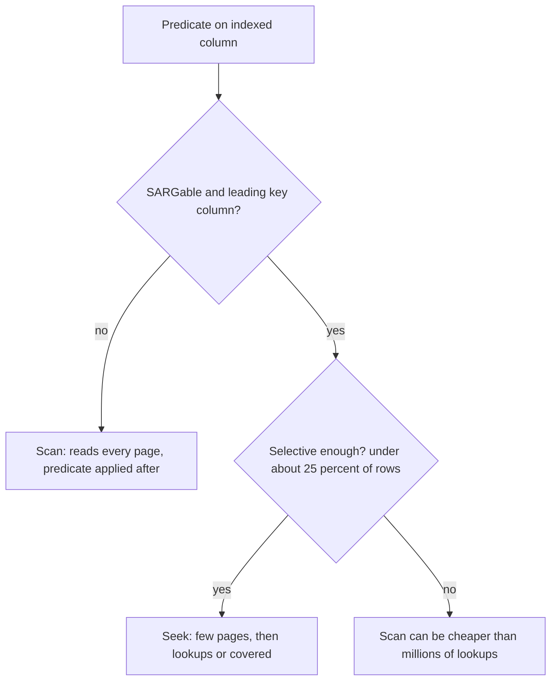

**Hands-on.**

```sql
SET STATISTICS IO ON;

-- Seek (selective) vs scan (non-selective) on the same index
SELECT COUNT(*) FROM dbo.Orders WHERE CustomerId = 4242;      -- few matches → seek on IX_Orders_Customer_Date
SELECT COUNT(*) FROM dbo.Orders WHERE CustomerId = 1;         -- ~1,000,000 matches → scan is cheaper than 1M lookups, or covering seek (range)

-- Look for the residual-predicate trap: seek on CustomerId, filter on non-indexed column afterwards
SELECT OrderId FROM dbo.Orders WHERE CustomerId = 1 AND ExternalRef = 'EXT-777';   -- seeks half the table, then filters

-- Non-SARGable → scan even though CustomerId is indexed
SELECT OrderId FROM dbo.Orders WHERE CustomerId + 0 = 4242;                         -- scan
SELECT OrderId FROM dbo.Orders WHERE CustomerId = 4242;                             -- seek
```

**Real-world.** `WHERE CAST(OrderDate AS DATE) = @d` scanned a 500M-row table every call — rewriting to `OrderDate >= @d AND OrderDate < DATEADD(DAY,1,@d)` turned 4.2M reads into 6.

**When not to worry.** Scans on tiny tables, lookup tables, or queries legitimately reading most of a table. When not to "force seek": `FORCESEEK` can make a query *slower* by forcing millions of lookups; fix the cause instead.

**Mistakes.** Treating all scans as bugs; adding indexes to chase a scan the optimizer is *right* to choose; ignoring residual predicates; comparing plans for different parameters.

**Performance / Azure.** Scans consume buffer pool and I/O (and in Azure, IOPS and log-free but read-governed budgets); a single bad scan can trigger `PAGEIOLATCH_SH` for everyone and evict hot pages.

**Troubleshooting.** Sort `sys.dm_exec_query_stats` by `total_logical_reads` and inspect plans for scans with a `Predicate` but no `Seek Predicates`; use Query Store *Top Resource Consumers* (by logical reads).

**Related.** [Chapters 5](#5-index-fundamentals), [8](#8-key-lookups-and-bookmark-lookups), [12](#12-sargable-versus-non-sargable-queries).

### Interview Q&A — chapter 7

**Q: Seek or scan — which do you want?**
A: The one that reads fewer pages for the rows required. Seeks for selective predicates; scans for large fractions. The warning signs are a scan with a selective predicate and a seek with a large residual predicate or a huge execution count.

**Q: A query uses an index seek and is still slow. Why?**
A: High number of executions (nested-loop inner side), large range read, many key lookups, residual predicate filtering most rows, blocking waits, or a slow client consuming results.

---

## 8. Key lookups and bookmark lookups

**Simple idea.** A non-clustered index finds the matching rows, but if the query needs a column that the index doesn't contain, the engine must go back to the base table **once per row** to fetch it: a **Key Lookup** (clustered table) or **RID Lookup** (heap). One lookup is cheap; a million are not.

**Architect depth.**

- **Mechanism.** NC index seek returns clustering keys (or RIDs); for each, the engine performs a seek into the clustered index (3–4 page reads) — typically random I/O. Cost scales with matching rows × tree depth.
- **The tipping point.** Because each lookup costs ~3–4 reads, once the number of matching rows exceeds roughly **one quarter to one third of the number of pages in the table**, scanning the whole table is cheaper than lookups. The optimizer switches from *seek + lookup* to *scan* around that point — which is why the same query flips plans with different parameters ([chapter 10](#10-parameter-sniffing-and-parameter-sensitive-plans)).
- **Fixes in order of preference.**
  1. Make it covering: add the missing columns as `INCLUDE`.
  2. Reduce the projected columns (no `SELECT *`, [chapter 17](#17-avoiding-unnecessary-columns-no-select-star)).
  3. Make the query more selective (extra predicate, `TOP`).
  4. Accept it if rows are few (a handful of lookups is fine).
- **Costs of "fixing" by INCLUDE-all.** Index becomes a copy of the table; write amplification. Don't include wide columns (NVARCHAR(MAX), LOB).
- **Nested-loops + lookups can be expensive *and* blocking:** each lookup takes locks on the clustered index → readers/writers collide on hot rows.
- **Not always bad.** Rare queries with few rows; low-priority paths where an index is not justified.

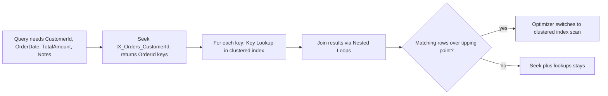

**Hands-on.**

```sql
SET STATISTICS IO ON;
CREATE NONCLUSTERED INDEX IX_Orders_CustomerId_Only ON dbo.Orders (CustomerId);

-- 50 matching orders → fine: seek + 50 lookups
SELECT OrderId, OrderDate, TotalAmount, Notes FROM dbo.Orders WHERE CustomerId = 77;

-- ~25k matches → lookups dominate reads, plan may flip to scan
SELECT OrderId, OrderDate, TotalAmount, Notes
FROM dbo.Orders WHERE CustomerId BETWEEN 1 AND 2000;

-- Fix: cover it (only if this query is hot) — Notes is NVARCHAR(400); a narrower projection is better
CREATE NONCLUSTERED INDEX IX_Orders_CustomerId_Cov ON dbo.Orders (CustomerId) INCLUDE (OrderDate, TotalAmount);
SELECT OrderId, OrderDate, TotalAmount FROM dbo.Orders WHERE CustomerId BETWEEN 1 AND 2000;   -- no lookups; Notes dropped from projection
```

```csharp
// The EF Core way to remove lookups: project only the covered columns
var rows = await db.Orders.AsNoTracking()
    .Where(o => o.CustomerId >= 1 && o.CustomerId <= 2000)
    .Select(o => new { o.OrderId, o.OrderDate, o.TotalAmount })      // matches the covering index
    .ToListAsync();
// Loading the whole entity (SELECT every column, including Notes + RowVer) forces lookups for every row.
```

**Real-world.** A support-tool grid selected `*` from a 60-column table by a non-clustered key; 40,000 matches meant 40,000 lookups (120k reads) and a plan flip to full scans under load. Fix was a 5-column projection plus a covering index — and an API contract change to stop returning unused columns.

**When not / trade-off.** Don't add INCLUDE columns for rarely-run queries; accept lookups for low-row-count queries.

**Mistakes.** Ignoring a 1000× executions count on a lookup; `SELECT *`; including very wide columns; making every index covering for every query.

**Performance / Azure.** Random reads from lookups hurt on throttled storage tiers (Azure SQL IOPS limits) and inflate `PAGEIOLATCH_SH` waits. Hyperscale and Premium reduce the penalty but don't remove it.

**Troubleshooting.** In the plan, hover the Key Lookup: *Number of Executions* and *Actual Rows*. Compare to the Index Seek rows above it. Query Store plan comparison shows the flip from seek+lookup to scan across parameter values.

**Related.** [Chapters 5](#5-index-fundamentals), [10](#10-parameter-sniffing-and-parameter-sensitive-plans), [17](#17-avoiding-unnecessary-columns-no-select-star).

### Interview Q&A — chapter 8

**Q: What's a key lookup and when is it a problem?**
A: A per-row fetch from the clustered index for columns the non-clustered index lacks. It's a problem when the row count is large (cost grows linearly) — typically visible as a high-execution lookup under a nested-loops join; fix by covering/INCLUDE, narrowing the projection, or making the predicate more selective.

**Q: Why does the optimizer sometimes scan even though an index exists?**
A: The estimated matching rows exceed the tipping point: lookups would cost more than scanning the table. That is the correct decision unless the estimate is wrong — in which case the root cause is statistics or parameter sniffing.

*Follow-ups.* "How is a RID lookup different?" → heap: uses physical row id; avoids tree traversal but suffers forwarded records. "Is a covering index always better than a lookup?" → only if the read benefit exceeds write/space cost.

---

## 9. Statistics and cardinality estimation

**Simple idea.** Statistics are the optimizer's *summary of your data* — "how many rows, how are values distributed". The **cardinality estimator (CE)** uses them to guess how many rows each step will produce. Every plan decision is built on these guesses.

**Architect depth.**

- **What a statistics object holds.** A **histogram** (up to 200 steps) on the *leading column* only, with per-step `RANGE_HI_KEY`, `EQ_ROWS`, `RANGE_ROWS`, `DISTINCT_RANGE_ROWS`, `AVG_RANGE_ROWS`; a **density vector** (1 / distinct values) for each column *prefix*; row count; and metadata (updated date, sampling rate, modification counter).
- **Creation.** Created automatically for index keys and (with `AUTO_CREATE_STATISTICS`) for predicate columns; you can create **multi-column** and **filtered** statistics manually (helps correlated predicates and skewed subsets).
- **Auto-update.** Triggered when the **modification counter** passes a threshold: legacy rule `500 + 20% of rows`; with database compat level 130+ a dynamic threshold ~`√(1000 × rows)` — much more responsive on big tables. With `AUTO_UPDATE_STATISTICS_ASYNC` queries use the stale stats while an update runs in the background (avoids waiting; accepts one more bad plan).
- **Sampling.** Default sample is small on large tables (it scales down), so rare values or skew can be missed. `FULLSCAN` or an explicit `SAMPLE n PERCENT`, or `PERSIST_SAMPLE_PERCENT`, gives stable quality at higher cost.
- **The ascending key problem.** Inserting new, larger-than-histogram values (e.g. today's `OrderDate`): the histogram's last step doesn't know them → estimates of 1 row for the most recent (hot!) data → nested loops where hash/scan was needed. Newer CE (120+) mitigates with a default-density assumption for out-of-range values; still update stats on ascending columns frequently for hot tables.
- **CE models.** Legacy CE (compat < 120, "70") assumes **independence** of predicates and uses simple containment. The new CE (compat ≥ 120) assumes **exponential backoff** for correlated predicates and different join containment. Neither is "right"; upgrading compat level changes estimates — **always test with Query Store** (set `LEGACY_CARDINALITY_ESTIMATION` or `USE HINT` for A/B) and use CE feedback (2022) where available.
- **Estimation hard spots.** Local variables (average density, not value), table variables (pre-2019 fixed 1 row; 2019+ deferred compile uses actual count), multi-statement TVFs (fixed 100 / 1), expressions on columns (`WHERE YEAR(d)=2024` → guess), correlated columns, very skewed data beyond 200 histogram steps, `LIKE '%x%'`, scalar UDF results (pre-inlining), implicit conversions (histogram can't be used), cross-database/linked-server remote queries.
- **Incremental statistics** for partitioned tables (update by partition); **filtered statistics** for hot subsets; **statistics on computed columns** to make expressions estimable.

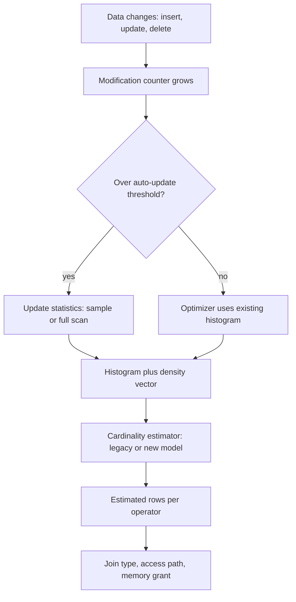

**Hands-on.**

```sql
-- Inspect: which stats exist, how stale, how sampled?
SELECT OBJECT_NAME(s.object_id) tbl, s.name, sp.last_updated, sp.rows, sp.rows_sampled, sp.modification_counter, sp.steps
FROM sys.stats s CROSS APPLY sys.dm_db_stats_properties(s.object_id, s.stats_id) sp
WHERE s.object_id = OBJECT_ID('dbo.Orders');

-- Look at the histogram the optimizer actually uses
DBCC SHOW_STATISTICS ('dbo.Orders', 'IX_Orders_CustomerId_Cov') WITH HISTOGRAM;
-- CustomerId = 1 should show EQ_ROWS ≈ 1,000,000; other keys ≈ 10. Skew visible → sniffing risk.

-- Compare estimated vs actual for a correlated predicate: CountryCode and CustomerId are correlated in this data
SELECT COUNT(*) FROM dbo.Orders WHERE CountryCode = 'US' AND CustomerId = 5;    -- check estimated vs actual rows

-- Multi-column statistics to help correlated predicates, filtered stats for a hot subset
CREATE STATISTICS ST_Orders_Country_Customer ON dbo.Orders (CountryCode, CustomerId) WITH FULLSCAN;
CREATE STATISTICS ST_Orders_Open ON dbo.Orders (OrderDate) WHERE Status = 0 WITH FULLSCAN;

-- Ascending key: update frequently on hot tail
UPDATE STATISTICS dbo.Orders (IX_Orders_Customer_Date) WITH SAMPLE 25 PERCENT;

-- Database-level policy
ALTER DATABASE PerfLab SET AUTO_UPDATE_STATISTICS_ASYNC ON;            -- trade fresh-stat wait for one stale compile
ALTER DATABASE SCOPED CONFIGURATION SET LEGACY_CARDINALITY_ESTIMATION = OFF;  -- default; ON to compare/rollback

-- Local variable vs parameter: the estimate difference is the classic demo
DECLARE @c INT = 1;
SELECT COUNT(*) FROM dbo.Orders WHERE CustomerId = @c;                 -- uses average density: wildly wrong for customer 1
SELECT COUNT(*) FROM dbo.Orders WHERE CustomerId = 1;                  -- literal: histogram → accurate
```

```csharp
// App-side: stable parameter *types* matter for histogram use. Make sure EF doesn't send the wrong type.
modelBuilder.Entity<Customer>().Property(c => c.Email).HasColumnType("varchar(200)");  // matches DB; avoids nvarchar param conversion
// Keep literal-vs-parameter behaviour in mind when you test in SSMS: SSMS with literals will not show sniffing issues the app sees.
```

**Real-world.** A nightly import added 3M rows dated "today"; the morning dashboard filtered `OrderDate >= today`. The stale histogram predicted 1 row, chose nested loops with a key lookup and ran 40 minutes. Updating statistics on that index after the load (and enabling the newer CE) fixed it permanently.

**When to manage stats manually.** Very large tables where auto-thresholds lag; ETL loads; ascending/time-series columns; skewed tables; after migrations/restores to a new SQL version (stats/CE changes). When not: small tables with auto-update — leave it.

**Pros/cons / trade-offs.** FULLSCAN = best accuracy, high cost; sampling = cheap, possible miss on skew; async update = no waits, one stale compile; multi-column/filtered stats = precision at the cost of maintenance and more objects.

**Mistakes.** Disabling `AUTO_UPDATE_STATISTICS` to "save time"; updating stats with a tiny sample on skewed data; rebuilding indexes (which full-scan) and then immediately updating stats with a *lower* sample (it overwrites the better statistics, a documented gotcha — update only the stats that weren't just rebuilt); ignoring the ascending key problem; upgrading compat level without baseline.

**Performance / reliability / security / Azure.** Statistics expose value distribution — `DBCC SHOW_STATISTICS` requires permissions and histograms can leak sample values; treat as sensitive for regulated data. Azure SQL: auto stats on by default; use Automatic Tuning/Query Store to detect CE-driven regressions after a compat-level change; Query Store makes the "change compat level safely" workflow routine.

**Troubleshooting.** Symptom → check:
- *Estimates off by 10–1000×* → `sys.dm_db_stats_properties`, `DBCC SHOW_STATISTICS`, sampling, ascending key.
- *Good in SSMS, bad in app* → parameter sniffing ([chapter 10](#10-parameter-sniffing-and-parameter-sensitive-plans)) and SET options.
- *Spills / over-large grants* → grant feedback; estimates; temp structures.

**Related.** [Chapters 3](#3-execution-plans-estimated-versus-actual), [4](#4-cost-based-query-optimization), [10](#10-parameter-sniffing-and-parameter-sensitive-plans), [14](#14-subqueries-versus-ctes) (temp tables vs table variables).

### Interview Q&A — chapter 9

**Q: How does SQL Server decide how many rows a predicate returns?**
A: It looks up the predicate's value in the column's statistics histogram (equality rows or interpolated range rows), combines per-predicate selectivities using the CE model (independence/exponential backoff), propagates through joins using density/containment assumptions, and falls back to density or guesses when the histogram can't be used.

**Q: Stats are "up to date" but the plan is still bad. Why?**
A: Sampling missed skew; correlated predicates; histogram limited to 200 steps; non-SARGable or implicit-conversion predicates; local variables/table variables/MSTVF; parameter sniffing; or an old CE assumption mismatch. "Up to date" doesn't mean "representative".

*Follow-ups.* "What happens to stats after an index rebuild vs reorganize?" → rebuild refreshes that index's stats with a full scan equivalent; reorganize does not. "How do you fix the ascending key problem?" → frequent stats updates on the tail, newer CE, filtered/incremental stats, `OPTION (RECOMPILE)` for hot queries, or designing queries so hot-range estimates don't drive join choice.

---
## 10. Parameter sniffing and parameter-sensitive plans

**Simple idea.** The first time a parameterized query or stored procedure runs, SQL Server looks at the **actual parameter values** ("sniffs" them) to estimate row counts and builds a plan that is then **reused for every later value**. If the first value was typical but a later one is very different (data skew), the cached plan is wrong for it. Sniffing is a *feature* — it gives parameter-specific estimates — that becomes a *problem* only with skewed data and shared plans.

**Architect depth.**

- **Mechanism.** At compile time the optimizer uses the parameter's value (`ParameterCompiledValue` in the plan XML) against the histogram. The plan is cached per (query, SET options, ...). Later executions reuse it with different `ParameterRuntimeValue`s; the estimates stay tied to the *compile-time* value.
- **Classic failure.** `GetOrdersByCustomer @CustomerId`:
  - compiled for customer 4242 (50 orders) → seek + key lookups, nested loops, small memory grant;
  - reused for customer 1 (1,000,000 orders) → a million lookups, spills, 20 s — or the reverse (compiled for the whale → scan/hash for everyone → every small call reads the table).
- **Not the same as "stale plan".** Data didn't change; the *value* did. And it is **not** a bug in SQL Server — it's the cost of plan reuse.
- **Why SSMS "is fast" but the app is slow.** Different **SET options** (notably `ARITHABORT` — SSMS defaults ON, many drivers historically OFF) produce **different cache entries**. Running the query in SSMS compiles a *fresh* plan for *your* values; the app is still using the old cached plan. A quick diagnostic: `SET ARITHABORT OFF` in SSMS (or query `sys.dm_exec_plan_attributes` for `set_options`) to reproduce the app's plan. The slow plan is the evidence.
- **Related terms.** *Parameter-sensitive plan problem (PSPP)* — the general class; *plan regression* — when the cached plan changes for the worse (e.g. after stats update/restart/failover); *plan stability* — the goal.
- **SQL Server 2022 / Azure SQL — PSP optimization (compat 160).** For a parameterized query with a skewed predicate, the engine creates a **dispatcher plan** and up to **three** query variants ("small", "medium", "large" boundary buckets from the histogram); each execution is routed to the variant that fits its estimated cardinality. It is *automatic* and covers equality predicates (initially) on columns with histogram skew; it does **not** cover every shape, it only helps when the skew shows up in the predicate histogram, and plans are visible in Query Store as `query_variant_query_id` linked to a `parent_query_id`.
- **Mitigation toolbox** (order from least to most invasive):
  1. **Fix the query/index shape so the plan is stable**: covering index so seek+lookup vs scan can't diverge; SARGable predicates; eliminate lookups.
  2. **Compat 160 PSP optimization** / Intelligent QP (memory grant feedback, adaptive joins).
  3. **Query Store hints** (2022 / Azure SQL): `EXEC sys.sp_query_store_set_hints @query_id, N'OPTION(RECOMPILE)'` — no app change.
  4. **Query Store plan forcing** (or **Automatic Plan Correction** in Azure SQL).
  5. **`OPTION (RECOMPILE)`** — per-execution plan; correct but burns CPU and fills `sys.dm_exec_query_stats` less usefully; right when execution frequency is low and each run is costly.
  6. **`OPTIMIZE FOR (@p = value)`** — pins a plan to a representative value (e.g. the *whale* to avoid worst-case) — fragile when data changes.
  7. **`OPTIMIZE FOR UNKNOWN` / `USE HINT('DISABLE_PARAMETER_SNIFFING')` / local-variable trick** — uses *average density*; predictable, mediocre; the "local variable" copy-trick is an obsolete form of it and hides parameter values from Query Store/DMV analysis.
  8. **Split the code path**: `IF @CustomerId IN (SELECT ... whales)` → separate procedure/statement per workload class, or **dynamic SQL** with separate plan for whale vs normal tenants (`sp_executesql`, different text).
  9. **Plan guides** (legacy; use only when you can't change the code and Query Store hints/forcing don't apply).
- **Detecting it.** Same query_id with multiple plans in Query Store whose **duration varies by orders of magnitude**; plan XML with compile value ≠ runtime value; `sys.dm_exec_query_stats` min/max elapsed time wildly apart; "fast after `sp_recompile`, slow again later".

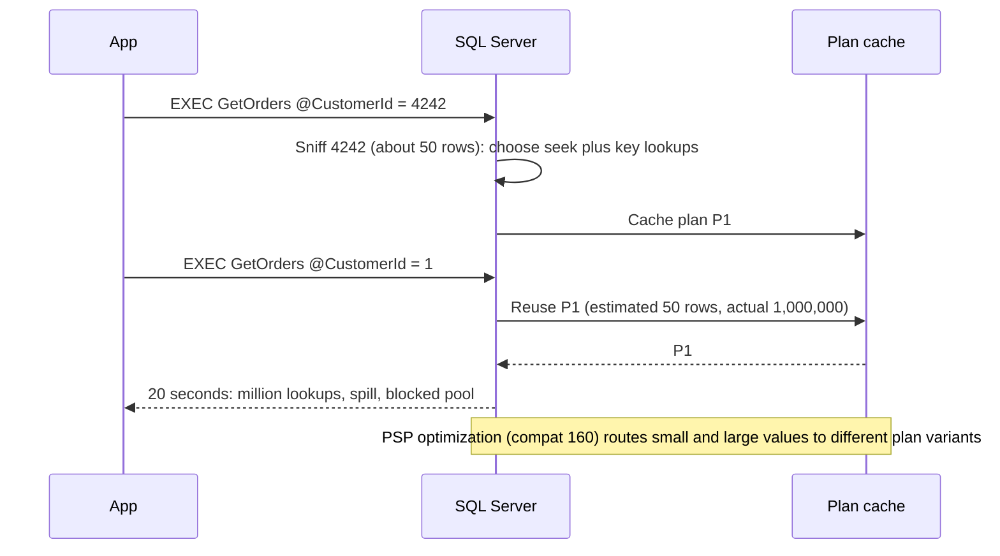

**Hands-on: reproducible demo.**

```sql
-- Index that makes the choice between "seek+lookup" and "scan" value-dependent
CREATE NONCLUSTERED INDEX IX_Orders_CustomerId_Only ON dbo.Orders (CustomerId);   -- if not already present (see chapter 8)
GO
CREATE OR ALTER PROCEDURE dbo.GetOrdersByCustomer @CustomerId INT
AS
BEGIN
    SET NOCOUNT ON;
    SELECT OrderId, OrderDate, TotalAmount, Notes
    FROM dbo.Orders
    WHERE CustomerId = @CustomerId;
END
GO
SET STATISTICS IO ON;

-- ❶ Compile for a small customer first
EXEC sys.sp_recompile 'dbo.GetOrdersByCustomer';
EXEC dbo.GetOrdersByCustomer @CustomerId = 4242;       -- seek + ~50 lookups, tiny
EXEC dbo.GetOrdersByCustomer @CustomerId = 1;          -- REUSES the lookup plan for ~1M rows: millions of reads, very slow

-- ❷ Reverse: compile for the whale first
EXEC sys.sp_recompile 'dbo.GetOrdersByCustomer';
EXEC dbo.GetOrdersByCustomer @CustomerId = 1;          -- scan (correct)
EXEC dbo.GetOrdersByCustomer @CustomerId = 4242;       -- reuses the scan: reads whole table for 50 rows

-- ❸ Mitigations (try each; compare reads and Query Store plans)
-- a. per-call recompile
ALTER PROCEDURE dbo.GetOrdersByCustomer @CustomerId INT AS
    SELECT OrderId, OrderDate, TotalAmount, Notes FROM dbo.Orders WHERE CustomerId = @CustomerId OPTION (RECOMPILE);
GO
-- b. Query Store hint without touching the code (find query_id first)
SELECT q.query_id, qt.query_sql_text FROM sys.query_store_query q
JOIN sys.query_store_query_text qt ON qt.query_text_id = q.query_text_id
WHERE qt.query_sql_text LIKE '%FROM dbo.Orders%CustomerId = @CustomerId%';
EXEC sys.sp_query_store_set_hints @query_id = 42, @query_hints = N'OPTION (USE HINT(''DISABLE_PARAMETER_SNIFFING''))';
-- c. force a known-good plan
EXEC sys.sp_query_store_force_plan @query_id = 42, @plan_id = 7;
-- d. compat 160 PSP optimization: switch the database to 160 and watch variants appear
SELECT query_id, parent_query_id, query_variant_query_id FROM sys.query_store_query WHERE query_variant_query_id IS NOT NULL;   -- *verify column names for your build*

-- Why the app is slow and SSMS fast: compare SET options of cached plans
SELECT cp.plan_handle, pa.value AS set_options
FROM sys.dm_exec_cached_plans cp
CROSS APPLY sys.dm_exec_plan_attributes(cp.plan_handle) pa
WHERE pa.attribute = 'set_options';
```

```csharp
// EF Core: sniffing appears whenever a parameterized query is reused. Options in code:
// 1) Query tag + Query Store hint (no code risk), 2) route by data class, 3) RECOMPILE via interceptor for specific tagged queries.
public class RecompileForTaggedQueries : DbCommandInterceptor
{
    public override InterceptionResult<DbDataReader> ReaderExecuting(DbCommand cmd, CommandEventData e,
        InterceptionResult<DbDataReader> r)
    {
        if (cmd.CommandText.StartsWith("-- RECOMPILE", StringComparison.Ordinal))
            cmd.CommandText += " OPTION (RECOMPILE)";
        return r;
    }
}
// usage: db.Orders.TagWith("RECOMPILE").Where(o => o.CustomerId == id) — only works if the final statement can legally take OPTION.

// Route whales to a different code path (separate plan)
var path = whaleIds.Contains(id)
    ? await db.Orders.AsNoTracking().Where(o => o.CustomerId == id).OrderByDescending(o => o.OrderDate).Take(100)
                     .Select(o => new { o.OrderId, o.OrderDate, o.TotalAmount }).ToListAsync()      // bounded result: TOP prevents the disaster
    : await db.Orders.AsNoTracking().Where(o => o.CustomerId == id).Select(o => new { o.OrderId, o.OrderDate, o.TotalAmount }).ToListAsync();
```

**Real-world.** B2B SaaS: 5% of tenants own 80% of the rows. Monday morning after a failover (cold plan cache) the first request was a tiny tenant → "small" plan → the next big-tenant request timed out, API threads piled up, health probes failed, autoscale added instances that all recompiled. Resolution: Query Store forced plan + paging (TOP) for large tenants + compat 160 PSP, plus a warm-up job after failover.

**When to use which mitigation.**
- *RECOMPILE:* low frequency, high cost per execution, truly variable plans. *Not* for hot OLTP paths (compile CPU).
- *Plan forcing:* when one plan is good for all values; monitor failure counts.
- *OPTIMIZE FOR:* when a representative value is stable.
- *Split / dynamic SQL:* when workload classes are known and stable (tenants, date ranges).
- *PSP optimization:* upgrade path; verify it triggers for your predicates; it is not a silver bullet.

**Advantages / disadvantages.** Sniffing gives specific plans per value but shares them; the mitigations trade plan quality, CPU, stability and maintainability.

**Mistakes and anti-patterns.** "Fix" by clearing the whole plan cache; global `OPTION(RECOMPILE)` everywhere; local-variable trick on every proc; `OPTIMIZE FOR UNKNOWN` as a default; ignoring that SSMS ≠ app because of SET options; not capturing the *slow parameter values*; unbounded result sets (paging missing); blaming the index when the problem is value-skew.

**Performance / scalability / reliability / security.** One bad plan under load → long queries → blocked workers/connection pool exhaustion ([chapter 27](#27-connection-pooling-and-pool-exhaustion)) → cascading API failure. Dynamic SQL branches must remain parameterized (injection).

**Azure.** Query Store is on by default; **Automatic Tuning** (`FORCE_LAST_GOOD_PLAN`) auto-detects regressions caused by plan changes (check `sys.dm_db_tuning_recommendations`); PSP is available at compat 160 in Azure SQL Database/MI (*verify current*).

**Troubleshooting checklist.** (1) Get the **slow parameter value** from the app logs/Query Store. (2) Compare plans for slow vs fast parameters. (3) Check the cached plan's compile values and SET options. (4) Apply the least invasive mitigation. (5) Add monitoring: Query Store regressed-queries alert, `max_duration/avg_duration` ratio.

**Related.** [Chapters 3](#3-execution-plans-estimated-versus-actual), [8](#8-key-lookups-and-bookmark-lookups), [9](#9-statistics-and-cardinality-estimation), [16](#16-stored-procedure-optimization), Part 2 — Query Store.

### Interview Q&A — chapter 10

**Q: Explain parameter sniffing and how you'd fix it in production.**
A: At first compile SQL Server uses the actual parameter value to estimate cardinality and caches that plan for all later values. With skewed data the plan can be wildly wrong for other values. In production I'd confirm via Query Store (one query, multiple plans or a high duration variance) and the plan's compiled-vs-runtime values; then choose the least invasive fix: a covering index/bounded query to make the plan robust, Query Store hint or forced plan, compat-160 PSP optimization, targeted `RECOMPILE` for low-frequency expensive calls, or splitting the path for known whale tenants. I'd avoid clearing the whole cache and avoid blanket hints, and I'd add alerting on plan regressions.

**Q: Why is the query fast in SSMS but slow from the application?**
A: Different SET options (ARITHABORT is the classic) create a separate plan-cache entry. SSMS compiled a fresh plan for the value I typed; the app uses a cached plan compiled for different values. Reproduce with the app's SET options or the app's actual values and compare plans.

*Follow-ups.* "Is `OPTION (RECOMPILE)` bad?" → no, it's right for rare/expensive/variable queries; it's wrong for high-frequency paths. "How does PSP optimization decide the variants?" → from the histogram boundaries of the predicate column; the dispatcher plan evaluates the parameter against low/high boundaries and routes (up to three variants); it needs the skew to be visible in statistics. "Does a stored procedure avoid sniffing?" → no; procedures sniff at first compile just like `sp_executesql`.

---

## 11. Query optimization techniques

**Simple idea.** Most slow queries are slow because they **read or move more data than needed** or because they **hide the filter from the index**. Optimization is mostly *reducing work*: fewer rows, fewer columns, fewer round trips, smarter structure.

**Architect depth — a practical order of attack.**

1. **Measure first**: logical reads, CPU, duration, and the waits ([Part 2](02-database-architecture-scaling-and-troubleshooting.md)). Fix the top consumer in Query Store, not the loudest complaint.
2. **Return less**: columns (no `SELECT *`), rows (`TOP`, paging, filters), frequency (cache, batching).
3. **Make predicates SARGable** ([chapter 12](#12-sargable-versus-non-sargable-queries)) and types match (no implicit conversions).
4. **Give the optimizer the right indexes** (equality→range→order, covering where hot) and **good statistics**.
5. **Shape the query**: `EXISTS` instead of `COUNT(*) > 0`, set-based instead of row-by-row (cursors/loops/scalar UDFs), avoid `DISTINCT` as a bug patch for join duplication, `UNION ALL` instead of `UNION` when duplicates are impossible, remove unnecessary `ORDER BY`/sorts, push filters before joins/aggregations.
6. **Use the right temp structure** (temp table with stats vs table variable vs CTE) — [chapter 14](#14-subqueries-versus-ctes).
7. **Batch writes**: set-based `INSERT ... SELECT`, `MERGE` caution, `TOP (n)` batched deletes (1,000–5,000 rows) to avoid lock escalation and log blow-up; `SqlBulkCopy` for large loads; EF Core `ExecuteUpdate/ExecuteDelete`, `AddRange` with batching.
8. **Reduce round trips**: one query returning what's needed (or a bounded few) rather than chatty calls ([chapter 18](#18-the-n-plus-1-query-problem)).
9. **Avoid hidden row-by-row work**: scalar UDFs (pre-2019), triggers, cursors, correlated subqueries evaluated per row, implicit conversions per row.
10. **Prove it**: before/after reads/CPU/duration and plan comparison; then guard with monitoring.

**Hands-on: before/after rewrites.**

```sql
SET STATISTICS IO, TIME ON;

-- (a) COUNT(*) > 0  →  EXISTS (stops at first row)
IF (SELECT COUNT(*) FROM dbo.Orders WHERE CustomerId = 1 AND Status = 0) > 0 PRINT 'has open orders';   -- counts 500k rows
IF EXISTS (SELECT 1 FROM dbo.Orders WHERE CustomerId = 1 AND Status = 0) PRINT 'has open orders';       -- first match

-- (b) UNION → UNION ALL when sets are disjoint (UNION adds a sort/distinct)
SELECT OrderId FROM dbo.Orders WHERE Status = 0 UNION ALL SELECT OrderId FROM dbo.Orders WHERE Status = 3;

-- (c) Row-by-row (cursor) vs set-based update
UPDATE o SET o.Status = 3 FROM dbo.Orders o WHERE o.Status = 0 AND o.OrderDate < DATEADD(YEAR,-1,SYSUTCDATETIME());   -- one statement (see batching below)

-- (d) Batched delete/update: avoid one huge transaction (lock escalation, log growth, blocking)
DECLARE @batch INT = 5000, @rows INT = 1;
WHILE @rows > 0
BEGIN
    DELETE TOP (@batch) FROM dbo.Orders WHERE Status = 3 AND OrderDate < DATEADD(YEAR,-2,SYSUTCDATETIME());
    SET @rows = @@ROWCOUNT;
    WAITFOR DELAY '00:00:00.050';          -- let log backups/replicas/readers breathe
END

-- (e) Aggregate early, then join (reduce rows before the join)
SELECT c.CustomerId, c.FullName, x.Total
FROM dbo.Customers c
JOIN (SELECT CustomerId, SUM(TotalAmount) AS Total FROM dbo.Orders WHERE OrderDate >= '2025-01-01' GROUP BY CustomerId) x
  ON x.CustomerId = c.CustomerId
WHERE c.CountryCode = 'DE';
```

```csharp
// EF Core 10 set-based writes (single SQL statement, no change tracking, no entity load)
await db.Orders
    .Where(o => o.Status == 0 && o.OrderDate < DateTime.UtcNow.AddYears(-1))
    .ExecuteUpdateAsync(s => s.SetProperty(o => o.Status, (byte)3));

// Batched delete helper: bounded transactions + retry-friendly
int deleted;
do
{
    deleted = await db.Orders.Where(o => o.Status == 3 && o.OrderDate < cutoff).Take(5000)
        .ExecuteDeleteAsync();                  // EF Core translates Take with ExecuteDelete into DELETE TOP (n) on SQL Server
    await Task.Delay(50);
} while (deleted > 0);

// Bulk load: SqlBulkCopy (or EFCore.BulkExtensions) beats row-by-row inserts by orders of magnitude
using var bulk = new SqlBulkCopy(connection) { DestinationTableName = "dbo.OrderItems", BatchSize = 10_000 };
await bulk.WriteToServerAsync(dataTable);
```

**Real-world.** Nightly "archive old orders" job issued one `DELETE` of 40M rows: escalated to a table lock, blocked the API for 25 minutes, filled the log, and failed with rollback that took 40 more. Batched deletes in 5,000-row transactions with log backups running finished in 70 minutes with no user impact.

**When not.** Don't micro-optimize queries that run rarely and cheaply; don't denormalize or add hints before measuring; avoid cleverness that makes SQL unreadable for little gain.

**Trade-offs.** Faster reads ↔ slower writes (indexes); batch size ↔ throughput vs blocking; `NOLOCK` ↔ fast but dirty/duplicate/missed rows (prefer RCSI — [chapter 25](#25-row-versioning)).

**Mistakes.** `NOLOCK` everywhere; `DISTINCT` to hide duplicate joins; `SELECT *`; scalar UDF in `WHERE`/`SELECT` over millions of rows; `OR` across different columns without UNION ALL rewrite; unbatched mega-transactions; "fixing" with `MAXDOP 1`; dynamic search procs with `(@a IS NULL OR col = @a)` patterns that produce one bad plan (use `OPTION (RECOMPILE)` or dynamic SQL).

**Performance / reliability / security / Azure.** Batching protects log-rate governed tiers; dynamic SQL must use `sp_executesql` with parameters; use least-privilege app logins (no `db_owner`).

**Troubleshooting.** Query Store "Top Resource Consumers" by logical reads/CPU; look for single statements with high `avg_logical_io_reads × execution_count`; extended events for statements over a duration threshold.

**Related.** [Chapters 12–19](#12-sargable-versus-non-sargable-queries), [Part 2](02-database-architecture-scaling-and-troubleshooting.md).

### Interview Q&A — chapter 11

**Q: A query is slow. What is your approach?**
A: Reproduce with realistic data and the slow parameters; get the actual plan with reads/time; check estimated vs actual rows; identify the dominant cost (scan, lookups, spill, wait); fix the *cause* (index, SARGability, statistics, rewrite, batching); re-measure; add monitoring so it can't silently regress.

**Q: How do you delete 100M rows safely?**
A: Batch (e.g. 5k rows) with short transactions, an index supporting the delete predicate, throttle between batches, keep log backups running (or simple recovery in lower envs), monitor blocking and replica lag; better: partition switching (sliding window) so deletion becomes a metadata operation ([Part 2](02-database-architecture-scaling-and-troubleshooting.md)).

*Follow-ups.* "What's wrong with `NOT IN (subquery)`?" → NULL semantics (any NULL → no rows) and often worse plans; use `NOT EXISTS`. "Why not just use `NOLOCK`?" → dirty reads, missed or duplicate rows during page splits, and it still takes schema stability locks; RCSI solves reader/writer blocking correctly.

---

## 12. SARGable versus non-SARGable queries

**Simple idea.** **SARG** = *Search ARGument able*: a predicate the engine can use to **seek** an index directly. If you wrap the indexed column in a function or expression, SQL Server must evaluate it row by row, so it scans. Keep the **column bare on one side** and put the expression on the other.

**Architect depth.**

- A predicate is SARGable when it has the form `column <op> expression` where the engine can map the expression to a key range: `=`, `>`, `>=`, `<`, `<=`, `BETWEEN`, `IN`, `LIKE 'abc%'`, `IS NULL` (indexes include NULLs).
- **Non-SARGable patterns:** functions on columns (`YEAR(d)=2024`, `ISNULL(c,0)=0`, `LEFT(name,3)='abc'`, `CONVERT/CAST(col)`), arithmetic on columns (`col+1=5`), leading wildcards (`LIKE '%abc'`), `OR` across different columns, `<>`/`NOT IN` (usually scans), and **implicit conversions that convert the column side**.
- **Implicit conversion & data type precedence.** When two operands differ in type, SQL Server converts the one with *lower precedence* to the higher. `NVARCHAR` outranks `VARCHAR`; `INT` outranks `VARCHAR`; `DATETIME2` outranks `VARCHAR`. If the *column* is `VARCHAR` and the parameter is `NVARCHAR` (the .NET `string` default!), the **column** gets converted → `CONVERT_IMPLICIT(nvarchar, col)` → no seek (scan every row). The reverse (NVARCHAR column, VARCHAR param) converts the parameter — fine. (Behaviour differs for *SQL collations* vs *Windows collations*: with SQL collations the conversion is a hard scan; with Windows collations a seek with a residual may still be possible. Don't rely on the escape hatch.)
- **EF Core pitfall.** A .NET `string` maps to `nvarchar` parameters unless the property is configured `IsUnicode(false)`/`HasColumnType("varchar(n)")`. Also `ToUpper()`, `string.Contains` (→ `LIKE '%x%'`), `.Date`, `DateTime.Year` in LINQ produce non-SARGable SQL.
- **Fixes.** Rewrite the predicate (range instead of function); store the derived value in a **persisted computed column** and index it; create a **computed column on the expression** that the optimizer can match (`WHERE UPPER(Email)=...` can use an index on a computed `UPPER(Email)` column); fix types end-to-end (parameter types = column types); full-text/trigram-style search for `%contains%`; case-insensitive collation instead of `UPPER()`.

**Hands-on.**

```sql
SET STATISTICS IO ON;
CREATE NONCLUSTERED INDEX IX_Orders_OrderDate ON dbo.Orders (OrderDate) INCLUDE (TotalAmount);
CREATE UNIQUE NONCLUSTERED INDEX UX_Customers_Email ON dbo.Customers (Email);

-- 1) function on column → scan             vs  range → seek
SELECT SUM(TotalAmount) FROM dbo.Orders WHERE YEAR(OrderDate) = 2025 AND MONTH(OrderDate) = 3;
SELECT SUM(TotalAmount) FROM dbo.Orders WHERE OrderDate >= '2025-03-01' AND OrderDate < '2025-04-01';

-- 2) ISNULL on column
SELECT COUNT(*) FROM dbo.Orders WHERE ISNULL(ExternalRef,'') = 'EXT-5';          -- scan
SELECT COUNT(*) FROM dbo.Orders WHERE ExternalRef = 'EXT-5';                      -- seek (nulls never equal anyway)

-- 3) Leading wildcard vs prefix
SELECT CustomerId FROM dbo.Customers WHERE Email LIKE '%@example.com';          -- scan
SELECT CustomerId FROM dbo.Customers WHERE Email LIKE 'user123%';                -- seek range

-- 4) Implicit conversion: varchar column vs nvarchar parameter
DECLARE @e NVARCHAR(200) = N'user123@example.com';
SELECT CustomerId FROM dbo.Customers WHERE Email = @e;       -- plan shows CONVERT_IMPLICIT(nvarchar(200),[Email]) → scan (SQL collation)
DECLARE @e2 VARCHAR(200) = 'user123@example.com';
SELECT CustomerId FROM dbo.Customers WHERE Email = @e2;      -- seek

-- 5) Persisted computed column to make an expression indexable
ALTER TABLE dbo.Orders ADD OrderYearMonth AS (YEAR(OrderDate)*100 + MONTH(OrderDate)) PERSISTED;
CREATE NONCLUSTERED INDEX IX_Orders_YearMonth ON dbo.Orders (OrderYearMonth) INCLUDE (TotalAmount);

-- 6) OR across columns → UNION ALL (each branch seeks)
SELECT OrderId FROM dbo.Orders WHERE CustomerId = 5 OR ExternalRef = 'EXT-9';
SELECT OrderId FROM dbo.Orders WHERE CustomerId = 5
UNION ALL
SELECT OrderId FROM dbo.Orders WHERE ExternalRef = 'EXT-9' AND CustomerId <> 5;
```

```csharp
// EF Core: type mapping and SARGable LINQ
modelBuilder.Entity<Customer>().Property(c => c.Email).IsUnicode(false).HasMaxLength(200);  // parameter becomes varchar(200)

// BAD  → WHERE YEAR(OrderDate) = 2025      (non-SARGable)
var bad  = db.Orders.Where(o => o.OrderDate.Year == 2025);
// GOOD → range
var from = new DateTime(2025,1,1);
var good = db.Orders.Where(o => o.OrderDate >= from && o.OrderDate < from.AddYears(1));

// BAD → LIKE '%x%'  (Contains)  GOOD → StartsWith → LIKE 'x%'
var starts = db.Customers.Where(c => c.Email.StartsWith(prefix));

// Case-insensitive search without UPPER(): rely on the column collation (CI) instead of ToUpper()
// If you must: computed column + index, or a CI collation on the column.
```

**Real-world.** A login endpoint `WHERE Email = @email` against `VARCHAR` emails with EF's default `nvarchar` parameter scanned a 20M-row table per login → CPU 100% at peak. One line (`IsUnicode(false)`) dropped it to 3 reads. Detected via the `CONVERT_IMPLICIT` warning in the plan and `PlanAffectingConvert` in Query Store.

**When not.** Rarely-run admin queries can stay non-SARGable; small tables don't care. But never ignore it on hot paths.

**Mistakes.** Functions on columns; `LIKE '%x'`; `OR` explosions; mismatched types between app and schema; `DATEDIFF` filters on dates; `COALESCE` on the column; relying on `WHERE (@p IS NULL OR col = @p)` without recompile.

**Performance / security.** Non-SARGable scans scale with table size (not selectivity) and are an easy DoS vector on search endpoints; combine with rate limiting and paging. Parameterize — also removes injection.

**Azure / Troubleshooting.** Query Store flags plan-affecting converts (`sys.query_store_plan` XML / plan warnings). Search the plan cache for `CONVERT_IMPLICIT` (see chapter 3 query). Extended Events: `plan_affecting_convert` event.

**Related.** [Chapters 5](#5-index-fundamentals), [7](#7-index-seeks-versus-index-scans), [11](#11-query-optimization-techniques), EF Core mapping in [ASP.NET Core internals](../10-aspnet-core-web-api-internals/aspnet-core-web-api-internals.md).

### Interview Q&A — chapter 12

**Q: What makes a predicate SARGable?**
A: The indexed column appears unmodified on one side of a comparison the engine can convert into a key range. Functions, arithmetic or type conversions applied to the column prevent seeks; move them to the parameter side, or index a persisted computed expression.

**Q: A query seeks fine in SSMS but scans from EF Core. Why?**
A: EF sent an `nvarchar` parameter for a `varchar` column; data type precedence converts the column to `nvarchar`, making the predicate non-SARGable. Map the property as non-Unicode (or fix the column type) so parameter and column types match.

*Follow-ups.* "Does `LIKE 'abc%'` use an index?" → yes (range seek); `'%abc'` and `'%abc%'` don't — use full-text search or a different design. "Why is `WHERE col <> 5` a scan?" → the engine would need the complement of a range; it may seek two ranges (`<5` or `>5`) but usually estimates cost favors a scan.

---

## 13. JOIN optimization

**Simple idea.** A join combines two row sets. SQL Server has three physical algorithms — **Nested Loops, Hash Match, Merge Join** — and picks one based on estimated input sizes, indexes and sort order. Join problems nearly always come from *bad estimates*, *missing indexes on join keys* or *row-count explosions* (many-to-many fan-out).

**Architect depth.**

| Algorithm | How it works | Best when | Danger |
| --- | --- | --- | --- |
| **Nested Loops** | For each outer row, seek into inner (needs index on join column) | Small outer, indexed inner; selective lookups | Huge outer input → millions of seeks; under-estimated outer |
| **Hash Match** | Build hash table on smaller input, probe with larger | Large unsorted inputs, no useful index, analytics | Memory grant; spill to tempdb on under-estimate; blocking operator |
| **Merge Join** | Walk two inputs already sorted on the join key | Both inputs sorted (indexes), large ranges | Needs sort if inputs aren't sorted; many-to-many merge uses a worktable |
| **Adaptive Join (2017+, batch mode)** | Decides hash vs nested loops at runtime based on actual rows | Variable-cardinality inputs | Memory grant is sized for the hash variant |

- **Join order** is chosen by the optimizer; the physical order may differ from your query text. `FORCE ORDER`/hints are last resorts.
- **Index on the join key of the inner/ many side is the #1 fix**, especially **foreign key columns** (SQL Server does *not* create them automatically). Missing FK indexes also make parent `DELETE`/`UPDATE` slow and cause blocking.
- **Fan-out.** Joining Orders→OrderItems→Payments→Shipments multiplies rows; aggregating after the joins counts duplicates (wrong *and* slow). Aggregate each child separately before joining, or use `EXISTS`/`OUTER APPLY (SELECT TOP 1 ...)`.
- **Join type semantics matter for performance:** `LEFT JOIN` + `WHERE right.col = x` silently becomes an inner join (put the predicate in `ON` if you need left semantics); `INNER` allows join reordering/elimination; `LEFT JOIN` to a unique-keyed table and unused columns can be **eliminated** (trusted FKs).
- **Join predicates must be SARGable and types must match** (implicit conversion on join keys kills seeks and estimates).
- **Many joins (>8–10)** push the optimizer to time out; materialize intermediate results (temp table with an index) or restructure.
- **Row-goal & semi-joins:** `EXISTS`/`IN` become **semi joins**, `NOT EXISTS` **anti semi joins** — they stop at the first match.

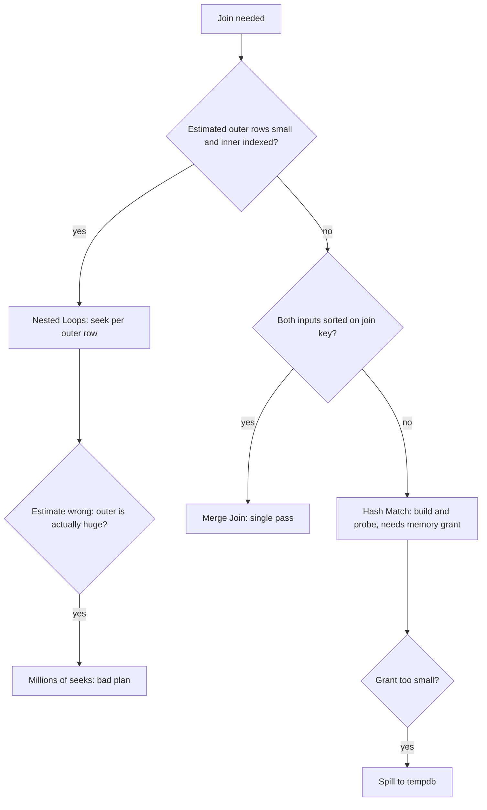

**Hands-on.**

```sql
SET STATISTICS IO ON;

-- Without an index on OrderItems(OrderId) the join is brutal; we created IX_OrderItems_OrderId in lab setup.
-- Selective outer (one customer) → nested loops + seeks
SELECT o.OrderId, SUM(i.Quantity * i.UnitPrice) AS Total
FROM dbo.Orders o
JOIN dbo.OrderItems i ON i.OrderId = o.OrderId
WHERE o.CustomerId = 4242
GROUP BY o.OrderId;

-- Huge outer (whale) → hash join / scan; check for spill warnings and memory grant
SELECT o.OrderId, SUM(i.Quantity * i.UnitPrice) AS Total
FROM dbo.Orders o JOIN dbo.OrderItems i ON i.OrderId = o.OrderId
WHERE o.CustomerId = 1
GROUP BY o.OrderId;

-- Fan-out bug: counting after joining a one-to-many twice (illustrative; add a Payments table to try)
-- SELECT o.OrderId, COUNT(*) FROM Orders o JOIN OrderItems i ... JOIN Payments p ...   -- COUNT multiplies
-- Fix: pre-aggregate each child
SELECT o.OrderId, ISNULL(i.ItemCount,0) AS Items
FROM dbo.Orders o
LEFT JOIN (SELECT OrderId, COUNT(*) AS ItemCount FROM dbo.OrderItems GROUP BY OrderId) i ON i.OrderId = o.OrderId
WHERE o.CustomerId = 4242;

-- OUTER APPLY TOP 1: "latest order per customer" without row-multiplying joins
SELECT c.CustomerId, lo.OrderId, lo.OrderDate
FROM dbo.Customers c
OUTER APPLY (SELECT TOP (1) OrderId, OrderDate FROM dbo.Orders o WHERE o.CustomerId = c.CustomerId ORDER BY o.OrderDate DESC) lo
WHERE c.CountryCode = 'DE';      -- needs IX_Orders_Customer_Date (CustomerId, OrderDate DESC)

-- Find foreign keys that lack a supporting index
SELECT OBJECT_NAME(fk.parent_object_id) AS child_table, fk.name AS fk_name,
       COL_NAME(fkc.parent_object_id, fkc.parent_column_id) AS fk_column
FROM sys.foreign_keys fk
JOIN sys.foreign_key_columns fkc ON fkc.constraint_object_id = fk.object_id
WHERE NOT EXISTS (SELECT 1 FROM sys.index_columns ic
                  WHERE ic.object_id = fkc.parent_object_id AND ic.column_id = fkc.parent_column_id AND ic.key_ordinal = 1);
```

```csharp
// EF Core: Include = JOIN, can fan out; for collections prefer split queries or projection
var summary = await db.Orders
    .Where(o => o.CustomerId == id)
    .Select(o => new { o.OrderId, Items = o.Items.Count, Total = o.Items.Sum(i => i.Quantity * i.UnitPrice) })  // translated to subqueries/joins server-side, no entity materialization
    .ToListAsync();
```

**Real-world.** A report joined six tables and ran 14 minutes on the whale tenant: estimated 3 rows after a correlated filter, actual 800k; nested loops fed by a lookup on every join, spill on sort. Fix: multi-column statistics, pre-aggregating two children, and an FK index — 14 min → 9 s.

**When to use hints / not.** Join hints (`HASH JOIN`) only to confirm a diagnosis in testing or when estimates can't be fixed; never as standing practice.

**Mistakes.** No index on FK/join columns; joining on mismatched types; joining to a view that expands to many tables; `DISTINCT`/`GROUP BY` to hide fan-out; `LEFT JOIN` filtered in `WHERE`; joining huge tables then filtering (push filters early / aggregate early); using `OR` in join conditions.

**Performance / scalability / reliability / Azure.** Hash joins and sorts depend on **memory grants** — concurrency of big joins causes `RESOURCE_SEMAPHORE` waits; Resource Governor (box) or tier sizing (Azure) bounds this. Memory grant feedback (2017+/2019+) corrects repeat queries.

**Troubleshooting.** Look at: join operator type vs rows, spill warnings, `Actual Executions` on inner side, memory grant columns; wait types `RESOURCE_SEMAPHORE`, `IO_COMPLETION` (spill), `PAGEIOLATCH_*`.

**Related.** [Chapters 5](#5-index-fundamentals), [9](#9-statistics-and-cardinality-estimation), [14](#14-subqueries-versus-ctes).

### Interview Q&A — chapter 13

**Q: How does SQL Server choose between nested loops, hash and merge joins?**
A: By cost based on estimated cardinality of both inputs, available indexes, and sort order. Nested loops suit small outer with an indexed inner; merge needs sorted inputs; hash handles large, unsorted inputs at the cost of a memory grant. Bad estimates cause the wrong choice; fixing statistics/indexes is better than hinting.

**Q: Which index would you add to speed up joining Orders to OrderItems?**
A: A non-clustered index on `OrderItems(OrderId)` (the foreign key), with INCLUDEd columns the query needs to avoid lookups, e.g. `(OrderId) INCLUDE (Quantity, UnitPrice)`.

*Follow-ups.* "Why can LEFT JOIN with a WHERE on the right table behave like INNER?" → NULL-extended rows fail the WHERE; move the predicate to `ON`. "Can the optimizer remove a join?" → yes if the joined table's columns aren't used and a trusted FK/unique key guarantees no row change; hence `WITH CHECK` constraints matter.

---

## 14. Subqueries versus CTEs

**Simple idea.** A **CTE** (`WITH x AS (...)`) is a *named, readable subquery* — **not a cached/materialized result** in SQL Server. The optimizer inlines it into the query like a view; referencing it twice can execute it twice. Temp tables, by contrast, are *real, materialized, statistics-bearing* tables.

**Architect depth.**

- **CTE ≠ performance feature.** Non-recursive CTEs are syntax sugar; the optimizer typically produces the same plan as the equivalent derived table/subquery. Use for readability, **recursion** (hierarchies/graphs), and `WITH ... DELETE/UPDATE` patterns (e.g. de-duplication with `ROW_NUMBER()`).
- **Subquery forms:** *scalar* (returns one value), *derived table* (in `FROM`), *correlated* (references the outer row), `EXISTS`/`IN`/`NOT EXISTS`/`NOT IN`. The optimizer **decorrelates** many correlated subqueries into joins/semi-joins; some remain row-by-row (apply/spool).
- **EXISTS vs IN vs JOIN.** `EXISTS` stops at the first match (semi join) and handles NULLs safely; `IN (subquery)` is usually the same plan; `JOIN` can multiply rows (duplicates) and needs `DISTINCT`; `NOT IN` breaks with NULLs and often plans worse than `NOT EXISTS`.
- **CROSS/OUTER APPLY** — table-valued subqueries per outer row, great for "top N per group" with an index, and for calling inline TVFs. **Window functions** (`ROW_NUMBER`, `LAG`, `SUM() OVER`) replace many self-joins/correlated subqueries; they need sorting — index on `PARTITION BY` + `ORDER BY` columns removes the sort.
- **Temp tables vs table variables vs CTE vs memory-optimized.**

| Structure | Stats | Materialized | Recompiles | Good for |
| --- | --- | --- | --- | --- |
| CTE / derived table | uses base-table stats | no (inlined) | n/a | readability, recursion |
| `#temp table` | **yes** (auto-created) | yes (tempdb) | may recompile on cardinality change | intermediate results reused ≥2×, large sets, need indexes/stats |
| `@table variable` | none until 2019 *deferred compilation* (actual row count, still no column stats) | yes (tempdb) | no | small sets (<~100 rows), avoiding recompiles, TVP |
| Memory-optimized table / variable | hash/range | in memory | no | tempdb contention, high-frequency small temp structures |
| Indexed view | yes | **yes (persisted)** | n/a | expensive aggregates read often (write overhead, many restrictions) |

- **Recursive CTE** default `MAXRECURSION 100`; performance depends on the anchor/recursive member and indexes; consider `hierarchyid`/closure tables for heavy hierarchy querying.
- **Materialization hint myth.** There is no `MATERIALIZED` keyword (unlike PostgreSQL). To force materialization use `#temp`. Optimizer "spools" can materialize implicitly (Eager/Lazy Spool) — usually a *warning sign*.

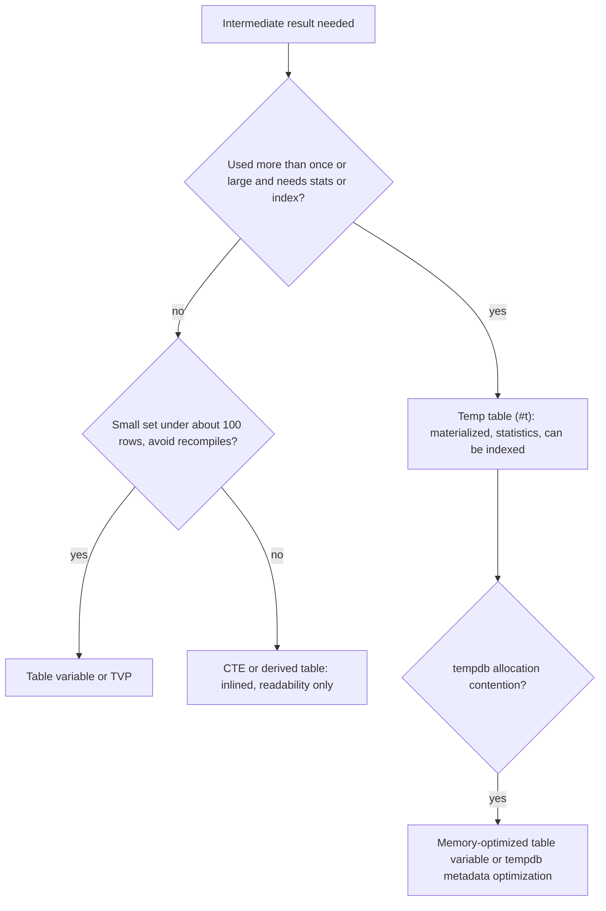

**Hands-on.**

```sql
SET STATISTICS IO ON;

-- 1) CTE referenced twice → logic runs twice (check the plan: two scans of Orders)
WITH recent AS (SELECT CustomerId, TotalAmount FROM dbo.Orders WHERE OrderDate >= DATEADD(DAY,-30,SYSUTCDATETIME()))
SELECT (SELECT SUM(TotalAmount) FROM recent) AS total, (SELECT COUNT(DISTINCT CustomerId) FROM recent) AS customers;

-- Materialized once with statistics:
SELECT CustomerId, TotalAmount INTO #recent FROM dbo.Orders WHERE OrderDate >= DATEADD(DAY,-30,SYSUTCDATETIME());
CREATE CLUSTERED INDEX cx ON #recent (CustomerId);
SELECT SUM(TotalAmount) total, COUNT(DISTINCT CustomerId) customers FROM #recent;

-- 2) NOT IN with NULLs vs NOT EXISTS
SELECT COUNT(*) FROM dbo.Customers c WHERE c.CustomerId NOT IN (SELECT CustomerId FROM dbo.Orders);          -- wrong if any NULL; usually slower
SELECT COUNT(*) FROM dbo.Customers c WHERE NOT EXISTS (SELECT 1 FROM dbo.Orders o WHERE o.CustomerId = c.CustomerId);

-- 3) De-duplicate using CTE + ROW_NUMBER (a legitimate CTE superpower)
;WITH d AS (SELECT *, ROW_NUMBER() OVER (PARTITION BY ExternalRef ORDER BY OrderId) rn FROM dbo.Orders WHERE ExternalRef IS NOT NULL)
DELETE FROM d WHERE rn > 1;

-- 4) Top-N-per-group: window function (needs index on (CustomerId, OrderDate DESC) to avoid a sort)
SELECT * FROM (
  SELECT o.*, ROW_NUMBER() OVER (PARTITION BY CustomerId ORDER BY OrderDate DESC) rn
  FROM dbo.Orders o WHERE CustomerId IN (1,2,3)) x
WHERE rn <= 3;

-- 5) Table variable (2019+ deferred compilation uses the real row count)
DECLARE @ids TABLE (CustomerId INT PRIMARY KEY);
INSERT @ids SELECT TOP (5000) CustomerId FROM dbo.Customers;
SELECT COUNT(*) FROM dbo.Orders o JOIN @ids i ON i.CustomerId = o.CustomerId;    -- compat 150+: estimate is 5000, not 1
```

```csharp
// EF Core: passing many ids → OPENJSON / parameterized IN lists; large lists: prefer a temp/TVP join
var ids = Enumerable.Range(1, 5000).ToArray();
var rows = await db.Orders.Where(o => ids.Contains(o.CustomerId)).Select(o => o.OrderId).ToListAsync();
// EF Core 8+ SQL Server translates Contains to OPENJSON by default (single plan, any list size); EF Core 9/10 add parameter-sniffing-friendly options (verify current).
// For very large sets use a TVP/SqlBulkCopy into a #temp table and join.
```

**Real-world.** A reporting proc built five nested CTEs, each referenced by the next three times; the plan executed the base aggregation 11×. Replacing the base CTE with a `#temp` table with a clustered index cut runtime from 3 min to 8 s and made the plan stable (the optimizer had stats on the temp table).

**When to use / not.** CTE: readability/recursion. Temp table: reuse, big intermediate sets, need stats/indexes. Table variable: tiny sets, avoid recompile storms. Derived table vs correlated subquery: let the optimizer decide, then verify with the plan.

**Pros/cons.** Temp tables cost tempdb I/O and may trigger recompiles but give statistics; CTEs cost nothing extra but can hide repeated work.

**Mistakes.** Believing CTEs cache results; `NOT IN`; scalar subquery per row in `SELECT`; nested views-of-views-of-CTEs; table variables for large sets on old compat levels; temp tables in a procedure called thousands/sec (tempdb metadata contention — use memory-optimized tempdb metadata in 2019+, `PAGELATCH_*` waits).

**Performance / reliability / Azure.** tempdb is shared; in Azure SQL it's governed per tier. Watch spills and `PAGELATCH_UP/EX` on tempdb allocation pages.

**Troubleshooting.** Plan shows *Table Spool/Eager Spool* or repeated scans of the same table → CTE referenced multiple times; wrong estimates on `@table` (pre-2019) → switch to `#temp` or compat 150+.

**Related.** [Chapters 9](#9-statistics-and-cardinality-estimation), [13](#13-join-optimization), [16](#16-stored-procedure-optimization).

### Interview Q&A — chapter 14

**Q: CTE vs temp table — which is faster?**
A: A CTE isn't materialized; it's inlined like a view. A temp table is materialized with statistics and can be indexed. For one-time use, the plans are equivalent; for reuse of a large intermediate result, or when estimation across a complex pipeline is poor, a temp table is usually faster and more stable.

**Q: Why is `NOT IN` dangerous?**
A: If the subquery returns any NULL, `x NOT IN (...)` evaluates to unknown and returns no rows; `NOT EXISTS` handles NULLs correctly and typically yields a better anti-semi-join plan.

*Follow-ups.* "When is a table variable better than a temp table?" → tiny sets, hot paths where recompiles from temp-table stats changes cost more than they save, TVPs. "Why can a recursive CTE be slow?" → each level is an iteration without set-based parallelism; ensure an index on the join key, set an explicit MAXRECURSION, consider hierarchyid/closure tables.

---
## 15. Pagination optimization

> **Deeper treatment:** [OFFSET/FETCH and pagination deep dive](./04-offset-fetch-and-pagination-deep-dive.md) covers OFFSET internals, every technique that makes OFFSET cheaper (covering index, deferred join, bounded offsets, cheap counts, anchor tables), keyset pagination and API design. This chapter is the short summary.

**Simple idea.** Paging means returning a slice of a large result. `OFFSET/FETCH` skips N rows by *reading and discarding them*, so page 5,000 is far slower than page 1. **Keyset (seek) pagination** instead says "give me rows *after the last one I saw*", using an index seek, so every page costs the same.

**Architect depth.**

- **OFFSET/FETCH cost.** `ORDER BY OrderDate DESC OFFSET 100000 ROWS FETCH NEXT 50 ROWS ONLY` must produce and sort/walk 100,050 rows, then drop 100,000. Reads grow linearly with the page number; with a supporting index the engine still *scans* that many index entries. Without a supporting index it sorts the whole filtered set.
- **Instability.** With concurrent inserts/deletes, offset pages **skip or repeat rows** (the window shifts). Users see duplicates when scrolling.
- **Keyset pagination.** Order by a **unique, deterministic** key (the sort column *plus a tie-breaker*, e.g. `(OrderDate DESC, OrderId DESC)`), pass the last row's key values, and filter `WHERE (OrderDate, OrderId) < (@lastDate, @lastId)`. SQL Server lacks row-value comparison, so write it as `OrderDate < @d OR (OrderDate = @d AND OrderId < @id)` — and make sure the plan uses a **seek on the composite index** (check the `Seek Predicates`).
- **Trade-offs of keyset:** no random "jump to page 57" (only next/previous); API contract uses an opaque **cursor/continuation token**; sorting by non-unique/ user-chosen columns needs a matching index per sort order.
- **`COUNT(*)` for "total pages"** is itself an O(n) scan on big filtered sets. Alternatives: approximate counts (stats/`sys.dm_db_partition_stats` for unfiltered), cap the count (`SELECT COUNT(*) FROM (SELECT TOP (1001) ...)` → "1000+"), cache counts, or drop the total from the UX.
- **Deep paging protection:** cap max offset/page size (e.g. 100), reject `page > N`, require filters, or use keyset only. Search engines use the same constraint for the same reason.
- **Covering + narrow.** Page queries should read from a covering index and then fetch wide columns for just the 50 returned keys (**late row lookup / "deferred join"**): first select the page's keys from the narrow index, then join to the base table for the full rows.

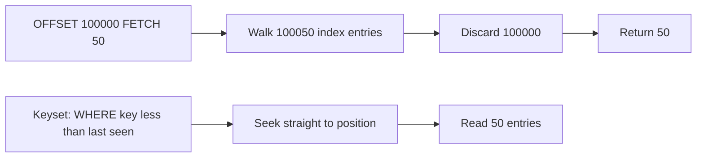

**Hands-on.**

```sql
SET STATISTICS IO ON;
-- Supporting index (CustomerId equality, then ordered columns, with a unique tie-breaker included automatically as the clustering key OrderId)
CREATE NONCLUSTERED INDEX IX_Orders_Cust_DateId ON dbo.Orders (CustomerId, OrderDate DESC, OrderId DESC) INCLUDE (TotalAmount, Status);

-- OFFSET/FETCH: page 1 vs page 10,000 for the whale
SELECT OrderId, OrderDate, TotalAmount FROM dbo.Orders WHERE CustomerId = 1
ORDER BY OrderDate DESC, OrderId DESC OFFSET 0 ROWS FETCH NEXT 50 ROWS ONLY;                 -- few reads
SELECT OrderId, OrderDate, TotalAmount FROM dbo.Orders WHERE CustomerId = 1
ORDER BY OrderDate DESC, OrderId DESC OFFSET 500000 ROWS FETCH NEXT 50 ROWS ONLY;           -- thousands of reads

-- Keyset: same cost on every page
DECLARE @lastDate DATETIME2(0) = '2025-06-01T10:00:00', @lastId BIGINT = 1234567;
SELECT TOP (50) OrderId, OrderDate, TotalAmount
FROM dbo.Orders
WHERE CustomerId = 1
  AND (OrderDate < @lastDate OR (OrderDate = @lastDate AND OrderId < @lastId))
ORDER BY OrderDate DESC, OrderId DESC;

-- Deferred join: narrow index finds the page of keys, then fetch wide rows only for those
WITH page AS (
  SELECT TOP (50) OrderId FROM dbo.Orders WHERE CustomerId = 1 ORDER BY OrderDate DESC, OrderId DESC)
SELECT o.* FROM page p JOIN dbo.Orders o ON o.OrderId = p.OrderId ORDER BY o.OrderDate DESC, o.OrderId DESC;

-- Capped count instead of exact COUNT(*)
SELECT COUNT(*) AS capped FROM (SELECT TOP (1001) 1 AS x FROM dbo.Orders WHERE CustomerId = 1) t;   -- 1001 → UI shows "1000+"
```

```csharp
// EF Core 10 keyset pagination with a cursor token
public record OrderCursor(DateTime OrderDate, long OrderId);

public async Task<(List<OrderDto> Items, OrderCursor? Next)> GetPageAsync(int customerId, OrderCursor? after, int size = 50)
{
    size = Math.Clamp(size, 1, 100);                                    // guard deep/huge pages
    var q = db.Orders.AsNoTracking().Where(o => o.CustomerId == customerId);
    if (after is not null)
        q = q.Where(o => o.OrderDate < after.OrderDate || (o.OrderDate == after.OrderDate && o.OrderId < after.OrderId));

    var items = await q.OrderByDescending(o => o.OrderDate).ThenByDescending(o => o.OrderId)
                       .Take(size + 1)                                  // +1 to know if there is a next page without COUNT(*)
                       .Select(o => new OrderDto(o.OrderId, o.OrderDate, o.TotalAmount)).ToListAsync();
    var hasMore = items.Count > size;
    if (hasMore) items.RemoveAt(size);
    return (items, hasMore ? new OrderCursor(items[^1].OrderDate, items[^1].OrderId) : null);
}
// Return the cursor as an opaque, signed/base64 token — never trust a client-supplied raw cursor for authorization.
```

**Real-world.** An admin grid on a 300M-row audit table timed out on page > 2,000 and showed duplicate rows while ingestion was running. Keyset pagination on `(CreatedAt DESC, Id DESC)` made every page ~4 reads, removed duplicates, and an upper bound on offset-based "export" prevented abuse.

**When to use / not.** Keyset: infinite scroll, APIs, feeds, large tables, live data. OFFSET: small tables, back-office UIs that truly need page jumps (cap offsets). Not: arbitrary user-selected multi-column sorts without matching indexes — limit allowed sorts.

**Advantages / disadvantages.** Keyset: constant cost, stable under writes; no random access, more complex API. OFFSET: simple, random access; linear cost, unstable, easy to abuse.

**Mistakes.** `ORDER BY` a non-unique column (rows skipped/duplicated at page boundaries); no tie-breaker; sorting without a supporting index; exact `COUNT(*)` on every request; `Skip/Take` with `Include` of collections (row multiplication affects paging; EF warns); unbounded page size; ordering by an expression.

**Performance / security.** Cap page sizes and offsets (resource exhaustion); validate/sign cursors; add rate limits to search/paging endpoints; ensure authorization filters (tenant, user) are part of the leading index columns.

**Troubleshooting.** Slow high pages → plan shows `Top`/`Sort` over many rows or `Index Scan` reading far more than 50; `STATISTICS IO` reads grow with page number → move to keyset.

**Related.** [Chapters 5](#5-index-fundamentals), [8](#8-key-lookups-and-bookmark-lookups), [17](#17-avoiding-unnecessary-columns-no-select-star), [ASP.NET Core internals](../10-aspnet-core-web-api-internals/aspnet-core-web-api-internals.md) (API performance and caching).

### Interview Q&A — chapter 15

**Q: Why is OFFSET/FETCH slow for deep pages and what's the alternative?**
A: The engine must produce and discard all skipped rows; cost grows with the offset and results are unstable under concurrent writes. Keyset pagination seeks to the last seen key `(sort col, unique tiebreaker)` and reads the next N, so cost is constant and stable. Trade-off: forward/back navigation only and a cursor-token API.

**Q: How do you implement "previous page" with keyset?**
A: Reverse the comparison and sort order, take N, then reverse the results in memory (or issue the inverse query) — and encode the direction in the cursor.

*Follow-ups.* "How do you get a total count cheaply?" → don't; show "next/previous", capped counts, approximations or cached counts. "What if users can sort by any column?" → restrict sort options to indexed ones or accept scans with strict limits.

---

## 16. Stored procedure optimization

**Simple idea.** A stored procedure is compiled code stored in the database: its plan is cached and reused, parameters are typed, permissions are centralized. It's *not* automatically fast — bad SQL inside is still bad SQL — but it provides good hooks for tuning, security and consistent plans.

**Architect depth.**

- **Plan and sniffing.** One plan per procedure statement, compiled with the first parameter values ([chapter 10](#10-parameter-sniffing-and-parameter-sensitive-plans)). Control with `OPTION (RECOMPILE)` per statement (not `WITH RECOMPILE` on the whole proc unless needed), Query Store hints/forcing.
- **`SET NOCOUNT ON`** removes per-statement `DONE_IN_PROC` messages — reduces network chatter (matters for procs with many statements) and avoids confusing some drivers.
- **Parameter types match column types** (no implicit conversion), sized appropriately (`VARCHAR(50)` not `VARCHAR(MAX)` for a 10-char code; MAX parameters affect memory grant estimates).
- **Set-based over procedural.** Avoid cursors/WHILE row-by-row; avoid scalar UDF in `SELECT`/`WHERE` over big sets — pre-2019 they run per row, serial, with hidden cost (**scalar UDF inlining** in 2019+/compat 150 fixes many, not all; check `is_inlineable`). **Multi-statement TVFs** have fixed estimates (1 or 100 rows, 2017+ interleaved execution fixes it for MSTVFs) — prefer **inline TVFs**.
- **Dynamic SQL.** Use `sp_executesql` with parameters (plan reuse + injection safety); `EXEC(@sql)` concatenation → plan per literal + injection. For "optional filter" search procs, `WHERE (@a IS NULL OR col=@a)` yields one compromise plan — use `OPTION (RECOMPILE)` or build dynamic SQL with only the needed predicates (`sp_executesql` keeps plans cacheable per shape).
- **Schema-qualify** objects (`dbo.Orders`) — avoids name-resolution lookups and plan-cache fragmentation per user.
- **Avoid triggers doing heavy work**, avoid nested procs doing repeated work, avoid chatty procs calling scalar functions.
- **Temp tables vs table variables** in procs ([chapter 14](#14-subqueries-versus-ctes)): temp tables can cause **recompiles**; reuse is cached for small procs; excessive creation → tempdb metadata contention.
- **Error handling and transactions.** `SET XACT_ABORT ON` so errors roll back and don't leave open transactions; `TRY/CATCH` with `THROW`; keep transactions short ([chapter 26](#26-long-running-transactions)).
- **Return only needed columns/rows**; use `OUTPUT` params for scalars rather than result sets when possible.
- **Plan cache bloat.** Ad hoc SQL from apps with literals; consider `optimize for ad hoc workloads`, parameterization (EF does it), and avoiding user-specific object names.
- **Procs vs ORM.** Procedures aren't *faster by nature* than parameterized ORM queries (both parameterized, plans cached). Procedures shine for complex set logic, batch/ETL operations, security boundaries (grant EXECUTE only), and operational tuning without redeploying the app.

**Hands-on.**

```sql
CREATE OR ALTER PROCEDURE dbo.SearchOrders
    @CustomerId INT = NULL,
    @Status     TINYINT = NULL,
    @From       DATETIME2(0) = NULL,
    @To         DATETIME2(0) = NULL
AS
BEGIN
    SET NOCOUNT ON;
    SET XACT_ABORT ON;

    -- Dynamic SQL: only include predicates that were supplied → one good plan per shape, still parameterized
    DECLARE @sql NVARCHAR(MAX) = N'
        SELECT TOP (200) OrderId, CustomerId, OrderDate, Status, TotalAmount
        FROM dbo.Orders WHERE 1 = 1';
    IF @CustomerId IS NOT NULL SET @sql += N' AND CustomerId = @CustomerId';
    IF @Status     IS NOT NULL SET @sql += N' AND Status = @Status';
    IF @From       IS NOT NULL SET @sql += N' AND OrderDate >= @From';
    IF @To         IS NOT NULL SET @sql += N' AND OrderDate <  @To';
    SET @sql += N' ORDER BY OrderDate DESC, OrderId DESC;';

    EXEC sys.sp_executesql @sql,
         N'@CustomerId INT, @Status TINYINT, @From DATETIME2(0), @To DATETIME2(0)',
         @CustomerId, @Status, @From, @To;
END
GO

-- Find scalar UDFs and whether they are inlineable (2019+)
SELECT OBJECT_NAME(object_id) fn, is_inlineable FROM sys.sql_modules
WHERE OBJECTPROPERTY(object_id, 'IsScalarFunction') = 1;

-- Per-procedure runtime cost
SELECT OBJECT_NAME(ps.object_id) proc_name, ps.execution_count, ps.total_elapsed_time/1000 total_ms,
       ps.total_logical_reads, ps.total_worker_time/1000 total_cpu_ms
FROM sys.dm_exec_procedure_stats ps WHERE ps.database_id = DB_ID() ORDER BY ps.total_worker_time DESC;
```

```csharp
// Calling a proc from EF Core 10 with typed parameters (no implicit conversions, no injection)
var rows = await db.Database
    .SqlQuery<OrderRow>($"EXEC dbo.SearchOrders @CustomerId = {customerId}, @Status = {status}")
    .ToListAsync();

// Dapper alternative with explicit DbType/size (prevents nvarchar surprises on varchar columns)
var p = new DynamicParameters();
p.Add("@Email", email, DbType.AnsiString, size: 200);       // AnsiString → varchar
var customer = await conn.QuerySingleOrDefaultAsync<Customer>("SELECT * FROM dbo.Customers WHERE Email = @Email", p);
```

**Real-world.** A catalog search procedure with 9 optional filters used `(@x IS NULL OR col = @x)` for each; the compromise plan scanned everything for every combination and took 4–8 s. Rewriting to parameterized dynamic SQL gave per-shape plans (≤ 30 ms), and index design could finally target real filter combinations.

**When to use procs / when not.** Use for: batch/ETL, complex set logic, security encapsulation, performance-critical hot paths needing DB-side tuning. Avoid putting business logic in procs when it makes testing, versioning and team workflows painful; avoid dynamic string concatenation without `sp_executesql`.

**Pros/cons.** Plan reuse, security, fewer round trips; versus versioning/deployment complexity, portability, business logic split across tiers.

**Mistakes.** Missing `SET NOCOUNT ON`; `SELECT *`; cursors; scalar UDFs on large sets; `WITH RECOMPILE` on a hot procedure; `EXEC(@sql)` concatenation; nested procs with temp-table scope surprises; ignoring `XACT_ABORT` (leaves open transactions after timeouts); parameter type mismatch; `sp_` prefix naming (checks `master` first); catch-all search with OR-IS-NULL.

**Performance / reliability / security / Azure.** `EXECUTE AS`/ownership chaining for least-privilege; grant `EXECUTE` on schema rather than table access; Query Store tracks procs; Azure SQL supports Automatic Plan Correction for procs.

**Troubleshooting.** `sys.dm_exec_procedure_stats`, Query Store per-object stats; look for plan variability (min/max durations) and recompile counts (`sql_statement_recompile` XEvent); test in SSMS with the app's SET options.

**Related.** [Chapters 10](#10-parameter-sniffing-and-parameter-sensitive-plans), [14](#14-subqueries-versus-ctes), [26](#26-long-running-transactions).

### Interview Q&A — chapter 16

**Q: Are stored procedures faster than ORM queries?**
A: Not inherently. Both are parameterized and plan-cached; the difference is control: procs let DBAs tune and version DB logic without redeploying apps and reduce round trips for multi-step logic. Performance depends on the SQL inside.

**Q: How do you write a search procedure with many optional filters?**
A: Parameterized dynamic SQL via `sp_executesql` that appends only the supplied predicates (optionally `OPTION (RECOMPILE)` for highly variable shapes), avoiding the `(@p IS NULL OR col=@p)` pattern that forces a compromise plan.

*Follow-ups.* "Why `SET XACT_ABORT ON`?" → on a client timeout or runtime error, SQL Server may leave the transaction open; XACT_ABORT rolls it back, preventing orphaned locks. "What replaced scalar UDF pain?" → inlining in 2019+ (compat 150) when the function qualifies; otherwise rewrite as inline TVF/computed column.

---

## 17. Avoiding unnecessary columns (no SELECT star)

**Simple idea.** Every extra column costs something: more bytes read, sent, materialized and tracked — and it can turn a cheap *covered* index seek into expensive lookups. Ask for what you need.

**Architect depth.**

- **Covering depends on the projection.** `SELECT *` can never be covered by a reasonable index; a 4-column projection can ([chapter 8](#8-key-lookups-and-bookmark-lookups)).
- **I/O and memory.** Wide rows mean fewer rows per page → more pages read → more buffer pool pressure. **LOB columns** (`VARCHAR(MAX)`, `NVARCHAR(MAX)`, `VARBINARY(MAX)`, XML, JSON blobs) live off-row (LOB pages) — reading them costs extra page reads *and* network.
- **Network/serialization.** Bytes cross the wire, are deserialized, mapped to objects, serialized to JSON; at API scale, wide payloads dominate latency and cost (egress charges).
- **Schema fragility.** `SELECT *` breaks when columns are added/removed (view `SELECT *` freezes metadata until `sp_refreshview`), leaks new sensitive columns, and silently changes plans.
- **EF Core specifics.** Loading entities selects *all mapped columns* and sets up change tracking (identity map, snapshots) — **`AsNoTracking()`** for read-only queries; **projection with `Select`** to DTOs reads only needed columns (translates to a narrow SELECT, can be covered, no tracking). **Table splitting / owned types / separate "heavy" entity** for LOB columns (e.g. `OrderNotes`, `Attachment` in another table or lazily loaded explicitly). Compiled queries (`EF.CompileAsyncQuery`) shave LINQ translation CPU for hot paths.
- **When `SELECT *` is fine:** `EXISTS (SELECT * ...)` (ignored), `COUNT(*)`, ad-hoc exploration.
- **Wide-table design.** Vertical partitioning (hot narrow columns vs cold wide columns) improves cache density; store large blobs in Blob Storage and keep a URL/metadata in SQL ([Azure services](../14-azure-services-and-cloud-architecture/azure-services-and-cloud-architecture.md)).

**Hands-on.**

```sql
SET STATISTICS IO ON;
-- Narrow, covered
SELECT OrderId, OrderDate, TotalAmount FROM dbo.Orders WHERE CustomerId = 4242 ORDER BY OrderDate DESC;    -- IX_Orders_Customer_Date covers: no lookups
-- SELECT * → lookups for every row (Notes NVARCHAR(400), ExternalRef, RowVer, CountryCode...)
SELECT * FROM dbo.Orders WHERE CustomerId = 4242 ORDER BY OrderDate DESC;

-- How wide are rows / how many rows per page?
SELECT index_id, avg_record_size_in_bytes, page_count, record_count
FROM sys.dm_db_index_physical_stats(DB_ID(), OBJECT_ID('dbo.Orders'), NULL, NULL, 'DETAILED') WHERE index_level = 0;

-- SELECT * in a view freezes columns: refresh or schema-bind
EXEC sp_refreshview 'dbo.SomeView';
```

```csharp
// BAD: loads full entity graph + tracking for a list screen
var bad = await db.Orders.Include(o => o.Items).Where(o => o.CustomerId == id).ToListAsync();

// GOOD: projection, no tracking, covered by the index
public record OrderListItem(long OrderId, DateTime OrderDate, decimal TotalAmount, int ItemCount);
var good = await db.Orders.AsNoTracking()
    .Where(o => o.CustomerId == id).OrderByDescending(o => o.OrderDate).Take(50)
    .Select(o => new OrderListItem(o.OrderId, o.OrderDate, o.TotalAmount, o.Items.Count))
    .ToListAsync();

// Global default for a read-heavy context
services.AddDbContext<ReadOnlyShopDb>(o => o.UseSqlServer(cs).UseQueryTrackingBehavior(QueryTrackingBehavior.NoTracking));

// Hot-path compiled query: LINQ → SQL translation done once
private static readonly Func<ShopDb, int, IAsyncEnumerable<OrderListItem>> ByCustomer =
    EF.CompileAsyncQuery((ShopDb c, int cid) =>
        c.Orders.Where(o => o.CustomerId == cid).Select(o => new OrderListItem(o.OrderId, o.OrderDate, o.TotalAmount, 0)));
```

**Real-world.** A product list endpoint returned 120 KB per item (including a base64 description and image) at 20 items/page; moving to a projection (6 fields) reduced SQL reads by 14×, payload by 95% and p95 from 900 ms to 70 ms; Azure egress costs fell proportionally.

**When not.** Don't over-fragment: DTO explosion for tiny tables isn't worth it; keep entities for write paths (change tracking helps there).

**Mistakes.** `SELECT *` in views/ETL/production code; returning whole entities from APIs (over-posting and over-fetching); `Include`-everything; loading blobs by default; no `AsNoTracking` in read endpoints; column lists that drift from the index INCLUDE list.

**Performance / security.** Narrow reads reduce I/O, memory, bandwidth and log of sensitive data exposure (don't project PII you don't need).

**Troubleshooting.** App Insights dependency duration + payload size; Query Store "Top by logical reads"; plan with Key Lookup on high-row queries; check `SELECT *` via `sys.sql_modules` text search for views/procs.

**Related.** [Chapters 5](#5-index-fundamentals), [8](#8-key-lookups-and-bookmark-lookups), [18](#18-the-n-plus-1-query-problem), [ASP.NET Core internals — API performance](../10-aspnet-core-web-api-internals/aspnet-core-web-api-internals.md).

### Interview Q&A — chapter 17

**Q: Why avoid `SELECT *`?**
A: It reads/transfers unneeded data (including LOBs), prevents covering indexes (forcing lookups or scans), inflates memory and network, couples code to schema, and can leak new sensitive columns. A projection lets the engine use narrow indexes and reduces payload.

**Q: What does `AsNoTracking` save?**
A: Identity-map lookups, snapshot allocation and change detection for read-only entities — often noticeably faster materialization on large reads (measure it), and less memory.

*Follow-ups.* "How would you handle a large text column in list queries?" → exclude it from list projections, load on demand from a detail query, or move it to a side table/Blob Storage.

---

## 18. The N plus 1 query problem

**Simple idea.** Fetch a list with **1** query, then run **N** more queries — one per item — to load related data. 1,000 orders → 1,001 round trips. Each query is "fast", but latency adds up and the database drowns in tiny calls.

**Architect depth.**

- **Causes.** Lazy-loading proxies (accessing `order.Customer` in a loop), repository methods that call other repositories per item, `foreach` + `await db.X.Where(...)`, GraphQL resolvers per node (use DataLoader/batching), view models assembling data per row.
- **Why it hurts.** Network round trip (0.5–2 ms inside a region, 10+ ms across regions/AZs) × N; each query takes a connection from the pool (concurrency → pool exhaustion); plan cache/CPU overhead; lock/latch churn; chatty traffic scales linearly with data volume — "works in dev with 10 rows".
- **Fixes.**
  1. **Eager loading:** `Include` — single query with joins (beware **cartesian explosion** for multiple collections).
  2. **Split queries:** `AsSplitQuery()` — one query per collection (a constant number of queries, avoids row multiplication; costs consistency between queries unless within a snapshot/transaction).
  3. **Projection:** `Select` exactly what the screen needs (best option — one narrow query, no tracking).
  4. **Batching/explicit loading:** `Where(x => ids.Contains(x.FK))` once, then group in memory.
  5. **Dapper multi-mapping / `QueryMultiple`** for hand-written SQL.
  6. **Caching** reference data (HybridCache/Redis).
  7. **Set-based DB views / stored procedures** for reports.
- **Detection.** EF Core logging (count commands per request); **MiniProfiler**; **OpenTelemetry/Application Insights dependency telemetry** (many SQL dependencies per request operation); Query Store: *very high execution count, very low per-execution cost*, same query shape with different parameter; `sys.dm_exec_query_stats` execution_count outliers; SQL Profiler/XE `rpc_completed` bursts correlated with one request id.
- **Guardrails.** EF Core: disable lazy loading by default; use `ConfigureWarnings` to **throw on** `QueryPossibleUnintendedUseOfEqualsWarning` etc.; integration tests that assert the **number of SQL commands** for key endpoints (command counting interceptor); code review rule for loops with `await db`.

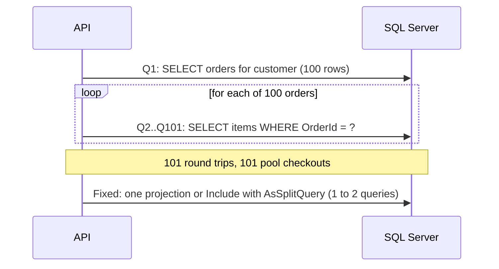

**Hands-on.**

```csharp
// ❌ N+1 (lazy loading or explicit loop)
var orders = await db.Orders.Where(o => o.CustomerId == id).ToListAsync();      // 1 query
foreach (var o in orders)
    o.Items = await db.OrderItems.Where(i => i.OrderId == o.OrderId).ToListAsync();   // N queries

// ✅ Projection (best): one query, narrow, no tracking
var dto = await db.Orders.AsNoTracking().Where(o => o.CustomerId == id)
    .Select(o => new { o.OrderId, o.OrderDate,
                       Items = o.Items.Select(i => new { i.ProductId, i.Quantity, i.UnitPrice }) })
    .ToListAsync();

// ✅ Include + split query: 2 queries total; no cartesian product
var loaded = await db.Orders.Include(o => o.Items).AsSplitQuery().Where(o => o.CustomerId == id).ToListAsync();

// ✅ Batch by ids
var ids = orders.Select(o => o.OrderId).ToList();
var items = (await db.OrderItems.Where(i => ids.Contains(i.OrderId)).ToListAsync()).ToLookup(i => i.OrderId);

// Detect N+1 in tests: count commands per request
public sealed class CommandCounter : DbCommandInterceptor
{
    public int Count;
    public override InterceptionResult<DbDataReader> ReaderExecuting(DbCommand c, CommandEventData e, InterceptionResult<DbDataReader> r)
    { Interlocked.Increment(ref Count); return r; }
}
// Assert.True(counter.Count <= 3, "N+1 regression on GET /customers/{id}/orders");

// Dapper multi-mapping
var sql = "SELECT o.*, i.* FROM dbo.Orders o JOIN dbo.OrderItems i ON i.OrderId = o.OrderId WHERE o.CustomerId = @id";
var map = new Dictionary<long, Order>();
await conn.QueryAsync<Order, OrderItem, Order>(sql, (o, i) => { if (!map.TryGetValue(o.OrderId, out var x)) map[o.OrderId] = x = o; x.Items.Add(i); return x; },
    new { id }, splitOn: "OrderItemId");
```

```sql
-- Query Store / DMV hint of N+1: huge execution_count, tiny per-exec cost, same text
SELECT TOP 10 qs.execution_count, qs.total_worker_time/qs.execution_count AS avg_cpu_us,
       SUBSTRING(st.text,1,200) AS txt
FROM sys.dm_exec_query_stats qs CROSS APPLY sys.dm_exec_sql_text(qs.sql_handle) st
ORDER BY qs.execution_count DESC;
```

**Real-world.** An order-history page made 1 + 25 (items) + 25 (shipments) queries for a customer; under load, 800 concurrent users generated 40,000 queries/s, exhausted the 100-connection pool and caused API timeouts although SQL CPU was only 30%. A single projection reduced it to 1 query per request.

**When Include/split is right / wrong.** `Include` for small, bounded graphs; split queries for multiple collections; projection for read models and list screens; avoid `Include` of big collections without filters ("filtered include" EF Core 5+ for subsets).

**Advantages / disadvantages.** Lazy loading: convenient but dangerous; eager loading: predictable but may over-fetch/cartesian-explode; split queries: fewer rows, more round trips (constant) and potential inconsistency; projection: best performance, more mapping code.

**Mistakes.** Lazy loading enabled globally; `Select` after `ToList()` (client-side evaluation then lazy loads); `ToList()` inside projection; looping with `await`; N+1 hidden in mappers/AutoMapper/serializers (JSON serializer traversing navigation properties); GraphQL resolvers without DataLoader; cartesian explosion from multiple `Include`s on collections.

**Performance / reliability.** N+1 + pool exhaustion = cascading failure ([chapter 27](#27-connection-pooling-and-pool-exhaustion)). Also multiplies tail latency (p99 of 100 serial calls is far worse than a single call).

**Azure.** Application Insights *Application Map* and *Performance → Dependencies* show per-operation SQL dependency counts; set an alert/test on "SQL calls per request".

**Troubleshooting.** Count queries per request; look at the dependency call graph; log EF commands with `LogTo` in a test; Query Store top by *execution count*.

**Related.** [Chapters 13](#13-join-optimization), [17](#17-avoiding-unnecessary-columns-no-select-star), [27](#27-connection-pooling-and-pool-exhaustion), [ASP.NET Core internals](../10-aspnet-core-web-api-internals/aspnet-core-web-api-internals.md).

### Interview Q&A — chapter 18

**Q: What is N+1 and how do you find and fix it in EF Core?**
A: One query to fetch parents and N more to fetch children. Detect via EF command logging, APM dependency counts per request or Query Store executions. Fix with projection (preferred), `Include` + `AsSplitQuery`, batch-by-ids, or disabling lazy loading; guard with tests that assert command counts.

**Q: Include vs AsSplitQuery vs projection?**
A: Include produces joins (risk of cartesian explosion with multiple collections); split query issues one query per collection (constant count, less duplication, possible inconsistency); projection selects exactly what's needed in one query without tracking — usually best for read endpoints.

*Follow-ups.* "Does a join always beat N+1?" → almost always for the same data volume, except when one-to-many fan-out explodes rows; then split queries/projection with aggregates. "N+1 in GraphQL?" → resolvers per node; use DataLoader batching.

---

## 19. Normalization and denormalization

**Simple idea.** **Normalization** organizes data so each fact is stored once (no duplication → no update anomalies). **Denormalization** deliberately duplicates or pre-computes data to make *reads* faster, at the cost of write complexity and consistency risk.

**Architect depth.**

- **Normal forms.** **1NF:** atomic values, no repeating groups. **2NF:** every non-key attribute depends on the *whole* key (no partial dependencies). **3NF:** no transitive dependencies (non-key attribute depends only on the key). **BCNF:** every determinant is a candidate key. Aim for 3NF/BCNF in OLTP by default.
- **Anomalies prevented.** Insert (can't add a fact without another), update (change one copy, miss another), delete (deleting a row loses unrelated facts).
- **Why denormalize?** Joins cost CPU/IO at scale; read-heavy reporting; microservices with database-per-service where cross-service joins don't exist; reducing latency of a hot query; avoiding expensive aggregations.
- **Denormalization techniques (SQL Server).**
  - **Persisted computed columns** (derived from the same row; always consistent).
  - **Indexed views** (materialized aggregates/joins maintained by the engine; strict restrictions — `SCHEMABINDING`, `COUNT_BIG(*)`, deterministic, no outer joins etc.; write overhead; readers can get the benefit only on Enterprise edition or with `NOEXPAND` hint in other editions — *verify edition behaviour*).
  - **Summary/rollup tables** (e.g. `CustomerOrderStats`) maintained by triggers, jobs, change feeds or events.
  - **Duplicated columns** (e.g. `CustomerName` copied into `Orders` as a *snapshot at order time* — often *correct* for domain reasons, not just performance).
  - **Read models via CQRS** — separate denormalized projections updated from events ([CQRS](../03-architectural-patterns/02-CQRS-pattern/CQRS-pattern.md)).
  - **JSON columns** (`NVARCHAR(MAX)` with `JSON_VALUE`, native `json` type in newer releases/Azure SQL — *verify current*) for semi-structured, rarely-queried attributes.
  - **Columnstore / analytical copies** (star schema in a warehouse/Fabric/Synapse) rather than denormalizing the OLTP schema.
- **Keeping denormalized data correct.** Single writer, transactional updates (same transaction), idempotent rebuild jobs, reconciliation queries, event-driven updates with the outbox ([Inbox/Outbox](../15-inbox-outbox-and-reliable-messaging/inbox-outbox-and-reliable-messaging.md)), and the ability to **rebuild from source of truth**.
- **Not a substitute for indexing.** Many "we need to denormalize" cases are really missing indexes, N+1, or non-SARGable predicates.

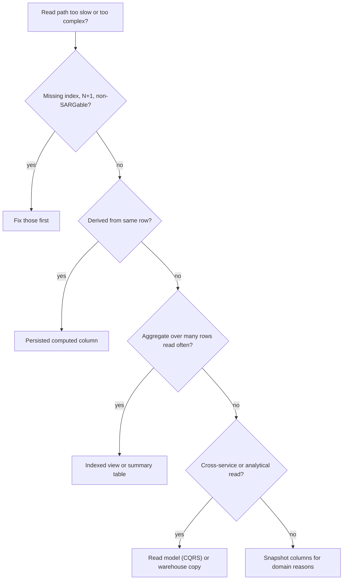

**Hands-on.**

```sql
-- 1) Persisted computed column: free consistency, indexable
ALTER TABLE dbo.OrderItems ADD LineTotal AS (Quantity * UnitPrice) PERSISTED;
CREATE NONCLUSTERED INDEX IX_OrderItems_Order_LineTotal ON dbo.OrderItems (OrderId) INCLUDE (LineTotal);

-- 2) Indexed view: pre-aggregated revenue per customer per day (read-heavy dashboards)
CREATE VIEW dbo.vCustomerDailyRevenue WITH SCHEMABINDING AS
SELECT o.CustomerId, CAST(o.OrderDate AS DATE) AS OrderDay, SUM(o.TotalAmount) AS Revenue, COUNT_BIG(*) AS Orders
FROM dbo.Orders o GROUP BY o.CustomerId, CAST(o.OrderDate AS DATE);
GO
CREATE UNIQUE CLUSTERED INDEX CX_vCustomerDailyRevenue ON dbo.vCustomerDailyRevenue (CustomerId, OrderDay);
-- Query it with NOEXPAND outside Enterprise-level automatic matching:
SELECT OrderDay, Revenue FROM dbo.vCustomerDailyRevenue WITH (NOEXPAND) WHERE CustomerId = 4242;
-- Cost: every INSERT/UPDATE/DELETE on Orders now also maintains the view → measure write latency.

-- 3) Summary table maintained set-based (rebuildable)
CREATE TABLE dbo.CustomerStats (CustomerId INT PRIMARY KEY, OrderCount INT NOT NULL, TotalSpent DECIMAL(14,2) NOT NULL, LastOrderDate DATETIME2(0) NULL);
MERGE dbo.CustomerStats AS t
USING (SELECT CustomerId, COUNT(*) c, SUM(TotalAmount) s, MAX(OrderDate) d FROM dbo.Orders GROUP BY CustomerId) AS x
ON t.CustomerId = x.CustomerId
WHEN MATCHED THEN UPDATE SET OrderCount = x.c, TotalSpent = x.s, LastOrderDate = x.d
WHEN NOT MATCHED THEN INSERT VALUES (x.CustomerId, x.c, x.s, x.d);      -- MERGE has known pitfalls: prefer separate UPDATE/INSERT in critical paths
```

```csharp
// Domain-correct denormalization: snapshot price and customer name at order time (must NOT change when master data changes)
public class OrderItem { public decimal UnitPrice { get; set; } /* price at purchase, not Product.CurrentPrice */ }

// Read model projection updated from events (CQRS): idempotent upsert keyed by CustomerId
public async Task Handle(OrderPlaced e, CancellationToken ct)
{
    await db.Database.ExecuteSqlInterpolatedAsync($@"
        MERGE dbo.CustomerStats AS t USING (VALUES ({e.CustomerId})) AS s(CustomerId) ON t.CustomerId = s.CustomerId
        WHEN MATCHED THEN UPDATE SET OrderCount = t.OrderCount + 1, TotalSpent = t.TotalSpent + {e.Total}, LastOrderDate = {e.PlacedAt}
        WHEN NOT MATCHED THEN INSERT (CustomerId, OrderCount, TotalSpent, LastOrderDate) VALUES ({e.CustomerId}, 1, {e.Total}, {e.PlacedAt});", ct);
}   // Needs inbox/idempotency so a redelivered OrderPlaced is not counted twice (see the Inbox guide)
```

**Real-world.** An e-commerce site's category page joined 9 tables; after normalization review, the team kept OLTP 3NF, added an indexed view for product counts per category and a read model in Redis/Azure AI Search for the faceted list — p95 dropped 800 → 60 ms without corrupting the transactional model.

**When to normalize / denormalize.** Normalize the *system of record*; denormalize *read paths* deliberately and only after measuring, with a documented source of truth and a rebuild path. Denormalization is a **cache with schema**.

**Advantages / disadvantages.** Normalized: integrity, smaller storage, simpler writes; denormalized: faster reads/fewer joins; but update anomalies, write amplification, consistency work, more code.

**Mistakes.** Denormalizing before measuring; duplicated columns with no update strategy; EAV (entity-attribute-value) "flexible schema" tables that kill query performance; JSON-for-everything; over-normalizing (lookup table per boolean); indexed views on write-hot tables; MERGE misuse; forgetting that snapshot columns are *intentional* history.

**Performance / reliability / security.** Denormalized copies multiply PII footprint (right-to-be-forgotten must reach every copy); indexed views add lock/latch pressure on writers.

**Troubleshooting.** Consistency drift → reconciliation queries comparing source vs summary; slow writes after adding an indexed view → plan of the DML shows view maintenance operators.

**Related.** [Chapters 5](#5-index-fundamentals), [13](#13-join-optimization), [CQRS](../03-architectural-patterns/02-CQRS-pattern/CQRS-pattern.md), [Event Sourcing](../03-architectural-patterns/03-event-sourcing/event-sourcing.md), [Part 2 — caching, replicas](02-database-architecture-scaling-and-troubleshooting.md).

### Interview Q&A — chapter 19

**Q: When would you denormalize?**
A: After proving the read path is a bottleneck that indexing/query fixes can't solve — for read-heavy reporting, hot paths with expensive aggregates, or when service boundaries forbid joins. I choose the least risky mechanism (computed column, indexed view, summary table, read model) with a single source of truth and a rebuild/reconciliation path.

**Q: Normalized vs denormalized in microservices?**
A: Each service normalizes its own store; cross-service reads use API composition or event-fed read models (denormalized copies), accepting eventual consistency.

*Follow-ups.* "Indexed view drawbacks?" → write overhead, restrictions, lock contention, schema-binding makes DDL harder. "Snapshot column vs normalization violation?" → capturing price/name at purchase is the *correct* temporal model, not duplication.

---
# Part B — Concurrency and transactions

## 20. ACID properties

**Simple idea.** A transaction is a group of operations that must succeed or fail *as a unit* (**A**tomicity), leave data valid (**C**onsistency), not trip over other transactions (**I**solation) and survive crashes once committed (**D**urability).

**Architect depth — how SQL Server delivers each property.**

- **Atomicity — the transaction log + rollback.** Every change writes log records (with before/after images) *before* the data page is changed in memory. On `ROLLBACK` or crash recovery, the **undo** phase reverses uncommitted work using the log. Note: a rollback typically takes about as long as the work already done (and **blocks log truncation** while it runs).
- **Consistency — constraints and application invariants.** Database-level: PK/UNIQUE/FK/CHECK/NOT NULL, triggers. *Consistency is a joint responsibility*: the engine enforces declared rules; the application defines the invariants (e.g. "stock never negative" → needs a CHECK or a guarded UPDATE).
- **Isolation — locks and/or row versions** ([chapters 21](#21-transaction-isolation-levels), [22](#22-locking-and-blocking), [25](#25-row-versioning)). A spectrum, not a switch; stronger isolation = fewer anomalies but more blocking.
- **Durability — Write-Ahead Logging (WAL) + `COMMIT` hardening.** A commit returns only after the log records are flushed to disk (`WRITELOG` wait). Data pages may be written later by checkpoint/lazy writer; after a crash, **redo** replays committed log records, **undo** reverses uncommitted ones (**ARIES-style recovery**). **Delayed durability** trades the guarantee for throughput (can lose the last few ms of commits) — appropriate only for tolerant workloads. **Accelerated Database Recovery (ADR, 2019+/Azure SQL)** keeps a persistent version store so rollback and recovery are near-instant regardless of transaction length.
- **Implicit vs explicit transactions.** By default each statement is its own *autocommit* transaction (many tiny commits = many log flushes). `BEGIN TRAN ... COMMIT` groups them; `SET IMPLICIT_TRANSACTIONS ON` (JDBC-style) opens a transaction at first statement — dangerous if the app forgets to commit.
- **Distributed transactions.** MSDTC / `TransactionScope` spanning databases or resource managers (2PC) — heavy and fragile; cloud/microservices prefer sagas + idempotency ([Distributed transactions](../03-architectural-patterns/distributed-transaction.md), [Inbox/Outbox](../15-inbox-outbox-and-reliable-messaging/inbox-outbox-and-reliable-messaging.md)). Azure SQL supports elastic transactions in limited form.

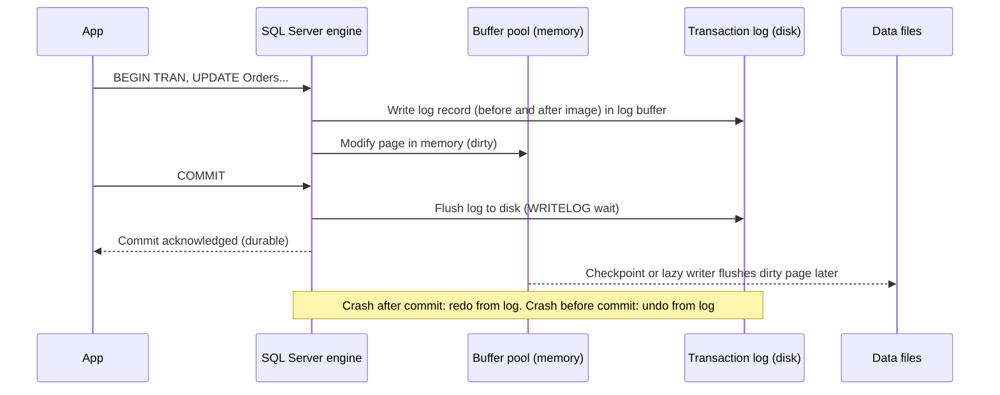

**Hands-on.**

```sql
-- Atomicity and error handling done right
CREATE OR ALTER PROCEDURE dbo.PlaceOrder @CustomerId INT, @ProductId INT, @Qty INT, @UnitPrice DECIMAL(12,2)
AS
BEGIN
    SET NOCOUNT ON; SET XACT_ABORT ON;            -- any runtime error aborts and rolls back the batch
    BEGIN TRY
        BEGIN TRAN;
            DECLARE @OrderId BIGINT;
            INSERT dbo.Orders (CustomerId, OrderDate, Status, TotalAmount, CountryCode)
            VALUES (@CustomerId, SYSUTCDATETIME(), 0, @Qty * @UnitPrice, 'US');
            SET @OrderId = SCOPE_IDENTITY();
            INSERT dbo.OrderItems (OrderId, ProductId, Quantity, UnitPrice) VALUES (@OrderId, @ProductId, @Qty, @UnitPrice);
        COMMIT;
        SELECT @OrderId AS OrderId;
    END TRY
    BEGIN CATCH
        IF @@TRANCOUNT > 0 ROLLBACK;
        THROW;                                     -- rethrow to the caller with the original error
    END CATCH
END
GO

-- Observe durability cost: many autocommits vs one transaction (WRITELOG)
SET NOCOUNT ON;
DECLARE @i INT = 0; DECLARE @t DATETIME2 = SYSUTCDATETIME();
WHILE @i < 10000 BEGIN INSERT dbo.OrderItems (OrderId, ProductId, Quantity, UnitPrice) VALUES (1,1,1,1); SET @i += 1; END   -- 10,000 log flushes
SELECT DATEDIFF(MILLISECOND, @t, SYSUTCDATETIME()) AS autocommit_ms;
SET @i = 0; SET @t = SYSUTCDATETIME();
BEGIN TRAN; WHILE @i < 10000 BEGIN INSERT dbo.OrderItems (OrderId, ProductId, Quantity, UnitPrice) VALUES (1,1,1,1); SET @i += 1; END; COMMIT;   -- one flush
SELECT DATEDIFF(MILLISECOND, @t, SYSUTCDATETIME()) AS single_tran_ms;

-- Database durability knobs
ALTER DATABASE PerfLab SET DELAYED_DURABILITY = ALLOWED;   -- then COMMIT WITH (DELAYED_DURABILITY = ON) only for tolerant writes
ALTER DATABASE PerfLab SET ACCELERATED_DATABASE_RECOVERY = ON;   -- on by default in Azure SQL; verify for your version
```

```csharp
// EF Core: SaveChanges is already one transaction. Use an explicit transaction for multiple SaveChanges/raw SQL,
// and wrap it in the execution strategy so transient failures retry the WHOLE unit.
var strategy = db.Database.CreateExecutionStrategy();
await strategy.ExecuteAsync(async () =>
{
    await using var tx = await db.Database.BeginTransactionAsync();
    var order = new Order { CustomerId = id, OrderDate = DateTime.UtcNow, TotalAmount = total, CountryCode = "US" };
    db.Orders.Add(order);
    await db.SaveChangesAsync();                       // gets OrderId
    db.OrderItems.AddRange(lines.Select(l => new OrderItem { OrderId = order.OrderId, ProductId = l.ProductId, Quantity = l.Qty, UnitPrice = l.Price }));
    await db.SaveChangesAsync();
    await tx.CommitAsync();
});
// System.Transactions: use TransactionScopeAsyncFlowOption.Enabled with async code (see chapter 26).
```

**Real-world.** Importing 5M rows with `INSERT` per row in autocommit mode took 2 hours because each row paid a log flush; batching 5,000 rows per transaction (or `SqlBulkCopy`) cut it to minutes. Conversely, wrapping the whole import in a single transaction blew the log and blocked everything — batch size is a **trade-off** (chapter 26).

**When transactions are/aren't needed.** Needed for multi-statement invariants. A single-statement `UPDATE ... WHERE` guarded by a condition is already atomic; avoid transactions wrapping reads that need no invariant (they hold locks/versions longer).

**Advantages / disadvantages.** ACID gives correctness; costs: latency of log flush, lock/version overhead, rollback time, reduced concurrency, difficulty scaling across nodes (CAP/PACELC trade-offs in [Foundations](../01%20Foundations.md)).

**Mistakes.** Forgetting `XACT_ABORT`; catching errors without rolling back (orphan open transactions); using transactions to span user think-time or HTTP calls; assuming `READ COMMITTED` protects read-modify-write (it doesn't — [chapter 24](#24-optimistic-versus-pessimistic-concurrency)); distributed 2PC across services; treating "Consistency" as automatically guaranteed.

**Performance / reliability / security / Azure.** Log throughput caps commit rate; Azure SQL log-rate limits by tier; put log on low-latency storage on VMs; keep transactions short; ADR makes long rollbacks cheap; auditing/ledger tables provide tamper evidence (SQL Ledger) for compliance needs.

**Troubleshooting.** `WRITELOG` waits → log latency or too many tiny commits; `sys.dm_tran_active_transactions`, `sys.dm_tran_database_transactions` (log used), `DBCC OPENTRAN`, `log_reuse_wait_desc`.

**Related.** [Chapters 21](#21-transaction-isolation-levels), [26](#26-long-running-transactions), [Distributed Transactions](../03-architectural-patterns/distributed-transaction.md), [Saga](../03-architectural-patterns/01-SAGA-pattern/SAGA-pattern.md).

### Interview Q&A — chapter 20

**Q: How does SQL Server guarantee durability?**
A: Write-ahead logging: log records are flushed to disk before commit returns. Data pages are written lazily; crash recovery redoes committed changes from the log and undoes uncommitted ones.

**Q: Does ACID's "C" mean the database guarantees business consistency?**
A: Only for declared constraints. Business invariants must be expressed as constraints or enforced inside the transaction by the application.

*Follow-ups.* "Why is a rollback slow?" → undo must reverse all changes, single-threaded in the transaction's context; ADR makes it near-instant. "When is delayed durability acceptable?" → telemetry/logging style workloads that can lose the last few commits.

---

## 21. Transaction isolation levels

**Simple idea.** Isolation answers: *what may a transaction see while other transactions are changing data?* Stronger levels prevent more anomalies but hold locks longer (or keep row versions), which reduces concurrency.

**Architect depth.**

| Level | Dirty read | Non-repeatable read | Phantom | Mechanism (SQL Server) |
| --- | --- | --- | --- | --- |
| **READ UNCOMMITTED** | possible | possible | possible | No shared locks; sees uncommitted data (`NOLOCK` = same, per table) |
| **READ COMMITTED** (default, locking) | prevented | possible | possible | Shared locks released as soon as the row is read; blocks on writers |
| **READ COMMITTED SNAPSHOT (RCSI)** (database option; **default in Azure SQL Database**) | prevented | possible | possible | Reads the last committed *version* (statement-level snapshot); readers don't block writers |
| **REPEATABLE READ** | prevented | prevented | possible | Shared locks held to end of transaction on rows read |
| **SERIALIZABLE** | prevented | prevented | prevented | Key-range locks; range protected until commit |
| **SNAPSHOT** (needs `ALLOW_SNAPSHOT_ISOLATION ON`) | prevented | prevented | prevented | Transaction-level snapshot via row versions; **update conflicts (error 3960)** instead of blocking; still allows **write skew** |

- **Anomalies.**
  - *Dirty read:* reading uncommitted data that may roll back.
  - *Non-repeatable read:* re-reading a row gives a different value.
  - *Phantom:* re-running a range query returns new rows.
  - *Lost update:* two transactions read-then-write the same row, the second overwrites the first (classic read-modify-write bug; READ COMMITTED does **not** prevent it).
  - *Write skew:* two transactions read overlapping data, each update *different* rows based on what they read, jointly violating an invariant ("at least one doctor on call"). **SNAPSHOT permits it; SERIALIZABLE prevents it.**
- **Locking vs versioning.** Locking readers block writers (and vice versa) — consistent but contended. Row-versioning readers see a snapshot — less blocking, more tempdb/PVS I/O and update conflicts to handle.
- **RCSI is the pragmatic default** for most OLTP: eliminates reader/writer blocking, keeps the read-committed semantic model (each *statement* sees the latest committed data as of its start). Beware: code that relied on blocking (e.g. "read then insert if missing" without hints) was already racy; RCSI makes the race window larger.
- **SNAPSHOT isolation** for read-only reporting transactions needing a consistent multi-statement view, or optimistic update patterns.
- **SERIALIZABLE** for strict invariants over ranges (uniqueness "check then insert", scheduling overlap) — expensive and deadlock-prone; prefer unique constraints, `UPDLOCK, HOLDLOCK` on narrow ranges, or `sp_getapplock`.
- **Scope.** Set per connection/transaction (`SET TRANSACTION ISOLATION LEVEL ...`), or per table hint; EF Core: `BeginTransaction(IsolationLevel.X)`; `TransactionScope` defaults to **SERIALIZABLE** (!) unless you set `IsolationLevel.ReadCommitted` — a notorious source of deadlocks.

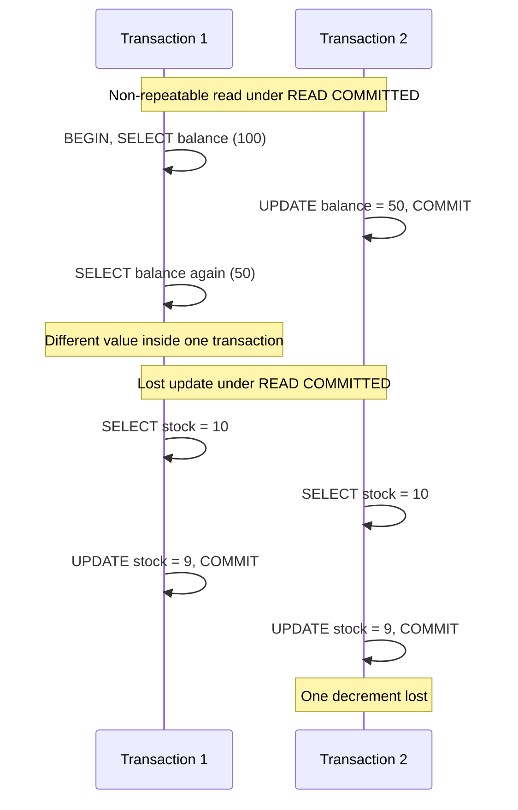

**Hands-on: two-session demos (open two query windows).**

```sql
-- Setup
CREATE TABLE dbo.Accounts (AccountId INT PRIMARY KEY, Balance DECIMAL(12,2) NOT NULL, RowVer ROWVERSION);
INSERT dbo.Accounts (AccountId, Balance) VALUES (1,100),(2,100);

-- === Demo 1: dirty read ===
-- Session A:  BEGIN TRAN; UPDATE dbo.Accounts SET Balance = 0 WHERE AccountId = 1;   -- (not committed)
-- Session B:  SET TRANSACTION ISOLATION LEVEL READ UNCOMMITTED; SELECT Balance FROM dbo.Accounts WHERE AccountId = 1;  -- sees 0 (dirty)
-- Session A:  ROLLBACK;                                    -- B acted on data that never existed

-- === Demo 2: reader blocked by writer (READ COMMITTED, locking) ===
-- Session A:  BEGIN TRAN; UPDATE dbo.Accounts SET Balance = 50 WHERE AccountId = 1;
-- Session B:  SELECT Balance FROM dbo.Accounts WHERE AccountId = 1;                   -- BLOCKED (waits for A)
-- Fix → enable RCSI:
ALTER DATABASE PerfLab SET READ_COMMITTED_SNAPSHOT ON WITH ROLLBACK IMMEDIATE;        -- needs exclusive moment; do in a window
-- Session B now returns the last committed value (100) immediately.

-- === Demo 3: lost update (READ COMMITTED) → fix with UPDLOCK or atomic UPDATE ===
-- Both sessions: BEGIN TRAN; DECLARE @b DECIMAL(12,2) = (SELECT Balance FROM dbo.Accounts WHERE AccountId = 1);
--                WAITFOR DELAY '00:00:10'; UPDATE dbo.Accounts SET Balance = @b - 10 WHERE AccountId = 1; COMMIT;
-- Result: 90 instead of 80. Fixes:
UPDATE dbo.Accounts SET Balance = Balance - 10 WHERE AccountId = 1 AND Balance >= 10;     -- atomic, also checks the invariant
-- or: SELECT ... FROM dbo.Accounts WITH (UPDLOCK, ROWLOCK) WHERE AccountId = 1;          -- pessimistic: second session waits

-- === Demo 4: phantom (REPEATABLE READ) vs SERIALIZABLE ===
-- Session A: SET TRANSACTION ISOLATION LEVEL REPEATABLE READ; BEGIN TRAN; SELECT COUNT(*) FROM dbo.Orders WHERE CustomerId = 5;
-- Session B: INSERT dbo.Orders (CustomerId, OrderDate, Status, TotalAmount, CountryCode) VALUES (5, SYSUTCDATETIME(), 0, 1, 'US');   -- succeeds
-- Session A: SELECT COUNT(*) ... again → phantom. Use SERIALIZABLE (range locks: B blocks) if the invariant needs it.

-- === Demo 5: SNAPSHOT isolation and update conflict (error 3960) ===
ALTER DATABASE PerfLab SET ALLOW_SNAPSHOT_ISOLATION ON;
-- Session A: SET TRANSACTION ISOLATION LEVEL SNAPSHOT; BEGIN TRAN; SELECT Balance FROM dbo.Accounts WHERE AccountId = 2;
-- Session B: UPDATE dbo.Accounts SET Balance = 10 WHERE AccountId = 2;   (autocommit)
-- Session A: UPDATE dbo.Accounts SET Balance = 20 WHERE AccountId = 2;   → Msg 3960 update conflict; app must retry the transaction.

-- Which level is each session actually using?
SELECT session_id, transaction_isolation_level FROM sys.dm_exec_sessions WHERE is_user_process = 1;   -- 1 RU, 2 RC, 3 RR, 4 SER, 5 SNAPSHOT
SELECT name, is_read_committed_snapshot_on, snapshot_isolation_state_desc FROM sys.databases WHERE name = DB_NAME();
```

```csharp
// EF Core: choose the level per unit of work
await using var tx = await db.Database.BeginTransactionAsync(System.Data.IsolationLevel.Snapshot);
// ... queries, SaveChanges ...
await tx.CommitAsync();

// System.Transactions: ALWAYS set the level — default is Serializable
var opts = new TransactionOptions { IsolationLevel = IsolationLevel.ReadCommitted, Timeout = TimeSpan.FromSeconds(30) };
using var scope = new TransactionScope(TransactionScopeOption.Required, opts, TransactionScopeAsyncFlowOption.Enabled);
```

**Real-world.** A ticketing system's reports used `WITH (NOLOCK)` to avoid blocking checkout; finance saw totals that double-counted rows moved by page splits. Enabling RCSI removed the blocking *and* the wrong numbers; `NOLOCK` hints were removed.

**When to use which.** RCSI: default OLTP. SNAPSHOT: consistent multi-statement read-only views or optimistic writers. REPEATABLE READ/SERIALIZABLE: targeted invariants (short, narrow). READ UNCOMMITTED: almost never (approximate monitoring only).

**Advantages / disadvantages.** Versioning reduces blocking but costs tempdb/PVS, 14-byte row overhead, and adds update conflicts (SNAPSHOT). Locking is memory-light, consistent, but blocks.

**Mistakes.** `NOLOCK` as a performance fix; assuming READ COMMITTED prevents lost updates; `TransactionScope` default SERIALIZABLE; turning on SNAPSHOT without retry logic for 3960; switching to RCSI without testing code that relied on blocking; wrapping reads in long REPEATABLE READ/SERIALIZABLE transactions.

**Performance / reliability / security / Azure.** Azure SQL Database: **RCSI on by default**, SNAPSHOT available; Managed Instance defaults vary (*verify*). Version store pressure appears in tempdb (or **PVS** in the user DB with ADR). Row versions are not an access-control feature; permissions still apply.

**Troubleshooting.** Unexpected blocking → current isolation level of blockers; stale/odd results → RCSI semantics (statement-level snapshot); 3960 spikes → conflicting update hotspots; tempdb growth → long-running snapshot transactions ([chapter 25](#25-row-versioning)).

**Related.** [Chapters 22](#22-locking-and-blocking), [24](#24-optimistic-versus-pessimistic-concurrency), [25](#25-row-versioning).

### Interview Q&A — chapter 21

**Q: Explain isolation levels and which you use by default.**
A: Read Uncommitted (no shared locks; dirty reads), Read Committed (locks released after the read; no dirty reads), Repeatable Read (read locks held; no non-repeatable reads), Serializable (range locks; no phantoms), Snapshot (transaction-level row-version snapshot; no blocking readers; update conflicts). I default OLTP databases to RCSI — non-blocking reads with committed data — and use targeted stronger isolation or explicit locks for specific invariants.

**Q: Does Snapshot isolation prevent all anomalies?**
A: No. It prevents dirty/non-repeatable reads and phantoms for reads but allows **write skew**, because two transactions can update different rows based on overlapping reads. Use serializable semantics, constraints or explicit locks for those invariants.

*Follow-ups.* "How do you prevent lost updates?" → atomic `UPDATE x = x - n WHERE x >= n`, rowversion optimistic concurrency, `UPDLOCK`, or SNAPSHOT with conflict retry. "Is `NOLOCK` the same as READ UNCOMMITTED?" → yes at table level; it can also return duplicated or missed rows during allocation-order scans.

---

## 22. Locking and blocking

**Simple idea.** To keep transactions from corrupting each other, SQL Server places **locks** on data it reads or changes. When a transaction needs a lock that another holds in a conflicting mode, it **waits** — that wait is **blocking**. Some blocking is normal; *long* blocking chains are outages.

**Architect depth.**

- **Lock granularity & hierarchy.** Row (`RID/KEY`), page, table (`OBJECT`), plus others (database, partition, `HoBT`). Intent locks (**IS, IX, SIX**) are taken at higher levels to signal that lower-level locks exist, so the engine needn't scan row locks to check a table lock.
- **Lock modes.**
  - **Shared (S)** — readers (under locking read committed, released immediately; under repeatable read+, held).
  - **Exclusive (X)** — writers; incompatible with everything.
  - **Update (U)** — "I'm going to modify this": taken when reading rows for update; compatible with S but not with other U — the mechanism that prevents the classic conversion deadlock of two S→X upgrades.
  - **Intent (IS/IX/SIX)**, **Schema (Sch-S/Sch-M)** (DDL vs queries), **Key-range** (RangeS-S etc. for serializable), **Bulk update (BU)**.
- **Compatibility matrix (essentials).**

| Held \ Requested | IS | IX | S | U | X |
| --- | --- | --- | --- | --- | --- |
| **IS** | ✔ | ✔ | ✔ | ✔ | ✘ |
| **IX** | ✔ | ✔ | ✘ | ✘ | ✘ |
| **S** | ✔ | ✘ | ✔ | ✔ | ✘ |
| **U** | ✔ | ✘ | ✔ | ✘ | ✘ |
| **X** | ✘ | ✘ | ✘ | ✘ | ✘ |

- **Lock escalation.** When one statement acquires ~**5,000 locks** on a single object (or memory pressure thresholds), SQL Server converts row/page locks to a **table (or partition) lock** to save memory. Good for memory, terrible for concurrency (a big update blocks the whole table). Mitigate with batching (<5,000 rows), good indexes (touch fewer rows), `ALTER TABLE ... SET (LOCK_ESCALATION = AUTO/DISABLE)` (partition-level with partitioned tables), RCSI for readers.
- **Blocking vs deadlock.** Blocking = A waits for B, B eventually finishes. Deadlock = cycle; SQL Server kills a victim ([chapter 23](#23-deadlocks-and-deadlock-graphs)).
- **Blocking chains.** Lead blocker (the head, often *idle* with an open transaction: `sleeping` status, `open_transaction_count > 0`) → many waiters. The head, not the victims, is the problem.
- **Common causes.** Long transactions; user interaction inside transactions; missing indexes → scans lock many rows; large batch updates; lock escalation; serializable/repeatable read; unindexed FKs (parent delete scans child with locks); triggers; poorly-ordered access; connection pool "leak" of open transactions (return to pool without commit — `sp_reset_connection` rolls back, but app logic might hold the connection while waiting on HTTP).
- **Lock wait timeout.** `SET LOCK_TIMEOUT` (default infinite!) — ADO.NET `CommandTimeout` (30 s) cancels *client-side* but the blocker continues; consider `LOCK_TIMEOUT` for fail-fast.
- **Observing locks.** `sys.dm_tran_locks`, `sys.dm_os_waiting_tasks`, `sys.dm_exec_requests.blocking_session_id`, `sp_who2` (legacy), `sp_WhoIsActive` (community tool; excellent), blocked-process report (XEvent `blocked_process_report` with `blocked process threshold`).
- **Hints (use sparingly):** `UPDLOCK`, `HOLDLOCK`/`SERIALIZABLE`, `ROWLOCK`/`PAGLOCK`/`TABLOCK`, `READPAST` (skip locked rows — queue pattern), `NOLOCK` (dirty), `XLOCK`, `READCOMMITTEDLOCK`.

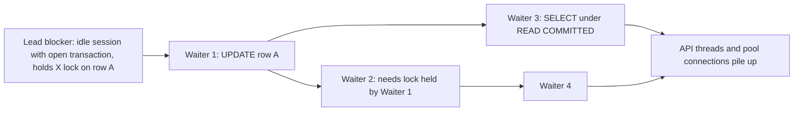

**Hands-on.**

```sql
-- Create a blocking situation
-- Session 1:
BEGIN TRAN; UPDATE dbo.Accounts SET Balance = Balance + 1 WHERE AccountId = 1;     -- leave open
-- Session 2:
SELECT Balance FROM dbo.Accounts WHERE AccountId = 1;                              -- blocked if RCSI is OFF

-- Who blocks whom, and what are they running?
SELECT r.session_id, r.blocking_session_id, r.wait_type, r.wait_time, r.status, DB_NAME(r.database_id) db,
       SUBSTRING(t.text, r.statement_start_offset/2+1,
         (CASE r.statement_end_offset WHEN -1 THEN DATALENGTH(t.text) ELSE r.statement_end_offset END - r.statement_start_offset)/2+1) AS running_sql
FROM sys.dm_exec_requests r CROSS APPLY sys.dm_exec_sql_text(r.sql_handle) t
WHERE r.blocking_session_id <> 0;

-- The *lead* blocker (often sleeping with an open transaction; its last statement is in the input buffer)
SELECT s.session_id, s.status, s.login_name, s.host_name, s.program_name, s.open_transaction_count, s.last_request_end_time,
       (SELECT text FROM sys.dm_exec_sql_text(c.most_recent_sql_handle)) AS last_sql
FROM sys.dm_exec_sessions s JOIN sys.dm_exec_connections c ON c.session_id = s.session_id
WHERE s.session_id IN (SELECT blocking_session_id FROM sys.dm_exec_requests WHERE blocking_session_id <> 0)
  AND s.session_id NOT IN (SELECT session_id FROM sys.dm_exec_requests WHERE blocking_session_id <> 0);

-- Locks held right now
SELECT request_session_id, resource_type, resource_database_id, request_mode, request_status, resource_description
FROM sys.dm_tran_locks WHERE resource_database_id = DB_ID() ORDER BY request_session_id;

-- Oldest open transactions
DBCC OPENTRAN;
SELECT TOP 5 st.session_id, at.transaction_begin_time, DATEDIFF(SECOND, at.transaction_begin_time, SYSDATETIME()) AS age_s
FROM sys.dm_tran_session_transactions st JOIN sys.dm_tran_active_transactions at ON at.transaction_id = st.transaction_id
ORDER BY at.transaction_begin_time;

-- Fail-fast instead of waiting forever
SET LOCK_TIMEOUT 5000;       -- ms → error 1222 if a lock can't be acquired

-- Control escalation on a table (e.g. highly concurrent queue table)
ALTER TABLE dbo.Orders SET (LOCK_ESCALATION = AUTO);   -- partition-level escalation if partitioned; DISABLE to avoid table locks (watch memory)

-- Blocked process report
EXEC sys.sp_configure 'blocked process threshold (s)', 10; RECONFIGURE;    -- then capture the XE event "blocked_process_report"
```

```csharp
// App-side guardrails: short timeouts + retry for blocking symptoms; never hold a transaction across I/O
builder.Services.AddDbContext<ShopDb>(o => o.UseSqlServer(cs, sql =>
{
    sql.CommandTimeout(15);                       // fail fast rather than pile up threads
    sql.EnableRetryOnFailure(5, TimeSpan.FromSeconds(5), errorNumbersToAdd: new[] { 1205 /*deadlock*/, 1222 /*lock timeout*/ });
}));
// BAD:  BeginTransaction(); await http.PostAsync(...); await SaveChanges();   // locks held during network call
// GOOD: call the external service first (or use outbox), then a short DB transaction.
```

**Real-world.** Nightly job "closed" invoices with one `UPDATE` touching 600k rows: escalation to a table lock froze the order API. Fix: indexed filter, batches of 4,000 rows with 100 ms pauses, RCSI for readers.

**When it matters.** Always in OLTP with mixed readers/writers. **When not to over-engineer:** read-mostly reporting databases (use replicas/snapshots).

**Trade-offs.** Row locks maximize concurrency but cost memory (≈100 bytes/lock); table locks are cheap but block everything; hints give control but remove adaptability.

**Mistakes.** Transactions open across HTTP calls/user input; `NOLOCK` "fixes"; unindexed foreign keys; killing sessions blindly (rollback can take as long as the work); `LOCK_TIMEOUT` ignored; huge batch updates; assuming blocking = deadlock; ignoring that the *idle* head blocker is the culprit.

**Performance / reliability / Azure.** In Azure SQL, blocked requests still consume workers/connections → `10928` worker limit errors cascade. Use **Query Store wait stats** (Lock category) to see blocked queries over time.

**Troubleshooting.** The standard recipe: (1) find the head blocker, (2) see its last statement and open transaction age, (3) identify the app/host/code path, (4) fix the cause (short tx, index, RCSI, batching), (5) only then consider `KILL`.

**Related.** [Chapters 21](#21-transaction-isolation-levels), [23](#23-deadlocks-and-deadlock-graphs), [26](#26-long-running-transactions), [27](#27-connection-pooling-and-pool-exhaustion).

### Interview Q&A — chapter 22

**Q: How do you troubleshoot blocking in production?**
A: Identify the blocked requests and the *head* blocker via `sys.dm_exec_requests`/`sys.dm_os_waiting_tasks`; inspect the blocker's session (open transaction count, last SQL, program/host); check wait types (`LCK_M_*`); determine the cause (long transaction, scan locks, escalation, isolation level) and fix it at the source — shorten transactions, add indexes, batch writes, enable RCSI. Kill the head only as mitigation.

**Q: What is lock escalation and how do you avoid its impact?**
A: Conversion of many fine-grained locks to a table/partition lock when a statement acquires ~5,000 locks or under memory pressure. Avoid by batching, better indexing, shorter transactions, RCSI for readers, and escalation settings on the table when appropriate.

*Follow-ups.* "Why does an Update lock exist?" → to avoid conversion deadlocks when two transactions read with S locks then both try to upgrade to X. "Can reading block?" → yes under locking READ COMMITTED when a writer holds X; and readers hold S until end under REPEATABLE READ/SERIALIZABLE. "Is `KILL` safe?" → it rolls back the session; large transactions roll back slowly (but ADR helps).

---

## 23. Deadlocks and deadlock graphs

**Simple idea.** A deadlock is a **circular wait**: A holds lock 1 and wants lock 2; B holds lock 2 and wants lock 1. Neither can progress, so SQL Server's **deadlock monitor** (runs every few seconds) picks a **victim** (the cheapest to roll back, or by `DEADLOCK_PRIORITY`), rolls it back and raises **error 1205**.

**Architect depth.**

- **Detection.** Lock monitor thread checks wait-for graph periodically (5 s default, accelerating when deadlocks are found). Victim choice: lowest `DEADLOCK_PRIORITY`, then least log used.
- **Typical causes (and fixes).**
  1. **Inconsistent access order** — T1 updates A then B; T2 updates B then A. *Fix:* standardize order (always parent→child, lower id→higher id).
  2. **Read-then-write upgrade conflict** — both take S locks on a row then both want X. *Fix:* `UPDLOCK` hint on the initial read, or a single atomic `UPDATE`.
  3. **Missing index** — scans lock many rows, increasing overlap. *Fix:* index the predicate/FK.
  4. **Serializable/repeatable read** range locks (and `TransactionScope` default serializable). *Fix:* use READ COMMITTED/RCSI; narrow range.
  5. **Lookups and index-order conflicts** — reader uses NC index then lookup to clustered; writer updates clustered then NC index (opposite order). *Fix:* covering index (eliminates lookup), RCSI.
  6. **Foreign key checks/cascades**, triggers, indexed view maintenance, page/lock escalation conflicts.
  7. **Parallelism deadlocks** (intra-query) — exchange-related; rare; check `MAXDOP`/plan.
  8. **Application-level** (app lock/`sp_getapplock`, multiple connections of the same user).
- **Reading a deadlock graph (XML or SSMS graph).** Elements: `<process-list>` (each `process` with `spid`, `waitresource`, `lockMode`, `inputbuf`/`frame`, `isolationlevel`, `trancount`, `clientapp`, `hostname`), `<resource-list>` (keylock/pagelock/objectlock with `owner-list` and `waiter-list`), `victim-list`. Steps: (1) identify both statements; (2) see which resources (index/key) each holds vs waits; (3) map to the access pattern (order inversion? upgrade? range?); (4) decide the fix.
- **Capturing.** The built-in **`system_health` Extended Events session** records `xml_deadlock_report` (ring buffer/file) by default; also trace flag 1222 (error log; legacy), Query Store doesn't capture deadlocks; Azure SQL: use the `xml_deadlock_report` event in a database-scoped XE session, **Azure Monitor/Diagnostic settings → Deadlocks** metric/log category.
- **Handling in app.** Deadlock is a *normal, retryable* error in busy systems: **retry the whole transaction** (idempotent unit) with jittered backoff (2–3 attempts). Don't retry just the failed statement — the transaction is rolled back.
- **Mitigations beyond ordering.** Smaller/shorter transactions; RCSI; covering indexes; `DEADLOCK_PRIORITY LOW` for background jobs so they yield; avoid hot-row designs (counter tables → use sequences or sharded counters); queue patterns with `READPAST`.

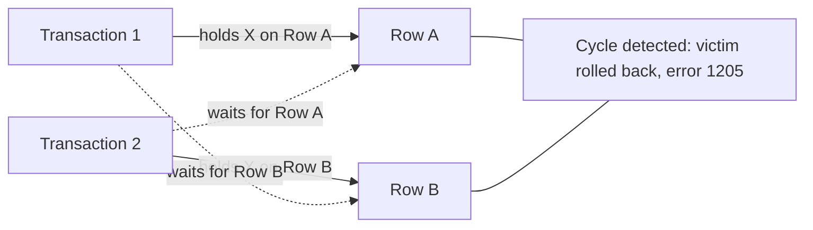

**Hands-on.**

```sql
-- Classic order-inversion demo (two sessions, run step by step)
-- Session 1:                                      Session 2:
-- BEGIN TRAN;                                     BEGIN TRAN;
-- UPDATE dbo.Accounts SET Balance=Balance-1       UPDATE dbo.Accounts SET Balance=Balance-1
--   WHERE AccountId = 1;                            WHERE AccountId = 2;
-- (wait ~5s)                                      (wait ~5s)
-- UPDATE dbo.Accounts SET Balance=Balance+1       UPDATE dbo.Accounts SET Balance=Balance+1
--   WHERE AccountId = 2;  -- blocks                   WHERE AccountId = 1;  -- deadlock → one gets 1205

-- Read the deadlocks captured by system_health (works on boxed SQL Server)
;WITH x AS (
  SELECT CAST(target_data AS XML) AS td FROM sys.dm_xe_session_targets t
  JOIN sys.dm_xe_sessions s ON s.address = t.event_session_address
  WHERE s.name = 'system_health' AND t.target_name = 'ring_buffer')
SELECT d.value('(@timestamp)[1]','datetime2') AS utc_time,
       d.query('(data/value/deadlock)[1]') AS deadlock_graph
FROM x CROSS APPLY td.nodes('//RingBufferTarget/event[@name="xml_deadlock_report"]') AS q(d)
ORDER BY utc_time DESC;

-- Fix 1: consistent order
-- Always lock the lower AccountId first:
CREATE OR ALTER PROCEDURE dbo.Transfer @From INT, @To INT, @Amount DECIMAL(12,2) AS
BEGIN
    SET NOCOUNT ON; SET XACT_ABORT ON;
    DECLARE @first INT = IIF(@From < @To, @From, @To), @second INT = IIF(@From < @To, @To, @From);
    BEGIN TRAN;
        SELECT 1 FROM dbo.Accounts WITH (UPDLOCK, ROWLOCK) WHERE AccountId = @first;
        SELECT 1 FROM dbo.Accounts WITH (UPDLOCK, ROWLOCK) WHERE AccountId = @second;
        UPDATE dbo.Accounts SET Balance -= @Amount WHERE AccountId = @From AND Balance >= @Amount;
        IF @@ROWCOUNT = 0 THROW 50001, 'Insufficient funds', 1;
        UPDATE dbo.Accounts SET Balance += @Amount WHERE AccountId = @To;
    COMMIT;
END

-- Fix 2: let background jobs be the victim
SET DEADLOCK_PRIORITY LOW;
```

```csharp
// Retry the whole unit of work on deadlock (1205) with jittered backoff — using Polly v8
var pipeline = new ResiliencePipelineBuilder()
    .AddRetry(new RetryStrategyOptions
    {
        ShouldHandle = new PredicateBuilder().Handle<SqlException>(e => e.Number is 1205 or 1222 or 3960),
        MaxRetryAttempts = 3,
        BackoffType = DelayBackoffType.Exponential,
        UseJitter = true,
        Delay = TimeSpan.FromMilliseconds(100)
    }).Build();

await pipeline.ExecuteAsync(async ct =>
{
    await using var tx = await db.Database.BeginTransactionAsync(ct);   // whole transaction is the retry unit
    // ... business logic + SaveChanges ...
    await tx.CommitAsync(ct);
}, cancellationToken);
// With EnableRetryOnFailure(errorNumbersToAdd: [1205]) EF's execution strategy does this too, but requires user-initiated transactions to run inside strategy.ExecuteAsync.
```

**Real-world.** Peak-hour deadlocks (40/min) on `Inventory`: `CheckoutService` updated `Cart → Inventory`, `RestockService` updated `Inventory → Cart`. Fix: both lock in the same order; the unindexed FK `CartItems.ProductId` got an index (shorter scans); checkout retried on 1205 with jitter; deadlocks dropped to ~0.

**When retry is wrong.** Non-idempotent side effects (emails/payments) inside the transaction — make them outbox-driven after commit ([Inbox/Outbox](../15-inbox-outbox-and-reliable-messaging/inbox-outbox-and-reliable-messaging.md)).

**Advantages / disadvantages.** Engine auto-resolves deadlocks (no permanent hang), but victims lose work and apps must handle 1205; prevention needs design discipline.

**Mistakes.** Not retrying; retrying a statement instead of the transaction; `NOLOCK` to avoid deadlocks (masks the pattern); `TransactionScope` defaults; retrying forever without backoff (amplifies load); not capturing graphs; dismissing "occasional deadlocks" until peak.

**Performance / reliability / Azure.** Deadlocks waste CPU/log (work is rolled back); under load, retries can synchronize and re-deadlock — add jitter; in Azure SQL, monitor the **Deadlocks** metric and capture graphs via XE to blob/event file.

**Troubleshooting.** Get 3–5 graphs from different times; group by the pair of statements; most deadlocks are 1–2 patterns. Check `waitresource` (e.g. `KEY: 5:72057594038779904 (hash)` → map with `sys.dm_db_page_info`/`%%lockres%%` or Query Store).

**Related.** [Chapters 21](#21-transaction-isolation-levels), [22](#22-locking-and-blocking), [24](#24-optimistic-versus-pessimistic-concurrency).

### Interview Q&A — chapter 23

**Q: You see error 1205 spikes at peak. What do you do?**
A: Capture deadlock graphs from `system_health` XE; identify the two statements, resources and lock modes; classify the cause (order inversion, S→X upgrade, missing index, lookup/index-order conflict, serializable ranges); fix (consistent access order, `UPDLOCK`/atomic update, index, RCSI, shorter transactions, `DEADLOCK_PRIORITY`); add idempotent retry with jitter in the app; monitor rate afterwards.

**Q: How does SQL Server choose the victim?**
A: Lowest `DEADLOCK_PRIORITY`; ties broken by least estimated rollback cost (log used). The victim gets 1205 and its transaction rolls back.

*Follow-ups.* "Can reads deadlock with writes?" → yes, under locking READ COMMITTED when index-order differs (lookup vs update); RCSI removes reader-side locks. "Why does a covering index reduce deadlocks?" → it removes the clustered-index lookup that creates the opposite lock order.

---

## 24. Optimistic versus pessimistic concurrency

**Simple idea.** **Pessimistic:** lock first — "I assume a conflict will happen, so nobody else touches it until I'm done." **Optimistic:** don't lock — "I assume conflicts are rare; at write time I'll check that nobody changed the row; if they did, I retry or tell the user."

**Architect depth.**

| | Pessimistic | Optimistic |
| --- | --- | --- |
| How | Locks held (`UPDLOCK`, `HOLDLOCK`, SERIALIZABLE, app locks) | Version check at write: `rowversion`/ETag/timestamp/`WHERE col = @original` |
| Conflict result | Waiters block (maybe deadlock) | One writer fails (0 rows affected / `DbUpdateConcurrencyException`) → retry/merge/reject |
| Best for | High contention on a *small* hot set (inventory counters, queues, seat reservation), short critical sections | Low contention, long user think-time (edit forms, REST resources with ETag), scale-out stateless services |
| Cost | Reduced concurrency, deadlocks, locks tied to a connection (bad across HTTP calls) | Retry logic, user-facing conflict handling, wasted work |

- **SQL Server building blocks.**
  - **`rowversion` (`timestamp`)** column — automatically incremented 8-byte binary unique per DB on every row change. Optimistic token.
  - **EF Core concurrency tokens:** `[Timestamp]`/`IsRowVersion()` or `IsConcurrencyToken()` on other columns. `SaveChanges` issues `UPDATE ... WHERE Id=@id AND RowVer=@orig` and throws `DbUpdateConcurrencyException` if 0 rows are affected.
  - **HTTP:** `ETag`/`If-Match` header (map to rowversion) → `412 Precondition Failed` or `409 Conflict`; `If-None-Match` for conditional GET (see [ASP.NET Core internals](../10-aspnet-core-web-api-internals/aspnet-core-web-api-internals.md)).
  - **Pessimistic hints:** `UPDLOCK` (take U lock while reading → blocks other updaters not readers), `ROWLOCK`, `HOLDLOCK`, `READPAST` (skip locked rows — work queue), `XLOCK`; **application locks** `sp_getapplock` (named mutex, scope transaction/session) for critical sections not tied to a row (e.g. "only one instance runs the nightly job").
  - **Atomic conditional UPDATE** (`SET Stock = Stock - @q WHERE Stock >= @q`) — the cheapest, safest form: no read-modify-write window. Prefer this whenever the logic fits in a statement.
  - **Optimistic with snapshot isolation:** SNAPSHOT gives first-committer-wins (error 3960) — engine-level optimistic concurrency.
- **Queue-table pattern (competing consumers on SQL).** `SELECT TOP (n) ... WITH (UPDLOCK, READPAST, ROWLOCK) ... ORDER BY Id` inside a transaction (or `UPDATE TOP (n) ... OUTPUT inserted.*` with a status flip) lets multiple workers claim distinct rows without blocking each other ([Inbox/Outbox — atomic claiming](../15-inbox-outbox-and-reliable-messaging/inbox-outbox-and-reliable-messaging.md)).

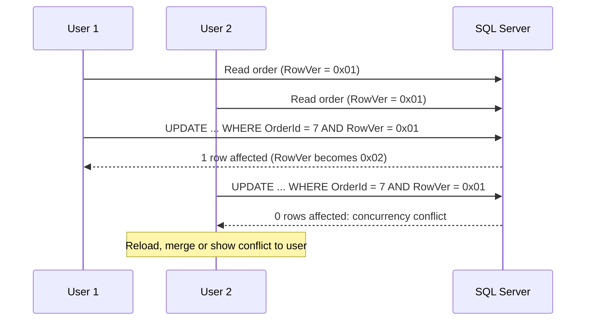

**Hands-on.**

```sql
-- Optimistic: rowversion token
DECLARE @orig BINARY(8) = (SELECT RowVer FROM dbo.Orders WHERE OrderId = 7);
UPDATE dbo.Orders SET Status = 1 WHERE OrderId = 7 AND RowVer = @orig;
IF @@ROWCOUNT = 0 PRINT 'Conflict: row changed since read';

-- Pessimistic: read-modify-write with U lock
BEGIN TRAN;
SELECT @stock = Stock FROM dbo.Inventory WITH (UPDLOCK, ROWLOCK) WHERE ProductId = 5;     -- others updaters wait
-- ... business logic ...
UPDATE dbo.Inventory SET Stock = @stock - 1 WHERE ProductId = 5;
COMMIT;

-- Better: atomic conditional update (no explicit lock, no race)
UPDATE dbo.Inventory SET Stock = Stock - @qty WHERE ProductId = @p AND Stock >= @qty;
IF @@ROWCOUNT = 0 THROW 50002, 'Out of stock', 1;

-- Queue claim without blocking other workers
;WITH next AS (
  SELECT TOP (10) * FROM dbo.WorkQueue WITH (UPDLOCK, READPAST, ROWLOCK) WHERE Status = 0 ORDER BY Id)
UPDATE next SET Status = 1, LockedBy = @worker, LockedAt = SYSUTCDATETIME()
OUTPUT inserted.Id, inserted.Payload;

-- Application lock: only one instance of a job
DECLARE @r INT;
EXEC @r = sp_getapplock @Resource = 'NightlyInvoiceJob', @LockMode = 'Exclusive', @LockOwner = 'Session', @LockTimeout = 0;
IF @r < 0 PRINT 'Another instance is running';  -- remember sp_releaseapplock (Session scope releases on disconnect)
```

```csharp
// EF Core optimistic concurrency with rowversion — the standard API pattern
public async Task<IResult> UpdateOrderStatus(long id, UpdateStatusDto dto, ShopDb db)
{
    var order = await db.Orders.FindAsync(id);
    if (order is null) return Results.NotFound();

    db.Entry(order).Property(o => o.RowVer).OriginalValue = Convert.FromBase64String(dto.ETag);   // client's version
    order.Status = dto.Status;
    try
    {
        await db.SaveChangesAsync();
        return Results.Ok(new { ETag = Convert.ToBase64String(order.RowVer) });
    }
    catch (DbUpdateConcurrencyException)
    {
        return Results.Problem(statusCode: 409, title: "Order was modified by someone else", detail: "Reload and retry.");
    }
}

// Atomic update via ExecuteUpdate: no read, no token needed for simple counters
var affected = await db.Inventory.Where(i => i.ProductId == p && i.Stock >= qty)
    .ExecuteUpdateAsync(s => s.SetProperty(i => i.Stock, i => i.Stock - qty));
if (affected == 0) return Results.Conflict("Out of stock");

// Pessimistic in EF: raw SQL with UPDLOCK inside a transaction (keep it short!)
await using var tx = await db.Database.BeginTransactionAsync();
var inv = await db.Inventory.FromSql($"SELECT * FROM dbo.Inventory WITH (UPDLOCK, ROWLOCK) WHERE ProductId = {p}").SingleAsync();
```

**Real-world.** Flash-sale inventory: optimistic concurrency produced 70% conflict/retry storms on a single hot row; the atomic `UPDATE ... WHERE Stock >= @q` plus a unique reservation table made it linear. For the admin product editor (low contention, long edit times) rowversion/ETag was perfect and avoided holding locks during human think-time.

**When to use which.** Optimistic: web/API CRUD, long think time, low conflict. Pessimistic: short critical sections with high contention and clear lock ordering. Atomic conditional update: counters/inventory/balances. App locks: singleton jobs and cross-row critical sections. Never hold DB locks across user think-time or HTTP calls.

**Advantages / disadvantages.** Optimistic scales and avoids blocking but needs conflict UX/retries and can starve under heavy contention; pessimistic prevents wasted work but can block, deadlock and tie up connections.

**Mistakes.** Read-modify-write without any protection (lost updates); `[Timestamp]` missing on EF entities; swallowing `DbUpdateConcurrencyException`; pessimistic locks held during HTTP calls; `UPDLOCK` without `ROWLOCK` + index (locks too much); global retry on conflict that silently overwrites (last-writer-wins); `sp_getapplock` with Session scope in pooled connections leaking locks.

**Performance / reliability / security / Azure.** Optimistic conflicts show as 409/412 rate — an SLI. In Azure SQL, hot-row contention shows as `LCK_M_U/X` waits in Query Store; scale-out doesn't fix a single hot row (shard the counter or use queueing).

**Troubleshooting.** Spikes in `DbUpdateConcurrencyException` → identify hot entities; spikes in `LCK_M_U` → pessimistic hot row; time-to-conflict analysis from logs; replicate by running two sessions.

**Related.** [Chapters 21](#21-transaction-isolation-levels), [22](#22-locking-and-blocking), [25](#25-row-versioning), [Inbox/Outbox claiming](../15-inbox-outbox-and-reliable-messaging/inbox-outbox-and-reliable-messaging.md).

### Interview Q&A — chapter 24

**Q: Optimistic or pessimistic for an order-edit API?**
A: Optimistic with a `rowversion` exposed as an ETag: low contention, long edit sessions, no locks held across requests. On conflict return 409/412 and let the client reload/merge. For high-contention counters, use an atomic conditional `UPDATE`.

**Q: How would you implement a reliable work queue on SQL Server?**
A: Claim rows atomically with `UPDATE TOP (n) ... OUTPUT` or `SELECT TOP ... WITH (UPDLOCK, READPAST, ROWLOCK)` in a short transaction, mark them in-progress with a lease/timeout, process, then complete; add retries, poison handling and idempotent processing.

*Follow-ups.* "How does READPAST affect ordering?" → skips locked rows, so strict ordering isn't guaranteed across workers. "What's the difference between `UPDLOCK` and `XLOCK`?" → UPDLOCK allows concurrent readers (S) while blocking other updaters; XLOCK blocks all.

---
## 25. Row versioning

**Simple idea.** Instead of making readers wait for writers, SQL Server can keep **older committed copies ("versions") of changed rows**. Readers read the version that was current when their statement (RCSI) or transaction (SNAPSHOT) started, so *readers don't block writers and writers don't block readers*. The price is extra storage and I/O for those versions.

**Architect depth.**

- **Two isolation features, one mechanism.**
  - `READ_COMMITTED_SNAPSHOT ON` (**RCSI**) changes the behaviour of `READ COMMITTED` to *statement-level* snapshot reads.
  - `ALLOW_SNAPSHOT_ISOLATION ON` enables the **SNAPSHOT** level (*transaction-level* snapshot) that sessions opt into.
  - Both make every modified row carry a **14-byte versioning tag** (transaction sequence number + pointer to the previous version) and write the old version to the **version store**.
- **Version store location.**
  - Traditional: in **tempdb** (shared across all databases using versioning — one runaway transaction can fill tempdb and stall *everyone*).
  - **Accelerated Database Recovery (ADR, 2019+/Azure SQL)**: **Persistent Version Store (PVS)** inside the *user database*. It also makes rollback/crash recovery near-instant and allows aggressive log truncation. Cleanup is done by a background **version cleaner**; a long-running transaction (or readers on a secondary) can *hold back* cleanup and bloat PVS.
- **What causes version-store growth.** Long-running transactions (a snapshot reader that never ends keeps *all* versions created since it started), orphaned open transactions, large updates, readable secondary queries (AG) pinning versions.
- **Cost model.** Writes: +14 bytes per row (page splits if no free space), version generation I/O; reads: occasionally traverse version chains (a long chain slows reads); more tempdb/PVS I/O. Overall for OLTP it's a very good trade because blocking is the bigger cost.
- **Update conflicts.** Under SNAPSHOT (not RCSI), if your transaction tries to update a row modified by another transaction after your snapshot began → **error 3960**; retry the transaction. RCSI does not produce 3960 (it reads latest committed at statement time and uses locks for writes).
- **Semantics to know (RCSI).** Each *statement* sees the latest committed data as of statement start. Two statements in the same transaction can see different data. Code that depended on a reader blocking until a writer committed will now not wait. **Never mix** assumptions of locking-read-committed with RCSI.
- **Hints and RCSI.** `READCOMMITTEDLOCK` hint forces locking behaviour for a table; `NOLOCK` still reads uncommitted; `UPDLOCK`, `HOLDLOCK` behave as before. Reads for FK/uniqueness checks still use locks/validations as needed.
- **Azure.** Azure SQL Database: **RCSI is ON by default** and ADR is always on; SNAPSHOT available (commonly enabled). **Managed Instance:** RCSI default is ON for user databases created there in recent builds (*verify current*). SQL Server on VM/box: **off by default** — turning it on is usually the single best concurrency fix.
- **Monitoring.** `sys.dm_tran_version_store_space_usage` (tempdb version store by DB), `sys.dm_tran_persistent_version_store_stats` (PVS size and the *oldest active transaction that blocks cleanup*), `sys.dm_tran_active_snapshot_database_transactions` (oldest snapshot transaction), performance counters "Version Store Size (KB)", "Longest Transaction Running Time".

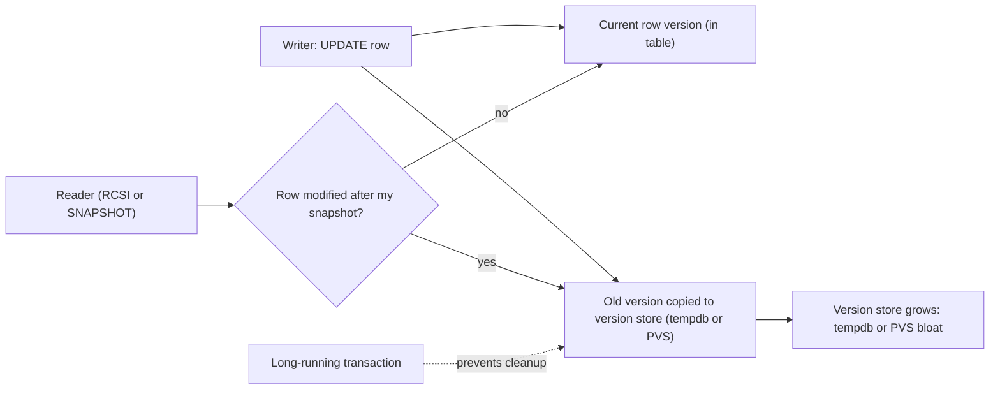

**Hands-on.**

```sql
-- Turn on / check
ALTER DATABASE PerfLab SET READ_COMMITTED_SNAPSHOT ON WITH ROLLBACK IMMEDIATE;   -- kicks out other sessions: schedule a window
ALTER DATABASE PerfLab SET ALLOW_SNAPSHOT_ISOLATION ON;
SELECT name, is_read_committed_snapshot_on, snapshot_isolation_state_desc, is_accelerated_database_recovery_on FROM sys.databases WHERE name = 'PerfLab';

-- Demo: reader no longer blocked
-- Session 1: BEGIN TRAN; UPDATE dbo.Accounts SET Balance = 999 WHERE AccountId = 1;
-- Session 2: SELECT Balance FROM dbo.Accounts WHERE AccountId = 1;   → returns the committed value immediately (RCSI)

-- How big is the version store, who is holding it back?
SELECT DB_NAME(database_id) db, reserved_page_count*8/1024 AS reserved_mb
FROM sys.dm_tran_version_store_space_usage;

SELECT TOP 5 s.session_id, s.login_name, s.program_name, t.transaction_sequence_num, t.elapsed_time_seconds
FROM sys.dm_tran_active_snapshot_database_transactions t JOIN sys.dm_exec_sessions s ON s.session_id = t.session_id
ORDER BY t.elapsed_time_seconds DESC;

-- ADR / PVS (2019+)
SELECT DB_NAME(database_id) db, persistent_version_store_size_kb/1024 AS pvs_mb, current_aborted_transaction_count,
       oldest_active_transaction_id, online_index_version_store_size_kb/1024 AS oltp_idx_mb
FROM sys.dm_tran_persistent_version_store_stats;

-- tempdb pressure from versioning
SELECT SUM(version_store_reserved_page_count)*8/1024 AS version_store_mb, SUM(unallocated_extent_page_count)*8/1024 AS free_mb
FROM tempdb.sys.dm_db_file_space_usage;
```

```csharp
// App implications: SNAPSHOT needs retry on 3960; RCSI usually needs no code change.
// Read-only report with a consistent view across multiple queries:
await using var tx = await db.Database.BeginTransactionAsync(System.Data.IsolationLevel.Snapshot);
var totals = await db.Orders.AsNoTracking().SumAsync(o => o.TotalAmount);
var count  = await db.Orders.AsNoTracking().CountAsync();      // consistent with totals (same snapshot)
await tx.CommitAsync();    // keep snapshot transactions SHORT: they pin versions
```

**Real-world.** A migration to RCSI removed ~90% of `LCK_M_S` waits in an OLTP system overnight. Two weeks later tempdb filled at 3 a.m.: a forgotten reporting session in SNAPSHOT isolation kept an open transaction for 11 hours. Fixes: query timeout + `sys.dm_tran_active_snapshot_database_transactions` alert on age > 5 min, ADR enabled so versions live in the user DB with smarter cleanup, and reporting moved to a readable replica.

**When to use / not.** Use RCSI for mixed OLTP — almost always. Use SNAPSHOT for consistent multi-statement reads and optimistic updates. Be careful when tempdb is small/slow and write volume is extreme, or you have code that *depends* on read blocking (e.g. naive "check then insert" patterns — fix with unique constraints/`UPDLOCK, HOLDLOCK`).

**Advantages / disadvantages.** No reader/writer blocking, fewer deadlocks, consistent reads; but more tempdb/PVS I/O, 14-byte row overhead, long-transaction risk, SNAPSHOT update conflicts, version chain read cost.

**Mistakes.** Enabling RCSI without checking tempdb sizing/monitoring; leaving sessions with open snapshot transactions; ignoring that RCSI changes semantics for read-then-write logic; assuming SNAPSHOT prevents write skew; running huge reporting queries under SNAPSHOT on the primary for hours.

**Performance / reliability / security / Azure.** In AG/geo-replicas, long-running readers on the secondary can delay version cleanup on the primary (**feedback**). Azure SQL manages tempdb/PVS size per tier — hitting limits yields errors (`40544`-class/`3958`/`3967` version store full on box; verify codes). Keep transactions short; alert on PVS size and oldest transaction age.

**Troubleshooting.** tempdb or PVS growth → find the oldest active transaction (`DBCC OPENTRAN`, snapshot transactions DMV, PVS stats `oldest_active_transaction_id`) → kill/fix → verify cleanup. Error 3960 → add retry; find contention hotspots.

**Related.** [Chapters 21](#21-transaction-isolation-levels), [22](#22-locking-and-blocking), [26](#26-long-running-transactions); [Part 2 — readable secondaries, HA](02-database-architecture-scaling-and-troubleshooting.md).

### Interview Q&A — chapter 25

**Q: What does RCSI change and what are its costs?**
A: Under RCSI, READ COMMITTED reads use committed row versions (statement-level snapshot) instead of shared locks, so readers don't block writers. Costs: version store in tempdb/PVS, 14-byte row overhead, more I/O, and the need to watch long-running transactions that prevent version cleanup.

**Q: SNAPSHOT vs RCSI?**
A: RCSI is statement-level consistency and requires no code change; SNAPSHOT is transaction-level consistency opted into per transaction and can raise update-conflict error 3960 when you update a row changed after your snapshot.

*Follow-ups.* "How does ADR change this?" → versions move to a PVS in the user DB, making rollback and recovery constant-time and log truncation more aggressive. "What fills tempdb under RCSI?" → long-lived open transactions and heavy write volume; identify the oldest active transaction.

---

## 26. Long-running transactions

**Simple idea.** A transaction that stays open for a long time holds **locks** (blocking others), pins the **transaction log** (it can't truncate past the oldest active transaction), pins **row versions**, and takes **as long to roll back** as it did to run. Long transactions are a leading cause of "the whole system froze".

**Architect depth.**

- **What "long" costs.**
  - **Blocking:** locks held until commit/rollback ([chapter 22](#22-locking-and-blocking)).
  - **Log growth:** the log can't be truncated past the oldest open transaction's first LSN, even with log backups. Symptom: log file huge, `log_reuse_wait_desc = ACTIVE_TRANSACTION`; in Azure SQL → log-rate governance and `9002`-type errors; in AG, redo lag.
  - **Version store/PVS growth** under row versioning ([chapter 25](#25-row-versioning)).
  - **Rollback time:** killing a 2-hour transaction can take hours (without ADR). SQL Server won't reduce rollback time by killing again.
  - **Memory/tempdb/worktables** for large sorts/hash within the transaction.
- **Where they come from in .NET apps.**
  - **User think-time or HTTP calls inside a transaction/`TransactionScope`** (e.g. payment gateway call between two SaveChanges).
  - **`TransactionScope` pitfalls:** default isolation **Serializable**; default timeout 60 s (max timeout in machine.config); **async flow** requires `TransactionScopeAsyncFlowOption.Enabled` (otherwise the ambient transaction doesn't flow across `await` and you get "transaction scope must be disposed on the same thread" errors or *silently no transaction*); promoting to **MSDTC** when two connections/resources enlist (opening two connections in one scope — or two pooled connections to the same DB on older versions — can promote to distributed, heavily slower).
  - **Forgotten commit/dispose** (exception paths), connection returned to pool with open transaction (`sp_reset_connection` rolls back at reuse, but the lock persists until then).
  - **Big batch jobs** doing millions of changes in one transaction.
  - **Implicit transactions** (`SET IMPLICIT_TRANSACTIONS ON` or drivers that set it).
  - **Index rebuilds/ALTER** on huge tables inside outer transactions.
- **Mitigation patterns.**
  1. **Short transactions:** do reads/validation/external calls *outside*; open the transaction late, commit early.
  2. **Batching:** small committed units (1–5k rows) with throttling; resumable jobs with checkpoints (watermark column/table).
  3. **Idempotent steps + outbox** instead of cross-system transactions ([Inbox/Outbox](../15-inbox-outbox-and-reliable-messaging/inbox-outbox-and-reliable-messaging.md), [Saga](../03-architectural-patterns/01-SAGA-pattern/SAGA-pattern.md)).
  4. **Timeouts everywhere:** `CommandTimeout`, `TransactionScope` timeout, `LOCK_TIMEOUT`, request cancellation tokens; `SET XACT_ABORT ON`.
  5. **Observability:** alert on oldest transaction age, log reuse wait, version store size, blocked process threshold.
  6. **ADR on** (2019+/Azure SQL): constant-time rollback and log truncation despite long transactions.
  7. **Minimal logging bulk paths** (`SqlBulkCopy`, `INSERT...SELECT` with TABLOCK under bulk-logged/simple) for big loads (watch recovery model implications).
  8. **Partition switching** for large deletes/loads ([Part 2](02-database-architecture-scaling-and-troubleshooting.md)).

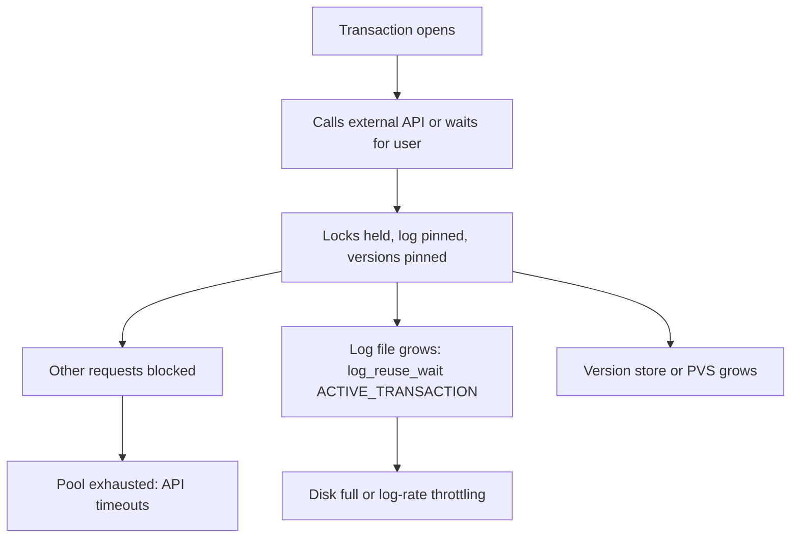

**Hands-on.**

```sql
-- Oldest open transactions and what they're doing
SELECT TOP 10 s.session_id, s.login_name, s.host_name, s.program_name, s.status,
       at.transaction_begin_time, DATEDIFF(MINUTE, at.transaction_begin_time, SYSDATETIME()) AS age_min,
       dt.database_transaction_log_bytes_used/1024/1024 AS log_mb_used
FROM sys.dm_tran_session_transactions st
JOIN sys.dm_tran_active_transactions at ON at.transaction_id = st.transaction_id
JOIN sys.dm_exec_sessions s ON s.session_id = st.session_id
LEFT JOIN sys.dm_tran_database_transactions dt ON dt.transaction_id = st.transaction_id AND dt.database_id = DB_ID()
ORDER BY at.transaction_begin_time;

-- Why can't the log truncate?
SELECT name, log_reuse_wait_desc, recovery_model_desc FROM sys.databases;      -- ACTIVE_TRANSACTION, LOG_BACKUP, AVAILABILITY_REPLICA, REPLICATION ...
DBCC SQLPERF(LOGSPACE);

-- Rollback progress of a killed session (box SQL Server)
KILL 87 WITH STATUSONLY;

-- Resumable, batched job with a watermark (survives restarts; each batch is its own short transaction)
-- Assumes: dbo.OrdersArchive has the same columns as dbo.Orders except RowVer, and dbo.JobWatermark(JobName PK, LastProcessedId).
DECLARE @lastId BIGINT = ISNULL((SELECT LastProcessedId FROM dbo.JobWatermark WHERE JobName = 'ArchiveOrders'), 0);
DECLARE @batch TABLE (OrderId BIGINT PRIMARY KEY);
DECLARE @rows INT = 1;
WHILE @rows > 0
BEGIN
    DELETE FROM @batch;
    BEGIN TRAN;
        INSERT @batch (OrderId)
        SELECT TOP (5000) OrderId FROM dbo.Orders WHERE OrderId > @lastId AND Status = 3 ORDER BY OrderId;
        SET @rows = @@ROWCOUNT;
        IF @rows > 0
        BEGIN
            INSERT dbo.OrdersArchive (OrderId, CustomerId, OrderDate, Status, TotalAmount, CountryCode, ExternalRef, Notes)
            SELECT o.OrderId, o.CustomerId, o.OrderDate, o.Status, o.TotalAmount, o.CountryCode, o.ExternalRef, o.Notes
            FROM dbo.Orders o JOIN @batch b ON b.OrderId = o.OrderId;      -- (identity insert needed if OrderId is IDENTITY in the archive)
            SELECT @lastId = MAX(OrderId) FROM @batch;
            UPDATE dbo.JobWatermark SET LastProcessedId = @lastId WHERE JobName = 'ArchiveOrders';
        END
    COMMIT;
    WAITFOR DELAY '00:00:00.100';     -- throttle: let log backup, replicas and OLTP breathe
END
```

```csharp
// ✅ Correct TransactionScope usage in async code
var options = new TransactionOptions { IsolationLevel = System.Transactions.IsolationLevel.ReadCommitted, Timeout = TimeSpan.FromSeconds(30) };
using (var scope = new TransactionScope(TransactionScopeOption.Required, options, TransactionScopeAsyncFlowOption.Enabled))
{
    await db.SaveChangesAsync();
    scope.Complete();                       // forget this → rollback on Dispose
}

// ❌ Anti-pattern: external call inside a DB transaction
await using var tx = await db.Database.BeginTransactionAsync();
order.Status = Status.PaymentPending; await db.SaveChangesAsync();
var charge = await paymentGateway.ChargeAsync(order);      // seconds, may fail/retry → locks held
// ✅ Pattern: record intent + outbox message in a short transaction; call the gateway from a worker; update state idempotently.

// Cancellation/timeouts so a slow client cannot hold locks forever
app.MapPost("/orders", async (CreateOrder cmd, ShopDb db, CancellationToken ct) =>
{
    using var cts = CancellationTokenSource.CreateLinkedTokenSource(ct);
    cts.CancelAfter(TimeSpan.FromSeconds(10));
    // pass cts.Token to all EF/ADO calls
});

// Detect leaked/idle transactions from the app: log a warning if a unit of work exceeds N seconds
```

**Real-world.** A month-end job wrapped 12M row updates in a single transaction on a 200 GB log volume: the log filled in 40 minutes, the DB went read-only (`9002`), a failover started, and the subsequent rollback (no ADR) took 3 hours during which the system was unavailable. Redesigned: set-based batches of 5k with watermark, ADR enabled, log-space alerts at 70%.

**When long transactions are legitimate.** Schema migrations, controlled bulk loads in maintenance windows — *with* planning (log space, ADR, no concurrent OLTP). Otherwise treat any transaction above a few seconds as a design smell.

**Advantages / disadvantages.** Big transactions give all-or-nothing semantics but risk system-wide stalls; batching reduces risk but needs idempotency and resumability.

**Mistakes.** HTTP/message-broker calls inside transactions; no `XACT_ABORT`; forgetting `scope.Complete()` or missing async flow; opening two connections in a `TransactionScope` (MSDTC promotion); one-giant-transaction batch jobs; relying on `KILL` as a fix; leaving `BEGIN TRAN` in an SSMS window on production (the classic!).

**Performance / reliability / security / Azure.** Azure SQL has log-rate limits and transaction log size caps per tier; failures present as throttling (`LOG_RATE_GOVERNOR` waits) before outright errors. Use **resumable operations** (index builds) and ADR. Audit who runs ad-hoc production sessions (SSMS "forgot to commit" incidents); require change control/read-only roles.

**Troubleshooting.** Oldest tran DMV (above) → identify the session/app/host → fix code path; check `log_reuse_wait_desc`; for AG: `sys.dm_hadr_database_replica_states` redo queue; for version store see chapter 25.

**Related.** [Chapters 20](#20-acid-properties), [22](#22-locking-and-blocking), [25](#25-row-versioning), [Distributed Transactions](../03-architectural-patterns/distributed-transaction.md), [Cloud migration — large data moves](../11-cloud-migration-and-modernization/cloud-migration-and-legacy-modernization.md).

### Interview Q&A — chapter 26

**Q: What problems do long-running transactions cause?**
A: Lock blocking, inability to truncate the log (log growth/full), version store/PVS growth under row versioning, long rollback after failure, resource holds that exhaust connection pools. They also increase deadlock probability.

**Q: How do you design a large data-maintenance job safely?**
A: Set-based batches (1–5k rows) with short transactions, a supporting index, a watermark for resumability, throttling, ADR/log backups running, monitoring (blocking, log, replica lag), idempotent processing, off-peak scheduling — and partition switching when deletion/loading is structural.

*Follow-ups.* "Why does `TransactionScope` sometimes use MSDTC?" → enlisting two resource managers or (in older stacks) two connections in one scope promotes to a distributed transaction; avoid by using one connection or EF's own transaction. "What does ADR change?" → rollback and recovery time stop depending on transaction size; log can truncate despite long transactions (via PVS).

---

## 27. Connection pooling and pool exhaustion

**Simple idea.** Opening a SQL connection is expensive (TCP + TLS + login + session setup). **ADO.NET pools** keep physical connections open and hand them out to your code; `Dispose()` returns the connection to the pool (it doesn't close it). The pool has a **maximum size (default 100 per unique connection string, per process)**; when all are in use, requests **wait up to the connect timeout (default 15 s)** and then fail with *"Timeout expired. The timeout period elapsed prior to obtaining a connection from the pool... max pool size was reached."*

**Architect depth.**

- **Pool identity.** One pool **per process × per exact connection string (and per identity/credential, per `Application Name`, etc.)**. Changing any keyword creates a new pool. Multiple app instances each have their own 100 → total DB connections = instances × 100 (×distinct strings) — a **scale-out trap**: 20 pods × 100 = 2,000 potential sessions against a database with a worker/connection limit (Azure SQL tiers cap sessions/workers: e.g. 5–30,000 workers depending on SKU — *verify current*).
- **Lifecycle.** `Open()` → pool returns an idle physical connection (after `sp_reset_connection` reset of session state on first command when reused) or creates one up to `Max Pool Size`. `Close/Dispose()` → returns to pool. Idle connections time out after ~4–8 minutes (random) unless `Min Pool Size` keeps them. `Connection Lifetime`/`Load Balance Timeout` recycle connections (useful for failover/DNS changes). Broken connections are pruned. `SqlConnection.ClearAllPools()` is a blunt tool.
- **Why pools exhaust.**
  1. **Leaks:** not disposing connections/`DbContext`/`DbDataReader`/`SqlDataReader` (unfinished readers hold the connection), exceptions skipping `Dispose`, `using` missing; long-lived singletons holding a connection.
  2. **Long checkout times:** slow queries (blocking, bad plans — [chapters 10](#10-parameter-sniffing-and-parameter-sensitive-plans), [22](#22-locking-and-blocking)), long transactions, external calls while holding a connection, N+1 ([chapter 18](#18-the-n-plus-1-query-problem)).
  3. **Concurrency > pool:** burst traffic × queries per request > 100.
  4. **Sync-over-async / thread pool starvation:** blocking calls (`.Result`) stall threads so connections aren't released; lack of threads also delays disposal. See [ASP.NET Core internals](../10-aspnet-core-web-api-internals/aspnet-core-web-api-internals.md).
  5. **Multiple pools** from fluctuating connection strings (e.g. per-tenant strings, changing `Application Name`, random `Workstation ID`).
  6. **Failover/transient errors:** connections stuck half-open; retries amplify load.
- **Bigger pool is rarely the fix.** It moves the failure to the database (CPU/worker/`THREADPOOL`/memory). First reduce *connection hold time* and the *number of concurrent queries* (backpressure, bulkheads — [Distributed patterns](../03-architectural-patterns/distributed-systems-patterns.md)).
- **EF Core / DbContext.** `DbContext` is lightweight, scoped per request; it opens the connection lazily and releases after each operation unless in a transaction (then held until commit). **`AddDbContextPool`** pools *DbContext instances* (reuses object graphs, not connections) — cheap CPU win for high-throughput APIs when DbContext has no per-request state. **Never share DbContext across threads** and don't run parallel queries on one context.
- **Azure SQL specifics.** Connection policies (Redirect vs Proxy), **transient errors** (40613 *database unavailable*, 40197/40501 service busy, 10928/10929 resource limits, 49918–49920, 4060): use **`EnableRetryOnFailure`**/Polly with backoff; use **`ConnectRetryCount`/`ConnectRetryInterval`** (idle connection resiliency). **Failover** closes connections — handled by retry + pool pruning. Serverless tier **auto-pause** → first connection error `40613` while resuming; retry.
- **Alternatives to raw pooling at scale.** **PgBouncer-style proxies don't exist for SQL Server natively**; mitigate with smaller `Max Pool Size`, fewer instances, queueing/async messaging, read replicas, **Elastic pools** (shares resources, not connections), **Azure SQL Hyperscale** more workers, and architecture that avoids a request-per-connection model (batching/CQRS).
- **`MultipleActiveResultSets (MARS)`** lets multiple readers on one connection but adds overhead/complexity; avoid unless necessary.
- **Diagnostics.** `dotnet-counters monitor -p <pid> Microsoft.Data.SqlClient.EventSource` — counters like *active-hard-connections*, *hard-connects/disconnects*, *soft-connects/disconnects*, *number-of-non-pooled-connections*, *number-of-pooled-connections*, *number-of-active-connections*, *number-of-free-connections*, *number-of-stasis-connections* (names per SqlClient version — *verify current*). Server side: `sys.dm_exec_sessions` grouped by `program_name`/`host_name`, `sys.dm_exec_connections`, `sys.dm_exec_requests`.

```mermaid
flowchart LR
    R1["Request 1"] --> P["Connection pool: Max Pool Size 100"]
    R2["Request 2"] --> P
    RN["Request N over 100"] --> W["Wait up to Connect Timeout 15 s"]
    P --> DB[("SQL Server sessions")]
    W -- "timeout" --> X["Exception: max pool size reached"]
    LEAK["Leaked or long-held connection"] -. "never returned" .-> P
```

**Hands-on.**

```sql
-- Who is connected, from where, doing what? (pool leak = many sleeping sessions from one app with old last_request_end_time)
SELECT s.program_name, s.host_name, s.login_name, COUNT(*) AS sessions,
       SUM(CASE WHEN s.status = 'sleeping' THEN 1 ELSE 0 END) AS sleeping,
       SUM(CASE WHEN r.session_id IS NOT NULL THEN 1 ELSE 0 END) AS running,
       MIN(s.last_request_end_time) AS oldest_idle
FROM sys.dm_exec_sessions s LEFT JOIN sys.dm_exec_requests r ON r.session_id = s.session_id
WHERE s.is_user_process = 1
GROUP BY s.program_name, s.host_name, s.login_name ORDER BY sessions DESC;

-- Sleeping sessions that hold an open transaction (the dangerous ones)
SELECT session_id, program_name, open_transaction_count, last_request_end_time
FROM sys.dm_exec_sessions WHERE is_user_process = 1 AND status = 'sleeping' AND open_transaction_count > 0;

-- Azure SQL: resource and worker pressure
SELECT TOP 20 end_time, avg_cpu_percent, avg_data_io_percent, avg_log_write_percent, max_worker_percent, max_session_percent
FROM sys.dm_db_resource_stats ORDER BY end_time DESC;
```

```bash
# Process-side diagnosis (container/VM): see pool counters live
dotnet-counters monitor -p <pid> Microsoft.Data.SqlClient.EventSource System.Runtime
# Look for: number-of-active-connections stuck at Max Pool Size, rising 'free' = 0, thread pool queue length > 0 (starvation)
```

```csharp
// ✅ Always dispose: DbContext is per-request (scoped); connections are borrowed lazily
builder.Services.AddDbContextPool<ShopDb>(o => o.UseSqlServer(cs, sql => sql.EnableRetryOnFailure(5)), poolSize: 256);

// Connection string hygiene: consistent, explicit, small pool + resilience
// "Server=tcp:myserver.database.windows.net;Database=Shop;Authentication=Active Directory Default;
//  Max Pool Size=50;Min Pool Size=5;Connect Timeout=15;Application Name=orders-api;ConnectRetryCount=3;ConnectRetryInterval=10;
//  Encrypt=True;TrustServerCertificate=False;Command Timeout=30"

// ❌ Leak: reader never closed, connection never returned
var conn = new SqlConnection(cs); await conn.OpenAsync();
var cmd = new SqlCommand("SELECT ...", conn); var rdr = await cmd.ExecuteReaderAsync();
// return rdr;   // caller forgets to dispose → connection stays checked out

// ✅ using/await using (disposes on exceptions too)
await using var conn2 = new SqlConnection(cs);
await conn2.OpenAsync(ct);
await using var cmd2 = new SqlCommand("SELECT ...", conn2);
await using var rdr2 = await cmd2.ExecuteReaderAsync(ct);

// Backpressure: don't let unbounded concurrency queue on the pool — bulkhead DB access
builder.Services.AddSingleton(new SemaphoreSlim(40));   // < Max Pool Size, shared per process
// await sem.WaitAsync(ct); try { ... } finally { sem.Release(); }
// Or use Polly ResiliencePipeline with a ConcurrencyLimiter / ASP.NET Core rate limiting + queue limits.

// Managed identity auth (no passwords, token refresh handled by driver)
// Authentication=Active Directory Default  (Microsoft.Data.SqlClient 5+)
```

**Real-world.** At 03:00 a batch job triggered a blocking chain behind a forgotten open transaction; API requests queued on the pool (100 each × 12 pods), all timing out with *max pool size reached*, readiness probes failed, Kubernetes restarted pods, and the reconnect storm worsened it. Fixes: kill the lead blocker, RCSI, query/command timeouts shorter than connect timeout, `Max Pool Size=40` with a concurrency limiter (fail fast 503 instead of queueing), alerts on oldest open transaction, and pod count tuned to DB worker capacity.

**When to change pool size.** Increase only after proving connection hold time is minimal and DB has capacity; decrease to protect the DB in scale-out (instances × pool ≤ DB capacity). Use `Min Pool Size` for latency-sensitive services with spiky arrival (avoid cold connects).

**Advantages / disadvantages.** Pooling saves login cost and bounds concurrency; per-process pools multiply with scale-out; failures are binary (wait then timeout) unless you design backpressure.

**Mistakes.** Not disposing; holding connections across non-DB awaits (HTTP, queue); `Max Pool Size=1000` as a "fix"; many distinct connection strings (tenants) multiplying pools; `ClearAllPools` in a loop; sync-over-async; `MARS` by default; no command timeouts; ignoring transient-fault retries for Azure SQL; static `SqlConnection` reuse across threads; creating `DbContext` as singleton.

**Performance / scalability / reliability / security.** Use TLS (`Encrypt=True`), managed identity/Entra auth instead of passwords, least-privileged logins; never log connection strings with secrets; contained users per app; Key Vault for secrets if not using managed identity ([Azure services](../14-azure-services-and-cloud-architecture/azure-services-and-cloud-architecture.md)).

**Troubleshooting recipe.** (1) Confirm symptom: pool timeout vs command timeout (message text differs). (2) App: pool counters, thread pool queue, active requests; (3) DB: sessions by program_name, blocking, long transactions, waits; (4) Find leak sources via `SqlClient` EventSource / Application Insights dependency durations; (5) Fix hold time (queries/tx), then concurrency limits, then pool size.

**Related.** [Chapters 18](#18-the-n-plus-1-query-problem), [22](#22-locking-and-blocking), [26](#26-long-running-transactions), [ASP.NET Core internals — HttpClient & thread pool starvation](../10-aspnet-core-web-api-internals/aspnet-core-web-api-internals.md), [Part 2 — connection management, read/write separation](02-database-architecture-scaling-and-troubleshooting.md).

### Interview Q&A — chapter 27

**Q: What causes "Timeout expired... max pool size was reached" and how do you fix it?**
A: All pooled connections are checked out. Causes: leaked/undisposed connections, slow queries or blocking/long transactions that hold connections, N+1 chatty access, burst concurrency above the pool size, thread pool starvation. Fix by finding the hold-time source (blocking, bad plan, external call inside a transaction), disposing correctly, reducing concurrency (bulkhead/backpressure), and only then tuning pool size with the DB's total capacity in mind.

**Q: How many connections should a service have?**
A: Enough to cover steady-state concurrent queries — usually far fewer than 100. Compute `instances × Max Pool Size` against the database worker/session limits; prefer smaller pools plus fail-fast backpressure to protect the DB.

*Follow-ups.* "Does `Dispose()` close the physical connection?" → no, returns it to the pool (reset on next use). "What does `AddDbContextPool` pool?" → DbContext instances, not connections. "How do you detect leaks?" → pool counters showing active connections pinned at max while DB shows sleeping sessions with old `last_request_end_time`, plus dependency traces and code review for undisposed readers.

---
# Part C — Putting it together

## 28. Scenario-based questions

Each scenario shows the **structured diagnosis path** ([chapter 30](#30-structured-answer-framework)): *symptom → first measurements → hypotheses → proof → fix → prevention*. In an interview, narrate this order; the fix is the last step, not the first.

### Scenario 1 — "API p95 jumped from 80 ms to 6 s after a deploy"

**Context.** .NET 10 Web API + Azure SQL. Latency spike right after a release; CPU on the database modest.

**Diagnosis path.**
1. **Scope it.** Which endpoint(s)? Application Insights → Performance → by operation; compare before/after the deploy time. Is the time in SQL dependencies or elsewhere (thread pool, HTTP calls)?
2. **Database side.** Query Store → *Regressed Queries* / *Top Resource Consumers* for the window. Questions: new query text (code change), same query with a new plan (plan regression), same plan with more executions (N+1), or waits (blocking)?
3. **Hypotheses & proofs.**
   - *New N+1 from the release* → dependency count per request jumped; many identical small queries → fix with projection/Include.
   - *Non-SARGable / implicit conversion* introduced (new EF mapping/parameter type) → `CONVERT_IMPLICIT` in plan; reads jumped.
   - *Plan regression after a schema change or stats update* → same `query_id`, new `plan_id` with higher duration; force the good plan (or Automatic Plan Correction), then fix the cause.
   - *Blocking* → waits in Query Store show `Lock` category; lead blocker is a new background job.
4. **Fix and prevent.** Roll back or hotfix; add a regression test that asserts SQL command count and (in a perf environment) plan shape/reads; add an alert on p95 per endpoint and Query Store regression; use canary deployment so a bad change hits 5% first ([Cloud migration — canary](../11-cloud-migration-and-modernization/cloud-migration-and-legacy-modernization.md)).

```sql
-- Query Store: what got worse in the last 2 hours vs the previous 24 hours (adapt intervals)
SELECT TOP 20 q.query_id, qt.query_sql_text,
       r.avg_duration/1000.0 AS avg_ms, r.avg_logical_io_reads, r.count_executions, p.plan_id
FROM sys.query_store_query q
JOIN sys.query_store_query_text qt ON qt.query_text_id = q.query_text_id
JOIN sys.query_store_plan p ON p.query_id = q.query_id
JOIN sys.query_store_runtime_stats r ON r.plan_id = p.plan_id
JOIN sys.query_store_runtime_stats_interval i ON i.runtime_stats_interval_id = r.runtime_stats_interval_id
WHERE i.start_time > DATEADD(HOUR,-2,SYSUTCDATETIME())
ORDER BY r.avg_duration * r.count_executions DESC;
```

**Follow-ups the interviewer may ask.** "What if Query Store is off?" → DMVs (`dm_exec_query_stats` since last restart), XEvents on duration, App Insights dependency data; then enable Query Store *now*. "How do you avoid it next time?" → pre-prod load tests with production-like data volume/skew, perf budgets in CI, canary + automatic rollback.

### Scenario 2 — "The procedure is fast in SSMS but slow from the app"

**Diagnosis.** Almost always **parameter sniffing + different SET options** ([chapter 10](#10-parameter-sniffing-and-parameter-sensitive-plans)).
1. Capture the *slow parameter values* from the app (log them) and the app's plan (Query Store plan by query_id, or `dm_exec_query_plan_stats`).
2. In SSMS, run the app's exact statement with the app's SET options (`SET ARITHABORT OFF`, etc.) → reproduces the slow cached plan. Compare to the fast fresh plan: estimates for the slow parameter differ (compile value vs runtime value).
3. Mitigate: `sp_recompile` to confirm hypothesis (temporary), then durable fix: Query Store hint/forced plan, `OPTION (RECOMPILE)` if low frequency, PSP optimization (compat 160), covering index to remove the lookup/scan divergence, or split paths.
4. Prevent: alert on duration variance per query_id (max/avg ratio); parameterized tests with whale and small tenants.

**Follow-ups.** "Why does `ARITHABORT` matter?" → part of the plan-cache key (set_options); SSMS and ADO.NET defaults differ, so they get different cached plans. "What if the problem returns after every restart?" → the first caller after restart decides the plan; warm the cache with representative calls (and/or force a stable plan).

### Scenario 3 — "Deadlocks only at peak"

**Diagnosis.** Capture graphs ([chapter 23](#23-deadlocks-and-deadlock-graphs)): `system_health` XE or Azure diagnostics. Group by statement pairs.
- Typical: two procedures update `Orders`/`Inventory` in opposite order → **standardize order**.
- Or reader/writer lookup conflict → **covering index** or **RCSI**.
- Or `TransactionScope` serializable range locks → set `ReadCommitted`.
- Or unindexed FK causing scans under load → **index the FK**.
Then add idempotent **retry with jitter** for 1205 on the whole transaction; set `DEADLOCK_PRIORITY LOW` for batch jobs; load test with concurrency to verify.

**Follow-ups.** "Why peak only?" → collision probability rises with concurrency (locks overlap in time) and with scan sizes; low traffic hides ordering bugs. "Can you eliminate deadlocks completely?" → Practically no: design to minimize and retry safely.

### Scenario 4 — "Connection pool exhausted at 3 a.m."

**Diagnosis.** ([chapter 27](#27-connection-pooling-and-pool-exhaustion)) Time correlation: batch/maintenance window at 3 a.m.
1. App: `max pool size was reached` exceptions + pool counters → connections pinned. Thread pool queue length? (starvation).
2. DB: sessions by program/host; **lead blocker** with open transaction (job or someone's SSMS); long-running index rebuild/ETL; `LCK_M_*` waits; log reuse wait.
3. Immediate mitigation: kill lead blocker (understand rollback cost), scale out? (No — more pods = more connections = worse). Temporarily lower concurrency.
4. Durable fixes: RCSI; move ETL to lower-priority resource governance/off the OLTP; batch with short transactions; command timeouts < pool wait; concurrency limiter returning 503 quickly; alert on oldest open transaction > 5 min; right-size `Max Pool Size × instances`.

**Follow-ups.** "Why not raise Max Pool Size to 500?" → moves the bottleneck to SQL workers/CPU and increases blast radius; connection hold time is the issue. "How do you stop the restart storm?" → readiness probes that don't depend on DB for liveness; exponential backoff and jitter on reconnect.

### Scenario 5 — "Pagination is slow on page 5,000"

**Diagnosis.** `OFFSET 249950 ROWS FETCH 50` reads/discards rows ([chapter 15](#15-pagination-optimization)). Check actual plan: Top/Sort over large rowcounts or index scan with high reads; `STATISTICS IO` grows with page number.
**Fix.** Keyset pagination on `(sortCol, uniqueTie)` with a supporting composite index; cursor tokens; cap offset/page size; avoid exact `COUNT(*)` — return `hasNext`/capped totals; deferred join for wide rows. Consider search index (Azure AI Search/Elasticsearch) for arbitrary filters/sorts.

**Follow-ups.** "Users want 'jump to page'." → provide search/filter to narrow, offer approximate paging with caps, or use a precomputed page index for stable datasets.

### Scenario 6 — "Add an index to a 2-billion-row table safely"

**Diagnosis & plan.** The risk: long exclusive/schema locks, log blow-up, replica lag, tempdb sort spills, blocked DML.
1. **Prove the need & design:** Query Store workload; test the index on a copy with production-like stats; estimate size (`sp_estimate_data_compression_savings`, row width × rows); consider **filtered** index and `PAGE` compression.
2. **Capacity:** disk for index + sort (tempdb or `SORT_IN_TEMPDB`), log (online build logs the index data), AG redo capacity/Azure log-rate limits, time window.
3. **Execute:** `CREATE INDEX ... WITH (ONLINE = ON, RESUMABLE = ON, MAX_DURATION = 120 MINUTES, MAXDOP = 4, DATA_COMPRESSION = PAGE, SORT_IN_TEMPDB = ON)`; Enterprise/Azure SQL required for ONLINE (*verify edition*). Monitor `sys.index_resumable_operations`, blocking at start/end (short Sch-M lock), log %, replica lag. Pause/resume as needed.
4. **Validate:** compare plans/reads before/after; check write overhead; update stats; keep the old index until validated, then drop redundant ones.
5. **Rollback plan:** `ALTER INDEX ... ABORT` / drop index; keep change window and comms.
6. **Partitioned table?** Build aligned, per-partition, or via partition switching for sliding windows ([Part 2](02-database-architecture-scaling-and-troubleshooting.md)).

```sql
CREATE NONCLUSTERED INDEX IX_Orders_Cust_DateId_Big
ON dbo.Orders (CustomerId, OrderDate DESC, OrderId DESC) INCLUDE (TotalAmount, Status)
WITH (ONLINE = ON, RESUMABLE = ON, MAX_DURATION = 120 MINUTES, MAXDOP = 4, DATA_COMPRESSION = PAGE, SORT_IN_TEMPDB = ON);
-- progress
SELECT name, state_desc, percent_complete, start_time, last_pause_time FROM sys.index_resumable_operations;
```

**Follow-ups.** "Online index build still blocks?" → brief Sch-S/Sch-M locks at start/end can wait behind long transactions and then block others (lock-priority options `WAIT_AT_LOW_PRIORITY` help).

### Scenario 7 — "Blocking from a forgotten open transaction"

**Diagnosis.** Pile of `LCK_M_*` waits; `blocking_session_id` chain ends at a **sleeping** session with `open_transaction_count > 0` (an SSMS tab or app bug). Mitigate: identify owner (login/host/program), ask them to commit/rollback, else `KILL` (know rollback cost; with ADR it's fast). Durable fixes: RCSI so readers don't block; `SET XACT_ABORT ON`; no `IMPLICIT_TRANSACTIONS`; policy: read-only access for humans in production; alert when oldest transaction age > N minutes; connection-level idle transaction timeouts at the proxy/app.

### Scenario 8 — "CPU hit 100% after we upgraded the compatibility level to 160"

**Diagnosis.** New **CE** and IQP features changed plans. Query Store (enabled *before* upgrade) shows regressed queries. Use per-query `USE HINT('FORCE_LEGACY_CARDINALITY_ESTIMATION')` or Query Store hints/forced plans for the regressed few; keep the rest on the new CE. Standard safe path: enable Query Store → baseline at old level → raise compat → compare → force good plans → keep tuned. Don't revert blindly; understand why the estimate changed (correlation, stats, ascending key). Azure SQL: automatic tuning can auto-force.

### Scenario 9 — "Inventory is oversold under load"

**Diagnosis.** Read-modify-write at `READ COMMITTED` → **lost update**: both transactions read `Stock = 1`, both decrement. Fix with an **atomic conditional UPDATE** (`SET Stock = Stock - @q WHERE ProductId=@p AND Stock >= @q`) and check `@@ROWCOUNT`; or `UPDLOCK` read; or optimistic rowversion with retry. Add a CHECK constraint (`Stock >= 0`) as a safety net. For flash sales: queue the reservations (Service Bus) and process serially per product ([Service Bus guide](../13-azure-service-bus-and-messaging-patterns/azure-service-bus-and-messaging-patterns.md)), or shard counters.

### Scenario 10 — "tempdb is full"

**Diagnosis.** `tempdb.sys.dm_db_file_space_usage`: user objects, internal objects (sorts/hash spills), **version store**. If version store → oldest snapshot transaction. If internal → spills from under-estimated memory grants; find queries by `sys.dm_db_session_space_usage` / `dm_db_task_space_usage`. If user objects → temp table abuse. Fix the root (long transaction, bad estimates, huge temp tables), then add files/size (equal-sized files, instant file init), enable memory-optimized tempdb metadata for allocation contention.

### Scenario 11 — "Transaction log is full / log keeps growing"

**Diagnosis.** `log_reuse_wait_desc`: `LOG_BACKUP` (backups not running/slow), `ACTIVE_TRANSACTION` (long tran), `AVAILABILITY_REPLICA` (secondary behind), `REPLICATION`, `CDC` (capture job). Fix the specific cause; **do not** shrink/truncate casually; consider ADR (2019+). Azure SQL: log-rate governance and `LOG_RATE_GOVERNOR` waits; batch and throttle loads.

### Scenario 12 — "Azure SQL: sporadic errors 10928/10929/40501 at peak"

**Diagnosis.** Resource governance: workers, sessions or CPU limits reached. `sys.dm_db_resource_stats` shows which dimension (CPU %, worker %, session %, log write %). Options: tune the worst queries (usually the real fix), reduce concurrency/connection fan-out (pool × pods), add retry with backoff for 40501/10928, scale up the service tier/vCores or move to Hyperscale/Business Critical read scale-out for readers, offload reads to a replica ([Part 2](02-database-architecture-scaling-and-troubleshooting.md)), cache hot reads ([Azure services — Redis](../14-azure-services-and-cloud-architecture/azure-services-and-cloud-architecture.md)).

### Scenario 13 — "Report query uses an index but still reads 50 GB"

**Diagnosis.** Seek with large range plus many Key Lookups, or residual predicate filtering after the seek. Check actual rows per operator and reads per table. Fix: covering index, narrower projection, additional predicate columns in the key (turn residual into seek predicate), filtered index for the hot subset, or columnstore for analytics. If the report is inherently big, push it to a replica/warehouse.

### Scenario 14 — "Design the database access layer for a 5k RPS API"

**Answer outline.** Short transactions, RCSI, parameterized queries, projections + `AsNoTracking`, covering indexes for hot paths, keyset paging, N+1 guardrails, pool sizing vs DB capacity with bulkhead/backpressure, retry on transient errors with jitter, read replicas for read-heavy endpoints with explicit staleness tolerance, Redis cache-aside for hot reads, async messaging with outbox for side effects, observability (Query Store, App Insights dependency metrics, SLOs per endpoint), capacity tests with production-shaped skewed data. Mention trade-offs: staleness vs latency, cost vs headroom, complexity vs gain ([Part 2](02-database-architecture-scaling-and-troubleshooting.md)).

---

## 29. Cheat sheet

### Index design rules

| Rule | Why |
| --- | --- |
| Narrow, unique, static, ever-increasing clustering key | Copied into every NC index; avoids splits |
| Equality columns → range column → ORDER BY column | Seek then ordered range, no sort |
| INCLUDE only columns needed by hot queries | Covers without bloating the key |
| Filtered index for skewed/sparse subsets | Small, cheap, selective |
| Index every FK you join/delete by | Join speed, parent-delete scans, blocking |
| Remove unused/duplicate indexes | Write cost, memory, log |
| Check usage over a full business cycle | `dm_db_index_usage_stats` resets on restart |
| Statistics before rebuilds | Many "rebuild fixed it" wins are stats |

### Isolation levels at a glance

| Level | Dirty | Non-rep. | Phantom | Blocking readers? | Notes |
| --- | --- | --- | --- | --- | --- |
| Read Uncommitted | ✔ possible | ✔ | ✔ | no | `NOLOCK`; avoid |
| Read Committed (locking) | prevented | ✔ | ✔ | yes (S vs X) | Default on box |
| RCSI | prevented | ✔ | ✔ | no | Default Azure SQL DB |
| Repeatable Read | prevented | prevented | ✔ | yes | Holds S locks |
| Serializable | prevented | prevented | prevented | yes | Range locks, deadlock-prone |
| Snapshot | prevented | prevented | prevented | no | 3960 conflicts, write skew |

### Lock compatibility (essentials)

See the matrix in [chapter 22](#22-locking-and-blocking): **S–S ok, S–U ok, U–U no, X with anything no, IS/IX compatible with each other, IX–S no.**

### Wait types quick map

| Wait | Usually means | First look |
| --- | --- | --- |
| `PAGEIOLATCH_SH/EX` | Reading data pages from disk | Scans, missing indexes, memory too small, slow storage |
| `LCK_M_S/U/X/IX...` | Blocked by another transaction | Lead blocker, long tx, RCSI, indexes |
| `WRITELOG` | Waiting for log flush at commit | Tiny autocommits, slow log disk, log-rate governance |
| `SOS_SCHEDULER_YIELD` | CPU pressure (runnable queue) | Top CPU queries, parallelism, compile storms |
| `CXPACKET` / `CXCONSUMER` | Parallel query coordination | Usually benign; check skew, cost threshold, MAXDOP |
| `RESOURCE_SEMAPHORE` | Waiting for a memory grant | Over/under-estimates, huge sorts/hash, concurrency |
| `ASYNC_NETWORK_IO` | Client not consuming rows fast enough | App slow, huge result sets, row-by-row processing |
| `PAGELATCH_UP/EX` | In-memory page contention (tempdb allocation, hot insert page) | tempdb files/metadata optimization, last-page insert contention |
| `THREADPOOL` | Worker threads exhausted | Blocking chain holding workers, too many connections |
| `LOG_RATE_GOVERNOR` | Azure log throughput cap | Batch/throttle writes, tier |
| `SOS_PHYS_PAGE_CACHE`, `RESOURCE_SEMAPHORE_QUERY_COMPILE` | Memory/compile pressure | Plan cache bloat, compile storms |

### Error codes worth memorising

| Code | Meaning | Action |
| --- | --- | --- |
| 1205 | Deadlock victim | Retry whole transaction (with jitter) and fix the pattern |
| 1222 | Lock request timeout | Investigate blocking; fail fast is intended |
| 3960 | Snapshot update conflict | Retry transaction |
| 2627 / 2601 | Unique/PK violation | Duplicate detection (inbox/idempotency) |
| 547 | FK/CHECK conflict | Data/ordering bug |
| -2 (client) | Command timeout | Blocking, bad plan, too-short timeout |
| *Pool timeout* (client) | Max pool size reached | Hold time, leaks, concurrency |
| 40613 | Azure SQL database not currently available | Transient: retry with backoff |
| 40501 / 10928 / 10929 | Service busy / resource limit | Retry, tune, scale |
| 4060 / 18456 | Login failure / cannot open DB | Auth/firewall/failover |

### First-response diagnostic queries

```sql
-- 1) What is running and waiting right now?
SELECT r.session_id, r.status, r.command, r.wait_type, r.wait_time, r.blocking_session_id, r.cpu_time, r.logical_reads, r.total_elapsed_time,
       DB_NAME(r.database_id) db, SUBSTRING(t.text, r.statement_start_offset/2+1, 200) AS stmt
FROM sys.dm_exec_requests r CROSS APPLY sys.dm_exec_sql_text(r.sql_handle) t
WHERE r.session_id <> @@SPID AND r.session_id > 50 ORDER BY r.total_elapsed_time DESC;

-- 2) Top waits since restart (snapshot twice and diff for a live picture)
SELECT TOP 10 wait_type, wait_time_ms/1000.0 AS wait_s, waiting_tasks_count
FROM sys.dm_os_wait_stats WHERE wait_type NOT LIKE '%SLEEP%' AND wait_type NOT IN ('BROKER_TASK_STOP','XE_TIMER_EVENT','LAZYWRITER_SLEEP','SQLTRACE_BUFFER_FLUSH','REQUEST_FOR_DEADLOCK_SEARCH','HADR_FILESTREAM_IOMGR_IOCOMPLETION')
ORDER BY wait_time_ms DESC;

-- 3) Top CPU / reads queries
SELECT TOP 10 qs.total_worker_time/1000 AS cpu_ms, qs.total_logical_reads, qs.execution_count, SUBSTRING(st.text,1,150) AS txt
FROM sys.dm_exec_query_stats qs CROSS APPLY sys.dm_exec_sql_text(qs.sql_handle) st ORDER BY qs.total_worker_time DESC;
```

---

## 30. Structured answer framework

> **Measure → Hypothesize → Verify → Fix → Prevent.**

| Step | What you say / do | Tools |
| --- | --- | --- |
| **Frame** | Clarify symptom, scope, onset, blast radius, SLOs; *what changed?* (deploy, data growth, config, traffic) | APM, deploy log |
| **Measure** | Is it *waiting* or *running*? CPU / reads / duration / waits / blocking / memory / I/O | `dm_exec_requests`, waits, Query Store, resource stats |
| **Hypothesize** | 2–3 ranked causes consistent with evidence (plan, stats, locking, pool, N+1, resource limit) | Mental model from chapters 1–27 |
| **Verify** | Prove with the actual plan, reads, deadlock graph, blocking chain, counters; reproduce with the slow parameters | SSMS, XEvents, `dotnet-counters` |
| **Fix** | Least risky, most durable change; mention trade-offs and rollback; mitigation vs cure | Index, rewrite, stats, RCSI, batching, hints/forcing |
| **Prevent** | Monitoring/alerts, regression tests (reads/command counts), load tests with skewed data, canary, runbook | Query Store alerts, CI perf budgets |

**Worked example — "Orders endpoint is timing out intermittently."**

1. **Frame.** "Which endpoint, since when, what changed, what's p95/p99 and error type — command timeout, pool timeout, or 5xx?" → Answer: `GET /customers/{id}/orders`, started yesterday, only for some customers, command timeouts.
2. **Measure.** App Insights: only the SQL dependency is slow. Query Store: one `query_id`, two plans; durations 20 ms vs 18 s; plan 2 appears after a deploy-triggered stats update.
3. **Hypothesize.** (a) Parameter sniffing — plan flips between seek+lookup and scan by customer size; (b) blocking; (c) resource limits. Evidence (waits show `PAGEIOLATCH`, not `LCK_M`) favors (a).
4. **Verify.** Plan 2 compiled for a tiny customer (estimated 40 rows) and executed for the whale (actual 1.1M rows) with 1.1M key lookups. Reproduced in SSMS with the slow parameter.
5. **Fix.** *Immediate:* force the good plan in Query Store (mitigation). *Durable:* covering index `(CustomerId, OrderDate DESC) INCLUDE (TotalAmount, Status)` and a bounded projection with keyset paging so no plan involves unbounded lookups; compat-160 PSP enabled; trade-off: +180 MB index, ~8% slower inserts, accepted.
6. **Prevent.** Alert on Query Store duration variance > 10× per query; load test includes whale tenants; EF projection test asserting ≤ 2 commands and the reads budget; runbook entry for "plan regression: force plan, then fix cause".

Closing statement style (senior-level): *"I'd mitigate first, because customers are impacted, then make the root cause fix, and make sure we can't regress silently."*

**Explaining a decision (ADR-style, 30 seconds):** *Context* (workload, constraints) → *Options considered* (2–3 with one-line trade-offs) → *Decision* → *Why* (measurable criterion) → *Consequences/risks* → *How we'll know it worked* (metric).

---

## 31. Revision checklist

**Fundamentals**
- [ ] I can explain parser → binder → optimizer → plan cache → executor and what the storage engine, buffer pool and log do.
- [ ] I can read an actual plan: estimated vs actual rows, warnings, spills, memory grants, seek vs residual predicates.
- [ ] I know why cost % lies and why logical reads are my primary metric.
- [ ] I can design indexes (clustered key, equality→range, INCLUDE, filtered, unique) and justify their write cost.
- [ ] I can explain fragmentation honestly (stats > defrag) and how to rebuild online/resumable.
- [ ] I can explain statistics, histograms, auto-update, ascending key problem and CE versions.
- [ ] I can demo and fix parameter sniffing (PSP, Query Store hints/forcing, RECOMPILE, OPTIMIZE FOR) and explain SSMS-vs-app differences.
- [ ] I can rewrite non-SARGable predicates and spot implicit conversions (including EF `nvarchar` vs `varchar`).
- [ ] I know the three join algorithms, when each wins, and fan-out/FK-index pitfalls.
- [ ] I know CTEs aren't materialized; temp tables vs table variables; `EXISTS` vs `NOT IN`.
- [ ] I can implement keyset pagination and explain OFFSET cost and count alternatives.
- [ ] I can write a robust proc (NOCOUNT, XACT_ABORT, typed params, dynamic SQL via `sp_executesql`).
- [ ] I avoid `SELECT *`, use projections/`AsNoTracking`, and can detect/fix N+1.
- [ ] I can argue normalization vs targeted denormalization with consistency strategy.

**Concurrency**
- [ ] ACID mapped to WAL, constraints, locks/versions, durability.
- [ ] Isolation levels + anomalies (dirty, non-repeatable, phantom, lost update, write skew) and my default (RCSI).
- [ ] Lock modes, compatibility, escalation (~5,000), blocking chain diagnosis (find the *head*).
- [ ] Deadlock graph reading, typical causes/fixes, retry-the-transaction with jitter.
- [ ] Optimistic (rowversion/ETag) vs pessimistic (UPDLOCK/READPAST/app locks) vs atomic UPDATE.
- [ ] Row versioning costs (tempdb/PVS), error 3960, ADR.
- [ ] Long transactions: log, locks, versions, rollback; `TransactionScope` async flow/serializable default/MSDTC.
- [ ] Connection pooling: pool identity, leaks vs hold time, sizing across instances, backpressure, Azure transient errors.

**Interview behaviour**
- [ ] I start with measurements, not guesses; I narrate measure → hypothesize → verify → fix → prevent.
- [ ] I state trade-offs and rollback for every fix, and add monitoring to prevent recurrence.
- [ ] I can tie database problems back to API symptoms (thread pool starvation, pool exhaustion, N+1) and to Azure limits (resource governance, log rate, transient errors).

**Next:** continue with [Part 2 — Database Architecture, Scaling and Troubleshooting](02-database-architecture-scaling-and-troubleshooting.md) for partitioning, sharding, replicas, caching, HA and the production troubleshooting toolbox. Related broader reading: [ASP.NET Core Web API Internals](../10-aspnet-core-web-api-internals/aspnet-core-web-api-internals.md), [Azure Services and Cloud Architecture](../14-azure-services-and-cloud-architecture/azure-services-and-cloud-architecture.md), [Inbox, Outbox and Reliable Messaging](../15-inbox-outbox-and-reliable-messaging/inbox-outbox-and-reliable-messaging.md), [Distributed Transactions](../03-architectural-patterns/distributed-transaction.md), [Cloud Migration and Legacy Modernization](../11-cloud-migration-and-modernization/cloud-migration-and-legacy-modernization.md), [Broader Architect Skills](../06-broader-architect-skills/Broader%20Architect%20Skills.md).
