# Database Architecture, Scaling and Production Troubleshooting

**Part 2 of Database Performance Optimization and Troubleshooting.** Part 1 —
[SQL Server Internals, Query Tuning and Concurrency](./01-sql-server-internals-query-tuning-and-concurrency.md) —
covers the optimizer, indexes, statistics, parameter sniffing, query rewrites, isolation levels,
locking and deadlocks. This part covers what you do when a single well-tuned database is *not
enough* (partitioning, sharding, replicas, caching, connection management, HA) and — just as
important in interviews — how you **find the problem in production** (Query Store, Extended Events,
DMVs, wait statistics, plans, runbooks).

> **Interview feedback this guide targets:** "strengthen database performance optimization and
> troubleshooting" and "structured problem-solving, explaining technical decisions with practical
> examples". Every chapter therefore ends with interview Q&A, and the last part gives a reusable
> framework and 12 architect-level scenarios.

## How to use this guide

1. Read Part I (chapters 1–10) as *design tools*: each is a lever with a cost.
2. Read Part II (chapters 11–19) as *diagnostic tools*: each answers a specific question.
3. Rehearse Part III scenarios aloud using the framework in chapter 22.
4. Every T-SQL script is runnable on SQL Server 2019+ / Azure SQL unless noted. Azure CLI/Bicep
   syntax, SKU names and product names drift — items marked **(verify current)** should be checked
   against current Microsoft documentation before you rely on them.

## Chapter conventions

Each chapter follows the same skeleton so you can revise quickly: **Simple idea → Why it exists →
How it works → Examples (C# / T-SQL / Azure) → Diagram → Real-world use → When to use / not →
Trade-offs → Mistakes → Performance, scale, reliability, security → Troubleshooting → Related
topics → Interview Q&A → Follow-ups.** Small chapters compress some of these but never drop them.

## Table of contents

**Part I — Advanced database architecture**
1. [Database partitioning (SQL Server table partitioning)](#1-database-partitioning-sql-server-table-partitioning)
2. [Horizontal vs vertical partitioning](#2-horizontal-vs-vertical-partitioning)
3. [Sharding and multi-tenant data models](#3-sharding-and-multi-tenant-data-models)
4. [Read replicas](#4-read-replicas)
5. [Primary–secondary architecture](#5-primarysecondary-architecture)
6. [Database caching](#6-database-caching)
7. [Redis caching patterns](#7-redis-caching-patterns)
8. [Database connection management](#8-database-connection-management)
9. [Read/write separation](#9-readwrite-separation)
10. [Database scalability and high availability](#10-database-scalability-and-high-availability)

**Part II — Troubleshooting tools and production practice**
11. [Query Store](#11-query-store)
12. [Extended Events](#12-extended-events)
13. [Dynamic Management Views (DMVs)](#13-dynamic-management-views-dmvs)
14. [SQL Profiler and its limitations](#14-sql-profiler-and-its-limitations)
15. [CPU, memory and disk I/O analysis](#15-cpu-memory-and-disk-io-analysis)
16. [Query execution plan analysis](#16-query-execution-plan-analysis)
17. [Monitoring slow queries](#17-monitoring-slow-queries)
18. [Identifying blocking and deadlocks](#18-identifying-blocking-and-deadlocks)
19. [Production database performance troubleshooting runbook](#19-production-database-performance-troubleshooting-runbook)

**Part III — Interview toolkit**
20. [Architect-level scenarios](#20-architect-level-scenarios)
21. [Cheat sheet](#21-cheat-sheet)
22. [A structured framework for explaining database decisions](#22-a-structured-framework-for-explaining-database-decisions)
23. [Quick-revision checklist](#23-quick-revision-checklist)

---

# Part I — Advanced database architecture

> **The scaling ladder.** Always climb in order and stop when the problem is solved:
> (1) fix queries and indexes (Part 1) → (2) fix the application's access pattern (N+1, chatty
> calls, connection use) → (3) cache → (4) scale **up** → (5) read replicas / read-write
> separation → (6) partition large tables → (7) shard / split by tenant or service. Each step
> adds operational and consistency cost; skipping to step 7 is the most common architectural
> mistake in this area.

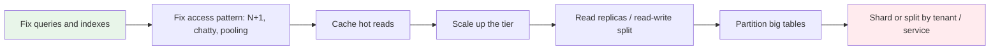

---

## 1. Database partitioning (SQL Server table partitioning)

### Simple idea
One huge table is physically stored as several smaller chunks (partitions) by a column such as
date. To the application it is still one table. Maintenance (archiving, index rebuilds, loading)
can then work chunk by chunk, and queries that filter on the partition column can skip chunks.

### Why it exists
- A 2 TB `Orders` table with 5 years of data: deleting the oldest month with `DELETE` generates
  huge log, long locks and fragmentation. Switching a partition out is a **metadata operation**
  taking milliseconds.
- Rebuilding one partition's index instead of the whole table shrinks maintenance windows.
- Different partitions can live on different filegroups/storage tiers (hot SSD, cold cheap).

### How it works internally
Three objects: a **partition function** (maps a value to a partition number via boundary
values), a **partition scheme** (maps partition numbers to filegroups), and a table/index created
`ON` the scheme. The partitioning column must be part of the clustered index key (and of every
unique index for the index to be *aligned*). Each partition is its own B-tree/heap internally
(`sys.partitions`), which is why per-partition rebuild, compression and statistics (incremental
stats) are possible. The optimizer performs **partition elimination** when the predicate on the
partitioning column is SARGable and the literal/parameter type matches.

```sql
-- Monthly partitions, RANGE RIGHT so each boundary value is the first day of its month
CREATE PARTITION FUNCTION pf_OrderMonth (date)
AS RANGE RIGHT FOR VALUES ('2026-01-01','2026-02-01','2026-03-01','2026-04-01');

CREATE PARTITION SCHEME ps_OrderMonth
AS PARTITION pf_OrderMonth ALL TO ([PRIMARY]);      -- or map to different filegroups

CREATE TABLE dbo.Orders
(
    OrderId     bigint        NOT NULL,
    OrderDate   date          NOT NULL,
    CustomerId  int           NOT NULL,
    Total       decimal(18,2) NOT NULL,
    CONSTRAINT PK_Orders PRIMARY KEY CLUSTERED (OrderDate, OrderId)  -- partition col in key
) ON ps_OrderMonth (OrderDate);

-- Aligned nonclustered index (same scheme) so partition switching stays possible
CREATE NONCLUSTERED INDEX IX_Orders_Customer
ON dbo.Orders (CustomerId) INCLUDE (Total) ON ps_OrderMonth (OrderDate);

-- Verify elimination: look for "Actual Partition Count" in the plan, or check rows per partition
SELECT p.partition_number, p.rows, prv.value AS lower_boundary
FROM sys.partitions p
JOIN sys.indexes i ON i.object_id = p.object_id AND i.index_id = p.index_id
LEFT JOIN sys.partition_schemes ps ON ps.data_space_id = i.data_space_id
LEFT JOIN sys.partition_range_values prv
       ON prv.function_id = ps.function_id AND prv.boundary_id = p.partition_number - 1
WHERE p.object_id = OBJECT_ID('dbo.Orders') AND i.index_id = 1;
```

### Sliding window and partition switching
```sql
-- 1) Archive the oldest month: switch partition 2 into an identically structured staging table
CREATE TABLE dbo.Orders_Archive_2026_01 (/* same columns, same clustered key, same filegroup */
    OrderId bigint NOT NULL, OrderDate date NOT NULL, CustomerId int NOT NULL, Total decimal(18,2) NOT NULL,
    CONSTRAINT PK_OA PRIMARY KEY CLUSTERED (OrderDate, OrderId),
    CONSTRAINT CK_OA CHECK (OrderDate >= '2026-01-01' AND OrderDate < '2026-02-01')
);
ALTER TABLE dbo.Orders SWITCH PARTITION 2 TO dbo.Orders_Archive_2026_01;   -- metadata only

-- 2) Remove the now-empty boundary, and 3) add a new boundary for the future month
ALTER PARTITION FUNCTION pf_OrderMonth() MERGE RANGE ('2026-01-01');
ALTER PARTITION SCHEME  ps_OrderMonth NEXT USED [PRIMARY];
ALTER PARTITION FUNCTION pf_OrderMonth() SPLIT RANGE ('2026-05-01');       -- split an EMPTY range
```
Always **split an empty partition** (ahead of time) — splitting a populated one moves data and
logs heavily. Automate "create next N boundaries" as a scheduled job; a missing future boundary
means all new rows land in one ever-growing last partition.

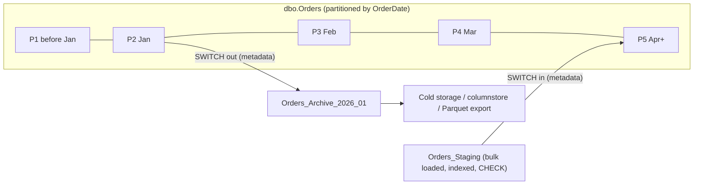

### Real-world use
Time-series/log/audit tables, order history, IoT telemetry, ETL fact tables loaded daily via
staging + switch-in, GDPR retention (drop a partition rather than millions of deletes).

### When to use / when NOT
Use when: table is very large (hundreds of GB+), you have a natural range key used in most
predicates, and you need fast archive/load or per-partition maintenance. **Do not use** as a
"make queries faster" switch: if queries do not filter on the partition column, they scan *all*
partitions and can be **slower** (more B-trees to open, per-partition parallelism quirks). A
well-indexed 50 GB table rarely benefits. Azure SQL Database supports table partitioning, but
partition-to-filegroup mapping is moot (single filegroup) — the maintenance benefit remains.

### Trade-offs
| Pro | Con |
|---|---|
| Near-instant archive/load via SWITCH | Partition key must be in clustered key and unique indexes |
| Per-partition rebuild/compression/stats | Predicates on other columns get no elimination |
| Maintenance windows shrink | Operational scripts (split/merge/switch) must be automated and tested |
| Filegroup/tier placement (on-prem) | Parameter-type mismatch silently kills elimination |

### Common mistakes / anti-patterns
- Partitioning for performance without checking elimination in actual plans.
- `datetime` column vs `date` parameter conversions (or `DATEADD` on the column) breaking elimination.
- Forgetting the unique constraint must include the partition column → surprises with "global" uniqueness (e.g. `OrderId` alone cannot be unique-enforced).
- Splitting a non-empty boundary at 2 a.m. on production.
- RANGE LEFT vs RIGHT confusion → rows in the wrong month.
- Too many partitions (thousands) → slow plan compilation/metadata overhead.

### Performance, scalability, reliability, security
Use incremental statistics (`STATISTICS_INCREMENTAL = ON`) so refreshing one partition updates stats
cheaply. Partition-level data compression (PAGE for cold, none for hot) saves I/O. Partitioned views
(UNION ALL with CHECK constraints) are an older alternative and still useful across databases.
Security: switching requires `ALTER` on both tables — keep it in a controlled service account.

### Troubleshooting
Query reads all partitions → check the predicate type/SARGability and the plan's *Actual Partition
Count*. SWITCH fails → check identical columns, nullability, indexes, filegroup, and the CHECK constraint on the target.
Last partition huge → missing future boundary job.

### Related
Archival strategy ties to [cloud migration](../11-cloud-migration-and-modernization/cloud-migration-and-legacy-modernization.md) (bulk load/cutover) and to columnstore for analytics; index design is in Part 1.

### Interview Q&A
**Q: Does partitioning improve query performance?** Only through partition elimination or per-partition parallel/maintenance wins. It is primarily a *manageability* feature. A query without the partition column in its predicate touches every partition.

**Q: How do you delete 100 million old rows without blocking the system?** Switch the oldest partition out to a staging table and drop/truncate it — metadata-only. Without partitioning: batched deletes (`DELETE TOP (5000)` in a loop, small transactions, log backups between batches) to avoid lock escalation and log blow-up.

**Follow-ups:** *Why must the partition column be in the clustered key?* So each row maps deterministically to one partition and the index is aligned. *RANGE LEFT vs RIGHT?* Which partition the boundary value itself belongs to; RIGHT with date boundaries keeps "first day of month" in the new month. *What breaks alignment?* Creating a nonclustered index on a different scheme — then SWITCH is blocked.

---

## 2. Horizontal vs vertical partitioning

### Simple idea
*Horizontal* partitioning splits **rows** (e.g. orders by year or by region) into separate tables/databases with the same columns. *Vertical* partitioning splits **columns** (frequently accessed narrow columns in one table, rare/large columns in another).

### Why it exists
Narrow rows → more rows per 8 KB page → better buffer-cache density and fewer reads. Hot/cold data separation keeps the working set small. Large objects (`nvarchar(max)`, `varbinary(max)`, XML/JSON) bloat rows and hurt scans.

### How it works
- **Vertical:** `Product(ProductId, Name, Price, Stock)` stays hot; `ProductDetail(ProductId, LongDescription, Specs, Image)` is 1:1 joined only on the product page. Related options: row-overflow/LOB allocation units already move large values off-row, but a *narrow-first* design still reduces scans of the clustered index; also **covering nonclustered indexes** are a poor-man's vertical split.
- **Horizontal:** native table partitioning (chapter 1), partitioned views, archive tables (`Orders_Hot` last 90 days + `Orders_Archive`), or distribution across databases (sharding, chapter 3).
- **Filegroups:** place hot partitions/indexes on faster storage; read-only filegroups for archives (on-prem/MI).

```sql
-- Vertical split: hot table narrow, cold table wide
CREATE TABLE dbo.Product      (ProductId int PRIMARY KEY, Name nvarchar(200) NOT NULL, Price decimal(18,2) NOT NULL, Stock int NOT NULL);
CREATE TABLE dbo.ProductBlob  (ProductId int PRIMARY KEY REFERENCES dbo.Product(ProductId),
                               LongDescription nvarchar(max) NULL, SpecsJson nvarchar(max) NULL);
```
```csharp
// EF Core 10: table splitting is the INVERSE (two entities one table); for vertical split map two tables
modelBuilder.Entity<Product>().ToTable("Product");
modelBuilder.Entity<ProductBlob>().ToTable("ProductBlob");
modelBuilder.Entity<Product>().HasOne(p => p.Blob).WithOne().HasForeignKey<ProductBlob>(b => b.ProductId);
// List pages query Product only; detail page uses .Include(p => p.Blob) or a projection.
```

### Real-world use
Catalog pages (hot) vs product documents (cold), users vs user preferences/avatars, active orders vs archived orders, SaaS tenant tiers.

### When to use / not
Use vertical when profiling shows scans dominated by wide, rarely-read columns. Use horizontal hot/cold when >80% of reads touch recent data. **Not** when the "cold" column is joined on nearly every query — you add a join for no gain. Store files in **Blob Storage** (with a URL column) rather than `varbinary(max)` for large media; see [Azure services guide](../14-azure-services-and-cloud-architecture/azure-services-and-cloud-architecture.md).

### Trade-offs / mistakes
Extra joins, more complex writes (two inserts in one transaction), FK/consistency overhead; the common mistake is splitting *before measuring* page density. Another: horizontal split into `Orders2024`, `Orders2025` tables with hand-written UNION ALL views forever — prefer native partitioning or a proper archive process.

### Perf/scale/reliability/security
Column-level sensitivity is a good reason for a vertical split (PII table with tighter permissions, encryption with Always Encrypted, separate retention). Backup/restore granularity improves with filegroups.

### Troubleshooting
Check `sys.dm_db_index_physical_stats` (avg record size, page density) and `SET STATISTICS IO` — page reads per row tell you whether width matters.

### Interview Q&A
**Q: Horizontal vs vertical partitioning — give an example of each.** Vertical: move `LongDescription` out of `Product` so list queries read narrow rows. Horizontal: order rows by month in partitions, or tenants by shard. **Follow-up:** *How is table partitioning different from sharding?* Partitioning stays inside one database/server (one failure domain, one CPU/memory pool); sharding spreads rows across servers and removes the single-box ceiling at the price of cross-shard complexity.

---

## 3. Sharding and multi-tenant data models

### Simple idea
Split data across several independent databases (shards), each holding a subset of rows, and route each request to the right shard using a **shard key**.

### Why it exists
Vertical scale-up and replicas eventually hit limits: write throughput on one primary, storage ceilings (e.g. Azure SQL DB max sizes), blast radius, or data-residency rules. Sharding scales **writes and storage** horizontally. It is also the natural fit for multi-tenant SaaS.

### How it works
1. **Shard key** — a column present in (nearly) every query, with high cardinality and even distribution: `TenantId`, `CustomerId`, `Region`.
2. **Mapping strategy:**
   - *Range* (A–M → shard 1): easy range scans, prone to hot shards.
   - *Hash/consistent hash:* even distribution, no range queries, resharding is costly without consistent hashing/virtual buckets.
   - *Directory/lookup* (a shard map table or service): flexible, tenant can be moved, adds a lookup dependency (cache it!).
3. **Router** — library in the app (Azure SQL **Elastic Database client library** shard maps), a gateway service, or a data-access layer that resolves `tenantId → connection string`.
4. **Cross-shard concerns:** queries spanning shards need fan-out/aggregate (Elastic Query, app-level scatter-gather, or a separate analytics store); distributed transactions are avoided in favour of sagas/outbox (see [Saga](../03-architectural-patterns/01-SAGA-pattern/SAGA-pattern.md), [Outbox deep dive](../15-inbox-outbox-and-reliable-messaging/inbox-outbox-and-reliable-messaging.md)).

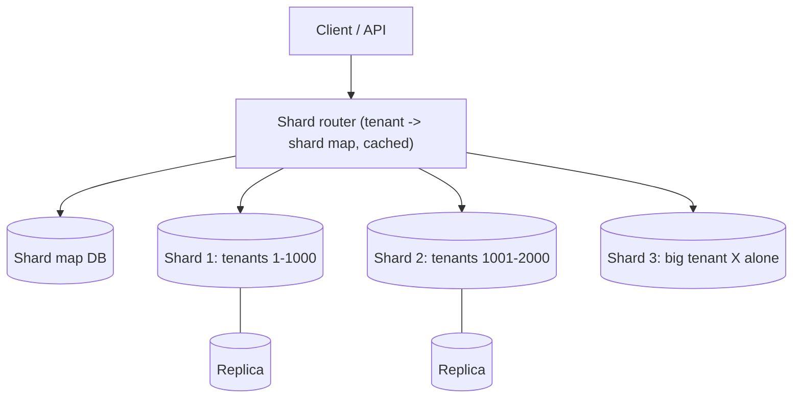

### Multi-tenant models (very common interview question)
| Model | Isolation | Cost | Ops | Noisy neighbour | Fit |
|---|---|---|---|---|---|
| **Database per tenant** (+ **elastic pool**) | Strongest; per-tenant restore, encryption keys, residency | Higher; pools share DTU/vCores to mitigate | Many DBs: automate schema deploy, monitoring | Isolated, except in a shared pool | Enterprise/regulated B2B, tens–thousands of tenants |
| **Shared database, schema per tenant** | Medium | Medium | Schema count explodes, migrations slow | Shared | Rarely recommended |
| **Shared schema + `TenantId` column** | Logical only (RLS) | Lowest | Single schema, simplest deploy | Shared; one big tenant hurts all | Many small tenants (B2C, SMB) |
| **Hybrid / sharded pools** | Tiered | Balanced | Complex routing | Big tenants get own DB | Mature SaaS |

**Shared schema with Row-Level Security** (defence in depth against forgotten `WHERE TenantId`):
```sql
CREATE FUNCTION Security.fn_TenantFilter(@TenantId int) RETURNS TABLE WITH SCHEMABINDING
AS RETURN SELECT 1 AS ok WHERE @TenantId = CAST(SESSION_CONTEXT(N'TenantId') AS int);

CREATE SECURITY POLICY Security.TenantPolicy
ADD FILTER PREDICATE Security.fn_TenantFilter(TenantId) ON dbo.Orders,
ADD BLOCK  PREDICATE Security.fn_TenantFilter(TenantId) ON dbo.Orders AFTER INSERT
WITH (STATE = ON);
-- Set per connection: EXEC sp_set_session_context @key=N'TenantId', @value=@tenantId, @read_only=1;
-- Lead every index with TenantId. Beware: pooled connections must reset context on open.
```
```csharp
// EF Core: global filter + connection interceptor that sets SESSION_CONTEXT per request
modelBuilder.Entity<Order>().HasQueryFilter(o => o.TenantId == _tenant.Id);

public sealed class TenantSessionContextInterceptor(ITenantProvider tenant) : DbConnectionInterceptor
{
    public override async Task ConnectionOpenedAsync(DbConnection c, ConnectionEndEventData e, CancellationToken ct)
    {
        await using var cmd = c.CreateCommand();
        cmd.CommandText = "EXEC sp_set_session_context @k, @v, @ro = 1";   // pooled conns: set EVERY open
        cmd.Parameters.Add(new SqlParameter("@k", "TenantId"));
        cmd.Parameters.Add(new SqlParameter("@v", tenant.Id));
        await cmd.ExecuteNonQueryAsync(ct);
    }
}
```
Azure: **elastic pools** let many tenant databases share a resource budget with per-DB min/max caps;
the **Elastic Database tools** (client library shard maps, split-merge guidance, elastic jobs for
schema rollout across DBs, elastic query) support the pattern **(verify current feature set)**.
**Cosmos DB** is the managed alternative: pick a partition key (e.g. `/tenantId` or a synthetic
key such as `tenantId_bucket` for big tenants) and the service handles physical partitioning; the
trade is the loss of relational joins/transactions across partitions.

### Resharding
Plan it from day one: use **many logical shards (e.g. 256 buckets) mapped to few physical DBs** so
rebalancing means moving a bucket, not rehashing. Move with: dual-write or CDC copy → verify with
checksums → flip the map entry → drain → delete. See [CDC/zero-downtime migration](../11-cloud-migration-and-modernization/cloud-migration-and-legacy-modernization.md).

### Real-world use
SaaS per-tenant isolation, gaming (per-region/per-player-range), messaging, large e-commerce (per-seller). Data residency (EU tenants on EU shards).

### When to use / not
Use when a single primary cannot meet write throughput/storage/blast-radius needs *after* tuning, caching and scale-up. **Do not** shard prematurely: it removes cross-row transactions, global unique constraints and ad-hoc joins, and multiplies deployment, backup and monitoring work. A well-tuned Azure SQL Hyperscale (to 100 TB-class storage, **verify current**) postpones sharding for most systems.

### Trade-offs
Gains: write scale-out, isolation, smaller blast radius, per-shard maintenance. Costs: routing layer, cross-shard queries, rebalancing, schema-migration fan-out, uneven load, harder reporting.

### Mistakes / anti-patterns
- Shard key without high cardinality (`Country`) → hot shard.
- Monotonic key + range sharding (all new writes hit the last shard).
- Cross-shard transactions via MSDTC "just this once".
- Not caching the shard map, making it a SPOF/latency tax.
- RLS without resetting `SESSION_CONTEXT` on pooled connections → **cross-tenant data leak**.
- Forgetting a "tenant 0"/global reference-data store.

### Performance, scalability, reliability, security
Keep tenant-specific indexes leading with `TenantId`; per-tenant throttling/rate limits; per-tenant backup/restore only in DB-per-tenant model; encryption keys per tenant (Always Encrypted/CMK) for regulated customers; run schema deployments as ring-based rollouts across shards.

### Troubleshooting
One shard hot → check key distribution (`SELECT TenantId, COUNT(*) …`), move the big tenant. Router latency → cache map, check the lookup DB's own health. Schema drift across shards → elastic jobs/pipelines with a version table per DB.

### Interview Q&A
**Q: How would you choose a shard key?** High cardinality, present in most queries, evenly distributed, stable (immutable), aligned with transaction boundaries so most transactions stay single-shard. For SaaS that is `TenantId`; for social data maybe `UserId`.
**Q: DB-per-tenant or shared schema?** Depends on tenant count/size, compliance, and cost: thousands of tiny tenants → shared schema + RLS (or pooled DBs); few large/regulated tenants → DB per tenant with elastic pools; mature products run a hybrid where large tenants graduate to dedicated DBs.
**Follow-ups:** *How do you run a report across all tenants?* Fan-out (elastic query/jobs) for small result sets, but for analytics replicate into a warehouse/lake (CDC or events). *How do you add a shard without downtime?* Virtual buckets + bucket move with dual-write/CDC and a map flip. *How do you keep cross-shard integrity?* Avoid it: eventual consistency with sagas, idempotent consumers.

---
## 4. Read replicas

### Simple idea
A read replica is a continuously updated copy of the primary that serves **read-only** queries, so
reporting and read-heavy traffic stop competing with writes on the primary.

### Why it exists
Most OLTP workloads are 80–95% reads. Replicas scale reads horizontally, isolate heavy reports
from transactional latency, and double as HA/DR targets.

### How it works in SQL Server and Azure SQL
| Technology | Replica type | Notes |
|---|---|---|
| **Always On Availability Groups** (SQL Server) | Readable secondary (sync or async) | Reads use snapshot isolation on the secondary; statistics are created in tempdb; **Query Store on secondaries** has had limited/preview support depending on version **(verify current)** |
| **Azure SQL Database Business Critical / Premium** | Built-in readable secondary (1) | Free with the tier; reach it with `ApplicationIntent=ReadOnly` |
| **Azure SQL Hyperscale** | **Named replicas** (own compute, shared storage) and HA replicas | Scale reads independently, different SKU per replica, near-zero replication lag via page servers **(verify current)** |
| **Active geo-replication / failover groups** | Async readable geo-secondary | Cross-region reads and DR; lag is seconds, not zero |
| **Transactional replication** | Subscriber with its own schema/indexes | Heavier to run; useful for reporting copies with different indexing |

Replication is **log-based**: the primary ships log records; the replica redoes them. A replica
therefore lags by the log-transport + redo time. Under heavy write bursts or a long-running query
on the replica (blocking redo/ghost-cleanup under some modes), lag grows.

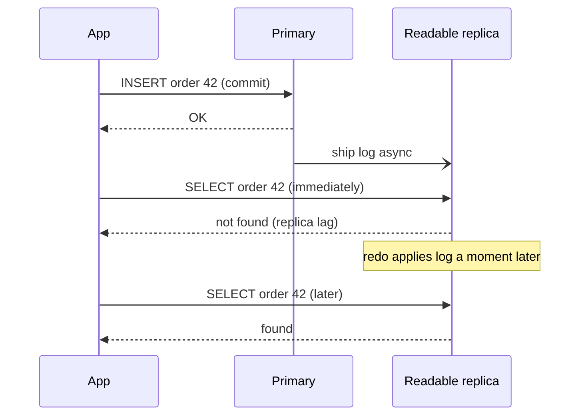

### Connection example
```csharp
// Read-only intent: gateway routes to a readable secondary when one exists
var ro = new SqlConnectionStringBuilder(baseCs) { ApplicationIntent = ApplicationIntent.ReadOnly };
// Application name helps you spot the traffic in DMVs
ro.ApplicationName = "orders-api-readonly";
```
```sql
-- On the connection: confirm where you landed
SELECT DATABASEPROPERTYEX(DB_NAME(), 'Updateability') AS updateability;   -- READ_ONLY on replica
-- Always On: measure lag from the primary
SELECT d.name, drs.synchronization_state_desc, drs.log_send_queue_size, drs.redo_queue_size,
       drs.last_commit_time, DATEDIFF(SECOND, drs.last_commit_time, SYSUTCDATETIME()) AS approx_lag_s
FROM sys.dm_hadr_database_replica_states drs JOIN sys.databases d ON d.database_id = drs.database_id
WHERE drs.is_local = 0;
```
```bash
# Hyperscale named replica (verify current CLI syntax)
az sql db replica create -g rg -s sqlsrv -n appdb --partner-database appdb-ro1 --partner-server sqlsrv \
   --secondary-type Named --service-objective HS_Gen5_4
```

### The central problem: replication lag and read-your-writes
Mitigations, from simplest to strongest:
1. **Route by use-case, not globally:** reports, dashboards, search, exports → replica; "read right after write" flows → primary.
2. **Session stickiness to primary after a write** (e.g. 5–10 s window or until the replica's LSN passes your write — "read-after-write token" stored in a cookie/claim).
3. **Return the created resource from the write response** instead of re-reading.
4. **Wait for replica catch-up** by comparing a version/rowversion/LSN captured at write time (possible, rarely worth it).
5. **Use synchronous commit** for a secondary when stale reads are unacceptable (costs write latency).
6. Make the UI tolerant (optimistic UI, "processing" states).

### Real-world use
Reporting/BI, product search/catalog reads, export jobs, dashboards, read-heavy public APIs, regional read locality via geo-replicas.

### When to use / not
Use when reads dominate, the workload tolerates seconds of staleness, and tuning/caching is not enough. **Not** for correctness-critical reads (inventory check before purchase, balance before debit), nor as a fix for bad queries — a slow query is slow on the replica too and a long-running replica query can delay redo.

### Trade-offs / mistakes
Gains: read scale-out, isolation, DR reuse. Costs: eventual consistency, licensing/compute cost, routing logic, plan/statistic differences. Mistakes: sending *all* traffic to the replica "because it's read-only" (including read-modify-write), ignoring lag SLOs, running unbounded reports that starve redo, assuming failover keeps `ReadOnly` routing healthy, forgetting that after failover the replica *becomes* primary and the pool of connections must reconnect.

### Performance, scalability, reliability, security
Apply the same RBAC/TDE/auditing on replicas. Monitor `redo_queue_size`/lag and alert on it. For Hyperscale named replicas, size independently and give BI users a separate endpoint. Combine with caching so the replica is not your first line.

### Troubleshooting
Stale reads in prod → check lag DMV, long-running transactions on primary (log truncation delays), large batch loads, and redo blocking from long queries. "Cannot write on this connection" → intent routed to read-only; check connection string and middleware.

### Interview Q&A
**Q: Users create an item then do not see it in the list. Why and how do you fix it?** Replica lag (read-your-writes violation). Fix by pinning post-write reads to the primary for a short window or until a version token catches up, return the created entity directly, and keep list endpoints that must be fresh on the primary.
**Follow-ups:** *Sync vs async replicas?* Sync = zero data loss but write latency and availability coupling; async = fast writes, possible loss on failover, lag. *Does a replica scale writes?* No — all writes still go to the single primary; that is where sharding enters.

---

## 5. Primary–secondary architecture

### Simple idea
One node (primary) accepts writes; one or more secondaries receive its changes and can take over if the primary dies.

### Why it exists
Single-node databases are a single point of failure. Replication gives **high availability** (automatic failover) and **disaster recovery** (copy in another zone/region), with a defined RPO/RTO.

### How it works
- **Commit modes:** *synchronous* — primary waits for the secondary to harden the log before acknowledging commit (RPO ≈ 0, adds network latency to every commit); *asynchronous* — commit does not wait (RPO > 0 seconds, minimal latency).
- **Failover types:** automatic (needs sync commit + a witness/quorum), manual planned (no data loss), forced (async, data loss possible).
- **Quorum and split-brain:** if the nodes cannot see each other, two nodes may both believe they are primary. Clusters/AGs prevent this with **quorum** (majority vote of nodes + witness — file share, cloud witness, disk). The side without quorum stops serving writes. Azure SQL handles this for you inside the service.
- **Client behaviour:** applications connect through a **listener / failover-group endpoint** (a stable DNS name) and must **retry** transient errors during the failover window (seconds to a minute).

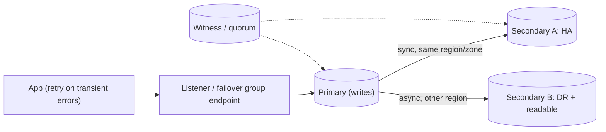

```csharp
// Resilient connection to a failover endpoint (Microsoft.Data.SqlClient + EF Core)
services.AddDbContext<AppDb>(o => o.UseSqlServer(cs, sql => sql.EnableRetryOnFailure(
    maxRetryCount: 6, maxRetryDelay: TimeSpan.FromSeconds(30), errorNumbersToAdd: null)));
// Connection string tips: ConnectRetryCount=3;ConnectRetryInterval=10;MultiSubnetFailover=True (AG listener)
```
Important: with `EnableRetryOnFailure`, **user-initiated transactions must run inside the execution strategy** (`strategy.ExecuteAsync(...)`), otherwise EF throws.

### Real-world use
Production OLTP with 99.99% targets; regional DR for regulated systems; maintenance with rolling patching (fail over, patch, fail back).

### When to use / not
Always for production. Choose **sync** for in-region HA, **async** for cross-region DR. Do not stretch synchronous commit across continents (latency per commit ≈ RTT).

### Trade-offs / mistakes
Sync: safety vs latency/availability coupling (if the sync secondary is down, primary may stall unless you configure fallback — know your AG's `REQUIRED_SYNCHRONIZED_SECONDARIES_TO_COMMIT`). Mistakes: never testing failover; app without retry logic; hard-coded node names; assuming failover is instant; ignoring that after failover caches and plans are cold; forgetting jobs/logins/linked servers that are not replicated (instance-level objects).

### Performance, scalability, reliability, security
Network bandwidth between nodes must exceed peak log generation; large index rebuilds can saturate it (use `RESUMABLE`/`ONLINE`, off-peak, or minimal logging patterns). Use TLS between replicas; keep the same TDE keys on all nodes.

### Troubleshooting
Growing log on primary → secondary lag blocks truncation (`log_reuse_wait_desc = AVAILABILITY_REPLICA`). Failover took 90 s → look at DB recovery time (long-running transactions → long undo; **Accelerated Database Recovery** shortens it), client connection pool still holding dead connections, DNS TTL.

### Interview Q&A
**Q: What is RPO vs RTO and how do sync/async relate?** RPO = tolerable data loss, RTO = tolerable downtime. Sync secondary → RPO ≈ 0; async → RPO ≈ lag. RTO depends on failover automation, recovery time, and client reconnect behaviour.
**Follow-ups:** *What is split-brain and how is it prevented?* Two writable primaries; prevented by quorum/witness and fencing. *Why does a long transaction hurt failover?* Recovery must roll it back (without ADR) before the DB is fully available.

---

## 6. Database caching

### Simple idea
Keep copies of expensive-to-compute or frequently-read data closer to the application so the database is hit less.

### Why it exists
The database is the hardest component to scale (stateful, write-bound, expensive per query). A cache hit is microseconds–milliseconds and costs nothing in DB CPU/IO, protecting the DB during spikes.

### Layers of caching
| Layer | What | Pros | Cons |
|---|---|---|---|
| **SQL Server buffer pool / plan cache** | Data pages and compiled plans in RAM (automatic) | Free, always on | Not a substitute for app caching; cold after failover/restart |
| **In-process memory cache** (`IMemoryCache`) | Per-instance objects | Fastest, no network | Per-instance inconsistency, memory pressure, lost on restart |
| **Distributed cache** (Redis) | Shared across instances | Consistent view across scale-out, survives app restarts | Network hop (≈0.2–1 ms), serialization, extra failure mode |
| **HybridCache (.NET)** | L1 in-memory + L2 distributed with stampede protection | Best of both, built-in single-flight | Needs invalidation design |
| **HTTP/CDN/output cache** | Whole responses | Offloads API too | Coarse invalidation, personalisation limits |
| **Materialised/read-model tables, indexed views** | Pre-computed aggregates | Moves cost to write time | Staleness/maintenance (see [CQRS](../03-architectural-patterns/02-CQRS-pattern/CQRS-pattern.md)) |

### What to cache — and what not
Good: reference/lookup data, product catalog, configuration, user profile summaries, computed aggregates, expensive joins, rate-limit counters, sessions/tokens. Bad: highly volatile data, per-user unique data with low reuse, anything requiring strict read-after-write correctness, huge objects, or data whose invalidation you cannot define. **Rule:** if you cannot state the invalidation/staleness rule in one sentence, do not cache it yet.

### Cache design checklist
Key naming and versioning (`app:v3:product:{id}`), TTL policy with **jitter**, size limits, serialization format (System.Text.Json/MessagePack), stampede protection, failure mode (fail-open to DB with protection, or fail-closed), metrics (hit ratio, latency, evictions, memory), and security (never cache one tenant's data under a shared key; include tenant in the key).

### Troubleshooting
Low hit ratio → keys too specific/TTL too short/evictions. Stale data bug → missing invalidation path (including *writes from other services or SQL scripts*). DB spike at cache restart → cold-start stampede; warm up or stagger.

### Interview Q&A
**Q: What are the two hard things in computer science and how does it apply?** Naming and **cache invalidation**; strategies: TTL (simple, bounded staleness), explicit invalidate-on-write, event-driven invalidation (publish "ProductChanged" and evict), versioned keys (bump a version number so old keys are simply never read).
**Follow-up:** *Where is the best place to cache — app, Redis, or DB?* Layer them: the DB buffer pool is automatic; use L1+L2 in the app for hot reference data; use output/CDN caching for public GETs; choose by staleness tolerance and sharing needs.

---

## 7. Redis caching patterns

### Simple idea
Redis is an in-memory key-value store. Patterns differ in **who loads the cache and who writes to the database**.

### The five patterns
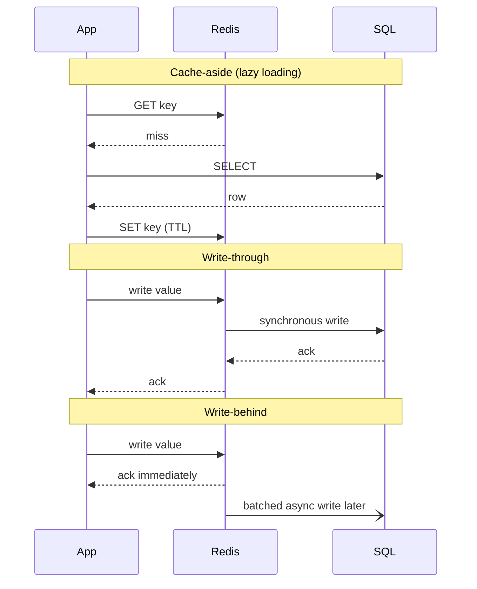

| Pattern | Flow | Consistency | Latency | Risk | Use when |
|---|---|---|---|---|---|
| **Cache-aside** | App reads cache, on miss loads DB and populates; writes go to DB then **invalidate** (or update) cache | Eventual; small stale window | Fast hits, slow miss | Stampede, stale on missed invalidation | Default for read-heavy data |
| **Read-through** | Cache layer itself loads from DB on miss | Same | Same | Requires cache provider support | Library/platform handles loading (HybridCache's factory delegate behaves like this) |
| **Write-through** | Writes go through cache to DB synchronously | Strong-ish (cache never ahead of DB) | Write latency = cache + DB | Cache holds unread data | Read-after-write needs, simpler invalidation |
| **Write-behind (write-back)** | Write to cache, DB updated asynchronously in batches | Cache is ahead of DB | Lowest write latency | **Data loss if cache dies before flush**, ordering, complexity | High-rate counters/telemetry where loss is tolerable, or backed by a durable queue |
| **Refresh-ahead** | Proactively reload keys before TTL expiry | Fresher reads | No miss latency | Wasted loads for cold keys | Predictable hot keys (home page, rates) |

### Cache-aside with HybridCache (preferred in .NET 9/10)
```csharp
builder.Services.AddStackExchangeRedisCache(o => o.Configuration = cfg["Redis:Cs"]);   // L2
builder.Services.AddHybridCache(o =>
{
    o.DefaultEntryOptions = new HybridCacheEntryOptions
    {
        Expiration = TimeSpan.FromMinutes(10),          // L2 TTL
        LocalCacheExpiration = TimeSpan.FromMinutes(1)  // L1 TTL (shorter = less cross-node staleness)
    };
});

public sealed class ProductReader(HybridCache cache, AppDb db)
{
    public ValueTask<ProductDto?> GetAsync(int id, CancellationToken ct) =>
        cache.GetOrCreateAsync($"product:v2:{id}",
            async token => await db.Products.AsNoTracking()
                .Where(p => p.Id == id)
                .Select(p => new ProductDto(p.Id, p.Name, p.Price))
                .FirstOrDefaultAsync(token),
            tags: ["products", $"product:{id}"], cancellationToken: ct);   // GetOrCreate = single-flight per key

    public async Task UpdatePriceAsync(int id, decimal price, CancellationToken ct)
    {
        await db.Products.Where(p => p.Id == id).ExecuteUpdateAsync(s => s.SetProperty(p => p.Price, price), ct);
        await cache.RemoveByTagAsync($"product:{id}", ct);   // invalidate after the DB commit
    }
}
```
HybridCache coalesces concurrent misses for the same key (stampede protection) and layers L1/L2.
Tag-based invalidation depends on the .NET version/features in use **(verify current)**; with a plain
`IDistributedCache` you do the same with `RemoveAsync(key)`.

### Cache-aside with StackExchange.Redis (explicit control + stampede lock)
```csharp
public async Task<Product?> GetAsync(int id)
{
    var key = $"product:v2:{id}";
    var hit = await _db.StringGetAsync(key);
    if (hit.HasValue) return JsonSerializer.Deserialize<Product>(hit!);

    var lockKey = key + ":lock";
    var token = Guid.NewGuid().ToString("N");
    if (await _db.StringSetAsync(lockKey, token, TimeSpan.FromSeconds(10), When.NotExists))   // single loader
    {
        try
        {
            var p = await _repo.LoadAsync(id);                       // DB
            var ttl = TimeSpan.FromMinutes(10) + TimeSpan.FromSeconds(Random.Shared.Next(0, 60));   // jitter
            await _db.StringSetAsync(key, JsonSerializer.SerializeToUtf8Bytes(p), p is null ? TimeSpan.FromSeconds(30) : ttl); // cache nulls briefly
            return p;
        }
        finally { await ReleaseLockAsync(lockKey, token); }          // compare-token Lua script
    }
    await Task.Delay(50);                                            // waiters poll cache, bounded retries
    return await GetAsync(id);                                       // cap recursion in real code
}
```

### Failure modes — name them precisely in interviews
| Problem | What happens | Defences |
|---|---|---|
| **Cache stampede / thundering herd** | A hot key expires and N requests hit the DB simultaneously | Single-flight (HybridCache), mutex per key, TTL jitter, refresh-ahead, serve-stale-while-revalidate |
| **Cache penetration** | Requests for keys that never exist bypass cache every time | Cache negative results briefly, Bloom filter, input validation |
| **Cache avalanche** | Many keys expire at once, or Redis restarts → DB melts | TTL jitter, warm-up, multi-layer (L1), DB protection (bulkhead/rate-limit/circuit breaker) |
| **Hot key** | One key gets disproportionate traffic → single shard/CPU saturation | L1 in-process copy, key replication (`key#1..#N`), client-side caching |
| **Stale data** | Write path forgot to invalidate, or race (read old → write DB → invalidate → old value set) | Invalidate *after* commit, short TTL as backstop, versioned keys, event-driven invalidation, delete rather than update |
| **Cache down** | Redis unavailable | Short timeouts (50–200 ms), circuit breaker, fall back to DB **with concurrency limit**, never wait on retries |
| **Memory pressure / eviction** | Keys evicted unexpectedly | Right `maxmemory-policy` (`allkeys-lru`/`allkeys-lfu` for caches; `noeviction` for stores), size by working set, watch evictions |

**Classic race with cache-aside:** T1 reads miss → loads old row; T2 updates DB and deletes key; T1
then sets the *old* value. Mitigations: short TTLs, versioned values (store `rowversion` and refuse to
overwrite newer), or delayed double-delete. Be able to draw this.

### Sizing, eviction, serialization
Size = (avg object bytes + ~100 B overhead) × working-set keys × replication factor; monitor
`used_memory`, `evicted_keys`, `keyspace_hits/misses`. Serialize compactly (MessagePack/protobuf)
for large objects; avoid caching big graphs; compress only when payload >~1 KB and CPU allows.
Azure: Azure Cache for Redis tiers (Basic/Standard/Premium/Enterprise) and its successor **Azure
Managed Redis** — check current guidance on tier selection, retirement dates and SKU names
**(verify current)**. Use private endpoints, Entra ID auth where supported, TLS only.

### Redis is not your source of truth
Use it as a cache unless you have deliberately designed for durability (AOF/persistence, replication)
and accept its failure semantics. Write-behind without a durable queue is data loss waiting to
happen.

### Real-world use
Product catalog and pricing, session/token stores, rate limiting (INCR + EXPIRE), leaderboards (sorted sets), idempotency keys with TTL, distributed locks (with caution), feature flags.

### When to use / not
Use for read-heavy, repeatable, staleness-tolerant data. Not for primary storage, strongly consistent reads, or data with unbounded cardinality and no reuse.

### Trade-offs / mistakes
Faster and cheaper reads vs staleness and a new failure domain. Mistakes: no TTL; caching without invalidation; caching per-user data under shared keys; caching EF tracked entities (serialize DTOs); awaiting Redis with default 5 s timeouts so an outage stalls every request; unbounded key cardinality; treating Redis locks as perfectly safe (RedLock debates — prefer idempotency).

### Troubleshooting
Latency spikes → big keys, `KEYS`/`SMEMBERS` on huge sets, CPU-bound single thread, network throttling, client thread-pool starvation (see [ASP.NET Core internals](../10-aspnet-core-web-api-internals/aspnet-core-web-api-internals.md)). Use `SLOWLOG GET`, `INFO stats`, `--bigkeys`, Azure Monitor metrics (server load, evicted keys, connected clients).

### Related
[Distributed systems patterns](../03-architectural-patterns/distributed-systems-patterns.md) (caching, bulkhead, circuit breaker); [Azure services guide](../14-azure-services-and-cloud-architecture/azure-services-and-cloud-architecture.md) (Redis service selection).

### Interview Q&A
**Q: Cache-aside vs write-through?** Cache-aside: app controls loading/invalidation, simple, tolerates cache loss, but has a stale window and stampede risk. Write-through: cache is updated on every write so reads see fresh data, but writes are slower and the cache fills with possibly-unread data.
**Q: Why not write-behind everywhere?** Acknowledging writes before they are durable risks data loss and reordering; use only where loss is acceptable or with a durable queue (e.g. Service Bus) between cache and DB.
**Q: Redis is down and your API melts the DB — how do you prevent it?** Timeouts + circuit breaker around Redis, fall back to DB behind a **concurrency limiter/bulkhead**, L1 in-memory cache, serve-stale, request coalescing, rate-limit expensive endpoints, and load-shedding with 503/Retry-After. See scenario 7.
**Follow-ups:** *How do you invalidate across 20 app instances' L1 caches?* Short L1 TTL, or pub/sub invalidation messages (Redis channel/Service Bus topic), or version keys. *Cache stampede vs penetration?* Stampede: existing hot key expires; penetration: nonexistent keys always miss.

---
## 8. Database connection management

### Simple idea
Opening a database connection is expensive (TCP + TLS + auth + login). ADO.NET therefore keeps a **pool** of open connections per distinct connection string; `Open()` borrows one, `Close()/Dispose()` returns it. Managing connections means keeping them short-lived, bounded and matched to what the database can actually run.

### Why it exists / how it works
`Microsoft.Data.SqlClient` pools per (connection string, identity, …). Default `Max Pool Size=100`. When all are in use, callers **queue until `Connect Timeout` (15 s)** then throw `InvalidOperationException: Timeout expired… max pool size was reached`. Each pooled connection that is *executing* occupies a SQL Server **worker thread** (`max worker threads` is CPU-dependent); sessions that are idle cost memory but not workers. Connection reset (`sp_reset_connection`) runs on reuse.

### Pool-sizing math (Little's law)
`concurrent_connections_needed = request_rate × avg_connection_hold_time`.
At 500 req/s and 40 ms average hold time → ~20 concurrent connections, *not* 500. If a bug holds the connection for 2 s (calling an external API inside the `using` block) → 1,000 needed → pool exhaustion. **Fix the hold time, not the pool size.**

Across instances: `total_connections = instances × max_pool_size`. 30 pods × 100 = 3,000 potential sessions against a database whose service tier allows, say, 800 concurrent sessions/workers **(verify tier limits)**. Size the pool per instance as `target_db_concurrency / instances` and use backpressure (queue/limit concurrency in the app) rather than letting the DB queue.

```csharp
// Per-instance cap and hygiene
var csb = new SqlConnectionStringBuilder(cs)
{
    MaxPoolSize = 40, MinPoolSize = 5, ConnectTimeout = 15,
    ApplicationName = "orders-api", ConnectRetryCount = 3, ConnectRetryInterval = 10,
    MultipleActiveResultSets = false          // MARS only if you really need it (see below)
};
// Passwordless: managed identity (Azure) - no secret in config
csb.Authentication = SqlAuthenticationMethod.ActiveDirectoryDefault;   // verify current auth modes

// EF Core: pool DbContext objects (not connections) for very high throughput, keep lifetime scoped per request
services.AddDbContextPool<AppDb>(o => o.UseSqlServer(csb.ConnectionString, s => s.EnableRetryOnFailure()), poolSize: 256);
```
- **DbContext lifetime:** scoped per request/unit of work, never singleton (not thread-safe, tracks entities forever).
- **Async all the way:** sync-over-async blocks threads while holding connections → pool + thread-pool starvation.
- **Do not hold a connection across an HTTP call, a queue publish or a user think-time.** Read → close → process → open → write; or use the outbox.
- **MARS** (Multiple Active Result Sets) lets multiple commands interleave on one connection; it adds overhead and subtle behaviours — avoid unless needed (e.g. streaming a reader while issuing updates), prefer separate short operations.
- **Connection resiliency:** transient errors (40613, 40197, 40501, 49918, 10928/10929 resource limits, 4060, deadlock 1205 is *not* transient-connection but retryable) → `EnableRetryOnFailure` or Polly; make operations idempotent.
- **Azure SQL connection policy:** *Redirect* (clients connect directly to the node after a gateway handshake — lower latency, needs ports 11000–11999 open) vs *Proxy* (everything via gateway on 1433 — simpler firewalls, slightly higher latency). Default is Redirect for clients inside Azure, Proxy outside.
- **Keep-alives / idle-connection killers:** NAT gateways and load balancers close idle TCP after ~4 minutes; ADO.NET's `ConnectRetryCount` handles idle-connection resiliency; for long-idle pools consider shorter `Connection Lifetime`-style recycling.

### No PgBouncer for SQL Server — what instead?
SQL Server has no mainstream external multiplexing pooler like PgBouncer. Approaches: (1) **limit pool size and concurrency in the app** (preferred); (2) **reduce instance count / use fewer, larger instances**; (3) use **Azure SQL Hyperscale/higher tiers with higher worker limits**; (4) aggregate work through a **queue + consumers** with bounded concurrency; (5) put a **read replica** behind reporting; (6) for serverless/Functions, use a bounded `maxConcurrent` per instance (Functions scale-out multiplies connections quickly — plan with `WEBSITE_MAX_DYNAMIC_APPLICATION_SCALE_OUT` or Service Bus `MaxConcurrentCalls`).

### Diagnosing pool exhaustion
```sql
-- Who holds the connections? (from SQL Server's perspective)
SELECT s.program_name, s.host_name, s.login_name, COUNT(*) AS sessions,
       SUM(CASE WHEN r.session_id IS NOT NULL THEN 1 ELSE 0 END) AS running,
       SUM(CASE WHEN s.status = 'sleeping' AND s.open_transaction_count > 0 THEN 1 ELSE 0 END) AS idle_in_tran
FROM sys.dm_exec_sessions s LEFT JOIN sys.dm_exec_requests r ON r.session_id = s.session_id
WHERE s.is_user_process = 1
GROUP BY s.program_name, s.host_name, s.login_name ORDER BY sessions DESC;
```
Many sleeping sessions with `open_transaction_count > 0` = code that began a transaction and then waited (e.g. on HTTP). Many *running* = the DB is the bottleneck. Client-side: .NET event counters `Microsoft.Data.SqlClient.EventSource` (`active-hard-connections`, `number-of-pooled-connections`, `number-of-active-connections`) via `dotnet-counters`.

### Real-world use / when not
Any .NET service. **Do not** raise `MaxPoolSize` to "fix" timeouts without finding what holds connections; you only move the queue into SQL Server where it burns workers.

### Trade-offs / mistakes
Bigger pools mask leaks and amplify DB contention; smaller pools provide backpressure but can cap throughput. Mistakes: `new SqlConnection` without `using`; returning `IDataReader` from a method (connection lifetime leaks); long `TransactionScope` across awaits to remote services; disabling pooling; per-tenant connection strings producing hundreds of tiny pools (`Max Pool Size` × tenants!); logging in with SQL auth secrets in config instead of managed identity.

### Performance, scalability, reliability, security
Use managed identity/Entra auth and TLS (`Encrypt=True`); least-privilege DB users per service; separate pools for read-only intent; clear pool on failover if needed (`SqlConnection.ClearAllPools()` rarely).

### Troubleshooting
"Timeout expired. The timeout period elapsed prior to obtaining a connection from the pool" → check hold time, leaks (missing dispose), blocking in DB (long transactions holding connections), thread-pool starvation, or genuinely insufficient capacity. See [ASP.NET Core internals](../10-aspnet-core-web-api-internals/aspnet-core-web-api-internals.md) and Part 1's pooling chapter.

### Interview Q&A
**Q: API intermittently throws pool timeouts. Walk me through it.** (1) Confirm: client counters show active connections ≈ max. (2) Is the DB slow or are connections *held*? Check `dm_exec_requests` vs sleeping sessions with open transactions. (3) Look for external calls or `.Result` inside `using`. (4) Find blocking chains. (5) Fix the root cause (shorten hold time, indexes, async), then right-size pools per instance with backpressure. Raising `Max Pool Size` is the last resort.
**Follow-up:** *Why is `instances × pool size` an issue during autoscale?* Scale-out multiplies DB connections; need per-instance caps and DB-aware autoscale limits.

---

## 9. Read/write separation

### Simple idea
Send **writes** to the primary and **reads** to replicas — in code, configuration, or via CQRS read models.

### Why it exists
Scale reads independently, protect transactional latency from reporting, and enable cheaper compute for read nodes.

### How it works — routing options
1. **Two connection strings + two DbContexts** (explicit, safest): `WriteDb` and `ReadDb` (`ApplicationIntent=ReadOnly`).
2. **Interceptor/factory routing** by operation type or attribute.
3. **CQRS** — the query side reads from a projection store (replica, denormalised table, Elasticsearch, Redis) fed by events/outbox.
4. **Proxy/driver-level** routing (limited in SQL Server; ApplicationIntent does it at the gateway/listener).

```csharp
public sealed class ReadDb(DbContextOptions<ReadDb> o) : DbContext(o)
{   // read-only by construction
    public ReadDb() : this(new DbContextOptions<ReadDb>()) { }
    protected override void OnConfiguring(DbContextOptionsBuilder b) =>
        b.UseQueryTrackingBehavior(QueryTrackingBehavior.NoTracking);
    public override int SaveChanges() => throw new InvalidOperationException("Read-only context");
    public override Task<int> SaveChangesAsync(CancellationToken ct = default) => throw new InvalidOperationException("Read-only context");
}

builder.Services.AddDbContext<WriteDb>(o => o.UseSqlServer(cfg.GetConnectionString("Primary")));
builder.Services.AddDbContext<ReadDb>(o => o.UseSqlServer(cfg.GetConnectionString("PrimaryReadOnlyIntent")));

// Query handler (CQRS read side) uses ReadDb (or Dapper) - never writes
public sealed class GetOrdersHandler(ReadDb db) { /* ... */ }
```
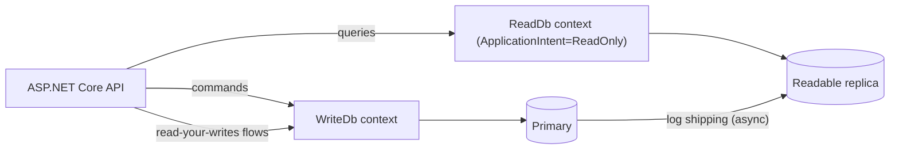
Add a **consistency policy**: an endpoint attribute `[ReadsFrom(ReadSource.Primary)]` for flows that need freshness (post-write redirects, balance checks), `Replica` for lists/search/reporting.

### Real-world use
Catalogs, dashboards, reporting APIs, public GET-heavy APIs, analytics exports.

### When to use / not
When read load clearly exceeds what primary+cache can serve and staleness is acceptable. Not when most reads are read-after-write. Don't introduce before you have measured read contention.

### Trade-offs / mistakes
Eventual consistency bugs (see chapter 4), two failure domains, double the connection pools. Mistakes: using replica for **read-modify-write** (stale read → lost update; use rowversion/ETag concurrency on the primary), routing *by HTTP verb* only (a `POST /search` is a read; a `GET` that increments a counter is a write), running a transaction partly on each context, forgetting that reads after **failover** may suddenly hit the new primary.

### Performance/reliability/security
Pool each context separately; fail back to primary when replica unavailable (circuit breaker); apply the same row-level security/auditing; monitor lag as an SLI ("replica freshness").

### Troubleshooting
User reports stale pages → log which source served the request (enrich logs with `db.source=replica`), check lag. Writes failing "database is read-only" → wrong context/connection string.

### Interview Q&A
**Q: How do you implement read/write splitting in EF Core?** Separate DbContexts or interceptor-based routing, with an explicit consistency policy per use case; read context is NoTracking and cannot SaveChanges. **Follow-up:** *Relation to CQRS?* Read/write splitting is the infrastructure-level version of CQRS; full CQRS also separates models and can use a different store for reads (see [CQRS](../03-architectural-patterns/02-CQRS-pattern/CQRS-pattern.md)).

---

## 10. Database scalability and high availability

### Simple idea
*Scalability* = handling more load by adding resources; *high availability* = staying up when components fail. They are different axes: a huge but single-node database is scalable-ish yet not HA; a mirrored small one is HA but not scalable.

### Vertical vs horizontal
| | Vertical (scale up) | Horizontal (scale out) |
|---|---|---|
| How | Bigger SKU: more vCores/RAM/IOPS | Replicas, partitioning, sharding |
| Pros | No app change, fastest fix | Higher ceilings, blast-radius control |
| Cons | Ceiling and cost curve, downtime/failover on resize (brief) | Complexity, consistency, routing |
| Use | First response to saturation | When ceilings/writes demand it |

### HA/DR building blocks
| Platform | HA | DR | Notes |
|---|---|---|---|
| SQL Server on VMs/on-prem | **Always On AG** (readable secondaries, sync/async, listener), **FCI** (shared storage, instance-level) | AG async in another site, log shipping, backup/restore | You own patching, quorum, failover testing |
| **Azure SQL Database/MI** | Built-in HA (local/zone-redundant replicas, automatic) | **Auto-failover groups** (cross-region, read-write/read-only listener endpoints), geo-restore, LTR | 99.99–99.995% SLAs depending on tier/zone redundancy **(verify current)** |
| **Hyperscale** | Multiple HA replicas, fast scale/restore independent of size | Geo-replica/named replicas, backup via snapshots | Great for large DBs and fast restores |

- **Zone redundancy:** replicas spread across availability zones — survives a zone failure (RPO≈0 for sync inside region). **Failover groups:** survive a region failure (async, RPO seconds).
- **Backups:** automated full/diff/log with **point-in-time restore** (retention 1–35 days) and **long-term retention** (weeks–10 years); *test restores*; backups ≠ HA. **Restore time is part of RTO** — large DBs restore slowly outside Hyperscale.
- **Maintenance windows:** Azure SQL lets you choose a maintenance window; every maintenance = a brief failover → clients must retry.
- **Capacity planning:** measure CPU/IO/log-rate/workers/sessions headroom, track growth monthly, load-test before launches. Use **serverless** (auto-scale + auto-pause) for spiky dev/low-traffic workloads (cold start after pause: seconds) and **elastic pools** for many small DBs with uncorrelated peaks. Provisioned/Hyperscale for steady, critical workloads.
```bash
# Failover group and zone redundancy (verify current syntax/SKUs)
az sql failover-group create -n fog-app -g rg -s sql-eus --partner-server sql-weu --add-db appdb --failover-policy Automatic --grace-period 1
az sql db update -g rg -s sql-eus -n appdb --zone-redundant true
az sql db update -g rg -s sql-eus -n appdb --service-objective GP_Gen5_8   # scale up/down
```
```bicep
// Elastic pool for many tenant DBs (verify current API version)
resource pool 'Microsoft.Sql/servers/elasticPools@2023-08-01-preview' = {
  parent: sqlServer
  name: 'tenants-pool'
  location: location
  sku: {
    name: 'GP_Gen5'
    tier: 'GeneralPurpose'
    capacity: 8
  }
  properties: {
    perDatabaseSettings: {
      minCapacity: json('0.25')
      maxCapacity: 4
    }
  }
}
```

### SQL vs NoSQL at a glance
Pick relational for transactions, joins, constraints, ad-hoc queries; pick Cosmos/Redis/document stores for massive horizontal scale on a known access pattern, flexible schema, multi-region writes, or low-latency key lookups. Polyglot persistence per service is normal in microservices (see [advanced architecture](../16-advanced-architecture-and-microservices/advanced-architecture-and-microservices.md)); don't use NoSQL merely to avoid schema design.

### Real-world use
Tier-1 transactional systems: zone-redundant Business Critical/Hyperscale + failover group + PITR + tested runbooks + retry-aware clients.

### When to use / not / trade-offs
Cross-region active-passive is worth it when the business RTO/RPO demands it; it doubles cost and adds failover procedure complexity. Do not promise "five nines" without testing failover and without dependent services (queues, caches, identity) matching it — **the composite SLA is the product of the parts**.

### Mistakes / anti-patterns
No failover drills; sync stretch across regions; relying on backups as HA; one huge shared database for all microservices; resizing in business hours without retry-aware clients; autoscale without upper cap (cost) or with serverless pause for a latency-sensitive API; ignoring log-rate governance limits on the tier.

### Performance, scalability, reliability, security
Watch tier-specific limits (log write MB/s, IOPS, max workers/sessions, tempdb size). Encrypt (TDE + TLS), use private endpoints, audit, Defender for SQL. Cost: right-size with Query Store/`sys.dm_db_resource_stats`; reserved capacity; stop over-provisioned replicas. More in the [Azure services guide](../14-azure-services-and-cloud-architecture/azure-services-and-cloud-architecture.md) and [migration guide](../11-cloud-migration-and-modernization/cloud-migration-and-legacy-modernization.md).

### Troubleshooting
After failover: slow queries (cold cache/plans) → expect warm-up, consider pre-warming; connection storms → jittered retries; geo-failover app still on old region → DNS TTL/failover-group listener names. Resource-limit errors → `sys.dm_db_resource_stats` (avg_cpu, avg_log_write_percent, max_worker_percent).

### Interview Q&A
**Q: Design HA/DR for a payments database, RPO ≈ 0 in-region, RTO 15 min cross-region.** Zone-redundant Business Critical (sync replicas in zones) for RPO≈0; auto-failover group to a paired region (async, RPO seconds, so state this honestly); app uses the failover-group listener, retry policies, health-checked region switching (Front Door/Traffic Manager); PITR + LTR; quarterly failover drills; runbook for forced failover with data-loss decision. **Follow-up:** *Why not synchronous cross-region?* Each commit pays the inter-region RTT (50–150 ms) and region partitions would stall writes.

---

# Part II — Troubleshooting tools and production practice

> **Method before tools.** Start from the symptom and the *question*: Is it slow now or always? One query or everything? CPU, I/O, memory, blocking, or the network? Each tool below answers a specific question: **Query Store** — "what changed / what is expensive over time?"; **DMVs** — "what is happening right now and what is the engine waiting on?"; **Extended Events** — "capture this specific event with low overhead (deadlock, slow RPC, blocked process)"; **execution plans** — "why is this query slow?"

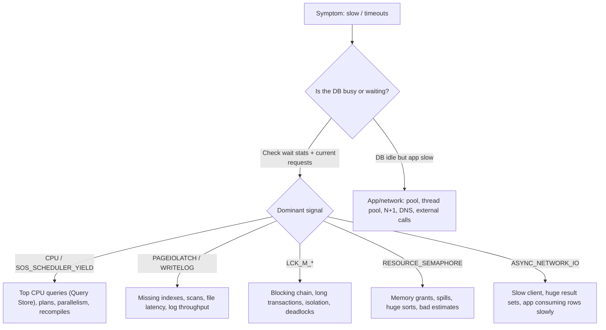

---
## 11. Query Store

### Simple idea
Query Store is a "flight recorder" built into the database. It persists, per query and per plan, runtime statistics aggregated in time intervals — so you can answer "what got slower after Tuesday's deployment?" even after a restart or plan cache flush.

### Why it exists
The plan cache and `sys.dm_exec_query_stats` are **volatile**: restarts, memory pressure, `RECOMPILE`, failovers and schema changes wipe history, and DMVs hold only the *current* plan. Plan regressions (sniffing, stats change, compat-level upgrade) need *historical* comparison across **multiple plans for the same query** — and a way to **force** the good one.

### How it works internally
Compilation and execution hooks write to in-memory buffers, flushed asynchronously to internal tables in the user database (so it **travels with backups/restores**). Data model:
`sys.query_store_query_text` → `sys.query_store_query` → `sys.query_store_plan` → `sys.query_store_runtime_stats` (per plan per interval) and `sys.query_store_wait_stats` (per plan per interval per wait category), plus `sys.query_store_runtime_stats_interval`. Enabled **by default** in Azure SQL Database and in new SQL Server 2022 databases (`READ_WRITE`); on older on-prem versions enable it per DB.

```sql
ALTER DATABASE CURRENT SET QUERY_STORE = ON
(
    OPERATION_MODE = READ_WRITE,
    QUERY_CAPTURE_MODE = AUTO,                 -- skip trivial/rare queries; ALL is noisy
    INTERVAL_LENGTH_MINUTES = 60,              -- 15-30 for finer incident granularity
    DATA_FLUSH_INTERVAL_SECONDS = 900,
    MAX_STORAGE_SIZE_MB = 1024,                -- size to retention; if full -> READ_ONLY!
    SIZE_BASED_CLEANUP_MODE = AUTO,
    STALE_QUERY_THRESHOLD_DAYS = 30,
    WAIT_STATS_CAPTURE_MODE = ON               -- per-query wait categories
);
-- Health check: actual state vs desired state (READ_ONLY unexpectedly = full or error)
SELECT actual_state_desc, desired_state_desc, current_storage_size_mb, max_storage_size_mb, readonly_reason
FROM sys.database_query_store_options;
```

### Everyday queries
```sql
-- 1) Top resource consumers over the last 24 h (by total CPU)
SELECT TOP (20)
       q.query_id, LEFT(qt.query_sql_text, 200) AS sql_text,
       SUM(rs.count_executions)                            AS execs,
       SUM(rs.avg_cpu_time * rs.count_executions) / 1000.0 AS total_cpu_ms,
       SUM(rs.avg_duration * rs.count_executions) / 1000.0 AS total_duration_ms,
       SUM(rs.avg_logical_io_reads * rs.count_executions)   AS total_logical_reads
FROM sys.query_store_query q
JOIN sys.query_store_query_text qt ON qt.query_text_id = q.query_text_id
JOIN sys.query_store_plan p ON p.query_id = q.query_id
JOIN sys.query_store_runtime_stats rs ON rs.plan_id = p.plan_id
JOIN sys.query_store_runtime_stats_interval i ON i.runtime_stats_interval_id = rs.runtime_stats_interval_id
WHERE i.start_time > DATEADD(HOUR, -24, SYSUTCDATETIME())
GROUP BY q.query_id, qt.query_sql_text
ORDER BY total_cpu_ms DESC;

-- 2) Regressed queries: same query_id with >1 plan, recent avg duration much worse than older
WITH s AS (
  SELECT p.query_id, p.plan_id, i.start_time, rs.avg_duration, rs.count_executions
  FROM sys.query_store_plan p
  JOIN sys.query_store_runtime_stats rs ON rs.plan_id = p.plan_id
  JOIN sys.query_store_runtime_stats_interval i ON i.runtime_stats_interval_id = rs.runtime_stats_interval_id
), recent AS (
  SELECT query_id, plan_id, SUM(avg_duration*count_executions)/NULLIF(SUM(count_executions),0) AS dur
  FROM s WHERE start_time > DATEADD(HOUR,-4,SYSUTCDATETIME()) GROUP BY query_id, plan_id),
history AS (
  SELECT query_id, plan_id, SUM(avg_duration*count_executions)/NULLIF(SUM(count_executions),0) AS dur
  FROM s WHERE start_time <= DATEADD(HOUR,-4,SYSUTCDATETIME()) AND start_time > DATEADD(DAY,-7,SYSUTCDATETIME()) GROUP BY query_id, plan_id)
SELECT r.query_id, r.plan_id AS recent_plan, h.plan_id AS good_plan, r.dur/1000.0 AS recent_ms, h.dur/1000.0 AS good_ms
FROM recent r JOIN history h ON h.query_id = r.query_id AND h.plan_id <> r.plan_id
WHERE r.dur > 2 * h.dur ORDER BY r.dur - h.dur DESC;

-- 3) What was the query waiting on?
SELECT ws.wait_category_desc, SUM(ws.total_query_wait_time_ms) AS wait_ms
FROM sys.query_store_wait_stats ws WHERE ws.plan_id IN (SELECT plan_id FROM sys.query_store_plan WHERE query_id = @QueryId)
GROUP BY ws.wait_category_desc ORDER BY wait_ms DESC;
```

### Forcing plans, hints and automatic correction
```sql
EXEC sp_query_store_force_plan   @query_id = 4711, @plan_id = 9023;   -- pin the last known good plan
EXEC sp_query_store_unforce_plan @query_id = 4711, @plan_id = 9023;
-- Check failures: forced plan can fail if an index it uses was dropped
SELECT query_id, plan_id, is_forced_plan, force_failure_count, last_force_failure_reason_desc FROM sys.query_store_plan WHERE is_forced_plan = 1;

-- Query Store hints (SQL Server 2022 / Azure SQL): attach a hint without changing app code
EXEC sys.sp_query_store_set_hints @query_id = 4711, @query_hints = N'OPTION (RECOMPILE, MAXDOP 1)';

-- Automatic tuning: engine forces last good plan when it detects a regression and verifies it
ALTER DATABASE CURRENT SET AUTOMATIC_TUNING (FORCE_LAST_GOOD_PLAN = ON);
SELECT * FROM sys.dm_db_tuning_recommendations;
```
Also useful: **Compatibility-level upgrades** with Query Store let you upgrade, detect regressions, force old plans, then fix properly (the "Query Tuning Assistant" workflow). Query Store also underpins **parameter-sensitive plan (PSP) optimization** in compat level 160 (see Part 1).

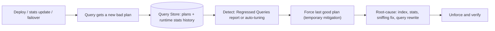

### Real-world use
Post-deployment verification, comparing performance before/after a version or index change, detecting plan flips after a statistics update, capacity planning (top consumers), and **emergency mitigation** by plan forcing — often the fastest safe fix at 3 a.m.

### When to use / not / trade-offs
Almost always ON. Overhead is small (single-digit % CPU typical; higher with `ALL` capture + tiny intervals + huge ad-hoc workloads that generate millions of distinct query texts — use `AUTO` and `OPTIMIZE_FOR_AD_HOC_WORKLOADS`/forced parameterization where appropriate). Forcing plans is a **bandage** that can hide data-skew problems and pin a plan that later becomes wrong; it also breaks if schema changes.

### Mistakes
Leaving the default tiny `MAX_STORAGE_SIZE_MB` → store silently flips to `READ_ONLY`; capture mode `ALL` on ad-hoc heavy systems; forcing plans and forgetting; ignoring that on **readable secondaries** Query Store is not generally capturing (check version support) — profile on the primary or use DMVs; reading averages without execution counts (a plan with 1 execution is noise); not noticing that **ad-hoc queries with literals** create huge numbers of distinct `query_id`s (use parameterization).

### Performance, scalability, reliability, security
Storage lives in the user DB (counts toward size). `sys.query_store_query_text` contains SQL text — may include PII literals; restrict `VIEW DATABASE STATE`/Query Store access.

### Troubleshooting
Empty reports → `actual_state_desc`; "plan forcing failed" → read `last_force_failure_reason_desc`; weird duplicates → context settings (`SET` options) create separate `context_settings_id` entries; ORM-generated literals → parameterize.

### Interview Q&A
**Q: A query was fast yesterday and slow today, no code change. What do you do?** Open Query Store regressed/top-duration report for that `query_id`; compare plans (join type, index use, estimated vs actual rows); check what changed (stats auto-update, index rebuild, failover, data growth, parameter value skew); if a prior good plan exists, **force it** to restore service; then root-cause (stats, index, PSP/sniffing, rewrite) and unforce.
**Follow-ups:** *Query Store vs DMVs?* DMVs = live, volatile; Query Store = persisted history + forcing. *Cons of forcing?* Hides root cause, can fail, may become wrong as data evolves; track forced plans.

---

## 12. Extended Events

### Simple idea
Extended Events (XE) is SQL Server's lightweight, flexible event-tracing engine — "capture *these* events, with *these* filters, to *this* target" — replacing Profiler/Trace for the engine.

### Why it exists
Trace/Profiler had high overhead, limited filtering, and is deprecated. XE is designed to run continuously in production with small overhead because **filtering happens before the event is materialized** (predicates evaluated early) and targets buffer asynchronously.

### How it works
Concepts: **package → event → action (extra data, costlier) → predicate (filter) → target (event_file, ring_buffer, histogram, event_counter, pair_matching)**. The built-in `system_health` session is always on and already captures deadlocks (`xml_deadlock_report`), high-severity errors, long waits, non-yielding schedulers, and more — **start there**.

```sql
-- 1) Slow queries: RPC/batch completions over 1 second, to a rolling file target
CREATE EVENT SESSION [slow_queries] ON SERVER
ADD EVENT sqlserver.rpc_completed(
    SET collect_statement = 1
    ACTION (sqlserver.client_app_name, sqlserver.database_name, sqlserver.username, sqlserver.query_hash, sqlserver.plan_handle)
    WHERE duration > 1000000 AND sqlserver.database_name = N'AppDb'),    -- microseconds
ADD EVENT sqlserver.sql_batch_completed(
    ACTION (sqlserver.client_app_name, sqlserver.database_name, sqlserver.query_hash)
    WHERE duration > 1000000 AND sqlserver.database_name = N'AppDb')
ADD TARGET package0.event_file (SET filename = N'slow_queries.xel', max_file_size = 100, max_rollover_files = 5)
WITH (MAX_MEMORY = 16 MB, EVENT_RETENTION_MODE = ALLOW_SINGLE_EVENT_LOSS, MAX_DISPATCH_LATENCY = 30 SECONDS, STARTUP_STATE = OFF);
ALTER EVENT SESSION [slow_queries] ON SERVER STATE = START;

-- Read it
SELECT CAST(event_data AS xml) AS x INTO #ev
FROM sys.fn_xe_file_target_read_file(N'slow_queries*.xel', NULL, NULL, NULL);
SELECT x.value('(event/@timestamp)[1]','datetime2') AS ts,
       x.value('(event/@name)[1]','sysname') AS evt,
       x.value('(event/data[@name="duration"]/value)[1]','bigint')/1000 AS duration_ms,
       x.value('(event/data[@name="cpu_time"]/value)[1]','bigint')/1000 AS cpu_ms,
       x.value('(event/data[@name="logical_reads"]/value)[1]','bigint') AS reads,
       x.value('(event/action[@name="client_app_name"]/value)[1]','nvarchar(256)') AS app,
       x.value('(event/data[@name="statement"]/value)[1]','nvarchar(max)') AS stmt
FROM #ev ORDER BY ts DESC;

-- 2) Blocked process report: needs a threshold, then XE captures blocked_process_report
EXEC sp_configure 'show advanced options', 1; RECONFIGURE;
EXEC sp_configure 'blocked process threshold (s)', 10; RECONFIGURE;      -- report waits > 10s
CREATE EVENT SESSION [blocking] ON SERVER
ADD EVENT sqlserver.blocked_process_report
ADD TARGET package0.event_file (SET filename = N'blocking.xel', max_file_size = 50, max_rollover_files = 4);
ALTER EVENT SESSION [blocking] ON SERVER STATE = START;

-- 3) Deadlock graphs from the always-on system_health session (no setup needed)
SELECT x.value('(event/@timestamp)[1]','datetime2') AS ts,
       x.query('(event/data[@name="xml_report"]/value/deadlock)[1]') AS deadlock_graph   -- save as .xdl to open graphically
FROM (SELECT CAST(event_data AS xml) AS x
      FROM sys.fn_xe_file_target_read_file(N'system_health*.xel', NULL, NULL, NULL)
      WHERE object_name = 'xml_deadlock_report') d
ORDER BY ts DESC;
```
Prefer the **file target** over the ring buffer: ring-buffer XML is memory-resident, can be truncated
and is lost on restart.

**Azure SQL Database** uses **database-scoped** sessions (`CREATE EVENT SESSION … ON DATABASE`) with targets in Azure Storage (`event_file` to a blob container via credential) or `ring_buffer`; some events differ **(verify current)**. Managed Instance behaves like SQL Server with some restrictions.

### Real-world use
Capture sporadic slow RPCs, who is blocking whom at 10 s+, deadlock history, TempDB spills/sorts (`sort_warning`, `hash_warning`), login failures, recompiles (`sql_statement_recompile`), page splits (`page_split`), wait-based profiling (`wait_completed` with duration filter).

### When to use / not / trade-offs
Use for targeted, time-boxed or continuous low-overhead capture. Not for "capture everything": unfiltered high-frequency events (`sql_statement_completed`, `lock_acquired`, `wait_info` without filters) can hurt production. Actions (e.g. `callstack`, `sql_text`) add cost; prefer `query_hash`/`plan_handle` and join later.

### Mistakes
Writing to the same disk as data/log; unbounded targets; filtering by text patterns with `LIKE` (costly); leaving a diagnostic session on forever; reading ring_buffer XML (truncated at ~4 MB output) instead of file target; capturing at duration threshold in the wrong units (microseconds in XE; milliseconds in Profiler).

### Performance, scalability, reliability, security
Always filter, cap memory and files, use `ALLOW_SINGLE_EVENT_LOSS`. Captured data may contain literals/PII; secure the `.xel` folder/storage.

### Troubleshooting
Session won't start → permissions (`ALTER ANY EVENT SESSION`/`CONTROL SERVER`; Azure: `ALTER ANY DATABASE EVENT SESSION`), missing folder, bad event/field name (check `sys.dm_xe_object_columns`). No events → predicate too strict or wrong DB name.

### Interview Q&A
**Q: How do you find a query that times out once an hour?** Extended Events on `rpc_completed/sql_batch_completed` (+ `attention` for client timeouts) filtered by duration to a file target; correlate with Query Store for plan history and with `blocked_process_report` if lock waits are involved.
**Follow-up:** *Why XE over Profiler?* Filtering before collection (lower overhead), supported on Azure SQL (database-scoped), more events, not deprecated; Profiler is deprecated for the engine and can't run safely on busy prod.

---

## 13. Dynamic Management Views (DMVs)

### Simple idea
DMVs/DMFs are system views exposing the engine's live state: running requests, waits, cached plans, locks, I/O, memory. They are your *right-now* microscope — **volatile** (reset on restart/failover; plan-based ones also on cache eviction).

### Index of ready-to-use scripts
```sql
-- A) What is running right now, and what is it waiting on?
SELECT r.session_id, r.status, r.command, r.blocking_session_id AS blocked_by, r.wait_type, r.wait_time AS wait_ms,
       r.cpu_time, r.logical_reads, r.total_elapsed_time/1000 AS elapsed_s, DB_NAME(r.database_id) AS db,
       s.login_name, s.host_name, s.program_name,
       SUBSTRING(t.text, r.statement_start_offset/2+1,
         (CASE r.statement_end_offset WHEN -1 THEN DATALENGTH(t.text) ELSE r.statement_end_offset END - r.statement_start_offset)/2+1) AS current_stmt
FROM sys.dm_exec_requests r
JOIN sys.dm_exec_sessions s ON s.session_id = r.session_id
CROSS APPLY sys.dm_exec_sql_text(r.sql_handle) t
WHERE r.session_id <> @@SPID AND s.is_user_process = 1
ORDER BY r.total_elapsed_time DESC;

-- B) Top cached queries by CPU (since plan cached) - with plan and per-execution averages
SELECT TOP (25) qs.execution_count, qs.total_worker_time/1000 AS total_cpu_ms,
       qs.total_worker_time/NULLIF(qs.execution_count,0)/1000 AS avg_cpu_ms,
       qs.total_logical_reads/NULLIF(qs.execution_count,0) AS avg_reads,
       qs.creation_time, qs.last_execution_time, st.text, qp.query_plan
FROM sys.dm_exec_query_stats qs
CROSS APPLY sys.dm_exec_sql_text(qs.sql_handle) st
CROSS APPLY sys.dm_exec_query_plan(qs.plan_handle) qp
ORDER BY qs.total_worker_time DESC;

-- C) Wait stats - the 'where does time go' list (filter benign waits; snapshot twice and diff for a window)
SELECT TOP (15) wait_type, wait_time_ms/1000.0 AS wait_s, signal_wait_time_ms/1000.0 AS signal_s,
       100.0*wait_time_ms/SUM(wait_time_ms) OVER() AS pct, waiting_tasks_count
FROM sys.dm_os_wait_stats
WHERE wait_type NOT IN ('SLEEP_TASK','LAZYWRITER_SLEEP','SQLTRACE_BUFFER_FLUSH','BROKER_TO_FLUSH','XE_TIMER_EVENT','XE_DISPATCHER_WAIT',
   'REQUEST_FOR_DEADLOCK_SEARCH','LOGMGR_QUEUE','CHECKPOINT_QUEUE','DIRTY_PAGE_POLL','HADR_FILESTREAM_IOMGR_IOCOMPLETION',
   'SP_SERVER_DIAGNOSTICS_SLEEP','WAITFOR','BROKER_EVENTHANDLER','CLR_AUTO_EVENT','CLR_MANUAL_EVENT','FT_IFTS_SCHEDULER_IDLE_WAIT','QDS_PERSIST_TASK_MAIN_LOOP_SLEEP')
ORDER BY wait_time_ms DESC;
-- Azure SQL Database: use sys.dm_db_wait_stats (database-scoped)

-- D) Locks and the blocking chain
SELECT tl.request_session_id AS spid, tl.resource_type, tl.request_mode, tl.request_status,
       DB_NAME(tl.resource_database_id) AS db, tl.resource_description
FROM sys.dm_tran_locks tl WHERE tl.request_status IN ('WAIT','CONVERT');

-- E) Open transactions (long-running = blocking, log growth, version store growth)
SELECT st.session_id, dt.transaction_begin_time, DATEDIFF(SECOND, dt.transaction_begin_time, SYSUTCDATETIME()) AS age_s,
       s.login_name, s.program_name, s.status
FROM sys.dm_tran_active_transactions dt
JOIN sys.dm_tran_session_transactions st ON st.transaction_id = dt.transaction_id
JOIN sys.dm_exec_sessions s ON s.session_id = st.session_id
ORDER BY dt.transaction_begin_time;

-- F) Memory grants: who waits for / hogs workspace memory
SELECT session_id, requested_memory_kb/1024 AS req_mb, granted_memory_kb/1024 AS granted_mb, used_memory_kb/1024 AS used_mb,
       wait_time_ms, dop, query_cost FROM sys.dm_exec_query_memory_grants ORDER BY requested_memory_kb DESC;

-- G) Index usage (what is unused / write-only) - counters reset at restart
SELECT OBJECT_NAME(i.object_id) AS tbl, i.name AS idx, us.user_seeks, us.user_scans, us.user_lookups, us.user_updates
FROM sys.indexes i LEFT JOIN sys.dm_db_index_usage_stats us
  ON us.object_id = i.object_id AND us.index_id = i.index_id AND us.database_id = DB_ID()
WHERE OBJECTPROPERTY(i.object_id,'IsUserTable') = 1 AND i.type_desc = 'NONCLUSTERED' AND i.is_primary_key = 0 AND i.is_unique_constraint = 0
ORDER BY ISNULL(us.user_seeks,0)+ISNULL(us.user_scans,0)+ISNULL(us.user_lookups,0), us.user_updates DESC;

-- H) Missing-index suggestions (a LEAD, not a command - see warning)
SELECT TOP (20) mid.statement AS tbl, migs.user_seeks, migs.avg_total_user_cost, migs.avg_user_impact,
       mid.equality_columns, mid.inequality_columns, mid.included_columns
FROM sys.dm_db_missing_index_group_stats migs
JOIN sys.dm_db_missing_index_groups mig ON mig.index_group_handle = migs.group_handle
JOIN sys.dm_db_missing_index_details mid ON mid.index_handle = mig.index_handle
ORDER BY migs.user_seeks * migs.avg_total_user_cost * migs.avg_user_impact DESC;

-- I) Fragmentation (SAMPLED/LIMITED; don't run DETAILED in business hours on large tables)
SELECT OBJECT_NAME(ips.object_id) AS tbl, i.name AS idx, ips.avg_fragmentation_in_percent, ips.page_count
FROM sys.dm_db_index_physical_stats(DB_ID(), NULL, NULL, NULL, 'LIMITED') ips
JOIN sys.indexes i ON i.object_id = ips.object_id AND i.index_id = ips.index_id
WHERE ips.page_count > 1000 ORDER BY ips.avg_fragmentation_in_percent DESC;

-- J) File I/O latency (ms per read/write): >20ms data or >5ms log deserves attention
SELECT DB_NAME(vfs.database_id) AS db, mf.physical_name, vfs.io_stall_read_ms/NULLIF(vfs.num_of_reads,0) AS avg_read_ms,
       vfs.io_stall_write_ms/NULLIF(vfs.num_of_writes,0) AS avg_write_ms
FROM sys.dm_io_virtual_file_stats(NULL, NULL) vfs JOIN sys.master_files mf ON mf.database_id = vfs.database_id AND mf.file_id = vfs.file_id;

-- K) Azure SQL resource usage (15 s granularity, last hour) and longer history
SELECT TOP (60) end_time, avg_cpu_percent, avg_data_io_percent, avg_log_write_percent, max_worker_percent, max_session_percent, avg_memory_usage_percent
FROM sys.dm_db_resource_stats ORDER BY end_time DESC;      -- sys.resource_stats (master) for ~14 days, 5-min granularity
```
**Missing-index DMV warning:** suggestions come from single-query optimization, ignore existing similar indexes, don't consider write cost, sorting, or consolidation, and are reset on restart. Treat them as hints: merge with existing indexes, validate with actual plans, test write overhead.

### How to read them
- *Wait stats* are cumulative since startup: take **two snapshots a minute apart and diff** for an incident window. Combine with **signal wait ratio** (signal/total) — high ⇒ CPU pressure.
- `dm_exec_query_stats` aggregates are per **cached plan** — missing queries that were evicted or used `RECOMPILE`; Query Store has the full history.
- `dm_exec_requests.wait_type`/`wait_resource` + `blocking_session_id` = the first things to read in a live incident.

### Real-world use
Live triage (A, C, D, E), regression hunting (B vs Query Store), hygiene (G, H, I), capacity (J, K).

### When to use / not / trade-offs
DMVs are cheap and ubiquitous, but beware **expensive ones** (`dm_db_index_physical_stats` DETAILED, `dm_exec_query_plan` on huge caches) and **permissions** (`VIEW SERVER STATE`/`VIEW DATABASE STATE`, `VIEW DATABASE PERFORMANCE STATE` on newer versions). They are not history — schedule collection to a table (or use Query Store/Azure Monitor) for trends.

### Mistakes
Reading cumulative wait stats without a baseline or diff; dropping "unused" indexes using stats that reset on restart or that omit quarterly reports; applying missing-index suggestions verbatim (index bloat); trusting `avg_fragmentation` on tiny indexes; running heavy DMVs on the primary during peak.

### Related
Locking/deadlocks and index internals: [Part 1](./01-sql-server-internals-query-tuning-and-concurrency.md). Wider diagnostics in [ASP.NET Core internals](../10-aspnet-core-web-api-internals/aspnet-core-web-api-internals.md) (app side).

### Interview Q&A
**Q: Name your first five DMVs in an incident.** `dm_exec_requests` + `dm_exec_sql_text` (what's running), `dm_os_waiting_tasks` / `dm_exec_requests.wait_type` (what it waits on), `dm_tran_locks` + blocking chain, `dm_os_wait_stats` (diffed), `dm_exec_query_memory_grants` / `dm_io_virtual_file_stats` depending on the wait.
**Follow-up:** *Why not just use the missing-index DMV?* Reasons above; I validate suggestions against workload via Query Store and test the write cost.

---
## 14. SQL Profiler and its limitations

### Simple idea
SQL Server Profiler is the classic GUI that attaches to SQL Trace and streams events (batch started/completed, RPC, deadlock graph…). It was the standard tool for 20 years and still shows up in legacy runbooks and interview questions.

### Why it is (mostly) obsolete
- **Deprecated** for the database engine (SQL Trace/Profiler are on the deprecation list; Profiler for Analysis Services remains).
- **High overhead:** events are materialised and sent to the client *before* filtering in many cases; a GUI session on a busy server can add significant CPU/latency, and if the client cannot keep up the server **throttles or stalls** (trace-to-client uses a rowset provider).
- **Not supported on Azure SQL Database** (and limited on MI) — XE is the supported path.
- Coarse filtering, no rich predicates, and poor support for modern events (e.g. no query-store-aware context).
- Output volume overwhelms analysis; you capture "everything" and drown.

### How it works / what to use instead
Server-side SQL Trace (a file trace without the GUI) is lighter than the Profiler GUI but still deprecated. Replace with **Extended Events** (chapter 12) and **Query Store** (chapter 11). Profiler's *use cases* map directly:

| Profiler task | Modern replacement |
|---|---|
| Find slow queries | XE `rpc_completed`/`sql_batch_completed` with duration filter, or Query Store top consumers |
| Capture deadlock graph | `system_health` XE (`xml_deadlock_report`) |
| Replay a workload | Distributed Replay (also deprecated) / capture + replay tools, or load-test harness (k6/JMeter against the API) |
| Tune with Database Engine Tuning Advisor (DTA) | Query Store + missing-index analysis + human review |
| Trace login events | XE `login`/`error_reported`, Azure SQL auditing |

**Database Engine Tuning Advisor caveats:** recommends many overlapping indexes/statistics, uses a sample workload (garbage-in/garbage-out), ignores write cost and operational constraints, and can inflate index count. Use it as an idea generator, never apply recommendations blindly.

### When (rarely) to still use Profiler
On a **dev/test** box to quickly see what an ORM sends; an old on-prem version where XE knowledge is lacking; or to *teach* the event model. Never leave an unfiltered GUI trace on production.

### Mistakes
Profiling production with all events and no filters; writing the trace to the same disk as data/logs; leaving a trace running; analysing trace output as truth when overhead changed timings.

### Interview Q&A
**Q: Why shouldn't you run Profiler against production?** Overhead and throttling risk, deprecated, no Azure SQL support, poor filtering; use XE (filter early, file target) and Query Store.
**Follow-up:** *How do you see what EF Core generates?* EF Core logging (`LogTo`, `EnableSensitiveDataLogging` only in dev), OpenTelemetry SQL instrumentation, `ToQueryString()`, or an XE session filtered by `client_app_name`.

---

## 15. CPU, memory and disk I/O analysis

### Simple idea
SQL Server's bottleneck is almost always one of **CPU, memory (grants/buffer pool), disk I/O (data or log), locking, or the network/client**. **Wait statistics** tell you which, because every time a worker cannot run it records *why*.

### How it works: the scheduler model
Each CPU has a **scheduler**; a worker runs until it needs something (I/O, lock, memory, latch) and then yields and waits in a queue. Time in the **RUNNABLE** queue (ready but waiting for CPU) is **signal wait**; time waiting for the resource is the **resource wait**. `wait_time_ms − signal_wait_time_ms` = resource wait. High **signal wait %** (>~20–25% sustained) ⇒ CPU pressure.

### Wait type map
| Wait type | Meaning | Typical causes | First actions |
|---|---|---|---|
| `SOS_SCHEDULER_YIELD` | Worker yielded the CPU voluntarily, waiting to run again | CPU-bound queries, scans, bad plans | Top CPU queries (Query Store), missing indexes, plan review, check MAXDOP |
| `CXPACKET` / `CXCONSUMER` | Parallelism coordination | Heavily parallel scans, skew, bad cardinality, MAXDOP too high, cost threshold of parallelism 5 default | Fix the query/stats first; set **MAXDOP** to ≤ cores per NUMA node (often 4–8), **cost threshold** 30–50 as a starting point; `CXCONSUMER` is benign by itself; **don't blindly set MAXDOP 1** |
| `THREADPOOL` | No worker threads available | Blocking chains piling up, too many concurrent requests/connections | Find head blocker, limit app concurrency, check pool settings |
| `PAGEIOLATCH_SH/EX` | Waiting to read a data page from disk into memory | Scans, missing indexes, working set > memory, slow storage | Index/query tuning, more memory, check file latency |
| `WRITELOG` | Waiting for transaction log flush | Many tiny commits, slow log disk, log throttling, sync AG replica latency | Batch commits, faster log storage, check AG sync latency; Azure SQL log-rate governance |
| `LCK_M_S/U/X/IX…` | Waiting for a lock | Blocking, long transactions, escalation, missing indexes causing wide locks | Blocking chain, shorten transactions, RCSI, index |
| `RESOURCE_SEMAPHORE` | Waiting for a **query memory grant** | Large sorts/hashes, bad estimates (over-estimates), many concurrent big queries | Fix cardinality, indexes to avoid sorts, Resource Governor, memory-grant feedback (compat 140+/150+) |
| `ASYNC_NETWORK_IO` | SQL has results but the **client** isn't consuming | App reading row-by-row slowly, huge result sets, slow network, client CPU bound | Fix the app (paging, streaming, projection), not SQL |
| `PAGELATCH_UP/EX` on tempdb/last page | In-memory page contention | tempdb allocation contention, last-page insert hotspot on identity/time keys | Multiple tempdb files, memory-optimized tempdb metadata, `OPTIMIZE_FOR_SEQUENTIAL_KEY` |
| `HADR_SYNC_COMMIT` | Sync AG commit waiting for secondary | Latency/bandwidth to sync replica | Network, secondary I/O, reduce log volume |
| `SOS_PHYS_PAGE_CACHE`, `RESOURCE_SEMAPHORE_QUERY_COMPILE` | Memory/compile pressure | Plan-cache churn, ad-hoc literals | Parameterize, forced parameterization, `optimize for ad hoc workloads` |

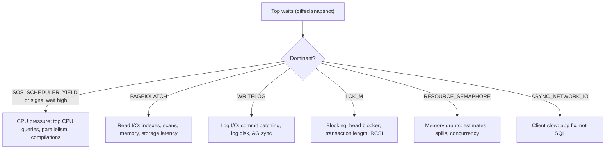

### CPU analysis
1. Is it SQL Server's CPU (`sys.dm_os_ring_buffers` scheduler monitor, `sys.dm_db_resource_stats`, Perfmon `Process(sqlservr)\% Processor Time`) or something else on the host?
2. Top CPU queries (Query Store/`dm_exec_query_stats`). Typical culprits: scans due to missing/unusable indexes, non-SARGable predicates, implicit conversions (`nvarchar` param vs `varchar` column), scalar UDFs (pre-2019 inlining), bad plans from sniffing, **excessive compilations** (ad-hoc SQL → `Batch Requests/sec` vs `SQL Compilations/sec`), parallelism skew.
3. Fix at the query/index level before throwing cores at it.

### Memory analysis
- **Buffer pool** holds data pages. **Page Life Expectancy** is a *weak, misleading* standalone metric (old "300 s" rule is obsolete; on large-RAM/NUMA servers per-node PLE varies) — prefer **read latency, PAGEIOLATCH waits and `Buffer cache hit ratio` trends** together, and *what is being read*.
- **Query memory grants** (`RESOURCE_SEMAPHORE`): oversized grants from over-estimated rows starve others; under-estimates cause **spills to tempdb**. See `dm_exec_query_memory_grants`, plan warnings, and use batch-mode/memory-grant feedback.
- **Plan cache bloat**: thousands of single-use plans → `optimize for ad hoc workloads`, parameterize.
- `max server memory` must leave room for OS (on VMs/on-prem); Azure SQL manages it.

### Disk I/O analysis
```sql
-- Latency per file (script J in chapter 13). Guidance: data reads < ~10-20 ms, log writes < ~2-5 ms.
-- Which queries do the physical reads right now?
SELECT TOP (10) r.session_id, r.wait_type, r.wait_time, r.reads, r.writes, r.logical_reads,
       SUBSTRING(t.text,1,200) AS txt
FROM sys.dm_exec_requests r CROSS APPLY sys.dm_exec_sql_text(r.sql_handle) t
WHERE r.wait_type LIKE 'PAGEIOLATCH%' ORDER BY r.wait_time DESC;
```
Windows/Linux counters: `Avg. Disk sec/Read`, `Avg. Disk sec/Write`, `Disk Queue Length` (interpret carefully on SAN/cloud), `Log Flushes/sec`, `Log Bytes Flushed/sec`. Azure SQL: `avg_data_io_percent`, `avg_log_write_percent` in `dm_db_resource_stats` and portal metrics; being at 100% of **log rate** throttles with `LOG_RATE_GOVERNOR` waits.

### tempdb
Contention (`PAGELATCH_*` on 2:1:1 / 2:1:3 pages), version store growth (long transactions with RCSI/SI), and spills. Multiple equally sized data files (up to 8 cores' worth), memory-optimized tempdb metadata (2019+), watch `sys.dm_tran_version_store_space_usage` and `sys.dm_db_file_space_usage`.

### Real-world scenarios
"CPU 90% only at month-end" → Query Store top CPU for that window + parameter-sensitive report query. "Random slowness, PAGEIOLATCH high after patching" → cold cache + storage latency. "Everything stalls every minute" → `WRITELOG` with log disk spikes, or `HADR_SYNC_COMMIT`.

### When to scale vs tune
Scale up when tuned queries are *efficient but the workload grew* (headroom gone). Tune when top queries do orders of magnitude more reads than needed. Scaling a broken plan just makes it fail slightly later and cost more.

### Mistakes
Setting `MAXDOP = 1` globally to "fix" CXPACKET; disabling parallelism that a reporting query needs; chasing PLE; adding RAM for a missing-index problem; ignoring `ASYNC_NETWORK_IO` and blaming SQL; looking at *cumulative* wait stats since last year.

### Interview Q&A
**Q: PAGEIOLATCH_SH is your top wait. What do you do?** Confirm with file latency; find queries doing the physical reads (Query Store by physical/logical reads); fix scans with indexes/predicates; check memory pressure (working set vs RAM); consider storage tier/IOPS limits; verify it isn't a one-off backup/DBCC/index rebuild.
**Q: What does CXPACKET mean and is it bad?** It's parallelism synchronisation; usually a symptom of large parallel scans/skew/bad estimates. Tune queries and set sane MAXDOP/cost threshold rather than disabling parallelism.
**Follow-up:** *High `ASYNC_NETWORK_IO` — SQL problem?* Almost never; the client isn't draining results fast enough.

---

## 16. Query execution plan analysis

*(Optimizer theory, estimated vs actual plans, seeks/scans, lookups, statistics and sniffing are in [Part 1](./01-sql-server-internals-query-tuning-and-concurrency.md). This chapter is the **troubleshooting workflow**.)*

### Simple idea
The execution plan is the engine's chosen recipe for a query. Reading the **actual** plan (with runtime row counts, warnings and wait info) shows exactly where time and I/O go.

### A repeatable workflow for one slow query
1. **Reproduce with real parameters** (for sniffing: capture the compile-time and runtime values from the plan XML `ParameterList`).
2. **Measure:** `SET STATISTICS IO, TIME ON;` → logical reads per table, CPU vs elapsed (big gap ⇒ waiting: locks, I/O, client).
3. **Get the actual plan** (SSMS "Include Actual Execution Plan", or Query Store/`sys.dm_exec_query_plan` for the cached one, or `sys.dm_exec_query_plan_stats` with `LAST_QUERY_PLAN_STATS`).
4. **Find the expensive operator by actual cost, not %-of-estimate:** operator time (actual elapsed/CPU per operator in 2016 SP1+), actual rows, executions, reads.
5. **Compare estimated vs actual rows** at every operator. A 100× error is the root of most bad plans (stale/missing stats, correlated columns, table variables, scalar UDF, `OPTION(OPTIMIZE FOR UNKNOWN)`, local variables, non-SARGable expression, multi-statement TVF).
6. **Read the warnings** (yellow triangle): *implicit conversion affecting seek*, *spill to tempdb* (sort/hash), *missing statistics*, *no join predicate*, *excessive memory grant*, *residual predicate*.
7. **Identify the pattern**, then fix (below). Re-measure, compare plans, and **verify with a representative dataset size** (plans change with volume).

### Pattern → fix table
| Plan pattern | Likely cause | Fix |
|---|---|---|
| **Clustered Index Scan/Table Scan** reading millions of rows, few returned | No usable index; non-SARGable predicate; function on column; implicit conversion | Add/adjust index; rewrite predicate (`WHERE d >= @a AND d < @b`); match types |
| **Key Lookup** executed 100k times | Non-covering index + many matched rows | `INCLUDE` the lookup columns; narrow selected columns; or accept scan if selectivity is low |
| **Estimated 1 row, actual 1,000,000** | Stale stats, parameter sniffing, table variable (pre-2019), multi-statement TVF | `UPDATE STATISTICS … WITH FULLSCAN`, temp tables instead of table variables, inline TVF, compat 150+ (deferred compilation), PSP, `OPTION (RECOMPILE)` for highly skewed params |
| **Nested Loops over a huge inner side** | Underestimated outer rows | Fix estimates; hint last, e.g. `OPTION (HASH JOIN)` for diagnosis |
| **Hash/Sort spill** (warning) | Under-estimated memory grant | Fix estimates; update stats; memory grant feedback; add index to avoid sort |
| **Sort of a large set** | `ORDER BY` without supporting index | Index in ORDER BY order (`INCLUDE` as needed); keyset pagination |
| **Parallelism with skew** (one thread does all work) | Uneven distribution/stats | Statistics, `MAXDOP` hint for that query, rewrite |
| **Eager Spool / Table Spool** | Halloween protection, correlated recursion | Rewrite, indexes |
| **Scalar UDF** invoked per row (no inlining) | Pre-2019 or non-inlineable UDF | Inline TVF / rewrite; compat 150 scalar UDF inlining |
| **Plan differs by parameter** | Sniffing/skew | PSP (160), `OPTION (RECOMPILE)`, `OPTIMIZE FOR`, split procedure by branch, Query Store force/hints |

```sql
-- Compare estimated vs actual in one go (SQL 2019+: last actual plan without re-running)
ALTER DATABASE SCOPED CONFIGURATION SET LAST_QUERY_PLAN_STATS = ON;
SELECT qs.last_execution_time, ps.query_plan AS last_actual_plan
FROM sys.dm_exec_query_stats qs CROSS APPLY sys.dm_exec_query_plan_stats(qs.plan_handle) ps
WHERE qs.query_hash = 0x1234567890ABCDEF;

-- Find plans with implicit conversions or key lookups at scale (plan cache search)
WITH XMLNAMESPACES (DEFAULT 'http://schemas.microsoft.com/sqlserver/2004/07/showplan')
SELECT TOP (20) qs.execution_count, st.text,
       qp.query_plan.exist('//Warnings/PlanAffectingConvert') AS has_implicit_convert
FROM sys.dm_exec_query_stats qs
CROSS APPLY sys.dm_exec_sql_text(qs.sql_handle) st
CROSS APPLY sys.dm_exec_query_plan(qs.plan_handle) qp
WHERE qp.query_plan.exist('//Warnings/PlanAffectingConvert') = 1
ORDER BY qs.execution_count DESC;
```
**Forcing/guiding:** Query Store plan force, Query Store hints, plan guides (legacy), `OPTION (…)` hints (`RECOMPILE`, `OPTIMIZE FOR`, `MAXDOP`, `USE HINT('DISABLE_PARAMETER_SNIFFING')`). Hints are a last resort — they freeze decisions the optimizer should revisit as data changes.

### C# side
```csharp
// Surface the SQL and its cost in dev, and tag it so DMVs/XE can find it
var q = db.Orders.Where(o => o.CustomerId == id).TagWith("OrdersApi.GetByCustomer v3");
Console.WriteLine(q.ToQueryString());
// EF Core: SQL appears with a comment "-- OrdersApi.GetByCustomer v3" -> grep it in Query Store text
```
Typical ORM plan problems: `Contains` with huge lists, `Include` cartesian explosion (use `AsSplitQuery`), client-side evaluation, `nvarchar` parameters against `varchar` columns (map `.IsUnicode(false)`), `OFFSET` pagination on deep pages.

### Interview Q&A
**Q: How do you read an execution plan efficiently?** Right-to-left, top-to-bottom data flow; start from the most expensive operator by actual elapsed/reads; compare estimated vs actual rows; read warnings; check seek predicates vs residual predicates; look at row counts to find where the funnel should narrow.
**Follow-ups:** *Estimated vs actual plan?* Estimated = compile-time guess without running; actual = includes real row counts, executions, memory, spills, waits — use it for diagnosis. *Why would the same query have two plans?* Different parameter values at compile (sniffing), different `SET` options, stats changes, recompiles, different compat level.

---

## 17. Monitoring slow queries

### Simple idea
Don't wait for users: define what "slow" means (SLOs), collect telemetry continuously, alert on symptoms, and keep enough history to compare.

### Layers of monitoring
| Layer | Tool | Answers |
|---|---|---|
| **Application** | Application Insights / OpenTelemetry dependency telemetry; EF Core logging/interceptors | Which endpoint and which SQL call is slow, how often, for whom |
| **Database workload** | Query Store, XE sessions, DMVs | Which query/plan, waits, regressions |
| **Platform** | Azure Monitor metrics (CPU %, DTU, workers, deadlocks, storage), Azure SQL Insights replacement **Database Watcher** (naming/availability: verify current), SQL Server: Perfmon/SCOM/third-party APM | Saturation, trends, capacity |
| **Synthetic/SLO** | Availability tests, p95/p99 latency SLOs, error budgets | User-visible health |

### EF Core slow-query logging and interceptor
```csharp
public sealed class SlowQueryInterceptor(ILogger<SlowQueryInterceptor> log) : DbCommandInterceptor
{
    private static readonly TimeSpan Threshold = TimeSpan.FromMilliseconds(500);
    public override ValueTask<DbDataReader> ReaderExecutedAsync(DbCommand c, CommandExecutedEventData e, DbDataReader r, CancellationToken ct = default)
    {
        if (e.Duration > Threshold)
            log.LogWarning("Slow SQL {DurationMs} ms | {Sql} | CorrelationId={Corr}", e.Duration.TotalMilliseconds, c.CommandText, Activity.Current?.TraceId);
        return new(r);
    }
}
services.AddDbContext<AppDb>((sp, o) => o.UseSqlServer(cs).AddInterceptors(sp.GetRequiredService<SlowQueryInterceptor>()));
// Do NOT log parameter values in prod unless sanitised (PII).
// OpenTelemetry: AddSqlClientInstrumentation / AddEntityFrameworkCoreInstrumentation -> dependency spans in App Insights.
```
### Application Insights / KQL
```kusto
// Slowest SQL dependencies, p95 by command, last 24h
dependencies
| where timestamp > ago(24h) and type == "SQL"
| summarize calls=count(), p50=percentile(duration,50), p95=percentile(duration,95), failed=countif(success==false) by name=substring(data,0,120)
| where calls > 20 | order by p95 desc | take 20

// Trace one slow request end-to-end
let op = "operation_Id-from-the-slow-request";
union requests, dependencies, exceptions | where operation_Id == op | order by timestamp asc
| project timestamp, itemType, name, duration, success, resultCode
```
```kusto
// Azure SQL (diagnostic settings -> Log Analytics): deadlocks and blocking trend
AzureMetrics | where ResourceProvider == "MICROSOFT.SQL" and MetricName in ("deadlock","cpu_percent","workers_percent")
| summarize avg(Average), max(Maximum) by MetricName, bin(TimeGenerated, 5m) | render timechart
```
### Alerts worth having
CPU/workers/sessions > 80% for 10 min; **log-rate/IO % > 85%**; deadlocks > 0 sustained; **blocked sessions > N for > 30 s** (blocked-process XE or custom check); Query Store plan regression / auto-tuning recommendation; replica lag; connection failures; DTU/vCore trend vs forecast; p95 dependency duration breach; storage > 85%. Alert on **symptoms (SLO)** first, causes second.

### Real-world use
After each release, compare p95 query times and Query Store top consumers; a **performance budget** (e.g. no endpoint >3 SQL calls, none >200 ms p95) enforced in CI/perf tests.

### When not / mistakes
Logging every SQL statement (cost, PII); alerting on raw CPU without context; averages hiding tail latency (use p95/p99); monitors that only exist on prod primary (no replica/geo-secondary coverage); not tagging queries (`TagWith`, `Application Name`) so you can't map SQL to code.

### Interview Q&A
**Q: How do you detect a slow query before users complain?** SLO-based alerts on p95 latency, dependency telemetry tying endpoints to SQL, Query Store regression detection and top-consumer reviews after each deploy, plus capacity alerts (CPU, workers, log rate).
**Follow-up:** *How do you link an HTTP request to a SQL statement?* Correlation/trace IDs via OpenTelemetry, `TagWith`/`SET CONTEXT_INFO`/`Application Name`, and dependency telemetry in App Insights (see [ASP.NET Core internals](../10-aspnet-core-web-api-internals/aspnet-core-web-api-internals.md)).

---

## 18. Identifying blocking and deadlocks

*(Locking theory, isolation levels and prevention patterns are in [Part 1](./01-sql-server-internals-query-tuning-and-concurrency.md). Here: **finding and fixing them in production**.)*

### Blocking vs deadlock — one-minute definition
**Blocking:** session B waits for a lock held by A; resolves when A commits/rolls back (or never, if A's transaction is forgotten). **Deadlock:** A waits for B and B waits for A — a cycle; SQL Server's deadlock monitor (every ~5 s, faster when cycles are frequent) picks a **victim** (lowest `DEADLOCK_PRIORITY`, then cheapest rollback) and raises **error 1205**.

### Finding the head blocker
```sql
-- Blocking chain with head blocker and SQL text
WITH chain AS (
  SELECT r.session_id, r.blocking_session_id, r.wait_type, r.wait_time, r.wait_resource, 0 AS lvl
  FROM sys.dm_exec_requests r WHERE r.blocking_session_id <> 0
)
SELECT c.session_id AS blocked, c.blocking_session_id AS blocker, c.wait_type, c.wait_time/1000 AS wait_s, c.wait_resource,
       bt.text AS blocked_sql, hb.login_name AS blocker_login, hb.program_name AS blocker_app, hb.status AS blocker_status,
       hb.open_transaction_count AS blocker_open_tran, ht.text AS blocker_last_sql
FROM chain c
JOIN sys.dm_exec_sessions hb ON hb.session_id = c.blocking_session_id
LEFT JOIN sys.dm_exec_connections hc ON hc.session_id = hb.session_id
OUTER APPLY sys.dm_exec_sql_text(hc.most_recent_sql_handle) ht
OUTER APPLY (SELECT TOP 1 text FROM sys.dm_exec_requests r2 CROSS APPLY sys.dm_exec_sql_text(r2.sql_handle) WHERE r2.session_id = c.session_id) bt(text)
ORDER BY c.wait_time DESC;
-- Head blocker = a blocker that is NOT itself blocked. 'sleeping' + open_transaction_count > 0 = idle-in-transaction
-- (app opened a transaction and went off to do something else) - the classic cause.
```
**Typical root causes:** long transactions (HTTP/external call or user think-time inside a transaction), missing indexes causing scans that take wide locks/escalation, `UPDATE`s that touch too many rows (escalation to table lock at ~5,000 locks), serializable/holdlock ranges, schema-modification (`Sch-M`) waits from online index ops/DDL, `SELECT` blocked by writers under default READ COMMITTED (fix: **RCSI**), lock convoys on hot rows (counters, queues).

### Fix menu
1. **Shorten transactions;** do I/O and external calls outside them; batch large changes (`TOP (n)` loops).
2. **Index** to reduce rows touched/locked.
3. **Enable READ_COMMITTED_SNAPSHOT** (row versioning) so readers don't block writers — watch tempdb/version store and long-running transactions: `ALTER DATABASE CURRENT SET READ_COMMITTED_SNAPSHOT ON WITH ROLLBACK IMMEDIATE;` (Azure SQL DB has it on by default).
4. **Optimistic concurrency** (`rowversion` + EF `IsRowVersion()`) instead of holding locks across user think-time.
5. **Consistent access order** across code paths (prevents deadlocks).
6. `LOCK_TIMEOUT`, `SET DEADLOCK_PRIORITY`, queue hot rows (`READPAST, UPDLOCK` for work queues), partition counters (sharded counters).
7. Emergency: `KILL <spid>` only after understanding the rollback cost — a long transaction rolls back at roughly the speed it ran; `KILL <spid> WITH STATUSONLY` shows progress; `ALTER DATABASE … ` and ADR make rollbacks near-instant on supported versions.

### Deadlock walk-through (concrete)
Two transactions update the same two rows in opposite order:
```
T1: BEGIN TRAN; UPDATE dbo.Accounts SET Balance = Balance - 10 WHERE Id = 1;   -- X lock on row 1
T2: BEGIN TRAN; UPDATE dbo.Accounts SET Balance = Balance - 20 WHERE Id = 2;   -- X lock on row 2
T1: UPDATE dbo.Accounts SET Balance = Balance + 10 WHERE Id = 2;               -- waits for T2
T2: UPDATE dbo.Accounts SET Balance = Balance + 20 WHERE Id = 1;               -- waits for T1  => DEADLOCK
```
A trimmed deadlock graph from `system_health`:
```xml
<deadlock>
  <victim-list><victimProcess id="process1a2b"/></victim-list>
  <process-list>
    <process id="process1a2b" spid="57" waitresource="KEY: 7:72057594038321152 (a1b2c3)" waittime="1204" isolationlevel="read committed (2)" clientapp="TransfersApi">
      <executionStack><frame procname="dbo.usp_Transfer" line="14">UPDATE dbo.Accounts SET Balance = Balance + @amt WHERE Id = @to</frame></executionStack>
    </process>
    <process id="process3c4d" spid="63" waitresource="KEY: 7:72057594038321152 (d4e5f6)" waittime="1198" isolationlevel="read committed (2)" clientapp="TransfersApi">
      <executionStack><frame procname="dbo.usp_Transfer" line="14">UPDATE dbo.Accounts SET Balance = Balance + @amt WHERE Id = @to</frame></executionStack>
    </process>
  </process-list>
  <resource-list>
    <keylock objectname="AppDb.dbo.Accounts" indexname="PK_Accounts" mode="X">
      <owner-list><owner id="process3c4d" mode="X"/></owner-list><waiter-list><waiter id="process1a2b" mode="X" requestType="wait"/></waiter-list>
    </keylock>
    <keylock objectname="AppDb.dbo.Accounts" indexname="PK_Accounts" mode="X">
      <owner-list><owner id="process1a2b" mode="X"/></owner-list><waiter-list><waiter id="process3c4d" mode="X" requestType="wait"/></waiter-list>
    </keylock>
  </resource-list>
</deadlock>
```
**How to read it:** (1) `victim-list` – who was killed. (2) `process-list` – each participant's statement, isolation level, app, `waitresource`. (3) `resource-list` – the two locks, who *owns* and who *waits*: process A owns resource 1 and waits for 2; B owns 2 and waits for 1 = the cycle. (4) `executionStack`/`procname`+`line` – the code to fix. **Fix:** always lock accounts in a deterministic order (`ORDER BY Id` / process lower id first) in `usp_Transfer`; keep the transaction short; or use a single set-based `UPDATE … WHERE Id IN (@a,@b)`; add retry for 1205 in the app.
```csharp
// Retry on deadlock victim (1205) with jitter - idempotent operations only
var policy = Policy.Handle<SqlException>(e => e.Number == 1205)
    .WaitAndRetryAsync(3, i => TimeSpan.FromMilliseconds(50 * i + Random.Shared.Next(0, 50)));
await policy.ExecuteAsync(() => transferService.TransferAsync(cmd));   // transaction wrapped INSIDE the retried unit
```
Other common deadlock shapes: **key-lookup vs update** (reader holds S on nonclustered index then needs the clustered key; writer reverse) → cover the index; **range/serializable** deadlocks → lower isolation/RCSI; **foreign-key checks**; **escalation** conflicts.

### Mistakes
`NOLOCK` everywhere to "fix" blocking (dirty reads, missing/duplicate rows, errors) — use **RCSI/snapshot** instead; killing sessions blindly; ignoring that *blocking* is usually an application transaction-design problem; retry loops without idempotency.

### Interview Q&A
**Q: Users see timeouts; `sys.dm_exec_requests` shows many LCK_M_S waits. Steps?** Find the head blocker (`blocking_session_id` chain), look at its status/open transactions/SQL text, determine whether it's long-running work or an idle-in-transaction connection, mitigate (finish/kill with care), then fix root cause (transaction scope, indexes, RCSI) and add a blocked-process alert.
**Follow-ups:** *How do you stop a deadlock permanently?* Remove the cycle: consistent lock ordering, shorter transactions, better indexes (fewer locks), RCSI for read/write conflicts, and retries as a safety net — not as the fix. *NOLOCK?* Allows dirty/inconsistent reads; RCSI gives readers a consistent snapshot without blocking.

---

## 19. Production database performance troubleshooting runbook

> **Method and worked cases:** [Finding and fixing database performance issues](./03-finding-and-fixing-database-performance-issues.md) expands this runbook into a full find, fix, prove and prevent method with case studies.

### Simple idea
A calm, ordered procedure beats heroics. **Stabilise → locate → explain → fix → prevent.** Keep a written timeline; change one thing at a time.

### Step 0 — Triage in the first five minutes
1. **Scope:** One endpoint or everything? One tenant? Since when (deploy, failover, traffic spike, scheduled job)? Check change log/deployment history first — "what changed?" explains most incidents.
2. **Is it the database?** Compare app dependency duration (App Insights `dependencies`) with request duration. If SQL calls are fast, the issue is app/network/threads (pool, thread-pool starvation, N+1, external API). If DB calls are slow, continue.
3. **Platform health:** CPU %, workers, log IO %, storage, failovers, replica lag, throttling errors (Azure SQL 10928/10929/40501).
4. **Now-state:** script A (running requests), blocking chain (ch. 18), open transactions (E).
5. **Wait-stats first:** take two snapshots of `dm_os_wait_stats` (or `dm_db_wait_stats`) 60 s apart and diff; map to the wait table (ch. 15).

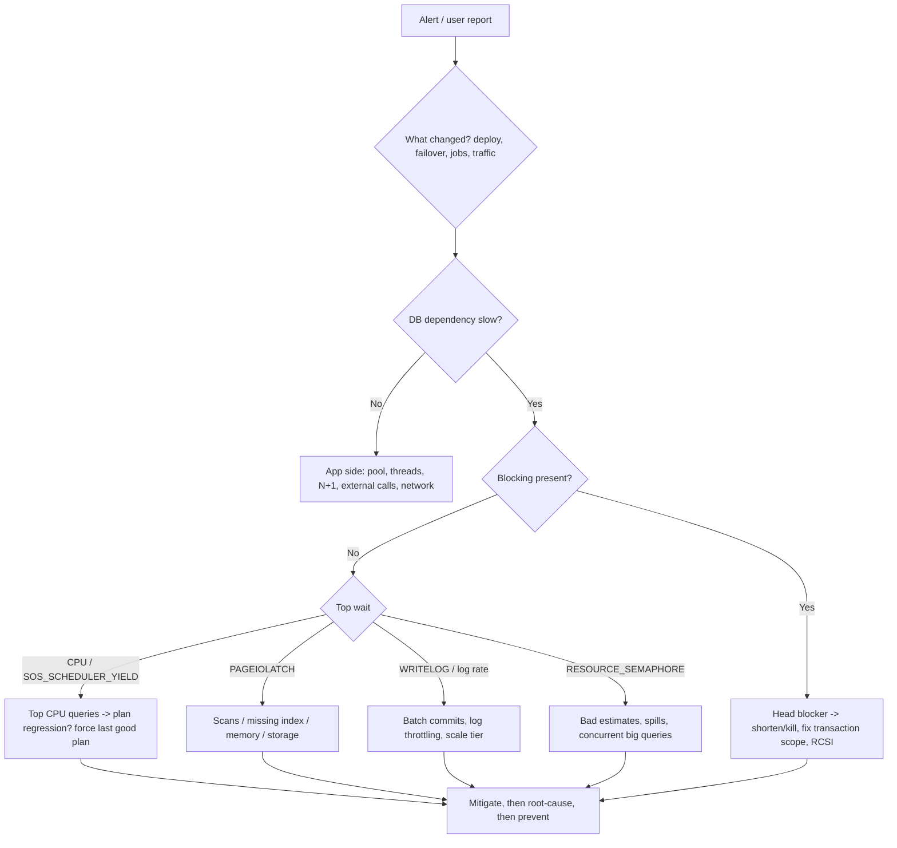

### Classic failure patterns
| Symptom | Likely cause | Evidence | Fix |
|---|---|---|---|
| Query suddenly 100× slower, no deploy | **Plan regression** (stats update, sniffing, failover, compat change) | Query Store: 2 plans, new one slower; plan cache recently cleared | Force last good plan → fix stats/index/sniffing; `OPTION (RECOMPILE)` if param-skewed |
| Same proc fast for one user, slow for another | **Parameter sniffing** (skew) | Plan XML compile-time vs runtime params differ | PSP (160), `OPTIMIZE FOR`, `RECOMPILE`, split branches |
| CPU pegged, many similar queries | Missing index/scans, or compilation storm | Top CPU in Query Store; `SQL Compilations/sec` high | Index, parameterize (ORM literals), `optimize for ad hoc workloads` |
| Timeouts, `LCK_M_*` waits | Blocking: long transaction/idle-in-tran | Blocking chain, `open_transaction_count` | Fix transaction scope; RCSI; kill carefully |
| Intermittent 1205 | Deadlocks | `system_health` graph | Consistent order, indexes, retry |
| App "pool exhausted" while DB CPU low | Connections held (external call inside `using`) or leak | Sleeping sessions with open transactions; client counters | Fix hold time, async, caps (ch. 8) |
| Slow after failover/restart | Cold cache/plans | `PAGEIOLATCH`, compile spikes, Query Store plan changes | Warm-up, patience, force known plans |
| Everything slow at fixed time | Scheduled job/backup/index rebuild/ETL/report | Agent job history, `dm_exec_requests` at that time | Reschedule, throttle (MAXDOP, resource governor), use replica |
| Log full / `WRITELOG` | Long transaction/blocked log truncation, big batch, AG lag | `log_reuse_wait_desc` | Fix long transaction/replica; batch; log backups |
| `RESOURCE_SEMAPHORE` | Giant memory grants | `dm_exec_query_memory_grants` | Fix estimates/indexes, Resource Governor |
| `ASYNC_NETWORK_IO` | Slow client reading big result sets | Wait + client app | Pagination, projection, streaming |
| Latency spike on one tenant | Noisy neighbour/hot partition | Per-tenant telemetry, Query Store by tenant tag | Throttle, move tenant, dedicated pool |

### Safe emergency actions (least → most invasive)
1. **Force the last good plan** in Query Store (reversible, no restart).
2. **Evict one plan:** `DBCC FREEPROCCACHE (plan_handle)` for a single bad plan (never the whole cache in prod). Or `EXEC sp_recompile 'dbo.usp_X'`.
3. **`OPTION (RECOMPILE)`/hint hotfix** in the specific statement; or a Query Store hint without redeploying.
4. **Update statistics** (`UPDATE STATISTICS dbo.T IX WITH FULLSCAN`) for the offending index — can change plans, so verify.
5. **Kill the head blocker or runaway query** after reading what it is and its rollback cost.
6. **Scale up** (Azure SQL tier/vCores; brief failover) or scale out readers — buys time when headroom is the issue.
7. **Shed load:** pause batch/ETL, rate-limit expensive endpoints, enable cache/serve-stale, degrade features.
Avoid in emergencies: `DBCC FREEPROCCACHE` (all), restarting the instance (cold cache), adding indexes online during peak without testing (can block/consume IO), changing global MAXDOP mid-incident without evidence.

### Post-incident and prevention
Blameless review with timeline; root cause + contributing factors; **prevent recurrence**: baselines (CPU/IO/duration/waits per hour of week), **regression tests with production-like data volumes** (plans change with size), load tests (k6/JMeter/Azure Load Testing) before launches, **Query Store comparison gates** after deploy, automated plan-regression alerting/auto-tuning, performance budgets in CI (EF query count/time per endpoint), index/stats maintenance policy (targeted, not blanket nightly rebuilds — use `IndexOptimize`-style thresholds and update stats more than you rebuild), runbooks and game days.

**Useful community tooling to mention:** `sp_WhoIsActive` (Adam Machanic) for live activity, **Brent Ozar's `sp_Blitz` family** (`sp_BlitzFirst/Cache/Index`) and Erik Darling's `sp_PressureDetector`/`sp_HumanEvents` — all read the same DMVs/XE described above; know the *underlying* DMVs so you can explain them.

### How to communicate it in an interview
Narrate in a fixed shape: "**Symptom → hypothesis → evidence (tool) → mitigation → root cause → prevention.**" Example: "p95 jumped at 14:05. I first checked deployments and found none, then separated app from DB time — SQL dependency duration doubled. Wait stats pointed to CPU (`SOS_SCHEDULER_YIELD`), Query Store showed one query with a new plan after a stats update. I forced the previous plan to restore service within minutes, then found a skewed parameter caused sniffing, fixed with an index and `OPTIMIZE FOR`/PSP, unforced it, and added a plan-regression alert."

### Interview Q&A
**Q: The production database is slow right now. What exactly do you do?** The triage sequence above: change history → app vs DB → platform metrics → now-state (requests, blocking) → diffed wait stats → targeted tool (Query Store/plan/XE) → least-invasive mitigation → root-cause fix → prevention.
**Q: Which emergency actions are safe?** Plan forcing, single-plan eviction, targeted recompile/hints, killing a clearly identified runaway session, scale-up, load shedding. Unsafe: clearing the entire plan cache, restarting, global config changes without evidence.
**Follow-ups:** *The fix needs an index on a 2 TB table — how?* `CREATE INDEX … WITH (ONLINE = ON, RESUMABLE = ON, MAXDOP = n)` off-peak, watch log and tempdb, test on a restored copy, monitor blocking from Sch-M at the end; on Azure SQL use `RESUMABLE` and pause/resume as load requires. *How do you prove the fix?* Before/after Query Store metrics, actual-plan comparison, and p95 SLO recovery.

---
# Part III — Interview toolkit

## 20. Architect-level scenarios

Each scenario gives a **structured path**: clarify → diagnose/design → decision → trade-offs → validation. Practise saying them aloud.

### Scenario 1 — Design the database tier for a read-heavy SaaS at 50k requests/second
**Clarify:** read:write ratio (assume 95:5), data size, tenant count/skew, staleness tolerance per endpoint, SLOs (p95 < 150 ms), availability (99.95%+), compliance/residency.
**Design:** 50k req/s does **not** mean 50k queries/s on SQL. (1) **Cache first:** CDN/output cache for public GETs; HybridCache (L1+Redis) for hot reads with ~80–95% hit ratio → ~2.5–10k DB reads/s. (2) **Tune** the top queries (covering indexes, keyset pagination, projections). (3) **Primary + readable replicas** (Hyperscale named replicas or Business Critical secondary) for list/search/reporting; primary for read-your-writes. (4) Connection budget: per-instance pool caps so `instances × pool ≤ DB limit`. (5) **Zone-redundant** HA + failover group for DR. (6) Shard by tenant **only** if write/storage ceilings are in sight; start with logical buckets so it is possible later. (7) Observability: Query Store, replica-lag SLI, hit-ratio and p95 dashboards.
**Trade-offs:** staleness windows, cache invalidation, cost of replicas vs a bigger primary.
**Validate:** load test at 1.5× peak with realistic key distribution (hot keys!), failover drill, cache-down game day.

### Scenario 2 — Multi-tenant SaaS: database-per-tenant or shared schema?
**Clarify:** number of tenants (100 vs 100k), size distribution, regulated tenants, per-tenant backup/restore/SLA, customisation needs, team capacity.
**Decision:** thousands of small tenants → **shared schema + `TenantId` (leading index key) + RLS** with tenant-aware caching keys; few large/regulated tenants → **DB per tenant in elastic pools**; in practice a **hybrid**: pooled shared shards for the long tail, dedicated DBs for whales, a **directory/shard map** to route.
**Trade-offs:** isolation/restore/key-per-tenant (DB-per-tenant) vs cost/ops simplicity (shared); noisy-neighbour control (per-tenant throttling, pool max caps); schema migration fan-out needs ring-based automation.
**Pitfalls to mention:** RLS `SESSION_CONTEXT` reset on pooled connections; per-tenant pools exploding connection-pool counts; cross-tenant reporting via warehouse not fan-out queries.

### Scenario 3 — Cache-aside caused stale prices
**Symptom:** customers see old prices for minutes; occasionally *old overwrites new*.
**Diagnose:** (1) What is the invalidation path? Many writers (admin UI, import job, direct SQL) but only one invalidates. (2) Race: reader loads old row → writer updates and deletes key → reader sets old value. (3) TTL too long, L1 per-instance copies not invalidated.
**Fix:** invalidate **after commit** from **every** write path (or publish a `PriceChanged` event via outbox → subscribers evict); store a **version/rowversion** in cached value and reject older writes; shorter L1 TTL + pub/sub eviction; **short TTL as backstop** (e.g. 60 s for prices); consider *write-through* or not caching price at checkout (read from primary at order time — the cache is for browsing only).
**Principle:** state staleness as a business rule per data type; price shown ≠ price charged.

### Scenario 4 — Database CPU hits 100% at 2 p.m. every day
**Path:** What runs at 2 p.m.? Agent jobs, reports, ETL, a customer batch, cache TTL alignment (stampede), traffic peak. Use Query Store for the **time window**: top CPU consumers and regressions; check `dm_exec_requests` live at 13:55–14:05 once; wait stats diff (CPU vs `PAGEIOLATCH`).
**Typical findings:** a report scanning the primary; month-end style aggregate with parallel plan; TTL-aligned cache expiry; a plan flip after the 13:00 stats update.
**Actions:** move reports to a replica/warehouse, index or rewrite the query, jitter TTLs/refresh-ahead, throttle batch (MAXDOP/Resource Governor), force last good plan if regression, then capacity-plan.
**Prevent:** alert on CPU trend, post-deploy Query Store checks, schedule hygiene.

### Scenario 5 — A failover caused a 90-second outage
**Decompose the 90 s:** (a) detection + failover time in the platform (often seconds to ~30 s), (b) database recovery (long-running transactions → undo; ADR shortens), (c) client behaviour: pools holding dead connections, no retry, DNS TTL caching, retry storms, (d) cold cache/plans post-failover causing slow queries, (e) dependent services.
**Fix:** retry-aware clients (`EnableRetryOnFailure`, `ConnectRetryCount`, jittered backoff, idempotent writes), failover-group listener names, avoid long transactions, enable ADR, health probes with sensible thresholds, warm-up scripts, **game-day drills** measuring actual RTO, and circuit breaker + graceful degradation (serve cached/read-only mode).
**Trade-offs:** aggressive retries can amplify load — use budgets and jitter.

### Scenario 6 — Move reads to replicas without introducing stale-read bugs
**Plan:** inventory read paths → classify (must-be-fresh vs tolerant) → route only tolerant ones first (reports, search, lists) → add **read-after-write pinning** (primary for N seconds after a write by that user, or version-token check) → expose **replica lag SLI** and alert → feature flag per endpoint → canary 5% → compare error/complaint rates → expand.
**Guardrails:** read-only DbContext that cannot `SaveChanges`; never read-modify-write on replica; fallback to primary if lag > threshold (circuit breaker); logs carry `db.source`.
**Validation:** chaos test injecting lag; integration tests for create-then-read flows.

### Scenario 7 — Redis goes down and the API melts the SQL database
**Immediate:** the cache is the *shield*; without it, 90% of reads hit SQL → saturation → cascading failures.
**Design for it:** (1) tight Redis timeouts (≤100–200 ms) + **circuit breaker** so a dead cache doesn't add latency; (2) **L1 in-memory cache** as a second shield; (3) **bulkhead/concurrency limiter** on DB-bound reads (`Semaphore`/rate limiter) so SQL sees a bounded load; (4) **request coalescing** (single-flight) per key; (5) serve **stale-while-revalidate** and degrade features (503 + `Retry-After` for non-critical endpoints, shed load by priority); (6) autoscale cautiously (more instances = more DB connections); (7) warm the cache gradually after recovery (avoid stampede); (8) runbook + game day.
```csharp
services.AddRateLimiter(o => o.AddConcurrencyLimiter("db-reads", c => { c.PermitLimit = 64; c.QueueLimit = 200; }));
// + Polly circuit breaker on Redis, HybridCache single-flight, stale fallback for catalog endpoints
```

### Scenario 8 — "Timeout expired… max pool size was reached" in production
Follow chapter 8: client counters → DB busy vs connections *held* → sleeping sessions with open transactions → find the code holding connections across external calls or sync-over-async → fix hold time, add backpressure, then right-size. Do not raise `MaxPoolSize` first.

### Scenario 9 — Deadlocks (error 1205) spike after a release
Pull deadlock graphs from `system_health`; identify the two statements/procs and resources; typical culprit is new code path locking tables in a different order or a new missing index making scans lock more. Fix with consistent ordering/indexes/shorter transactions; mitigate with retry; consider RCSI if reader/writer conflict; add the deadlock metric to the release dashboard.

### Scenario 10 — A 3 TB `Orders` table: slow queries, painful maintenance, archival needed
Measure first (top queries, index usage, I/O). **Index and query fixes** (covering, filtered for "open orders"). **Partition by month** for archive/SWITCH and per-partition maintenance (elimination only helps date-filtered queries). **Hot/cold split:** keep 13 months online, archive older to a cheaper store (columnstore archive table/Blob/Parquet) with a unified read API. Online/resumable index builds off-peak. Compression (PAGE) for cold partitions. Validate with plans and restore tests; explain partitioning is manageability first.

### Scenario 11 — A reporting query degrades OLTP latency
Isolate: replica for reporting (ApplicationIntent), or a warehouse/columnstore copy; Resource Governor (on-prem) or separate named replica (Hyperscale); RCSI to avoid reader/writer blocking; throttle with MAXDOP and query timeouts; precompute aggregates (indexed views, summary tables via outbox/CDC). **Trade-off:** freshness vs isolation.

### Scenario 12 — When is sharding justified vs scale-up/Hyperscale?
Sharding is justified when **write throughput, storage, or blast-radius/residency** requirements exceed what a single tuned, scaled-up (or Hyperscale) primary can deliver, or tenancy demands isolation. Before that: cache, replicas, tuning, partitioning, archiving. State what you'd measure (CPU, log rate, storage growth, lock contention hot spots) and the exit strategy (logical buckets, directory map, outbox/CDC for rebalancing).

---

## 21. Cheat sheet

### Wait types → meaning → first move
| Wait | Think | First move |
|---|---|---|
| `SOS_SCHEDULER_YIELD`, high signal waits | CPU | Top CPU queries, plans, parallelism |
| `CXPACKET`/`CXCONSUMER` | Parallelism | Fix estimates, sane MAXDOP/cost threshold |
| `PAGEIOLATCH_*` | Data reads from disk | Index/scan fixes, memory, storage latency |
| `WRITELOG` | Log flush | Batch commits, log storage, AG sync latency |
| `LCK_M_*` | Blocking | Head blocker, transaction scope, RCSI |
| `RESOURCE_SEMAPHORE` | Memory grants | Estimates, spills, concurrency |
| `ASYNC_NETWORK_IO` | Client slow | Fix app consumption |
| `THREADPOOL` | Out of workers | Blocking pile-up, concurrency caps |
| `PAGELATCH_*` (tempdb/last page) | In-memory contention | tempdb files, sequential-key option |
| `HADR_SYNC_COMMIT` | Sync replica latency | Network/secondary I/O |

### Tool → question
Query Store: *what changed / top consumers / force plan.* DMVs: *what's happening now / waits.* XE: *capture rare events (deadlocks, slow RPCs, blocking).* Plans: *why is this query slow.* App Insights: *which endpoint and SQL, correlated.* Azure Monitor: *saturation and alerts.*

### DMV / script index (from this guide)
Running requests (A, ch. 13) · top CPU (B) · wait stats (C) · locks (D) · open transactions (E) · memory grants (F) · index usage (G) · missing indexes (H) · fragmentation (I) · file latency (J) · Azure resource stats (K) · Query Store top/regressions (ch. 11) · XE slow queries/blocked process/deadlock (ch. 12) · blocking chain (ch. 18) · pool diagnosis (ch. 8) · replica lag (ch. 4).

### Cache pattern comparison
| | Cache-aside | Read-through | Write-through | Write-behind | Refresh-ahead |
|---|---|---|---|---|---|
| Who loads cache | App | Cache layer | On write | On write | Background |
| Write path | DB, then invalidate | n/a | Cache → DB (sync) | Cache, DB async | n/a |
| Freshness | TTL/invalidation | Same | High | Cache ahead of DB | High for hot keys |
| Write latency | DB | n/a | Cache + DB | Lowest | n/a |
| Main risk | Stampede, stale | Provider coupling | Unread data cached | **Data loss** | Wasted loads |
| Typical use | Default reads | Platform-managed | Read-after-write | Counters/telemetry | Known hot keys |

### Scaling ladder & numbers to remember
Tune → access pattern → cache → scale up → replicas → partition → shard. Pool need = rate × hold time. Missing-index DMV = hint, not order. Partitioning = manageability first. NOLOCK ≠ fix; use RCSI. Replicas scale reads, not writes. Sync commit = RPO≈0 but latency; async = lag. Tiers/limits: **verify current**.

### Relationships to other topics
Query tuning/indexes/isolation → [Part 1](./01-sql-server-internals-query-tuning-and-concurrency.md) · API-side connection use, async, `HttpClient`/thread pool → [ASP.NET Core internals](../10-aspnet-core-web-api-internals/aspnet-core-web-api-internals.md) · service tiers, Redis, networking, DR → [Azure services](../14-azure-services-and-cloud-architecture/azure-services-and-cloud-architecture.md) · outbox/inbox, DLQ for async DB writes → [Service Bus](../13-azure-service-bus-and-messaging-patterns/azure-service-bus-and-messaging-patterns.md) and [Inbox/Outbox](../15-inbox-outbox-and-reliable-messaging/inbox-outbox-and-reliable-messaging.md) · read models → [CQRS](../03-architectural-patterns/02-CQRS-pattern/CQRS-pattern.md) · cache, bulkhead, circuit breaker → [Distributed systems patterns](../03-architectural-patterns/distributed-systems-patterns.md) · database-per-service, consistency → [Advanced architecture](../16-advanced-architecture-and-microservices/advanced-architecture-and-microservices.md) · CDC, DB migration, cutover → [Cloud migration](../11-cloud-migration-and-modernization/cloud-migration-and-legacy-modernization.md).

---

## 22. A structured framework for explaining database decisions

Use **C-M-O-T-V** — *Clarify, Measure, Options, Trade-offs, Validate* — in every performance or design answer.

1. **Clarify** the workload and goals: read/write mix, data size/growth, latency SLO, consistency needs, availability target, budget, team skills.
2. **Measure** before deciding: top queries (Query Store), waits, plans, resource saturation, access patterns. *"I won't shard or add replicas until I can show where the time goes."*
3. **Options** — list at least three on the scaling ladder (tune, cache, scale up, replicas, partition, shard) and their prerequisites.
4. **Trade-offs** — for the chosen option state what you gain *and* what you pay (consistency, complexity, cost, operability) and what you would watch.
5. **Validate** — how you'll prove it: before/after metrics, load tests, failover/cache-down drills, rollback plan.

**Worked example — "Our order list endpoint takes 3 s at peak."**
*Clarify:* p95 target 300 ms; 20 M orders; list filtered by customer and status, sorted by date; reads dominate; strong freshness only after the user's own writes.
*Measure:* Query Store shows one query = 70% of CPU; actual plan: clustered index scan with a key lookup repeated 40 k times, estimated 50 rows vs actual 40 k; EF generated `OFFSET 20000 FETCH 20`; `PAGEIOLATCH` high.
*Options:* (a) covering index `(CustomerId, Status, OrderDate DESC) INCLUDE (Total, Reference)` + project only needed columns; (b) keyset pagination instead of deep OFFSET; (c) cache first page per customer for 30 s; (d) route to a replica; (e) scale up.
*Decision & trade-offs:* a+b first (cheapest, no consistency cost; extra index adds write overhead ≈ negligible at this write rate), c for the first page with explicit 30 s staleness (acceptable except right after a write — pin to primary), skip d/e until measured need.
*Validate:* Query Store before/after (reads 40 k → 25), p95 300 ms on a load test with production-sized data, write-latency check on the new index, regression alert on this `query_id`.

**One-liners that signal seniority:** "Measure first." "State the staleness rule." "That's a bandage, here's the root-cause." "The failure mode of this design is … and we mitigate with …" "Verify under production-like volume."

---

## 23. Quick-revision checklist

**Architecture (Part I)**
- [ ] Scaling ladder in order; can justify skipping steps only with evidence.
- [ ] Partitioning = manageability (SWITCH, per-partition maintenance); elimination needs the partition column predicate; split empty ranges; automate boundaries.
- [ ] Horizontal vs vertical partitioning; hot/cold; LOBs to Blob.
- [ ] Sharding: key criteria, range/hash/directory, hot shards, cross-shard queries, logical buckets, DB-per-tenant vs shared schema + RLS (and the SESSION_CONTEXT pooling pitfall).
- [ ] Replicas: scale reads only, lag, read-your-writes mitigations, ApplicationIntent.
- [ ] Sync vs async commit, quorum/split-brain, failover-aware clients, RPO/RTO.
- [ ] Cache layers; five Redis patterns; stampede/penetration/avalanche/hot-key; invalidation after commit; Redis is not the source of truth; Redis-down protection.
- [ ] Pool math (rate × hold time), `instances × pool`, no external calls inside connections, MARS caveats, managed identity.
- [ ] Read/write split via separate contexts + consistency policy; CQRS relation.
- [ ] HA/DR: zone redundancy, failover groups, backups ≠ HA, drills; serverless/elastic pools/Hyperscale fit.

**Troubleshooting (Part II)**
- [ ] Query Store: enable/size, regressed queries, force/unforce, hints, auto-tuning.
- [ ] XE: slow queries, blocked process, `system_health` deadlocks, file target, filter early.
- [ ] DMV scripts A–K; diffed wait stats; missing-index caveats.
- [ ] Profiler: why deprecated, XE replacement; DTA caveats.
- [ ] Wait type map; CPU vs I/O vs memory vs lock vs client; tempdb.
- [ ] Plan workflow: estimated vs actual, warnings, pattern → fix.
- [ ] Monitoring: dependency telemetry, KQL, alerts on symptoms, tagging queries.
- [ ] Blocking: head blocker, idle-in-transaction, RCSI over NOLOCK; deadlock graph reading and fixes.
- [ ] Runbook: triage → app vs DB → waits → targeted tool → least-invasive mitigation → root cause → prevention.

**Interview behaviours**
- [ ] Use Clarify → Measure → Options → Trade-offs → Validate.
- [ ] Quote concrete numbers/tools, name failure modes, mark version-specific claims as "verify current".
- [ ] Practise the 12 scenarios aloud in under 3 minutes each.

---

*Back to the series index in the [repository README](../README.md). Companion: [Part 1 — SQL Server Internals, Query Tuning and Concurrency](./01-sql-server-internals-query-tuning-and-concurrency.md).*
