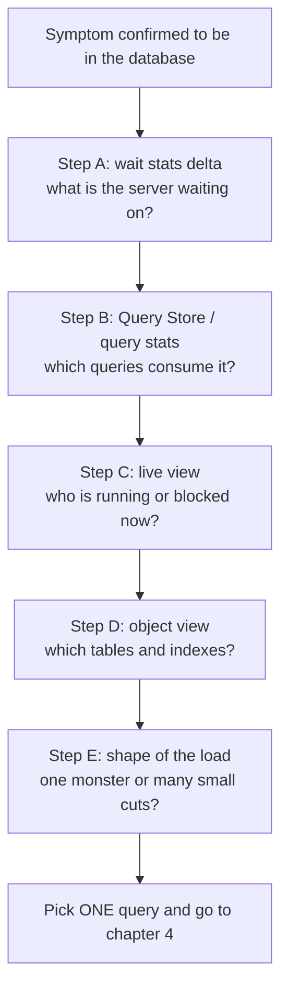
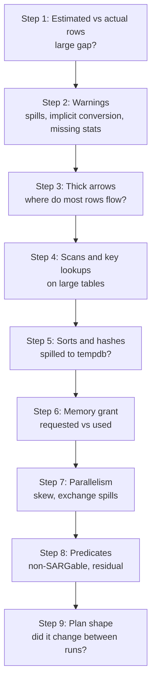
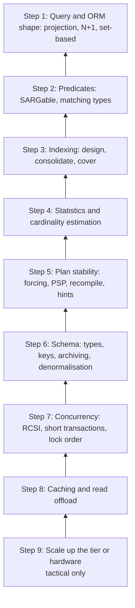
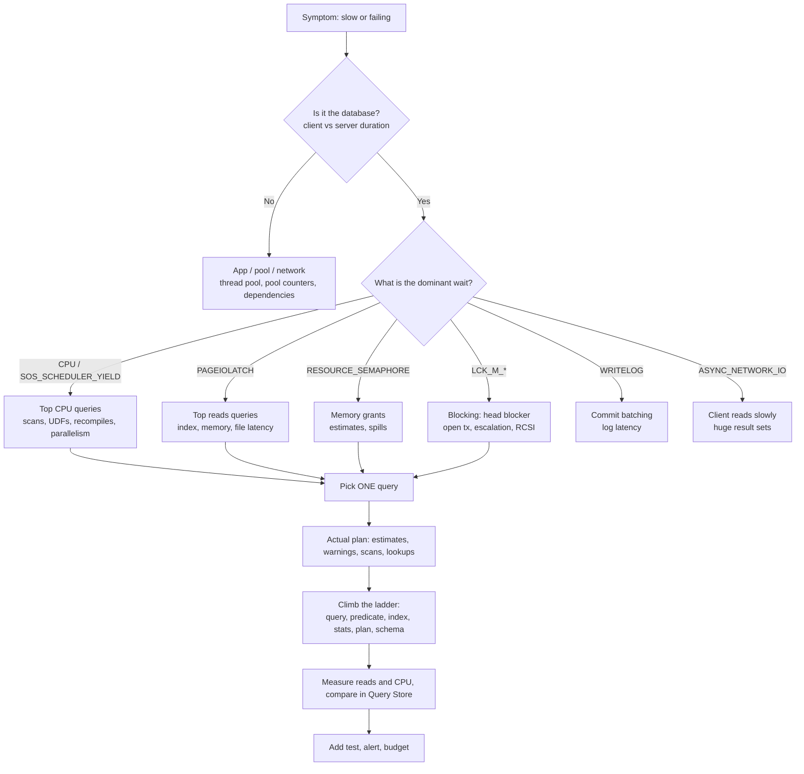

# Finding and Fixing Database Performance Issues — The End-to-End Method

> **Part 3 of the Database Performance Optimization and Troubleshooting guide.**
> [Part 1](./01-sql-server-internals-query-tuning-and-concurrency.md) explains *how SQL Server works* (plans, indexes, statistics, sniffing, locking).
> [Part 2](./02-database-architecture-scaling-and-troubleshooting.md) explains *architecture and tools* (replicas, caching, Query Store, XE, DMVs, runbook).
> **This part is the method that ties them together:** how to *find* a performance problem systematically, how to *improve* it in the safest order, how to *prove* the fix worked, and how to *explain* all of it in an interview.
> Pagination and `OFFSET/FETCH` have their own deep dive: [04 — OFFSET/FETCH and pagination](./04-offset-fetch-and-pagination-deep-dive.md).

---

## How to use this guide

- **Read chapters 1–3 first.** They teach the *funnel*: symptom → layer → query → object → cause. Most candidates fail interviews not on knowledge but because they jump to "add an index" before locating the problem.
- **Chapter 4** shows how to read the evidence for one bad query, with four annotated worked examples.
- **Chapter 5** is the *improvement ladder* — an ordered list of fixes from cheapest/safest to most invasive.
- **Chapters 6–7** are about proving the fix and preventing regressions.
- **Chapter 8** has eight case studies written as incident narratives. **Chapter 9** is the interview toolkit.
- All SQL uses the `PerfLab` schema from [Part 1, chapter 0](./01-sql-server-internals-query-tuning-and-concurrency.md#0-lab-setup) (`Customers`, `Orders`, `OrderItems`, skewed so that customer 1 owns about half of all orders). Re-run the lab setup to reproduce.
- Azure SQL and version-specific statements are flagged **(verify current)** where product behaviour changes between releases.

### Chapter conventions

Each chapter gives: simple explanation → architect depth → internals → C#/EF Core and T-SQL → Azure notes → diagram → real-world → when/when not → trade-offs → mistakes → performance/reliability/security → troubleshooting → relationships → interview Q&A. Short chapters fold some of these together; nothing is dropped silently.

---

## Table of contents

1. [The performance-investigation mindset](#1-the-performance-investigation-mindset)
2. [Finding the problem from the application side](#2-finding-the-problem-from-the-application-side)
3. [Finding the problem from the database side: the top-down funnel](#3-finding-the-problem-from-the-database-side-the-top-down-funnel)
4. [Reading a bad query's evidence (four worked examples)](#4-reading-a-bad-querys-evidence-four-worked-examples)
5. [The improvement playbook: a ladder ordered by payoff and risk](#5-the-improvement-playbook-a-ladder-ordered-by-payoff-and-risk)
6. [Prove it: measuring improvements correctly](#6-prove-it-measuring-improvements-correctly)
7. [Prevent: budgets, alerts and regression control](#7-prevent-budgets-alerts-and-regression-control)
8. [Case studies (eight incidents)](#8-case-studies-eight-incidents)
9. [Interview toolkit](#9-interview-toolkit)
    - [9.1 Questions and detailed answers](#91-questions-and-detailed-answers)
    - [9.2 Scenario questions](#92-scenario-questions)
    - [9.3 Decision flowchart and cheat sheet](#93-decision-flowchart-and-cheat-sheet)
    - [9.4 Structured answer framework](#94-structured-answer-framework)
    - [9.5 Revision checklist](#95-revision-checklist)

---

## 1. The performance-investigation mindset

**Simple idea.** "The database is slow" is not a diagnosis; it is a complaint. Performance work is detective work: define exactly what is slow, find *where* the time goes, change *one* thing, and measure again. The tools matter less than the discipline.

### 1.1 Define the symptom precisely

Four different problems all get reported as "slow", and each leads to a different investigation:

| Symptom | What it means | Typical suspects |
|---|---|---|
| **High latency** (one request takes long) | Individual operations are slow | Bad plan, missing index, blocking, big result set, cold cache |
| **Low throughput** (system cannot handle the load) | Capacity or contention limit reached | CPU saturation, log throughput, lock contention, pool exhaustion |
| **Timeouts / errors** | Something waits longer than the client tolerates | Blocking, deadlocks, pool exhaustion, failover, throttling (Azure SQL 10928/10929/40501) |
| **High resource use** (CPU, IO, memory, log %) | Work per request is excessive, or too many requests | Scans, spills, parallelism, recompiles, chatty ORM (N+1), runaway job |

Ask these questions before touching anything:

1. **What exactly is slow?** Which endpoint, report, job or screen? Which tenant or user? Give numbers: "p95 of `GET /orders` is 4.2 s; it was 180 ms."
2. **Since when?** A sharp start points to a *change*: deployment, schema change, statistics update, failover, data load, config change, tier change. A gradual slope points to *growth*: data volume, tenants, index fragmentation, version store, log.
3. **How often?** Always, intermittently, only at peak, only after restart, only for some parameters? "Sometimes slow" is the signature of parameter sniffing, blocking, or resource contention — not of a missing index (which is slow *every* time).
4. **Who is affected?** One customer (skew/sniffing), all customers (global resource or plan), one region (network), one instance (instance-level problem).
5. **What changed?** Correlate the start of the problem with deployments, Query Store plan changes, statistics updates, index maintenance windows, failovers, scaling events, and new traffic sources.

### 1.2 Baselines and percentiles

- **Averages lie.** A mean of 200 ms can hide 5% of requests at 4 s. Track **p50, p95, p99** and the *count* of slow requests.
- **A baseline is a before-picture.** Without it you cannot say "worse", only "feels worse". Keep Query Store history ([Part 2, chapter 11](./02-database-architecture-scaling-and-troubleshooting.md#11-query-store)), App Insights/OpenTelemetry percentiles, and a weekly wait-stats snapshot.
- **Compare like with like.** Same time of day, same data volume, same parameters.

### 1.3 The layers: prove which one is slow

A request crosses many layers. Do not blame the database until you have shown the time is spent there.


| Layer | How to prove it is (or is not) the bottleneck |
|---|---|
| Client / network | Browser dev tools timing, Front Door/APIM latency vs backend latency |
| ASP.NET Core app | Request duration minus dependency duration = time in your code (and thread pool waits) |
| Connection pool | `dotnet-counters` pool metrics; "Timeout expired ... max pool size reached" in logs ([Part 1, ch. 27](./01-sql-server-internals-query-tuning-and-concurrency.md#27-connection-pooling-and-pool-exhaustion)) |
| Network to DB | Compare client-measured duration with server-measured `duration` for the same statement (Query Store/XE). A large gap means network, pool wait, or `ASYNC_NETWORK_IO` (slow client reading results) |
| SQL engine | Wait stats, Query Store runtime stats, `sys.dm_exec_requests` |
| Storage / log | `sys.dm_io_virtual_file_stats` latency, `WRITELOG`, `PAGEIOLATCH_*` waits |

**The single most useful comparison:** *client-side duration of the SQL call* vs *server-side duration of the same statement*. If the client sees 3 s and the server sees 40 ms, the database is innocent — look at the pool, the network, thread-pool starvation, or the client consuming rows slowly.

### 1.4 Frameworks to organise your thinking

- **USE** (Utilization, Saturation, Errors) for *resources*: CPU, memory, disk, log, tempdb, connections.
- **RED** (Rate, Errors, Duration) for *requests/services*: per endpoint, per query.
- **Golden signals** (latency, traffic, errors, saturation) combine both.

| Signal | At the app | At the database |
|---|---|---|
| Latency | Request p95, dependency p95 | Query duration p95 (Query Store), wait time |
| Traffic | Requests/s | Batch requests/s, executions per query |
| Errors | 5xx, timeouts | Deadlocks (1205), timeouts (-2), throttling, login failures |
| Saturation | Thread pool queue, pool wait | CPU %, `RESOURCE_SEMAPHORE`, log % used, workers |

### 1.5 The cardinal rules

1. **Measure before you change.** Capture reads, CPU, duration and plan *before* the fix.
2. **Change one thing at a time.** Two simultaneous changes make attribution impossible and rollback painful.
3. **Prefer evidence to intuition.** "I think it's the index" is a hypothesis; the actual plan is evidence.
4. **Fix the cause, not the symptom.** Scaling up the tier to hide a scan buys weeks, not a solution.
5. **Reproduce with realistic data.** A query that is instant on 1,000 rows says nothing about 100 million. Production *skew* matters as much as volume.

### 1.6 Common mistakes

- Starting with "add an index" or "rebuild all indexes" before locating the slow query.
- Looking only at *cumulative* wait stats (dominated by history) instead of a **delta** over the incident window (chapter 3).
- Using averages instead of percentiles.
- Fixing the loudest query instead of the most *expensive in total* (low average × huge executions).
- Testing on a laptop with 10,000 rows and declaring victory.
- Making changes in production during an incident without recording them, then being unable to explain what fixed it.

**Interview Q&A**

**Q: A user says "the API is slow." What do you do first?**
A: Clarify and scope before touching anything: which endpoint, how slow in numbers (p95, not "feels slow"), since when, always or intermittent, which users. Then locate the layer: compare the request duration with its SQL dependency duration in Application Insights. If the dependency dominates, move to the database with wait stats and Query Store; if not, the problem is in the app, pool, or network. I change nothing until I have a measured baseline and a hypothesis.
*Follow-up: How do you tell database time from network time?* Compare client-measured call duration with the server-side duration of the same statement in Query Store or an Extended Events session; a persistent gap is network, pool wait, or slow client consumption (`ASYNC_NETWORK_IO`).

**Q: Why are percentiles better than averages?**
A: User experience is determined by the tail. A parameter-sniffing regression, a blocking episode or a cold-cache miss affects a minority of requests, which the mean hides. p95/p99 and slow-request counts expose it, and they are the right basis for SLOs.

---

## 2. Finding the problem from the application side

**Simple idea.** The application already knows which SQL calls are slow and how many it makes per request. Use that before opening the database, because it tells you *which endpoint and which query shape* to investigate and exposes N+1 patterns the database cannot see.

### 2.1 Application Insights / OpenTelemetry dependency telemetry

ASP.NET Core with Azure Monitor OpenTelemetry (`Azure.Monitor.OpenTelemetry.AspNetCore`) records SQL calls as dependencies (type `SQL`). Enable SQL command text capture deliberately and carefully — it can contain sensitive data (see 2.3).

```csharp
// Program.cs (.NET 10) — OpenTelemetry with SqlClient instrumentation
builder.Services.AddOpenTelemetry()
    .UseAzureMonitor()                       // connection string from APPLICATIONINSIGHTS_CONNECTION_STRING
    .WithTracing(t => t.AddSqlClientInstrumentation(o =>
    {
        o.SetDbStatementForText = true;      // capture statement text (parameterized text only, no values)
        o.RecordException = true;
    }));
```

**KQL: the slowest SQL dependencies (by p95 and by total time)**

```kusto
// 1) Which SQL statements cost the most in total? (death by a thousand cuts vs one monster)
dependencies
| where timestamp > ago(1h) and type == "SQL"
| summarize calls = count(),
            avgMs = avg(duration),
            p95Ms = percentile(duration, 95),
            totalSec = sum(duration) / 1000
          by name = substring(data, 0, 120)
| order by totalSec desc
| take 20
```

Read it like this: sort by **`totalSec`** to find what the database spends its life on; sort by **`p95Ms`** to find what users *feel*. A statement with 2 ms average and 5 million calls is a different problem (chatty code, caching) from one with 8 s p95 and 40 calls (plan/index problem).

**KQL: count SQL calls per request to detect N+1**

```kusto
// 2) How many SQL calls does each request make? A high, scaling number is the N+1 signature.
let reqs = requests | where timestamp > ago(1h) | project operation_Id, reqName = name, reqMs = duration;
dependencies
| where timestamp > ago(1h) and type == "SQL"
| summarize sqlCalls = count(), sqlMs = sum(duration) by operation_Id
| join kind=inner reqs on operation_Id
| summarize p50Calls = percentile(sqlCalls, 50), p95Calls = percentile(sqlCalls, 95),
            p95ReqMs = percentile(reqMs, 95), p95SqlMs = percentile(sqlMs, 95) by reqName
| order by p95Calls desc
```

If `GET /orders` shows `p95Calls = 240` for a page of 50 orders, you have roughly 4–5 queries per row: classic N+1 ([Part 1, ch. 18](./01-sql-server-internals-query-tuning-and-concurrency.md#18-the-n-plus-1-query-problem)).

**KQL: p95 by operation, and request time versus SQL time**

```kusto
// 3) Where does the request time go: SQL or the app?
requests
| where timestamp > ago(1h)
| join kind=leftouter (
    dependencies | where type == "SQL" | summarize sqlMs = sum(duration) by operation_Id
  ) on operation_Id
| summarize p95Req = percentile(duration, 95), p95Sql = percentile(sqlMs, 95) by name
| extend appMs = p95Req - p95Sql
| order by p95Req desc
```

If `appMs` is large, the time is in your code, serialisation, thread-pool waits or other dependencies — not SQL.

### 2.2 EF Core: see the SQL you are actually running

Most ORM performance problems are invisible until you log the generated SQL.

```csharp
// Development: log every command with timing
builder.Services.AddDbContext<ShopDbContext>(o => o
    .UseSqlServer(cs)
    .LogTo(Console.WriteLine, new[] { RelationalEventId.CommandExecuted }, LogLevel.Information)
    .EnableDetailedErrors());
// .EnableSensitiveDataLogging()  <-- DEVELOPMENT ONLY. Writes parameter VALUES (PII, tokens) to logs.
```

**Caution on `EnableSensitiveDataLogging`:** it writes parameter values into logs. Never enable it in production unless values are scrubbed and access to logs is controlled. Prefer parameterized-text logging (the default) plus an interceptor that records *duration and a hash*, not values.

**A slow-query interceptor** (production-safe: logs text and duration, not parameter values):

```csharp
public sealed class SlowQueryInterceptor(ILogger<SlowQueryInterceptor> log, TimeSpan threshold)
    : DbCommandInterceptor
{
    public override ValueTask<DbDataReader> ReaderExecutedAsync(
        DbCommand command, CommandExecutedEventData eventData, DbDataReader result, CancellationToken ct = default)
    {
        if (eventData.Duration > threshold)
        {
            log.LogWarning("Slow SQL {DurationMs} ms | {CommandText}",
                (int)eventData.Duration.TotalMilliseconds,
                command.CommandText.Length > 500 ? command.CommandText[..500] : command.CommandText);
        }
        return base.ReaderExecutedAsync(command, eventData, result, ct);
    }
}

builder.Services.AddSingleton(sp => new SlowQueryInterceptor(
    sp.GetRequiredService<ILogger<SlowQueryInterceptor>>(), TimeSpan.FromMilliseconds(300)));
builder.Services.AddDbContext<ShopDbContext>((sp, o) => o
    .UseSqlServer(cs)
    .AddInterceptors(sp.GetRequiredService<SlowQueryInterceptor>()));
```

### 2.3 Correlating an app request to a database query

When the database shows an expensive query, you need to know *which code path* issued it. Four practical techniques:

1. **`TagWith`** — adds a SQL comment visible in Query Store, XE and plan cache text:

```csharp
var recent = await db.Orders
    .TagWith("OrdersController.GetRecent | feature=order-history")   // appears as -- comment in SQL text
    .Where(o => o.CustomerId == customerId)
    .OrderByDescending(o => o.OrderDate)
    .Take(50)
    .AsNoTracking()
    .ToListAsync(ct);
```

Then search Query Store: `WHERE qt.query_sql_text LIKE '%OrdersController.GetRecent%'`.

2. **Application Name in the connection string** (`Application Name=orders-api;`) — shows in `sys.dm_exec_sessions.program_name` and XE `client_app_name`. Use one name per service (not per request, which would fragment the connection pool).
3. **`SET CONTEXT_INFO` / `sp_set_session_context`** — attach a correlation id to the session; use sparingly because it needs an extra round trip per connection use (an interceptor on `ConnectionOpened` can set it).
4. **W3C trace context** — the OpenTelemetry trace id appears in App Insights; add the trace id as a `TagWith` suffix only for *diagnostic* sampling, not for every call (it destroys plan cache reuse for ad hoc text if it changes each call — see mistakes).

> **Mistake:** putting a request id or timestamp into the SQL *text* (comments included) produces a unique statement per request, bloating the plan cache and defeating plan reuse. Tags must be **constant per code path**. Per-request ids belong in `CONTEXT_INFO`/session context or telemetry, never in SQL text.

### 2.4 MiniProfiler and test-time detection

- **MiniProfiler** (`MiniProfiler.AspNetCore.Mvc` + EF Core integration) shows per-request SQL with duplicate-query warnings. Excellent in development and staging to catch N+1 before release.
- **Integration tests that count queries:** assert the number of commands for an endpoint using an interceptor counter. A test like "list 50 orders issues at most 3 SQL commands" is a cheap permanent guard against N+1 regressions.

```csharp
public sealed class CommandCounter : DbCommandInterceptor
{
    public int Count;
    public override DbDataReader ReaderExecuted(DbCommand c, CommandExecutedEventData e, DbDataReader r)
    { Interlocked.Increment(ref Count); return base.ReaderExecuted(c, e, r); }
}
// In a test: resolve the interceptor, call the endpoint, Assert.True(counter.Count <= 3);
```

### 2.5 Is it the database, or thread-pool starvation / pool exhaustion?

Slow SQL dependency durations in App Insights can be caused by the *app* being unable to run the continuation, not by the database. Distinguish:

| Observation | Points to |
|---|---|
| Server-side duration (Query Store/XE) is small, client-side duration large | Thread-pool starvation, pool wait, network, or slow client reading |
| `ThreadPool Queue Length` climbing, `ThreadPool Thread Count` growing slowly, sync-over-async in stack dumps | **Thread-pool starvation** ([ASP.NET Core internals guide](../10-aspnet-core-web-api-internals/aspnet-core-web-api-internals.md)) |
| Exceptions "Timeout expired ... max pool size was reached" | **Connection pool exhaustion**: leaks, long transactions, or too many concurrent requests for the pool size |
| `sys.dm_exec_sessions` shows many sleeping sessions holding open transactions | App holds connections/transactions open while doing other work |

```bash
# Counters worth watching during an incident
dotnet-counters monitor --process-id <pid> System.Runtime Microsoft.AspNetCore.Hosting \
  Microsoft.Data.SqlClient.EventSource   # pool counters; names vary by SqlClient version (verify current)
```

### 2.6 Azure notes

- **Application Insights** workspace-based: the `dependencies` table is in Log Analytics (`AppDependencies` in the workspace schema). Adjust table/column names for workspace-based resources (verify current).
- **Sampling** can drop dependency telemetry; for investigation, temporarily raise the sampling percentage for the affected service, or use targeted diagnostics (`dotnet-trace`/profiler) rather than guessing from sampled data.
- **Cost:** capturing full SQL text for every call increases ingestion cost; sample and scrub.

### 2.7 When this approach is not enough

Application telemetry shows *what the app asked* and *how long it waited*, not *why the database was slow*. When the dependency dominates, move on to chapter 3. When the dependency is fast but the endpoint is slow, stay in the application ([ASP.NET Core Web API internals](../10-aspnet-core-web-api-internals/aspnet-core-web-api-internals.md)).

**Interview Q&A**

**Q: How do you detect N+1 queries in production?**
A: Count SQL dependency calls per operation in Application Insights (KQL: summarize count of SQL dependencies by `operation_Id`, then percentile by request name). A call count that scales with page size is the signature. In EF Core I confirm by logging generated SQL or with MiniProfiler in staging, then fix with a projection, `Include`/`AsSplitQuery`, or a set-based query. I add an integration test that asserts a maximum command count so it cannot regress.

**Q: How do you connect a slow query in Query Store back to the code that issued it?**
A: Constant per-code-path tags with EF Core `TagWith` (appears as a comment in `query_sql_text`), a per-service `Application Name`, and, where needed, session context for correlation ids. I never put per-request values into SQL text because that would create one plan-cache entry per request.
*Follow-up: why not just put the trace id in a comment?* Each distinct text is a distinct cache entry for ad hoc batches; it bloats the cache, wastes compile CPU and fragments Query Store (a separate `query_id` per text).

**Q: The SQL dependency shows 3 s in App Insights but Query Store says 50 ms. What now?**
A: The database is not the bottleneck. Suspect thread-pool starvation (sync-over-async), connection-pool wait, network, or a client that reads rows slowly (`ASYNC_NETWORK_IO`). I check pool counters, thread-pool queue length and whether the call included time waiting for a connection from the pool.

---
## 3. Finding the problem from the database side: the top-down funnel

**Simple idea.** On the server, do not start with a favourite query. Work **top-down**, narrowing with each step: *what is the server waiting on?* → *which queries consume that resource?* → *what is running or blocked right now?* → *which objects (tables/indexes) are involved?* → *is it one monster or a thousand small cuts?* Each step has a script below and a rule for reading its output.



The tool details (what each DMV/XE/Query Store view is) are in [Part 2, chapters 11–13](./02-database-architecture-scaling-and-troubleshooting.md#11-query-store); this chapter is about *how to use them in order and how to read the results*.

### 3.1 Step A — What is the server waiting on? (wait stats **delta**, not cumulative)

**Why it exists.** SQL Server records, per wait type, how long sessions spent waiting since the last restart (or last clear). Waits tell you which *resource* is the bottleneck (CPU, disk, locks, memory grants, log) before you know which query is responsible.

**Why cumulative is misleading.** `sys.dm_os_wait_stats` accumulates for weeks. A 2 a.m. backup wait from last Tuesday can dominate today's number. Use a **delta over the incident window**.

```sql
/* Wait-stats delta: snapshot, wait, snapshot, diff. Run during the incident. */
IF OBJECT_ID('tempdb..#w1') IS NOT NULL DROP TABLE #w1;
SELECT wait_type, waiting_tasks_count, wait_time_ms, signal_wait_time_ms
INTO #w1 FROM sys.dm_os_wait_stats;

WAITFOR DELAY '00:01:00';   -- sample window: 30-120 seconds during the problem

;WITH d AS (
  SELECT w2.wait_type,
         w2.waiting_tasks_count - w1.waiting_tasks_count AS tasks,
         w2.wait_time_ms        - w1.wait_time_ms        AS wait_ms,
         w2.signal_wait_time_ms - w1.signal_wait_time_ms AS signal_ms
  FROM sys.dm_os_wait_stats w2
  JOIN #w1 w1 ON w1.wait_type = w2.wait_type
)
SELECT TOP (15) wait_type, tasks, wait_ms, signal_ms,
       CAST(100.0 * wait_ms / NULLIF(SUM(wait_ms) OVER (), 0) AS DECIMAL(5,1)) AS pct,
       CAST(1.0 * wait_ms / NULLIF(tasks, 0) AS DECIMAL(12,2)) AS avg_ms_per_wait
FROM d
WHERE wait_ms > 0
  AND wait_type NOT IN (   -- benign / idle waits (partial list; extend as needed)
     'SLEEP_TASK','BROKER_TASK_STOP','BROKER_TO_FLUSH','BROKER_EVENTHANDLER','CLR_AUTO_EVENT',
     'DISPATCHER_QUEUE_SEMAPHORE','FT_IFTS_SCHEDULER_IDLE_WAIT','HADR_FILESTREAM_IOMGR_IOCOMPLETION',
     'LAZYWRITER_SLEEP','LOGMGR_QUEUE','REQUEST_FOR_DEADLOCK_SEARCH','SQLTRACE_INCREMENTAL_FLUSH_SLEEP',
     'XE_DISPATCHER_WAIT','XE_TIMER_EVENT','CHECKPOINT_QUEUE','WAITFOR','DIRTY_PAGE_POLL',
     'SP_SERVER_DIAGNOSTICS_SLEEP','QDS_PERSIST_TASK_MAIN_LOOP_SLEEP','QDS_ASYNC_QUEUE',
     'QDS_CLEANUP_STALE_QUERIES_TASK_MAIN_LOOP_SLEEP','PVS_PREALLOCATE','PREEMPTIVE_OS_QUERYREGISTRY')
ORDER BY wait_ms DESC;
```

On **Azure SQL Database** use `sys.dm_db_wait_stats` (database-scoped) — same technique (verify current).

**How to read it.**

| Dominant wait | Resource | Next move |
|---|---|---|
| `SOS_SCHEDULER_YIELD`, high `signal_ms` share (> ~20–25%) | **CPU pressure** | Top CPU queries (Step B); look for scans, scalar UDFs, recompiles, parallelism |
| `CXPACKET` / `CXCONSUMER` | Parallelism (not bad by itself) | Check skew, MAXDOP, cost threshold for parallelism; find the parallel plans |
| `PAGEIOLATCH_SH/EX` | Reading data pages from disk (cache misses) | Top logical-read queries; missing indexes; memory too small; check file latency |
| `WRITELOG` | Transaction log flush | Many tiny commits; batch writes; log disk latency; delayed durability trade-off |
| `LCK_M_*` | Blocking | Step C head-blocker; [Part 2, ch. 18](./02-database-architecture-scaling-and-troubleshooting.md#18-identifying-blocking-and-deadlocks) |
| `RESOURCE_SEMAPHORE` | Waiting for a **memory grant** | Queries with huge grants (bad estimates, sorts/hashes); see 5.9 |
| `ASYNC_NETWORK_IO` | Client slow to consume results | App reading row-by-row, huge result sets, network |
| `PAGELATCH_*` on tempdb pages | tempdb allocation contention | Temp table churn, tempdb file count, `ALLOC` pages |
| `THREADPOOL` | Worker threads exhausted | Blocking chain or too many concurrent requests |

> **Rule:** waits tell you the *category*; they never name the query. Next step finds the query.

### 3.2 Step B — Which queries consume that resource?

**Preferred source: Query Store** (persisted, survives restarts and plan-cache eviction, has history for before/after comparison). Fall back to `sys.dm_exec_query_stats` when Query Store is off or read-only.

```sql
/* Top queries by TOTAL CPU in the last 2 hours (Query Store). Swap the ORDER BY to explore other resources. */
DECLARE @from DATETIMEOFFSET = DATEADD(HOUR, -2, SYSDATETIMEOFFSET());

SELECT TOP (15)
       q.query_id,
       LEFT(qt.query_sql_text, 140)                           AS sql_text,
       SUM(rs.count_executions)                               AS executions,
       CAST(SUM(rs.avg_cpu_time      * rs.count_executions) / 1000.0 AS BIGINT) AS total_cpu_ms,
       CAST(SUM(rs.avg_duration      * rs.count_executions) / 1000.0 AS BIGINT) AS total_duration_ms,
       CAST(SUM(rs.avg_logical_io_reads * rs.count_executions) AS BIGINT)       AS total_logical_reads,
       CAST(SUM(rs.avg_cpu_time * rs.count_executions) / NULLIF(SUM(rs.count_executions),0) / 1000.0 AS DECIMAL(12,2)) AS avg_cpu_ms,
       COUNT(DISTINCT p.plan_id)                              AS plans
FROM sys.query_store_runtime_stats rs
JOIN sys.query_store_runtime_stats_interval i ON i.runtime_stats_interval_id = rs.runtime_stats_interval_id
JOIN sys.query_store_plan p  ON p.plan_id  = rs.plan_id
JOIN sys.query_store_query q ON q.query_id = p.query_id
JOIN sys.query_store_query_text qt ON qt.query_text_id = q.query_text_id
WHERE i.start_time >= @from
GROUP BY q.query_id, qt.query_sql_text
ORDER BY total_cpu_ms DESC;      -- try: total_duration_ms, total_logical_reads, executions, or MAX memory grant
```

Pick the ordering that matches the dominant wait:

| Dominant wait / complaint | Order by |
|---|---|
| CPU | `total_cpu_ms` |
| Users feel slowness | `total_duration_ms` and p95 (use `stdev`/`max_duration` for tail) |
| `PAGEIOLATCH_*` | `total_logical_reads` (and physical reads) |
| `RESOURCE_SEMAPHORE` | `max_query_max_used_memory` (memory grant columns) |
| `WRITELOG` | `executions` of write statements; `avg_log_bytes_used` |
| "It got slower" | **Regressed Queries** report / compare two intervals (chapter 6) |

**Detect plan changes (`plans > 1`).** A query with several plans and very different average durations is a *plan regression* or *sniffing* candidate:

```sql
/* One query, all its plans, side by side */
SELECT p.plan_id, p.is_forced_plan, p.last_execution_time,
       SUM(rs.count_executions) AS executions,
       CAST(AVG(rs.avg_duration)/1000.0 AS DECIMAL(12,2))        AS avg_ms,
       CAST(MAX(rs.max_duration)/1000.0 AS DECIMAL(12,2))        AS max_ms,
       CAST(AVG(rs.avg_logical_io_reads) AS BIGINT)               AS avg_reads
FROM sys.query_store_plan p
JOIN sys.query_store_runtime_stats rs ON rs.plan_id = p.plan_id
WHERE p.query_id = @queryId
GROUP BY p.plan_id, p.is_forced_plan, p.last_execution_time
ORDER BY p.last_execution_time DESC;
```

**Fallback: plan cache DMVs** (`sys.dm_exec_query_stats`):

```sql
SELECT TOP (15)
       qs.query_hash, qs.query_plan_hash,
       qs.execution_count,
       qs.total_worker_time/1000                       AS total_cpu_ms,
       qs.total_worker_time/NULLIF(qs.execution_count,0)/1000 AS avg_cpu_ms,
       qs.total_logical_reads, qs.total_elapsed_time/1000 AS total_elapsed_ms,
       qs.creation_time, qs.last_execution_time,
       SUBSTRING(st.text, (qs.statement_start_offset/2)+1,
         ((CASE qs.statement_end_offset WHEN -1 THEN DATALENGTH(st.text) ELSE qs.statement_end_offset END
           - qs.statement_start_offset)/2)+1) AS statement_text
FROM sys.dm_exec_query_stats qs
CROSS APPLY sys.dm_exec_sql_text(qs.sql_handle) st
ORDER BY qs.total_worker_time DESC;
```

**Caveats of the plan-cache DMV** — memorise these, interviewers ask:
- Entries disappear on **memory pressure, restart, failover, `OPTION (RECOMPILE)`, schema change, `DBCC FREEPROCCACHE`**; `creation_time` shows how long the numbers have accumulated. A query recompiled 5 minutes ago shows tiny totals even if it is the worst offender.
- Statements that use `OPTION (RECOMPILE)` or are not cached never appear.
- It records *averages and totals*, not a timeline: you cannot see *when* it got slow. Query Store can.
- Totals mix all parameter values; skew is invisible (use Query Store per-plan, or max values).

### 3.3 Step C — What is running or blocked right now?

When the problem is happening *now*, look at live requests rather than history:

```sql
/* Live view: running requests, what they wait on, who blocks them */
SELECT r.session_id, r.status, r.command, r.wait_type, r.wait_time AS wait_ms,
       r.blocking_session_id, r.cpu_time, r.logical_reads, r.total_elapsed_time AS elapsed_ms,
       DB_NAME(r.database_id) AS db, s.login_name, s.host_name, s.program_name,
       SUBSTRING(t.text, r.statement_start_offset/2+1,
         (CASE r.statement_end_offset WHEN -1 THEN DATALENGTH(t.text) ELSE r.statement_end_offset END
          - r.statement_start_offset)/2+1) AS running_statement
FROM sys.dm_exec_requests r
JOIN sys.dm_exec_sessions s ON s.session_id = r.session_id
OUTER APPLY sys.dm_exec_sql_text(r.sql_handle) t
WHERE r.session_id <> @@SPID AND s.is_user_process = 1
ORDER BY r.total_elapsed_time DESC;
```

- A request with `blocking_session_id <> 0`: follow the chain to the **head blocker** (the session with no blocker itself). It is often a *sleeping* session holding an open transaction: look at `sys.dm_exec_sessions.open_transaction_count` and `last_request_end_time`.
- Many requests in `RUNNABLE` with `SOS_SCHEDULER_YIELD`: CPU saturation.
- A few with huge `logical_reads`/`cpu_time` and `elapsed_ms`: the monster query is in front of you.

The deeper blocking and deadlock scripts live in [Part 2, chapter 18](./02-database-architecture-scaling-and-troubleshooting.md#18-identifying-blocking-and-deadlocks); the community tool `sp_WhoIsActive` (Adam Machanic) bundles this view and is the standard live-triage tool for on-premises/VM SQL Server.

### 3.4 Step D — Which objects are involved?

Query text tells you *what* ran; object statistics tell you *which tables and indexes carry the load* — useful to find unused indexes (write cost with no benefit) and missing ones.

**Index usage and write cost (since last restart):**

```sql
/* Index usage: reads vs writes. Many writes + zero reads = candidate to drop (verify over a full business cycle). */
SELECT OBJECT_SCHEMA_NAME(i.object_id) AS sch, OBJECT_NAME(i.object_id) AS tbl, i.name AS idx,
       i.type_desc, i.is_unique, i.is_primary_key,
       ISNULL(us.user_seeks,0) AS seeks, ISNULL(us.user_scans,0) AS scans,
       ISNULL(us.user_lookups,0) AS lookups, ISNULL(us.user_updates,0) AS updates,
       ps.used_page_count * 8 / 1024 AS size_mb
FROM sys.indexes i
LEFT JOIN sys.dm_db_index_usage_stats us
       ON us.object_id = i.object_id AND us.index_id = i.index_id AND us.database_id = DB_ID()
LEFT JOIN (SELECT object_id, index_id, SUM(used_page_count) used_page_count
           FROM sys.dm_db_partition_stats GROUP BY object_id, index_id) ps
       ON ps.object_id = i.object_id AND ps.index_id = i.index_id
WHERE OBJECTPROPERTY(i.object_id, 'IsUserTable') = 1 AND i.index_id > 0
ORDER BY ISNULL(us.user_updates,0) DESC, size_mb DESC;
```

> **Caveats:** `dm_db_index_usage_stats` **resets on restart/failover** and (in some versions) when an index is rebuilt; an index used only by the month-end job looks unused for 29 days. Never drop on a one-day observation. On Azure SQL, usage resets on failover/scale events too.

**Missing index suggestions — use as hints, not orders:**

```sql
SELECT TOP (15)
       mid.statement AS table_name,
       migs.avg_user_impact, migs.user_seeks + migs.user_scans AS uses,
       CAST(migs.avg_total_user_cost * migs.avg_user_impact * (migs.user_seeks + migs.user_scans) AS BIGINT) AS improvement_score,
       mid.equality_columns, mid.inequality_columns, mid.included_columns
FROM sys.dm_db_missing_index_group_stats migs
JOIN sys.dm_db_missing_index_groups mig ON mig.index_group_handle = migs.group_handle
JOIN sys.dm_db_missing_index_details mid ON mid.index_handle = mig.index_handle
WHERE mid.database_id = DB_ID()
ORDER BY improvement_score DESC;
```

Why you must not apply these blindly: they consider **one query at a time**, ignore existing near-duplicate indexes, may propose enormous `INCLUDE` lists, do not account for write cost, and drop on restart. Treat each suggestion as "a query wanted an index on these columns": find *which* query ([Part 1, ch. 5](./01-sql-server-internals-query-tuning-and-concurrency.md#5-index-fundamentals) for design), then design **one** index that serves several queries.

**Duplicate and overlapping indexes** (same leading keys) waste writes and memory:

```sql
/* Indexes whose key columns are a prefix of another index on the same table: consolidation candidates */
;WITH k AS (
  SELECT i.object_id, i.index_id, i.name,
         STRING_AGG(CAST(c.name AS NVARCHAR(128)), ',') WITHIN GROUP (ORDER BY ic.key_ordinal) AS key_cols
  FROM sys.indexes i
  JOIN sys.index_columns ic ON ic.object_id = i.object_id AND ic.index_id = i.index_id AND ic.is_included_column = 0
  JOIN sys.columns c ON c.object_id = ic.object_id AND c.column_id = ic.column_id
  WHERE i.index_id > 0 AND OBJECTPROPERTY(i.object_id,'IsUserTable') = 1
  GROUP BY i.object_id, i.index_id, i.name)
SELECT OBJECT_NAME(a.object_id) AS tbl, a.name AS narrower_index, a.key_cols AS narrow_keys,
       b.name AS wider_index, b.key_cols AS wide_keys
FROM k a JOIN k b ON a.object_id = b.object_id AND a.index_id <> b.index_id
 AND b.key_cols LIKE a.key_cols + ',%';
```

**Tables with the heaviest scanning:** compare `user_scans` and size; a 50 GB table scanned 10,000 times a day is a prime target.

### 3.5 Step E — One monster, or a thousand small cuts?

Two very different load shapes need different fixes:

| Shape | Signature | Typical fix |
|---|---|---|
| **One monster** | A few executions, huge per-execution cost (seconds of CPU, millions of reads) | Query/plan/index fix ([chapter 4](#4-reading-a-bad-querys-evidence-four-worked-examples)) |
| **Death by a thousand cuts** | Tiny per-execution cost (1–5 ms) but millions of executions per hour; high total CPU | Reduce *call count*: cache, batch, remove N+1, set-based, change client polling |
| **Same query, many plans** | `plans > 1`, wide duration spread | Sniffing / plan regression ([Part 1, ch. 10](./01-sql-server-internals-query-tuning-and-concurrency.md#10-parameter-sniffing-and-parameter-sensitive-plans)) |
| **Same query, unparameterised** | Thousands of near-identical statements differing only in literals | Parameterise in the app; consider `PARAMETERIZATION FORCED` carefully |

**Group ad hoc workloads by `query_hash`** — a hash of the normalised statement text — to see through literal values:

```sql
/* Many literal variants collapse into one logical query via query_hash */
SELECT TOP (15) qs.query_hash,
       COUNT(*)                                   AS cached_entries,       -- many entries = literal explosion / plan cache bloat
       SUM(qs.execution_count)                    AS executions,
       SUM(qs.total_worker_time)/1000             AS total_cpu_ms,
       MIN(SUBSTRING(st.text,1,140))              AS sample_text
FROM sys.dm_exec_query_stats qs
CROSS APPLY sys.dm_exec_sql_text(qs.sql_handle) st
GROUP BY qs.query_hash
ORDER BY total_cpu_ms DESC;
```

If `cached_entries` runs into the thousands for one `query_hash`, the app is concatenating literals into SQL (also an injection smell). Fix in code with parameters. **`PARAMETERIZATION FORCED`** (database option) rewrites literals into parameters server-side as a stopgap: it reduces compile cost and cache bloat but introduces sniffing risk and can disable some plan optimisations (indexed view matching, filtered index matching on literals) — test before enabling, and prefer fixing the application.

**Also check "optimize for ad hoc workloads"** (server option): stores a small stub on first execution, saving cache memory on single-use plans; low risk, commonly enabled.

### 3.6 Azure SQL notes (verify current)

- **Query Store is on by default** with `READ_WRITE` capture; in Azure SQL Database you can also use the portal's **Query Performance Insight** and **automatic tuning** (force last good plan, create/drop index recommendations — review recommendations before enabling auto-apply of indexes).
- **`sys.dm_db_resource_stats`** (15-second granularity, ~1 hour) and `sys.resource_stats` (5-minute, ~14 days, in `master`) show CPU/data IO/log IO percentages against the tier's limits — the first stop to see *whether you are hitting the service tier ceiling*.
- **Throttling signatures:** errors 10928/10929 (resource limits), 40501 (service busy), 40613 (database unavailable) → handle with retry logic (EF Core `EnableRetryOnFailure`).
- **Hyperscale/serverless:** after auto-pause or scale events, the first queries run against a cold cache (`PAGEIOLATCH`), which looks like a regression but is warm-up.

### 3.7 Common mistakes in this phase

- Reading cumulative waits and chasing `LCK`/backup waits that ended last week.
- Treating the **missing-index DMV** as a to-do list.
- Judging a query only by *average* duration; ignoring `max_duration`, `stdev_duration` and execution count.
- Using the plan cache DMV after a failover or memory-pressure episode and trusting the totals.
- Looking at one database's queries when the problem is **instance-wide** (`tempdb`, memory, log, another database stealing CPU) — always check instance-level waits first.
- Running heavy diagnostic queries (`dm_db_index_physical_stats` in DETAILED mode, big XE with `sql_text` actions) on an already struggling production server.

### 3.8 Troubleshooting the troubleshooting

| Problem | Likely reason | What to do |
|---|---|---|
| Query Store empty or `READ_ONLY` | Size full, or database is a readable secondary, or capture mode too restrictive | Check `sys.database_query_store_options.actual_state_desc`; increase max size; capture `AUTO` |
| Totals in `dm_exec_query_stats` look tiny | Plan recompiled recently or cache evicted | Check `creation_time`; use Query Store |
| Wait stats look "normal" but users complain | Problem is not on the server: app/pool/network, or you sampled the wrong window | Compare client vs server duration; resample during the problem |
| Cannot connect to run diagnostics | Workers exhausted (`THREADPOOL`) | Use the dedicated admin connection (`admin:` prefix, on-premises) or Azure SQL query editor/failover options; kill the head blocker |

### 3.9 Relationships

Plans and statistics: [Part 1, ch. 3, 4, 9](./01-sql-server-internals-query-tuning-and-concurrency.md#3-execution-plans-estimated-versus-actual). Tool internals: [Part 2, ch. 11–17](./02-database-architecture-scaling-and-troubleshooting.md#11-query-store). Instance and I/O analysis: [Part 2, ch. 15](./02-database-architecture-scaling-and-troubleshooting.md#15-cpu-memory-and-disk-io-analysis).

**Interview Q&A**

**Q: Walk me through finding the slowest query on a server.**
A: I start with what the server is waiting on, using a *delta* of wait stats over a short window during the problem, because cumulative waits are dominated by history. The dominant wait type tells me the resource: CPU, I/O, locks, memory grants, log. Then I rank queries in Query Store by the metric matching that resource (total CPU, total reads, duration, memory grant), looking at *total* cost not just average, and check whether a query has multiple plans. I confirm with the live view of requests and blockers, then inspect the actual plan of the top candidate.
*Follow-up: why total and not average?* A 3 ms query executed 20 million times costs more than a 30 s report executed once; the first drives CPU, the second drives one user's experience. Both matter, but for system saturation total is what counts.

**Q: Can you trust the missing-index DMV?**
A: Treat it as a hint. It analyses one query at a time, cannot see overlap with existing indexes, ignores write cost, proposes oversized includes, and resets on restart. I identify the query behind the suggestion, design one index that serves several queries, test it on a restored copy with realistic data, and measure reads and write overhead before and after.

**Q: How do you decide an index is unused and can be dropped?**
A: Compare reads (`seeks + scans + lookups`) against writes (`user_updates`) in `dm_db_index_usage_stats`, but only after observing a full business cycle, because stats reset on restart/failover and periodic jobs (month-end) use indexes rarely. I confirm it is not backing a constraint or a hint-forced query, disable it first (`ALTER INDEX ... DISABLE`) so it is reversible, monitor, and only then drop.

**Q: A query's average duration is fine but users complain. Where do you look?**
A: At the tail: `max_duration`, `stdev_duration` and per-plan stats in Query Store. Wide variance means multiple plans (sniffing), blocking, memory-grant waits or cold-cache misses for particular parameter values. I look at the plan per parameter set rather than the average.

---
## 4. Reading a bad query's evidence (four worked examples)

**Simple idea.** Once you have one suspect query, collect three pieces of evidence — **I/O and time statistics**, the **actual execution plan**, and **the parameters** — and read them in a fixed order. The order matters: it prevents you from fixating on the first scary operator.

### 4.1 Capture the evidence

```sql
SET STATISTICS IO ON;
SET STATISTICS TIME ON;
-- In SSMS: Query > Include Actual Execution Plan (Ctrl+M), then run the statement with the REAL parameter values.
EXEC dbo.usp_GetOrdersByCustomer @CustomerId = 1;
```

For production, capture the *actual* plan without running it interactively:
- Query Store holds the **estimated** plan per `plan_id` plus runtime stats; the **last actual plan** is available through `sys.dm_exec_query_plan_stats` (SQL Server 2019+, requires `LAST_QUERY_PLAN_STATS = ON` database-scoped configuration, small overhead) (verify current).
- Extended Events `query_post_execution_showplan` is *expensive*; use it only on a narrow filter and briefly ([Part 2, ch. 12](./02-database-architecture-scaling-and-troubleshooting.md#12-extended-events)).

### 4.2 Reading `STATISTICS IO`: logical reads are the currency

```text
Table 'Orders'.     Scan count 1, logical reads 3215402, physical reads 0, read-ahead reads 0, ...
Table 'Customers'.  Scan count 0, logical reads 3,      physical reads 0, ...
SQL Server Execution Times: CPU time = 4120 ms, elapsed time = 4390 ms.
```
*(numbers illustrative)*

| Field | Meaning | How to use it |
|---|---|---|
| **logical reads** | 8 KB pages read from the buffer pool. **The most stable measure of work** — independent of cache state and server load | Compare before/after. A 99% drop in logical reads is a real fix |
| physical reads / read-ahead reads | Pages that came from disk (cache miss) | Variable between runs (cold vs warm). High => `PAGEIOLATCH` waits |
| scan count | Times the object was accessed. For a nested-loop inner side, this is the **number of outer rows** | Scan count of 1,000,000 on the inner table means a nested loop with a million seeks |
| `Worktable` | Spool/sort/hash spill in tempdb | Presence signals spools or spills — check the plan |
| CPU time vs elapsed | CPU > elapsed => parallelism. Elapsed ≫ CPU => waiting (locks, I/O, memory grant, network) | Tells you whether to hunt computation or waiting |
| LOB reads | Large-object (varchar(max)) page reads | Wide columns being read unnecessarily |

> **Rule of thumb:** a seek that returns 50 rows from a 100-million-row table costs about 3–5 logical reads. If your logical reads are in the millions for a screen that shows 50 rows, the engine is reading far more than it returns — find out why.

### 4.3 The actual-plan triage checklist (in this order)



1. **Estimated vs actual rows (do this first).** Hover over each operator: *Estimated Number of Rows Per Execution* vs *Actual Number of Rows*. A gap of 10× or more is the **root cause of most bad plans**: the optimizer chose join type, join order, memory grant and access path based on a wrong number ([Part 1, ch. 9](./01-sql-server-internals-query-tuning-and-concurrency.md#9-statistics-and-cardinality-estimation)). Note that for the inner side of a nested loop, "estimated" is *per execution* — multiply by the number of executions.
2. **Warnings** (yellow triangle): *implicit conversion*, *no join predicate*, *columns with no statistics*, *sort/hash spill to tempdb*, *excessive memory grant*.
3. **Thick arrows:** width shows row counts. Follow the thickest arrow back to the operator producing the rows — usually where the real problem starts.
4. **Scans and key lookups on big tables.** A *Clustered Index Scan* of a big table feeding a tiny result suggests missing index or non-SARGable predicate. A *Key Lookup* executed hundreds of thousands of times suggests a missing covering column or a wrong estimate ([Part 1, ch. 8](./01-sql-server-internals-query-tuning-and-concurrency.md#8-key-lookups-and-bookmark-lookups)).
5. **Sorts and hash operations that spilled.** A spill writes to tempdb (slow). Usually caused by an *underestimated* row count so the memory grant was too small.
6. **Memory grant:** in the root operator's properties, compare *Granted Memory* with *Max Used Memory*. Grants 50× larger than used waste memory and cause `RESOURCE_SEMAPHORE` queues; grants too small cause spills.
7. **Parallelism:** actual rows per thread; if one thread did everything (skew), parallelism did not help. Exchange operators can spill too.
8. **Predicates:** look for the *Predicate* (residual, applied after reading) vs *Seek Predicates* (used to navigate the index) on each scan/seek. A predicate that cannot be a seek predicate is non-SARGable or the index lacks the column ([Part 1, ch. 12](./01-sql-server-internals-query-tuning-and-concurrency.md#12-sargable-versus-non-sargable-queries)).
9. **Plan shape stability:** compare with the previous plan in Query Store. A change in join order/type between "fast" and "slow" days is a regression story.

### 4.4 Worked example A — the key lookup storm

**Symptom.** `GET /customers/{id}/orders/summary` p95 jumped to 4 s after the dataset grew; fine for most customers, terrible for big ones.

**The query (EF Core generates something like this):**

```sql
SELECT o.OrderDate, o.Status, o.TotalAmount
FROM dbo.Orders o
WHERE o.CustomerId = @p0 AND o.OrderDate >= @p1;
```

**Existing index:** `CREATE INDEX IX_Orders_Customer ON dbo.Orders (CustomerId);` (key = `CustomerId` only).

**Evidence.**

```text
Table 'Orders'. Scan count 1, logical reads 3,215,402 ...    -- for ~1,000,000 matching rows
CPU time = 4,120 ms
```

Plan operators (simplified text):

```text
Nested Loops (Inner Join)                       Est rows 1,000,000   Actual 1,000,000
 ├─ Index Seek  IX_Orders_Customer  (CustomerId = @p0)      Actual 1,000,000
 └─ Key Lookup  PK_Orders  (fetch OrderDate, Status, TotalAmount)   Executions 1,000,000   <-- the cost
```

**Reading it.** One million index entries found, then one million *random* lookups into the clustered index (about 3 reads each ≈ 3.2 million reads). Steps 4 of the checklist: *key lookup executed a million times*. The plan is "correct" for a customer with 10 rows; for the whale it is catastrophic.

**Root cause.** The index does not cover the query's columns, and the filter on `OrderDate` is applied *after* the lookup (it is not in the index key at all).

**Fix.**

```sql
CREATE INDEX IX_Orders_Customer_Date
ON dbo.Orders (CustomerId, OrderDate)          -- equality first, then range
INCLUDE (Status, TotalAmount)                  -- covering: no lookup needed
WITH (ONLINE = ON, SORT_IN_TEMPDB = ON);       -- ONLINE needs Enterprise/Azure SQL (verify edition)
-- then, after validation, drop the now-redundant IX_Orders_Customer (it is a prefix of the new key).
```

**Verification.**

```text
Before: logical reads 3,215,402, CPU 4,120 ms
After : logical reads    12,306 (index range seek only), CPU 180 ms     -- ~99.6% fewer reads
```

**Trade-off.** The new index is wider (more storage, slower inserts/updates to `Status`/`TotalAmount`). Measure write overhead on the hot insert path. If most queries ask for *all columns*, covering is not the answer; reduce the columns requested instead ([Part 1, ch. 17](./01-sql-server-internals-query-tuning-and-concurrency.md#17-avoiding-unnecessary-columns-no-select-star)).

### 4.5 Worked example B — the implicit conversion from EF Core

**Symptom.** A login lookup by e-mail takes 1.2 s although `Email` has an index. CPU rises linearly with customer count.

**The code.**

```csharp
// Customers.Email is VARCHAR(200) in the database, but the C# property is just 'string'
var c = await db.Customers.FirstOrDefaultAsync(x => x.Email == email, ct);
```

EF Core maps `string` to **`nvarchar`** by default and sends the parameter as `@p0 nvarchar(4000)`.

**Evidence.** The actual plan shows an **Index Scan** instead of a seek, a yellow warning on the operator, and in the XML:

```xml
<Warnings>
  <PlanAffectingConvert ConvertIssue="Seek Plan" Expression="CONVERT_IMPLICIT(nvarchar(4000),[c].[Email],0)=[@p0]" />
</Warnings>
```

**Reading it.** *Data type precedence* says `nvarchar` outranks `varchar`, so SQL Server converts the **column** (every row) to `nvarchar` to compare — which makes the predicate non-SARGable. With a SQL collation (`SQL_Latin1_General_CP1_CI_AS`) a seek is impossible; with a Windows collation the engine may still seek via a range-expansion trick but the plan is more expensive and the warning remains. `STATISTICS IO` shows reads equal to the whole index.

**Root cause.** Client and column data types disagree (varchar column, nvarchar parameter).

**Fix (application-side, preferred).**

```csharp
// Fluent configuration: tell EF the column is non-Unicode varchar(200)
modelBuilder.Entity<Customer>()
    .Property(x => x.Email)
    .HasMaxLength(200)
    .IsUnicode(false);            // maps to varchar(200); parameters are sent as varchar(200)
```

Per-query alternative: `EF.Functions` is not needed; fix the model instead of casting in the query (casting the *column* would again be non-SARGable).

**Verification.** Index Seek, logical reads fall from ~9,000 to 3, warning gone. Search all tables with a query over the plan cache for `PlanAffectingConvert` to find other victims:

```sql
;WITH XMLNAMESPACES (DEFAULT 'http://schemas.microsoft.com/sqlserver/2004/07/showplan')
SELECT TOP (20) st.text, qp.query_plan, qs.execution_count
FROM sys.dm_exec_query_stats qs
CROSS APPLY sys.dm_exec_query_plan(qs.plan_handle) qp
CROSS APPLY sys.dm_exec_sql_text(qs.sql_handle) st
WHERE qp.query_plan.exist('//PlanAffectingConvert[@ConvertIssue="Seek Plan"]') = 1
ORDER BY qs.execution_count DESC;      -- expensive on big caches: run off-peak
```

**Lesson.** The same issue occurs with `Guid` vs `varchar`, `int` vs `varchar`, and `DateTime` vs `DATE`. Always align types end-to-end, and make it a code-review item for any column that is `varchar`/`char`.

### 4.6 Worked example C — stale statistics and the ascending key problem

**Symptom.** Every morning after the nightly bulk load, a dashboard query for "today's orders" takes 90 s; by afternoon it is fine; next morning slow again.

**The query.**

```sql
SELECT o.OrderId, o.CustomerId, o.TotalAmount
FROM dbo.Orders o
JOIN dbo.OrderItems oi ON oi.OrderId = o.OrderId
WHERE o.OrderDate >= CAST(SYSUTCDATETIME() AS DATE);
```

**Evidence.**

```text
Index Seek (Orders.IX_Orders_OrderDate)   Estimated rows: 1       Actual rows: 480,000     <-- the clue
Nested Loops -> Index Seek (OrderItems)   Executions: 480,000     (should have been a hash join)
```

Check the histogram:

```sql
DBCC SHOW_STATISTICS ('dbo.Orders', 'IX_Orders_OrderDate') WITH HISTOGRAM;
-- The last RANGE_HI_KEY is yesterday's date. Today's rows are beyond the histogram: "ascending key problem".
SELECT s.name, sp.last_updated, sp.rows, sp.rows_sampled, sp.modification_counter
FROM sys.stats s CROSS APPLY sys.dm_db_stats_properties(s.object_id, s.stats_id) sp
WHERE s.object_id = OBJECT_ID('dbo.Orders');
```

**Reading it.** The newly loaded rows are *newer than the highest histogram step*, so the optimizer has no information about them and estimates ≈ 1 row (legacy CE) or a small average-density estimate (new CE, which extrapolates somewhat but still underestimates a sudden 480k load). It chose nested loops with an `OrderItems` seek per order — good for 1 row, awful for 480,000. The automatic statistics update threshold (a percentage of table changes, lower on large tables with the dynamic threshold since compatibility level 130) had not fired yet, or fired too late.

**Root cause.** Statistics lag behind a large, ordered data load.

**Fix.**

```sql
-- Immediate: refresh the statistic the optimizer needs, then let plans recompile
UPDATE STATISTICS dbo.Orders IX_Orders_OrderDate WITH FULLSCAN;   -- or SAMPLE with a larger percent on huge tables

-- Durable: update statistics at the end of the load job, for the loaded tables
-- (schedule as part of the ETL, not a generic weekly maintenance task)
```

Other options: compatibility level 120+ (new cardinality estimator handles ascending keys better than legacy); keep `AUTO_UPDATE_STATISTICS_ASYNC` in mind (async updates let the *first* queries use the stale stats); trace flags 2389/2390 are the legacy-CE workaround and are obsolete in the new CE. **Do not** "fix" it by rebuilding all indexes.

**Verification.** Estimated ≈ actual rows; plan switches to a hash join; duration 90 s → 3 s; Query Store shows the plan change correlated with the stats update time.

**Lesson.** "Slow after loads, fine later" almost always means statistics. The cure belongs *in the load process*.

### 4.7 Worked example D — the sniffed plan

**Symptom.** `usp_GetOrdersByCustomer` takes 2 ms for most customers and 14 s for customer 1 — *or*, after a restart, the reverse: everyone is slow because the first caller was the whale.

**The procedure.**

```sql
CREATE OR ALTER PROCEDURE dbo.usp_GetOrdersByCustomer @CustomerId INT AS
BEGIN
    SET NOCOUNT ON;
    SELECT OrderId, OrderDate, TotalAmount, Notes
    FROM dbo.Orders
    WHERE CustomerId = @CustomerId;
END;
```

**Evidence.** In the plan XML, compare compiled and runtime values:

```xml
<ParameterList>
  <ColumnReference Column="@CustomerId" ParameterDataType="int"
       ParameterCompiledValue="(42)" ParameterRuntimeValue="(1)" />
</ParameterList>
```

Query Store shows **two plans** for one `query_id`: *plan 7* (Index Seek + Key Lookup, avg 2 ms, 180 reads) and *plan 12* (Clustered Index Scan, avg 900 ms, 40,000 reads).

**Reading it.** The plan was compiled ("sniffed") for customer 42 (a few orders) → seek + lookup. Reused for customer 1 (a million orders) → a million lookups. Data skew + plan reuse. Compare the **compiled value vs the runtime value**: that mismatch is the proof ([Part 1, ch. 10](./01-sql-server-internals-query-tuning-and-concurrency.md#10-parameter-sniffing-and-parameter-sensitive-plans)).

**Fix options, in order of preference.**

1. **Let the engine adapt** — compatibility level 160 (SQL Server 2022 / Azure SQL) enables **Parameter Sensitive Plan (PSP) optimization**: it can keep multiple plan variants for different parameter ranges (verify applicability: it covers equality predicates on columns with skewed statistics).
2. **Query Store hint** (SQL Server 2022 / Azure SQL): attach a hint without changing code:

```sql
EXEC sys.sp_query_store_set_hints @query_id = 1234, @query_hints = N'OPTION (RECOMPILE)';
-- or: N'OPTION (OPTIMIZE FOR UNKNOWN)'  (verify behaviour/availability for your version)
```

3. **Force the good plan** in Query Store (`sys.sp_query_store_force_plan`) *if one plan is acceptable for all parameters* — it is not here, so prefer 1/2 or restructure.
4. **Restructure:** split into two procedures (`@CustomerId` known to be a "big customer" → different shape), or use dynamic SQL for the skewed branch.
5. **Index so that both shapes are cheap:** a covering index removes the lookup and makes the seek plan safe for all values (often the best durable fix, see example A).
6. `OPTION (RECOMPILE)` in the statement: reliable but costs compile CPU per call — acceptable for infrequent expensive queries, not for 5,000 calls/second.

**Verification.** Run with both parameter sets after each change; confirm *reads and duration* for **both** the small and the big customer, never just one.

**Lesson.** "Fast in SSMS, slow in the app" is often this same story with different `SET` options (e.g., `ARITHABORT`) producing a separate cache entry with a different sniffed plan — see case study 8.5.

### 4.8 Mistakes when reading evidence

- Reading only the **estimated** plan. It cannot show actual rows, spills, or memory used.
- Comparing **duration** between runs with different cache states; use logical reads and CPU.
- Testing with a parameter value that is not representative (the median customer, not the whale).
- Ignoring *per-execution* semantics of the inner side of a nested loop.
- Fixating on the highest-cost *percentage* operator: those percentages are **estimates** and can be badly wrong when the estimate is wrong.
- Using `NOLOCK` to "fix" slowness that is really a scan, then silently reading uncommitted/duplicated rows.

### 4.9 Azure SQL notes (verify current)

- Query Store retains plans and runtime stats by default; the portal's *Query Performance Insight* and *Recommendations* surface regressed plans.
- **Intelligent Query Processing** features (adaptive joins, memory grant feedback, PSP optimization, cardinality estimation feedback) depend on the database **compatibility level**; upgrading the level can change plans — test before and after.
- Automatic tuning can **force the last good plan** when a regression is detected; review its actions in `sys.dm_db_tuning_recommendations`.

**Interview Q&A**

**Q: You get an actual plan. What do you look at first and why?**
A: Estimated versus actual row counts per operator. Join type, join order, access path and memory grant all derive from estimates, so a large gap usually explains the entire plan. Then warnings (spills, implicit conversion), the thickest arrows, scans/lookups on large tables, and the memory grant. Cost percentages are estimates, so I do not trust them blindly.

**Q: What is the single best metric to compare before and after a query fix?**
A: Logical reads (alongside CPU time). Duration varies with cache and load; logical reads measure the work the engine did and are repeatable. I also check the plan shape and run for several parameter sets.

**Q: A query is fast in SSMS but slow from the application. Why?**
A: Different `SET` options (notably `ARITHABORT`, but also `ANSI_*`, `LANGUAGE`, `DATEFORMAT`) create a different plan-cache entry, which can hold a different sniffed plan. The app's cached plan may have been compiled for an unrepresentative parameter. I compare plans via Query Store/plan cache by `plan_handle` and `set_options`, reproduce with the app's SET options, and fix sniffing rather than "set ARITHABORT ON" folklore.

**Q: EF Core generates a scan on an indexed varchar column. Why, and how do you fix it?**
A: The string parameter is sent as `nvarchar`, so SQL Server implicitly converts the varchar column (data type precedence), making the predicate non-SARGable. Fix the model with `IsUnicode(false)` / `HasColumnType("varchar(200)")` so parameters match the column type, then verify a seek and the absence of `PlanAffectingConvert`.

---
## 5. The improvement playbook: a ladder ordered by payoff and risk

**Simple idea.** Once you know *what* is slow and *why*, resist the urge to reach for the biggest hammer. Fixes have very different cost, risk and payoff. Climb the ladder from the bottom: cheap, safe, high-payoff steps first; hardware last.



| Rung | Typical payoff | Risk | Rollback | Needs downtime? |
|---|---|---|---|---|
| 1. Query / ORM shape | Very high (10×–1000×) | Low (code change, testable) | Redeploy | No |
| 2. Predicates / types | High | Low | Redeploy | No |
| 3. Indexing | High | Medium (write cost, locks while building, plan changes) | Drop/disable index | Online build avoids it (edition-dependent) |
| 4. Statistics / CE | Medium–high | Low–medium (plans change) | Restore old compat level / re-update | No |
| 5. Plan stability | Medium (stops regressions) | Medium (forced plan may go stale) | Unforce plan / remove hint | No |
| 6. Schema | High long-term | High (migrations, data movement) | Hard — use expand/contract | Often needs a plan |
| 7. Concurrency | Medium–high (removes blocking) | Medium (RCSI changes semantics, tempdb/PVS load) | Turn option off | Brief for `ALTER DATABASE` |
| 8. Caching / read offload | High for read-heavy | Medium (staleness, invalidation) | Remove cache layer | No |
| 9. Scale up | Linear at best | Low (money) | Scale down | Brief failover |

### 5.1 Rung 1 — Fix the query and ORM shape

The cheapest improvement is to ask the database for less, in fewer round trips, using set-based operations.

**Project only what you need.**

```csharp
// BAD: loads whole entities (all columns, change tracking) to display three fields
var orders = await db.Orders.Where(o => o.CustomerId == id).ToListAsync(ct);

// GOOD: projection + no tracking => narrower reads, can use a covering index, far less memory
var rows = await db.Orders.AsNoTracking()
    .Where(o => o.CustomerId == id)
    .OrderByDescending(o => o.OrderDate)
    .Select(o => new OrderSummaryDto(o.OrderId, o.OrderDate, o.TotalAmount))
    .Take(50)
    .ToListAsync(ct);
```

**Remove N+1** (details in [Part 1, ch. 18](./01-sql-server-internals-query-tuning-and-concurrency.md#18-the-n-plus-1-query-problem)):

```csharp
// BAD: one query for orders + one per order for items (1 + N)
foreach (var o in orders) o.Items = await db.OrderItems.Where(i => i.OrderId == o.OrderId).ToListAsync(ct);

// GOOD: single round trip with projection (or Include / AsSplitQuery for graphs)
var dto = await db.Orders.AsNoTracking()
    .Where(o => o.CustomerId == id)
    .Select(o => new OrderWithItemsDto(o.OrderId, o.OrderDate,
         o.Items.Select(i => new ItemDto(i.ProductId, i.Quantity, i.UnitPrice)).ToList()))
    .AsSplitQuery()          // avoids the cartesian explosion of one giant JOIN
    .ToListAsync(ct);
```

**Replace row-by-row loops with set-based statements.**

```csharp
// BAD: loads 200,000 rows, updates each, SaveChanges => 200,000 round trips of tracking work
// GOOD (EF Core 7+): one statement, executed in the database
await db.Orders.Where(o => o.Status == OrderStatus.New && o.OrderDate < cutoff)
    .ExecuteUpdateAsync(s => s.SetProperty(o => o.Status, OrderStatus.Cancelled), ct);
```

```sql
-- T-SQL equivalent; for very large sets, batch it (see 5.6 and 5.10) to avoid lock escalation and log growth
UPDATE TOP (5000) dbo.Orders SET Status = 3 WHERE Status = 0 AND OrderDate < @cutoff;
```

**Avoid chatty access.** Ten calls of 5 ms is 50 ms of latency before any work. Combine lookups (`WHERE Id IN (...)` via a table-valued parameter or `OPENJSON`, not hundreds of single-row queries), cache reference data, and send one query returning several shapes where it makes sense.

**`Contains` with huge lists** generates huge parameter lists (EF Core 8+ parameterises them as JSON via `OPENJSON` by default for SQL Server 2016+; verify for your provider version). For thousands of ids prefer a table-valued parameter or a temp table join.

**Pagination:** the standard `OFFSET/FETCH` pattern gets slower the deeper the page. See [04 — OFFSET/FETCH and pagination deep dive](./04-offset-fetch-and-pagination-deep-dive.md) for the cost model and keyset alternatives.

**Trade-off.** Projections can duplicate mapping logic and bypass domain behaviour; use them for read paths (CQRS-style read models) and keep rich entities for writes.

### 5.2 Rung 2 — Fix predicates and data types

A predicate that cannot use an index seek forces scans no matter how good your indexes are ([Part 1, ch. 12](./01-sql-server-internals-query-tuning-and-concurrency.md#12-sargable-versus-non-sargable-queries)).

| Non-SARGable (scan) | SARGable rewrite |
|---|---|
| `WHERE YEAR(OrderDate) = 2025` | `WHERE OrderDate >= '2025-01-01' AND OrderDate < '2026-01-01'` |
| `WHERE CAST(OrderDate AS DATE) = @d` | `WHERE OrderDate >= @d AND OrderDate < DATEADD(DAY,1,@d)` |
| `WHERE LEFT(Email,5) = 'user1'` | `WHERE Email LIKE 'user1%'` |
| `WHERE Email LIKE '%@example.com'` | Reverse/persisted computed column of the domain + index, or a full-text/search service |
| `WHERE ISNULL(Status,0) = 1` | Make column NOT NULL or `WHERE Status = 1` |
| `WHERE Total + Tax > 100` | Persisted computed column `GrossTotal` + index |
| `WHERE (@Cust IS NULL OR CustomerId = @Cust)` | Dynamic SQL or `OPTION (RECOMPILE)` for the optional-filter ("catch-all") query |
| varchar column vs nvarchar parameter | Align types ([example B](#45-worked-example-b--the-implicit-conversion-from-ef-core)) |

**The catch-all query anti-pattern:** a single statement with many `(@p IS NULL OR col = @p)` branches compiles one plan for all combinations (bad for all of them). Build the `WHERE` dynamically with parameters (EF Core composes `IQueryable` conditionally), or add `OPTION (RECOMPILE)` when execution frequency is low.

### 5.3 Rung 3 — Indexing (design, consolidate, cover)

Index design is the highest-leverage and most abused tool. Principles (full detail in [Part 1, ch. 5](./01-sql-server-internals-query-tuning-and-concurrency.md#5-index-fundamentals)):

1. **Start from the workload, not the table.** List the top queries (chapter 3) and their predicates, joins, sort orders and selected columns.
2. **Key column order:** equality predicates first, then one range/sort column; selectivity matters but *predicate shape matters more*. An index `(CustomerId, OrderDate)` serves `WHERE CustomerId = @c AND OrderDate >= @d ORDER BY OrderDate`, avoiding both a sort and a lookup (if covering).
3. **Cover with `INCLUDE`** for the hot read queries, but keep includes small; wide includes duplicate table data.
4. **Filtered indexes** for hot subsets (`WHERE Status = 0`) are tiny and cheap — but the query's predicate must match the filter and parameterised queries may not match (use `OPTION (RECOMPILE)` or literals).
5. **Consolidate before you add.** Use the overlapping-index script in 3.4: replace `(A)` and `(A,B)` with `(A,B)`; merge near-duplicates.
6. **Columnstore for analytics.** A nonclustered or clustered columnstore index makes aggregations over millions of rows dramatically cheaper (batch mode, compression) — for reporting tables or HTAP workloads, not for OLTP single-row lookups.
7. **Foreign keys need supporting indexes** on the referencing column, or deletes/joins on the parent scan the child (and take wide locks).

**The cost side — "do not over-index".** Every nonclustered index must be maintained on every insert, delete, and update of its columns. Ten indexes on a hot table can turn a 1 ms insert into 8 ms, inflate the transaction log, increase blocking and slow backups and maintenance. The index you add must pay for itself in measured reads saved *and* acceptable write overhead.

**Building indexes safely in production:**

```sql
-- Online + resumable build (edition/version dependent: Enterprise / Azure SQL; verify current)
CREATE INDEX IX_Orders_Status_Date ON dbo.Orders (Status, OrderDate)
INCLUDE (CustomerId, TotalAmount)
WITH (ONLINE = ON, RESUMABLE = ON, MAX_DURATION = 60, SORT_IN_TEMPDB = ON);
-- If you must stop: ALTER INDEX IX_Orders_Status_Date ON dbo.Orders PAUSE;   later RESUME;   or ABORT;
-- MAXDOP, off-peak windows, and log space headroom still matter on a 100 GB table.
```

**Testing an index before production:** restore a recent backup (or use a database copy on a lower environment) with realistic **volume and skew**, run the real workload, and compare logical reads, CPU and plan shape. *Hypothetical* indexes (Database Engine Tuning Advisor) help with what-if plans but are not a substitute for measuring. **Rollback:** `DROP INDEX` or `ALTER INDEX ... DISABLE` (disabling keeps metadata and is reversible with `REBUILD`).

### 5.4 Rung 4 — Statistics and cardinality estimation

When the plan shape is wrong because estimates are wrong ([Part 1, ch. 9](./01-sql-server-internals-query-tuning-and-concurrency.md#9-statistics-and-cardinality-estimation)):

```sql
-- Refresh with a bigger sample on a skewed or huge column
UPDATE STATISTICS dbo.Orders IX_Orders_Customer WITH FULLSCAN;      -- precise, expensive: schedule off-peak
UPDATE STATISTICS dbo.Orders IX_Orders_Customer WITH SAMPLE 20 PERCENT;

-- Multi-column correlation: give the optimizer a hint about column dependence
CREATE STATISTICS ST_Orders_Country_Status ON dbo.Orders (CountryCode, Status);

-- Filtered statistics for a hot, skewed slice
CREATE STATISTICS ST_Orders_Open ON dbo.Orders (OrderDate) WHERE Status = 0;
```

- **Compatibility level** controls the cardinality estimator version (120+ = new CE) and which IQP features apply. Raise it deliberately and compare plans with Query Store; keep the old level as a rollback.
- **`AUTO_UPDATE_STATISTICS_ASYNC`**: avoids the first query waiting for an update, at the price of that query using stale stats.
- **Persisted sample percent** (`PERSIST_SAMPLE_PERCENT`) keeps a chosen sample rate across automatic updates.
- **Query Store hints** can apply a CE version or other option to one query without code changes (verify availability for your version).

**Risk.** Updated statistics invalidate cached plans: after the update, many queries recompile at once. Do large updates off-peak.

### 5.5 Rung 5 — Plan stability

When the *right* plan exists but the engine sometimes picks another ([example D](#47-worked-example-d--the-sniffed-plan)):

- **Query Store plan forcing**: `EXEC sys.sp_query_store_force_plan @query_id, @plan_id;` — pins a known-good plan. Monitor `force_failure_count`/`last_force_failure_reason_desc`; forced plans can fail after schema changes, and a forced plan can become *wrong* as data grows.
- **Automatic plan correction / automatic tuning**: `ALTER DATABASE CURRENT SET AUTOMATIC_TUNING (FORCE_LAST_GOOD_PLAN = ON);` — the engine detects regressions and reverts (SQL Server 2017+/Azure SQL).
- **PSP optimization** (compat 160): multiple plans per query by parameter range.
- **Recompile** (`OPTION (RECOMPILE)`) for rarely-run, highly parameter-sensitive statements.
- **Hints (last resort):** `OPTIMIZE FOR`, `FORCESEEK`, `MAXDOP`, join hints. They override the optimizer permanently: document them, review them with each version upgrade, and prefer **Query Store hints** (no code change, easy to remove).

**Rollback:** `sp_query_store_unforce_plan` / `sp_query_store_clear_hints`. **Anti-pattern:** forcing plans as the *first* response, instead of understanding the cause.

### 5.6 Rung 6 — Schema changes

Schema changes have the highest long-term payoff and the highest migration risk; use *expand/contract* (parallel change) so every step is reversible ([migration guide](../11-cloud-migration-and-modernization/cloud-migration-and-legacy-modernization.md)).

- **Data types:** right-size columns (`INT` vs `BIGINT`, `DATETIME2(0)` vs `DATETIME2(7)`, `VARCHAR` vs `NVARCHAR` where Unicode is not needed, `DECIMAL(12,2)` vs `FLOAT` for money). Narrower columns mean more rows per page, fewer reads, and smaller indexes.
- **Narrow, ever-increasing clustered keys** (`INT/BIGINT IDENTITY` or sequential GUID) reduce page splits and keep nonclustered indexes small, because every nonclustered index carries the clustered key. Random `NEWID()` clustered keys cause page splits and fragmentation (use `NEWSEQUENTIALID()` or a sequence/ULID-style key if a GUID is mandatory).
- **Archiving and purging** old data: a 2-billion-row table where 99% of queries touch the last 30 days pays for the cold data in index depth, statistics accuracy, backups and maintenance. Archive in batches:

```sql
-- Batched purge: small batches avoid lock escalation, huge log growth and long blocking
DECLARE @deleted INT = 1;
WHILE @deleted > 0
BEGIN
    DELETE TOP (5000) FROM dbo.AuditLog WHERE CreatedAt < DATEADD(MONTH, -13, SYSUTCDATETIME());
    SET @deleted = @@ROWCOUNT;
    WAITFOR DELAY '00:00:00.200';      -- let the log and other sessions breathe; also watch log backups
END;
```

- **Partitioning** is mainly a *manageability* feature (sliding-window archive via partition switch, per-partition maintenance), not a guaranteed query speed-up ([Part 2, ch. 1](./02-database-architecture-scaling-and-troubleshooting.md#1-database-partitioning-sql-server-table-partitioning)).
- **Denormalisation:** add a persisted/computed column, a summary table or an **indexed view** to avoid repeated expensive aggregation. Trade-off: write-time cost, consistency maintenance, and for indexed views restrictions plus lock contention on hot aggregates ([Part 1, ch. 19](./01-sql-server-internals-query-tuning-and-concurrency.md#19-normalization-and-denormalization)).

### 5.7 Rung 7 — Concurrency fixes

When waits are `LCK_M_*` or deadlocks appear ([Part 1, ch. 21–26](./01-sql-server-internals-query-tuning-and-concurrency.md#21-transaction-isolation-levels)):

- **Enable RCSI** (`READ_COMMITTED_SNAPSHOT ON`): readers stop blocking on writers (and vice versa) using row versions. Costs: version-store load in tempdb (or PVS with Accelerated Database Recovery), slightly higher IO; behaviour changes for code that relied on blocking reads. **Azure SQL Database has it on by default**; Managed Instance and on-premises vary (verify current).

```sql
ALTER DATABASE PerfLab SET READ_COMMITTED_SNAPSHOT ON WITH ROLLBACK IMMEDIATE;   -- brief exclusive access; plan a window
```

- **Shorten transactions:** never hold a transaction across an HTTP call, user interaction or message publish; do remote work before `BEGIN` or after `COMMIT` (use the outbox for reliable publishing — [inbox/outbox guide](../15-inbox-outbox-and-reliable-messaging/inbox-outbox-and-reliable-messaging.md)).
- **Consistent lock ordering:** access tables/rows in the same order everywhere to prevent deadlock cycles; retry on error 1205 with a bounded retry.
- **Batch large writes** to stay under lock-escalation thresholds (about 5,000 locks per statement) and keep log growth manageable.
- **Add the missing index** on the predicate of the blocking update/delete: a scan takes many more locks for longer.
- **`UPDLOCK, ROWLOCK, READPAST`** for queue-table claiming patterns, so workers skip locked rows instead of waiting.

### 5.8 Rung 8 — Caching and read offload

When the load is read-heavy with tolerable staleness: cache-aside with Redis/`HybridCache` for reference and hot data, and read replicas for reporting ([Part 2, ch. 6–9](./02-database-architecture-scaling-and-troubleshooting.md#6-database-caching)). Remember the cost side: invalidation complexity, stampedes, and replica lag — caching a slow query hides a problem that returns when the cache is cold.

### 5.9 Rung 9 — Scale up (tactical, not strategic)

Moving to a larger tier or more vCores is legitimate when the workload is genuinely efficient and simply bigger, or as an **emergency lever** during an incident. It does not fix a quadratic query: doubling hardware gives, at best, double throughput against a problem that grows with the square of the data. Use it to buy time, record it as technical debt, and pair it with the underlying fix. On Azure SQL, scaling is an online operation but ends with a brief connection drop (retry logic required); check `sys.dm_db_resource_stats` first to confirm which resource (CPU, data IO, log IO, memory, workers) is actually capped.

### 5.10 Bulk operations tuning

| Technique | Use for | Notes |
|---|---|---|
| Batching `INSERT` (multi-row `VALUES`, batches of 1–5k) | Moderate writes | Fewer round trips and log flushes than row-by-row |
| `SqlBulkCopy` (+ `TableLock` hint, batch size) | Large loads (10⁵+ rows) | Minimally logged under conditions (simple/bulk-logged recovery, empty/heap targets, TABLOCK); full-recovery databases still log, but far less overhead than singleton inserts |
| **Table-valued parameters** | Passing a set to a procedure (IN-lists, batch upserts) | Typed, one round trip; avoid giant strings |
| `MERGE` | Upserts | Known historic bugs and concurrency pitfalls (race conditions without `HOLDLOCK`); many teams prefer explicit `UPDATE` then `INSERT` guarded by `UPDLOCK, HOLDLOCK` |
| Disable/rebuild nonclustered indexes around huge loads | Initial loads | Weigh rebuild time vs per-row maintenance |
| EF Core `AddRange` + `SaveChanges` | Moderate batches | EF batches commands (default batch size varies); for very large loads use `SqlBulkCopy` or `EFCore.BulkExtensions` |

```csharp
using var bulk = new SqlBulkCopy(conn, SqlBulkCopyOptions.TableLock, null)
{
    DestinationTableName = "dbo.OrderItems",
    BatchSize = 10_000,
    BulkCopyTimeout = 0,
    EnableStreaming = true
};
bulk.ColumnMappings.Add("OrderId", "OrderId");
bulk.ColumnMappings.Add("ProductId", "ProductId");
bulk.ColumnMappings.Add("Quantity", "Quantity");
bulk.ColumnMappings.Add("UnitPrice", "UnitPrice");
await bulk.WriteToServerAsync(dataReader, ct);   // stream from IDataReader; never materialise millions of objects
```

```sql
-- Safe upsert pattern (instead of raw MERGE): serialise on the key to prevent duplicate-insert races
BEGIN TRAN;
UPDATE dbo.Inventory WITH (UPDLOCK, HOLDLOCK) SET Qty = @qty WHERE ProductId = @pid;
IF @@ROWCOUNT = 0 INSERT dbo.Inventory (ProductId, Qty) VALUES (@pid, @qty);
COMMIT;
```

### 5.11 tempdb and memory-grant tuning

- **Memory grants** are computed from *estimated rows × row size* for sorts/hashes. Underestimate → spill to tempdb (slow); overestimate → huge grant that starves concurrency (`RESOURCE_SEMAPHORE`). Fix the estimate first (statistics, better predicates). **Memory grant feedback** (IQP, compat 140+/150+) adjusts grants between executions; **Resource Governor** `REQUEST_MAX_MEMORY_GRANT_PERCENT` caps per-query grants on-premises.
- **Look for grant outliers:**

```sql
SELECT TOP (10) session_id, requested_memory_kb, granted_memory_kb, used_memory_kb, ideal_memory_kb, query_cost, wait_time_ms
FROM sys.dm_exec_query_memory_grants ORDER BY requested_memory_kb DESC;
```

- **tempdb pressure:** many `#temp` tables with large row counts, row-versioning load, sort/hash spills, and `PAGELATCH_*` on allocation pages. Mitigations: multiple equally sized tempdb data files (on-premises; Azure SQL manages it), memory-optimised tempdb metadata (SQL Server 2019+), reducing spills by fixing estimates, and not materialising huge intermediate sets. Table variables deliver deferred compilation (compat 150+) but have no statistics on columns; temp tables with indexes/statistics are usually better for non-trivial row counts ([Part 1, ch. 14](./01-sql-server-internals-query-tuning-and-concurrency.md#14-subqueries-versus-ctes)).

### 5.12 Write-side optimisation

When `WRITELOG` dominates or insert throughput caps out:

- **Understand what `WRITELOG` is:** each commit must flush its log records to disk; the wait is the log device latency × number of commits. Thousands of tiny autocommit transactions each pay it.
- **Batch writes in explicit transactions** (e.g., 1,000 rows per commit), not one commit per row.
- **Put the log on low-latency storage**; on Azure SQL, log rate is governed by tier — check `log_write_percent` in `sys.dm_db_resource_stats`.
- **Reduce log volume:** narrower rows, fewer indexes on hot tables, avoid updating unchanged columns, avoid `UPDATE` that rewrites LOB columns.
- **Delayed durability** (`DELAYED_DURABILITY = ALLOWED/FORCED`, or per commit `WITH (DELAYED_DURABILITY = ON)`): the commit returns before the log flush; throughput improves dramatically but a crash can **lose the most recent committed transactions**. Acceptable for telemetry or staging data; unacceptable for money. Always a conscious business decision.
- **Accelerated Database Recovery (ADR)** speeds rollback and recovery for long transactions at the cost of the persistent version store (default on in Azure SQL).

### 5.13 Common mistakes

- Adding an index per slow query instead of designing for the workload; a table with 18 indexes.
- Rebuilding all indexes nightly ("maintenance") instead of updating the *statistics* that matter and rebuilding only where fragmentation and scan patterns justify it ([Part 1, ch. 6](./01-sql-server-internals-query-tuning-and-concurrency.md#6-index-fragmentation-and-maintenance)).
- `NOLOCK` everywhere: dirty reads, duplicate/missing rows; use RCSI instead.
- Forcing hints and plans permanently and forgetting them after the data changes.
- Using `MERGE` for concurrent upserts without understanding its races.
- Scaling up to avoid fixing a query.
- Changing several rungs at once, so nobody knows which one worked.

### 5.14 Troubleshooting a fix that did not work

| Symptom after the change | Likely cause | Check |
|---|---|---|
| New index not used | Predicate not SARGable, optimizer prefers another index, parameter type mismatch, stats stale | Actual plan; `sys.dm_db_index_usage_stats`; compare estimates |
| Query faster but writes slower | Over-indexing | Compare insert/update duration and log use before/after; `user_updates` |
| Plan flips back after a while | Statistics update/recompile, forced plan failed | Query Store `force_failure_count`; plan list per query |
| Lock waits increased after RCSI | Writers still block writers; long transactions | `dm_tran_locks`, open transaction age |
| Duration improved, CPU rose | Parallelism or batch mode | Plan DOP; MAXDOP; check scheduler pressure |

### 5.15 Relationships

Pagination fixes: [04 — OFFSET/FETCH deep dive](./04-offset-fetch-and-pagination-deep-dive.md). Caching/replicas: [Part 2, ch. 6–9](./02-database-architecture-scaling-and-troubleshooting.md#6-database-caching). Tier selection and cost: [Azure services guide](../14-azure-services-and-cloud-architecture/azure-services-and-cloud-architecture.md). Reliable writes and message publishing: [inbox/outbox guide](../15-inbox-outbox-and-reliable-messaging/inbox-outbox-and-reliable-messaging.md).

**Interview Q&A**

**Q: A query is slow. In what order do you try to fix it?**
A: Cheapest and safest first: change what the application asks for (projection, remove N+1, set-based), fix predicates and data types so seeks are possible, then index design (consolidate before adding, covering, filtered), then statistics, plan stability, schema changes, concurrency, caching, and finally hardware. Each step is measured against logical reads and CPU before the next. I escalate only when the cheaper rung cannot meet the target, because risk and rollback cost rise as you climb.
*Follow-up: when would you scale up first?* During an active incident, as a tactical lever to restore service, while recording the underlying fix as follow-up work. Scaling up does not repair a query whose cost grows faster than the hardware.

**Q: What is the cost of adding an index?**
A: Each nonclustered index is updated on every insert/delete and on updates to its columns, so it increases write latency, log volume, lock footprint, storage, backup size and maintenance time. It also adds options for the optimizer, occasionally changing plans. An index is justified when the reads saved clearly exceed that cost, which I verify by measuring both read queries and the write path.

**Q: How would you speed up a bulk load of 20 million rows?**
A: Stream with `SqlBulkCopy` (TABLOCK, large batch size) from a data reader rather than materialising objects or inserting row by row; load into a staging/heap table if useful; consider minimal logging prerequisites (recovery model, empty target); disable or defer secondary indexes where rebuilding is cheaper than per-row maintenance; update statistics afterwards; and batch the follow-up merge into the main table to limit locking and log growth.

**Q: When is delayed durability acceptable?**
A: When losing the last few committed transactions in a crash is tolerable — telemetry, click streams, caches of reproducible data. Never for financial or otherwise authoritative data. It trades durability for throughput by removing the log flush from the commit path.

**Q: Why does your team avoid `MERGE`?**
A: Historically it has had correctness bugs and, without `HOLDLOCK`/proper locking, race conditions that cause duplicate-key errors under concurrency. An explicit `UPDATE` followed by a guarded `INSERT` (or `INSERT ... WHERE NOT EXISTS` with the right locking hints) is easier to reason about and test.

---
## 6. Prove it: measuring improvements correctly

**Simple idea.** A fix is a *claim*; measurement is the proof. Most "improvements" that fail in production were measured wrongly: warm cache vs cold cache, a friendly parameter, a tiny dataset, or a single run.

### 6.1 Rules for a fair before/after comparison

1. **Same inputs.** Identical parameters — *including the worst-case ones* (the whale customer, the widest date range) as well as typical ones.
2. **Same data.** Realistic **volume and skew**. Restore a recent production backup (sanitised) to a test instance; a laptop with 10k rows hides everything.
3. **Same cache state.** The first execution after a restart reads from disk (physical reads); the second reads from memory. Either run everything warm (execute twice, measure the second) or everything cold — never mix. `DBCC DROPCLEANBUFFERS` and `DBCC FREEPROCCACHE` exist **only for non-production** test servers: they evict everyone's cache.
4. **Primary metrics:** **logical reads** and **CPU time** (stable), then duration (variable). Plus plan shape and memory grant.
5. **Repeat** several runs and report median and worst. Discard the very first (compile + cold cache) unless cold start is the point.
6. **Check side effects:** write latency, log volume, other queries' plans (an index or statistics change affects more than the target query).

```sql
/* A repeatable measurement harness (non-production) */
SET STATISTICS IO, TIME ON;
DBCC DROPCLEANBUFFERS;         -- cold-cache test: TEST SERVERS ONLY
DBCC FREEPROCCACHE;            -- forces recompile: TEST SERVERS ONLY (use DBCC FREEPROCCACHE(plan_handle) to evict one plan)
EXEC dbo.usp_GetOrdersByCustomer @CustomerId = 1;      -- worst case
EXEC dbo.usp_GetOrdersByCustomer @CustomerId = 42;     -- typical
EXEC dbo.usp_GetOrdersByCustomer @CustomerId = 99999;  -- tiny
```

### 6.2 Compare with Query Store (production-safe)

Query Store lets you compare *intervals* without touching the workload:

```sql
/* Compare per-query average CPU/reads between a 'before' and an 'after' window */
DECLARE @b1 DATETIMEOFFSET = '2026-11-10 00:00 +00:00', @b2 DATETIMEOFFSET = '2026-11-12 00:00 +00:00';  -- before
DECLARE @a1 DATETIMEOFFSET = '2026-11-12 00:00 +00:00', @a2 DATETIMEOFFSET = '2026-11-14 00:00 +00:00';  -- after

;WITH agg AS (
  SELECT q.query_id,
         CASE WHEN i.start_time >= @b1 AND i.start_time < @b2 THEN 'before' ELSE 'after' END AS win,
         SUM(rs.count_executions) AS execs,
         SUM(rs.avg_cpu_time * rs.count_executions) / NULLIF(SUM(rs.count_executions),0) / 1000.0 AS avg_cpu_ms,
         SUM(rs.avg_logical_io_reads * rs.count_executions) / NULLIF(SUM(rs.count_executions),0)   AS avg_reads
  FROM sys.query_store_runtime_stats rs
  JOIN sys.query_store_runtime_stats_interval i ON i.runtime_stats_interval_id = rs.runtime_stats_interval_id
  JOIN sys.query_store_plan p ON p.plan_id = rs.plan_id
  JOIN sys.query_store_query q ON q.query_id = p.query_id
  WHERE (i.start_time >= @b1 AND i.start_time < @b2) OR (i.start_time >= @a1 AND i.start_time < @a2)
  GROUP BY q.query_id, CASE WHEN i.start_time >= @b1 AND i.start_time < @b2 THEN 'before' ELSE 'after' END)
SELECT b.query_id, b.execs AS execs_before, a.execs AS execs_after,
       b.avg_cpu_ms AS cpu_before, a.avg_cpu_ms AS cpu_after,
       b.avg_reads AS reads_before, a.avg_reads AS reads_after,
       a.avg_cpu_ms - b.avg_cpu_ms AS cpu_delta
FROM agg b JOIN agg a ON a.query_id = b.query_id AND a.win = 'after'
WHERE b.win = 'before'
ORDER BY cpu_delta DESC;     -- biggest regressions first; flip to ASC for biggest wins
```

The built-in **Regressed Queries** and **Top Resource Consumers** reports in SSMS do this graphically. Use the same window length and a comparable traffic mix (weekday vs weekday).

### 6.3 Load testing, honestly

A single-user timing proves nothing about contention. To validate a fix for throughput problems (blocking, pool exhaustion, log throughput) you need *concurrent* load with a realistic mix:

- **Tools:** k6, NBomber (C#), JMeter, Azure Load Testing (concept: replay a scripted workload against a production-like environment).
- **Design the test:** realistic data volume and skew; realistic parameter distributions (not the same id 10,000 times, which only exercises the buffer cache); ramp up gradually; run long enough to include checkpoint/log-backup cycles and cache warm-up; measure **p95/p99 and error rates**, not just average throughput.
- **Observe the database during the run:** wait stats delta, Query Store, log %, tempdb, pool counters.
- **Environment parity:** same compat level, same MAXDOP/cost threshold, same tier/limits; a test database on a bigger tier can hide the problem.

### 6.4 Production-safe rollout

- **Feature flag or canary** application-side changes (new query shape) so you can compare old/new paths on live traffic and roll back instantly (blue-green/canary mechanics in the [migration guide](../11-cloud-migration-and-modernization/cloud-migration-and-legacy-modernization.md)).
- **Index changes:** build online/resumable off-peak; watch blocking and log growth; keep the old index until the new one proves out, then disable (reversible) before dropping.
- **Statistics/CE/compat-level changes:** change one database at a time, with Query Store capturing before/after; keep the previous compat level as the rollback switch.
- **Write the change record:** what changed, why, expected effect, how to roll back, who watches which metric for how long.

### 6.5 Avoiding regressions

| Control | How |
|---|---|
| **Performance tests in CI with data volume** | Use a container-based SQL Server (Testcontainers) seeded by the same generator as the lab; assert **logical reads** or command counts for hot queries, not wall-clock time (wall-clock is flaky on shared agents) |
| **Command-count assertions** | Interceptor counter (2.4) asserts "page of 50 orders ≤ 3 SQL commands" |
| **Plan-regression alerts** | Alert when a query's avg duration or CPU in Query Store rises materially week-over-week, or when a forced plan fails |
| **Index change review checklist** | Which query benefits? Duplicate/overlap check? Write-path cost measured? Rollback ready? Included columns minimal? |
| **Schema/migration review** | New columns that widen hot tables, new FKs without indexes, new `nvarchar` parameters against `varchar` columns |

```csharp
// Sketch: integration test asserting a read budget with Testcontainers + an EF interceptor (xUnit)
[Fact]
public async Task Recent_orders_endpoint_stays_within_query_budget()
{
    await using var app = await TestApp.StartWithSeedAsync(rows: 200_000);   // seeds skewed data
    var counter = app.Services.GetRequiredService<CommandCounter>();
    var resp = await app.Client.GetAsync("/customers/1/orders/recent");
    resp.EnsureSuccessStatusCode();
    Assert.True(counter.Count <= 3, $"Query budget exceeded: {counter.Count} commands");
}
```

### 6.6 Mistakes when proving

- Declaring success on duration from one warm run.
- Measuring only the typical parameter, never the worst-case.
- Dropping caches on a shared server.
- Testing a fix on a tier larger than production.
- Trusting the estimated plan cost percentages instead of measured reads/CPU.
- No rollback plan for index/stat/compat changes.

**Interview Q&A**

**Q: How do you prove your fix actually helped?**
A: Define the metric first (p95 latency of the endpoint, logical reads and CPU of the query), capture a baseline with realistic data and the worst-case parameters, apply one change, and re-measure under identical cache and data conditions. In production I use Query Store to compare comparable windows before and after, check the plan, and watch side effects such as write latency. For throughput fixes I run a concurrent load test and compare p95/p99 and error rates. Finally I keep a rollback switch and monitor after release.
*Follow-up: why logical reads rather than duration?* Duration depends on cache state, load and parallel activity; logical reads measure the work the engine did and are stable and comparable.

**Q: How do you stop a fix from regressing later?**
A: Automated guards: CI tests with realistic data volume asserting reads/command counts for critical queries, plan-regression alerts from Query Store, a review checklist for index and schema changes, and dashboards with a performance budget per endpoint. The aim is to catch a regression in review or CI, not from a customer ticket.

---

## 7. Prevent: budgets, alerts and regression control

**Simple idea.** The cheapest performance incident is the one that never happens. Prevention is a set of habits: know your normal, get paged on *symptoms users feel*, review growth regularly, and rehearse.

### 7.1 Performance budgets

Agree and publish targets per endpoint/query class, derived from the SLO:

| Item | Example budget |
|---|---|
| API p95 latency (read) | ≤ 300 ms |
| API p95 latency (write) | ≤ 500 ms |
| SQL calls per request | ≤ 5 (alert if > 10) |
| Hot query logical reads | ≤ 5,000 pages per execution |
| Blocking duration | < 5 s sustained |
| Deadlocks | ≈ 0 per hour (any burst is an incident signal) |
| Log used % | < 70% |
| Connection pool wait | ≈ 0 |

A budget turns "feels slow" into a testable statement and gives code review a rule ("this adds 12 calls per request").

### 7.2 Dashboards and alerts (what to alert on)

Alert on **user-visible symptoms and saturation**, not on every internal metric.

| Signal | Source | Alert idea |
|---|---|---|
| p95/p99 request latency | App Insights / OpenTelemetry | Over SLO for N minutes |
| SQL dependency failure/timeout rate | App Insights | > baseline |
| CPU % / data IO % / **log IO %** | Azure SQL `dm_db_resource_stats` / Azure Monitor metrics | > 80% sustained |
| **Blocking duration** | XE `blocked_process_report` or custom query | Head blocker > 30 s |
| **Deadlocks** | `system_health` XE / Azure Monitor `deadlock` metric (Azure SQL) | Any burst |
| **Log used %**, long-running transactions | `sys.dm_db_log_space_usage`, `dm_tran_active_transactions` | > 70% or transaction > 5 min |
| **tempdb** usage / version store size | DMVs | Rapid growth |
| **Connection pool wait / exhausted** | `SqlClient` counters, exceptions | Any occurrence |
| **Failed forced plans / plan regressions** | Query Store | `force_failure_count` > 0 |
| Worker threads / `THREADPOOL` waits | wait stats | Any sustained |
| Replica lag | AG / geo-replication metrics | > RPO tolerance |

```kusto
// Azure Monitor / Log Analytics: alert query — SQL dependency p95 over budget (adjust names for workspace-based AI)
dependencies
| where timestamp > ago(15m) and type == "SQL"
| summarize p95 = percentile(duration, 95), calls = count() by cloud_RoleName
| where p95 > 500 and calls > 50
```

### 7.3 Capacity planning and data-growth review

- **Track growth** of the largest tables (rows, GB, index size) monthly. Project 6–12 months: when will a scan become unaffordable, when will the log/tempdb tier be outgrown, when will archiving be needed?
- **Review query plans against projected volume:** a query that is O(n) over a table doubling every year will break; know which ones.
- **Scheduled review (quarterly):** unused/duplicate indexes (3.4), missing-index suggestions *as hints*, statistics freshness for large tables, compat-level and IQP opportunities, top-10 by total CPU/reads, plan-forcing inventory (are forced plans still right?), query hints inventory.
- **Maintenance that matters:** update statistics (on tables that change a lot, ideally post-load), index maintenance driven by fragmentation *and* scan workload (not blind nightly rebuilds), integrity checks (`CHECKDB`), backup restore tests.

### 7.4 Runbooks and game days

- **Runbooks:** one page per scenario — "API latency spike", "blocking storm", "log full", "pool exhausted", "failover". Each: first five minutes, diagnostic queries, safe emergency actions, who to call, rollback. The 5-minute production runbook is in [Part 2, ch. 19](./02-database-architecture-scaling-and-troubleshooting.md#19-production-database-performance-troubleshooting-runbook).
- **Game days:** deliberately inject failures in a staging environment — kill a node, fill the log, hold a lock, slow storage — and practise diagnosing with the runbook. The first time you read the deadlock graph should not be at 3 a.m.
- **Blameless post-incident reviews:** timeline, evidence, root cause, contributing factors, and *prevention items* (alert, test, guard) with owners.

### 7.5 Security and reliability while troubleshooting

- Diagnostic data contains **query text and parameter values** (PII): restrict access to Query Store/XE output and APM telemetry; scrub or hash literals in logs.
- Grant least-privilege monitoring roles (`VIEW SERVER STATE`/`VIEW DATABASE STATE`/`VIEW DATABASE PERFORMANCE STATE` on newer versions — verify current) instead of `sysadmin` for on-call.
- Avoid running heavy diagnostics (DETAILED physical stats, XE with plan capture) on an already overloaded production server.

### 7.6 Mistakes

- Alerting on CPU alone (too late and not specific) or on every wait type (noise).
- No baseline, so every spike is a debate.
- Index maintenance by calendar instead of by evidence.
- Performance tests that only run at "developer data size".
- Runbooks that nobody has practised.

**Interview Q&A**

**Q: What would you alert on for a SQL-backed API?**
A: Symptoms users feel — p95/p99 latency and SQL-dependency timeouts — and saturation that precedes failure: CPU/IO/log percent against tier limits, blocking duration, deadlock bursts, log used %, tempdb/version-store growth, connection-pool waits, and plan-regression/forced-plan failures. I avoid alerting on every wait type or on instantaneous CPU spikes.

**Q: How do you keep performance from degrading as data grows?**
A: Track growth of the biggest tables, review the top queries' plans against projected volume, enforce performance budgets in CI with realistic data, archive old data, and run a quarterly review of indexes, statistics and Query Store regressions. I also design to avoid cost that grows with data size (keyset pagination, covering indexes, partition-friendly archival).

---

## 8. Case studies (eight incidents)

Each case follows: **context → timeline → evidence → root cause → fix → lessons**. Numbers are illustrative.

### 8.1 Slow report after data growth

- **Context.** A monthly revenue report ran in 8 s in 2023; by 2026 it times out at 120 s. The `Orders` table grew from 20 M to 400 M rows.
- **Evidence.** Query Store: same plan for two years, logical reads grew linearly with table size. Plan: *Clustered Index Scan* of `Orders` filtered by `OrderDate` and `Status`, then aggregate.
- **Root cause.** No usable index for the date range; the plan was always a scan, it just stopped being affordable. Nothing "broke" — growth exposed it.
- **Fix.** Added `IX_Orders_Date_Status` (`OrderDate, Status`) `INCLUDE (TotalAmount, CountryCode)`; moved the report to a **readable secondary** and added a nightly pre-aggregated summary table for the dashboard; archived orders older than 5 years.
- **Result.** 120 s → 2.1 s (ad hoc), 40 ms (dashboard from summary).
- **Lessons.** Linear-growth regressions are *capacity* problems: review plans against projected volume ([7.3](#73-capacity-planning-and-data-growth-review)); decide whether the report belongs on the OLTP primary.

### 8.2 Deadlocks after adding a feature

- **Context.** A new "apply promotion" feature shipped; a day later 1205 errors spiked at peak.
- **Evidence.** `system_health` deadlock graph: two sessions, each holding an exclusive key lock on `Orders` and requesting an update lock on `Promotions`, the reverse for the other. Transaction A updates `Orders` then `Promotions`; transaction B (the new feature) updates `Promotions` then `Orders`.
- **Root cause.** Inconsistent lock acquisition order across code paths, widened by a missing index on `Promotions.OrderId` which made the update scan and hold locks longer.
- **Fix.** Enforced a single order (always `Orders` then `Promotions`), added the missing index, and wrapped the unit of work in a bounded retry for 1205 (Polly retry with jitter on `SqlException.Number == 1205`). Turned on RCSI to remove reader/writer conflicts.
- **Result.** Deadlocks from ~40/hour to 0–1/day (retries absorb the rare case).
- **Lessons.** Deadlocks are design smells: fix ordering and indexes first, retry as a safety net. Read the graph: resources, owners, waiters ([Part 2, ch. 18](./02-database-architecture-scaling-and-troubleshooting.md#18-identifying-blocking-and-deadlocks)).

### 8.3 CPU at 100% from a missing index plus a scalar UDF

- **Context.** Monday 09:00, Azure SQL vCore CPU pinned at 100%, API p95 6 s.
- **Evidence.** Wait delta: `SOS_SCHEDULER_YIELD`, high signal waits. Query Store top by CPU: one query, 1.8 M executions/hour, avg CPU 18 ms. Plan: scan of `Customers` with a **scalar UDF** `dbo.fn_CustomerTier(CustomerId)` evaluated per row; the UDF itself hits `Orders`.
- **Root cause.** A new screen filtered on a computed tier via a scalar function: non-SARGable and (before SQL Server 2019 inlining, or when the UDF is not inlineable) executed row by row, serially.
- **Fix.** Emergency: scaled up one tier to stop the bleeding. Real fix: replaced the scalar UDF with an **inline table-valued function / `CROSS APPLY`** (or persisted computed column), added an index, and confirmed UDF inlining eligibility on compat 150+. Scaled back down.
- **Result.** CPU 100% → 22%; query avg CPU 18 ms → 0.4 ms.
- **Lessons.** Scale-up as tactical lever, then fix. Scalar UDFs hide cost from plans and block parallelism; look for `UDF` in actual plans.

### 8.4 Timeouts from stale statistics after a bulk load

- **Context.** Each morning after the ETL, the dashboard timed out for ~4 hours.
- **Evidence.** Estimated 1 row vs actual 480,000 on `OrderDate >= today` ([example C](#46-worked-example-c--stale-statistics-and-the-ascending-key-problem)); statistics `last_updated` the previous evening; `modification_counter` large.
- **Root cause.** Ascending-key problem with statistics lagging a large load; auto-update fired late in the day.
- **Fix.** `UPDATE STATISTICS ... WITH FULLSCAN` on the affected statistics as the **last step of the ETL job**; compat level 150 for the improved CE.
- **Lessons.** Fix belongs in the load process, not in a generic weekly job.

### 8.5 "Works in SSMS, slow in the app"

- **Context.** `usp_Search` returns in 40 ms in SSMS, takes 25 s from the API.
- **Evidence.** Two cache entries for the same procedure with different `set_options` (the app uses `ARITHABORT OFF` by default from SqlClient; SSMS uses ON). The app's entry was compiled for an unrepresentative parameter (sniffing) and used a scan + nested loop plan.
- **Root cause.** Parameter sniffing in the app's plan-cache entry; the SSMS test hit a *different* entry with a fortunate plan, so reproducing in SSMS proved nothing.
- **Fix.** Reproduced with the app's SET options (`SET ARITHABORT OFF`), confirmed the slow plan, then fixed sniffing (covering index + Query Store `RECOMPILE` hint for the skewed branch). Removed the tribal "turn ARITHABORT ON" fix.
- **Lessons.** Compare compiled vs runtime parameters in the plan XML; reproduce with the application's connection settings.

### 8.6 Pool exhaustion from a transaction around an HTTP call

- **Context.** At 03:00 a payment-provider slowdown caused API-wide 500s: "Timeout expired ... max pool size was reached".
- **Evidence.** `sys.dm_exec_sessions`: ~100 sleeping sessions with `open_transaction_count = 1`, `last_request_end_time` minutes ago; the code did `BEGIN TRAN` → `UPDATE Orders` → **HTTP call to the payment API** → `COMMIT`. Locks were held on `Orders` rows, blocking other requests.
- **Root cause.** Remote call inside a database transaction: with a slow provider each request held a pooled connection and row locks for tens of seconds; the pool (max 100) emptied.
- **Fix.** Moved the HTTP call outside the transaction; used the **outbox pattern** to publish/charge reliably after commit with idempotency keys ([inbox/outbox guide](../15-inbox-outbox-and-reliable-messaging/inbox-outbox-and-reliable-messaging.md)); added a timeout and circuit breaker to the HTTP client; alerted on pool waits.
- **Lessons.** Never hold a transaction or connection across slow I/O. Pool exhaustion is a *symptom*; ask what holds the connections.

### 8.7 tempdb spill from a bad estimate

- **Context.** An analytics query took 4 minutes on Tuesdays only.
- **Evidence.** Actual plan: *Hash Match* with a spill warning (level 2); estimated 12,000 rows vs actual 14 M; memory grant 120 MB vs needed 9 GB; `PAGEIOLATCH`/tempdb write waits.
- **Root cause.** Correlated predicates (`CountryCode` + `Status`) estimated with independence; data loaded weekly shifted the distribution.
- **Fix.** Created multi-column statistics, updated with a larger sample, raised compat level to enable memory grant feedback; replaced a wide `SELECT *` intermediate with a narrow projection (smaller rows, smaller grant).
- **Result.** 4 min → 35 s, no spills.
- **Lessons.** Spills are estimate problems; narrower rows shrink grants.

### 8.8 Nightly job blocking OLTP

- **Context.** Each night at 01:00 checkout latency rose for 20 minutes with timeouts.
- **Evidence.** Blocking chain head: a maintenance procedure running `UPDATE dbo.Orders SET ... WHERE OrderDate < @cutoff` touching 6 M rows in one statement. Lock escalation to a **table lock**; `LCK_M_IX` waits for checkout inserts; log growth to 90%.
- **Root cause.** One huge transaction escalated to a table-level exclusive lock and held it for the entire statement.
- **Fix.** Rewrote as batches of 5,000 with short pauses; ran under RCSI; moved to the quietest window; added an index to avoid scanning for the candidate rows; monitored log backups.
- **Lessons.** Large write operations must be batched; lock escalation turns a maintenance task into an outage.

---
## 9. Interview toolkit

### 9.1 Questions and detailed answers

**1. How do you find the slowest query?**
Define "slowest" first: highest *total* cost (drives saturation) or highest *per-call* latency (drives user experience)? Then use Query Store for the window of interest, ordered by total CPU, total duration or logical reads, and examine `max`/`stdev` for the tail. If Query Store is unavailable, `sys.dm_exec_query_stats` with its plan-cache caveats. I cross-check with App Insights dependency telemetry to tie the query to an endpoint, and with live requests for anything happening now.

**2. How do you decide which index to add?**
From the workload, not a single query. I gather the top queries, list predicates, joins, ordering and selected columns, and check existing indexes for overlap. I design one index serving several queries: equality columns first, then range/sort, includes only for hot reads. I validate on a restored copy with realistic skew by measuring reads, plan shape *and write overhead*, and I treat the missing-index DMV only as a hint.

**3. A query is slow only sometimes. What do you suspect?**
Anything that varies between executions: parameter sniffing (different plans for different values), blocking, memory-grant waits, cold cache after restart/failover/scale event, statistics updates triggering recompiles, or parallelism variation. I compare the fast and slow executions in Query Store (plan, duration, reads, waits) and the compiled-versus-runtime parameter values. "Always slow" suggests a missing index or non-SARGable predicate; "sometimes slow" suggests variation.

**4. Server CPU is at 100%. What do you do?**
Confirm it is SQL Server's CPU and not another process; take a wait-stats delta (`SOS_SCHEDULER_YIELD`, signal waits); rank Query Store by total CPU; check for scans, scalar UDFs, recompile storms (compilations/sec), runaway parallelism, or a sudden new workload. Tactical relief: scale up or force the last good plan if it is a regression; real fix: the query/index/plan problem. I also check whether the load is a call-count problem (N+1, polling) rather than an expensive query.

**5. How do you tell whether the database or the application is the bottleneck?**
Compare the SQL dependency duration as the client measures it with the server-side duration of the same statement (Query Store/XE). If they match and are large, it is the database. If the client number is much larger, suspect pool waits, thread-pool starvation, network or a slow reader (`ASYNC_NETWORK_IO`). Also check request duration minus dependency duration for time in app code.

**6. What is the difference between estimated and actual execution plans, and why does it matter?**
The estimated plan is what the optimizer expects without running the query (estimated rows, costs); the actual plan adds real row counts, executions, memory used, spills and warnings. The *gap* between estimated and actual rows reveals the cause of bad plans. Cost percentages are estimates, so they can mislead when the estimates are wrong.

**7. What are the first things you check in an actual plan?**
Estimated vs actual rows; warnings (spill, implicit conversion); thick arrows; scans and key lookups on large tables; sorts/hashes and memory grant; parallelism skew; seek vs residual predicates; and whether the plan shape differs from a previous good plan.

**8. Why is `STATISTICS IO` logical reads a better metric than duration?**
Logical reads are the number of pages touched and are independent of cache state and load, so they are repeatable and directly proportional to the work done. Duration includes waiting, cache misses and contention.

**9. What causes a key lookup problem and how do you fix it?**
A nonclustered index finds rows but lacks columns the query needs, so each row triggers a random lookup into the clustered index; with many rows this costs millions of reads. Fix with a covering index (`INCLUDE`), reduce the selected columns, or add selectivity. Be careful not to widen the index excessively.

**10. What is parameter sniffing and how do you handle it?**
The optimizer compiles a plan using the first parameter values and reuses it. With skewed data that plan can be terrible for other values. Options: PSP optimization (compat 160), a covering index making all plans cheap, Query Store hints or forced plan (if one plan fits all), `OPTION (RECOMPILE)` for rare queries, splitting logic by data shape, and `OPTIMIZE FOR` as a last resort.

**11. EF Core is producing a scan on an indexed `varchar` column. Why?**
Implicit conversion: EF sends `nvarchar` parameters; SQL Server converts the `varchar` column (higher precedence type wins), making the predicate non-SARGable. Configure the property `IsUnicode(false)`/`varchar(n)` so parameter types match.

**12. How do you find and fix N+1 queries?**
Count SQL dependency calls per request in App Insights, confirm in EF logs/MiniProfiler, then fix with projection/`Include`/`AsSplitQuery` or a set-based query, and add a command-count test to prevent regression.

**13. When would you use `OPTION (RECOMPILE)`, and what does it cost?**
For infrequent, highly parameter-sensitive statements, catch-all search queries, and when sniffing cannot be solved otherwise. It costs compile CPU on every execution and does not store a reusable plan, so it is wrong for high-frequency queries.

**14. Why do statistics matter, and when do you update them manually?**
Statistics drive cardinality estimates and therefore join strategy, access path and memory grants. Auto-update thresholds can lag after large loads or on skewed/ordered columns, so update statistics at the end of ETL jobs, for ascending-key columns, and when plans reveal a large estimate gap — using a larger sample or FULLSCAN where skew warrants.

**15. Should you rebuild all indexes every night?**
No. Fragmentation matters less on modern storage and for seek-heavy workloads; rebuilds are costly (log, locks, resources) and invalidate statistics benefits. Maintain by evidence: fragmentation *and* scan-heavy access, page density, and fixing the cause (fill factor, key choice). Updating statistics is usually higher value than rebuilding.

**16. How do you design a safe production index change?**
Test on production-like data, build `ONLINE`/`RESUMABLE` off-peak where supported, watch blocking and log, keep the old index until the new one proves itself, then disable (reversible) before dropping, and monitor reads, writes and plan changes.

**17. How do you diagnose blocking?**
Identify the head blocker via `sys.dm_exec_requests.blocking_session_id` and `dm_os_waiting_tasks`; see what it is doing or why it is sleeping with an open transaction; inspect locks in `dm_tran_locks`; use the blocked process report XE for history. Fix root causes: long transactions, missing indexes, large batch updates, isolation level (RCSI), and holding transactions across remote calls.

**18. How do you debug deadlocks?**
Capture the deadlock graph (`system_health` XE). Identify the victim and the resources/owners/waiters, map to the two code paths, and look for inconsistent lock order, scan-induced lock widening, or lookup/update conflicts. Fix ordering and indexes; use RCSI; add bounded retries on error 1205 as a safety net.

**19. A query is fast alone but slow under load. Why?**
Contention for a shared resource: locks (blocking), memory grants (`RESOURCE_SEMAPHORE`), worker threads, tempdb, log flushes, buffer pool churn, or the connection pool. Reproduce with a concurrent load test, then read wait stats during the test.

**20. How do you size and troubleshoot the connection pool?**
Pool size must cover *concurrent in-flight database calls*, not requests-per-second; the database's worker and CPU capacity caps useful concurrency regardless. Exhaustion is a symptom: look for leaks (undisposed connections), long transactions, calls held across slow I/O, and sync-over-async. Monitor pool counters and `dm_exec_sessions`; fix the holder before enlarging the pool.

**21. How do you improve a bulk insert/update?**
Set-based operations, batching in explicit transactions, `SqlBulkCopy` streaming, table-valued parameters, deferring index maintenance for initial loads, batched deletes to avoid lock escalation, and updating statistics afterward. Know the recovery-model implications for minimal logging.

**22. What is delayed durability and when is it acceptable?**
It acknowledges commits before the log flush, increasing throughput but risking loss of the latest committed transactions in a crash. Acceptable for telemetry and reproducible data, never for authoritative financial data.

**23. How do you evaluate whether to add a read replica?**
First confirm the load is read-heavy and that the primary's cost is reads rather than missing indexes. Check staleness tolerance and read-your-writes requirements; route with `ApplicationIntent=ReadOnly`; handle lag. A replica scales reads, not writes, and does not fix an inefficient query.

**24. Why is `NOLOCK` dangerous, and what do you use instead?**
It permits dirty reads, and can read rows twice or miss rows during page splits. Use RCSI or snapshot isolation to avoid reader/writer blocking with consistent reads.

**25. How do you avoid slow queries returning after a deployment?**
Query-count and read-budget tests in CI against realistic data, plan-regression alerts from Query Store, review of index/schema changes, canary releases, and automatic plan correction as a safety net.

**26. How do you troubleshoot a slow query on Azure SQL Database specifically?**
Check `sys.dm_db_resource_stats`/portal metrics to see which resource is at its tier limit, use Query Store (on by default) and Query Performance Insight, check automatic tuning recommendations, look for throttling errors (10928/10929/40501) and retry behaviour, and consider serverless/Hyperscale cold-cache effects after scale or pause events (verify current).

**27. How do you explain a performance decision to a non-technical stakeholder?**
State the user-visible impact in numbers, the cause in one sentence, the options with cost/risk/time, the recommendation, and how success will be measured and monitored.

**28. What would you do if you cannot reproduce the problem?**
Capture production evidence safely instead: Query Store plans and per-plan stats, a targeted XE session with a duration filter, wait-stats deltas during the window, and parameter values from the plan XML (compiled vs runtime). Then reproduce with production-like data volume and skew and the application's SET options.

#### Tough follow-ups an interviewer may ask

- *"Your fix reduced reads by 90% but p95 did not move. Why?"* — The bottleneck is elsewhere: pool wait, network, app code, another dependency, or blocking. Re-locate the layer.
- *"Why not just add RAM/CPU?"* — It treats cost, not cause; complexity that grows superlinearly will outrun hardware; but it is a valid emergency lever.
- *"The missing-index DMV suggests an index with 12 included columns. Do you create it?"* — No; identify the query, design for the workload, consider whether the query should select fewer columns, and test write overhead.
- *"How do you know the plan didn't change for the worse after the compat-level upgrade?"* — Query Store before/after comparison, keep the old level as rollback, regressed-queries report, and canary one database first.
- *"What if forcing a plan causes a failure?"* — Check `force_failure_count`/`last_force_failure_reason_desc`; forced plans fail when referenced objects change; unforce, fix cause, or use automatic plan correction.
- *"How would you prove an index is unused?"* — Observe usage over a full business cycle, account for restarts resetting DMV counters, confirm no constraint or hint depends on it, disable before dropping.

### 9.2 Scenario questions

**S1. The API p95 jumped from 80 ms to 6 s right after a release.**
*Approach:* scope (which endpoints, since exactly when); App Insights: SQL dependency vs app time and SQL calls per request (new N+1?); Query Store regressed queries between pre- and post-release windows (new query, new plan, forced plan failed?); wait-stats delta; compare schema/ORM changes (type mismatch → implicit conversion, new `Include`s, missing index on new FK). *Fix* the specific cause (e.g., align types, add index, revert/flag the query), verify logical reads and p95, add a regression test. *Mitigation first* if customer-impacting: roll back via feature flag/canary.

**S2. A stored procedure takes 40 ms in SSMS but 25 s from the app.**
*Approach:* different `SET` options → different cache entry/plan; compare `set_options` and compiled-vs-runtime parameters in plan XML; reproduce with app settings (`ARITHABORT OFF`); fix sniffing (covering index, PSP, Query Store hint), not by folklore.

**S3. Deadlocks only at peak load.**
*Approach:* capture graphs from `system_health`; identify the two statements; look for inconsistent lock order and scans widening locks; fix order/index; enable RCSI; add bounded retry for 1205; load-test to validate; add a deadlock-burst alert.

**S4. Connection pool exhausted at 03:00 every night.**
*Approach:* correlate with scheduled jobs/batch traffic and downstream slowness; `dm_exec_sessions` shows sleeping sessions with open transactions → transactions around remote calls or leaked connections; fix by shortening transactions, disposing connections, adding timeouts/circuit breakers, using the outbox; alert on pool waits; resize last.

**S5. Pagination at page 5,000 is extremely slow.**
*Approach:* `OFFSET` must read and discard all skipped rows, so cost grows with depth and results shift under concurrent inserts; move to keyset (seek) pagination on `(sortColumn, uniqueKey)` with a supporting index, cap offsets/page size, avoid exact total counts; see [04 — OFFSET/FETCH deep dive](./04-offset-fetch-and-pagination-deep-dive.md).

**S6. Add an index on a 2-billion-row table without downtime.**
*Approach:* validate design on a restored copy; ensure log space and tempdb headroom; build `ONLINE` and `RESUMABLE` with `MAX_DURATION` in a low-traffic window (edition/tier permitting; verify current); throttle with MAXDOP; monitor blocking, log, replica lag; keep the old index until validated; plan rollback (abort/drop). Consider partitioned/filtered alternatives if only recent data matters.

**S7. A forgotten open transaction is blocking everything.**
*Approach:* find the head blocker (sleeping session, `open_transaction_count > 0`, old `last_request_end_time`); identify host/app/login; decide whether to `KILL` (rollback duration risk — large transactions roll back slowly; check `sys.dm_exec_requests.percent_complete` for rollback); fix the application bug; add an alert for transaction age and consider `idle transaction` timeouts at the app layer.

**S8. Nightly ETL slows OLTP between 01:00 and 02:00.**
*Approach:* blocking chain and lock escalation analysis, log usage, tempdb, IO; batch writes, schedule/throttle (Resource Governor on-premises), use RCSI, load via staging with partition switch where applicable, update statistics at the end, and move heavy reads to a replica.

### 9.3 Decision flowchart and cheat sheet



**Cheat sheet**

| Question | Tool / query |
|---|---|
| What is the server waiting on? | Wait-stats **delta** snapshot (3.1) |
| Which queries cost most? | Query Store by total CPU / reads / duration (3.2) |
| What is running or blocked now? | `dm_exec_requests` + `dm_exec_sessions` + `dm_exec_sql_text` (3.3) |
| Unused / duplicate indexes? | `dm_db_index_usage_stats`, overlap script (3.4) |
| Plan change/regression? | Query Store per-plan stats; Regressed Queries report |
| Sniffing evidence? | Plan XML `ParameterCompiledValue` vs `ParameterRuntimeValue` |
| Implicit conversion? | `PlanAffectingConvert` in plan XML |
| Stale stats? | `dm_db_stats_properties`, estimated vs actual rows |
| Memory grants? | `dm_exec_query_memory_grants` |
| Azure SQL resource ceiling? | `dm_db_resource_stats`, `sys.resource_stats` |

| Wait type | Meaning | First move |
|---|---|---|
| `SOS_SCHEDULER_YIELD` | CPU pressure | Top CPU queries |
| `CXPACKET`/`CXCONSUMER` | Parallelism | Skew, MAXDOP, cost threshold |
| `PAGEIOLATCH_*` | Disk reads | Reads per query, indexes, memory |
| `WRITELOG` | Log flush | Batch commits, log latency |
| `LCK_M_*` | Blocking | Head blocker, transaction age |
| `RESOURCE_SEMAPHORE` | Memory grant queue | Estimates, grant sizes |
| `ASYNC_NETWORK_IO` | Slow client | Result size, client behaviour |
| `THREADPOOL` | Worker exhaustion | Blocking chain, concurrency |

| Fix rung | Do first |
|---|---|
| Query shape | Projection, kill N+1, set-based |
| Predicates | SARGable, matching types |
| Indexes | Workload-driven, consolidate, cover |
| Stats | Post-load updates, multi-column |
| Plans | PSP, Query Store hints/forcing |
| Schema | Types, keys, archive |
| Concurrency | RCSI, short transactions |
| Cache/replica | Only with invalidation/lag plan |
| Scale up | Tactical |

### 9.4 Structured answer framework

Use **Observe → Locate → Diagnose → Fix → Verify → Prevent** for any performance question.

1. **Observe** — define the symptom precisely: what, how slow (percentiles), since when, who, what changed.
2. **Locate** — prove the layer (client, app, pool, network, database, storage) and, in the database, the dominant resource via a wait-stats delta.
3. **Diagnose** — find the specific query/object (Query Store, live view), read the plan (estimates, warnings, scans/lookups), and form one hypothesis.
4. **Fix** — climb the ladder, one change at a time, cheapest/safest first; name the trade-off.
5. **Verify** — measure logical reads, CPU and p95 with realistic data; compare in Query Store; check side effects.
6. **Prevent** — add a test/alert/budget and update the runbook.

**Worked spoken example** — *"Our orders API got slow after last week's release."*

> "First I'd pin down the symptom: which endpoints, p95 before and after, and exactly when it started — that tells me whether to correlate with the release, data growth or a failover. Then I'd locate the layer: in Application Insights I'd compare request duration with SQL dependency duration and count SQL calls per request. Suppose the SQL dependency dominates and one endpoint went from 5 calls to 250 per request — that points to an N+1 introduced by the release. I'd confirm in EF logs, and on the database side I'd check Query Store for regressed queries between the pre- and post-release windows, plus a wait-stats delta to see whether the server is saturated or just chatty.
> For the fix, I'd start at the cheapest rung: change the query shape with a projection or `Include`/`AsSplitQuery`, because that removes 245 round trips with no schema risk. I'd verify by logical reads, the SQL call count and p95 on a realistic dataset including our largest customer, ship it behind a flag, and compare in Query Store. Finally I'd add a command-count test and an alert on SQL calls per request so the same regression can't reach production unnoticed. If customers were hurting meanwhile, I'd roll the release back via the flag first and fix forward afterwards."

### 9.5 Revision checklist

- [ ] I can define a symptom precisely (latency vs throughput vs timeouts vs resource) and use percentiles.
- [ ] I can prove which layer is slow by comparing client-side and server-side duration.
- [ ] I can write KQL to find slowest SQL dependencies and SQL calls per request (N+1).
- [ ] I can correlate an app request to a Query Store query (`TagWith`, app name) without per-request SQL text.
- [ ] I take wait stats as a **delta** and map dominant waits to resources.
- [ ] I can rank queries in Query Store by CPU, reads, duration, memory grant, and see multiple plans.
- [ ] I know the caveats of `dm_exec_query_stats`, `dm_db_index_usage_stats` and the missing-index DMV.
- [ ] I can tell "one monster" from "a thousand small cuts" and fix each differently.
- [ ] I can read `STATISTICS IO` and an actual plan in a fixed order (estimates → warnings → arrows → scans/lookups → spills → grants → predicates).
- [ ] I can work through key-lookup, implicit-conversion, stale-stats and sniffing examples.
- [ ] I climb the improvement ladder in order and state each rung's risk and rollback.
- [ ] I can design and build an index safely (workload-driven, online/resumable, test, rollback) and explain its write cost.
- [ ] I know bulk-load, MERGE, tempdb/memory-grant and delayed-durability trade-offs.
- [ ] I measure fixes fairly (same data, parameters, cache state; reads + CPU) and use Query Store before/after.
- [ ] I can describe CI guards, alerts, budgets, runbooks and game days that prevent regressions.
- [ ] I can narrate several incident case studies end to end.
- [ ] I use Observe → Locate → Diagnose → Fix → Verify → Prevent to structure answers.

### Relationships to other guides

- **Method inputs:** [Part 1 — internals, tuning, concurrency](./01-sql-server-internals-query-tuning-and-concurrency.md) (plans, indexes, statistics, sniffing, isolation, deadlocks, pooling) and [Part 2 — architecture, tools, runbook](./02-database-architecture-scaling-and-troubleshooting.md) (Query Store, XE, DMVs, replicas, caching).
- **Pagination:** [04 — OFFSET/FETCH and pagination deep dive](./04-offset-fetch-and-pagination-deep-dive.md).
- **Application side:** [ASP.NET Core Web API internals](../10-aspnet-core-web-api-internals/aspnet-core-web-api-internals.md) (thread-pool starvation, `DbContext` lifetime, HttpClient) and observability in [Advanced architecture and microservices](../16-advanced-architecture-and-microservices/advanced-architecture-and-microservices.md).
- **Azure:** tiers, Azure SQL, Redis, monitoring and cost in [Azure services and cloud architecture](../14-azure-services-and-cloud-architecture/azure-services-and-cloud-architecture.md).
- **Reliable writes:** [Inbox, Outbox and Reliable Messaging](../15-inbox-outbox-and-reliable-messaging/inbox-outbox-and-reliable-messaging.md) for keeping remote calls out of transactions.
