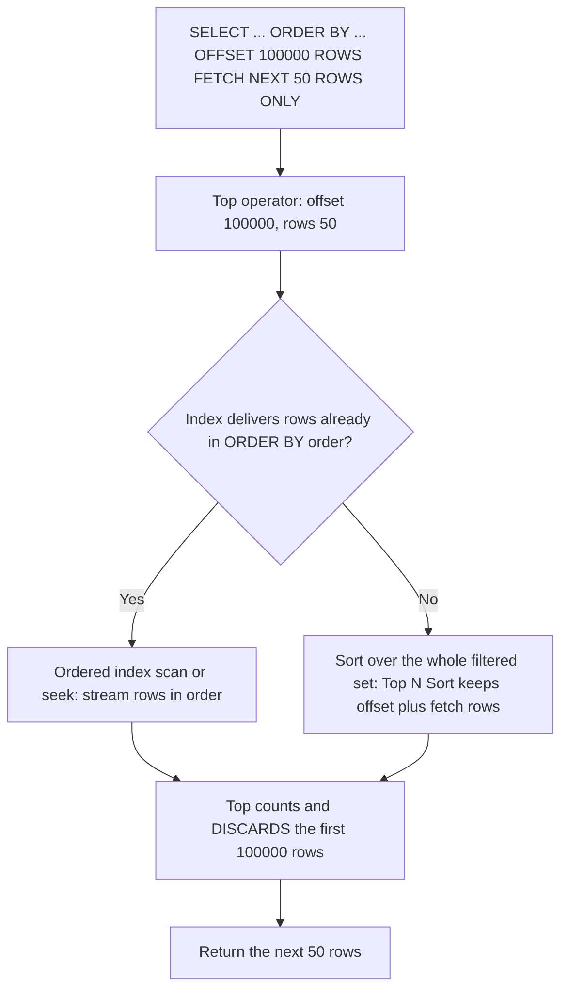
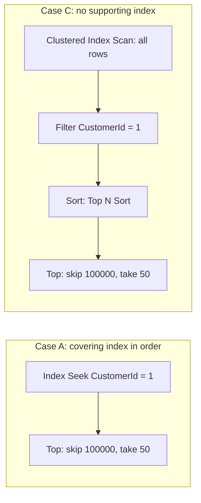
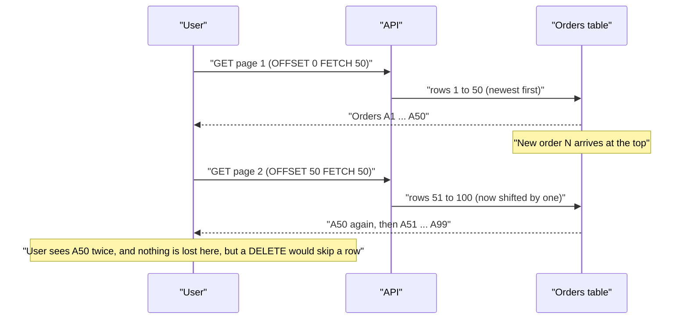
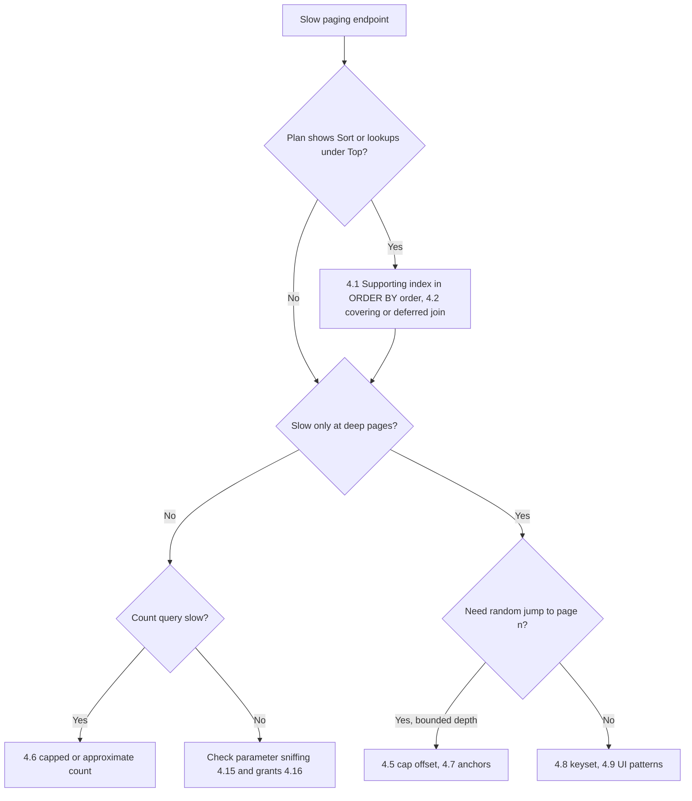
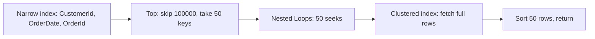
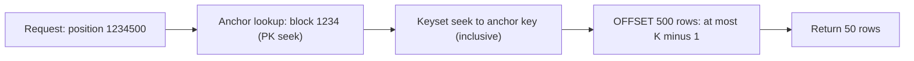
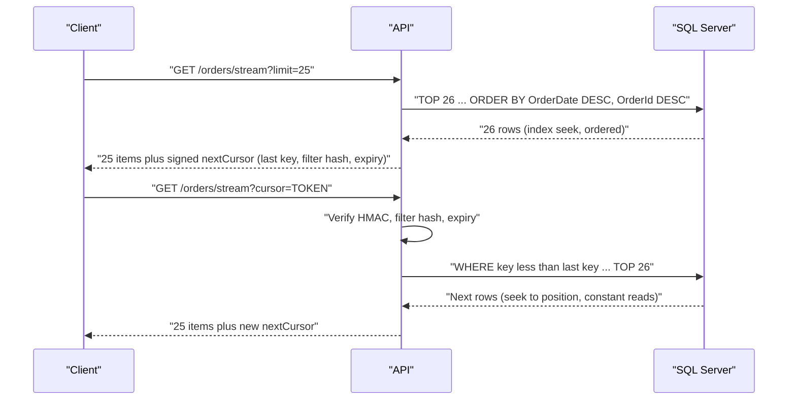
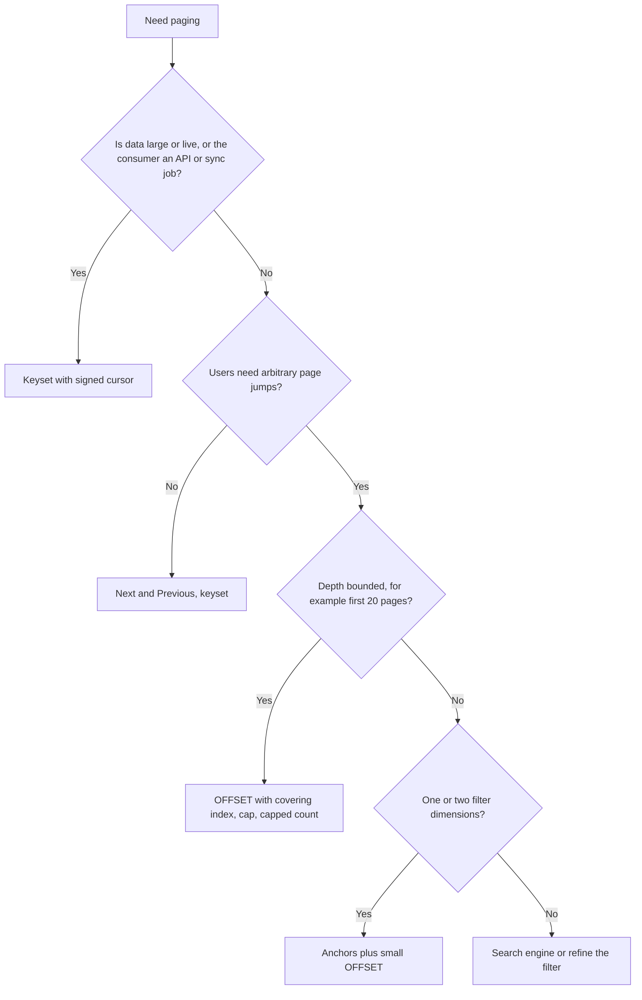

# OFFSET/FETCH and Pagination Deep Dive (SQL Server, Azure SQL, EF Core)

> **Part 4 of the Database Performance Optimization and Troubleshooting guides.**
> Part 1: [SQL Server internals, query tuning and concurrency](./01-sql-server-internals-query-tuning-and-concurrency.md) ·
> Part 2: [Database architecture, scaling and troubleshooting](./02-database-architecture-scaling-and-troubleshooting.md) ·
> Part 3: [Finding and fixing database performance issues](./03-finding-and-fixing-database-performance-issues.md) (written in parallel; link resolves once that file exists).
> This guide expands the short [pagination chapter in Part 1](./01-sql-server-internals-query-tuning-and-concurrency.md#15-pagination-optimization) into a full treatment and does not contradict it.

**The one-paragraph answer to "is there any performance improvement in OFFSET?"**
`OFFSET n ROWS` can never be made *free*: SQL Server has no way to jump to "the n-th row" of an ordered result, so it must produce and throw away `n` rows. What you *can* do is (1) make each skipped row as cheap as possible (a covering index in the exact `ORDER BY` order, no lookups, no sort, narrow rows), (2) fetch the wide columns only for the 50 rows you return (deferred join), (3) cap how deep anyone can page, (4) stop paying for exact `COUNT(*)`, (5) bound the cost of "jump to page" with anchors, and (6) replace OFFSET with keyset pagination where deep or live data is involved. With those, OFFSET is perfectly acceptable for shallow paging and bounded back-office grids, and the cost of deep OFFSET drops by one to two orders of magnitude, but it still grows linearly with the offset.

## How to use this guide

- Read chapters 1–3 to understand *why* OFFSET behaves as it does, chapter 4 for every improvement technique with code, chapter 5 for the decision table and a benchmark harness you can run on your own data.
- Chapters 6–7 are the ASP.NET Core API and EF Core implementation; chapter 8 is the production troubleshooting playbook.
- Chapters 9–14 are the interview toolkit (trade-offs, Q&A, scenarios, cheat sheet, answer framework, revision checklist).
- Every SQL example reuses the **lab schema** (`Customers`, `Orders`, `OrderItems`) defined in [chapter 0 of Part 1](./01-sql-server-internals-query-tuning-and-concurrency.md#0-lab-setup). Run that setup first (about 2 million orders; customer 1 owns roughly half of them, which is exactly the "whale tenant" shape that makes deep paging hurt).
- **Numbers in this guide are illustrative orders of magnitude**, not benchmark results. Chapter 5 gives you the harness to produce real numbers on your hardware. Version- and Azure-specific details are marked *verify current*.

## Table of contents

1. [What OFFSET/FETCH is](#1-what-offsetfetch-is)
2. [How OFFSET works internally and what it costs](#2-how-offset-works-internally-and-what-it-costs)
3. [OFFSET problems beyond speed](#3-offset-problems-beyond-speed)
4. [Performance improvements for OFFSET](#4-performance-improvements-for-offset)
   - [4.1 Supporting index that matches the ORDER BY](#41-supporting-index-that-matches-the-order-by)
   - [4.2 Covering index and the deferred join](#42-covering-index-and-the-deferred-join)
   - [4.3 Filtered and narrow indexes for common filters](#43-filtered-and-narrow-indexes-for-common-filters)
   - [4.4 Avoid SELECT star and LOB columns](#44-avoid-select-star-and-lob-columns)
   - [4.5 Cap the offset and the page size](#45-cap-the-offset-and-the-page-size)
   - [4.6 Avoid exact COUNT for total pages](#46-avoid-exact-count-for-total-pages)
   - [4.7 Seek-to-offset hybrid with page anchors](#47-seek-to-offset-hybrid-with-page-anchors)
   - [4.8 Keyset pagination](#48-keyset-pagination)
   - [4.9 UI patterns that avoid deep paging](#49-ui-patterns-that-avoid-deep-paging)
   - [4.10 Stable paging with an as-of pin](#410-stable-paging-with-an-as-of-pin)
   - [4.11 Caching pages](#411-caching-pages)
   - [4.12 ROW_NUMBER versus OFFSET versus TOP-TOP](#412-row_number-versus-offset-versus-top-top)
   - [4.13 Columnstore and batch mode for analytic grids](#413-columnstore-and-batch-mode-for-analytic-grids)
   - [4.14 Search engines for deep filterable listing](#414-search-engines-for-deep-filterable-listing)
   - [4.15 Parameter sniffing and parallelism with OFFSET](#415-parameter-sniffing-and-parallelism-with-offset)
   - [4.16 Sort spills and tempdb for unindexed ORDER BY](#416-sort-spills-and-tempdb-for-unindexed-order-by)
5. [Decision table and benchmark harness](#5-decision-table-and-benchmark-harness)
6. [API design for paging](#6-api-design-for-paging)
7. [EF Core specifics](#7-ef-core-specifics)
8. [Troubleshooting pagination in production](#8-troubleshooting-pagination-in-production)
9. [When OFFSET is fine, trade-offs, mistakes and considerations](#9-when-offset-is-fine-trade-offs-mistakes-and-considerations)
10. [Interview questions and answers](#10-interview-questions-and-answers)
11. [Scenario-based questions](#11-scenario-based-questions)
12. [Cheat sheet](#12-cheat-sheet)
13. [Structured answer framework](#13-structured-answer-framework)
14. [Revision checklist](#14-revision-checklist)

---

## 1. What OFFSET/FETCH is

**Simple idea.** Paging means "show me results 101 to 150". `OFFSET 100 ROWS FETCH NEXT 50 ROWS ONLY` says "sort the result, skip the first 100 rows, hand back the next 50". It is the standard SQL way to implement page numbers, available in SQL Server 2012 and later (database compatibility level 110+) and in Azure SQL Database and Managed Instance.

**Syntax and variants.**

```sql
-- The canonical form. ORDER BY is mandatory: OFFSET/FETCH is part of the ORDER BY clause.
SELECT OrderId, OrderDate, TotalAmount
FROM   dbo.Orders
WHERE  CustomerId = 42
ORDER BY OrderDate DESC, OrderId DESC          -- unique tie-breaker (see chapter 3)
OFFSET 100 ROWS FETCH NEXT 50 ROWS ONLY;       -- page 3 when the page size is 50 (zero-based: (3-1)*50)

-- Equivalent spellings: ROW/ROWS and FIRST/NEXT are interchangeable noise words.
-- ... OFFSET 100 ROW FETCH FIRST 50 ROW ONLY;

-- OFFSET without FETCH: skip n rows, return everything else (rarely what you want)
-- ... ORDER BY OrderId OFFSET 100 ROWS;

-- Parameters and expressions are allowed (this is how an API passes the page):
DECLARE @page INT = 3, @size INT = 50;
SELECT OrderId, OrderDate, TotalAmount
FROM   dbo.Orders
WHERE  CustomerId = 42
ORDER BY OrderDate DESC, OrderId DESC
OFFSET (@page - 1) * @size ROWS FETCH NEXT @size ROWS ONLY;
```

Rules worth remembering: the offset must be `>= 0` and the fetch count `>= 1` (otherwise the engine raises an error); `OFFSET/FETCH` cannot be combined with `TOP` in the same query expression; and without a total order the page contents are not well-defined (chapter 3). *(Verify current documentation for the exact list of restrictions, for example indexed views.)*

**How it compares with the alternatives.**

| Approach | Notes |
|---|---|
| `TOP (n)` | Gets the *first* n rows only. No skip. The basis of keyset pagination (`TOP (50) ... WHERE key < @last`). |
| `ROW_NUMBER() OVER (ORDER BY ...)` then `WHERE rn BETWEEN x AND y` | The pre-2012 pattern. Same fundamental cost as OFFSET (see [4.12](#412-row_number-versus-offset-versus-top-top)). |
| `LIMIT n OFFSET m` (PostgreSQL, MySQL, SQLite) | Same idea, same cost model. The advice in this guide transfers to those engines. |
| `OFFSET m ROWS FETCH NEXT n ROWS ONLY` (Oracle 12c+, SQL standard) | Identical syntax to SQL Server. |
| Keyset / seek | "Rows after the last one I saw". Constant cost per page ([4.8](#48-keyset-pagination)). |

**Why it exists and what problem it solves.** Before 2012 SQL Server developers wrote `ROW_NUMBER()` subqueries or double-`TOP` queries for every grid. `OFFSET/FETCH` standardised the pattern, made it readable and let the optimizer recognise it (the plan shows a dedicated `Top` operator with an offset). It solves *presentation* (page numbers over a sorted list), not *efficiency*: it is a convenience, not a seek mechanism.

**Plan shape.** The execution plan contains a **Top** operator whose properties show *Offset Expression* and *Rows*. Everything below that operator runs with a **row goal** of `offset + fetch` rows: the optimizer plans as if it only needs that many rows, which favours nested loops and index-ordered access over hash joins and sorts. That row goal is both a gift (cheap page 1) and a trap (the same plan is reused for page 100,000; see [4.15](#415-parameter-sniffing-and-parallelism-with-offset)).



**Why the engine cannot "seek to row number n".** A B-tree is ordered by *key*, not by *position*. Interior pages store key boundaries and child pointers, not "how many rows are under this child". There is no order-statistic tree behind a rowstore index, so the only way to learn which row is the 100,001st is to walk the leaf level and count. That is the entire reason OFFSET cost grows with the offset. Keyset pagination works because it converts "position" into "key" and *B-trees are excellent at seeking to a key*.

**Azure SQL.** Azure SQL Database and Managed Instance use the same engine behaviour; the practical differences are resource governance (a deep-paging storm burns DTUs/vCores and tempdb quickly) and Query Store on by default (useful for finding the offending queries, [chapter 8](#8-troubleshooting-pagination-in-production)).

**Relationship to other topics.** Index design and covering indexes ([Part 1, chapters 5 and 8](./01-sql-server-internals-query-tuning-and-concurrency.md#5-index-fundamentals)); plan reading ([chapter 3](./01-sql-server-internals-query-tuning-and-concurrency.md#3-execution-plans-estimated-versus-actual)); API design ([ASP.NET Core internals](../10-aspnet-core-web-api-internals/aspnet-core-web-api-internals.md)).

---

## 2. How OFFSET works internally and what it costs

**Simple idea.** To give you rows 1,000,001 to 1,000,050 the database must first *find and count* the million rows before them. Page 1 costs a few page reads; page 20,000 costs thousands. The cost is linear in the offset.

**Architect depth: the cost model.**

- **Rows produced = offset + fetch.** The `Top` operator pulls rows from its child until it has skipped `offset` rows and returned `fetch` rows. Logical reads are therefore roughly `B-tree depth + (offset + fetch) / rows-per-leaf-page` for an ordered index scan. Double the offset, double the reads.
- **Four plan families**, in increasing order of pain:

| Case | Plan | Cost of skipped rows |
|---|---|---|
| **A. Covering index in ORDER BY order** | Ordered index seek/scan, then `Top` | Cheapest possible: sequential leaf-page reads, no lookups, no sort. ~`offset / ~200` page reads for a narrow index. |
| **B. Index in order but not covering** | Index seek/scan, `Top`, plus Nested Loops with Key Lookup | **Depends where the optimizer puts the lookup.** If the lookup is only for *output* columns, the optimizer can place `Top` *below* the lookup, so only the fetched rows are looked up (good). If a *predicate or ORDER BY column* is missing from the index, every candidate row (including skipped ones) must be looked up *before* it can be counted: one random read per skipped row (terrible). Always check the position of `Top` relative to the Nested Loops in the plan. |
| **C. No supporting index** | Scan base table, `Sort` (Top N Sort), then `Top` | Reads the entire filtered set, sorts `offset + fetch` rows. Memory grant grows with the offset and **spills to tempdb** for deep pages. |
| **D. Joins and filters** | Row goal pushes the optimizer toward Nested Loops; filters evaluated after the join can force far more than `offset + fetch` rows to be produced | Selective-looking predicates that apply *after* the join mean rows are produced, joined, then discarded. |

- **Memory grant.** A Sort needs a grant sized from estimated rows × row width. Deep offsets and wide rows ask for large grants; under concurrency this causes `RESOURCE_SEMAPHORE` waits (memory-grant queueing), see [Part 2, chapter 15](./02-database-architecture-scaling-and-troubleshooting.md#15-cpu-memory-and-disk-io-analysis).
- **Parallelism.** A parallel plan under `Top` with `ORDER BY` needs an *order-preserving* `Gather Streams` (merge). For small page sizes and highly selective ordered access, a serial plan is often cheaper; parallelism helps the Case C full sort but not the Case A index walk.
- **Page cost versus buffer pool.** Deep pages touch pages that are rarely cached, so physical reads (`PAGEIOLATCH_SH`) appear on top of the logical-read growth. Page 1 is always hot; page 20,000 usually is not.

**Why this matters architecturally.** Pagination cost is an *unbounded function of user input* (the page number). Any API that accepts an arbitrary page number without a ceiling has an attacker-controlled cost parameter.

### 2.1 Lab: measuring page 1 versus deep pages

```sql
USE PerfLab;
GO
-- Indexes used in this guide. Create them one at a time so you can observe each effect.
-- (1) NONE: only the clustered PK on OrderId exists (Case C for ORDER BY OrderDate).
-- (2) Covering, in exact ORDER BY order (Case A). Note OrderId DESC is an explicit key column: if you rely on the
--     implicit clustering-key locator it is ascending, which does not match ORDER BY ... OrderId DESC.
CREATE NONCLUSTERED INDEX IX_Orders_Cust_DateId_Cov
    ON dbo.Orders (CustomerId, OrderDate DESC, OrderId DESC) INCLUDE (TotalAmount, Status);
GO
SET STATISTICS IO ON; SET STATISTICS TIME ON;

DECLARE @skip BIGINT;

-- Run each with Ctrl+M (actual plan) and compare "logical reads" in the Messages tab.
SET @skip = 0;
SELECT OrderId, OrderDate, TotalAmount FROM dbo.Orders WHERE CustomerId = 1
ORDER BY OrderDate DESC, OrderId DESC OFFSET @skip ROWS FETCH NEXT 50 ROWS ONLY OPTION (RECOMPILE);

SET @skip = 1000;
SELECT OrderId, OrderDate, TotalAmount FROM dbo.Orders WHERE CustomerId = 1
ORDER BY OrderDate DESC, OrderId DESC OFFSET @skip ROWS FETCH NEXT 50 ROWS ONLY OPTION (RECOMPILE);

SET @skip = 100000;
SELECT OrderId, OrderDate, TotalAmount FROM dbo.Orders WHERE CustomerId = 1
ORDER BY OrderDate DESC, OrderId DESC OFFSET @skip ROWS FETCH NEXT 50 ROWS ONLY OPTION (RECOMPILE);

SET @skip = 1000000;
SELECT OrderId, OrderDate, TotalAmount FROM dbo.Orders WHERE CustomerId = 1
ORDER BY OrderDate DESC, OrderId DESC OFFSET @skip ROWS FETCH NEXT 50 ROWS ONLY OPTION (RECOMPILE);
-- OPTION (RECOMPILE) is used here only so every offset gets its own plan and the comparison is not polluted by
-- parameter sniffing (chapter 4.15). Remove it to see the sniffing effect.
```

**Expected shape (illustrative; reproduce on your data).** With the covering index above, about 200 index rows fit on a leaf page and customer 1 owns roughly one million orders, so:

| Offset | Plan | Logical reads (order of magnitude) | Comment |
|---|---|---|---|
| 0 | Index seek + Top | single digits (tree depth plus 1 page) | The "page 1" everyone benchmarks. |
| 1,000 | Index seek + Top | ~10 | Still trivial. |
| 100,000 | Index seek + Top | ~500 | Linear growth is visible. |
| 1,000,000 | Index seek + Top | ~5,000 | 1,000× the reads of page 1 for the same 50 rows returned. |
| 100,000, **no index** | Clustered scan + Top N Sort | tens of thousands (whole table) plus a sort grant and possible tempdb spill | Case C: cost is nearly independent of the offset because everything is read anyway, but it is enormous for *every* page. |



**Reading the result.** Compare *logical reads*, not elapsed time (time is noisy). If reads grow in proportion to the offset you are in Case A (best you can do without changing the technique). If reads are huge at *every* offset including 0, you are in Case C or B-with-bad-lookup, and an index fixes most of it ([4.1](#41-supporting-index-that-matches-the-order-by)).

**Case B demonstration: a predicate column outside the index.**

```sql
-- Index lacks ExternalRef, but the WHERE clause needs it: every candidate row requires a Key Lookup *before* counting.
CREATE NONCLUSTERED INDEX IX_Orders_Cust_DateId_Narrow ON dbo.Orders (CustomerId, OrderDate DESC, OrderId DESC);
SELECT OrderId, OrderDate, TotalAmount
FROM   dbo.Orders WITH (INDEX (IX_Orders_Cust_DateId_Narrow))
WHERE  CustomerId = 1 AND ExternalRef LIKE 'EXT-1%'            -- predicate on a non-indexed column
ORDER BY OrderDate DESC, OrderId DESC
OFFSET 100000 ROWS FETCH NEXT 50 ROWS ONLY;
-- Plan: Index Seek -> Nested Loops -> Key Lookup (with the ExternalRef predicate) -> Top. The lookup happens for every row
-- the Top has to consider, so reads explode (hundreds of thousands). Fix: add ExternalRef to INCLUDE, or restructure
-- (4.2 deferred join does NOT fix this one by itself because the filter still needs the column).
```

**Troubleshooting.** In the plan, find the `Top` operator. *Rows read* on the operator below it far larger than 50 is the OFFSET tax (expected). A `Key Lookup` *below* `Top` with millions of executions, or a `Sort` with a warning icon, is the real problem.

---

## 3. OFFSET problems beyond speed

OFFSET has correctness and operations problems that exist even when the query is fast.

### 3.1 Instability under concurrent writes (skipped and duplicated rows)

**Simple idea.** Page 2 is defined as "rows 51 to 100 *at the time you ask*". If a new row appears at the top between your page 1 and page 2 requests, everything shifts down by one: the last row of page 1 reappears at the top of page 2. If a row is deleted, one row is skipped.



Consequences: duplicate rows in infinite scroll, a "missing" record in an audit grid, reconciliation exports that silently omit rows. Keyset pagination and an as-of pin ([4.10](#410-stable-paging-with-an-as-of-pin)) remove this class of bug; OFFSET cannot.

### 3.2 Non-deterministic ORDER BY (ties)

If `ORDER BY OrderDate` is not unique, rows with the same date can be returned in a *different order on each execution* (different plan, parallelism, page-split state). Rows then appear on two pages or on none. **Rule: every paging ORDER BY must end with a unique tie-breaker**, normally the primary key (`ORDER BY OrderDate DESC, OrderId DESC`). This is also what makes keyset pagination possible.

```sql
-- BAD: ties on OrderDate make page boundaries non-deterministic
... ORDER BY OrderDate DESC OFFSET 50 ROWS FETCH NEXT 50 ROWS ONLY;
-- GOOD: total order
... ORDER BY OrderDate DESC, OrderId DESC OFFSET 50 ROWS FETCH NEXT 50 ROWS ONLY;
```

### 3.3 The total-count problem

A grid wants "Page 3 of 4,817". Computing `4,817` needs `COUNT(*)` over the *entire filtered set*, which is an O(n) scan that costs as much as the deepest page, and it usually runs on *every* request. Often the count is the slowest part of the endpoint. Chapter [4.6](#46-avoid-exact-count-for-total-pages) covers the alternatives.

### 3.4 Deep paging as a denial-of-service vector

`?page=100000&pageSize=1000` costs roughly `10^8` row reads plus a sort grant. A few concurrent requests exhaust CPU, I/O, tempdb and the connection pool ([Part 1, chapter 27](./01-sql-server-internals-query-tuning-and-concurrency.md#27-connection-pooling-and-pool-exhaustion)). Crawlers and API consumers who "iterate all pages" do this unintentionally. The cost is controlled by *user input*: validate and cap it ([4.5](#45-cap-the-offset-and-the-page-size)).

### 3.5 Cache unfriendliness

Page results depend on `(filter, sort, offset, size)`. Deep pages are unique per user and rarely repeat, so caches get near-zero hit rates there, while the underlying data shift (3.1) makes cached deep pages stale or inconsistent. Caching helps the *first few pages* ([4.11](#411-caching-pages)).

---
## 4. Performance improvements for OFFSET

**Is there any performance improvement in OFFSET? Yes, several, but none changes the linear growth.** Techniques 4.1–4.6 make OFFSET cheaper and safer; 4.7 bounds the cost of jump-to-page; 4.8–4.11 avoid OFFSET's weaknesses; 4.12–4.16 cover engine-level details and alternatives. The ladder below shows the order in which to apply them.



### 4.1 Supporting index that matches the ORDER BY

**Simple idea.** If an index already stores rows in the order you want, the engine reads them in that order and stops after `offset + fetch` rows. Without it, it must read *every* qualifying row and sort.

**Rules.**

1. **Equality predicates first, then the ORDER BY columns, in the same order and direction**: `(CustomerId, OrderDate DESC, OrderId DESC)` for `WHERE CustomerId = @c ORDER BY OrderDate DESC, OrderId DESC`.
2. **A fully reversed order also works** (SQL Server can scan an index backward): an index on `(CustomerId, OrderDate ASC, OrderId ASC)` serves `ORDER BY OrderDate DESC, OrderId DESC`. **A mixed order** (`OrderDate DESC, OrderId ASC`) needs an index declared with exactly that mix.
3. **Include the tie-breaker explicitly.** For a non-unique nonclustered index SQL Server appends the clustering key as a *hidden, ascending* column. If your ORDER BY wants `OrderId DESC`, declare `OrderId DESC` in the key; otherwise the order does not match and a sort appears.
4. **Range predicates break ordering for later columns.** `WHERE CustomerId = @c AND OrderDate >= @from ORDER BY OrderDate DESC, OrderId DESC` is fine (the range column is the first ORDER BY column). `WHERE CustomerId IN (1,2,3) ORDER BY OrderDate DESC` is *not* served by one ordered range: multiple equality values produce multiple ordered runs and require a merge or sort. Use `UNION ALL` of per-value seeks plus a Top, or a different design.
5. **Collation matters for string sorts.** `ORDER BY Name` uses the column collation; an index on a column with a different collation, or `ORDER BY Name COLLATE Latin1_General_BIN2`, does not provide the order.
6. **Expressions defeat the index.** `ORDER BY UPPER(Name)` or `ORDER BY CAST(...)` needs a persisted computed column plus an index on it.

```sql
-- Verify the index is used and NO Sort operator exists
SET STATISTICS IO ON;
SELECT OrderId, OrderDate, TotalAmount
FROM   dbo.Orders
WHERE  CustomerId = 1
ORDER BY OrderDate DESC, OrderId DESC
OFFSET 5000 ROWS FETCH NEXT 50 ROWS ONLY;
-- Actual plan: Index Seek (IX_Orders_Cust_DateId_Cov, Ordered: True, Scan Direction: FORWARD) -> Top. No Sort.
```

**Gain.** Removes the full sort and the scan of the clustered index: from "whole table every page" to "linear in the offset, but starting from a tiny constant". **Limit.** Every supported sort order needs its own index (storage, write amplification); do not offer arbitrary user-selected sort columns without a matching index ([chapter 6](#6-api-design-for-paging)).

**Mistake.** Creating the index but leaving `OrderId` out of the ORDER BY (non-unique order), or sorting on an expression the index cannot satisfy.

### 4.2 Covering index and the deferred join

**Simple idea.** Reading a skipped row from the *narrow* index is cheap; reading it from the *wide* table (with `Notes`, LOBs, many columns) is expensive. So page over the narrow index to find the 50 keys, then fetch the full rows for only those 50.

**Covering.** If every column the query touches is in the key or `INCLUDE`, no lookup is needed (Case A). Cheap when the select list is small and stable (a grid with 5 columns).

**Deferred join (late row lookup).** Use when the select list is wide or variable:

```sql
-- BEFORE: wide select with the page computed over the base table (many skipped rows are read wide)
SELECT o.*                               -- includes Notes, ExternalRef, RowVer...
FROM   dbo.Orders o
WHERE  o.CustomerId = 1
ORDER BY o.OrderDate DESC, o.OrderId DESC
OFFSET 100000 ROWS FETCH NEXT 50 ROWS ONLY;

-- AFTER: deferred join. The inner query pages over the NARROW index (keys only), the outer query fetches 50 full rows.
WITH page AS
(
    SELECT OrderId, OrderDate                               -- only columns present in IX_Orders_Cust_DateId_Cov
    FROM   dbo.Orders
    WHERE  CustomerId = 1
    ORDER BY OrderDate DESC, OrderId DESC
    OFFSET 100000 ROWS FETCH NEXT 50 ROWS ONLY
)
SELECT o.*
FROM   page p
JOIN   dbo.Orders o ON o.OrderId = p.OrderId                -- 50 clustered index seeks
ORDER BY p.OrderDate DESC, p.OrderId DESC;                  -- re-sort the 50 rows: a join does not guarantee order
```



**Expected effect (illustrative).** If the base-table approach walked a wide index/lookup path costing ~1 logical read per two skipped rows plus lookups, the deferred join costs `offset/200` narrow-index reads plus `50 × tree depth` (about 150) reads, typically a 5–50× reduction when rows are wide, little or nothing when the index is already covering and the rows are small.

**When it helps / when not.** *Helps:* wide rows, LOB columns, `SELECT` lists that vary by caller, ORM entity loading. *Does not help:* the filter or sort needs columns that are not in the narrow index (the narrow part must be able to evaluate the WHERE and ORDER BY on its own); already-covering queries; tiny tables.

**CTE caveat.** A CTE is not materialized; the optimizer inlines it. The `OFFSET` inside it acts as a barrier (it cannot be removed), so the inner query still determines the 50 keys first. Confirm in the actual plan that `Top` sits above an index access on the narrow index and that the join to the base table runs 50 times.

```csharp
// Dapper version: deferred join with parameters (no string concatenation of user values)
const string sql = """
WITH page AS (
    SELECT OrderId, OrderDate FROM dbo.Orders
    WHERE CustomerId = @customerId
    ORDER BY OrderDate DESC, OrderId DESC
    OFFSET @skip ROWS FETCH NEXT @take ROWS ONLY)
SELECT o.OrderId, o.CustomerId, o.OrderDate, o.Status, o.TotalAmount, o.ExternalRef, o.Notes
FROM page p JOIN dbo.Orders o ON o.OrderId = p.OrderId
ORDER BY p.OrderDate DESC, p.OrderId DESC;
""";
var rows = (await conn.QueryAsync<OrderRow>(sql, new { customerId, skip, take })).ToList();
```

*EF Core form: see [chapter 7](#7-ef-core-specifics).*

### 4.3 Filtered and narrow indexes for common filters

A page over "open orders only" scans far less data if the index contains only open orders:

```sql
CREATE NONCLUSTERED INDEX IX_Orders_Open_DateId
    ON dbo.Orders (OrderDate DESC, OrderId DESC) INCLUDE (CustomerId, TotalAmount)
    WHERE Status = 0;                                -- New orders only (say 3% of the table)
-- Query must repeat the predicate with a LITERAL so the optimizer can match the filtered index:
SELECT OrderId, OrderDate, TotalAmount FROM dbo.Orders
WHERE  Status = 0
ORDER BY OrderDate DESC, OrderId DESC OFFSET 1000 ROWS FETCH NEXT 50 ROWS ONLY;
```

**Caveats.** A *parameterized* predicate (`WHERE Status = @s`) usually cannot use a filtered index, because the plan must be valid for any `@s`; use a literal, `OPTION (RECOMPILE)`, or one query per status. In EF Core a captured variable becomes a parameter while a literal constant is inlined, so write `o.Status == 0` for the filtered-index path. Every extra index costs writes; use filtered indexes for *hot, selective, stable* filters (inbox queues, "active" flags), not for every status.

### 4.4 Avoid SELECT star and LOB columns

`SELECT *` forces lookups, widens rows and blocks covering indexes. Page queries should project only the grid columns and leave `Notes`, JSON blobs and `varbinary(max)` for the detail endpoint. See [Part 1, chapter 17](./01-sql-server-internals-query-tuning-and-concurrency.md#17-avoiding-unnecessary-columns-no-select-star). With EF Core, project in the query (`Select(o => new OrderRow(...))`) *before* `Skip/Take`.

### 4.5 Cap the offset and the page size

The cheapest deep page is the one you refuse to serve. Treat the offset as untrusted input:

```csharp
public static class PagingLimits
{
    public const int MaxPageSize = 100;          // protects memory and payload size
    public const int MaxOffset   = 10_000;       // beyond this, require a narrower filter or a cursor
}

public static (int Skip, int Take) Normalize(int page, int pageSize)
{
    if (page < 1) throw new ArgumentOutOfRangeException(nameof(page));
    var take = Math.Clamp(pageSize, 1, PagingLimits.MaxPageSize);
    var skip = checked((page - 1) * take);
    if (skip > PagingLimits.MaxOffset)
        throw new PagingTooDeepException("Narrow your filter or use the cursor-based endpoint for deep browsing.");
    return (skip, take);
}
// Map PagingTooDeepException to HTTP 400 (ProblemDetails) with a message that says what to do instead.
```

```sql
-- Defence in depth inside a stored procedure
IF @skip > 10000 OR @take NOT BETWEEN 1 AND 100 THROW 50001, 'Paging window too large.', 1;
```

**Redirect, do not just refuse.** For legitimate bulk needs (export, sync) offer a keyset/streaming endpoint, an async export job writing to Blob Storage, or change-feed style incremental sync. Search services impose the same ceiling for the same reason (for example Azure AI Search limits `$skip`; *verify current* limits).

### 4.6 Avoid exact COUNT for total pages

`SELECT COUNT(*)` over a large filtered set costs as much as the deepest page. Options, from cheapest to most exact:

1. **Do not show a total.** "Next / Previous" and `hasMore` need no count. Fetch `pageSize + 1` rows: if you get `pageSize + 1`, there is a next page.
2. **Capped count ("1000+").** Count at most 1,001 rows; the cost is bounded regardless of table size:
   ```sql
   SELECT COUNT(*) AS capped
   FROM  (SELECT TOP (1001) 1 AS x FROM dbo.Orders WHERE CustomerId = @customerId) t;   -- 1001 means "1000+"
   ```
3. **Approximate unfiltered total from metadata** (instant, slightly stale):
   ```sql
   SELECT SUM(row_count) AS approx_rows
   FROM   sys.dm_db_partition_stats
   WHERE  object_id = OBJECT_ID('dbo.Orders') AND index_id IN (0, 1);   -- heap or clustered index
   ```
4. **Count only on the first page.** Return `total` on page 1, let the client keep it; later pages skip the count.
5. **Cache the count** by `(tenant, filter hash)` with a TTL of 30–300 seconds (Redis / `HybridCache`); it does not need to be exact.
6. **Maintain it**: an indexed view (`COUNT_BIG(*)` grouped by the filter dimension) or a counter table updated in the same transaction/outbox. Cheap to read, but adds write cost and contention on hot counters; use for a few high-value dimensions only.
7. **Run it narrow.** Plain `COUNT(*)` can use the narrowest index; make sure a small covering index for the filter exists so the count reads few pages.

```csharp
// Capped count with EF Core: bounded cost whatever the table size
int capped = await db.Orders.AsNoTracking().Where(o => o.CustomerId == customerId)
                     .Take(1001).CountAsync();             // translates to COUNT over a TOP (1001) subquery
bool more = capped > 1000;                                 // display "1000+"
```

**Trade-off.** Users like "page 3 of 4,817" but nobody reads page 4,000; an approximate or capped number loses almost nothing and often removes the slowest query on the endpoint.

### 4.7 Seek-to-offset hybrid with page anchors

**Simple idea.** Keyset pagination cannot jump to page 57. OFFSET can, at a cost proportional to 57 pages. **Anchors** give you both: store the sort key of every *K-th* row (say every 1,000th), jump to the nearest anchor with an index seek, then use a *small* OFFSET (less than K) to land exactly on the requested position. The cost of any jump is bounded by K rows regardless of depth.

```sql
-- Anchor table: the key of the first row of every block of K rows, per filter bucket (here: per customer)
CREATE TABLE dbo.OrderPageAnchor
(
    CustomerId INT          NOT NULL,
    AnchorNo   INT          NOT NULL,                -- block number: anchor k covers positions [k*K, k*K + K - 1]
    OrderDate  DATETIME2(0) NOT NULL,
    OrderId    BIGINT       NOT NULL,
    CONSTRAINT PK_OrderPageAnchor PRIMARY KEY (CustomerId, AnchorNo)
);
GO
-- (Re)build anchors for one customer. K = 1000. One pass over the narrow covering index.
CREATE OR ALTER PROCEDURE dbo.RebuildOrderAnchors @CustomerId INT, @K INT = 1000
AS
BEGIN
    SET NOCOUNT ON;
    BEGIN TRAN;
    DELETE dbo.OrderPageAnchor WHERE CustomerId = @CustomerId;
    ;WITH r AS (
        SELECT OrderDate, OrderId,
               ROW_NUMBER() OVER (ORDER BY OrderDate DESC, OrderId DESC) - 1 AS pos      -- zero-based position
        FROM dbo.Orders WHERE CustomerId = @CustomerId)
    INSERT dbo.OrderPageAnchor (CustomerId, AnchorNo, OrderDate, OrderId)
    SELECT @CustomerId, pos / @K, OrderDate, OrderId FROM r WHERE pos % @K = 0;
    COMMIT;
END
GO
-- Jump to ABSOLUTE position @skip (zero-based) with bounded cost
CREATE OR ALTER PROCEDURE dbo.GetOrdersAtPosition @CustomerId INT, @Skip BIGINT, @Take INT, @K INT = 1000
AS
BEGIN
    SET NOCOUNT ON;
    DECLARE @anchorNo INT = @Skip / @K, @rest INT = @Skip % @K, @d DATETIME2(0), @id BIGINT;

    SELECT @d = OrderDate, @id = OrderId
    FROM   dbo.OrderPageAnchor WHERE CustomerId = @CustomerId AND AnchorNo = @anchorNo;

    IF @d IS NULL   -- no anchor yet (new customer or beyond the last anchor): fall back to plain OFFSET, still capped by the API
        SELECT OrderId, OrderDate, TotalAmount FROM dbo.Orders WHERE CustomerId = @CustomerId
        ORDER BY OrderDate DESC, OrderId DESC OFFSET @Skip ROWS FETCH NEXT @Take ROWS ONLY;
    ELSE            -- keyset seek to the anchor row (inclusive), then skip at most K - 1 rows
        SELECT OrderId, OrderDate, TotalAmount FROM dbo.Orders
        WHERE  CustomerId = @CustomerId
          AND (OrderDate < @d OR (OrderDate = @d AND OrderId <= @id))                  -- inclusive of the anchor row
        ORDER BY OrderDate DESC, OrderId DESC OFFSET @rest ROWS FETCH NEXT @Take ROWS ONLY;
END
```



**Maintenance and trade-offs.**

- **Drift.** New inserts shift all positions by the number of inserts since the anchors were built. For append-only, newest-first browsing the error is "a few rows off", acceptable for human browsing, unacceptable for reconciliation (use keyset there). Rebuild on a schedule (minutes to hours), or per-customer when the row count changes by more than K.
- **Cardinality of buckets.** Anchors are per *filter combination*. One dimension (tenant) is manageable; arbitrary filter combinations are not. Do not build anchors for ad hoc filters.
- **Write path cost.** Deletes shift positions too. Anchors are a *read optimisation with approximate semantics*; document that contract.
- **Alternative without a table:** a clustered or covering index on a *monotonic position column* (for example a dense sequence maintained by the application) allows `WHERE Position BETWEEN x AND y` as a pure seek, at the cost of maintaining gap-free positions (hard under deletes and concurrency). Rarely worth it.

### 4.8 Keyset pagination

This is covered at a summary level in [Part 1, chapter 15](./01-sql-server-internals-query-tuning-and-concurrency.md#15-pagination-optimization). Details that matter in production:

**Idea.** Replace "skip n rows" with "give me rows strictly after the last key I saw". The `WHERE` clause becomes an **index seek** to that position; every page then reads about `fetch` rows (constant cost, stable under concurrent inserts).



**Predicate shapes.** SQL Server (as of SQL Server 2022; *verify current*) has no row-value constructor comparison (`(a, b) < (@a, @b)`), so write it out. For a sort of `(OrderDate DESC, OrderId DESC)` the next page after `(@d, @id)` is:

```sql
-- NEXT page, descending composite sort
SELECT TOP (@take) OrderId, OrderDate, TotalAmount
FROM   dbo.Orders
WHERE  CustomerId = @customerId
  AND (OrderDate < @d OR (OrderDate = @d AND OrderId < @id))
ORDER BY OrderDate DESC, OrderId DESC;

-- NEXT page, ascending composite sort: flip both comparisons
--   AND (OrderDate > @d OR (OrderDate = @d AND OrderId > @id)) ... ORDER BY OrderDate ASC, OrderId ASC

-- PREVIOUS page: reverse comparison AND reverse sort, take N, then reverse the result in the application
SELECT TOP (@take) OrderId, OrderDate, TotalAmount
FROM   dbo.Orders
WHERE  CustomerId = @customerId
  AND (OrderDate > @d OR (OrderDate = @d AND OrderId > @id))
ORDER BY OrderDate ASC, OrderId ASC;               -- the client (or API) reverses these rows
```

**Seek quality.** With the OR form the optimizer typically seeks on `CustomerId = @c AND OrderDate <= @d` and evaluates the OR as a *residual predicate*, reading the few rows with the same date but a larger id and discarding them. That is fine. If a very large number of rows share one sort value (thousands of orders at the same second), make the seek exact with `UNION ALL`:

```sql
SELECT TOP (@take) * FROM (
    SELECT TOP (@take) OrderId, OrderDate, TotalAmount FROM dbo.Orders
    WHERE CustomerId = @c AND OrderDate = @d AND OrderId < @id ORDER BY OrderId DESC
    UNION ALL
    SELECT TOP (@take) OrderId, OrderDate, TotalAmount FROM dbo.Orders
    WHERE CustomerId = @c AND OrderDate < @d ORDER BY OrderDate DESC, OrderId DESC
) x ORDER BY OrderDate DESC, OrderId DESC;
```

**Nullable sort columns.** `NULL` sorts first ascending (last descending) in SQL Server and `NULL < @x` is *unknown*, so a naive keyset predicate silently drops rows. Options: make the column `NOT NULL` with a sentinel; sort by a persisted computed column such as `ISNULL(ShippedAt, '9999-12-31')` (indexed, with the same expression in the predicate); or add explicit branches (`... OR (@d IS NOT NULL AND ShippedAt IS NULL)`) and carry "the cursor is in the NULL block" in the token. Test the boundary between the NULL block and the non-NULL block explicitly.

**Cursor tokens.** Return an *opaque, signed* token containing the sort key values, the direction and a hash of the filter/sort so a token cannot be replayed against different filters:

```csharp
public sealed record OrderCursor(DateTime OrderDate, long OrderId, string Dir, string FilterHash);

public sealed class CursorCodec(byte[] key)            // key from Key Vault, rotated; never hard-coded
{
    public string Encode(OrderCursor c)
    {
        var payload = JsonSerializer.SerializeToUtf8Bytes(c);
        var mac = HMACSHA256.HashData(key, payload);
        return $"{Base64Url.EncodeToString(payload)}.{Base64Url.EncodeToString(mac)}";
    }

    public OrderCursor? Decode(string token, string expectedFilterHash)
    {
        var parts = token.Split('.');
        if (parts.Length != 2) return null;
        var payload = Base64Url.DecodeFromChars(parts[0]);
        var mac     = Base64Url.DecodeFromChars(parts[1]);
        if (!CryptographicOperations.FixedTimeEquals(mac, HMACSHA256.HashData(key, payload))) return null;   // tampered
        var c = JsonSerializer.Deserialize<OrderCursor>(payload);
        return c is not null && c.FilterHash == expectedFilterHash ? c : null;                               // wrong query
    }
}
```

**Authorization still applies.** The cursor holds *positions*, not permission. The tenant/user predicate (`CustomerId = @callerCustomerId`) must come from the authenticated principal on every request and must be the leading index column. Never accept a tenant id from the cursor. Signing prevents tampering; it does not replace authorization (IDOR).

**Trade-offs.** No random jump (use [4.7](#47-seek-to-offset-hybrid-with-page-anchors) if you truly need it), each supported sort order needs its own index, the API contract changes from `page=3` to `cursor=...`. See [chapter 6](#6-api-design-for-paging) for the HTTP contract.

---
### 4.9 UI patterns that avoid deep paging

The best optimisation is a UX that never asks for page 4,000.

- **Next / Previous only** (cursor-based) for feeds and logs.
- **Infinite scroll or "Load more"** backed by keyset pagination.
- **Jump-to-page limited to the first N pages** (say 20), then "refine your search". Users who need record 80,000 need a *filter*, not a page number.
- **Search refinement instead of browsing**: date range, status, text search; every filter shrinks the set so the offset stays small.
- **Alphabet / date jump bars**: "jump to letter M" or "jump to March" translates to a *keyset seek* (`WHERE Name >= 'M'`), giving random access without OFFSET.
- **Export for bulk**: async job to Blob Storage, or a streaming keyset endpoint.

### 4.10 Stable paging with an as-of pin

To stop rows shifting between page requests (3.1) without holding a transaction open, **pin the result set** in the cursor:

```sql
-- First request returns a snapshot marker in the cursor: the current max identity (monotonic, append-mostly data).
DECLARE @snapshotMaxId BIGINT = (SELECT MAX(OrderId) FROM dbo.Orders);   -- or capture SYSUTCDATETIME() for timestamp-ordered data
-- Every subsequent page filters: rows created after the snapshot are invisible to this browsing session.
SELECT TOP (50) OrderId, OrderDate, TotalAmount
FROM   dbo.Orders
WHERE  CustomerId = @customerId
  AND  OrderId <= @snapshotMaxId                                              -- the pin
  AND (OrderDate < @d OR (OrderDate = @d AND OrderId < @id))
ORDER BY OrderDate DESC, OrderId DESC;
```

- This hides *inserts* during browsing. It does **not** hide *updates to the sort column* or *deletes*; for those, keyset still behaves sensibly (no duplicates, a deleted row is simply absent) but a row that moved past your cursor can be missed. For exact reconciliation use change tracking/CDC or an immutable snapshot, not paging.
- **RCSI and SNAPSHOT isolation do not solve this across requests.** Under read committed snapshot each *statement* sees a consistent snapshot, but each HTTP request is a new statement and sees newer data. Making pages consistent via SNAPSHOT isolation would require keeping one transaction open across HTTP calls, which is an anti-pattern (blocks version-store cleanup, [Part 1, chapters 25–26](./01-sql-server-internals-query-tuning-and-concurrency.md#25-row-versioning)).
- Temporal tables with `FOR SYSTEM_TIME AS OF @asOf` can give a consistent historical view at extra storage/query cost; useful for audit browsing, overkill for feeds. *Verify current* behaviour and cost.

### 4.11 Caching pages

Pages 1 to 5 get most of the traffic (a Zipf-like distribution), and they are the cheapest to cache.

```csharp
// HybridCache (in-process L1 + distributed L2, with stampede protection) keyed by every input that changes the result
public async Task<PagedResult<OrderRow>> GetCachedPageAsync(string tenantId, OrderFilter f, int page, int size, CancellationToken ct)
{
    var key = $"orders:{tenantId}:{f.Hash()}:{f.Sort}:{page}:{size}";
    return await cache.GetOrCreateAsync(key,
        async token => await repo.GetPageAsync(tenantId, f, page, size, token),
        new HybridCacheEntryOptions { Expiration = TimeSpan.FromSeconds(20), LocalCacheExpiration = TimeSpan.FromSeconds(10) },
        tags: [$"orders:{tenantId}"], cancellationToken: ct);          // tag: invalidate all pages for a tenant on write
}
// On a write: await cache.RemoveByTagAsync($"orders:{tenantId}", ct);
```

- **Short TTLs** (5–30 s) are usually enough to absorb refresh storms; the data is allowed to be a few seconds stale for a list view.
- **Cache only shallow pages.** Deep pages have a near-zero hit rate and fill the cache with one-time entries; set a maximum cached page (for example 10).
- **Invalidation** is the hard part: tag by tenant/filter and evict on write, or rely on TTL only. Beware caching per-user *authorized* views under a shared key (data leak).
- **Stampede protection**: many concurrent misses for page 1 hit the database together; `HybridCache`, `Lazy` per key, or a lock prevents it. See [Part 2, chapter 7](./02-database-architecture-scaling-and-troubleshooting.md#7-redis-caching-patterns) for Redis patterns.
- **Output caching** (`[OutputCache]` / `CacheOutput`) works for anonymous or shared lists; vary by query string and tenant.

### 4.12 ROW_NUMBER versus OFFSET versus TOP-TOP

```sql
-- 1. OFFSET/FETCH (2012+): simplest
SELECT OrderId, OrderDate FROM dbo.Orders WHERE CustomerId = @c
ORDER BY OrderDate DESC, OrderId DESC OFFSET @skip ROWS FETCH NEXT @take ROWS ONLY;

-- 2. ROW_NUMBER (2005+): same logical work, produces a Segment/Sequence Project, then filters rn
SELECT OrderId, OrderDate FROM (
    SELECT OrderId, OrderDate, ROW_NUMBER() OVER (ORDER BY OrderDate DESC, OrderId DESC) AS rn
    FROM dbo.Orders WHERE CustomerId = @c) x
WHERE rn > @skip AND rn <= @skip + @take
ORDER BY rn;

-- 3. TOP-TOP (any version): two reversed sorts, hard to read and error-prone
SELECT * FROM (
    SELECT TOP (@take) * FROM (
        SELECT TOP (@skip + @take) OrderId, OrderDate FROM dbo.Orders WHERE CustomerId = @c
        ORDER BY OrderDate DESC, OrderId DESC) a
    ORDER BY OrderDate ASC, OrderId ASC) b
ORDER BY OrderDate DESC, OrderId DESC;
```

**Verdict.** None of them is asymptotically better: all three produce `offset + fetch` rows in order and discard the front. With the same supporting index the plans have the same cost class; OFFSET/FETCH is usually equal or slightly cheaper (a dedicated `Top` instead of a Segment/Sequence Project/Filter), and certainly clearer. **OFFSET is not inherently slower than ROW_NUMBER**; the common claim that "ROW_NUMBER is faster" comes from comparing a version with an index to one without. Prefer OFFSET/FETCH for readability; choose ROW_NUMBER only when you need the row number in the output or run on a pre-2012 server.

### 4.13 Columnstore and batch mode for analytic grids

For analytic, filter-heavy, scan-oriented grids ("sales by region, sortable, paged"), a clustered or nonclustered **columnstore** index plus **batch mode** makes scans and aggregations far faster, but columnstore does not return rows in key order (without an *ordered* clustered columnstore, *verify current* availability), so a deep `ORDER BY ... OFFSET` still sorts the filtered set. Use columnstore to make the *filtering and counting* fast; keep a rowstore B-tree (or keyset) for the transactional, strictly-ordered browsing path. Do not use columnstore to "fix" OLTP deep paging.

### 4.14 Search engines for deep filterable listing

When users page through *text-searched, faceted* results over very large collections, a search service is built for it: **Elasticsearch** (`search_after` with a point-in-time, which is keyset by another name) or **Azure AI Search** (skip is capped; use filters and `$orderby` on a sortable key to continue). Benefits: relevance, facets, cheap counts, horizontal scale. Costs: another system, eventual consistency (indexer/outbox lag), reindexing, cost. Reach for it when search relevance and faceting are the real requirement, *not* merely to avoid writing a keyset query. See [Inbox, outbox and reliable messaging](../15-inbox-outbox-and-reliable-messaging/inbox-outbox-and-reliable-messaging.md) for feeding an index reliably.

### 4.15 Parameter sniffing and parallelism with OFFSET

**The trap.** `OFFSET @skip ROWS FETCH NEXT @take ROWS ONLY` with a parameterized `@skip` caches **one plan**, compiled for the *first* values it saw. The `Top` row goal (`@skip + @take`) shapes that plan: page 1 compiled first favours *nested loops + lookups* (cheap for 50 rows) and then runs for `@skip = 1,000,000`, doing a million lookups; or a deep-page compile favours a *hash/sort* plan that is wasteful for page 1.

```sql
-- Mitigations (choose by situation)
-- 1. Recompile per execution: new plan per offset. Best for infrequent or deep-page-capable endpoints. Cost: compile CPU.
... OFFSET @skip ROWS FETCH NEXT @take ROWS ONLY OPTION (RECOMPILE);

-- 2. Branch: shallow vs deep take different query text, hence different cached plans
IF @skip < 1000
    EXEC sys.sp_executesql N'... OFFSET @skip ROWS FETCH NEXT @take ROWS ONLY /* shallow */', N'@skip BIGINT, @take INT', @skip, @take;
ELSE
    EXEC sys.sp_executesql N'... OFFSET @skip ROWS FETCH NEXT @take ROWS ONLY OPTION (RECOMPILE) /* deep */', N'@skip BIGINT, @take INT', @skip, @take;

-- 3. OPTIMIZE FOR UNKNOWN / a representative value: stabilises but averages
... OPTION (OPTIMIZE FOR (@skip UNKNOWN));
-- 4. Query Store hint (2022+/Azure SQL) to apply a hint without changing code, or force a known-good plan in Query Store.
EXEC sys.sp_query_store_set_hints @query_id = 42, @query_hints = N'OPTION (RECOMPILE)';    -- verify current availability
```

The preferred fix is to **cap the offset** ([4.5](#45-cap-the-offset-and-the-page-size)) so the plan has a bounded range of "good" shapes; then sniffing matters little. See [Part 1, chapter 10](./01-sql-server-internals-query-tuning-and-concurrency.md#10-parameter-sniffing-and-parameter-sensitive-plans).

**Parallelism.** The Top over an ordered parallel stream needs an order-preserving `Gather Streams`. For selective index-ordered paging a serial plan (`OPTION (MAXDOP 1)`) is often as fast and uses less CPU; for the unindexed full-sort Case C, parallelism helps but the right fix is the index. Do not set MAXDOP 1 server-wide because of one paging query.

### 4.16 Sort spills and tempdb for unindexed ORDER BY

Without a supporting index (Case C) the sort grant is estimated from row count and width. Underestimate means the sort **spills to tempdb** (the plan shows a warning triangle "Sort Warnings"; Extended Event `sort_warning`); overestimate means a huge grant that queues other queries (`RESOURCE_SEMAPHORE`). Deeper offsets and wider rows make both worse. Fixes, in order: add the supporting index (removes the sort), narrow the row (project fewer columns, deferred join), cap the offset, update statistics so the estimate is right, and as a last resort raise grant limits through Resource Governor. Watch `tempdb` I/O and version store when deep paging coexists with RCSI. See [Part 2, chapter 15](./02-database-architecture-scaling-and-troubleshooting.md#15-cpu-memory-and-disk-io-analysis).

---

## 5. Decision table and benchmark harness

### 5.1 Which technique for which scenario

| Scenario | Recommended approach | Why |
|---|---|---|
| Small table (under ~100k rows), back-office grid, sortable | **OFFSET/FETCH** with supporting index, page-size cap | Cost is trivially small; simplicity wins. |
| Medium table, grid with page numbers, users rarely go past page 20 | OFFSET + covering index + **cap offset** + capped/approximate count | Bounded cost, familiar UX. |
| Wide rows or ORM entities, OFFSET needed | OFFSET with **deferred join** | Skipped rows are read from the narrow index only. |
| Large table, API consumed by apps, feeds, mobile infinite scroll | **Keyset** with cursor token | Constant cost, stable under writes. |
| Large table, UI needs "jump to page n" with bounded cost, one or two filter dimensions | **Anchors (4.7)** or OFFSET capped plus search refinement | Bounded cost per jump. |
| Reconciliation, sync, ETL, export | **Keyset or change feed (CDC/change tracking)**, never OFFSET | Must not skip or duplicate rows. |
| Text search with facets over huge data | **Search engine** (Elasticsearch / Azure AI Search) | Relevance, facets, cheap counts. |
| Analytic grid with heavy filtering | Columnstore + batch mode for filter/count, keyset or capped OFFSET for rows | Scan speed, ordering handled separately. |
| Multi-tenant SaaS, a "whale" tenant | Tenant as leading index column, **keyset**, per-tenant rate limits | Whale tenants expose deep-paging cost first. |



### 5.2 Benchmark harness: measure on your own data

**T-SQL harness (logical reads per offset).** Runs the same page query at increasing offsets and records the reads of each execution using the current request's cumulative counter:

```sql
SET NOCOUNT ON;
CREATE TABLE #r (offsetRows BIGINT, logicalReads BIGINT, cpuMs INT);

DECLARE @o BIGINT, @r0 BIGINT, @r1 BIGINT, @c0 INT, @c1 INT;
DECLARE @offsets TABLE (o BIGINT);
INSERT @offsets VALUES (0),(1000),(10000),(100000),(500000),(1000000);

DECLARE cur CURSOR LOCAL FAST_FORWARD FOR SELECT o FROM @offsets;
OPEN cur; FETCH NEXT FROM cur INTO @o;
WHILE @@FETCH_STATUS = 0
BEGIN
    DBCC FREEPROCCACHE WITH NO_INFOMSGS;                      -- DEV ONLY. Never run on a shared or production server.
    SELECT @r0 = logical_reads, @c0 = cpu_time FROM sys.dm_exec_requests WHERE session_id = @@SPID;
    SELECT OrderId, OrderDate, TotalAmount INTO #discard FROM (            -- INTO keeps client transfer out of the measurement
        SELECT OrderId, OrderDate, TotalAmount FROM dbo.Orders WHERE CustomerId = 1
        ORDER BY OrderDate DESC, OrderId DESC OFFSET @o ROWS FETCH NEXT 50 ROWS ONLY) q;
    SELECT @r1 = logical_reads, @c1 = cpu_time FROM sys.dm_exec_requests WHERE session_id = @@SPID;
    DROP TABLE #discard;
    INSERT #r VALUES (@o, @r1 - @r0, @c1 - @c0);
    FETCH NEXT FROM cur INTO @o;
END
CLOSE cur; DEALLOCATE cur;
SELECT * FROM #r ORDER BY offsetRows;      -- plot reads versus offset: a straight line means Case A
```

*Notes:* `DBCC FREEPROCCACHE` is a development-only shortcut; prefer `OPTION (RECOMPILE)` on the test query if you cannot clear the cache. Run each variant (no index, covering index, deferred join, keyset) through the same harness and compare the curves. Check `sys.dm_exec_requests` counters on your build (*verify current*); `SET STATISTICS IO` remains the most trustworthy reference.

**BenchmarkDotNet harness (end-to-end including EF Core and network).**

```csharp
[MemoryDiagnoser]
public class PagingBenchmarks
{
    private ShopDb _db = null!;
    [Params(0, 1_000, 100_000, 500_000)] public int Skip;
    // Cursor (last OrderDate, OrderId) for each Skip value, precomputed in GlobalSetup so keyset setup cost is not measured
    private readonly Dictionary<int, (DateTime Date, long Id)> Cursors = new();

    [GlobalSetup] public void Setup() => _db = new ShopDb(new DbContextOptionsBuilder<ShopDb>()
        .UseSqlServer(Environment.GetEnvironmentVariable("PERFLAB_CS")).Options);

    [Benchmark(Baseline = true)]
    public Task<List<OrderRow>> Offset() => _db.Orders.AsNoTracking().Where(o => o.CustomerId == 1)
        .OrderByDescending(o => o.OrderDate).ThenByDescending(o => o.OrderId)
        .Skip(Skip).Take(50).Select(o => new OrderRow(o.OrderId, o.OrderDate, o.TotalAmount)).ToListAsync();

    [Benchmark]
    public async Task<List<OrderRow>> Keyset()
    {   // positions the cursor at the Skip-th row first (setup cost excluded in a real run: precompute cursors per Skip)
        var (d, id) = Cursors[Skip];
        return await _db.Orders.AsNoTracking().Where(o => o.CustomerId == 1 && (o.OrderDate < d || (o.OrderDate == d && o.OrderId < id)))
            .OrderByDescending(o => o.OrderDate).ThenByDescending(o => o.OrderId).Take(50)
            .Select(o => new OrderRow(o.OrderId, o.OrderDate, o.TotalAmount)).ToListAsync();
    }
    // Add: DeferredJoin(), CappedCount(), and a concurrent-load variant (Parallel.ForEachAsync with 32 workers) —
    // paging problems often only show under concurrency (grants, tempdb, pool).
}
```

Measure **p50 and p99**, run **concurrently**, on **production-sized data**, with **cold and warm cache**. A paging query that is fine on 20,000 rows in a developer database is the classic production incident.

---
## 6. API design for paging

**Simple idea.** The HTTP contract decides whether a client *can* abuse deep paging and whether you can change the implementation later. Design it so the technique behind it (OFFSET today, keyset tomorrow) is replaceable.

### 6.1 Contract choices

| Style | Request | Pros | Cons |
|---|---|---|---|
| **Page number** | `?page=3&pageSize=25` | Familiar, jump to page, easy UI | OFFSET cost, unstable, deep-paging DoS |
| **Offset/limit** | `?offset=50&limit=25` | Same as above, more explicit | Same |
| **Cursor** | `?cursor=eyJ...&limit=25` | Constant cost, stable, hides internals, allows implementation change | No random jump, opaque tokens need signing and expiry |
| **Both (recommended for mixed consumers)** | Page-style for UI grids with caps, cursor for integrations and infinite scroll | Right tool per consumer | Two code paths to test |

**Rules of a good paging contract.** (1) Document the **default sort** and that it ends with a unique tie-breaker. (2) Enforce `maxPageSize` (and `maxOffset` for page-style) and return a clear `400` ProblemDetails with *what to do instead*. (3) Return `hasMore`/`nextCursor` rather than only `total`. (4) Treat cursors as **opaque**: clients must not parse or construct them. (5) Version the contract (changing from page to cursor is a breaking change; see versioning in [Advanced architecture](../16-advanced-architecture-and-microservices/advanced-architecture-and-microservices.md)).

### 6.2 Response envelope and Link headers

```json
{
  "items": [ { "orderId": 1234567, "orderDate": "2026-03-01T10:00:00Z", "totalAmount": 42.50 } ],
  "pageSize": 25,
  "hasMore": true,
  "nextCursor": "eyJvcmRlckRhdGUiOi4uLn0.k9f3...",
  "prevCursor": null,
  "totalApprox": 4817,
  "totalIsExact": false
}
```

```text
Link: <https://api.example.com/orders?cursor=eyJ...&limit=25>; rel="next",
      <https://api.example.com/orders?cursor=eyJ...&limit=25>; rel="prev"
```

`Link` headers (RFC 8288) let generic clients follow pagination without knowing your envelope. `totalIsExact: false` is honest about capped or approximate counts ([4.6](#46-avoid-exact-count-for-total-pages)).

### 6.3 ASP.NET Core minimal API: OFFSET (capped, deferred join) and keyset

```csharp
public sealed record PageRequest(int Page = 1, int PageSize = 25, string? Sort = null, bool Desc = true);
public sealed record OrderRow(long OrderId, DateTime OrderDate, decimal TotalAmount);
public sealed record Paged<T>(IReadOnlyList<T> Items, int PageSize, bool HasMore, string? NextCursor, long? TotalApprox, bool TotalIsExact);

var orders = app.MapGroup("/orders").RequireAuthorization().RequireRateLimiting("paging");

// ---- Page-style endpoint: OFFSET with caps, deferred join and a capped count -----------------------------------------
orders.MapGet("/", async ([AsParameters] PageRequest req, ICurrentCustomer me, ShopDb db, CancellationToken ct) =>
{
    var (skip, take) = PagingLimits.Normalize(req.Page, req.PageSize);                  // throws PagingTooDeepException -> 400
    var sortKey = Sorts.TryGetValue(req.Sort ?? "date", out var sorter) ? sorter : throw new BadHttpRequestException("Unknown sort.");

    var baseQuery = db.Orders.AsNoTracking().Where(o => o.CustomerId == me.Id);         // tenant from the PRINCIPAL, never from input

    // Deferred join: page the narrow index to get 'take' ids, then load the rows for those ids only
    var pageIds = sorter(baseQuery, req.Desc).Skip(skip).Take(take + 1).Select(o => o.OrderId);   // take+1 => hasMore without COUNT
    var ids = await pageIds.ToListAsync(ct);
    var hasMore = ids.Count > take;
    if (hasMore) ids.RemoveAt(take);

    var rows = await sorter(db.Orders.AsNoTracking().Where(o => ids.Contains(o.OrderId)), req.Desc)
                     .Select(o => new OrderRow(o.OrderId, o.OrderDate, o.TotalAmount)).ToListAsync(ct);

    long? total = req.Page == 1 ? await baseQuery.Take(1001).CountAsync(ct) : null;     // capped count, first page only
    return Results.Ok(new Paged<OrderRow>(rows, take, hasMore, null, total, total is null or <= 1000));
});

// ---- Cursor endpoint: keyset ------------------------------------------------------------------------------------------
orders.MapGet("/stream", async (string? cursor, int? limit, ICurrentCustomer me, ShopDb db, CursorCodec codec, CancellationToken ct) =>
{
    var size = Math.Clamp(limit ?? 25, 1, PagingLimits.MaxPageSize);
    OrderCursor? after = null;
    if (cursor is not null)
        after = codec.Decode(cursor, FilterHash(me.Id)) ?? throw new BadHttpRequestException("Invalid or expired cursor.");

    var q = db.Orders.AsNoTracking().Where(o => o.CustomerId == me.Id);
    if (after is not null) q = q.KeysetAfterDesc(o => o.OrderDate, o => o.OrderId, after.OrderDate, after.OrderId);

    var items = await q.OrderByDescending(o => o.OrderDate).ThenByDescending(o => o.OrderId)
                       .Take(size + 1).Select(o => new OrderRow(o.OrderId, o.OrderDate, o.TotalAmount)).ToListAsync(ct);
    var hasMore = items.Count > size;
    if (hasMore) items.RemoveAt(size);
    var next = hasMore ? codec.Encode(new OrderCursor(items[^1].OrderDate, items[^1].OrderId, "next", FilterHash(me.Id))) : null;
    return Results.Ok(new Paged<OrderRow>(items, size, hasMore, next, null, false));
});

// Map the domain exception to a helpful ProblemDetails
app.UseExceptionHandler(); // plus IExceptionHandler mapping PagingTooDeepException -> 400 with "use /orders/stream for deep browsing"
```

### 6.4 Safe dynamic sorting (SQL injection and index discipline)

Users want to click column headers. **Never concatenate a sort column into SQL.** Use an **allow-list** that maps the public key to a fixed, indexed sort, and ship an index for each entry:

```csharp
private static readonly Dictionary<string, Func<IQueryable<Order>, bool, IOrderedQueryable<Order>>> Sorts =
    new(StringComparer.OrdinalIgnoreCase)
{
    ["date"]  = (q, desc) => desc ? q.OrderByDescending(o => o.OrderDate).ThenByDescending(o => o.OrderId)
                                  : q.OrderBy(o => o.OrderDate).ThenBy(o => o.OrderId),            // index: (CustomerId, OrderDate, OrderId)
    ["total"] = (q, desc) => desc ? q.OrderByDescending(o => o.TotalAmount).ThenByDescending(o => o.OrderId)
                                  : q.OrderBy(o => o.TotalAmount).ThenBy(o => o.OrderId),          // index: (CustomerId, TotalAmount, OrderId)
};
// Unknown key => 400. Unsupported combinations are rejected, not "best effort", because an unindexed sort over a whale tenant is the outage.
```

For raw SQL or stored procedures, map the allow-listed key to a **constant fragment** (`"OrderDate DESC, OrderId DESC"`) chosen in code, and keep every *value* parameterized (`sp_executesql` / Dapper parameters). If the sort column cannot be supported by an index, either drop it from the API, cap the allowed result size, or move that view to a search/analytics store.

### 6.5 Rate limiting, authorization and abuse control

- **Rate limit by cost.** The cheap, shallow endpoint and the deep or export path deserve different policies (`AddRateLimiter` with a `paging` policy per tenant/user, a stricter one for page-style requests past a depth threshold). *Verify the exact limiter APIs for your ASP.NET Core version.*
- **Authorization is a query predicate**: tenant/user comes from the access token and is the **leading index column**; the cursor never carries it.
- **Cursor expiry**: include an issue time in the signed payload and reject tokens older than, say, 24 hours (also limits replay and stale as-of pins).
- **Observe**: log page size, offset or "cursor present", duration and rows read; alert on high offsets (chapter 8).

### 6.6 GraphQL, gRPC and streaming

- **GraphQL**: the Relay *Connection* specification (`first/after`, `last/before`, `edges { cursor node }`, `pageInfo { hasNextPage endCursor }`) is cursor/keyset pagination with a standard shape; use opaque cursors and cap `first`. HotChocolate supports cursor paging and offset paging; prefer cursor for large sets.
- **gRPC**: use a `page_token`/`next_page_token` + `page_size` request pair (an opaque token, as in Google's API guidance) or **server streaming** for bulk transfer, where one call streams keyset-ordered batches and the server controls the cost.
- **Streaming/export**: for "download everything", expose an async job producing a file in Blob Storage, or an endpoint that streams keyset batches (`IAsyncEnumerable<T>` in ASP.NET Core) instead of thousands of page requests.

**Relationships.** Gateway-level limits and caching: [API Gateway](../03-architectural-patterns/04-api-gateway/api-gateway.md); pipeline, exception handling and rate limiting: [ASP.NET Core internals](../10-aspnet-core-web-api-internals/aspnet-core-web-api-internals.md); API security essentials in the same guide.

---

## 7. EF Core specifics

**Skip/Take translation.** `Skip(n).Take(m)` becomes `OFFSET n ROWS FETCH NEXT m ROWS ONLY`, and `Take(m)` alone becomes `SELECT TOP(m)`. Both `n` and `m` are sent as **parameters**, so plan reuse and parameter sniffing apply ([4.15](#415-parameter-sniffing-and-parallelism-with-offset)).

**An ORDER BY is required.** SQL Server requires it for OFFSET. If you call `Skip/Take` without `OrderBy`, EF Core logs a warning (*RowLimitingOperationWithoutOrderByWarning*) and the generated SQL uses an arbitrary ordering, so page contents are undefined. Treat that warning as an error in CI (`ConfigureWarnings(w => w.Throw(CoreEventId.RowLimitingOperationWithoutOrderByWarning))`).

**Collection `Include` with paging.** EF Core applies `Skip/Take` to the *root* entities in a subquery and joins the children onto that page, so the page size counts roots, which is correct. The costs are different: (1) a single query returns roots × children rows (and a *cartesian explosion* with two collection includes); (2) `AsSplitQuery` avoids the explosion but repeats the paging subquery once per collection, and **if the ORDER BY is not deterministic or data changes between the split queries, the child queries can describe a different page than the root query**. Always use a unique tie-breaker, and prefer projecting to a DTO or the deferred-join pattern for grids. This is consistent with the caution in [Part 1, chapter 15](./01-sql-server-internals-query-tuning-and-concurrency.md#15-pagination-optimization).

**Project before you page, track nothing.**

```csharp
var page = await db.Orders.AsNoTracking()                       // no change tracking for read models
    .Where(o => o.CustomerId == customerId)
    .OrderByDescending(o => o.OrderDate).ThenByDescending(o => o.OrderId)
    .Select(o => new OrderRow(o.OrderId, o.OrderDate, o.TotalAmount))   // narrow SELECT: eligible for the covering index
    .Skip(skip).Take(take).ToListAsync(ct);
```

**Deferred join in EF Core (join form).**

```csharp
var pageKeys = db.Orders.AsNoTracking().Where(o => o.CustomerId == customerId)
    .OrderByDescending(o => o.OrderDate).ThenByDescending(o => o.OrderId)
    .Skip(skip).Take(take).Select(o => new { o.OrderId, o.OrderDate });          // derived table with OFFSET/FETCH (narrow)

var rows = await (from k in pageKeys
                  join o in db.Orders on k.OrderId equals o.OrderId
                  orderby k.OrderDate descending, k.OrderId descending
                  select o).AsNoTracking().ToListAsync(ct);                        // full rows for the page only
// Inspect the SQL with ToQueryString() and confirm in the plan that the derived table sits under Top.
```

**Compiled queries** reduce LINQ translation overhead on hot paging endpoints (they do not change the SQL cost):

```csharp
private static readonly Func<ShopDb, int, int, int, IAsyncEnumerable<OrderRow>> Page =
    EF.CompileAsyncQuery((ShopDb db, int customerId, int skip, int take) =>
        db.Orders.AsNoTracking().Where(o => o.CustomerId == customerId)
          .OrderByDescending(o => o.OrderDate).ThenByDescending(o => o.OrderId)
          .Skip(skip).Take(take).Select(o => new OrderRow(o.OrderId, o.OrderDate, o.TotalAmount)));
```

**Count pitfalls.** `CountAsync()` is a *second query* with the full filtered scan cost. `COUNT(*) OVER()` (a window total returned with each row) looks like a free single round trip but forces the whole filtered set to be evaluated, the same cost as the exact count. Use `Take(1001).CountAsync()` ([4.6](#46-avoid-exact-count-for-total-pages)) or omit the total.

**Client-evaluation and index-defeating traps.** Ordering or filtering by `ToUpper()`, `string.Compare`, `DateTime.Date`, or a custom method either fails to translate or translates into an expression that cannot use the index (non-SARGable, [Part 1, chapter 12](./01-sql-server-internals-query-tuning-and-concurrency.md#12-sargable-versus-non-sargable-queries)). Sort by the stored column, or add a persisted computed column plus an index.

**Reusable keyset helper (parameterized, SQL-injection safe, plan-cache friendly).** The values are wrapped in a closure box so EF extracts them as *parameters* (not inlined literals):

```csharp
public static class KeysetExtensions
{
    private sealed record Box<T>(T Value);

    /// Rows strictly AFTER (lastPrimary, lastTie) in a DESCENDING (primary, tie) order.
    public static IQueryable<T> KeysetAfterDesc<T, TP, TT>(this IQueryable<T> source,
        Expression<Func<T, TP>> primary, Expression<Func<T, TT>> tie, TP lastPrimary, TT lastTie)
    {
        var x = primary.Parameters[0];
        var tieBody = new ParameterReplacer(tie.Parameters[0], x).Visit(tie.Body)!;

        Expression P(TP v) => Expression.Property(Expression.Constant(new Box<TP>(v)), nameof(Box<TP>.Value));
        Expression T(TT v) => Expression.Property(Expression.Constant(new Box<TT>(v)), nameof(Box<TT>.Value));

        // primary < last OR (primary == last AND tie < lastTie)
        var body = Expression.OrElse(
            Expression.LessThan(primary.Body, P(lastPrimary)),
            Expression.AndAlso(Expression.Equal(primary.Body, P(lastPrimary)),
                               Expression.LessThan(tieBody, T(lastTie))));
        return source.Where(Expression.Lambda<Func<T, bool>>(body, x));
    }

    private sealed class ParameterReplacer(ParameterExpression from, ParameterExpression to) : ExpressionVisitor
    {
        protected override Expression VisitParameter(ParameterExpression node) => node == from ? to : base.VisitParameter(node);
    }
}
// Ascending order: swap LessThan for GreaterThan. Nullable sort columns need the explicit NULL branches from 4.8.
```

**Testing with Testcontainers (SQL Server).** Two kinds of test catch real paging bugs: *correctness under concurrent writes* and *cost regression*.

```csharp
[Fact]
public async Task Keyset_pages_have_no_duplicates_or_gaps_while_inserts_happen()
{
    await using var db = await _sql.CreateSeededContextAsync(rows: 200_000);          // MsSqlContainer from Testcontainers.MsSql
    using var cts = new CancellationTokenSource();
    var writer = Task.Run(async () => { while (!cts.IsCancellationRequested) { await _sql.InsertOrderAsync(); await Task.Delay(1); } });

    var seen = new HashSet<long>(); OrderCursor? cur = null;
    do {
        var (items, next) = await service.GetPageAsync(customerId: 1, cur, size: 500);
        foreach (var i in items) Assert.True(seen.Add(i.OrderId), $"Duplicate {i.OrderId}");   // no duplicates
        cur = next;
    } while (cur is not null);
    cts.Cancel(); await writer;
    Assert.True(seen.Count >= 100_000);                                                       // expected seeded rows all visited
}

[Fact]
public async Task Deep_page_cost_is_bounded()
{
    var reads = await MeasureLogicalReadsAsync(() => service.GetPageAsync(1, cursorAtPosition(900_000), 50));
    Assert.True(reads < 100, $"Keyset page read {reads} pages");   // constant cost, regardless of depth
}

// Capturing logical reads: SET STATISTICS IO ON + SqlConnection.InfoMessage, parse "logical reads N" from the message text.
```

Run the cost test against the same data volume and indexes as production; otherwise it proves nothing about plan shape.

---
## 8. Troubleshooting pagination in production

### 8.1 Symptom to cause to fix

| Symptom | Likely cause | Evidence | Fix (in order) |
|---|---|---|---|
| Fast on page 1, slow or timing out on deep pages | Linear OFFSET cost | Logical reads grow with offset; plan shows large rows read under `Top` | Cap offset ([4.5](#45-cap-the-offset-and-the-page-size)), covering index ([4.1](#41-supporting-index-that-matches-the-order-by)), deferred join ([4.2](#42-covering-index-and-the-deferred-join)), keyset ([4.8](#48-keyset-pagination)) |
| Slow at *every* page including page 1 | No supporting index (Sort over whole filtered set) or lookups before `Top` | `Sort` operator, `Key Lookup` with huge execution count, high reads at offset 0 | Index in exact ORDER BY order; move predicate columns into the index |
| Rows repeat or vanish between pages | Non-unique ORDER BY, or concurrent writes shift the window | Same id on two pages; reproducible with a writer running | Unique tie-breaker ([3.2](#32-non-deterministic-order-by-ties)), keyset, as-of pin ([4.10](#410-stable-paging-with-an-as-of-pin)) |
| The count request is slower than the page | Exact `COUNT(*)` over a big filtered set | Separate `COUNT` query dominates duration | Capped/approximate/cached count ([4.6](#46-avoid-exact-count-for-total-pages)) |
| Grid times out only for the biggest tenant | Skew: whale tenant has orders of magnitude more rows | Query duration correlates with tenant id/rowcount | Tenant leading index column, keyset, per-tenant limits |
| Same query, different plans on different calls | Parameter sniffing on `@skip`, row goal | Query Store shows multiple plans; duration max much greater than avg | `OPTION (RECOMPILE)`, branch shallow/deep, cap offset, force a good plan ([4.15](#415-parameter-sniffing-and-parallelism-with-offset)) |
| High CPU during peak with sort-heavy paging | Unindexed `ORDER BY` plus parallel sorts | Top CPU queries have `Sort`; `CXPACKET/CXCONSUMER` waits | Add index; cap parallelism for this workload; cap offset |
| tempdb growth, sort warnings | Sort grant too small for deep pages | `sort_warning` XE events, spills in the plan | Index, narrow rows, update statistics ([4.16](#416-sort-spills-and-tempdb-for-unindexed-order-by)) |
| Many requests waiting, CPU low | Memory-grant queueing from large sorts | `RESOURCE_SEMAPHORE` waits | Remove sorts via index; reduce concurrency of the offending path |
| Sudden slowdown after a deploy | EF change dropped `AsNoTracking`/projection, added `Include`, changed ORDER BY | Diff of generated SQL; Query Store plan regression | Restore projection/ordering; compare plans; force the old plan temporarily |

### 8.2 Find paging queries and their depth sensitivity

**Query Store: queries whose cost varies wildly (offset-dependent or sniffed).** Because the offset is a parameter, the query text is the same for every page; the variance in reads and duration across executions is the signal.

```sql
SELECT TOP (20)
       q.query_id,
       LEFT(qt.query_sql_text, 120)                       AS sql_text,
       SUM(rs.count_executions)                           AS executions,
       AVG(rs.avg_logical_io_reads)                       AS avg_reads,
       MAX(rs.max_logical_io_reads)                       AS max_reads,
       MAX(rs.max_logical_io_reads) / NULLIF(AVG(rs.avg_logical_io_reads), 0) AS max_to_avg_ratio,
       MAX(rs.max_duration) / 1000.0                      AS max_ms,
       COUNT(DISTINCT p.plan_id)                          AS plan_count
FROM   sys.query_store_query q
JOIN   sys.query_store_query_text    qt ON qt.query_text_id = q.query_text_id
JOIN   sys.query_store_plan          p  ON p.query_id = q.query_id
JOIN   sys.query_store_runtime_stats rs ON rs.plan_id = p.plan_id
WHERE  qt.query_sql_text LIKE '%OFFSET%ROWS%FETCH%'
GROUP  BY q.query_id, LEFT(qt.query_sql_text, 120)
ORDER  BY MAX(rs.max_logical_io_reads) DESC;
-- max_to_avg_ratio far above ~10 means execution cost depends on the parameter: deep pages or plan flips.
-- plan_count > 1 together with a large ratio is the sniffing signature. Details: Part 2 chapter 11 (Query Store).
```

**Application Insights (KQL): latency by requested depth.** If the page number is in the URL, you can chart cost against depth and prove the linear growth to the team:

```kusto
requests
| where url has "page="
| extend page = toint(extract(@"[?&]page=(\d+)", 1, url))
| summarize requests = count(), p50 = percentile(duration, 50), p95 = percentile(duration, 95) by depth = bin(page, 50)
| order by depth asc
// Also: dependencies | where type == "SQL" and data has "OFFSET" | summarize percentile(duration, 95) by name
```

**Extended Events / DMVs for the live incident.** Use `sys.dm_exec_requests` + `sys.dm_exec_query_plan` to find running paging statements, `sort_warning` for spills and `sys.dm_exec_query_memory_grants` for grant queues. Playbook: [Part 2, chapters 13, 16 and 19](./02-database-architecture-scaling-and-troubleshooting.md#19-production-database-performance-troubleshooting-runbook).

### 8.3 Fix ladder (cheapest and safest first)

1. **Stop the bleeding**: cap `pageSize` and `offset` at the API (hotfix, no database change), rate limit the endpoint.
2. **Fix the plan**: supporting index in exact ORDER BY order, predicate columns included, remove the `Sort`.
3. **Reduce per-row cost**: project fewer columns, deferred join, `AsNoTracking`.
4. **Remove the count tax**: capped, cached or dropped total.
5. **Stabilise plans**: `OPTION (RECOMPILE)` or branching for the deep path; force a known-good plan in Query Store as a bridge.
6. **Change the technique**: keyset or anchors for large or live data; search engine for faceted browsing.
7. **Prevent recurrence**: a paging cost test in CI with production-like volume, an alert on high offsets, and API contract documentation.

---

## 9. When OFFSET is fine, trade-offs, mistakes and considerations

### 9.1 When OFFSET is perfectly fine

- **Small or bounded result sets**: lookup tables, admin screens over under ~100,000 rows, filtered lists that rarely exceed a few hundred rows. The linear cost is negligible when `offset + fetch` is small.
- **Bounded depth**: you enforce `maxOffset` (for example 10,000) and the supporting index exists; the worst page costs a few dozen to a few hundred page reads.
- **Human-scale browsing**: users rarely go past page 5; shallow pages are cached.
- **Prototypes and internal tools** where operational simplicity beats scale, *provided* the limits and the unique ORDER BY are in place.

Use something else when: the dataset is large or fast-growing, consumers are machines that "walk all pages", correctness matters (sync, reconciliation, exports), data changes while browsing, or a whale tenant exists.

### 9.2 Advantages and disadvantages (trade-offs)

| | OFFSET/FETCH | Keyset | Anchors | Search engine |
|---|---|---|---|---|
| Random access to page n | Yes | No | Yes, bounded | Limited (skip caps) |
| Cost at depth | Linear in offset | Constant | Bounded by K | Constant for `search_after` |
| Stable under concurrent writes | No | Yes | Approximate | Per point-in-time |
| API complexity | Lowest | Medium (cursors) | High (anchor maintenance) | High (extra system) |
| Needs matching index per sort | Yes (to avoid sort) | Yes | Yes | n/a (inverted index) |
| Good for exports and sync | No | Yes | No | Sometimes |

### 9.3 Common mistakes and anti-patterns

- ORDER BY without a **unique tie-breaker** (duplicates and missing rows across pages).
- **No ceiling** on page number and page size (attacker-controlled cost).
- Exact `COUNT(*)` on every request, including every page.
- `OFFSET` over `SELECT *` and wide rows with no covering index; `OFFSET` over an unindexed sort.
- **Sorting by an expression** (`UPPER(Name)`, `CAST`) so the index cannot be used.
- Arbitrary user-selected sort columns with no matching indexes; building SQL by **concatenating** the sort column.
- Using OFFSET for **exports, ETL or sync**: rows are skipped or duplicated whenever data changes.
- Trusting a client-supplied cursor or tenant id; not signing cursors; not binding cursors to the filter.
- Keyset predicates written without handling `NULL` sort values; non-unique keyset key.
- Caching deep pages (low hit rate, memory churn) or caching per-user results under a shared key.
- Measuring on a small dev database and shipping.
- Holding a transaction open across HTTP page requests to "keep the snapshot".
- `COUNT(*) OVER()` assumed to be free.

### 9.4 Performance, scalability, reliability and security considerations

- **Performance**: reads grow linearly with offset; index and covering design decide the constant; projection and deferred join cut the per-row cost; measure logical reads, not just time.
- **Scalability**: deep paging is a superlinear *system* cost under concurrency (grants, tempdb, buffer-pool churn, connection pool pressure). Per-tenant limits and keyset keep the tail flat. Read replicas can host paging reads ([Part 2, chapter 4](./02-database-architecture-scaling-and-troubleshooting.md#4-read-replicas)) but replica lag makes pages stale; cursors pinned to a replica position must tolerate that.
- **Reliability**: bound the work per request (page size, offset, timeout, `CommandTimeout`), use cancellation tokens so abandoned requests stop consuming the server, and keep paging queries off the primary's critical write path.
- **Security**: sort allow-lists and parameterized values (SQL injection), signed and filter-bound cursors, tenant from the principal (IDOR), rate limits on paging endpoints, no sensitive columns in list projections, and error messages that do not leak cursor internals.
- **Azure**: Azure SQL resource governance makes a deep-paging burst show up as CPU or worker saturation and throttling (error codes such as 10928/10929 and 40501 are covered in Part 1); Query Store is on by default for diagnosis; use Azure Monitor alerts on high CPU plus query duration for the paging endpoint. *Verify current* limits for your service tier.

### 9.5 Relationship to other topics in this guide set

- Indexes, lookups, plans, sniffing, SARGability: [Part 1](./01-sql-server-internals-query-tuning-and-concurrency.md) (chapters 5, 8, 3, 10, 12, 15, 17).
- Replicas, caching, connection management, Query Store, Extended Events, runbook: [Part 2](./02-database-architecture-scaling-and-troubleshooting.md).
- Finding and fixing issues end to end: [Part 3](./03-finding-and-fixing-database-performance-issues.md).
- API pipeline, rate limiting, exception handling: [ASP.NET Core internals](../10-aspnet-core-web-api-internals/aspnet-core-web-api-internals.md).
- Request/response and cursor style contracts: [Integration and communication patterns](../03-architectural-patterns/integration-and-communication-patterns.md).
- Event-sourced and CQRS read models (a read model shaped for paging is often the real fix): [CQRS](../03-architectural-patterns/02-CQRS-pattern/CQRS-pattern.md).

---
## 10. Interview questions and answers

**Q1. Why is OFFSET slow, and can it be made fast?**
A: SQL Server cannot jump to the n-th row. A B-tree is ordered by key, not by position, so the engine must walk and count `offset + fetch` rows in order and discard the front (the `Top` operator). Cost grows linearly with the offset. It cannot be made *constant*, but it can be made much cheaper: a covering index in the exact `ORDER BY` order (no sort, no lookups), a deferred join so skipped rows are read from a narrow index, a cap on offset and page size, no exact `COUNT(*)`, and anchors if you need bounded jump-to-page. For deep or live data, move to keyset pagination.
*Follow-up: "So what does OFFSET 1,000,000 actually cost?"* About `1,000,000 / rows-per-leaf-page` reads on a narrow covering index (thousands), versus whole-table reads plus a sort if there is no index. The point is the *growth rate*, which you measure with `SET STATISTICS IO`.

**Q2. Explain the deferred join (late row lookup).**
A: Page over the narrow index to select only the 50 keys (`OFFSET/FETCH` over `(sort columns, key)`), then join those 50 keys to the base table to fetch wide columns. Skipped rows are never read from the wide table. It helps when rows are wide or ORM entities are loaded; it does not help if the narrow index cannot evaluate the filter and sort on its own, or if the query is already covered.
*Follow-up: "Does the CTE materialize?"* No, the optimizer inlines it. The inner `OFFSET` is a barrier, so the inner query still determines the 50 keys first. Verify in the plan.

**Q3. How do you implement "jump to page n" on 100 million rows?**
A: First challenge the requirement: nobody needs page 40,000; offer filters, alphabet or date jump bars, and cap depth. If it is truly required for one or two filter dimensions, use **anchors**: store the sort key of every K-th row (K = 1,000), jump to the nearest anchor with an index seek, then `OFFSET` fewer than K rows. Cost is bounded by K. Anchors are approximate under writes, so rebuild them periodically and document the contract.
*Follow-up: "What about arbitrary filter combinations?"* Anchors do not scale to ad hoc filters; use search refinement, a search engine, or accept a capped depth.

**Q4. How do you show a total count cheaply?**
A: Often you do not: use `hasMore` by fetching `pageSize + 1`. Otherwise a capped count (`COUNT` over `TOP (1001)` and show "1000+"), an approximate unfiltered count from `sys.dm_db_partition_stats`, a count computed only on the first page, a cached count with a short TTL, or a maintained counter or indexed view for a few high-value dimensions. Exact filtered `COUNT(*)` costs as much as the deepest page.
*Follow-up: "Is `COUNT(*) OVER()` free?"* No, it forces the whole filtered set to be evaluated, the same as an exact count.

**Q5. Write keyset pagination for a descending two-column sort with a nullable column.**
A: For `(OrderDate DESC, OrderId DESC)`: `WHERE OrderDate < @d OR (OrderDate = @d AND OrderId < @id) ORDER BY OrderDate DESC, OrderId DESC` with `TOP (n)`. SQL Server has no row-value comparison. With a nullable sort column, `NULL < @x` is unknown so rows vanish; handle it with a sentinel/persisted computed column or explicit `IS NULL` branches, and carry "in the NULL block" in the cursor. Always test the boundary between NULL and non-NULL.

**Q6. What happens to OFFSET pages when rows are inserted or deleted between requests?**
A: The window shifts: an insert at the top duplicates the last row of the previous page on the next one; a delete skips a row. Keyset pagination or an as-of pin in the cursor avoids it. OFFSET cannot be made stable without holding a transaction open, which is an anti-pattern.

**Q7. Is `ROW_NUMBER()` faster than `OFFSET/FETCH`?**
A: No. Both produce `offset + fetch` ordered rows and discard the front, so they are in the same cost class. With the same supporting index OFFSET/FETCH is equal or slightly cheaper and clearer. Reports that ROW_NUMBER is faster usually compared an indexed version with an unindexed one.

**Q8. Why must the ORDER BY have a unique tie-breaker?**
A: Without a total order, rows with equal sort values can come back in a different order on each execution (plan, parallelism, page splits), so a row can appear on two pages or none. A tie-breaker (usually the primary key) makes the order deterministic and is also the second column of the keyset predicate.

**Q9. Why would the optimizer perform key lookups for rows that are then skipped?**
A: If a predicate or ORDER BY column is *not in the index*, the engine must look the row up in the base table to evaluate it *before* it can decide whether the row counts toward the offset. Every candidate row, skipped or not, costs a random read. If the lookup is only for output columns the optimizer can place `Top` below the lookup (only the fetched rows are looked up). Check the position of `Top` relative to the Nested Loops in the actual plan, and fix by including the columns or using the deferred join with a narrow index that can evaluate the filter.

**Q10. How does parameter sniffing affect paging?**
A: `OFFSET @skip` is parameterized, so one plan is cached for the first values seen. The `Top` row goal shapes it: a plan compiled for page 1 (nested loops with lookups) is disastrous at a large offset, and the reverse wastes work on page 1. Mitigate with a cap on the offset (bounded range of good plans), `OPTION (RECOMPILE)` or a shallow/deep branch, `OPTIMIZE FOR`, or a Query Store forced plan or hint.

**Q11. How do you protect an API from deep-paging abuse?**
A: Treat page and offset as untrusted input: cap `pageSize` and `maxOffset`, return a 400 with guidance, rate limit per tenant, offer a cursor endpoint or an async export for bulk, set `CommandTimeout`, honor cancellation, and alert on high offsets.

**Q12. Does RCSI (or SNAPSHOT isolation) make pagination consistent?**
A: Not across requests. Each statement sees a consistent snapshot of *its own start time*; the next HTTP request sees newer data. Cross-request consistency needs an as-of pin in the cursor, keyset semantics, or a temporal/immutable view, never a transaction held open across calls.

**Q13. How do you secure cursor tokens?**
A: Make them opaque and signed (HMAC with a key from Key Vault), bind them to the filter/sort hash, include an issue time and expire them, compare MACs in constant time, and never trust the cursor for authorization: the tenant or user predicate always comes from the authenticated principal.

**Q14. How do you implement "previous page" with keyset?**
A: Reverse both the comparison and the sort order, take N rows, then reverse the result in memory; encode the direction in the cursor. The first page has no previous cursor.

**Q15. Why can't SQL Server seek straight to the n-th row?**
A: B-tree interior pages store key boundaries and child pointers, not subtree row counts, so there is no way to compute a row's position without counting at the leaf level. That is why we convert position into a key (keyset or anchors).

**Q16. What are the filtered-index pitfalls for paging?**
A: The query must contain the filter predicate in a form the optimizer can match at compile time; a parameterized predicate often cannot use the filtered index (use a literal, `RECOMPILE` or a query per value). Filtered indexes also add write cost, so reserve them for hot, selective, stable filters.

**Q17. How does EF Core behave with `Include` and `Skip/Take`?**
A: Paging is applied to the root entities in a subquery and children are joined onto that page, so page size counts roots. Costs: roots × children rows (cartesian explosion with multiple collections) and, with `AsSplitQuery`, the paging subquery repeats per collection, so a non-deterministic order or concurrent writes can make child queries describe a different page. Prefer projections or the deferred-join pattern for grids, and always use a unique tie-breaker.

**Q18. When would you use a search engine instead of SQL paging?**
A: For text search with relevance, facets and cheap counts over very large collections. Elasticsearch `search_after` is keyset in disguise. Costs: another system, eventual consistency, reindexing and operations. Do not adopt it merely to avoid writing a keyset query.

**Q19. How do you test paging performance in CI?**
A: Seed production-like volume, then assert *logical reads* (via `SET STATISTICS IO` messages) for a deep page rather than elapsed time, check the plan has no `Sort` and the expected seek, and run a concurrent insert while paging through everything to assert no duplicates or gaps. Testcontainers gives a real SQL Server.

**Q20. OFFSET versus TOP for the first page?**
A: `TOP (n)` is the first page without a skip, and it is the building block for keyset. `OFFSET 0 ROWS FETCH NEXT n ROWS ONLY` is equivalent in cost; use whichever the API shape needs. They cannot be combined in the same query expression.

**Q21. How do you support user-selectable sort with keyset pagination?**
A: Allow-list the sort keys, give each its own index with a unique tie-breaker, bind the cursor to the sort key, and reject unsupported combinations. Arbitrary sorting over a large set cannot be efficient without a matching index.

**Q22. Does columnstore fix deep paging?**
A: No. Columnstore speeds scans, filters and aggregates, but it does not return rows in key order (without an ordered columnstore, *verify current*), so a deep `ORDER BY ... OFFSET` still sorts the filtered set. Use it for filtering and counts, and rowstore or keyset for ordered browsing.

**Q23. Can paging reads go to a read replica?**
A: Yes, it offloads the primary, but replicas lag, so a user may not see their own write and a cursor created on one replica state may be slightly stale on another. Route read-your-writes paths to the primary or use a session consistency token ([Part 2, chapter 9](./02-database-architecture-scaling-and-troubleshooting.md#9-readwrite-separation)).

**Q24. How do you keep anchors correct?**
A: Rebuild them on a schedule or when row counts shift by more than K; accept approximate positions for browse UX; fall back to plain capped OFFSET when no anchor exists; do not use them for reconciliation.

---

## 11. Scenario-based questions

### Scenario 1: Audit grid times out beyond page 2,000 and shows duplicates during ingestion (300M rows)
**Diagnosis.** Reads at offset 100,000 vs 0 grow linearly (`STATISTICS IO`); duplicates reproduce only while the ingestion job runs, so the window shifts; the ORDER BY is `CreatedAt` only (ties).
**Fix.** Add the unique tie-breaker and an index `(CreatedAt DESC, Id DESC)`; switch the grid to keyset with a signed cursor; keep a capped page-number mode for the first 20 pages; replace the exact total with "1000+"/approximate; cap offset for the page-style endpoint. **Validate**: reads per page near constant; concurrent-ingest test shows no duplicates.

### Scenario 2: A customer's integration "walks all pages" and brings the database down
**Diagnosis.** Query Store shows the same paging query with enormous `max_to_avg_ratio`; the whale tenant's requests dominate; memory-grant waits.
**Fix.** Immediate: cap offset and page size, per-tenant rate limit. Strategic: give integrations a **keyset or change-feed endpoint** (or async export to Blob), and document that page-style endpoints are for UI only. Add alerts on offset depth.

### Scenario 3: "Page 3 of 4,817" makes the endpoint slow
**Diagnosis.** The `COUNT(*)` query is slower than the page. **Fix.** Count only on page 1, capped (`TOP 1001`) or cached, or return `hasMore`; if the product insists on a total, maintain it (indexed view/counter) for the few dimensions that need it and show "about".

### Scenario 4: Mobile infinite-scroll feed at 50k requests/second
**Design.** Keyset on `(PublishedAt DESC, Id DESC)` with a covering index; the cursor is a signed token; cache page 1 for 5 seconds (`HybridCache`) with stampede protection; the as-of pin hides inserts during a session; read replicas for scale with session consistency; no totals; page-size cap 50; per-user rate limits. **Trade-offs.** Eventual consistency of replicas, no random jump (not needed on a feed).

### Scenario 5: Admin wants jump-to-page over 100M rows with 4 filters
**Answer.** Push back: filters first, then bounded depth. If still required, restrict page-style access to the first N pages, use alphabet/date jump bars implemented as keyset seeks, anchors only for the tenant dimension, and a search engine if text facets are the real need. State the trade-offs (maintenance, approximate positions) and get product to accept "refine instead of page 40,000".

### Scenario 6: Page 1 is fast, deep pages take 40 seconds after a deploy
**Diagnosis.** Query Store: two plans for the same query; the plan compiled for page 1 (nested loops + lookups) is reused for deep offsets; row goal from `@skip + @take`. **Fix.** Bridge: force the good plan or add a Query Store hint (`RECOMPILE`); permanent: cap the offset, branch shallow/deep, ensure the covering index so both plans converge. Add a regression test with a deep page.

### Scenario 7: A sync consumer misses records when using page-style requests
**Diagnosis.** OFFSET paging over live data skips rows when earlier rows are deleted or re-sorted. **Fix.** Use a monotonic change marker (rowversion/CDC/change tracking or an outbox sequence) with keyset ("changes after position X"), not OFFSET. See [Inbox/Outbox](../15-inbox-outbox-and-reliable-messaging/inbox-outbox-and-reliable-messaging.md) and CDC in the [migration guide](../11-cloud-migration-and-modernization/cloud-migration-and-legacy-modernization.md).

### Scenario 8: Faceted product search over 50M items, users page through results
**Answer.** SQL B-tree paging is the wrong tool for relevance plus facets. Use Elasticsearch/Azure AI Search with `search_after` (or filters plus a sortable key), keep SQL as the source of truth, feed the index with an outbox, accept eventual consistency, and cap skip depth. Explain the operational cost you are accepting.

---

## 12. Cheat sheet

**Cost model.** Rows read = `offset + fetch`. Reads ≈ depth + offset / rows-per-leaf-page (covering index). No index: whole filtered set plus a sort.

| Technique | Effect on cost | Use when |
|---|---|---|
| Supporting index in ORDER BY order (+ tie-breaker) | Removes sort; linear but small | Always |
| Covering index / INCLUDE | Removes lookups | Small stable select list |
| Deferred join | Skipped rows read from the narrow index | Wide rows, ORM |
| Cap offset and page size | Bounds worst case | Always (API) |
| Capped/approximate/cached count | Removes O(n) count | Any grid with totals |
| Anchors | Bounded jump (≤ K rows) | Jump-to-page, few filter dimensions |
| Keyset | Constant | Large/live data, APIs, sync |
| As-of pin | Stability | Browse sessions over live data |
| Cache shallow pages | Absorbs hot pages | High traffic lists |
| `OPTION (RECOMPILE)` / branch | Plan stability | Sniffing on `@skip` |

**Templates.**

```sql
-- OFFSET (capped by the caller)
... ORDER BY k1 DESC, id DESC OFFSET @skip ROWS FETCH NEXT @take ROWS ONLY;
-- Keyset next (DESC)
... WHERE k1 < @k OR (k1 = @k AND id < @id) ORDER BY k1 DESC, id DESC   -- with TOP (@take)
-- Deferred join
WITH p AS (SELECT id, k1 FROM t WHERE ... ORDER BY k1 DESC, id DESC OFFSET @skip ROWS FETCH NEXT @take ROWS ONLY)
SELECT t.* FROM p JOIN t ON t.id = p.id ORDER BY p.k1 DESC, p.id DESC;
-- Capped count
SELECT COUNT(*) FROM (SELECT TOP (1001) 1 x FROM t WHERE ...) c;
-- Approximate total
SELECT SUM(row_count) FROM sys.dm_db_partition_stats WHERE object_id = OBJECT_ID('dbo.t') AND index_id IN (0,1);
```

**Plan checks.** `Top` with offset; no `Sort`; `Index Seek`/ordered scan; `Key Lookup` *above* `Top` is fine, *below* it is a problem; estimated vs actual rows; sort warnings; memory grant.

---

## 13. Structured answer framework

Use **Clarify → Measure → Hypothesize → Options → Decide → Validate → Prevent** when asked about slow paging.

1. **Clarify**: data size, growth, read/write mix, who consumes (human UI or machine), do users need jump-to-page, how live is the data, tenant skew.
2. **Measure**: reproduce on production-like data; `SET STATISTICS IO`, actual plan, Query Store `max_to_avg_ratio`, latency by depth (KQL).
3. **Hypothesize**: no index/sort, lookups before `Top`, count tax, sniffing on `@skip`, or plain linear growth.
4. **Options**: index and deferred join (cheap, safe), caps and count changes (cheap), keyset or anchors (design change), search engine (system change).
5. **Decide** with trade-offs stated: constant cost versus no random jump, simplicity versus scale, consistency versus staleness.
6. **Validate**: reads per page flat, p99 under the SLO, concurrent-insert test shows no duplicates, no plan flips.
7. **Prevent**: CI cost test with volume, alert on deep offsets, documented contract, rate limits.

**Spoken example.** "I would first ask who calls this and how deep they go. Then I'd reproduce page 1 and page 100,000 with `STATISTICS IO`: if reads grow linearly it's the OFFSET tax, if they're huge everywhere it's a missing index or lookups below the Top. For a human grid I'd keep OFFSET but add the covering index in the ORDER BY order with a unique tie-breaker, use a deferred join for the wide columns, cap the offset at about 10,000 and replace the exact count with a capped one. For machine consumers or live data I'd move to keyset with a signed cursor so cost stays constant and pages don't shift. Trade-off: no random page jumps, which product accepts once we offer filters and date jumps. I'd prove it with a deep-page read-count test and an alert on high offsets."

---

## 14. Revision checklist

- [ ] I can explain why OFFSET cost is linear and why SQL Server cannot seek to the n-th row.
- [ ] I can state honestly: OFFSET can be *cheaper*, not *free*; list the techniques and their limits.
- [ ] I know the four plan cases (covering index, lookups, no index/sort, joins) and where `Top` should sit relative to lookups.
- [ ] I can write the covering index in exact ORDER BY order, including the explicit tie-breaker and direction.
- [ ] I can write a deferred join and explain when it helps and when it does not.
- [ ] I can give at least four ways to avoid an exact `COUNT(*)`.
- [ ] I can design anchors for jump-to-page and describe their drift and maintenance.
- [ ] I can write keyset predicates (ASC, DESC, previous page, NULL handling) and a signed, filter-bound cursor.
- [ ] I can explain instability of OFFSET and the as-of pin; I know RCSI does not fix cross-request consistency.
- [ ] I can explain parameter sniffing on `@skip` and three mitigations.
- [ ] I can design the HTTP contract: caps, envelope, Link headers, allow-listed sorts, rate limits, authorization from the principal.
- [ ] I can list EF Core pitfalls: missing OrderBy, `Include` + paging, split queries, counts, index-defeating expressions.
- [ ] I can find paging problems in production with Query Store and KQL and apply the fix ladder.
- [ ] I can decide among OFFSET, keyset, anchors and a search engine for a given scenario and defend the trade-offs.
